<!-- Page 1 -->

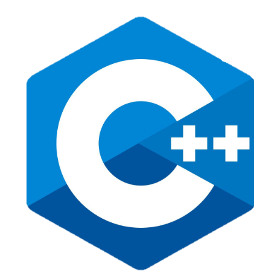

### Reference Note:

These study notes provide an independent technical breakdown of C++ fundamentals, following the pedagogical sequence and chapter outline of C++ Programming: From Problem Analysis to Program Design by D.S. Malik. All explanations, analytical tables, and code implementations are originally authored for academic documentation and contain no copyrighted text or figures from the original publication.

---

> **📄 Page 2**

## 📑 Table of Contents (الفهرس)

- **[Chapter 01 — Computing Foundations & C++ Build Pipeline](#chapter-01-computing-foundations-c-build-pipeline)** *(p. 4)*
  - [Introduction](#introduction) *(p. 4)*
  - [Historical Evolution of Computing Systems](#historical-evolution-of-computing-systems) *(p. 6)*
  - [Core System Components](#core-system-components) *(p. 10)*
  - [Hardware](#hardware) *(p. 14)*
    - [Central processing unit and main memory](#central-processing-unit-and-main-memory) *(p. 16)*
    - [Secondary storage](#secondary-storage) *(p. 29)*
    - [Input/output devices](#inputoutput-devices) *(p. 31)*
  - [Software](#software) *(p. 32)*
  - [Machine Language and Binary Representation](#machine-language-and-binary-representation) *(p. 33)*
  - [The Evolution of Programming Languages](#the-evolution-of-programming-languages) *(p. 37)*
  - [C++ Program Build and Execution Pipeline](#c-program-build-and-execution-pipeline) *(p. 40)*
  - [C++ Build and Execution Lifecycle](#c-build-and-execution-lifecycle) *(p. 41)*
  - [Problem Analysis, Coding, and Execution Cycle](#problem-analysis-coding-and-execution-cycle) *(p. 45)*
  - [10 algorithm examples](#10-algorithm-examples) *(p. 51)*
  - [Programming Methodologies and ANSI/ISO Standard C++](#programming-methodologies-and-ansiiso-standard-c) *(p. 56)*
    - [Structured Programming](#structured-programming) *(p. 56)*
    - [Object-Oriented Programming (OOP)](#object-oriented-programming-oop) *(p. 56)*
    - [Building Blocks Before Object-Oriented Design](#building-blocks-before-object-oriented-design) *(p. 56)*
    - [ANSI/ISO Standard C++](#ansiiso-standard-c) *(p. 57)*

---

> **📄 Page 3**

# Chapter 01 — Computing Foundations & C++ Build Pipeline

## Introduction

Modern networked infrastructure and daily digital workflows depend entirely on the interplay between physical hardware and executable software. Without instructions defined by computer programs, electronic hardware remains inert silicon incapable of performing useful computation. Programming languages serve as the formal medium through which engineers translate human algorithmic logic into binary instructions that a processor can execute. Among these languages, C++ stands out for combining high-level structural abstractions with direct, deterministic control over system memory and hardware resources, making it a primary choice for performance-critical applications. Establishing a solid grasp of fundamental hardware components, memory organization, and the architectural evolution of computing systems provides the necessary foundation before writing and compiling C++ code.

**مقدمة في أنظمة الحوسبة ولغة C++**

**تعتمد البنية التحتية الرقمية الحديثة والتطبيقات البرمجية اليومية على التكامل الدقيق بين المكونات المادية الصلبة (Hardware) والبرمجيات القابلة للتنفيذ (Software). على المستوى الفيزيائي، يتكون المعالج (CPU) والذاكرة العشوائية (RAM) من مليارات البوابات المنطقية (Logic Gates) المبنية من الترانزيستورات؛ هذه الدوائر الإلكترونية لا تفهم سوى مستويين من الجهد الكهربائي (Voltage Levels): جهد مرتفع يمثل منطقياً الرقم 1، وجهد منخفض يمثل الرقم 0. بدون تسلسل محدد من هذه النبضات الكهربائية تُحدده البرامج الحاسوبية (Computer Programs)، تبقى شرائح السيليكون في حالة سكون تام وعاجزة عن تنفيذ أي عملية حسابية أو منطقية.**

**تُعد لغات البرمجة (Programming Languages) الوسيط الهندسي الرسمي الذي يترجم المنطق الخوارزمي البشري إلى تعليمات ثنائية (Binary Instructions) قابلة للتنفيذ. وتتميز لغة C++ بجمعها بين التجريد البرمجي عالي المستوى والتحكم المباشر والحتمي في الذاكرة وموارد العتاد (Memory & Hardware Control)، مما يجعلها الخيار الأساسي لبناء الأنظمة عالية الأداء.**

---

> **📄 Page 4**

**عند كتابة كود مصدري (Source Code) بلغة C++، تمر التعليمات بسلسلة تحويلات عتادية دقيقة قبل التنفيذ الفعلي:**

**الترجمة (Compilation): يقوم المترجم (Compiler) بتحليل الكود وتحويله من نص مقروء للبشر إلى لغة الآلة (Machine Code) الخاصة بمعمارية المعالج (مثل x86-64 أو ARM)، وحفظه كملف تنفيذي (Executable File) على وحدة التخزين الثانوية.**

**التحميل وتخطيط الذاكرة (Loading & Memory Layout): عند تشغيل البرنامج، يقوم نظام التشغيل (Operating System) بنسخ تعليمات البرنامج وبياناته من وحدة التخزين إلى الذاكرة العشوائية (RAM) وتوزيعها على قطاعات محددة تشمل مقطع التعليمات (Text Segment) وذاكرة المكدس (Stack) وذاكرة الكومة (Heap).**

**التنفيذ داخل المعالج (CPU Execution): تقوم وحدة التحكم (Control Unit) بجلب التعليمات من عناوينها في RAM إلى المسجلات الداخلية فائقة السرعة (Registers)، لتتولى وحدة الحساب والمنطق (ALU) تنفيذ العمليات الحسابية والمنطقية على البيانات فعلياً.**

**لذلك، فإن استيعاب البنية الداخلية للعتاد وتنظيم الذاكرة يمثل الأساس الهندسي الضروري لفهم كيفية عمل برامج C++ وكتابة كود فعّال يتوافق مع طبيعة المعالج.**

---

> **📄 Page 5**

## Historical Evolution of Computing Systems

The earliest known calculating instrument was the abacus, which originated in Asia and remained in widespread use across ancient Babylon, China, and medieval Europe, relying on sliding beads along rods to perform addition and subtraction. Mechanical computation advanced in 1642 when French mathematician Blaise Pascal invented the Pascaline, a gear-driven mechanism with eight movable dials capable of adding and subtracting eight-digit numbers. Later in the seventeenth century, Gottfried von Leibniz engineered a stepped-drum calculator that expanded mechanical arithmetic to support multiplication and division.

A foundational shift toward programmable control emerged in 1819 when French weaver Joseph Jacquard automated textile looms using punched cards. By encoding thread patterns as physical perforations read sequentially by mechanical needles, Jacquard demonstrated that operational instructions could be stored externally and reordered to alter machine behavior without modifying the physical hardware. Building on this principle in the early-to-mid nineteenth century, English mathematician Charles Babbage designed the Difference Engine to automate complex polynomial calculations, followed by the conceptual blueprint for the Analytical Engine. Although never constructed in full, the Analytical Engine defined the core architecture of general-purpose computers: input devices, internal data storage, a control unit capable of executing instructions in any sequence, and output mechanisms. Babbage’s colleague, Ada Augusta, Countess of Lovelace, documented the machine's operational logic and authored instruction sequences for it, earning recognition as the first computer programmer. Near the end of the nineteenth century, Herman Hollerith combined punched-card storage with electrical tabulation to process U.S. Census data, founding the enterprise that later evolved into IBM.

Large-scale automated systems materialized in the 1940s with the electromechanical Harvard Mark I (1944)—a 52-foot, 50-ton machine built jointly by IBM and Harvard University under Howard Aiken comprising 750,000 components and punched-card inputs—and the fully electronic ENIAC (1946) at the University of Pennsylvania, which weighed roughly 30 tons and operated using 18,000 vacuum tubes. In the late 1940s, John von Neumann established the architectural model underlying modern computers, integrating an arithmetic logic unit (ALU), a control unit, memory, and input/output interfaces while introducing the stored-program design in which instructions and data share the same memory space. Commercial deployment soon followed with the delivery of UNIVAC to the U.S. Census Bureau in 1951.

---

> **📄 Page 6**

Subsequent breakthroughs in solid-state electronics drove exponential reductions in size and cost alongside massive gains in speed. Invented in 1947 and widely adopted in commercial computers by 1956, transistors replaced fragile, heat-intensive vacuum tubes with compact, energy-efficient switches, catalyzing the software development industry and early programming languages such as FORTRAN and COBOL. Integrated circuits (microchips) then consolidated thousands of transistor circuits onto single silicon chips, dramatically accelerating processing speeds. In 1970, engineers integrated an entire central processing unit onto a single chip—the microprocessor—sparking the personal computer revolution led by Steve Wozniak and Steve Jobs’s Apple computer (1977), the IBM Personal Computer (1981), and affordable IBM-compatible clones throughout the 1980s and 1990s. Contemporary computing spans mainframes, midsize systems, microcomputers, and handheld mobile devices powering artificial intelligence, clinical diagnostic expert systems, satellite-based navigation (GPS), and real-time financial services—all built upon the same foundational hardware architecture.

التطور التاريخي للحواسيب والأساس المعماري

1. الأدوات اليدوية والآلات الميكانيكية (Manual & Mechanical Calculators)

**المعداد (Abacus):** أول أداة حسابية معروفة، نشأت في آسيا وانتشرت في بابل والصين وأوروبا حتى أواخر العصور الوسطى، واعتمدت على تحريك الخرز على قضبان لتنفيذ عمليتي الجمع والطرح.

**آلة باسكالين (Pascaline - 1642):** ابتكرها الفيلسوف وعالم الرياضيات الفرنسي بليز باسكال (Blaise Pascal) باستخدام 8 أقراص وعجلات مسننة لإجراء الجمع والطرح لأرقام تصل إلى 8 خانات.

**آلة لايبنتز (Leibniz - أواخر القرن 17):** طوّر غوتفريد فون لايبنتز الآلية الميكانيكية لتشمل الضرب والقسمة إلى جانب الجمع والطرح.

*إشارة معمارية:* افتقرت هذه الآلات إلى الذاكرة القابلة للبرمجة؛ فالعملية الحسابية كانت مدمجة فيزيائياً في شكل التروس (Hardwired Mechanics).

---

> **📄 Page 7**

2. نشأة مفهوم البرمجة والتصميم المعماري (Programmable Control & Blueprints)

**البطاقات المثقبة (Punched Cards - 1819):** اكتشف الحائك الفرنسي جوزيف جاكار (Joseph Jacquard) إمكانية تخزين تعليمات النسيج على بطاقات مثقبة تمر عبر النول، بحيث تسمح الثقوب للإبر بسحب الخيوط المطلوبة.

*إشارة هندسية:* هنا ظهر لأول مرة مبدأ فصل التعليمات (Instructions) عن العتاد (Hardware)؛ إذ يمكن تغيير سلوك الآلة بإعادة ترتيب البطاقات دون تعديل مكوناتها المادية.

**تشارلز بابيج (Charles Babbage) وأدا لوفليس (Ada Lovelace):**

صمم بابيج محرك الفروق (Difference Engine) لإجراء عمليات معقدة كتربيع الأرقام تلقائياً، ثم وضع المخطط الهندسي لـ المحرك التحليلي (Analytical Engine) الذي أرسى المكونات الأساسية للحاسوب الحديث: وحدات إدخال (Input)، وحدة تخزين بيانات (Data Storage - النواة المفاهيمية لـ RAM)، وحدة تحكم (Control Unit) تسمح بمعالجة التعليمات بأي تسلسل، ووحدات إخراج (Output).

وثّقت زميلته أدا أوجستا (Ada Augusta, Countess of Lovelace) منطق عمل الآلة وصاغت أولى الخوارزميات المخصصة للتنفيذ الآلي، لتُعرف كأول مبرمجة في التاريخ.

**الجدولة الكهروميكانيكية لهيرمان هوليريث (Herman Hollerith - أواخر القرن 19):** ابتكر آلة تعمل بالكهرباء وتستخدم البطاقات المثقبة لتخزين وجدولة بيانات التعداد السكاني الأمريكي بكفاءة عالية، وأسس الشركة التي تحولت لاحقاً إلى عملاق التقنية IBM.

3. الحقبة الإلكترونية ومعمارية فون نيومان (Electronic Era & Von Neumann Architecture)

**حاسوب Harvard Mark I (1944):** أول آلة شبيهة بالحاسوب، بُنيت بالتعاون بين IBM وجامعة هارفارد بقيادة هوارد أيكن (Howard Aiken). بلغ طوله 52 قدماً ووزنه 50 طناً مع 750,000 جزء، واعتمد على البطاقات المثقبة لإدخال البيانات.

**حاسوب ENIAC (1946):** بُني في جامعة بنسلفانيا كأول حاسوب إلكتروني بالكامل، وضم 18,000 صمام مفرغ (Vacuum Tubes) بوزن 30 طناً.

*إشارة عتادية:* استبدلت الصمامات المفرغة الحركة الميكانيكية بتدفق الإلكترونات فارتفعت سرعة التبديل، لكنها عانت من ضخامة الحجم والاستهلاك الحراري والكهربائي المرتفع.

**معمارية فون نيومان (Von Neumann Architecture - أواخر الأربعينيات):** وضع جون فون نيومان القواعد المعمارية للحواسيب الحديثة، وجمعت أربعة عناصر رئيسية: وحدة الحساب والمنطق (ALU)، وحدة التحكم (Control Unit)، الذاكرة (Memory)، ووحدات الإدخال والإخراج (I/O Devices).

*إشارة معمارية جوهرية:* أرسى مبدأ البرنامج المخزن (Stored-Program Concept) الذي يتيح تخزين تعليمات البرنامج والبيانات معاً في نفس مساحة الذاكرة (RAM)، وهو التصميم الذي ظهر تجارياً عام 1951 مع حاسوب UNIVAC.

---

> **📄 Page 8**

4. أشباه الموصلات والمعالجات الدقيقة والحوسبة الحديثة (Semiconductors & Microprocessors)

**الترانزيستور (Transistor - اختُرع 1947 وانتشر تجارياً في الحوسبة عام 1956):** استبدل الصمامات المفرغة بمفاتيح صلبة أصغر حجماً وأكثر سرعة وموثوقية وكفاءة في الطاقة، مما أطلق صناعة البرمجيات وظهور لغات البرمجة المبكرة مثل FORTRAN و COBOL.

**الدوائر المتكاملة (Integrated Circuits / Chips):** دمجت آلاف الدوائر والترانزيستورات على شريحة سيليكون واحدة، مما قلّص المسافات الكهربائية وضاعف سرعة المعالجة.

**المعالج الدقيق (Microprocessor - 1970):** جمع كامل وحدة المعالجة المركزية (CPU) داخل شريحة واحدة، مما مهد لثورة الحواسيب الشخصية (Personal Computers) بدءاً من جهاز Apple (1977) لستيف وزنياك وستيف جوبز، وجهاز IBM PC (1981)، والنسخ المتوافقة (Clones) في الثمانينيات والتسعينيات.

| المرحلة التاريخية | التقنية الأساسية | الأثر المعماري والهندسي |
| --- | --- | --- |
| الآلات الميكانيكية (1642–1700s) | تروس وعجلات (Pascaline, Leibniz) | أتمتة العمليات الحسابية الأربع، مع بقاء المنطق محفوراً في العتاد (Hardwired). |
| البطاقات المثقبة والمحرك التحليلي (1800s) | بطاقات مثقبة (Jacquard, Babbage, Hollerith) | فصل التعليمات عن العتاد، وتحديد العناصر المعمارية الأساسية (Input, Storage, Control, Output). |
| الحواسيب الإلكترونية الأولى (1944–1951) | صمامات مفرغة (ENIAC) ومعمارية Von Neumann | الانتقال للتبديل الإلكتروني، وتوحيد تخزين التعليمات والبيانات داخل نفس الذاكرة (Stored-Program). |
| أشباه الموصلات والمعالج الدقيق (1956–1970) | Transistors ثم ICs ثم Microprocessor | دمج كامل الـ CPU في شريحة سيليكون واحدة، وظهور لغات البرمجة العالية والحواسيب الشخصية. |

الحوسبة المعاصرة (Modern Computing): تتنوع الأنظمة الحديثة بين الحواسيب العملاقة (Mainframes) والخوادم المتوسطة (Midsize) والحواسيب الدقيقة (Microcomputers) والأجهزة المحمولة (Mobile Devices) التي تشغل الذكاء الاصطناعي (AI) والنظم الخبيرة الطبية وأنظمة الملاحة (GPS) والمعاملات المالية، مع اشتراكها جميعاً في نفس البنية المعمارية الأساسية.

---

> **📄 Page 9**

## Core System Components

At an architectural level, a computer is an electronic system engineered to receive, store, transform, and emit digital data by executing sequences of instructions. Regardless of scale or form factor, every computational task reduces to four fundamental operations: input (acquiring raw data from external interfaces), output (transmitting processed results to display or peripheral devices), storage (retaining instructions and data across volatile and persistent media), and arithmetic and logical processing (performing mathematical calculations and Boolean comparisons).

Commercial system specifications—whether classic configurations featuring a 2.80 GHz single-core processor, 1 GB of system memory, a 250 GB hard drive, and a CRT display, or contemporary multi-core architectures—illustrate the foundational division of any computing environment into two interdependent layers:

Hardware: The physical, tangible electronic components that provide raw computational capacity, signal bandwidth, and storage volume. Processing clock frequencies, memory capacities, disk drives, and peripheral monitors define the physical ceiling of what the machine can execute.

Software: The non-physical sets of encoded instructions that direct and orchestrate hardware resources. Software ranges from foundational system software—most notably the Operating System (OS), which manages hardware access and resource scheduling—to application software, such as word processors, financial management tools, encyclopedias, and interactive games designed to accomplish specific user tasks.

Understanding how these physical components interact internally begins with examining the core hardware subsystems.

---

> **📄 Page 10**

مكونات نظام الحاسوب والتكامل بين العتاد والبرمجيات

يُعرَّف الحاسوب هندسياً بأنه منظومة إلكترونية مصممة لتنفيذ الأوامر (Performing Commands) ومعالجة البيانات الرقمية. وعلى الرغم من التعقيد الظاهري للأنظمة الحديثة، فإن جميع العمليات التي ينفذها الحاسوب تُختزل في أربع عمليات أساسية (Basic Operations) ترتبط مباشرة بمسارات نقل البيانات داخل العتاد:

- **الإدخال (Input - Get Data):** استقبال الإشارات الفيزيائية من الوحدات الطرفية (مثل لوحة المفاتيح أو الفأرة أو المستشعرات)، وتحويلها عبر متحكمات الإدخال والإخراج (I/O Controllers) إلى تمثيل ثنائي (Binary Data) يُنقل عبر ناقل النظام (System Bus) ليُخزَّن مبدئياً في الذاكرة العشوائية (RAM).

- **التخزين (Storage):** الاحتفاظ بالبيانات والتعليمات لاسترجاعها لاحقاً، وينقسم عتادياً إلى مستويين جوهريين:

- التخزين المؤقت المتطاير (Volatile Primary Storage): يتمثل في الذاكرة العشوائية (RAM) والمسجلات (Registers)، حيث تُحفظ البيانات النشطة أثناء المعالجة وتُفقد بمجرد انقطاع التيار الكهربائي.

- التخزين الدائم (Non-Volatile Secondary Storage): يتمثل في الأقراص الصلبة (HDD) أو وحدات التخزين الساكنة (SSD)، حيث تُحفظ الملفات والبرامج بشكل دائم على وسائط مغناطيسية أو شرائح ذاكرة وميضية (Flash Memory).

- **العمليات الحسابية والمنطقية (Arithmetic & Logical Operations):** تمثل جوهر المعالجة الفعلية؛ حيث تُجلب البيانات من RAM إلى المسجلات الداخلية فائقة السرعة (CPU Registers) لتقوم وحدة الحساب والمنطق (ALU) بتنفيذ العمليات الحسابية (الجمع، الطرح، الضرب، القسمة) والعمليات المنطقية (المقارنة والتقييم المنطقي AND, OR, NOT).

- **الإخراج (Output - Display Result):** نقل النتائج النهائية بعد معالجتها من الذاكرة الرئيسية إلى متحكمات الإخراج (مثل بطاقة الرسوميات GPU أو متحكم الصوت) لتحويلها من إشارات رقمية إلى مخرجات مرئية أو سمعية على أجهزة العرض.

---

> **📄 Page 11**

التحليل المعماري لمواصفات السوق (Hardware مقابل Software)

عند تفكيك المواصفات التقنية لأي جهاز حاسوب (مثل المواصفات التقليدية المذكورة: معالج Pentium 4 بتردد 2.80 GHz، ذاكرة 1 GB RAM، قرص صلب 250 GB HD، وشاشة عرض CRT Monitor مع برمجيات مثبتة مسبقاً Preloaded Software)، ينقسم النظام إلى طبقتين متكاملتين:

أولاً: طبقة العتاد المادي (Hardware Category)

تمثل المكونات الفيزيائية الملموسة التي تحدد السقف الفيزيائي للأداء (Physical Capacity & Bandwidth):

- المعالج وتردده (Processor & Clock Speed): القيمة 2.80 GHz تعني أن ساعة النظام الداخلية (System Clock) تولّد $2.8 \times 10^9$ نبضة كهربائية في الثانية الواحدة؛ كل نبضة تُزامن انتقال الإشارات وتنفيذ الخطوات الدقيقة داخل دوائر المعالج (CPU).

- الذاكرة العشوائية (1 GB RAM): تحدد مساحة العمل الفورية المتاحة للمعالج؛ فكل برنامج قيد التشغيل يجب أن يُحمَّل في هذه المساحة القابلة للعنونة المباشرة (Byte-Addressable Space) لكي يتمكن المعالج من الوصول إلى تعليماته وبياناته دون انتظار بطء القرص الصلب.

- سعة التخزين الثانوية (250 GB HD): تحدد الحجم الإجمالي للبيانات والملفات التنفيذية التي يمكن الاحتفاظ بها بشكل دائم خارج نطاق الذاكرة النشطة.

- وحدات العرض والطرفيات (CRT / Display Monitors): تمثل الواجهة الفيزيائية لتحويل البيانات المخزنة في ذاكرة العرض (Frame Buffer) إلى صورة مرئية.

ثانياً: طبقة البرمجيات (Software Category)

تمثل التعليمات البرمجية غير الملموسة (Encoded Instructions) التي تدير العتاد وتستثمر قدراته، وتنقسم وظيفياً إلى مستويين:

- برمجيات النظام (System Software): وعلى رأسها نظام التشغيل (Operating System - OS)، وهو الطبقة الوسيطة التي تتحكم مباشرة في العتاد؛ إذ يتولى إدارة توزيع الذاكرة (Memory Management)، جدولة مهام المعالج (CPU Scheduling)، والتواصل مع تعريفات الأجهزة (Device Drivers)، مما يوفر بيئة تشغيل مستقرة لبقية البرامج.

- البرمجيات التطبيقية (Application Software): وتشمل البرامج المصممة لأداء مهام محددة للمستخدم النهائي—مثل معالجات النصوص (Word Processors)، برامج الإدارة المالية (Money Management Programs)، الموسوعات الرقمية، والألعاب—وهي لا تتخاطب مع العتاد مباشرة في الأنظمة الحديثة، بل تطلب الموارد من خلال نظام التشغيل (System Calls).

| البُعد الهندسي | العتاد المادي (Hardware) | البرمجيات (Software) |
| --- | --- | --- |
| الطبيعة الفيزيائية | دوائر إلكترونية، شرائح سيليكون، ومكونات ميكانيكية ملموسة. | تسلسل من التعليمات الثنائية (Binary Instructions) المخزنة كحالات جهد أو شحنات. |
| الدور الوظيفي | توفير القدرة الحسابية (CPU)، مساحة العمل (RAM)، والتخزين (Disk). | توجيه العتاد وتحديد تسلسل العمليات المطلوب تنفيذها على البيانات. |
| مقاييس التقييم | التردد (GHz)، السعة (GB / TB)، وعرض النطاق (Bandwidth). | الكفاءة الخوارزمية، استهلاك الذاكرة (Memory Footprint)، وسرعة الاستجابة. |
| أمثلة تصنيفية | CPU, RAM, HDD/SSD, Motherboard, Monitor. | Operating System, Word Processors, Compilers, Games. |

---

> **📄 Page 12**

## Hardware

A computer’s physical architecture comprises four primary subsystems: the central processing unit (CPU), main memory (MM)—commonly referred to as random access memory (RAM)—input/output (I/O) devices, and secondary storage. Input peripherals, such as keyboards and mice, feed external data into the system, whereas output peripherals, such as display screens and printers, present processed information to the user. Notably, secondary storage functions in a dual capacity as both an input and an output medium: it acts as an input source when stored programs or data are loaded into main memory, and as an output destination when processed data is written back for persistent retention.

البنية التفصيلية للعتاد (Detailed Hardware Architecture)

1. وحدة المعالجة المركزية (CPU - Central Processing Unit)

الوصف: تُعد الوحدة المسؤولة عن تنفيذ التعليمات وتوجيه العمليات داخل الحاسوب، وهي المكون الأعلى تكلفة وتعقيداً في البنية المادية.

الوظيفة: جلب التعليمات، فك تشفيرها، وتنفيذ العمليات الحسابية والمنطقية.

**التركيب الداخلي (Internal Structure):**

وحدة التحكم (CU - Control Unit): تتولى إدارة تدفق البيانات وتنسيق عمل بقية وحدات الحاسوب؛ حيث تجلب التعليمة التالية من RAM، وتفسر نوع العملية المطلوبة، ثم ترسل إشارات التحكم لتنفيذها.

وحدة الحساب والمنطق (ALU - Arithmetic Logic Unit): الوحدة التنفيذية التي تجري العمليات الحسابية (الجمع، الطرح، الضرب، القسمة) والعمليات المنطقية والمقارنات (مثل أصغر من، أكبر من، يساوي).

المسجلات (Registers): وحدات تخزين داخلية فائقة السرعة ومحدودة السعة مدمجة داخل شريحة الـ CPU للاحتفاظ بالبيانات والتعليمات قيد المعالجة اللحظية، مثل مسجل عداد البرنامج (Program Counter - PC) الذي يحمل عنوان التعليمة القادمة، ومسجل التعليمات (Instruction Register - IR) الذي يحفظ التعليمة الجاري تنفيذها.

---

> **📄 Page 13**

2. الذاكرة الرئيسية (Main Memory / RAM)

الاسم التقني: ذاكرة الوصول العشوائي (Random Access Memory)؛ وسُميت عشوائية لأن المعالج يستطيع الوصول إلى أي موقع فيها مباشرة وبنفس الزمن الثابت دون الحاجة للمرور التسلسلي على المواقع السابقة.

الهيكلية والعنونة (Structure & Addressing): تتكون من سلسلة متتابعة ومرتبة من الخلايا التخزينية (Ordered Sequence of Cells)، وتمتلك كل خلية عنواناً رقمياً فريداً (Unique Memory Address) يتيح للمعالج تحديد موقع البيانات بدقة للقراءة أو الكتابة.

الخاصية الفيزيائية الحرجة: ذاكرة متطايرة (Volatile Memory)؛ لأنها تعتمد على الشحنات الكهربائية والجهد المستمر للاحتفاظ بالبيانات، لذا تفقد جميع محتوياتها فور انقطاع التيار الكهربائي.

الدور الوظيفي: تخزين البرامج قيد التشغيل والبيانات النشطة مؤقتاً أثناء عمل الجهاز فقط.

3. أجهزة الإدخال والإخراج (Input/Output Devices)

أجهزة الإدخال (Input Devices): تستقبل البيانات الخام (Raw Data) من العالم الخارجي وتحولها إلى إشارات رقمية تُنقل إلى الذاكرة الرئيسية (RAM) تمهيداً لمعالجتها.

*أمثلة:* لوحة المفاتيح (Keyboard)، الفأرة (Mouse).

أجهزة الإخراج (Output Devices): تستقبل النتائج النهائية المعالجة من الذاكرة الرئيسية وتحولها إلى صيغة مرئية أو مطبوعة يفهمها المستخدم.

*أمثلة:* الشاشة (Monitor)، الطابعة (Printer).

4. التخزين الثانوي (Secondary Storage)

التصنيف المزدوج (Dual-Role Medium): يُصنَّف التخزين الثانوي كجهاز إدخال وإخراج في آنٍ واحد تبعاً لاتجاه تدفق البيانات:

كجهاز إدخال (Input): عند تحميل برنامج أو ملف مخزن من وحدة التخزين إلى RAM ليتمكن المعالج من قراءته وتنفيذه.

كجهاز إخراج (Output): عند حفظ البيانات أو الملفات المعدلة من RAM إلى وحدة التخزين للاحتفاظ بها.

الوظيفة والخاصية الفيزيائية: توفير تخزين دائم وغير متطاير (Non-Volatile / Permanent Storage) يحتفظ بالبيانات والبرامج دون الحاجة إلى تيار كهربائي مستمر.

أمثلة: الأقراص الصلبة (Hard Disks)، وحدات الذاكرة الوميضية (Flash Drives / SSDs)، والأقراص الضوئية (Optical Discs).

---

> **📄 Page 14**

| المكون العتادي | الدور الوظيفي الأساسي | طبيعة الاحتفاظ بالبيانات | سرعة الوصول النسبية |
| --- | --- | --- | --- |
| CPU (CU, ALU, Registers) | جلب التعليمات وتنفيذ العمليات الحسابية والمنطقية | فوري / لحظي أثناء التنفيذ (Registers) | الأعلى (نانوثانية أو أقل) |
| Main Memory (RAM) | تخزين البرامج النشطة والبيانات قيد المعالجة | متطايرة (Volatile - تُفقد بانقطاع الكهرباء) | عالية جداً (وصول مباشر بالعنوان) |
| Input / Output Devices | إدخال البيانات الخام وعرض النتائج النهائية | واجهات نقل وتحويل إشارة (غير تخزينية) | بطيئة نسبياً (مرتبطة بالتفاعل البشري) |
| Secondary Storage | الحفظ الدائم للبرامج والملفات (Input و Output معاً) | غير متطايرة (Non-Volatile - دائمة) | أبطأ بكثير من RAM |

> More details to the hardware are below

### Central processing unit and main memory

Within a computer's physical architecture, the **Central Processing Unit (CPU)** and **Main Memory (RAM)** form the core execution engine. The CPU—comprising the **Control Unit (CU)**, the **Arithmetic Logic Unit (ALU)**, and ultra-fast internal **Registers**—acts as a synchronous state machine driven by a system clock (GHz). It continuously fetches binary instructions from memory, decodes their opcodes, and executes arithmetic or boolean logic operations.

Main Memory (RAM) serves as the processor's transient, high-speed workspace. Structurally, it is organized as a linear, contiguous array of byte-sized cells, each identified by a unique numerical **memory address** that enables constant-time ($O(1)$) random access via hardware address decoders. Because dynamic RAM (DRAM) stores bits as microscopic electrical charges inside leaking capacitors, it is **volatile**—requiring continuous refresh cycles and losing all data upon power loss. Furthermore, hardware memory is semantically blind, storing raw sequences of 0s and 1s without inherent meaning; it is the programming language's **type system** (such as char or int in C++) that dictates how many consecutive bytes the CPU fetches across the system buses (Address, Control, and Data buses) and how those bit patterns are interpreted.

---

> **📄 Page 15**

**1. مركزية المعالجة والدور الحسابي (The Computational Core)**

**تُعد وحدة المعالجة المركزية (CPU) هندسياً بمثابة "محرك الحالة المركزي" (State Engine) للنظام؛ فهي دائرة متكاملة معقدة (Integrated Circuit) تضم ملايين إلى مليارات الترانزيستورات التي تعمل كمفاتيح منطقية فائقة السرعة. تُقاس وتيرة نبضاتها بالتردد الزمني (Clock Speed - عدد الدورات في الثانية)، وتتركز بنيتها الداخلية في ثلاث وحدات متكاملة:**

**وحدة التحكم (Control Unit - CU): تدير تدفق البيانات وتزامن العمليات؛ تجلب التعليمة التالية من الذاكرة، وتفك تشفيرها (Decode)، ثم تصدر إشارات التحكم لبقية الوحدات.**

**وحدة الحساب والمنطق (Arithmetic Logic Unit - ALU): الدائرة التنفيذية المسؤولة عن إجراء العمليات الحسابية (+, -, *, /) والعمليات المنطقية البوليانية (Boolean Logic) والمقارنات (<, >, ==).**

**المسجلات (Registers): حجرات تخزين مجهرية فائقة السرعة مدمجة داخل شريحة المعالج مباشرة، تحتفظ بالبيانات والتعليمات قيد المعالجة اللحظية.**

**التشبيه الوظيفي: يعمل المعالج كـ "قائد أوركسترا فائق السرعة"؛ فهو لا يحتفظ بالبيانات تخزيناً، بل يوجه العمليات ويعالج الإشارات وفق إيقاع ساعة النظام (System Clock). إذا توقف القائد، يتوقف النظام بأكمله مهما بلغت كفاءة بقية المكونات.**

**2. الذاكرة الرئيسية كحيز عمل آني (Main Memory as Transient Workspace)**

**ترتبط الذاكرة الرئيسية (RAM) بالمعالج عبر نواقل النظام (System Buses)، وتحكمها خاصيتان هندسيتان جوهريتان:**

**مبدأ الوصول العشوائي (Random Access Principle): الزمن اللازم للوصول إلى أي خلية ذاكرة وقراءتها أو الكتابة فيها هو زمن ثابت ($O(1)$) بغض النظر عن موقعها الفيزيائي داخل الشريحة، وذلك بفضل دوائر فك ترميز العناوين (Address Decoders).**

**التطاير الكهربائي (Volatility): الذاكرة الرئيسية ذاكرة متطايرة (Volatile Memory) تعتمد فيزيائياً على استمرار التيار الكهربائي للحفاظ على الشحنات داخل المكثفات (Capacitors) الممثلة للبتات؛ وبمجرد انقطاع الطاقة تتلاشى الشحنات وتُمسح البيانات كلياً، مما يفرض تحميل البرامج من التخزين الثانوي (Disk) إلى هذا الحيز النشط قبل التنفيذ.**

**التشبيه الوظيفي: تشبه الذاكرة الرئيسية "طاولة العمليات الجراحية"؛ لا يستطيع الجراح (CPU) إجراء الجراحة للمريض وهو في غرفة الانتظار (Secondary Storage)، بل يجب نقله أولاً إلى الطاولة المجهزة (RAM) حيث الأدوات متاحة فوراً، وبمجرد إغلاق غرفة العمليات (إطفاء الجهاز) تُخلى الطاولة تماماً.**

---

> **📄 Page 16**

**3. هيكلية العنونة والعمى الدلالي للذاكرة (Addressing & Semantic Blindness)**

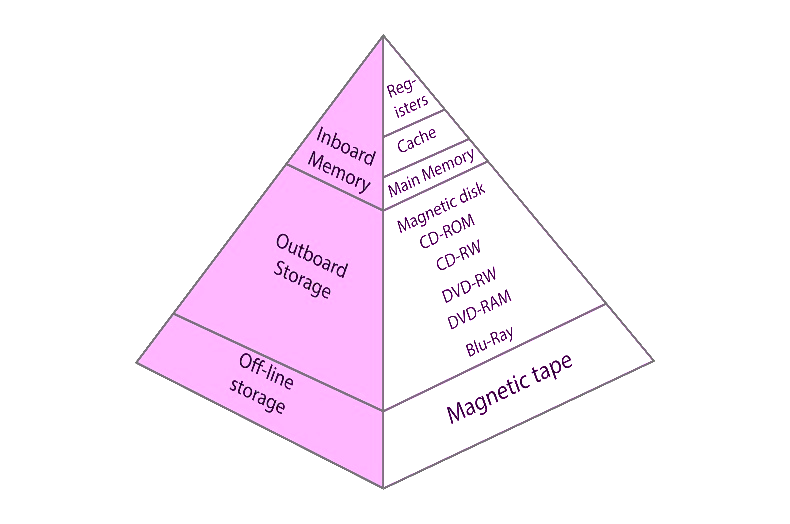

المصفوفة الخطية والعنونة (Linear Array & Addressing): تُنظم الذاكرة الرئيسية هيكلياً كمصفوفة خطية متتابعة من الخلايا، سعة كل خلية 1 بايت (8 Bits)، وتمتلك كل خلية رقماً تسلسلياً فريداً يُسمى العنوان (Memory Address)، وهو الإحداثي الحصري الذي يعتمد عليه المعالج للوصول إليها.

العمى الدلالي (Semantic Blindness): الذاكرة كعتاد لا تدرك طبيعة ما تخزنه؛ فهي مجرد مصفوفة من الشحنات الكهربائية التي تمثل أنماطاً صامتة من الأصفار والآحاد (Bit Patterns). المعالج ونظام الأنواع في لغة البرمجة (Type System) هما من يفرضان السياق والمعنى على هذه البتات؛ فالسلسلة الثنائية 01000001 مثلاً يمكن تفسيرها بثلاث طرق مختلفة كلياً:

كحرف نصي (char): تمثل الحرف 'A' وفق جدول الترميز القياسي ASCII.

كعدد صحيح (int): تمثل القيمة الحسابية 65 عند إجراء العمليات الرياضية.

كتعليمة آلة (Machine Instruction): تمثل رمز عملية (Opcode) يأمر وحدة التحكم بتنفيذ إجراء عتادي محدد.

التشبيه الوظيفي (صناديق البريد):

العنوان (Address): الرقم المحفور خارج صندوق البريد؛ ثابت ومحدد.

المحتوى (Data): الرسالة المودعة بالداخل؛ متغيرة ومتبدلة باستمرار.

المعالج (CPU): ساعي البريد الذي يتوجه إلى رقم الصندوق ويسحب محتواه دون التدخل في تفسير مضمونه.

نوع البيانات (Data Type): المستلم الذي يفتح الظرف ويحدد دلالة ما بداخله.

---

> **📄 Page 17**

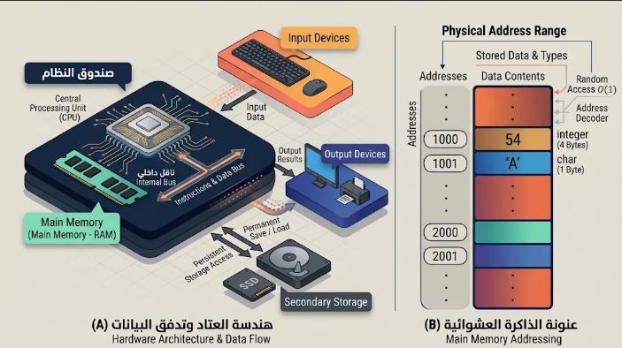

**4. السردية الهندسية الشاملة: دورة حياة البيانات من الإقلاع إلى التنفيذ في C++**

**المرحلة الأولى: يقظة العتاد والتمهيد للإقلاع (Hardware Awakening & Bootstrapping)**

**الانطلاق من نقطة الصفر (The Reset Vector):**

**لحظة توصيل التيار الكهربائي (Power On)، تكون الذاكرة العشوائية (RAM) فارغة تماماً ومسجلات المعالج مُصفّرة.**

**بحكم التصميم الفيزيائي لشريحة السيليكون، يُجبر المعالج فور سريان التيار على قراءة عنوان ثابت ومحفور عتادياً يُسمى متجه إعادة الضبط (Reset Vector)، والذي يوجهه مباشرة إلى شريحة ذاكرة القراءة فقط (ROM) غير المتطايرة المثبتة على اللوحة الأم.**

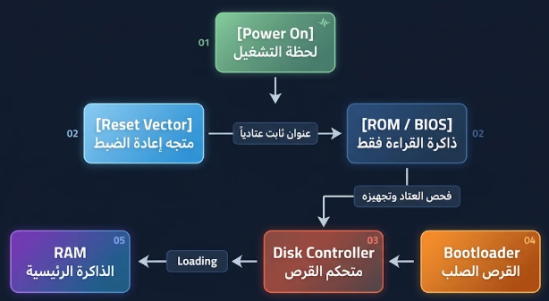

---

> **📄 Page 18**

**تسليم الراية لنظام التشغيل (BIOS & The Bootloader):**

**ينفذ المعالج البرنامج التأسيسي (BIOS / UEFI) المخزن في ROM لفحص سلامة العتاد (POST)، ثم يوجه أمراً إلكترونياً إلى متحكم القرص (Disk Controller).**

**يستدعي متحكم القرص محمل الإقلاع (Bootloader) من التخزين الثانوي (HDD / SSD)، ليقوم بنسخ نواة نظام التشغيل (OS Kernel) وتحميلها (Loading) إلى الذاكرة الرئيسية (RAM) لتصبح بيئة العمل جاهزة.**

**المرحلة الثانية: بنية الذاكرة ومفهوم "العمى الدلالي" (Memory Topology & Semantic Blindness)**

**بمجرد استقرار نظام التشغيل وتشغيل برنامجك المكتوب بلغة C++، يقوم النظام بحجز حيز مخصص له داخل الـ RAM.**

**المصفوفة الخطية والعنونة الفيزيائية: تُنظم الذاكرة الرئيسية هيكلياً كـ مصفوفة خطية من الخلايا (Linear Array of Cells) المتتابعة. كل بايت (8 بتات) يمتلك مُعرفاً رقمياً فريداً ومسلسلاً يسمى العنوان الفيزيائي (Physical Address)، وهو الإحداثي الحصري الذي يعتمد عليه المعالج للوصول إلى البيانات أو التعليمات وتعديلها.**

**العمى الدلالي (Semantically Blind): الذاكرة كعتاد لا تملك أدنى فكرة عما تخزنه؛ فهي مجرد بحر متلاطم من المفاتيح المجهرية المشحونة أو المفرغة التي تمثل أنماطاً من البتات (Bit Patterns) الصامتة. السلسلة الثنائية 01000001 داخل الخلية لا تعني للذاكرة أي شيء؛ فهي لا تميز إن كانت هذه الشحنات تمثل حرفاً أبجدياً، أو رقماً حسابياً، أو أمراً برمجياً.**

---

> **📄 Page 19**

**المرحلة الثانية: البروتوكول الكهربائي لنواقل النظام (System Bus Access Protocol)**

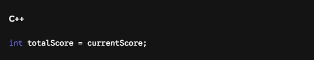

**عندما يصل التنفيذ في برنامج C++ إلى تعليمة تتطلب قراءة متغير من الذاكرة، مثل:**

**تبدأ دورة الجلب وفك التشفير والتنفيذ (Fetch-Decode-Execute Cycle) عبر بروتوكول زمني صارم تحكمه نواقل النظام (System Buses) في أجزاء من النانو ثانية:**

**تحديد العنوان (Address Bus): تضع وحدة التحكم (CU) الرقم الثنائي لعنوان الخلية المطلوبة (مثل 0x00A1) على ناقل العناوين (Address Bus). وهو ناقل أحادي الاتجاه (Unidirectional من المعالج إلى الذاكرة)، ويحدد عرضه الفيزيائي السقف الأقصى للذاكرة القابلة للعنونة؛ فناقل بعرض 32-bit يعنون حتى $2^{32}$ بايت (4 GB)، بينما يتيح ناقل 64-bit عنونة مساحات شاسعة ($2^{64}$).**

**إرسال إشارة التحكم (Control Bus): ترسل وحدة التحكم نبضة كهربائية متزامنة عبر ناقل التحكم (Control Bus) تحمل إشارة القراءة (Read Signal) لفتح بوابات الخلية المحددة.**

**نقل البيانات (Data Bus): تفرغ خلايا الذاكرة شحناتها لتتدفق عبر ناقل البيانات (Data Bus) — وهو ناقل ثنائي الاتجاه (Bidirectional) — لتستقر داخل المسجلات (Registers) داخل المعالج.**

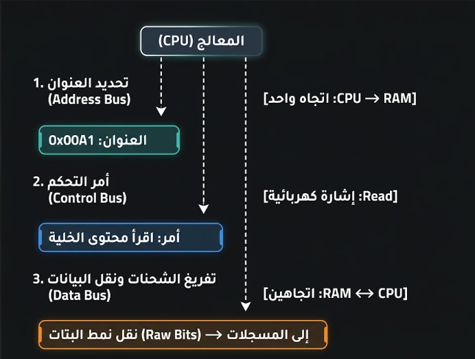

---

> **📄 Page 20**

**المرحلة الثالثة: جسر التجريد ونظام الأنواع في C++ (Data Abstraction & Type System)**

**بمجرد وصول البتات الخام إلى المسجلات، يتدخل نظام الأنواع في C++ لفرض البنية والمعنى:**

**تحديد الحجم ونطاق القراءة (Size Definition): يُملي نوع البيانات على المعالج عدد البايتات المتتالية التي يجب سحبها؛ فالإعلان عن متغير من نوع char يوجه المعالج لقراءة 1 بايت، بينما يوجهه النوع int لسحب كتلة متصلة من 4 بايتات (32 bits) وقراءتها كوحدة عددية واحدة.**

**تحديد السياق والتفسير (Context Interpretation): تُمرر محتويات المسجل إلى وحدة الحساب والمنطق (ALU) لتنفيذ العمليات الحسابية أو المقارنات. وإذا استدعى البرنامج حفظ النتيجة، يُعكس بروتوكول النواقل: يُرسل العنوان عبر Address Bus، وإشارة كتابة (Write Signal) عبر Control Bus، وتتدفق بتات النتيجة عبر Data Bus لتستقر في RAM.**

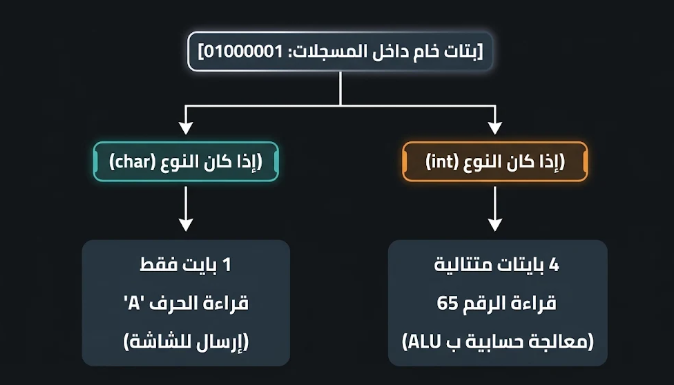

---

> **📄 Page 21**

**5. تعميقات هندسية وفيزيائية (Deep-Dive Engineering Notes)**

**أولاً: حتمية القوالب العتادية والحشو (Hardware Word-Size & Padding)**

**لا يملك المعالج القدرة على تخصيص مسجلات بمقاسات عشوائية (مثل 9 بت أو 59 بت)؛ فمساراته النحاسية وبواباته المنطقية مصممة للتعامل مع قوالب قياسية ثابتة تُعرف بـ حجم الكلمة العتادية (Word Size) وفق مضاعفات النظام الثنائي (8-bit, 16-bit, 32-bit, 64-bit).**

**عند تخزين قيمة تتطلب 9 bits، يحجزها المترجم والعتاد داخل قالب قياسي 16-bit (2 Bytes مثل النوع short)، وتُملأ البتات السبع المتبقية بأصفار تُعرف بـ أصفار الحشو (Zero Padding) لضمان محاذاة الذاكرة (Memory Alignment).**

**إذا تجاوزت البيانات سعة أكبر مسجل مفرد في المعالج (مثال نظري: بيانات بحجم 130 bits على معمارية 64-bit لا تكفيها خزنتان بسعة $64 \times 2 = 128\text{ bits}$)، تُوزَّع البيانات عبر تجميع 3 مسجلات متتالية ($64 \times 3 = 192\text{ bits}$ / 24 Bytes)، حيث تستقر الـ 130 bits الفعلية وتُملأ الـ 62 bits المتبقية بأصفار حشو.**

**ثانياً: دورة حياة العنوان ومفكك الترميز (Address Lifecycle & Address Decoder)**

**يمر عنوان الذاكرة بثلاث مراحل هندسية متكاملة قبل الوصول الفيزيائي للخلية:**

**الشبكة الفيزيائية (Physical Grid): تُصنع شريحة RAM وتُرقَّم خلاياها تسلسلياً من العنوان 0 حتى نهاية سعة الشريحة.**

**إزاحات المترجم (Compiler Offsets): أثناء ترجمة كود C++، لا يعرف المترجم الموقع الفعلي للبرنامج في الذاكرة، فيمنح المتغيرات عناوين نسبية تقديرية تُسمى الإزاحات (Offsets).**

**التحميل والترجمة العنوانية (OS Loader & MMU): عند التشغيل، يربط محمل نظام التشغيل (Loader) الإزاحات بالعناوين الافتراضية (Virtual Addresses)، وتتولى وحدة إدارة الذاكرة (MMU - Memory Management Unit) في المعالج ترجمتها لحظياً إلى العناوين الفيزيائية (Physical Addresses) الفعلية.**

**آلية الوصول اللحظي ($O(1)$): عندما يصل العنوان الثنائي عبر Address Bus، تستقبله دارة منطقية تُسمى مفكك ترميز العناوين (Address Decoder)، والذي يفعّل فوراً سلكاً كهربائياً واحداً يُسمى خط الكلمة (Wordline) يمر بالخلية المطلوبة تحديداً، فتُفتح بوابات ترانزستوراتها وتُفرّغ محتواها دفعة واحدة على Data Bus دون أي بحث تسلسلي.**

**ثالثاً: فيزياء خلايا الذاكرة الديناميكية وسر التطاير (DRAM Physics & Refresh Cycles)**

**تتكون كل خانة بت (Bit) داخل شريحة الذاكرة الديناميكية (DRAM) من عنصرين مجهريين:**

**مكثف دقيق (Capacitor): يخزن الشحنة الكهربائية؛ وجود شحنة مرتفعة يمثل منطقياً 1، وتفريغها يمثل 0.**

**ترانزستور (Transistor): يعمل كبوابة عزل إلكترونية تُفتح عند تفعيل Wordline لقراءة الشحنة أو تحديثها.**

---

> **📄 Page 22**

**بسبب التسريب الكهربائي الطبيعي للمكثفات المجهرية خلال أجزاء من الألف من الثانية، تُجري دوائر الذاكرة آلاف العمليات في الثانية لقراءة الشحنات وإعادة شحنها فيما يُعرف بـ دورات الإنعاش (Refresh Cycles)؛ وبمجرد انقطاع التيار تتوقف دورات الإنعاش وتتفرغ المكثفات فوراً.**

**ثانياً: دورة حياة العنوان ومفكك الترميز (Address Lifecycle & Address Decoder)**

**يمر عنوان الذاكرة بثلاث مراحل هندسية متكاملة قبل الوصول الفيزيائي للخلية:**

**الشبكة الفيزيائية (Physical Grid): تُصنع شريحة RAM وتُرقَّم خلاياها تسلسلياً من العنوان 0 حتى نهاية سعة الشريحة.**

**إزاحات المترجم (Compiler Offsets): أثناء ترجمة كود C++، لا يعرف المترجم الموقع الفعلي للبرنامج في الذاكرة، فيمنح المتغيرات عناوين نسبية تقديرية تُسمى الإزاحات (Offsets).**

**التحميل والترجمة العنوانية (OS Loader & MMU): عند التشغيل، يربط محمل نظام التشغيل (Loader) الإزاحات بالعناوين الافتراضية (Virtual Addresses)، وتتولى وحدة إدارة الذاكرة (MMU - Memory Management Unit) في المعالج ترجمتها لحظياً إلى العناوين الفيزيائية (Physical Addresses) الفعلية.**

**آلية الوصول اللحظي ($O(1)$): عندما يصل العنوان الثنائي عبر Address Bus، تستقبله دارة منطقية تُسمى مفكك ترميز العناوين (Address Decoder)، والذي يفعّل فوراً سلكاً كهربائياً واحداً يُسمى خط الكلمة (Wordline) يمر بالخلية المطلوبة تحديداً، فتُفتح بوابات ترانزستوراتها وتُفرّغ محتواها دفعة واحدة على Data Bus دون أي بحث تسلسلي.**

**ثالثاً: فيزياء خلايا الذاكرة الديناميكية وسر التطاير (DRAM Physics & Refresh Cycles)**

**تتكون كل خانة بت (Bit) داخل شريحة الذاكرة الديناميكية (DRAM) من عنصرين مجهريين:**

**مكثف دقيق (Capacitor): يخزن الشحنة الكهربائية؛ وجود شحنة مرتفعة يمثل منطقياً 1، وتفريغها يمثل 0.**

**ترانزستور (Transistor): يعمل كبوابة عزل إلكترونية تُفتح عند تفعيل Wordline لقراءة الشحنة أو تحديثها.**

**بسبب التسريب الكهربائي الطبيعي للمكثفات المجهرية خلال أجزاء من الألف من الثانية، تُجري دوائر الذاكرة آلاف العمليات في الثانية لقراءة الشحنات وإعادة شحنها فيما يُعرف بـ دورات الإنعاش (Refresh Cycles)؛ وبمجرد انقطاع التيار تتوقف دورات الإنعاش وتتفرغ المكثفات فوراً.**

---

> **📄 Page 23**

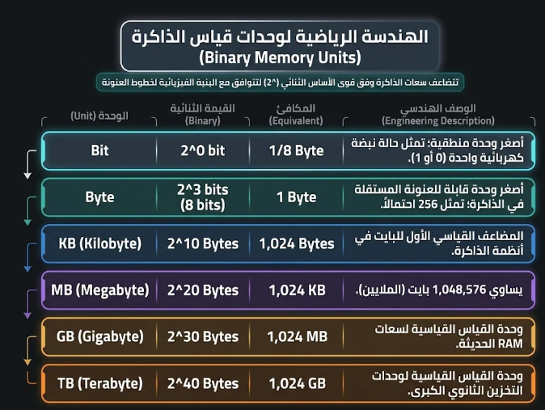

6. معجم المصطلحات الهندسية الموحد (Unified Engineering Glossary)

| **المصطلح (Term)** | **التعريف الهندسي الدقيق** |
| --- | --- |
| Central Processing Unit (CPU) | محرك الحالة المركزي للنظام؛ يجلب التعليمات ويفك شفرتها وينفذ العمليات الحسابية والمنطقية. |
| Arithmetic Logic Unit (ALU) | الدائرة الرقمية داخل المعالج المسؤولة عن العمليات الحسابية الرياضية والمقارنات المنطقية البوليانية. |
| Registers | حجرات تخزين مجهرية فائقة السرعة مدمجة على شريحة المعالج مباشرة لحفظ المدخلات والمخرجات اللحظية. |
| Volatile Memory | ذاكرة متطايرة تعتمد على الشحنات الكهربائية المستمرة وتفقد محتوياتها فور انقطاع الطاقة (مثل RAM). |
| Reset Vector | عنوان فيزيائي ثابت محفور عتادياً داخل السيليكون، يقفز إليه المعالج قسراً عند التشغيل لبدء الإقلاع. |
| ROM **&** BIOS | ذاكرة قراءة فقط غير متطايرة (ROM) تحتوي على البرنامج التأسيسي (BIOS) لفحص العتاد وبدء الإقلاع. |
| Bootloader **&** Disk Controller | دارة وسيطة (Disk Controller) تستدعي محمل الإقلاع (Bootloader) من التخزين الثانوي لنقل نظام التشغيل إلى RAM. |
| Linear Array of Cells | التنظيم البنيوي للذاكرة العشوائية كمصفوفة متتابعة من الخلايا سعة كل منها 1 بايت وعنوانها فريد. |
| System Buses | شبكة المسارات الكهربائية الرابطة بين المعالج والذاكرة (Address Bus, Control Bus, Data Bus). |
| Address Decoder | دارة إلكترونية في الذاكرة تترجم العنوان الثنائي وتفعّل سلك الخلية المطلوبة مباشرة في زمن ثابت $O(1)$. |
| Data Abstraction | تجريد برمجي يعزل التمثيل الفيزيائي للبتات (0 و 1) ويمنحها دلالة منطقية عبر نظام الأنواع (Type System). |

---

> **📄 Page 24**

[إدخال إثرائي 1]: حتمية القوالب العتادية والتعامل مع البتات الفائضة (Hardware Word-Size & Padding)

لا يملك المعالج (CPU) القدرة على تفصيل خلايا أو مسجلات بمقاسات رقمية عشوائية (كأن يحجز 9 بت أو 59 بت أو 130 بت بمفردها)؛ فبواباته المنطقية ومساراته النحاسية محفورة فيزيائياً داخل السيليكون لتتعامل مع قوالب موحدة وثابتة تُعرف بـ "حجم الكلمة العتادية" (Word Size)، والتي توافق قوى ومضاعفات النظام الثنائي القياسية (8 بت، 16 بت، 32 بت، 64 بت).

عندما يطلب البرنامج تخزين قيمة تتجاوز القالب المتاح، يتدخل المترجم والعتاد لنقلها فوراً إلى القالب القياسي الأكبر التالي؛ فالبيانات التي تتطلب 9 بت تُحجز تلقائياً داخل قالب 16 بت (2 بايت مثل short)، والبيانات التي تتطلب 59 بت تُحجز داخل قالب 64 بت (8 بايت مثل long long). أما المساحات الزائدة داخل القالب، فيتم ملؤها بأصفار تسمى أصفار الحشو (Padding) لضمان محاذاة البيانات في الذاكرة (Memory Alignment).

وإذا تجاوزت البيانات سعة أكبر مسجل مفرد في المعالج (مثل حالة الـ 130 بت في معمارية 64-bit)، يتم تقسيم المتغير وتوزيعه عبر تجميع عدة مسجلات متجاورة معاً برمجياً وعيادياً (تجميع 3 مسجلات 64-bit لتوفر مساحة 192 بت)؛ وذلك للحفاظ على استقرار وسرعة نقل النبضات عبر نواقل النظام دون إحداث ارتباك في دوائر التحكم الحسابية.

[إدخال إثرائي 2]: من أين تأتي العناوين؟ وميكانيكية الوصول اللحظي (Address Lifecycle & The Decoder)

العنوان الفيزيائي للذاكرة لا ينشأ عشوائياً، بل يمر بدورة حياة ثلاثية متكاملة تشترك فيها أطراف النظام:

- المصنع والعتاد (Physical Grid): تُصنع شريحة الذاكرة (RAM) وتُحفر خلاياها كشبكة متسلسلة، ويُمنح كل بايت (8 بت) رقماً تسلسلياً ثابتاً يبدأ من العنوان 0 وحتى نهاية سعة الشريحة.

- المترجم (Compiler Offsets): عند بناء برنامج C++، لا يعلم المترجم في أي موقع حقيقي سيستقر برنامجك في الذاكرة؛ لذا يعطي المتغيرات عناوين تقديرية تسمى "الإزاحات" (Offsets) تبدأ من الصفر.

- نظام التشغيل والمُحمّل (OS Loader): عند تشغيل البرنامج، يفحص نظام التشغيل المساحات الشاغرة في الـ RAM، ويقوم المُحمّل (Loader) بنسخ البرنامج وربط إزاحات المترجم بالعناوين الفيزيائية الحقيقية المحجوزة.

عندما يحتاج المعالج استدعاء هذا المتغير، ترسل وحدة التحكم العنوان الثنائي عبر أسلاك ناقل العناوين (Address Bus). هنا لا تبحث الذاكرة في الخلايا بالتتابع، بل تستلم العنوان دارة إلكترونية فائقة السرعة تُسمى مفكك ترميز العناوين (Address Decoder). يقوم هذا المفكك بعملية مطابقة منطقية فورية تفعل سلكاً كهربائياً واحداً مخصصاً يسمى (خط الكلمة - Wordline) يمر بالبايت المطلوب تحديداً. يؤدي ارتفاع الجهد في هذا السلك إلى فتح بوابات ترانزستورات تلك الخلية دون غيرها، لتفرغ محتواها دفعة واحدة على ناقل البيانات (Data Bus) في زمن لحظي ثابت لا يتأثر بموقع الخلية في الشريحة ($O(1)$ Access Time).

---

> **📄 Page 25**

[إدخال إثرائي 3]: فيزياء التخزين الداخلي وسر التطاير (DRAM Physics & Volatility)

تخزين الأصفار والآحاد في الذاكرة العشوائية (RAM) ليس كتابة بالمعنى التقليدي، بل هو شحن وتفريغ إلكتروني مجهري؛ حيث تتكون كل خانة بت (Bit) داخل شريحة الذاكرة الديناميكية (DRAM) من مكونين أساسيين:

- مكثف دقيق (Capacitor): يعمل كخزان يحبس الشحنة الكهربائية؛ فإذا كان مشحوناً بجهد كهربائي مرتفع (High Voltage) دلّ على القيمة المنطقية 1، وإذا كان مفرغاً من الشحنة بجهد منخفض (Low Voltage) دلّ على القيمة المنطقية 0.

- ترانزستور واحد (Transistor): يعمل كبوابة حراسة إلكترونية، يُفتح بضغط كهربائي من مفكك العناوين ليسمح بقراءة شحنة المكثف أو إعادة شحنه، ويُغلق لعزل الشحنة بالداخل.

السبب الفيزيائي خلف وصف الـ RAM بـ الذاكرة المتطايرة (Volatile Memory) هو أن هذه المكثفات بالغة الصغر تعاني من تسريب طبيعي ودائم للشحنات الكهربائية في أجزاء من الألف من الثانية. لذلك، تُجبر دارات الذاكرة على قراءة وإعادة شحن المكثفات بآلاف المرات في الثانية الواحدة في دورة مستمرة تُعرف بـ دورات الإنعاش (Refresh Cycles)؛ وبمجرد إطفاء الحاسوب أو انقطاع التيار، تتلاشى الشحنات كلياً من المكثفات في لمح البصر، وتعود الذاكرة ممسوحة وفارغة تماماً.

[إدخال إثرائي 4]: البت، البايت، والهندسة الرياضية للمضاعفات الثنائية (Binary Abstraction & Units)

- البت (Bit - Binary Digit): هو الذرة الأولية في الكون الرقمي، ويمثل حالة نبضة كهربائية واحدة (0 أو 1).

- البايت (Byte): سلسلة متصلة تتألف من 8 بتات متجاورة. يُعد البايت هو "اللبنة القياسية الأساسية"؛ لكونه أصغر وحدة تخزين فيزيائية تمتلك عنواناً مستقلاً وقابلة للاستدعاء الفردي من قبل المعالج. يستطيع البايت الواحد تشكيل $2^8 = 256$ احتمالاً بيانياً مختلفاً (الأرقام من 0 إلى 255).

تتصاعد سعات الذاكرة في علوم الحاسوب وفق متوالية هندسية أساسها قوى الرقم 2 ($2^n$) لكونها متطابقة مع التوصيلات المنطقية للأسلاك النحاسية؛ حيث يعادل الكيلوبايت ($2^{10} = 1024$ بايت)، ويتضاعف المدى تصاعدياً:

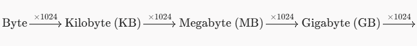

هذا الترابط بين فيزياء الترانزستورات، والترميز الثنائي، وتجريد اللغات البرمجية هو الأساس الذي يجعل كودك في C++ قادراً على إدارة العتاد وتحريك البيانات بدق ة متناهية[cite: 1, 5].

---

> **📄 Page 26**

### Secondary storage

Because executable programs and operational data must be loaded into main memory prior to processing—and because main memory loses all stored contents once power is removed—systems require a persistent medium to retain information long-term. **Secondary storage** fulfills this role by preserving data permanently until it is intentionally overwritten or the physical medium degrades. Exchanging data between main memory and secondary storage requires a dedicated hardware interconnect pathway linking both subsystems. Common implementations span legacy and contemporary technologies, including hard disk drives, solid-state flash drives, floppy disks, ZIP disks, optical CD-ROMs, and magnetic tapes.

**التخزين الثانوي (Secondary Storage)**

**1. حتمية التخزين الدائم (The Necessity of Non-Volatile Storage)**

نظراً لأن الذاكرة الرئيسية (RAM) تعتمد فيزيائياً على المكثفات (Capacitors) التي تتطلب دورات إنعاش مستمرة (Refresh Cycles)، فإن انقطاع التيار الكهربائي يؤدي إلى فقدان البيانات فوراً. لذلك، تفرض الهندسة المعمارية وجود ذاكرة غير متطايرة (Non-Volatile Memory) تحتفظ بحالتها دون الحاجة إلى طاقة كهربائية مستمرة، وتعتمد في ذلك على ثلاثة مبادئ فيزيائية رئيسية:

- **التخزين المغناطيسي (Magnetic Storage):** مثل الأقراص الصلبة (HDD) والأشرطة المغناطيسية (Tapes)، حيث يتم توجيه مغناطيسية نطاقات مجهرية (Magnetic Domains) لتمثيل قيمتي 0 و 1.

- **التخزين الضوئي (Optical Storage):** مثل أقراص CD-ROM، حيث تُحفر نقرات مجهرية (Pits) على سطح القرص باستخدام أشعة الليزر لقراءة البيانات بانعكاس الضوء.

- **تخزين الحالة الصلبة (Solid-State Storage):** مثل وحدات Flash Drives وأقراص SSD، حيث تُحبس الإلكترونات داخل ترانزيستورات ذات بوابات عائمة (Floating Gates) لتحتفظ بالشحنة لسنوات دون تيار كهربائي.

**2. ديناميكية النقل والربط (I/O Transfer Dynamics)**

- **طبيعة الاتصال العتادي:** الإشارة إلى وجوب اتصال الذاكرة الرئيسية والتخزين الثانوي ببعضهما تعني هندسياً ارتباطهما عبر نواقل الإدخال والإخراج (I/O Buses) ومتحكمات مخصصة (Controllers مثل SATA أو NVMe) تدير تدفق البيانات بينهما.

- **آلية النسخ (Copy Mechanism):** البيانات لا "تُنتزع" فعلياً من مكانها، بل **تُنسخ (Copied)**؛ فعند حفظ ملف (Saving)، ينسخ النظام نمط البتات (Bit Pattern) من RAM السريعة ويكتبه على وسط التخزين الثانوي الأبطأ، وعند تشغيل البرنامج يحدث العكس عبر تحميل نسخة من البتات إلى RAM (Loading).

---

> **📄 Page 27**

**3. المفاضلة في هرمية الذاكرة (The Memory Hierarchy Trade-off)**

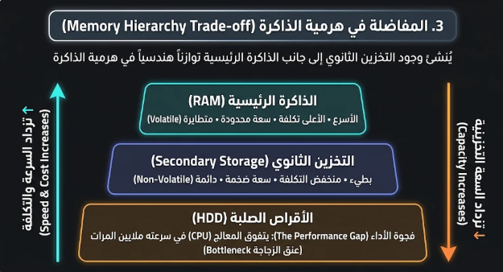

يُنشئ وجود التخزين الثانوي إلى جانب الذاكرة الرئيسية توازناً هندسياً في هرمية الذاكرة (Memory Hierarchy) مبنياً على التكلفة والسرعة والسعة:

- **الذاكرة الرئيسية (RAM):** سريعة جداً، مرتفعة التكلفة لكل جيجابايت، محدودة السعة، ومتطايرة (Volatile).

- **التخزين الثانوي (Secondary Storage):** بطيء مقارنة بالذاكرة الرئيسية، منخفض التكلفة، ضخم السعة، ودائم (Non-Volatile).

- **فجوة الأداء (The Performance Gap):** يتفوق المعالج (CPU) في سرعته بملايين المرات على الأقراص الصلبة الميكانيكية (HDD)، مما يجعل التخزين الثانوي عنق الزجاجة (Bottleneck) الأبرز في سرعة استجابة النظام عند تحميل البرامج أو قراءة الملفات الكبيرة.

**4. التصنيف التكنولوجي لوسائط التخزين (Classification of Storage Media)**

| **الفئة التقنية (Category)** | **الوسائط (Media Examples)** | **الخصائص الهندسية والاستخدام** |
| --- | --- | --- |
| **وسائط قديمة (Legacy)** | Floppy Disks, ZIP Disks | اعتمدت على أقراص مغناطيسية مرنة ذات سعات محدودة جداً وسرعة بطيئة. |
| **وسائط مغناطيسية (Magnetic)** | Hard Disks (HDD), Tapes | تعتمد على رؤوس قراءة/كتابة وأقراص دوّارة؛ تُستخدم Tapes للأرشفة الضخمة في المؤسسات. |
| **وسائط ضوئية (Optical)** | CD-ROMs | تعتمد على القراءة الضوئية بالليزر؛ تُستخدم لتوزيع البرمجيات والبيانات الثابتة. |
| **وسائط الحالة الصلبة (Solid-State)** | Flash Drives (USB), SSDs | شرائح إلكترونية خالية من الأجزاء الميكانيكية؛ حلّت محل HDD لسرعتها العالية وموثوقيتها. |

---

> **📄 Page 28**

### Input/output devices

For a computer to perform a useful task, it must be able to take in data and programs and display the results of calculations. The devices that feed data and programs into computers are called input devices. The keyboard, mouse, and secondary storage are examples of input devices. The devices that the computer uses to display results are called output devices. A monitor, printer, and secondary storage are examples of output devices. Figure 1-2 shows some input and output devices.

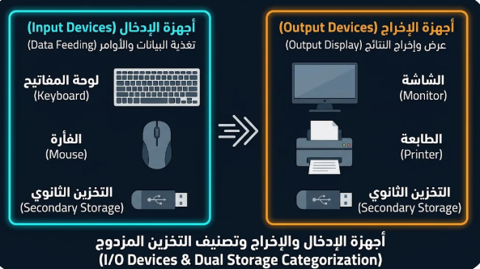

لكي  الكمبيوتر يتحول من مجرد "قطعة حديد" صامتة لآلة مفيدة بتقوم بمهام حقيقية، لازم يكون قادر على الدخول في دورة تفاعلية كاملة بتبدأ باستقبال البيانات (Data) والبرامج من العالم الخارجي، وبتنتهي بعرض نتائج معالجة هذه البيانات؛ وهي العملية اللي بتتم حصرياً عبر بوابات بنسميها "أجهزة الإدخال والإخراج" (I/O Devices). القصة بتبلش بأجهزة الإدخال (Input Devices) مثل الكيبورد والماوس، اللي وظيفتهم الأساسية تغذية المعالج بالأوامر والمواد الخام، في المقابل، بتيجي أجهزة الإخراج (Output Devices) مثل الشاشة والطابعة عشان تترجم لغة الآلة والعمليات الحسابية المعقدة لنتائج مرئية وملموسة نفهمها احنا كبشر. والنقطة الجوهرية والذكية هون هي وجود "وحدات التخزين الثانوية" (Secondary Storage) اللي بتكسر القاعدة وبتلعب دور "العميل المزدوج" (Hybrid)؛ فهي تُصنف كجهاز إدخال لما النظام "يقرأ" منها ملفات وبرامج محفوظة مسبقاً، وبتتحول فوراً لجهاز إخراج لما النظام يقرر "يكتب" عليها ويحفظ النتائج النهائية لتخزينها، وهيك بتكتمل دورة حياة البيانات داخل النظام بشكل منطقي ومترابط

---

> **📄 Page 29**

## Software

Software consists of structured sequences of instructions written in programming languages to execute well-defined computational tasks. Functionally, software architectures divide into two interdependent categories:

- **System Programs:** Low-level software engineered to govern and coordinate physical hardware resources. Foremost among these is the **Operating System (OS)**, the foundational program loaded into memory immediately upon system startup. Without an active operating system, hardware remains non-functional to the user. The OS continuously supervises overall system activity and delivers core services—including memory allocation, input/output coordination, and secondary storage organization via dedicated file management subsystems to ensure structured data retrieval.

- **Application Programs:** User-facing software built to accomplish specialized tasks, such as document processors, spreadsheet tools, and interactive games. Application programs cannot interact with hardware autonomously; instead, they rely entirely on the operating system as the host execution environment that loads, schedules, and runs them.

**البرمجيات (**Software**)**

تمثل البرمجيات (Software) المنظومة المنطقية الموجهة للعتاد، وهي برامج مكتوبة بلغات برمجة متخصصة لأداء مهام محددة. وتنقسم وظيفياً إلى طبقتين متكاملتين:

- **برامج النظام (**System Programs**):** البرمجيات المسؤولة عن إدارة موارد الحاسوب والتحكم بها، وعلى رأسها **نظام التشغيل (**Operating System - OS**)** الذي يُحمَّل إلى الذاكرة الرئيسية (RAM) فور تشغيل الجهاز، وبدونه يصبح العتاد عديم الفائدة. يتولى نظام التشغيل مراقبة النشاط العام للجهاز وتقديم خدمات أساسية تشمل:

- **إدارة الذاكرة (**Memory Management**):** تخصيص المساحات للبرامج النشطة ومنع تداخلها.

- **إدارة الإدخال والإخراج (**I/O Management**):** تنظيم تدفق البيانات مع الوحدات الطرفية.

- **تنظيم التخزين الثانوي (**Secondary Storage Management**):** عبر برمجيات نظام الملفات (File System) لترتيب البيانات وتسهيل الوصول إليها.

- **البرامج التطبيقية (**Application Programs**):** البرمجيات الموجهة للمستخدم لتنفيذ مهام محددة، مثل معالجات النصوص (Word Processors)، الجداول الإلكترونية (Spreadsheets)، والألعاب (Games). ولا تستطيع هذه البرامج العمل باستقلالية مباشرة على العتاد؛ بل يُعد **نظام التشغيل (**OS**)** هو البيئة الحاضنة والمشغّل الفعلي الذي يحمّلها ويدير تنفيذها.

---

> **📄 Page 30**

## Machine Language and Binary Representation

At the physical circuit level, electronic computers cannot natively interpret human characters, decimal numerals, or abstract symbols; they process information strictly through electrical signaling. Signal transmission generally takes one of two forms: **analog signals**, which represent information using continuous waveforms (such as audio magnetic tapes) that degrade cumulatively due to noise during duplication, and **digital signals**, which encode information as discrete, discontinuous sequences of binary states (0s and 1s) corresponding to low and high voltage levels. Because discrete voltage thresholds resist noise and allow exact bit-for-bit replication (as in compact discs), modern computing architectures rely exclusively on digital signaling, forming the foundation of **machine language**.

Within this binary framework (Base-2), a single 0 or 1 is termed a **bit** (binary digit), while an ordered sequence of eight bits forms a **byte**—the smallest independently addressable memory unit in modern architectures. Adopting an 8-bit ($2^3$) byte standard—popularized by architectures such as the IBM System/360—provided sufficient capacity to encapsulate standard 7-bit character encodings alongside an eighth bit for error detection (parity) or extended symbol sets ($2^8 = 256$ combinations). Similarly, because hardware address lines scale exponentially in powers of two ($2^n$), memory capacities follow binary multiples rather than base-10 metric prefixes; consequently, a **kilobyte (KB)** equals $2^{10} = 1,024$ bytes, scaling upward through megabytes ($2^{20}$), gigabytes ($2^{30}$), and terabytes ($2^{40}$).

Because a single 8-bit byte represents only $256$ distinct values—accommodating one character or tiny integers ranging from $0$ to $255$ (unsigned) or $-128$ to $+127$ (signed)—larger primitive numbers require multi-byte allocation (such as 16-bit short, 32-bit int, or floating-point types), while complex multimedia and text strings span contiguous arrays of thousands or millions of bytes. To bridge human text and binary hardware, encoding standards map characters to numeric codes. Foremost among these is **ASCII** (American Standard Code for Information Interchange), which assigns unique integer values ($0$–$127$) to control characters (0–31), printable punctuation and digits ('0'–'9' at 48–57), uppercase letters ('A'–'Z' at 65–90), and lowercase letters ('a'–'z' at 97–122, offset by a constant difference of 32). While early mainframe systems also utilized 8-bit **EBCDIC**, global multilingual computing necessitated **Unicode**, expanding character representation far beyond a single byte to encompass tens of thousands of international symbols.

---

> **📄 Page 31**

المبحث الأول: لغة الحاسوب والإشارات الفيزيائية (Analog vs. Digital)

الحاسوب في جوهره الهندسي ليس سوى آلة إلكترونية مصمتة، عاجزة بطبيعتها الفيزيائية عن إدراك ماهية الحروف الأبجدية أو الأرقام الحسابية التي يدخلها البشر عبر لوحات المفاتيح. تتم معالجة سائر المعلومات عبر نوعين رئيسيين من الإشارات الفيزيائية: الإشارات التماثلية (Analog Signals)، وهي موجات متصلة ومستمرة تُستخدم تقليدياً لتمثيل الظواهر الطبيعية كالموجات الصوتية (كما في أشرطة الكاسيت القديمة)، إلا أن عيبها الجوهري يكمن في سرعة تأثرها بالضوضاء وفقدان جودتها التراكمي مع كل عملية نسخ أو انتقال. في المقابل، تبرز الإشارات الرقمية (Digital Signals) كحجر زاوية لمعالجة البيانات الحديثة؛ إذ تعتمد على قيم منفصلة ومتقطعة تضمن دقة فائقة وقدرة على استنساخ البيانات بنسخ متطابقة دون أدنى تشويه (كما هو الحال في وسائط الأقراص المدمجة CDs).

تستند هذه الإشارات الرقمية إلى ما يُعرف بلغة الآلة (Machine Language)، وهي نمط تشغيل محكوم حصراً بالنظام الثنائي (Binary - Base 2) المؤلف من حالتين: الصفر (0) والواحد (1). يعكس هذان الرقمان تجسيداً مباشراً لمستويات الجهد الكهربائي داخل الدوائر المتكاملة؛ حيث يشير الصفر إلى انخفاض الجهد أو انقطاعه، بينما يمثل الواحد ارتفاعه. وتُعرف أصغر لبنة بناء رقمية تمثل هذا النبض الكهربائي باسم "البت" (Bit). ومن خلال ضم ثمانية بتات متتابعة، تتشكل الوحدة المعيارية المستقلة المسماة "البايت" (Byte)، والتي تمثل الإحداثي الحسابي الأصغر القابل للعنونة المباشرة داخل الذاكرة الرئيسية.

المبحث الثاني: الجذور الهندسية لمعايير سعة البيانات (The 8-bit & 1024 Bytes Architecture)

لم يكن تحديد سعة البايت بثمانية بتات أو قياس الكيلوبايت بـ 1024 بايت خياراً اعتباطياً، بل كان استجابة حتمية فرضتها هندسة السيليكون وقوانين الحساب الثنائي. في بدايات تصميم الحوسبة التجارية، وتحديداً مع معمارية IBM System/360، استقر العتاد على اعتماد مضاعفات قوى الرقم 2 ($2^3 = 8$) لتسهيل تصميم بوابات المعالجة وتكامل المسجلات. وقد أتاح هذا القالب المكون من 8 بتات استيعاب نظام ترميز ASCII (الذي كان يتطلب في الأصل 7 بتات فقط لتمثيل 128 رمزاً)، مع استغلال البت الثامن الإضافي لغرضين محوريين: الأول تمثل في "بت التحقق" (Parity Bit) المستخدم لفحص سلامة الإشارة والتأكد من خلو البيانات من التلف أثناء التراسل عبر الشبكات، والآخر تمثل في ابتكار "الترميز الموسع" (Extended ASCII) الذي ضاعف الاحتمالات من 128 احتمالية ($2^7$) إلى 256 احتمالية ($2^8$)، مفسحاً المجال لدعم خطوط ورسومات ولغات أخرى.

أما معضلة الكيلوبايت ($1024$ بايت مقابل الـ $1000$ العشرية)، فتعود إلى تباين الأساس الرياضي بين العقل البشري والآلة؛ فبينما يعتمد الإنسان النظام العشري (Base 10) حيث يمثل الكيلو ألفاً حسابية، يعتمد الحاسوب النظام الثنائي (Base 2) القائم على خطوط العنونة الفيزيائية (Address Lines). يضاعف كل خط عنونة إضافي السعة التخزينية وفق المتتالية الهندسية الصارمة ($2^n$)، وبما أن الرقم 1000 لا ينتمي لقوى الرقم 2، فإن الرقم 1024 ($2^{10}$) كان أقرب تمثيل مكافئ لمصطلح "ألف". استعار مهندسو الحوسبة البادئة المترية "كيلو" مجازاً لتفادي الهدر الفيزيائي لمسارات النواقل، لتتوالى السعات الهندسية تباعاً: الميجابايت ($2^{20}$ بايت)، الجيجابايت ($2^{30}$ بايت)، وصولاً إلى التيرابايت والوحدات الفلكية كـ الزيتابايت.

---

> **📄 Page 32**

المبحث الثالث: أفق الـ 8 بت بين البيانات الأولية والمركبة

يمنح البايت الواحد المكون من 8 بتات سعة رياضية محكومة بـ $2^8 = 256$ احتمالاً فقط؛ مما يجعله مخصصاً لاستيعاب الرموز النصية الفردية (حرف واحد أو رمز طباعي مفرد)، أو القيم العددية الأولية متناهية الصغر التي تقع حصراً ضمن النطاق من $0$ إلى $255$ (للأرقام غير الموقعة unsigned)، أو من $-128$ إلى $+127$ (للأرقام الموقعة signed).

هذا النطاق الضيق يوضح أن الـ 8 بت عاجزة تماماً عن احتواء معظم البيانات اليومية: فالأعداد الأولية الأوسع نطاقاً (مثل السنة 2026 أو الرواتب) تستلزم حجز قوالب عتادية أضخم، تبدأ من بايتين (16 بت للنوع short حتى 65,535) وتصل إلى 4 بايتات (32 بت للنوع int لتغطية ما فوق المليارين)، ناهيك عن الأرقام الكسرية والعائمة (float و double) التي تحتاج مساحات واسعة لتمثيل الإشارة والأس والكسر معاً. أما البيانات المركبة والوسائط المتعددة — من نصوص ممتدة، وأسماء، وصور نقطية، وملفات صوتية وفيديو — فإنها تُعامل كحاويات ضخمة لا تستقر في بايت مفرد، بل تُشيد عبر مصفوفات متصلة من ملايين ومليارات البايتات المتجاورة ($N \times 8 \text{ بت}$) داخل خلايا الذاكرة.

المبحث الرابع: نظام ASCII والتشريح الهندسي للجدول

يُعد نظام ASCII المعيار العالمي الذي أقام جسراً رقمياً مباشراً بين الفكر البشري وعمى الآلة؛ إذ منح كل رمز مدخل "هوية رقمية" فريدة تتراوح بين 0 و 127. ولأن المعالج يتعامل مع البايت الكامل كوحدة قياسية، يُخزن كل رمز داخل خلية ثمانية البت بوضع صفر حشو تلقائي في الخانة اليسرى. يفسر هذا المبدأ لماذا يُعد نوع البيانات char في لغة C++ مجرد "رقم صحيح صغير" (Small Integer) يشغل بايت واحداً، مما يشرعن للمبرمج إجراء عمليات رياضية مباشرة على الرموز وتطبيق مفاهيم التحويل النوعي (Type Casting).

لم يأتِ ترتيب جدول ASCII عشوائياً، بل شُيد وفق توزيع هندسي يخدم المعالجة الخوارزمية؛ إذ خُصصت المساحة من 0 إلى 31 لرموز التحكم غير المرئية (Control Characters) الموجهة لسلوك الطرفيات وأنظمة الإدخال والإخراج (كنقر زر Enter ومحارف الهروب Escape Sequences). وتبدأ الرموز النصية القابلة للطباعة عند خانة المسافة (Space) ذات القيمة 32، تليها الأرقام كنصوص ممتدة من الرمز '0' (بقيمة 48) إلى '9' (بقيمة 57) — وهي خاصية تمكّن المبرمج من تحويل الحرف الرقمي لقيمته الحسابية الصافية عبر طرح ثابت الأساس 48 (ch - '0'). تتتابع بعدها الحروف الإنجليزية الكبيرة من 65 إلى 90، لتقابلها الحروف الصغيرة من 97 إلى 122 بفارق إزاحة رياضي ثابت مقداره 32 ($'a' - 'A' = 32$)، مما جعل خوارزميات التبديل بين الحالات (Case Manipulation) والفرز النصي مجرد معادلات حسابية بسيطة بدلاً من عمليات استبدال نصي مكلفة.

ومع اتساع رقعة الحوسبة، طُورت معايير أخرى كـ EBCDIC الذي تبنته حواسيب IBM بسعة 256 رمزاً، وصولاً إلى نظام Unicode الشامل الذي تخطى قيود البايت الواحد ليوفر مساحات تتسع لعشرات الآلاف من الرموز لتمثيل كافة لغات الأرض في نسق رقمي موحد.

---

> **📄 Page 33**

Character Encoding and Binary Representation

Because digital hardware operates natively in Base-2 (binary) rather than human Base-10 (decimal), every alphanumeric keystroke and special symbol must be mapped to a unique binary sequence via a standardized encoding scheme. On personal computers, the foundational standard is the 7-bit ASCII (American Standard Code for Information Interchange) character set, which defines $128$ distinct characters indexed from 0 through 127. For example, the uppercase character 'A' occupies zero-based index 65 (1000001 in 7-bit binary), while the digit character '3' sits at index 51 (0110011 in 7-bit binary). Because modern memory architectures address storage in complete 8-bit bytes, the hardware pads each 7-bit ASCII value with a leading zero on the left—storing 'A' in RAM as 01000001 and '3' as 00110011.

To support expanded symbol sets and international scripts beyond ASCII's 128-character ceiling, broader encoding standards were engineered. IBM mainframes adopted the 8-bit EBCDIC scheme ($256$ characters), while modern multilingual computing relies on Unicode, whose foundational Basic Multilingual Plane (UCS-2 / UTF-16) encodes $65,536$ ($2^{16}$) characters by allocating two bytes (16 bits) per symbol.

**أنظمة الترميز والتمثيل الثنائي للمحارف (Character Encoding & Binary Representation)**

**نظراً لأن العتاد الرقمي يعالج البيانات حصرياً وفق النظام الثنائي (Binary - Base 2) بدلاً من النظام العشري البشري (Decimal - Base 10)، يعتمد الحاسوب على جداول ترميز قياسية لتحويل كل حرف أو رقم أو رمز خاص إلى سلسلة ثنائية فريدة:**

**معيار ASCII والحشو الثنائي (7-Bit ASCII & 8-Bit Byte Padding):**

**يُعد نظام ASCII ذو الـ 7 bits المعيار التأسيسي في الحواسيب الشخصية، ويتألف من 128 رمزاً مُرقّماً بصفرية البداية (Zero-Based Indexing) من 0 إلى 127.**

**التمثيل الفعلي في الذاكرة (RAM): لأن أصغر وحدة قابلة للعنونة في الذاكرة هي البايت الكامل (8 bits)، يضيف النظام تلقائياً بت حشو صفري (0) في الخانة اليسرى الأكثر أهمية (Most Significant Bit) لتحويل التمثيل من 7 بتات إلى 8 بتات:**

**الحرف 'A': يقع عند الفهرس 65 (الموقع الـ 66 فعلياً)، وتمثيله ذو الـ 7 بتات هو 1000001، ويُخزَّن في الذاكرة كبايت كامل بالصيغة 01000001.**

**الرمز الرقمي '3': يقع عند الفهرس 51 (الموقع الـ 52 فعلياً)، وتمثيله ذو الـ 7 بتات هو 0110011، ويُخزَّن في الذاكرة كبايت كامل بالصيغة 00110011.**

**الأنظمة الموسّعة ومتعددة اللغات (EBCDIC و Unicode):**

**نظام EBCDIC: طوّرته شركة IBM ليعمل على 8 بتات كاملة، مما يوفر 256 رمزاً ($2^8$).**

---

> **📄 Page 34**

**نظام Unicode: المعيار الحديث والشامل المصمم لاستيعاب لغات العالم والرموز التقنية؛ حيث يوفّر في مستواه الأساسي 65,536 رمزاً ($2^{16}$)، مما يتطلب حجز بايتين (16 bits) لتخزين كل محرف في الذاكرة.**

## The Evolution of Programming Languages

Computing history is characterized by the progressive abstraction of computer instruction sets, moving from hardware-specific binary codes to human-centric logical models.

**First Generation: Machine Language (Low-Level & Hardware-Specific)** The foundational execution level of any computer is **machine language**, where program instructions are supplied as raw sequences of bits (0s and 1s). Because each processor architecture has a unique internal hardware configuration, the binary codes designated for operations (such as loading, multiplying, or storing data) vary. A program written in the machine language of one hardware platform will not execute on another without revision—a characteristic termed **non-portability**. Early programmers had to manually manage physical memory addresses and input raw binary commands (e.g., 100110 for multiply), which made the process incredibly difficult and highly susceptible to errors.

**Second Generation: Assembly Language (Hardware-Specific with Mnemonics)** To improve usability, computer scientists introduced **assembly language**. This generation replaced cryptic binary sequences with easier-to-remember abbreviations known as **mnemonics**. Basic operations became simple commands: LOAD replaced 100100, MULT replaced 100110, and STOR replaced 100010. Writing calculations (such as LOAD rate, MULT hours, STOR wages) became much easier. Because a processor only executes binary instructions, assembly code must be converted into machine language before it can run. This is handled by a program called an **assembler**. Although assembly was a significant step forward, it remains a **low-level language**: it is still non-portable and requires the programmer to manage CPU registers and hardware-level operations manually.

**Third Generation: High-Level Languages (Portable & Human-Centric)** The transition to **high-level languages** (such as C++, Java, and C#) allowed programmers to write code using natural language and standard mathematical notation, abstracting away the underlying hardware entirely. Instead of writing dozens of low-level assembly lines, a calculation can be written as a simple, self-explanatory statement: wages = rate * hours;. To run this code on physical hardware, it must be translated into machine language by a program called a **compiler**. This compilation process delivers **portability**: the same source code can be compiled and executed on entirely different computer systems without revision, as the compiler handles the hardware-specific translation.

---

> **📄 Page 35**

**1. الجيل الأول: لغة الآلة (Machine Language) - "لغة الكهرباء الخام"**

**في البداية، يجب إدراك حقيقة فيزيائية ثابتة: المعالج (CPU) هو دائرة سيليكون متكاملة لا تفهم الكلمات أو الحروف، بل يستجيب حصرياً للإشارات الكهربائية (موجود = 1، غير موجود = 0). لذلك، اقتصرت البرمجة في جيلها الأول على لغة الآلة:**

**طبيعة اللغة: كان المبرمج مضطراً لكتابة التعليمات والبيانات بالكامل بصيغة أصفار وآحاد (مثل 100110 للضرب) ليخاطب الدوائر الإلكترونية مباشرة.**

**عدم المحمولية (Non-Portability): تُصمم كل عائلة معالجات (مثل Intel أو ARM) بتوصيلات فيزيائية ومسارات داخلية مختلفة، مما يعني أن الكود المكتوب لمعالج معين لن يعمل على معالج آخر لأن ترتيب الأصفار والآحاد يختلف. كان المبرمج مقيداً بتفاصيل العتاد ويدير الذاكرة يدوياً بتعقيد هائل.**

**2. الجيل الثاني: لغة التجميع (Assembly Language) - "الترميز البشري"**

**لحل معضلة التعامل مع ملايين الأصفار والآحاد، ابتكر المهندسون لغة التجميع كجسر أولي بين البشر والعتاد:**

**الرموز التذكيرية (Mnemonics): استُبدلت الأنماط الثنائية بكلمات مختصرة يسهل تذكرها؛ فبدلاً من حفظ الشفرة 100110 لعملية الضرب، اتفقوا على استخدام الاختصار MULT، واستخدام LOAD للتحميل، وSTOR للحفظ.**

**المُجمّع (Assembler): بما أن المعالج لا يفهم الكلمات، طُوّر برنامج وسيط يُسمى المُجمّع يتولى قراءة هذه الاختصارات وترجمتها فوراً إلى لغة الآلة المقابلة لها (مثل ترجمة ADD إلى 100101).**

**ورغم هذا التسهيل، ظلت لغة التجميع تُصنف كلغة منخفضة المستوى (Low-Level)؛ لأنها تظل مرتبطة بمعمارية المعالج وتفرض على المبرمج التفكير بطريقة عمل المسجلات والعتاد.**

**3. الجيل الثالث: اللغات عالية المستوى (High-Level Languages) - "ثورة المنطق"**

**مثّل هذا الجيل النقلة النوعية التي أتاحت كتابة البرامج بلغات قريبة من الطبيعة البشرية والمعادلات الرياضية (مثل C++):**

**تبسيط المنطق: أتاحت اللغات عالية المستوى للمبرمج التركيز على حل المشكلة منطقياً دون الاكتراث بكيفية عمل الكهرباء أو إدارة المسجلات والذاكرة داخلياً؛ فبدلاً من كتابة عدة أسطر تجميع لعملية حسابية، أصبح من الممكن كتابتها كمعادلة مباشرة: wages = rate * hours;.**

**المترجم (Compiler): برنامج ذكي يتولى قراءة الكود المكتوب باللغة عالية المستوى بالكامل، وتحليله، وترجمته دفعة واحدة إلى لغة الآلة الخاصة بالجهاز المستهدف.**

**المحمولية (Portability): الميزة الأهم في هذا الجيل؛ حيث يمكن تشغيل الكود المكتوب بلغة C++ على أي كمبيوتر في العالم تقريباً، لأن المترجم المخصص لكل جهاز هو من يتولى تحويله ليتناسب مع ذلك العتاد، وليس المبرمج.**

---

> **📄 Page 36**

**ملخص مصطلحات الأجيال والتراجم (Key Terminology)**

| **المصطلح (Term)** | **الوصف الهندسي الدقيق** |
| --- | --- |
| **لغة الآلة (Machine Language)** | **اللغة الوحيدة التي يفهمها ويخاطب بها المعالج مباشرة، وتتألف من أصفار وآحاد (0 و 1).** |
| **لغة التجميع (Assembly Language)** | **لغة منخفضة المستوى تستبدل الأرقام الثنائية بكلمات مختصرة وتذكيرية تسهل قراءتها.** |
| **لغات عالية المستوى (High-Level)** | **لغات مثل C++ و Java تشبه اللغات البشرية والرياضيات، وتسمح بالتركيز على المنطق بدلاً من العتاد.** |
| **المُجمّع (Assembler)** | **برنامج مخصص لترجمة تعليمات لغة التجميع إلى لغة الآلة المقابلة لها.** |
| **المترجم (Compiler)** | **برنامج معقد يترجم الملف البرمجي المكتوب باللغة عالية المستوى بالكامل إلى لغة الآلة قبل التنفيذ.** |
| **المحمولية (Portability)** | **قدرة البرنامج على العمل على بنيات حاسوبية مختلفة دون الحاجة لإعادة كتابة الكود من الصفر.** |

**لماذا تظل لغة التجميع (Assembly) حيوية في علوم الحاسوب المعاصرة؟**

**على الرغم من سيطرة اللغات عالية المستوى، تظل لغة التجميع ركيزة لا غنى عنها في مجالين رئيسيين:**

**الأداء الحرج للأنظمة (Critical Performance): في أنظمة الوقت الحقيقي (Real-Time Systems) مثل برمجيات التوجيه وأنظمة الملاحة الجوية، ونواة أنظمة التشغيل (OS Kernels)، يتطلب الأمر تحكماً دقيقاً بكل دورة معالج (CPU Cycle) لضمان أقصى سرعة استجابة، وهو مستوى من التحسين والتحكم الدقيق قد يعجز المترجم الآلي (Compiler) عن إنتاجه تلقائياً.**

**الأمن السيبراني والهندسة العكسية (Reverse Engineering): عند تحليل البرمجيات الضارة (كالفيروسات) أو فحص الملفات التنفيذية مغلقة المصدر، لا تتوفر الأكواد الأصلية المكتوبة بلغة عالية المستوى، بل يظهر الكود بصيغة تجميع (Assembly) بعد فك تجميع الملف، مما يجعل إتقانها السبيل الوحيد لفهم سلوك البرمجيات وتفكيك شيفراتها.**

---

> **📄 Page 37**

## C++ Program Build and Execution Pipeline

Because physical processors execute only machine code, high-level C++ source files must pass through a structured build and execution pipeline before any output appears on screen. Even a minimal program—such as one that prints My first C++ program. to standard output—requires translation from human-readable source statements into executable binary instructions. At this introductory stage, syntax details are secondary to understanding the overall transformation from source code to a running process.

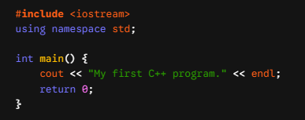

At this point, you need not be too concerned with the details of this program. However, if you run (execute) this program, it will display the following line on the screen:

**مسار بناء وتنفيذ برنامج C++ (C++ Build & Execution Pipeline)**

نظراً لأن المعالج (CPU) لا ينفذ سوى تعليمات لغة الآلة (Machine Language)، فإن كتابة برنامج بلغة C++ ليست سوى الخطوة الأولى؛ إذ يجب أن يمر الكود المصدري (Source Code) بسلسلة مراحل تحويلية حتى يظهر أثره الفعلي على الشاشة (مثل طباعة العبارة My first C++ program.). في هذه المرحلة التمهيدية، الأهم هو استيعاب الفكرة الكلية لتحويل البرنامج من نص برمجي إلى عملية قابلة للتنفيذ (Executable Process) دون التوقف عند تفاصيل كل سطر برمجي.

---

> **📄 Page 38**

## C++ Build and Execution Lifecycle

Because a processor executes only machine language, high-level C++ statements cannot run directly in text form; they must pass through a structured six-stage pipeline to produce an executable program inside main memory:

- **Editing and Source Code Creation:** A programmer uses a text editor to write C++ statements following the language's syntax rules, saving the source program in a plain text file with a .cpp extension (such as FirstCPPProgram.cpp) on secondary storage. At this stage, the file is inert text and is not yet executable.

- **Preprocessing:** Before compilation begins, a preprocessor scans the source code for preprocessor directives—lines starting with #, such as #include <iostream>. Rather than generating CPU instructions, these directives perform textual inclusion and substitution, copying header declarations into the code stream and producing an expanded source file free of # directives.

- **Compilation and Object Code Generation:** A compiler checks the preprocessed code for syntax errors, halting the build if any rule violations exist. When syntactically valid, it translates the code into target machine instructions stored in an object program (typically .obj or .o). An object file is not directly runnable on its own because it still contains unresolved references to external routines (such as input/output operations).

- **Linking and Executable Creation:** A linker combines the generated object code with precompiled routines from standard libraries, resolving external symbol references and addresses to produce a complete executable program (such as a .exe file) stored on secondary storage.

- **Loading into Main Memory:** Because the CPU does not execute instructions directly from secondary storage, an operating system loader reads the executable file from disk, allocates space in volatile main memory (RAM), copies instructions and data into memory cells, and assigns their runtime addresses.

- **Execution:** The loader passes control to the program's entry point (main), and the CPU's control unit runs the fetch-decode-execute cycle across system buses—reading instructions and data from RAM, performing operations in the ALU, and sending results to output devices.

---

> **📄 Page 39**

As a developer, your primary responsibility is mastering the language's syntax and logic to author accurate source code in Step 1. In practice, modern workflows rely on an **Integrated Development Environment (IDE)**—such as Visual Studio, C++ Builder, or CodeWarrior—which bundles an editor, compiler, linker, and execution tools into a unified workspace. A build or rebuild command (Build / Rebuild) automates compilation and linking (compiling first if needed), while running the program invokes loading and execution so output appears directly on screen.

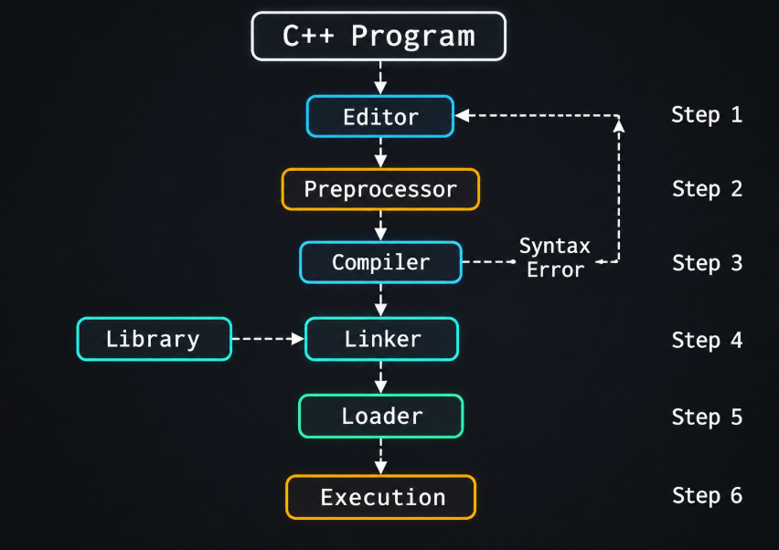

---

> **📄 Page 40**

الدورة الكاملة لحياة برنامج C++ (The C++ Build Lifecycle)

تعتمد وحدة المعالجة المركزية (CPU) في عملها حصراً على لغة الآلة المكونة من سلاسل ثنائية؛ لذا فإن الأسطر البرمجية المكتوبة بلغة ++C لا يمكن تنفيذها بصورتها النصية المباشرة، بل تخضع لسلسلة تحويلات هندسية متتابعة تمر بست مراحل محددة لإنتاج ملف تنفيذي مستقر داخل الذاكرة الرئيسية.

1. مرحلة التحرير وإنشاء الكود المصدري (Editing & Source Code)

تبدأ الدورة عندما يستخدم المبرمج محرر نصوص (Text Editor) لكتابة التعليمات البرمجية وفق القواعد النحوية والصياغية (Syntax) الصارمة للغة ++C. الملف الناتج في هذه المرحلة هو ملف نصي عادي (Text File) يحمل الامتداد القياسي .cpp ويُعرف برمجياً بـ "الكود المصدري" (Source Code). هذا الملف يستقر ساكناً على وسائط التخزين الثانوي (كالقرص الصلب أو SSD)، ولا يمتلك أي صفة تشغيلية؛ إذ يقتصر دوره على التعبير المنطقي عما يريده المبرمج دون أن يفهم المعالج أياً من أحرفه.

2. مرحلة المعالجة المسبقة (Preprocessing)

قبل بدء عملية الترجمة الفعلية، يمر الكود ببرنامج وسيط يُسمى "المعالج المسبق" (Preprocessor). يفحص هذا البرنامج الملف بحثاً عن أي أسطر تبدأ برمز الهاش (#)، والتي تُعرف بـ "توجيهات المعالج المسبق" (Preprocessor Directives). هذه السطور ليست أوامر برمجية موجهة للمعالج، بل هي تعليمات حقن واستبدال نصي للمحرر؛ فعند مصادفة أمر مثل #include <iostream>، يقوم المعالج المسبق بجلب الملف الرأسي المطلوب ونسخ كافة التصريحات والتعريفات التأسيسية الخاصة بأدوات الإدخال والإخراج ولصقها حرفياً داخل ملف الكود في الذاكرة المؤقتة. ينتج عن هذه المرحلة كود مصدري موسع، نظيف، ومجرد تماماً من أسطر الـ #.

3. مرحلة الترجمة وتوليد الكود الغرضي (Compilation)

يستلم "المترجم" (Compiler) الكود المصدري الموسع ليتولى مهمتين جوهريتين: الأولى هي التدقيق النحوي (Syntax Checking) للتأكد التام من مطابقة الكود لقواعد لغة ++C واكتشاف أي أخطاء شكلية كنسيان الفواصل المنقوطة أو استخدام متغيرات غير معلنة، حيث يُوقف عملية البناء فوراً إذا وُجد أي خلل صياغي. أما المهمة الثانية، فتتمثل في ترجمة التعليمات السليمة نحوياً إلى لغة الآلة الخاصة بالمعالج المستهدف. يُحفظ الناتج في ملف وسيط يسمى "البرنامج الغرضي" (Object Program) ويحمل الامتداد .obj (أو .o في أنظمة لينكس). هذا الملف، رغم احتوائه على شفرات ثنائية، يظل غير قابل للتشغيل إطلاقاً؛ لاحتوائه على استدعاءات خارجية معلقة وفجوات برمجية لوظائف لم يكتب المبرمج تفاصيلها العتادية بنفسه (مثل آليات الطباعة وعرض المحارف).

---

> **📄 Page 41**

4. مرحلة الربط وتوليد الملف التنفيذي (Linking)

يتدخل هنا برنامج "الرابط" (Linker) ليعمل كحلقة وصل تجميعية؛ حيث يأخذ الكود الغرضي (.obj) ويبحث داخل "المكتبات القياسية" (Standard Libraries) عن الأكواد الثنائية الجاهزة للأدوات والوظائف المستدعاة في البرنامج. يدمج الرابط هذه الشفرات معاً، ويسد الفجوات عبر حل وتوصيل العناوين الفيزيائية المتبادلة بين كود المبرمج وكود النظام. بانتهاء هذه العملية بنجاح، يُنتج الرابط المنتج البرمجي المستقل والمكتمل: "الملف التنفيذي" (Executable File) الذي يحمل الامتداد .exe، وهو ملف بصيغة الآلة جاهز ليطلبه نظام التشغيل.

5. مرحلة التحميل إلى الذاكرة (Loading)

يستقر الملف التنفيذي النهائي على القرص الصلب، لكن وحدة المعالجة المركزية عاجزة فيزيائياً عن قراءة أو تنفيذ البرامج مباشرة من وسائط التخزين الثانوي لبطئها وعدم اتصالها المباشر بناقل التعليمات. هنا يتدخل برنامج تابع لنظام التشغيل يسمى "المُحمّل" (Loader)؛ حيث يقوم بقراءة الملف التنفيذي من القرص، وحجز مساحة مناسبة له داخل الذاكرة الرئيسية (RAM)، ثم نسخ التعليمات والبيانات وتعيين العناوين المكانية الحقيقية لها على مصفوفة خلايا الذاكرة لتهيئتها للانطلاق.

6. مرحلة التنفيذ (Execution)

تُمثل هذه المحطة غاية دورة البناء؛ حيث يسلم المُحمّل عنوان أول تعليمة برمجية في نقطة الانطلاق الرئيسية (الدالة main) إلى مسجل مؤشر التعليمات داخل المعالج. تبدأ وحدة التحكم دورة "الجلب وفك الشفرة والتنفيذ" (Fetch-Decode-Execute Cycle) عبر نواقل النظام؛ فتسحب التعليمات من الـ RAM، وتمرر البيانات لوحدة الحساب والمنطق (ALU) لإجراء المعالجة المطلوبة، وتُوجّه المخرجات الناتجة نحو أجهزة العرض كالشاشة.

تكامل الأدوات عبر بيئة التطوير الموحدة (The Role of the IDE)

في بيئات العمل الحديثة، لا يُجري المطور هذه العمليات يدوياً عبر سطر الأوامر لكل أداة على حدة، بل يعتمد على "بيئة التطوير المتكاملة" (Integrated Development Environment - IDE) مثل Visual Studio أو CLion. تدمج البيئة محرر الأكواد، والمعالج المسبق، والمترجم، والرابط، والمُحمّل ضمن واجهة واحدة؛ فبمجرد الضغط على أمر "البناء" (Build)، يُطلق النظام تسلسل الفحص، الترجمة، والربط تلقائياً لإنتاج الملف التنفيذي، بينما يتولى أمر "التشغيل" (Run) استدعاء المُحمّل وتمرير الكود للمعالج ليبدأ التنفيذ اللحظي وعرض النتائج مباشرة.

---

> **📄 Page 42**

## Problem Analysis, Coding, and Execution Cycle

Software engineering approaches programming as a structured problem-solving discipline rather than mere code entry. Systematic methodologies not only produce working solutions but also expose the reasoning behind them and remain adaptable when problem requirements evolve. At the core of this discipline is an algorithm—a finite, step-by-step sequence of unambiguous instructions that terminates after producing a solution. If a procedure lacks a guaranteed termination condition, it fails as an algorithm and risks running indefinitely in a non-terminating loop.

In a software development workflow, solving a problem follows three core phases:

Problem Analysis and Algorithm Design: Define the problem thoroughly, specify required inputs, processing rules, and output formats, and break complex tasks into smaller subproblems (divide and conquer). Design and verify an algorithm for each subproblem—using sample test cases or mathematical reasoning—before writing code.

Implementation and Verification: Translate the verified algorithm into high-level C++ statements using a text editor, check syntax compliance through the compiler, resolve any syntax errors, and link and load the resulting machine code to verify that the program behaves as intended.

Maintenance: Update and adapt existing software over time as user needs, environments, or problem domains change.

A critical distinction in software development lies between syntax errors and logical errors. Compilers enforce language grammar and punctuation rules; a clean compile confirms syntactic validity, not algorithmic correctness. A program with valid syntax can still fail at runtime—such as crashing on division by zero or producing wrong outputs due to a flawed formula—requiring inspection of the code, algorithm, or initial problem analysis. Investing time upfront on paper to analyze requirements and design algorithms reduces costly debugging and structural rework later in development.

---

> **📄 Page 43**

**منهجية حل المشكلات: دورة التحليل والتنفيذ (The Problem Analysis–Coding–Execution Cycle)**

**1. جوهر البرمجة: تعريف الخوارزمية (Algorithm)**

**قبل كتابة السطور البرمجية، يجب التعامل مع البرمجة بوصفها هندسة حلول قائمة على الخوارزمية (Algorithm)؛ وهي سلسلة خطوات متتابعة ومحددة لحل مشكلة ضمن زمن محدود (Finite Time). شرط المحدودية (Finite) حاسم لأن الخطوات غير المنتهية لا تُعد خوارزمية صحيحة وتؤدي إلى حلقة لا نهائية (Infinite Loop).**

**2. دورة الحياة الثلاثية للبرمجيات (Three-Step Programming Process)**

**يمر بناء الحلول البرمجية بثلاث مراحل مترابطة:**

**التحليل والتصميم (Analysis & Design): فهم المشكلة بوضوح، وتحديد المدخلات (Input) وشكل المخرجات (Output) وتنسيقها، وتقسيم المشكلات المعقدة إلى مشكلات فرعية (Subproblems) وفق مبدأ فرّق تسد (Divide and Conquer)، ثم التحقق من صحة الخوارزمية عبر بيانات اختبار أو تحليل رياضي.**

**التنفيذ والتحقق (Implementation & Verification): كتابة الكود بلغة C++ وفق القواعد النحوية، ومعالجته عبر المترجم (Compiler) والرابط (Linker) والمُحمّل (Loader) للتحقق من عمله الفعلي.**

**الصيانة (Maintenance): تعديل البرنامج وتطويره بعد إطلاقه لمواكبة تغير المتطلبات أو نطاق المشكلة (Problem Domain).**

**3. الفخ التقني: صراع القواعد والمنطق (Syntax Errors vs. Logical Errors)**

**الأخطاء النحوية (Syntax Errors): مخالفة قواعد اللغة وقواعد الكتابة (مثل نقص فاصلة منقوطة أو استخدام متغير غير مصرّح به)؛ يكتشفها المترجم (Compiler) ويمنع إنتاج البرنامج التنفيذي حتى تُصحَّح.**

**الأخطاء المنطقية (Logical Errors): خلل في الخوارزمية أو الصياغة الرياضية أو معالجة الحالات الحدية (مثل القسمة على صفر أو معادلة حسابية خاطئة)؛ لا يكتشفها المترجم لأن قواعد اللغة سليمة، وتظهر أثناء التنفيذ كتعطل مفاجئ أو نتائج غير صحيحة تتطلب مراجعة الكود أو الخوارزمية أو التحليل.**

**4. قاعدة التحليل قبل الكتابة وتكامل الدورة (Design Before Coding & Integrated Cycle)**

**البدء بالتحليل وتصميم الخوارزمية على الورق قبل الانتقال إلى لوحة المفاتيح يسهّل اكتشاف العيوب مبكراً ويجعل الكود أسهل في القراءة والتعديل والصيانة لاحقاً. وفي دورة العمل الكاملة، يمر البرنامج من التحليل والخوارزمية إلى الكود ثم الفحص النحوي فالبناء والتحميل والتنفيذ، بينما تعيد أخطاء التنفيذ والمنطق المطور إلى مراجعة الكود أو الخوارزمية أو التحليل الأولي.**

---

> **📄 Page 44**

**قاموس المصطلحات المنهجية (Glossary)**

| **المصطلح (Term)** | **التعريف المنهجي** |
| --- | --- |
| **الخوارزمية (Algorithm)** | **خطوات متسلسلة ومحددة لحل مشكلة والوصول إلى نتيجة في زمن محدود.** |
| **الزمن المحدود (Finite Time)** | **شرط انتهاء الخوارزمية في عدد منتهٍ من الخطوات لتجنب الحلقات غير المنتهية.** |
| **فرّق تسد (Divide and Conquer)** | **تقسيم المشكلة المعقدة إلى مشكلات فرعية (Subproblems) لتسهيل تحليلها وحلها.** |
| **الخطأ النحوي (Syntax Error)** | **مخالفة قواعد لغة البرمجة التي يكتشفها المترجم (Compiler) أثناء الترجمة.** |
| **الخطأ المنطقي (Logical Error)** | **خلل في منطق الحل أو الخوارزمية يظهر عند التنفيذ ولا يكتشفه المترجم.** |
| **الصيانة (Maintenance)** | **تحديث البرنامج وتعديله لمواكبة التغيرات المستقبلية في المتطلبات أو التشغيل.** |
| **نطاق المشكلة (Problem Domain)** | **مجال المشكلة والبيئة والمتطلبات التي صُمم البرنامج لمعالجتها.** |

---

> **📄 Page 45**

**Applied Example: Session Fee & Average Score Calculation**

To demonstrate the problem analysis, algorithm design, and implementation cycle on a concrete task of equivalent introductory complexity, consider a program that computes the average of two test scores and the total fee for a tutoring or consulting session based on a fixed hourly rate and session duration in hours.

- **Inputs:** Two numeric test scores (score1, score2), an hourly rate (hourlyRate), and session duration in hours (hours).

- **Processing:** Compute the arithmetic mean of the two scores and multiply the hourly rate by the session duration to obtain the total fee.

- **Outputs:** Display the computed average score and the total session fee.

**Algorithm:**

- Obtain score1 and score2.

- Obtain hourlyRate and hours.

- Calculate average = (score1 + score2) / 2.0.

- Calculate totalFee = hourlyRate * hours.

- Display average and totalFee.

---

> **📄 Page 46**

**مثال تطبيقي بديل: حساب متوسط درجتين وتكلفة جلسة بالساعة (Applied Example)**

هذا المثال يحافظ على نفس البساطة المباشرة لمثال المستطيل من حيث الاعتماد على متغيرات عددية ومعادلات صريحة دون تعقيد شرطي أو حلقات تكرار، مع كونه مثالاً مستقلاً بالكامل عن الكتاب.

1. مرحلة التحليل (Problem Analysis)

- **المطلوب:** تصميم برنامج يحسب متوسط درجتين (Average Score)، ويحسب التكلفة الإجمالية لجلسة (Total Fee) بناءً على الأجر بالساعة وعدد الساعات.

- **المدخلات (Inputs):**

- الدرجة الأولى (score1) والدرجة الثانية (score2).

- الأجر للساعة (hourlyRate) وعدد الساعات (hours).

- **العمليات (Processing):**

- حساب المتوسط الحسابي: $\text{average} = \frac{\text{score1} + \text{score2}}{2.0}$ (استخدام 2.0 يضمن القسمة العشرية بدلاً من القسمة الصحيحة).

- حساب التكلفة الكلية: $\text{totalFee} = \text{hourlyRate} \times \text{hours}$.

- **المخرجات (Outputs):**

- طباعة المتوسط الحسابي (average) والتكلفة الإجمالية (totalFee) على الشاشة.

**2. مرحلة الخوارزمية (Algorithm Design)**

- اقرأ قيمتي score1 و score2.

- اقرأ قيمتي hourlyRate و hours.

- احسب المتوسط بالمعادلة: (score1 + score2) / 2.0.

- احسب التكلفة بالمعادلة: hourlyRate * hours.

- اطبع المتوسط والتكلفة النهائية.

**3. التنفيذ بلغة C++ (Implementation)**

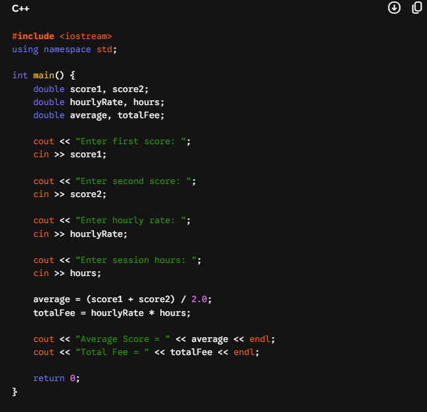

---

> **📄 Page 47**

## 10 algorithm examples

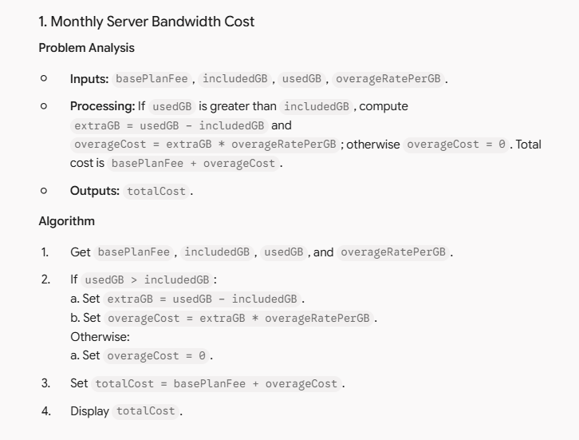

 

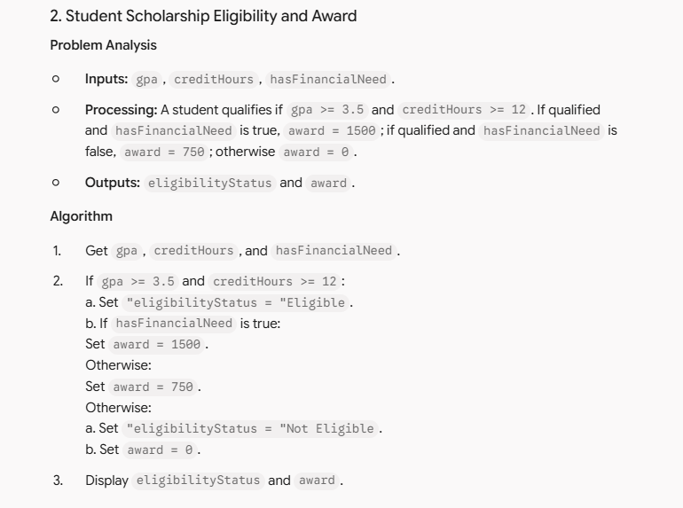

---

> **📄 Page 48**

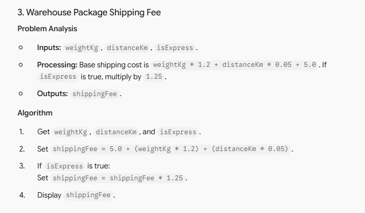

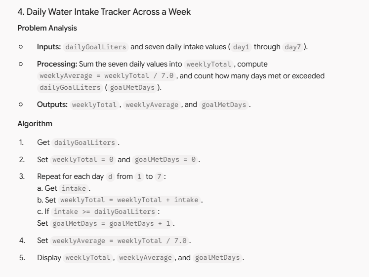

---

> **📄 Page 49**

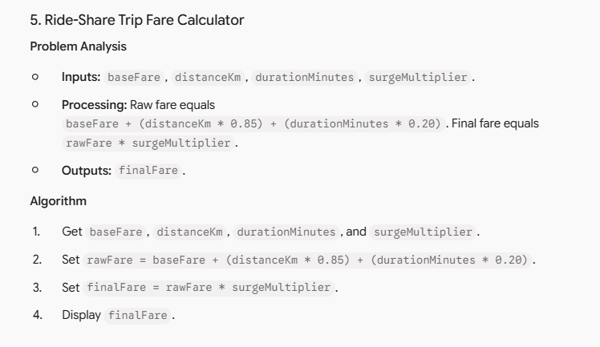

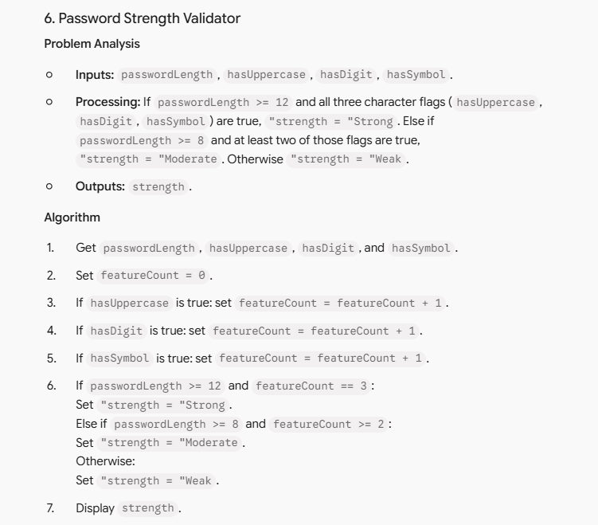

---

> **📄 Page 50**

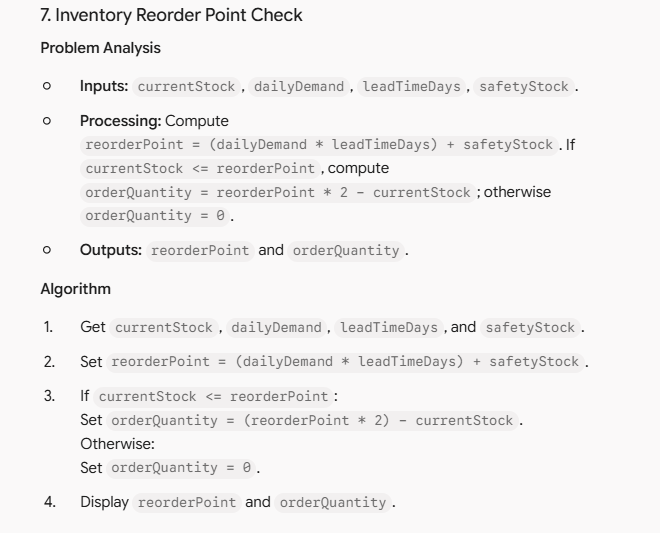

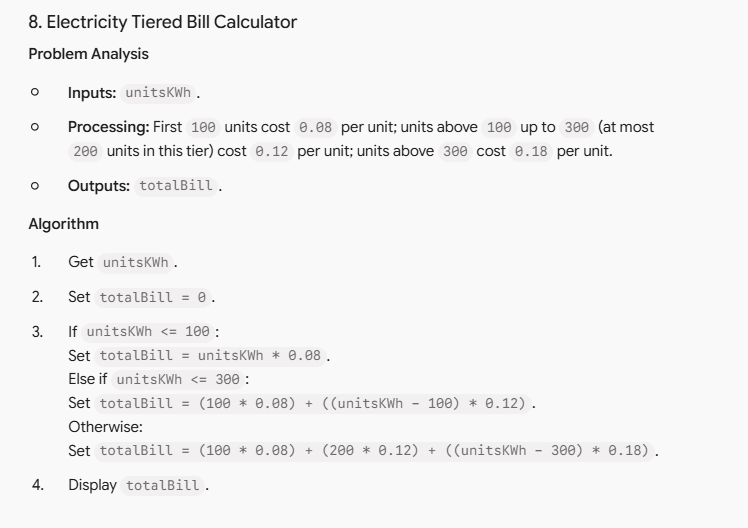

---

> **📄 Page 51**

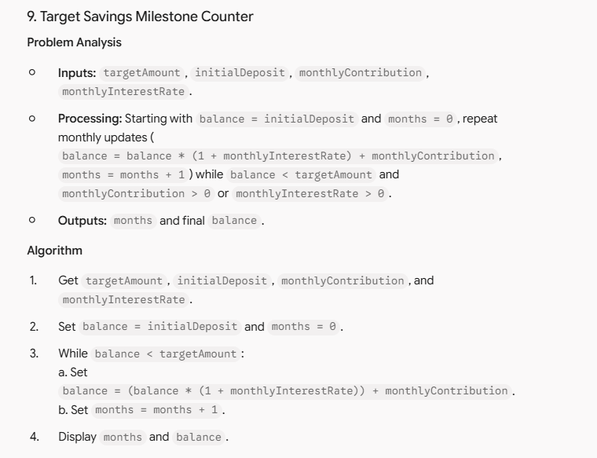

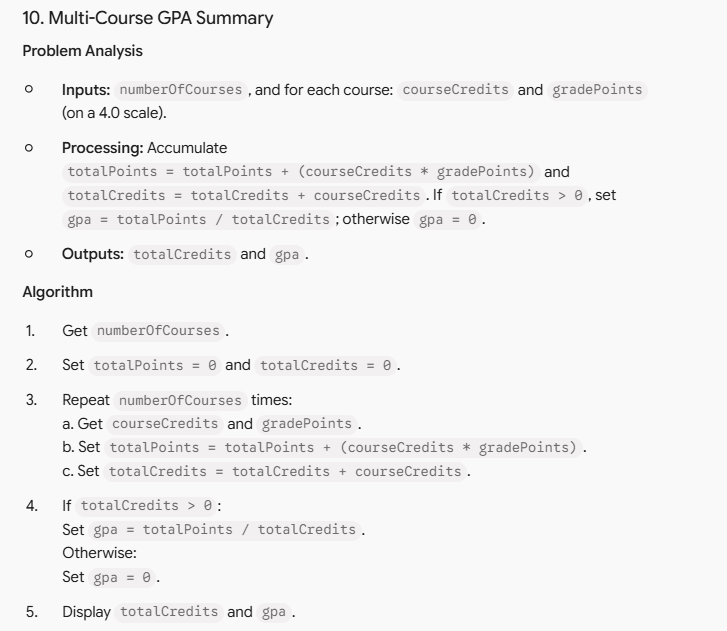

---

> **📄 Page 52**

## Programming Methodologies and ANSI/ISO Standard C++

Software design relies on two major paradigms—the structured approach and the object-oriented approach—each suited to particular problem structures and capable of working together in practice.

### Structured Programming

Structured design breaks a complex problem into smaller, manageable subproblems, analyzes and solves each subproblem independently, and combines those partial solutions into a complete solution. Implementing this structured design is known as structured programming, and the approach is also referred to as top-down design, bottom-up design, stepwise refinement, or modular programming. It is particularly effective for numerical computations and mathematical problem-solving where steps can be decomposed cleanly and supported by built-in library routines.

### Object-Oriented Programming (OOP)

Object-oriented design (OOD) centers the problem-solving process on identifying objects—the core entities that model the domain—and defining how they interact. Each object encapsulates both relevant data (state/attributes) and the operations (behaviors/methods) acting on that data within a single unit. For example, in a video store rental system, key objects include a video and a customer. A video object's data may include movie title, starring actors, producer, production company, and available copy count, while its operations may include inspecting the title, decrementing available copies upon rental, and incrementing available copies upon return. Languages designed to support OOD are object-oriented programming (OOP) languages, such as C++, which bundles data and operations into a single unit using a class. OOD is especially well-suited for modeling real-world systems—such as an automated candy machine—and often pairs naturally with structured design.

### Building Blocks Before Object-Oriented Design

Because objects combine data and operations, effective OOD requires foundational mastery of data representation, memory manipulation, control flow, and modular subprograms. In this curriculum progression, early chapters introduce basic data types, memory representation, and input/output; subsequent chapters cover control structures (selection for decision-making and repetition for condition-controlled loops), functions for organizing and reusing algorithm operations, and arrays for handling collections of elements of the same type. Once these core constructs are established using structured programming, the focus shifts to classes, data abstraction, and full OOD.

---

> **📄 Page 53**

### ANSI/ISO Standard C++

C++ evolved from C, designed by Bjarne Stroustrup at Bell Laboratories in the early 1980s. During the 1980s and early 1990s, multiple C++ compilers emerged with slight variations in how language features evolved, which occasionally hindered portability across compilers. To establish a uniform specification, a joint committee of the American National Standards Institute (ANSI) and the International Organization for Standardization (ISO) standardized the language, approving the ANSI/ISO C++ standard in mid-1998. Modern compilers largely conform to this standard, which forms the baseline for standard C++ syntax in this course.

**منهجيات البرمجة ومعيار** ANSI/ISO **للغة** C++ **(**Programming Methodologies & Standardization**)**

يستعرض هذا القسم المنهجيتين الرئيسيتين في تصميم البرمجيات، والأساس المعياري الذي يضمن توحيد قواعد لغة C++ عبر المترجمات المختلفة:

**1. البرمجة الهيكلية (**Structured Programming**)**

هي المنهجية القائمة على تقسيم المشكلة الكبيرة إلى مشكلات فرعية (Subproblems) أصغر يسهل تحليلها وحلها بشكل مستقل، ثم دمج حلول هذه الأجزاء للوصول إلى الحل الكلي للبرنامج:

- **المبدأ الأساسي:** تجزئة التعقيد وفق مبدأ Divide and Conquer وحل كل جزء بوضوح ثم تجميع النتائج.

- **المصطلحات المرتبطة بالمنهجية:** يرتبط هذا النهج بعدة تسميات متداولة في الأدبيات الهندسية، من أبرزها:

- **التصميم الهيكلي (**Structured Design**)**.

- **التصميم من الأعلى للأسفل (**Top-down Design**)**.

- **التصميم من الأسفل للأعلى (**Bottom-up Design**)**.

- **التنقيح التدريجي (**Stepwise Refinement**)**.

- **البرمجة المعيارية / المجزأة (**Modular Programming**)**.

- **مجال الاستخدام:** فعّالة جداً في المسائل الحسابية والرياضية ومعالجة مجموعات الأرقام بالاعتماد على الخطوات المتسلسلة والدوال الجاهزة في مكتبات C++.

---

> **📄 Page 54**

**2. البرمجة كائنية التوجه (**Object-Oriented Programming - OOP**)**

تعتمد منهجية **التصميم كائني التوجه (**Object-Oriented Design - OOD**)** على نمذجة النظام كمنظومة من **الكائنات (**Objects**)** المتفاعلة فيما بينها، حيث يجمع كل كائن في وحدة واحدة متماسكة بين:

- **البيانات (**Data**):** الخصائص والحالة التي تصف الكائن.

- **العمليات (**Operations**):** الإجراءات والسلوكيات التي تُنفَّذ على بيانات ذلك الكائن.

- **مثال نظام تأجير الفيديو (**Video Store Example**):** يمكن تمثيل النظام عبر كائنات رئيسية مثل كائن الفيديو (Video) وكائن العميل (Customer)؛ فكائن الفيديو يضم بيانات مثل اسم الفيلم، الممثلين الرئيسيين، المنتج، شركة الإنتاج، وعدد النسخ المتوفرة، ويضم عمليات مثل التحقق من اسم الفيلم، إنقاص عدد النسخ المتوفرة عند الاستئجار، وزيادة عدد النسخ عند الإرجاع.

- **الارتباط بـ** C++ **ومجال الاستخدام:** تُعد C++ لغة كائنية التوجه (OOP) وتوفر آلية **الصف (**Class**)** لدمج البيانات والعمليات في وحدة واحدة. وتبرز فعالية OOD بشكل خاص في تمثيل الأنظمة الواقعية (مثل آلة بيع الحلويات Candy Machine)، كما تتكامل عملياً مع التصميم الهيكلي.

**3. التسلسل التمهيدي قبل تطبيق** OOD

نظراً لأن الكائن يجمع بين البيانات والعمليات، فإن تصميم الكائنات واستخدامها بفعالية يتطلب بناء الأساس اللغوي والمنطقي أولاً عبر المراحل التالية:

- **تمثيل البيانات ومعالجتها والإدخال والإخراج:** فهم أنواع البيانات الأساسية في C++ وكيفية تمثيلها في الذاكرة وإدخال البيانات وعرض النتائج.

- **هياكل التحكم (**Control Structures**):** إتقان آليات **الاختيار (**Selection**)** لاتخاذ القرارات، و**التكرار (**Repetition**)** لتنفيذ العمليات حتى تحقق شروط محددة، أو الجمع بينهما في الخوارزميات.

- **الدوال والمصفوفات (**Functions & Arrays**):** استخدام **الدوال (**Functions**)** لفصل العمليات وتنظيم الخوارزميات وتسهيل استدعائها، واستخدام **المصفوفات (**Arrays**)** للتعامل مع مجموعات من البيانات المتجانسة من النوع نفسه (مثل قائمة أرقام المبيعات).

- **الانتقال إلى** Classes **و** OOD**:** بعد ترسيخ هذه الأساسيات بأسلوب البرمجة الهيكلية، يتم الانتقال إلى تجميع البيانات والعمليات في وحدة واحدة عبر الصفوف (Classes) وتطبيق OOD.

**4. معيار اللغة (**ANSI/ISO Standard C++**)**

- **النشأة والتطور:** تطورت C++ من لغة C على يد **بيارن ستروستروب (**Bjarne Stroustrup**)** في مختبرات **بيل (**Bell Laboratories**)** في أوائل الثمانينات.

---

> **📄 Page 55**

- **مشكلة تعدد المترجمات:** مع ظهور عدة مترجمات لـ C++ خلال الثمانينات وأوائل التسعينات، تطورت بعض التفاصيل بشكل طفيف بين مترجم وآخر، مما أثر أحياناً على قابلية نقل البرامج (Portability) بين بيئات التطوير المختلفة.

- **التوحيد القياسي:** في أوائل التسعينات، شُكّلت لجنة مشتركة من المعهد الوطني الأمريكي للمعايير (ANSI) والمنظمة الدولية للمعايير (ISO) لتوحيد قواعد اللغة، وتم اعتماد معيار ANSI/ISO C++ في منتصف عام 1998، وهو المعيار الذي تلتزم به أغلب المترجمات الحديثة وتعتمد عليه قواعد اللغة في هذا المنهج.

**ملاحظة منهجية للمسار الدراسي**

المنهج يبني قدراتك تدريجياً: يبدأ بتأسيس التفكير المنطقي والهيكلي (Structured) في تمثيل البيانات والتحكم بالتدفق والدوال والمصفوفات، لكي تكون جاهزاً عند الوصول إلى الصفوف (Classes) والكائنات (Objects) لدمج البيانات مع عملياتها ضمن تصميم كائني متماسك.

هل ننتقل إلى القسم التالي من الفصل الأول أو لديك تعديل على هذا الجزء؟

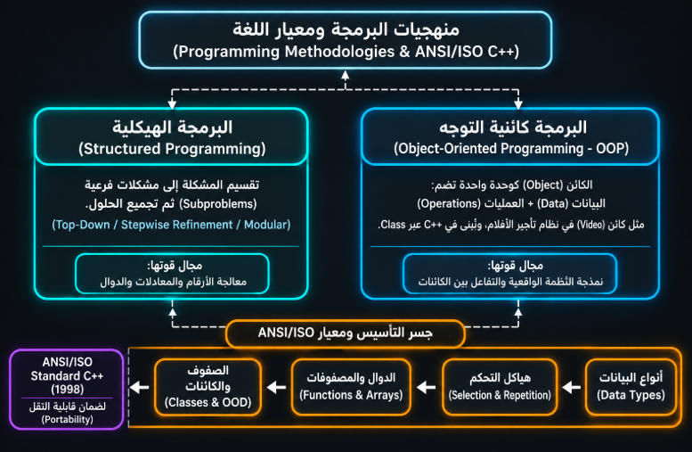
