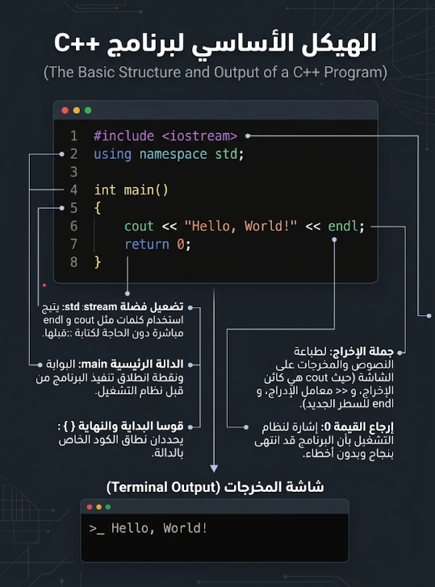
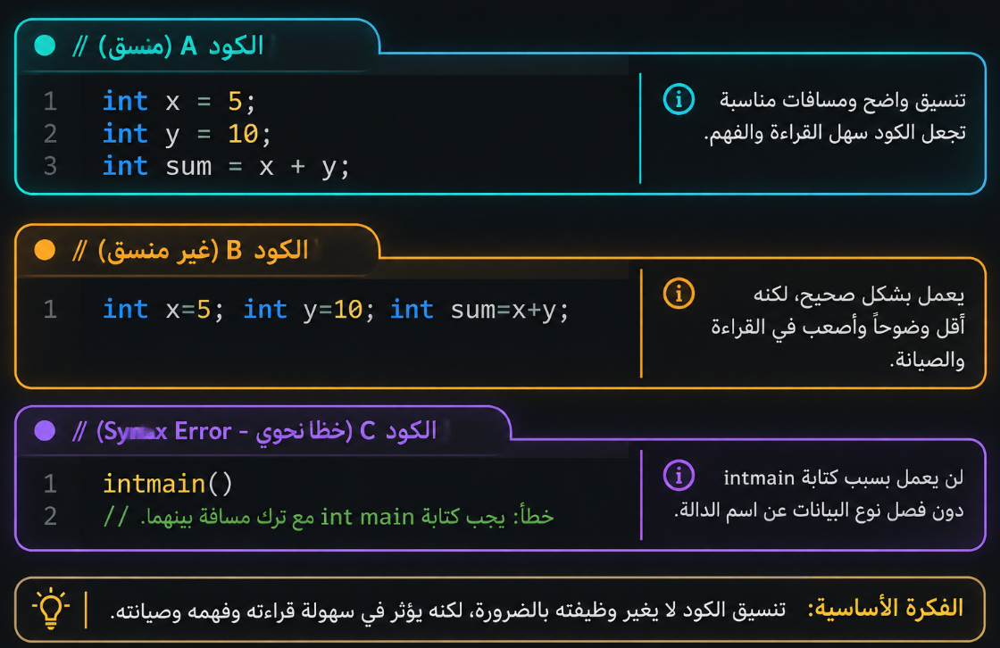
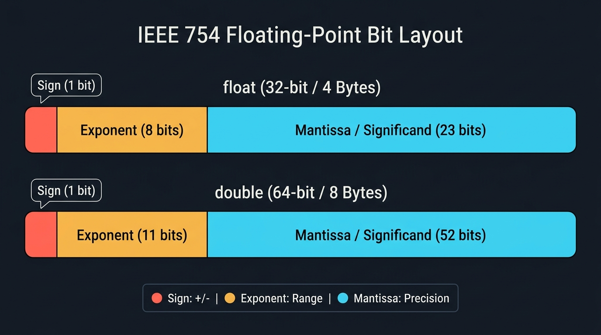
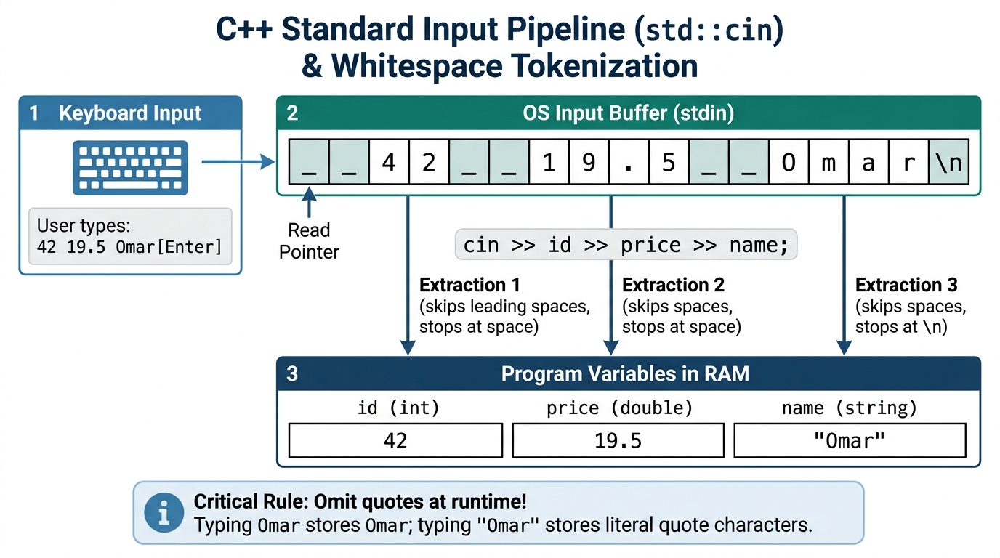
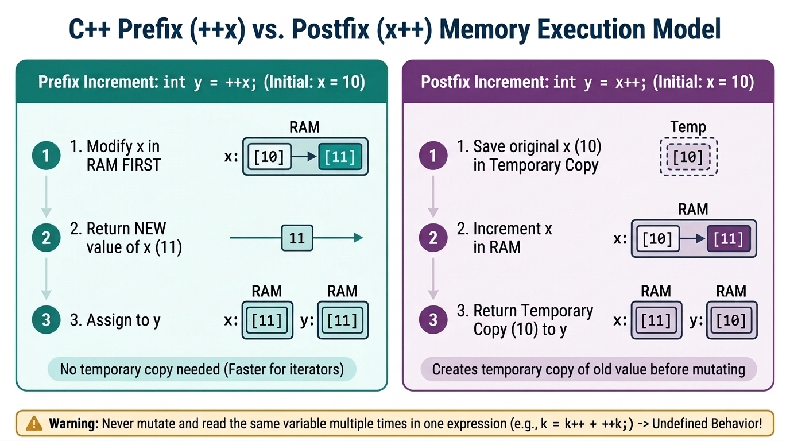
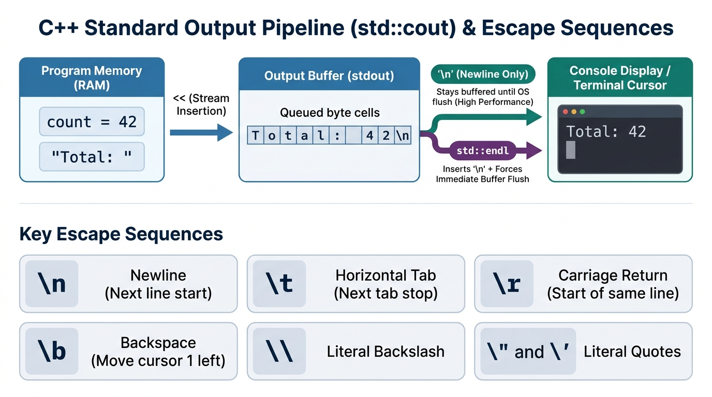
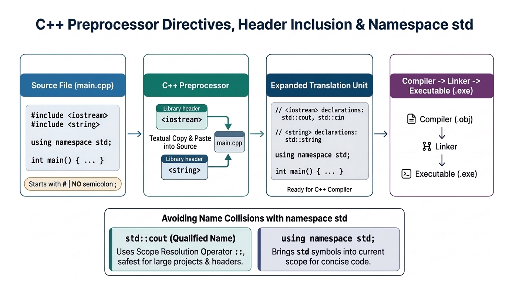
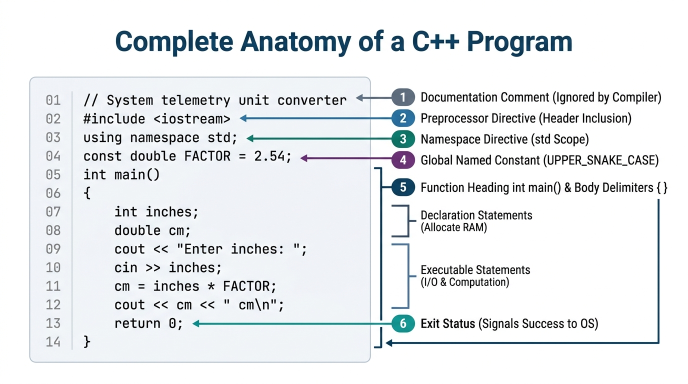
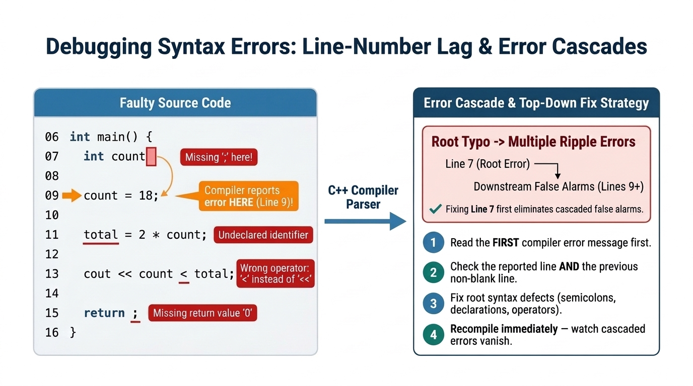
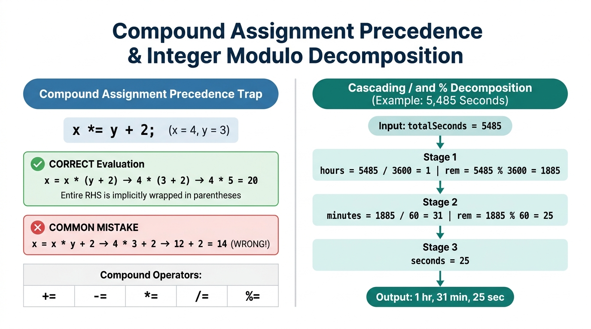

**Page 1**

## Table of Contents

- [Chapter 02 — Basic elements of C++](#chapter-02--basic-elements-of-c)
  - [Introduction](#introduction)
  - [A C++ Program](#a-c-program) *(Original p. 61)*
  - [The Basics of a C++ Program](#the-basics-of-a-c-program)
    - [Data Types](#data-types)
    - [Simple Data Types and Integral Categories](#simple-data-types-and-integral-categories)
    - [Discussion 1: Memory Addressing, Integer Ranges, and Overflow](#discussion-1-memory-addressing-integer-ranges-and-overflow)
    - [Practical Code Examples: Memory Sizes and Declarations](#practical-code-examples-memory-sizes-and-declarations)
    - [Floating-Point Data Types (float, double, long double)](#floating-point-data-types-float-double-long-double)
  - [Arithmetic Operators and Operator Precedence](#arithmetic-operators-and-operator-precedence)
    - [Order of Precedence and Character Arithmetic](#order-of-precedence-and-character-arithmetic)
  - [Mixed Expressions and Implicit Type Conversion](#mixed-expressions-and-implicit-type-conversion)
  - [Type Conversion (Casting)](#type-conversion-casting)
  - [The string Data Type (std::string)](#the-string-data-type-stdstring)
  - [Input](#input)
    - [Allocating Memory with Constants and Variables](#allocating-memory-with-constants-and-variables)
    - [Assignment Statement](#assignment-statement)
    - [Saving and Using the Value of an Expression](#saving-and-using-the-value-of-an-expression)
    - [Declaring and Initializing Variables](#declaring-and-initializing-variables)
    - [Input (Read) Statement](#input-read-statement)
    - [Variable Initialization](#variable-initialization)
  - [Increment and Decrement Operators](#increment-and-decrement-operators)
  - [Output](#output)
  - [Preprocessor Directives](#preprocessor-directives)
    - [namespace and Using cin and cout in a Program](#namespace-and-using-cin-and-cout-in-a-program)
    - [Using the string Data Type in a Program](#using-the-string-data-type-in-a-program)
  - [Creating a C++ Program](#creating-a-c-program)
  - [Debugging: Understanding and Fixing Syntax Errors](#debugging-understanding-and-fixing-syntax-errors)
  - [Program Style and Form](#program-style-and-form)
  - [More on Assignment Statements (Compound Assignment)](#more-on-assignment-statements-compound-assignment)
  - [Applied Engineering Case Studies](#applied-engineering-case-studies)
    - [Case Study 1: Multi-Unit Engineering Length Converter](#case-study-1-multi-unit-engineering-length-converter)
    - [Case Study 2: Cascading Integer Division and Modulo Decomposition Engine](#case-study-2-cascading-integer-division-and-modulo-decomposition-engine)
  - [Chapter 02 Summary & Pitfalls Checklist](#chapter-02-summary--pitfalls-checklist)
---

**Page 2**

# <span style="color:#1B4F72">Chapter 02 — Basic elements of C++</span>

## <span style="color:#2874A6">Introduction</span>

Mastering the C++ language begins with clarifying two foundational concepts: what constitutes a computer program, and what the discipline of programming entails. Technically, a computer program is a structured sequence of instructions designed to solve a specific problem or execute a defined task, whereas programming is the systematic process of designing, architecting, and implementing those instructions. However, formal definitions alone do not capture the practical realities of software engineering. Much like culinary arts or mastering a musical instrument, programming is an applied craft governed by distinct structural principles:

- **Execution vs. Creation:** Tracing and executing an existing algorithm is significantly simpler than architecting an original solution from scratch.

- **Code Quality Variance:** Programs vary substantially in architectural efficiency, maintainability, and design quality.

- **Readability and Structure:** Well-structured code is transparent and easy to trace, whereas poorly organized logic obscures intent.

- **Deterministic Reliability:** Not every implementation produces consistent, error-free outputs across all edge cases.

- **Toolchain Mastery:** Completing any software task requires practical familiarity with the compiler, debugger, and development environment.

- **Deep Domain Knowledge:** Engineering robust, original software demands a thorough understanding of language rules, memory behavior, and data structures.

Consequently, theoretical reading alone cannot produce a competent programmer. True proficiency requires combining foundational knowledge of language mechanics with continuous hands-on implementation, compilation, and rigorous testing on actual hardware.

---

**Page 3**

يفتتح هذا الفصل مدخله إلى لغة C++ بتفكيك التمييز الجوهري بين الكيان البرمجي وعملية بنائه، ثم يضع القواعد المنهجية لاكتساب المهارة البرمجية:

- **1. التمييز المفاهيمي:** البرنامج مقابل البرمجة (Program vs. Programming)

- **البرنامج الحاسوبي (Computer Program):** هو المنتج النهائي؛ أي سلسلة محددة ومنطقية من التعليمات (Statements) التي تُترجم إلى أوامر آلة ينفذها المعالج لإنجاز مهمة معينة.

- **البرمجة (Programming):** هي العملية الهندسية الكاملة التي تسبق وترافق كتابة الكود؛ وتشمل تحليل المشكلة، تصميم الخوارزمية، اختيار هياكل البيانات المناسبة، كتابة التعليمات، واختبارها للتأكد من خلوها من الأخطاء.

2. الحقائق الهندسية الست لطبيعة البرمجة (The Six Realities of Software Craft)

بدلاً من الاكتفاء بالتعريف النظري، يوضح الفصل طبيعة البرمجة كحرفة تطبيقية عبر ست حقائق مباشرة:

- **تتبع الكود أسهل من بنائه (Tracing vs. Architecting):** قراءة خوارزمية جاهزة وفهم خطواتها أسهل بكثير من مواجهة مشكلة فارغة وبناء حلها من الصفر.

- **التفاوت الجذري في الجودة (Architectural Quality):** كتابة برنامج يعطي ناتجاً صحيحاً لا تعني أنه برنامج جيد؛ فهناك فرق شاسع بين كود نظيف سريع وعالي الكفاءة، وكود فوضوي يستهلك الذاكرة والمعالج دون داعٍ.

- **قابلية القراءة والصيانة (Code Readability):** الكود يُكتب مرة واحدة ويُقرأ عشرات المرات؛ وضوح التسميات وبنية الكود يحددان سهولة تتبعه وتعديله لاحقاً.

- **الموثوقية والحتمية (Deterministic Reliability):** البرنامج الموثوق هو الذي يعطي نتائج دقيقة حتى عند إدخال قيم حدية أو غير متوقعة (Edge Cases)، وليس فقط في الحالات المثالية.

- **إتقان بيئة التطوير والأدوات (Toolchain Proficiency):** لا يمكن بناء برنامج متكامل دون معرفة كيفية استخدام المحرر، المترجم (**Compiler**)، والمصحح (Debugger) لتتبع الأخطاء وفهم رسائل النظام.

- **الابتكار ثمرة الفهم العميق (Deep Language Mechanics):** تصميم حلول برمجية جديدة يتطلب إتقاناً دقيقاً لقواعد اللغة وكيفية تعاملها مع الذاكرة (RAM) وأنواع البيانات.

- **3. قاعدة الإتقان:** التفاعل المباشر مع العتاد والمترجم (Hands-On Compilation & Testing)

يحسم الفصل الجدل المنهجي حول طريقة تعلم البرمجة بقاعدة قطعية: القراءة النظرية وحدها تخلق وهماً بالمعرفة ولا تبني مبرمجاً. تماماً كالعزف على آلة موسيقية، لا تتحول القواعد إلى مهارة حقيقية إلا عبر كتابة الكود بيدك، ترجمته، كسره عمداً لاكتشاف أخطاء المترجم، واختباره عملياً على الحاسوب للتحقق من تطابق المخرجات الفعلية مع التصميم المنطقي.

---

**Page 4**

## <span style="color:#2874A6">A C++ Program</span>

As you progress through the basic elements and constructs of C++, individual concepts will be demonstrated through short snippets alongside complete sample programs. In this section, a foundational C++ program is introduced to illustrate basic execution flow and standard output. At this stage, there is no need to dissect every low-level mechanism inside the program; the primary focus is observing how an output statement sends data to the display so you can build intuition before examining each syntactic component in detail.

```cpp
// Demonstrates basic standard output, literal strings,
// arithmetic expression evaluation, and integer variable display.

#include <iostream>
using namespace std;

int main()
{
    int value;
    value = 12;

    cout << "Starting C++ output demonstration." << endl;
    cout << "4 + 6 = " << 10 << endl;
    cout << "9 + 11 = " << (9 + 11) << endl;
    cout << "Stored value = " << value << endl;

    return 0;
}
```

---

**Page 5**

#### <span style="color:#6C3483">Example 2: Multiple Declarations and Formatted Output</span>

```cpp
#include <iostream>
```

- **1. الفلسفة المعمارية:** لماذا لا تفهم اللغة الشاشة ولوحة المفاتيح تلقائياً؟

صُممت لغة C++ في نواتها الأساسية لتكون لغة "نواة صلبة" (Core Language) تتبنى مبدأ هندسياً صارماً يُعرف بـ "عدم دفع ثمن ما لا تستخدمه" (Zero-Overhead Principle). بناءً على هذا المبدأ، تعمد مصممو اللغة تجريد الكلمات المفتاحية الأساسية للغة من أي أوامر مدمجة للتعامل مع الأجهزة الطرفية (Peripherals) كالشاشة، لوحة المفاتيح، الطابعة، أو الملفات.

- **السبب العتادي خلف هذا القرار جوهري:** لغة C++ لم تُصمم للحواسيب المكتبية فقط، بل تُستخدم لبرمجة طيف واسع من الأنظمة، بدءاً من الخوادم العملاقة وصولاً إلى المتحكمات الدقيقة (Microcontrollers) وأنظمة السيارات والغسالات التي لا تملك شاشة أو لوحة مفاتيح أصلاً. لو أُدمجت أوامر الطباعة داخل نواة اللغة، لأصبحت البرامج ثقيلة ومقيدة بعتاد معين. لذلك، جُعلت نواة اللغة محصورة في المنطق، الرياضيات، المتغيرات، وإدارة الذاكرة، بينما عُزلت أدوات التواصل مع العالم الخارجي في المكتبة القياسية (Standard Library) كصناديق أدوات اختيارية يستدعيها المبرمج عند الحاجة فقط.

2. التفكيك الدلالي لمكونات السطر

يتألف هذا السطر من أربعة أجزاء، لكل منها وظيفة محددة قبل بدء الترجمة الفعلية:

- الرمز (#): إشارة تنبيه خاصة لا يفهمها المترجم (**Compiler**)، بل توقظ برنامج المعالج المسبق (Preprocessor) وتخبره بأن هذا السطر هو "توجيه بناء" (Directive) وليس جملة برمجية تنفيذية؛ ولهذا السبب لا ينتهي السطر بفاصلة منقوطة (;).

- الأمر (include): تعليمة تحرير نصي تعني حرفياً "انسخ والصق"، حيث تطلب من المعالج المسبق البحث عن ملف خارجي، فتحه، ونسخ محتواه النصي بالكامل داخل ملفك.

- الأقواس الزاوية (< >): تحدد مسار البحث (Search Path)؛ إذ تُلزم المعالج المسبق بالبحث داخل مجلدات المكتبة القياسية للنظام المثبتة مع المترجم، على عكس علامات التنصيص المزدوجة (" ") التي تُستخدم لاستدعاء الملفات الخاصة التي أنشأها المبرمج داخل مجلد مشروعه.

- الاسم (iostream): اختصار لـ Input/Output Stream (تدفق الإدخال والإخراج). وغياب الامتداد .h هنا هو معيار اعتمدته لجنة (ANSI/ISO C++98) للتمييز بين ترويسات لغة C القديمة وترويسات C++ الحديثة التي تغلف كافة أدواتها داخل نطاق الأسماء القياسي std.

---

**Page 6**

- **3. آلية العمل في الكواليس:** الفرق بين "التصريح" و"التنفيذ"

يمر تفعيل هذا السطر بمرحلتين منفصلتين أثناء بناء البرنامج:

- مرحلة المعالج المسبق (الحقن النصي - Text Injection): قبل أن يبدأ المترجم بفحص قواعد كودك، يذهب المعالج المسبق إلى مجلدات النظام، يفتح ملف iostream، وينسخ آلاف الأسطر التعريفية الموجودة بداخله (بما في ذلك الملفات الفرعية المرتبطة به) ويلصقها حرفياً مكان سطر #include في الذاكرة المؤقتة، لينتج ملفاً موسعاً يُسمى وحدة الترجمة (Translation Unit).

- *ماذا تحتوي هذه الأسطر المنسوخة؟* تحتوي على التصريحات (Declarations) فقط—أي "بطاقات التعريف" التي تخبر المترجم بأن هناك أدوات صحيحة اسمها cout و cin وتحدد طريقة استخدامها، حتى لا يتوقف المترجم معتبراً إياها رموزاً مجهولة (Undeclared **Identifiers**).

- مرحلة الرابط (ربط الشفرة الفعلية - Linking): ملف iostream لا يحتوي على الكود التنفيذي الذي يحرك البكسلات على الشاشة؛ بل تقبع تلك الشفرة الثنائية المترجمة مسبقاً في ملفات النظام، ويتولى برنامج الرابط (Linker) دمجها مع برنامجك بعد انتهاء الترجمة.

4. مفهوم التدفق (Stream) والكائنات القياسية المستوردة

بمجرد تضمين <iostream>، يصبح برنامجك مجهزاً ببنية برمجية تقوم على مفهوم التدفق (Stream)؛ وهو تجريد هندسي يمثل البيانات كـ "تيار مستمر من البايتات" ينتقل من مصدر (Source) إلى وجهة (Destination)، مما يعزل المبرمج عن التعقيدات الفيزيائية لاختلاف الأجهزة. ويوفر هذا الملف أربعة كائنات قياسية رئيسية:

- cout (Console Output): كائن الإخراج القياسي، مرتبط بنافذة الشاشة لعرض النتائج.

- cin (Console Input): كائن الإدخال القياسي، مرتبط بلوحة المفاتيح لاستقبال البيانات من المستخدم.

- cerr (Console Error): كائن طباعة الأخطاء الفوري، يرسل رسائل الخطأ للشاشة مباشرة دون انتظار التخزين المؤقت (Unbuffered).

- clog (Console Log): كائن تسجيل البيانات والأحداث، يُستخدم لتتبع سجل عمل النظام.

أهم 10 مكتبات قياسية في لغة C++

<iostream> (الإدخال والإخراج)، <string> (معالجة النصوص)، <cmath> (الدوال الرياضية)، <vector> (المصفوفات الديناميكية)، <algorithm> (خوارزميات الفرز والبحث)، <fstream> (القراءة والكتابة في الملفات)، <iomanip> (تنسيق المخرجات والأرقام العشرية)، <cctype> (فحص وتحويل الحروف)، <cstdlib> (الأدوات العامة والأرقام العشوائية)، <ctime> (إدارة الوقت والتاريخ).

- **ملاحظة هندسية:** ماذا تحتوي نواة لغة C++ الصلبة (The Core Language) بدون أي مكتبات؟

عندما تجرد لغة C++ من كافة ملفات الترويسة (#include) والمكتبات القياسية، يتبقى لديك النواة المدمجة في المترجم نفسه (**Compiler** Built-ins)، وهي تمثل القواعد والآليات التي تترجم مباشرة إلى تعليمات وحدة المعالجة المركزية (CPU) وإدارة الذاكرة (RAM) دون وسيط. تتألف هذه النواة حصراً من ست ركائز أساسية: (1) أنواع البيانات الأولية ومعدّلاتها مثل الأعداد الصحيحة والعشرية والمحارف والمنطق (int, double, char, bool, void) مع معدلات السعة والإشارة (unsigned, long, const)؛ (2) العمليات الحسابية والمنطقية والبتّية (+, -, *, /, %, &&, ||, &, |, <<, sizeof) التي تُترجم مباشرة إلى تعليمات وحدة الحساب والمنطق (ALU)؛ (3) هياكل التحكم في مسار التنفيذ لاتخاذ القرارات والتكرار (if, else, switch, for, while, do-while, return)؛ (4) آليات التعامل المباشر مع الذاكرة عبر المؤشرات (*)، المراجع (&)، المصفوفات الخام، وعوامل الحجز والتحرير الديناميكي (new, delete)؛ (5) بناء الدوال ونطاقات الأسماء (namespace) لتنظيم الكود؛ و(6) أدوات التجريد وهيكلة البيانات لبناء أنواع مخصصة عبر الكائنات والقوالب (struct, class, enum, template, try/catch). باختصار: نواة C++ تمنحك السيطرة المطلقة على المعالج والذاكرة والمنطق، بينما تتكفل المكتبات بكل ما يربط هذا المنطق بالعالم الخارجي كالشاشة والملفات والشبكات.

---

**Page 7**

```cpp
using namespace std;
```

- **1. الفلسفة المعمارية:** مشكلة تضارب الأسماء (Name Collision)

في المشاريع البرمجية الكبيرة التي تدمج عشرات المكتبات الخارجية، يبرز تحدٍّ هندسي حتمي يُعرف بـ تضارب الأسماء (Name Collision)؛ ويحدث عندما تحتوي مكتبتان مختلفتان على دالة أو متغير يحملان الاسم نفسه (مثل دالة print()). عند استدعاء هذا الاسم في الكود دون تمييز، يعجز المترجم (**Compiler**) عن تحديد النسخة المقصودة ويوقف عملية البناء فوراً.

- **2. الحل الهندسي:** فضاءات الأسماء (Namespaces)

لحل هذه المعضلة، ابتكر مصممو لغة C++ آلية فضاء الأسماء (Namespace) لتعمل كحاوية عزل منطقية تغلف المعرّفات داخل نطاق مستقل. وبناءً على هذا التصميم، لم تُترك أدوات المكتبة القياسية (مثل cout و cin و endl) مكشوفة في النطاق العام للبرنامج، بل جُمعت كافة مكوناتها داخل فضاء رسمي يُسمى std (اختصار لـ Standard).

بناءً على ذلك، فإن الاسم الكامل والحقيقي لأداة الطباعة هو std::cout؛ حيث يُسمى الرمز :: عامل تحديد النطاق (Scope Resolution Operator)، ويعني حرفياً: *"الأداة* cout *التابعة لفضاء* std*"*.

3. آلية عمل السطر وقت الترجمة (Compile-Time Resolution)

نظراً لأن كتابة البادئة std:: قبل كل أداة قياسية في البرامج التعليمية البسيطة يُعد أمراً مكرراً، يوفر السطر using namespace std; تصريحاً توجيهياً (Using-Directive) يوجه المترجم أثناء مرحلة الترجمة (Compile-Time) بفتح فضاء std وإتاحة كافة أسمائه للبحث المباشر دون الحاجة لكتابة البادئة.

*(ملاحظة هندسية: هذا السطر ليس جملة تنفيذية؛ فهو لا يولّد أي تعليمات للمعالج وقت التشغيل، بل يقتصر أثره على تعديل قواعد مطابقة الأسماء لدى المترجم).*

---

**Page 8**

4. التحليل النحوي المفصل (**Syntax** Breakdown)

| المكون | التصنيف النحوي | الوظيفة والقاعدة الصياغية |
| --- | --- | --- |
| using | كلمة محجوزة (Keyword) | تُكتب بأحرف صغيرة حصراً، وتُعلن للمترجم عن نية استيراد أسماء إلى النطاق الحالي. |
| namespace | كلمة محجوزة (Keyword) | تُكتب بأحرف صغيرة، وتحدد أن الكيان المستورد هو فضاء أسماء كامل وليس رمزاً مفرداً. |
| std | معرّف (Identifier) | الاسم القياسي لفضاء المكتبة القياسية في C++ (حساس لحالة الأحرف). |
| ; | فاصلة منقوطة (Terminator) | علامة إنهاء التصريح في لغة C++؛ نسيانها يؤدي إلى خطأ نحوي (Syntax Error) لأن هذا السطر تصريح برمجي وليس توجيه معالج مسبق (#). |

- **5. الضريبة الهندسية:** تلوث فضاء الأسماء والتدرج الاحترافي

استيراد محتويات فضاء std بالكامل (التي تضم مئات الدوال والمتغيرات) يحمل مخاطرة تقنية تُعرف بـ تلوث فضاء الأسماء (Namespace Pollution)؛ فإذا قمت بتعريف متغير عام باسم شائع مثل count أو data (وهي أسماء محجوزة ومستخدمة أصلاً داخل std)، سيصطدم تعريفك بتعريف المكتبة القياسية ويُصدر المترجم خطأ غموض المرجع (Ambiguous Reference).

لذلك، يتدرج المهندسون في التعامل مع فضاءات الأسماء وفق حجم المشروع وبيئة العمل:

- مرحلة التعلم والبرامج التجريبية: استخدام using namespace std; لاختصار الكتابة وتسريع بناء الأمثلة البسيطة.

- الأنظمة الإنتاجية والاحترافية: حذف هذا السطر تماماً والاعتماد على البادئة الصريحة (std::cout) أو استيراد أسماء محددة فقط (using std::cout;) لمنع أي تلوث في النطاق العام.

- المشاريع الضخمة متعددة الفرق: تغليف كود المشروع نفسه داخل فضاء أسماء مخصص (Custom Namespace) يحمل اسم النظام أو المكتبة لعزله تماماً عن أي أكواد خارجية.

---

**Page 9**

```cpp
int main(){…….}
```

1. التحليل النظري (The Logic & Theory)

- نقطة الدخول المنطقية (Logical Entry Point): عند تشغيل البرنامج، يُحمّل نظام التشغيل (Windows/Linux) الملف التنفيذي إلى الذاكرة الرئيسية (RAM)، وتقوم بيئة تشغيل اللغة (C++ Runtime) بتهيئة الذاكرة والكائنات القياسية قبل أن تبحث عن دالة تحمل اسماً محدداً هو main لتبدأ منها تنفيذ تعليمات المبرمج. تُعد main() البوابة الوحيدة لبدء منطق البرنامج، بغض النظر عن ترتيب الدوال الأخرى في الملف المصدري.

- بروتوكول التواصل مع نظام التشغيل (int & return 0;): دالة main ليست دالة داخلية عادية، بل هي نقطة تواصل مباشرة مع نظام التشغيل. تحديد نوع الإرجاع كـ int (عدد صحيح) هو التزام معياري يفرضه معيار ISO C++ (حيث يُمنع استخدام void main())؛ وبموجبه يُرسل البرنامج عند انتهائه رمز حالة (Exit Status Code) إلى نظام التشغيل لتحديد مصير التنفيذ:

- إرجاع 0 (return 0;): إشارة قياسية تفيد بانتهاء البرنامج بنجاح دون أخطاء.

- إرجاع أي رقم غير صفري (مثل 1 أو -1): إشارة تفيد بحدوث فشل أو إنهاء غير طبيعي للبرنامج.*(ملاحظة معيارية: تنفرد دالة* main() *بقاعدة خاصة في لغة ++**C**؛ إذ يقوم المترجم بإضافة* return 0; *تلقائياً في نهايتها إذا أغفلها المبرمج، ومع ذلك تظل كتابتها صراحةً معياراً أساسياً لوضوح الكود).*

- قائمة المعاملات (()): القوسان الفارغان يعنيان أن الدالة تبدأ عملها دون استقبال مدخلات خارجية من سطر الأوامر (Command-Line Arguments) في هذه المرحلة التأسيسية.

2. التحليل النحوي المفصل (**Syntax** Breakdown)

| المكون | التصنيف النحوي | الوظيفة والقاعدة الصياغية |
| --- | --- | --- |
| int | نوع الإرجاع (Return Type) | كلمة محجوزة تُكتب بأحرف صغيرة، وتحدد أن القيمة المُعادة لنظام التشغيل هي عدد صحيح. |
| main | معرّف الدالة (Function Name) | اسم قياسي إلزامي يُكتب بأحرف صغيرة حصراً. كتابته بصيغة Main أو MAIN يُنتج خطأ رابط (Linker Error) لعدم وجود نقطة دخول للبرنامج. |
| () | قائمة المعاملات (Parameter List) | قوسان هلاليان إلزاميان لتمييز الدالة عن المتغير، ويُتركان فارغين عند عدم الحاجة لمعاملات خارجية. |
| غياب ; | قاعدة رأس الدالة (Function Header) | يُمنع وضع فاصلة منقوطة بعد ()؛ لأن وضعها يحوّل رأس الدالة إلى مجرد إعلان مسبق ويفصله عن جسمها، مما يسبب خطأً نحوياً. |
| { و } | حدود النطاق (Block / Scope Braces) | يحدد قوس الفتح { بداية جسم الدالة ونطاقها في الذاكرة، ويعلن قوس الإغلاق } انتهاء تنفيذها. |
| return 0; | جملة الإنهاء والإرجاع (Return Statement) | جملة تنفيذية تُنهي عمل الدالة وتُعيد القيمة 0 إلى نظام التشغيل، وتُختتم بفاصلة منقوطة إجبارية. |

---

**Page 10**

```cpp
Cout ≪ …….
```

تتألف جملة الطباعة في لغة C++ من أربعة أركان هندسية متكاملة تعمل بتناغم لنقل البيانات من ذاكرة البرنامج إلى شاشة المستخدم:

- **الركن الأول:** الكائن القياسي (cout — The Stream Object)

- الهوية البرمجية: cout ليست دالة (Function) وليست أمراً مدمجاً في نواة اللغة، بل هي كائن معرّف مسبقاً (Predefined Object) ينتمي إلى الصنف std::ostream (Output Stream) المُعرّف داخل مكتبة <iostream>.

- أصل التسمية والوظيفة الفيزيائية: الاسم هو اختصار لـ Character Output (إخراج المحارف)، ويمثل قناة اتصال برمجية مفتوحة ومرتبطة افتراضياً بمخرج العرض القياسي في نظام التشغيل (stdout / شاشة الكونسول).

- القواعد النحوية (**Syntax** Rules): يُكتب بأحرف صغيرة حصراً (cout)، ويتطلب وجود #include <iostream> مع تصريح الفضاء using namespace std; (أو كتابته بصيغته الكاملة std::cout).

- **الركن الثاني:** معامل الإدراج (<< — Stream Insertion Operator)

- الوظيفة واتجاه التدفق: يُسمى علمياً معامل إدراج التيار (Stream Insertion Operator). تشير رؤوس الأسهم نحو اليسار لتعكس اتجاه تدفق البيانات فيزيائياً: من البيانات (يمين المعامل) $\leftarrow$ إلى كائن التدفق cout (يسار المعامل) $\leftarrow$ ثم إلى الشاشة.

- مبدأ التسلسل (Cascading / Chaining): يتيح المعامل << ربط عدة عناصر متتالية في جملة واحدة (cout << A << B << C;). ويعود السبب الهندسي في ذلك إلى أن كل عملية إدراج تُعيد مرجعاً لكائن cout نفسه، ليصبح الطرف الأيسر لعملية الإدراج التالية.

- القواعد النحوية: يتكون من إشارتي "أصغر من" متلاصقتين تماماً (<<)؛ ويُمنع وضع مسافة بينهما وإلا تحولتا إلى خطأ نحوي، كما يجب تكرار المعامل قبل كل قطعة بيانات مستقلة.

---

**Page 11**

- **الركن الثالث:** المحتوى المُرسل (Payload — تعدد الأشكال للمعامل)

يتميز المعامل << بخاصية التحميل الزائد (Operator Overloading)؛ أي أنه يمتلك عدة نسخ برمجية تمكّنه من التعرف على نوع البيانات المُمررة إليه والتعامل مع كل نوع وفق طبيعته:

- السلاسل النصية الثابتة (String Literals): مثل "My first C++ program."

- *السلوك الهندسي:* تُطبّق عليها قاعدة "تُقيّم إلى نفسها" (Evaluates to itself)؛ حيث يعطّل البرنامج التقييم الرياضي وينقل المحارف المحصورة بين علامتي التنصيص المزدوجتين " " حرفياً كما هي إلى الشاشة (حتى لو احتوت رموزاً رياضية مثل "7 + 8 = ").

- التعبيرات الحسابية (Arithmetic Expressions): مثل 7 + 8

- *السلوك الهندسي:* عند غياب علامات التنصيص، يتعامل البرنامج مع الرموز كعملية رياضية يجب تقييمها أولاً (إما بتحسينها وقت الترجمة إن كانت ثوابت، أو بحسابها في وحدة الحساب والمنطق CPU وقت التشغيل)، ثم يُمرر الناتج النهائي فقط (15) إلى المعامل << لطباعته.

- المتغيرات (Variables): مثل num

- *السلوك الهندسي:* يدرك المعامل << أن num هو معرّف (**Identifier**) لعنوان محجوز في الذاكرة الرئيسية (RAM)؛ فيتجه إلى ذلك العنوان، ويجلب القيمة المخزنة بداخله حالياً (Value Fetching)، ثم يرسل نسخة منها إلى الشاشة دون تعديل الأصل في الذاكرة.

- **الركن الرابع:** مُناور التيار (endl — Stream Manipulator)

- الهوية والوظيفة المزدوجة: يُصنّف endl (اختصار لـ End Line) تقنياً كـ مُناور تيار (Stream Manipulator)، ويؤدي وظيفتين متزامنتين عند إدراجه في التدفق:

- إدراج سطر جديد (New Line): ينقل مؤشر الكتابة على الشاشة إلى بداية السطر التالي.

- تفريغ المخزن المؤقت (Buffer Flushing): يُجبر الذاكرة المؤقتة للإخراج (Output Buffer) على تفريغ محتوياتها فوراً إلى الشاشة بدلاً من انتظار امتلائها.

- القواعد النحوية: يُكتب بأحرف صغيرة (وينتهي بحرف L صغير وليس الرقم 1)، ويُعامل معاملة البيانات فيُسبق دائماً بالمعامل <<. *(ملاحظة هندسية: في البرامج عالية الأداء، يُفضّل استخدام المحرف* '\n' *للنزول سطراً دون إجبار النظام على التفريغ المتكرر للذاكرة المؤقتة).*

مصفوفة المقارنة السريعة لمكونات جملة الطباعة

| العنصر في الكود | التصنيف التقني | الآلية الهندسية للتنفيذ | المخرج الفعلي |
| --- | --- | --- | --- |
| "7 + 8 = " | سلسلة نصية ثابتة (String Literal) | نسخ حرفي للمحارف دون أي معالجة رياضية | 7 + 8 = |
| 7 + 8 | تعبير حسابي (Arithmetic Expression) | تقييم العملية الرياضية وتمرير الناتج النهائي فقط | 15 |
| num | متغير (Variable Identifier) | قراءة القيمة المخزنة في عنوان المتغير بالـ RAM | 6 |
| << | معامل إدراج (Insertion Operator) | توجيه البيانات من اليمين إلى كائن التدفق يساراً | (نقل البيانات) |
| endl | مناور تيار (Stream Manipulator) | إدراج سطر جديد مع تفريغ المخزن المؤقت فوراً | (سطر جديد) |

---

**Page 12**

```cpp
return 0  ;
```

- **أولاً:** التحليل النظري (The Logic & Theory)

1. العلاقة بين البرنامج ونظام التشغيل (Process & OS Relationship) عند تشغيل البرنامج، يُنشئ نظام التشغيل (Windows/Linux) عملية برمجية جديدة (Process)؛ حيث يمثل نظام التشغيل (عبر بيئة تشغيل اللغة C++ Runtime) الجهة المستدعية (Caller)، بينما يمثل برنامجك الجهة المُستدعاة (Callee). ينتظر النظام انتهاء هذه العملية لتلقي تقرير نهائي يوضح ما إذا كانت المهمة قد أُنجزت بنجاح أم توقفت بسبب خطأ.

2. مفهوم رمز الخروج (Exit Code / Exit Status) جملة return داخل دالة main لا تعرض القيمة للمستخدم على الشاشة، بل تُمررها مباشرة إلى نظام التشغيل كـ "رمز حالة" (Exit Status):

- دلالة الرقم 0: وفق المعيار المعتمد في أنظمة التشغيل، يعني الرقم 0 "صفر أخطاء" (Success)؛ أي أن البرنامج أتم تنفيذه بنجاح تام.

- دلالة الأرقام غير الصفرية (Non-Zero): إرجاع أي رقم آخر (مثل 1 أو -1) يعني حدوث فشل أو خطأ (Failure)، وتُستخدم هذه الأرقام كرموز تشخيصية (Error Codes) لتحديد طبيعة الخلل البرمجي أو التشغيلي.

3. تسلسل إنهاء البرنامج في الذاكرة (Termination Sequence) بمجرد وصول المعالج إلى تنفيذ جملة return 0;، تتم أربع عمليات متتالية:

- إيقاف تنفيذ أي تعليمات برمجية تلي هذا السطر داخل الدالة.

- تدمير المتغيرات المحلية وتنظيف إطار المكدس الخاص بالدالة (Stack Frame Cleanup).

- تحرير الذاكرة المحجوزة للبرنامج في الـ RAM وإعادتها لنظام التشغيل.

- تسليم القيمة 0 لنظام التشغيل وتسجيلها كرمز خروج للعملية.

---

**Page 13**

- **ثانياً:** التحليل النحوي المفصل (**Syntax** Rules)

| المكون | التصنيف النحوي | الوظيفة والقاعدة الصياغية |
| --- | --- | --- |
| return | كلمة محجوزة للتحكم (Control Flow Keyword) | تُكتب بأحرف صغيرة حصراً، وتنهي تنفيذ الدالة الحالية وتُعيد التحكم إلى الجهة التي استدعتها. |
| مسافة | فاصل (Whitespace) | يُترك فراغ واحد على الأقل للفصل بين الكلمة المحجوزة والقيمة المُرجعة. |
| 0 | قيمة ثابتة صحيحة (Integer Literal) | قاعدة توافق الأنواع (Type Matching): بما أن رأس الدالة عُرّف بـ int main()، يجب أن تكون القيمة المُرجعة عدداً صحيحاً. إرجاع نص مثل return "Done"; يُسبب خطأ ترجمة (Compilation Error). |
| ; | فاصلة منقوطة (Statement Terminator) | علامة إنهاء الجملة التنفيذية، وغيابها يؤدي إلى خطأ نحوي (Syntax Error). |

- **ثالثاً:** ملاحظة معيارية متقدمة (Standard Specification Note)

هل كتابة return 0; إجبارية في دالة main؟

- في دوال C++ العادية: إذا كان نوع إرجاع الدالة غير فارغ (مثل int أو double)، فإن الوصول إلى نهاية الدالة دون جملة return يُعد سلوكاً غير معرّف (Undefined Behavior) يؤدي إلى نتائج غير متوقعة أو أخطاء ترجمة.

- في دالة main حصراً (استثناء معياري): ينص معيار ISO C++ (منذ إصدار C++98 وما بعده) على أنه إذا وصل التنفيذ إلى قوس الإغلاق } في دالة main دون وجود جملة return، يقوم المترجم بإدراج return 0; تلقائياً في الخلفية. ومع ذلك، يلتزم المبرمجون بكتابتها صراحةً لضمان وضوح الكود وتأكيد أن الإنهاء تم بشكل مقصود.

- <p align="center">
  
</p>

## <span style="color:#2874A6">The Basics of a C++ Program</span>

At a structural level, a C++ program is composed of one or more subprograms known as functions. Some of these are predefined (standard) functions supplied by the language libraries and runtime environment, whereas others are user-defined functions written by the programmer to implement task-specific logic. Every standard C++ program requires a main function as its entry point; if a program contains only a single function, that function must be main. Prior to dedicated function modules, program execution is organized primarily inside main while invoking built-in library routines as needed.

Learning to construct meaningful programs in C++ parallels learning a natural language: you must master its vocabulary, special symbols, and structural rules. A programming language is formally a set of rules, symbols, and special words used to express instructions. Two distinct rule categories govern valid code:

- **Syntax Rules:** Define whether a statement is grammatically legal and acceptable to the compiler according to the language specification.

- **Semantic Rules:** Define the operational meaning and runtime behavior of a syntactically valid statement.

Subsequent sections introduce core C++ symbols, lexical elements, and rules incrementally, paving the way for writing and analyzing main and building complete programs.

---

**Page 14**

#### <span style="color:#6C3483">الشرح الهندسي والتحليل العتادي</span>

#### <span style="color:#6C3483">1. بنية البرنامج ودالة main (Functions & Entry Point)</span>

**الوحدات الوظيفية (**Functions**): يقسّم المترجم والبرنامج المنطق إلى دوال؛ بعضها جاهز ومُعرَّف مسبقاً في المكتبات القياسية (**Standard Library**)، وبعضها يكتبه المبرمج لتجزئة المهام.**

**نقطة الانطلاق (**main**): عند تحميل البرنامج إلى الذاكرة (**RAM**) وتشغيله، يستدعي مُشغِّل التشغيل (**Runtime Startup / CRT**) الدالة main كنقطة بداية للتنفيذ. لذلك يُشترط وجودها في كل برنامج قياسي، وإذا لم يكن هناك سوى دالة واحدة فستكون هي main**. وحتى الوصول إلى فصل الدوال، تتركز كتابة التعليمات التنفيذية داخل جسم main**.**

#### <span style="color:#6C3483">2. لغة البرمجة: نحو Syntax مقابل معنى Semantics</span>

**لغة البرمجة (**Programming Language**): منظومة محددة من القواعد، والرموز، والكلمات الخاصة التي تترجم نية المبرمج إلى تعليمات قابلة للتحويل إلى شيفرة آلة (**Machine Code**).**

- **قواعد النحو (Syntax Rules):** تحدد الشكل القانوني للتعبير أو الجملة حسب معيار C++؛ أي خلل هنا يوقف عملية الترجمة (Compile-Time Error) لأن المترجم لا يستطيع بناء شجرة التحليل (AST) بشكل صحيح.

- **قواعد الدلالة والمعنى (Semantic Rules):** تحدد ماذا يفعل العتاد والذاكرة فعلياً عند تنفيذ الجملة. قد يقبل المترجم جملة صحيحة نحوياً (Valid Syntax) لكن معناها يكون خاطئاً أو ينتج عنه سلوك غير مقصود (Semantic / Logic Error أو Undefined Behavior)، مثل إسناد قيمة غير منطقية للحالة المطلوبة أو القسمة على صفر.

---

**Page 15**

```cpp
Comments
```

```cpp
// 1. Single-line comment example:
// This program calculates the area of a circle.

/* 2. Multiple-line comment example:
   Author: Engineering Log
   Date: 2025-12-25
   Purpose: Demonstrating comment syntax
*/

#include <iostream>
using namespace std;

int main()
{
    cout << "7 + 8 = " << 7 + 8 << endl; // This comment explains the logic
    return 0;
}
```

- **1. المبدأ الهندسي:** التجاهل التام أثناء الترجمة (**Compiler** Ignorance)

تُعرَّف التعليقات البرمجية بأنها نصوص توضيحية موجهة حصراً للقارئ البشري (المبرمج أو فريق التطوير) بهدف توثيق الكود وشرح المنطق الكامن خلفه، وليست تعليمات تنفيذية موجهة للحاسوب.

- آلية المعالجة في المترجم (**Compiler**): أثناء المراحل الأولية لعملية البناء وقبل تحويل الكود المصدري إلى لغة الآلة (Machine Language)، يقوم المترجم بمسح جميع التعليقات واستبدال كل تعليق بمسافة فارغة واحدة (Single **Whitespace**).

- الأثر على الأداء وحجم الملف: نظراً لاختفاء التعليقات كلياً قبل توليد الملف التنفيذي (.exe)، فإن كتابة تعليقات مطولة ومفصلة لا تزيد من حجم البرنامج ولا تبطئ سرعة تنفيذه مطلقاً؛ مما يجعلها أداة توثيق مجانية تماماً من حيث استهلاك موارد النظام.

---

**Page 16**

2. القواعد النحوية لأنواع التعليقات (**Syntax** Rules)

تدعم لغة C++ أداتين قياسيتين فقط لكتابة التعليقات، ويتطلب استخدامهما الالتزام بقواعدهما النحوية لتجنب أخطاء الترجمة:

- **أولاً:** تعليق السطر الواحد (// — Single-Line Comment)

- القاعدة النحوية: يبدأ بشرطتين مائلتين متلاصقتين (//) دون فاصل بينهما، ويقوم المترجم بتجاهل أي نص أو رمز يقع بعدهما حتى نهاية السطر الحالي فقط، ليعود لقراءة الكود بشكل طبيعي في السطر التالي.

```cpp
x = 5; // Set x to 5
```

الاستخدام: يُستخدم لتدوين الملاحظات السريعة أو شرح تعليمة برمجية بجانبها مباشرة (Inline Comment).

- **ثانياً:** تعليق الفقرة المتعددة (/* ... */ — Multi-Line Comment)

- القاعدة النحوية: يُحصر النص بين علامة الفتح /* وعلامة الإغلاق */، ويتجاهل المترجم كافة الأسطر والمحارف الواقعة بينهما مهما بلغ عددها.

- الاستخدام: يُستخدم لكتابة ترويسة البرنامج التعريفية (اسم المبرمج، التاريخ، والوصف العام للبرنامج)، أو لتعطيل كتلة كاملة من الكود مؤقتاً (Commenting Out) أثناء الاختبار والتجريب.

تحذيرات نحوية شائعة:

- نسيان علامة الإغلاق (*/): يؤدي إغفال إغلاق التعليق المتعدد إلى ابتلاع المترجم لكافة أسطر الكود اللاحقة (بما في ذلك قوس نهاية دالة main)، مما يتسبب في إيقاف البناء وإصدار خطأ ترجمة (Compilation Error).

- منع التداخل (No Nesting): لا يجوز وضع تعليق متعدد الأسطر داخل تعليق آخر من النوع نفسه (/* ... /* ... */ ... */)؛ لأن المترجم يُنهي التعليق فور اصطدامه بأول علامة إغلاق */ يقابلها، ويعامل ما بعدها ككود برمجي مما يؤدي إلى خطأ نحوي.

تمثل التعليقات البرمجية (Comments) أداة توثيقية موجهة للمبرمج لتوضيح منطق الكود وتسهيل صيانته، ويتعامل معها المترجم بتجاهلها واستبدالها بمسافات فارغة قبل بناء الملف التنفيذي؛ لذا فهي لا تؤثر على حجم البرنامج أو أدائه، وتوفر لغة C++ صيغتين لكتابتها: تعليقات السطر الواحد وتبدأ بالرمز //، وتعليقات الفقرات المتعددة وتُحصر بين الرمزين /* و */.

---

**Page 17**

```cpp
Special Symbols
```

- **أولاً:** المفهوم التأسيسي — كيف يقرأ المترجم الكود؟ (The Token)

عندما تكتب برنامجاً بلغة C++، فإنك تكتبه في ملف نصي يتكون من مئات الأحرف والأرقام والرموز والمسافات المتتالية. الحاسوب لا يفهم هذا النص كجمل بشرية، بل يمرره أولاً إلى وحدة داخل المترجم (**Compiler**) تُسمى المحلل المعجمي (Lexical Analyzer / Lexer).

تتمثل وظيفة المحلل المعجمي في مسح النص البرمجي حرفاً بحرف، وتجميع الأحرف المترابطة لتكوين أصغر وحدات فردية مستقلة ذات معنى برمجي، وتُسمى كل وحدة منها رمزاً مميزاً (Token).

- التشبيه الهندسي: إذا كان البرنامج بأكمله بمثابة جدار مبني، فإن الـ Token هو "الطوبة" الواحدة؛ لا يمكن تجزئة الطوبة الواحدة إلى نصفين وإلا فقدت شكلها ووظيفتها الهندسية. وبالمثل، لا يمكن للمترجم تجزئة الكلمة المحجوزة return أو الرمز <= إلى أجزاء أصغر.

- التصنيف المعياري للرموز المميزة في C++: تُصنّف جميع اللبنات الأساسية التي يتكون منها أي برنامج C++ إلى ثلاث عائلات رئيسية:

- **الرموز الخاصة (Special Symbols):** العلامات الرياضية وعلامات الترقيم ورموز المقارنة.

- الكلمات المحجوزة (Word Symbols / **Keywords**): كلمات إنجليزية ذات معنى ثابت ومحصور في قواعد اللغة ولا يجوز استخدامها لغير غرضها (مثل int, using, namespace, return).

- المعرّفات (**Identifiers**): الأسماء التي يختارها المبرمج لتسمية المتغيرات والدوال والبيانات داخل البرنامج (مثل num, main).

---

**Page 18**

- **ثانياً:** التشريح التفصيلي للرموز الخاصة (Special Symbols Anatomy)

استعارت لغة C++ مجموعة من الرموز من الرياضيات وعلامات الترقيم اللغوية، ومنحت كل رمز وظيفة برمجية صارمة لا تقبل التأويل. وتنقسم هذه الرموز في أساسيات اللغة إلى ثلاث مجموعات وظيفية:

- **المجموعة الأولى:** رموز العمليات الحسابية (Mathematical Symbols)

تُستخدم هذه الرموز لبناء التعبيرات الرياضية وإجراء الحسابات داخل وحدة الحساب والمنطق (ALU) في المعالج:

- رمز الجمع (+): لجمع قيمتين عدديتين (مثل 7 + 8).

- رمز الطرح (-): لطرح قيمة من أخرى أو لتحديد الإشارة السالبة للعدد (مثل 10 - 4 أو -5).

- رمز الضرب (*): لإجراء عملية الضرب (تُستخدم علامة النجمة Asterisk بدلاً من علامة × لعدم وجودها في لوحة المفاتيح القياسية ولتجنب التباسها مع الحرف x).

- رمز القسمة (/): لإجراء عملية القسمة (تُستخدم الشرطة المائلة Forward Slash بدلاً من علامة ÷ القياسية).

- **المجموعة الثانية:** علامات الترقيم البرمجية (Punctuation Marks)

تعمل هذه الرموز كإشارات مرور تنظّم بنية الجمل البرمجية وتفصل بين مكوناتها:

- الفاصلة المنقوطة (; — Semicolon): تُسمى تقنياً مُنهي الجملة (Statement Terminator)، وهي أهم علامة ترقيم في C++. ونظراً لأن المترجم لا يعتمد على النزول إلى سطر جديد لمعرفة نهاية الأمر البرمجي، فإن الفاصلة المنقوطة هي الإشارة الوحيدة التي تُعلم المترجم باكتمال التعليمة الحالية والاستعداد للتعليمة التالية (تماماً كالنقطة في نهاية الجملة اللغوية).

- الفاصلة العادية (, — Comma): تُستخدم كأداة فصل (Separator) بين العناصر المتعددة ضمن القائمة الواحدة؛ مثل التصريح عن عدة متغيرات من النوع نفسه في سطر واحد (int x, y, z;) أو الفصل بين المعاملات المرسلة إلى دالة معينة.

- النقطة (. — Period / Dot): تُعرف باسم معامل الوصول إلى الأعضاء (Member Access Operator)، وتُستخدم للوصول إلى الخصائص الداخلية أو الدوال التابعة لكائن معين (مثل cin.get()).

- علامة الاستفهام (? — Question Mark): تُعد الجزء الأول من المعامل الشرطي الثلاثي (Ternary Conditional Operator ? :)، وهو صيغة مختصرة لاتخاذ القرارات المنطقية في سطر واحد.

---

**Page 19**

- **المجموعة الثالثة:** الرموز المركبة للمقارنة (Compound Relational Symbols)

نظراً لأن لوحة المفاتيح القياسية (ASCII) لا تحتوي على مفاتيح مفردة للرموز الرياضية مثل ($\le$) أو ($\ge$) أو ($\neq$)، فقد ابتكرت لغة C++ رموزاً مركبة تتألف فيزيائياً من محرفين متلاصقين، لكن المحلل المعجمي يدمجهما ويعاملهما كـ رمز واحد مستقل (Single Token):

- أقل من أو يساوي (<=): تتحقق من كون الطرف الأيسر أصغر من الطرف الأيمن أو مساوياً له.

- أكبر من أو يساوي (>=): تتحقق من كون الطرف الأيسر أكبر من الطرف الأيمن أو مساوياً له.

- لا يساوي (!=): تتحقق من عدم تساوي القيمتين (حيث تمثل علامة التعجب ! النفي المنطقي).

- يساوي للمقارنة (==): تتحقق من تساوي القيمتين منطقياً. *(يجب التمييز الصارم بينها وبين علامة يساوي المفردة* =*؛ فالعلامة المفردة* = *تعني "تخزين قيمة داخل متغير"، بينما المزدوجة* == *تعني "هل القيمتان متساويتان؟")*.

- **ثالثاً:** القواعد المعجمية الصارمة وأخطاء الترجمة (Strict Lexical Rules)

1. قاعدة حظر المسافات داخل الرموز المركبة (The No-Space Rule)

في جميع الرموز المركبة من محرفين (<=, >=, !=, ==)، يُحظر تماماً إدراج أي مسافة فارغة بين المحرف الأول والثاني.

- التفسير التقني: عند كتابة <= دون فاصل، يقرأ المحلل المعجمي المحرفين معاً كوحدة واحدة ذات معنى منطقي صحيح. أما عند كتابة < = بوجود مسافة، فإن المسافة تجبر المحلل المعجمي على تقطيعهما إلى رمزين منفصلين تماماً (رمز < متبوعاً برمز =)، وعندما تصل هذه الرموز المقطعة إلى مرحلة تحليل القواعد (Parsing)، يعجز المترجم عن فهم تتابع إشارة "أصغر من" تليها إشارة "إسناد"، فيوقف البناء فوراً ويُصدر خطأ نحوياً (**Syntax** Error).

2. الفراغ كرمز خاص غير مرئي (**Whitespace** as a Functional Symbol)

**المسافات الفارغة (**Whitespaces**) — وتشمل مسافة مفتاح المسطرة (**Space**)، ومسافة الجدولة (**Tab**)، والسطر الجديد (**Newline**) — لا يعاملها المترجم كعدم مطلق، بل يصنفها كـ رموز خاصة غير مرئية تخضع لثلاث قواعد دقيقة:**

**أولاً — الفراغ الإلزامي للفصل (**Mandatory Delimiter**): عندما يتجاور رمز من عائلة الكلمات المحجوزة مع رمز من عائلة المعرّفات، يصبح وجود مسافة واحدة على الأقل بينهما إجبارياً لمنع التحامهما. ففي جملة int num**; تفصل المسافة الكلمة المحجوزة int عن اسم المتغير num**؛ وإذا حُذفت المسافة (**intnum**;)، يدمجهما المحلل المعجمي في كلمة واحدة مجهولة (**intnum**) ويرفضها المترجم.**

**ثانياً — تجاهل الفراغات الزائدة (**Insignificant **Whitespace**): بمجرد أن تؤدي المسافة دورها في فصل الرموز عن بعضها، يتجاهل المترجم أي عدد إضافي من المسافات أو الأسطر الفارغة بين الرموز. لذلك، فإن كتابة int num = 6**; وكتابة int num = 6; متطابقتان تماماً في الملف التنفيذي الناتج. وكذلك الحال بين الرموز الخاصة والأسماء؛ فكتابة x=5**; وكتابة x = 5**; صحيحتان معاً لأن الرمز الخاص = يفصل تلقائياً بين x و 5 دون الحاجة إلى مسافة.**

---

**Page 20**

- **ثالثاً — استثناء السلاسل النصية (**String Literals Exception**):** تتوقف قاعدة تجاهل المسافات الزائدة تماماً داخل علامتي التنصيص المزدوجتين " "؛ حيث تُعامل كل مسافة داخل النص كمحرف حقيقي يُطبع على الشاشة كما هو دون حذف أو دمج.

- **رابعاً:** الجدول المرجعي الشامل للرموز الخاصة

| الرمز | الاسم التقني | التصنيف | القاعدة النحوية والتنبيهات |
| --- | --- | --- | --- |
| + - * / | Arithmetic Operators | عمليات حسابية | تُستخدم للجمع والطرح والضرب والقسمة؛ لا تتطلب مسافات حولها. |
| ; | Semicolon | علامة ترقيم | إجبارية لإنهاء كل جملة برمجية تنفيذية؛ نسيانها يسبب خطأ ترجمة. |
| , | Comma | علامة ترقيم | تفصل بين العناصر المتعددة في التعريفات والقوائم. |
| . | Dot Operator | علامة ترقيم | تُستخدم للوصول إلى مكونات الكائنات (Object Members). |
| ? | Question Mark | علامة ترقيم | تُستخدم ضمن صيغة الشرط المختصر (? :). |
| <= >= | Relational Operators | رموز مركبة | للمقارنة (أقل/أكبر أو يساوي)؛ يُمنع وضع مسافة بين محرفيها. |
| == != | Equality Operators | رموز مركبة | لاختبار التساوي أو عدم التساوي؛ يُمنع وضع مسافة بين محرفيها. |
| *(**Space**)* | Blank / Whitespace | رمز فاصل | إلزامي للفصل بين الكلمات المتجاورة (int num)، وتُهمل زيادته خارج النصوص. |

تُشكل هذه الرموز الخاصة والقواعد المعجمية المنظمة لها البنية التحتية التي يعتمد عليها المترجم لتفكيك أي شفرة مصدرية؛ وأي إخلال بترتيبها أو دمجها يُكتشف فوراً في المرحلة الأولى من بناء البرنامج قبل الانتقال إلى مرحلة التنفيذ.

---

**Page 21**

```cpp
Reserved Words (Keywords)
```

- **أولاً:** المفهوم التأسيسي والتمثيل البصري (Conceptual Foundation)

تُعرَّف الكلمات المحجوزة (**Reserved Words**) — وتُسمى أيضاً الكلمات المفتاحية (**Keywords**) — بأنها مجموعة محددة وثابتة من الكلمات الإنجليزية التي تمتلك معنىً وظيفياً ونحوياً ثابتاً ومُعرَّفاً مسبقاً داخل نواة لغة C++.

- التصنيف المعجمي: تُعد الكلمات المحجوزة الفئة الثانية من عائلة الوحدات الذرية (Tokens)، وتُصنف تقنياً تحت مسمى رموز الكلمات (Word Symbols)؛ لأنها تمثل لبنات أساسية في بناء القواعد النحوية للغة (**Syntax**) وليست مجرد أسماء يبتكرها المبرمج.

- التمييز البصري (**Syntax** Highlighting): تقوم بيئات التطوير المتكاملة (IDEs) ومحررات الأكواد والكتب التعليمية بتمييز الكلمات المحجوزة لونياً (غالباً باللون الأزرق أو البنفسجي)؛ وذلك لتوفير تغذية بصرية فورية للمبرمج تؤكد أن الكلمة مكتوبة بشكل صحيح وأن المترجم قد تعرف عليها كأمر لغوي رسمي.

تصنيف الكلمات المحجوزة الأساسية حسب الوظيفة

تتوزع الكلمات المحجوزة الأساسية في بدايات اللغة إلى ثلاث مجموعات وظيفية:

| الكلمة المحجوزة | التصنيف الوظيفي | الدور الهندسي في البرنامج |
| --- | --- | --- |
| int ، float ، double ، char | أنواع البيانات الأساسية<br>(Primitive Data Types) | تحديد نوع البيانات وحجم المساحة المحجوزة لها في الذاكرة (أعداد صحيحة، عشرية، أو محارف). |
| void | نوع الفراغ<br>(Empty Type) | الدلالة على انعدام القيمة أو عدم وجود نوع بيانات مُرجع من الدالة. |
| const | مُعدِّل الثبات<br>(Type Qualifier) | تحويل المتغير إلى ثابت يمنع تعديل قيمته في الذاكرة بعد التهيئة الأولية. |
| return | التحكم في التدفق<br>(Control Flow) | إنهاء تنفيذ الدالة الحالية وإعادة التحكم (والقيمة الناتجة) إلى الجهة المستدعية. |

---

**Page 22**

- **ثانياً:** القواعد المعجمية والنحوية الصارمة (Strict Lexical & Syntactic Rules)

يفرض معيار لغة C++ ثلاث قواعد صارمة على الكلمات المحجوزة، وأي إخلال بواحدة منها يؤدي إلى إيقاف عملية البناء وإصدار خطأ ترجمة (Compilation Error):

1. قاعدة الأحرف الصغيرة الحصرية (Strict Lowercase Rule)

لغة C++ حساسة لحالة الأحرف (Case-Sensitive)، وجميع الكلمات المحجوزة فيها مُعرَّفة بأحرف صغيرة (lowercase) حصراً.

- التحليل التقني: كلمة int تُعد كلمة محجوزة يتعرف عليها المترجم فوراً. أما كتابتها بصيغة Int أو INT فتُخرجها تماماً من قائمة الكلمات المحجوزة؛ إذ يعاملها المترجم كمعرّف جديد غير معروف (Undeclared **Identifier**) يبحث عن تعريف له في البرنامج، وحين لا يجده يُصدر خطأً نحوياً.

2. مبدأ الرمز الأحادي غير القابل للتجزئة (The Atomic Single-Symbol Concept)

على الرغم من أن الكلمة المحجوزة تتكون ظاهرياً من سلسلة من الأحرف الهجائية، إلا أن المحلل المعجمي (Lexer) يعامل الكلمة المحجوزة بأكملها كـ رمز واحد متكامل (Single Atomic Token) يحمل معرّفاً داخلياً فريداً لدى المترجم.

- النتيجة العملية: لا يجوز فصل أحرف الكلمة المحجوزة بمسافات فارغة تحت أي ظرف. فكتابة return تُقرأ كوحدة برمجية واحدة، بينما كتابة re turn تُجبر المترجم على تقطيعها إلى رمزين منفصلين غير مفهومين (re و turn)، مما يكسر بنية الجملة فوراً.

3. الحظر المطلق لإعادة التعريف (Prohibition of Redefinition)

الكلمات المحجوزة هي ملكية حصرية لقواعد اللغة، ويُمنع منعاً باتاً استخدامها كمعرّفات (**Identifiers**) لتسمية المتغيرات، الثوابت، أو الدوال.

- التعليل الهندسي (منع الغموض النحوي - Avoiding Grammar Ambiguity): لو سمحت اللغة بكتابة جملة مثل int return = 5; أو double float = 3.14;، فسيعجز محلل القواعد (Parser) عن التفريق بين الدلالة الوظيفية للكلمة (أمر الخروج من الدالة أو حجز نوع عشري) وبين استخدامها كاسم لموقع في الذاكرة؛ ولضمان خلو قواعد اللغة من أي التباس منطقي، تم حظر استخدام هذه الكلمات خارج سياقها الأصلي.

---

**Page 23**

- **ثالثاً:** تمييز هندسي حاسم — الكلمات المحجوزة مقابل المعرّفات القياسية

من الأخطاء المفاهيمية الشائعة الخلط بين الكلمات المحجوزة (**Keywords**) وبين المعرّفات القياسية المُعرّفة مسبقاً (Predefined **Identifiers**) التي توفرها المكتبات القياسية:

- الكلمات المحجوزة (int, const, return, void): هي جزء أصيل من قواعد اللغة نفسها، ولا تحتاج إلى استدعاء أي مكتبة (#include) لكي يتعرف عليها المترجم، ولا يمكن إعادة استخدام أسمائها مطلقاً.

- المعرّفات القياسية (cout, cin, endl, main): ليست كلمات محجوزة في جوهر اللغة؛ فكلمات مثل cout و endl هي أسماء لكائنات ومناورات مُعرّفة داخل مكتبة <iostream> ضمن فضاء الأسماء std، وكلمة main هي اسم الدالة القياسية لنقطة الدخول. ولذلك لا تظهر هذه الكلمات باللون المميز للكلمات المحجوزة في معظم المحررات، ولا يتعرف عليها المترجم أصلاً دون استدعاء مكتباتها وتحديد فضاء أسمائها.

- **رابعاً:** قائمة التدقيق الهندسي قبل الترجمة (Pre-Compilation Checklist)

لتفادي الأخطاء المعجمية المرتبطة بالكلمات المحجوزة أثناء كتابة الكود، يجب التحقق من ثلاثة معايير أساسية في كل سطر:

- سلامة التهجئة (Spelling Accuracy): التأكد من مطابقة أحرف الكلمة للتهجئة القياسية؛ إذ يؤدي سقوط حرف واحد (مثل كتابة flot بدلاً من float أو retrun بدلاً من return) إلى تحويل الكلمة المحجوزة إلى اسم متغير مجهول.

- انضباط حالة الأحرف (Lowercase Compliance): التأكد من عدم تفعيل مفتاح الحروف الكبيرة (Caps Lock) أو كتابة الحرف الأول كبيراً تلقائياً (مثل Void بدلاً من void أو Const بدلاً من const).

- نظافة التسميات (**Identifier** Collision Check): التأكد من أن أسماء المتغيرات والدوال التي تختارها لمشروعك لا تطابق أياً من الكلمات المحجوزة في اللغة (مثل محاولة تسمية متغير باسم char أو double).

تُشكل الكلمات المحجوزة الهيكل العظمي الثابت الذي تُبنى عليه تعليمات لغة C++؛ وبانضباط كتابتها تهجئةً وحالةً وموقعاً، يضمن المبرمج قدرة المترجم على فك شيفرة البرنامج وتحويله إلى تعليمات تنفيذية خالية من الغموض.

---

**Page 24**

```cpp
Identifiers
```

- **أولاً:** الجوهر الهندسي — الربط بين اللغة البشرية وعناوين الذاكرة

تتكون الذاكرة الرئيسية في الحاسوب (RAM) من ملايين الخلايا التخزينية المتجاورة، وتمتلك كل خلية عنواناً رقمياً معقداً بنظام العد الست عشري (مثل 0x7ffe53a4). ونظراً لاستحالة تعامل المبرمج البشري مباشرة مع هذه العناوين الرقمية، توفر لغة C++ آلية المعرّفات (**Identifiers**).

- التعريف العلمي: المعرّف هو اسم رمزي يختاره المبرمج لتمثيل كيان برمجي داخل البرنامج (مثل المتغيرات، الثوابت، الدوال، أو الأصناف)، ويعمل كـ "بطاقة تعريفية" (Label) مقروءة تشير إلى موقع محدد في الذاكرة.

- آلية عمل المترجم (Symbol Table): أثناء عملية الترجمة، يُنشئ المترجم بنية بيانات داخلية تُسمى جدول الرموز (Symbol Table)؛ حيث يسجل فيه كل معرّف كتبته ويربطه بنوع بياناته وعنوانه النسبي في الذاكرة، بحيث يتحول كل استخدام للاسم (مثل salary أو age) إلى وصول مباشر للعنوان الفيزيائي المقابل له عند تشغيل البرنامج.

- **ثانياً:** القواعد النحوية الصارمة لتكوين المعرّفات (Lexical & **Syntax** Rules)

لكي يتمكن المحلل المعجمي (Lexer) في المترجم من تمييز المعرّف عن الأرقام الثابتة أو الرموز الخاصة، يفرض معيار لغة C++ أربع قواعد صارمة لتكوين أي معرّف صحيح:

- المكونات المحرفية الحصرية (Allowed Characters): لا يُسمح بتكوين المعرّف إلا من ثلاث فئات من المحارف فقط:

- الأحرف الهجائية الإنجليزية الكبيرة والصغيرة (A–Z و a–z).

- الأرقام العشرية (0–9).

- رمز الشرطة السفلية (_).

- الحظر: يُمنع استخدام المسافات الفارغة، أو الرموز الرياضية (+, -, *, /)، أو علامات الترقيم والرموز الخاصة (@, #, $, %, !)؛ لأن وجود أي منها يكسر المعرّف فوراً ويُنتج خطأً نحوياً (**Syntax** Error).

- قاعدة محرف البداية (Starting Character Rule): يجب أن يبدأ المعرّف بحرف هجائي (a-z, A-Z) أو بشرطة سفلية (_) حصراً، ويُحظر تماماً بدؤه برقم (0-9).

- التعليل الهندسي (منع الغموض المعجمي - Lexical Ambiguity): عند قراءة الكود، يعتمد المحلل المعجمي على المحرف الأول لتحديد هوية الرمز القادم؛ فإذا رأى رقماً في البداية، يتهيأ لقراءة قيمة عددية (Numeric **Literal**)، فإذا اصطدم بحرف هجائي بعد الرقم (مثل 1grade)، يعجز عن تصنيف الرمز ويوقف الترجمة بخطأ نحوي.

---

**Page 25**

- حظر الكلمات المحجوزة (No **Keywords** Allowed): لا يجوز أن يطابق المعرّف أياً من الكلمات المحجوزة في اللغة (مثل int, return, double, const).

- طول المعرّف (**Identifier** Length): لا يفرض معيار C++ الحديث حداً أقصى لطول المعرّف نظرياً (حيث يأخذ المترجم جميع المحارف بعين الاعتبار للتمييز بين الأسماء)، لكن يُنصح هندسياً باختيار أسماء معبّرة وموجزة تسهل قراءتها وصيانتها.

- **ثالثاً:** حساسية حالة الأحرف وتعدد الكيانات (Case Sensitivity)

تُعد لغة C++ لغة حساسة لحالة الأحرف (Case-Sensitive)؛ إذ يتعامل المترجم مع الحرف الكبير والحرف الصغير كمحرفين مختلفين تماماً لاختلاف تمثيلهما الرقمي في جدول الترميز القياسي (ASCII — حيث يحمل الحرف A القيمة 65 بينما يحمل الحرف a القيمة 97).

- الأثر العملي: الأسماء myVar و MyVar و MYVAR تُعد ثلاثة معرّفات مستقلة تماماً، ويحجز لها المترجم ثلاثة مواقع منفصلة في الذاكرة دون أي تداخل بينها.

- خطر الخطأ المطبعي: كتابة اسم معرّف قياسي بحالة أحرف خاطئة (مثل كتابة Cout بدلاً من cout، أو Endl بدلاً من endl) تؤدي إلى فشل المترجم في التعرف عليها وإصدار خطأ (undeclared identifier).

- **رابعاً:** المعرّفات القياسية مقابل معرّفات المستخدم وظاهرة إخفاء الأسماء

تنقسم المعرّفات في أي برنامج C++ إلى فئتين رئيسيتين:

- المعرّفات المُعرّفة مسبقاً (Predefined / Standard **Identifiers**): هي أسماء الكائنات والدوال الجاهزة التي توفرها المكتبات القياسية للغة، مثل cout (كائن الإخراج)، و cin (كائن الإدخال)، و endl (مناور السطر الجديد). هذه الكلمات ليست كلمات محجوزة في جوهر اللغة، بل هي معرّفات كُتبت داخل مكتبة <iostream> ضمن فضاء الأسماء std.

- المعرّفات التي يحددها المبرمج (User-Defined **Identifiers**): هي الأسماء التي يبتكرها المبرمج لتسمية متغيراته ودواله الخاصة (مثل num, totalSalary, calculateTax).

تحذير هندسي — فخ إخفاء المعرّفات القياسية (Name Shadowing / Hiding):

نظراً لأن كلمات مثل cout هي معرّفات قياسية وليست كلمات محجوزة، فإن لغة C++ تسمح لك نحوياً بتعريف متغير داخل دالتك يحمل نفس الاسم (مثلاً: int cout = 10;). لكن الإقدام على ذلك يُعد خطأً تصميمياً فادحاً؛ لأن تعريفك المحلي سيقوم بـ إخفاء (Shadowing) كائن الطباعة الأصلي cout في نطاق دالتك، مما يُعطّل قدرتك على الطباعة بالصيغة المباشرة بعد ذلك السطر (ويُجبرك على كتابة std::cout صراحةً للوصول إلى الكائن الأصلي). القاعدة الهندسية: لا تستخدم أسماء الأدوات القياسية لتسمية متغيراتك أبداً.

---

**Page 26**

- **خامساً:** المحاذير المعيارية للشرطة السفلية وأساليب التسمية الاحترافية

على الرغم من أن قواعد التكوين تسمح ببدء المعرّف بشرطة سفلية (_)، إلا أن معيار ISO C++ يفرض قيوداً صارمة لحماية البنية الداخلية للمترجم ومكتبات النظام:

- حظر البدء بشرطتين سفليتين (__): أي اسم يبدأ بشرطتين سفليتين (مثل __counter) أو بشرطة سفلية متبوعة بحرف كبير (مثل _Count) هو محجوز حصرياً للمترجم ومكتبات النظام القياسية في جميع النطاقات، واستخدامه في كودك يُعرّض البرنامج لـ "سلوك غير معرّف" (Undefined Behavior).

- مخاطرة البدء بشرطة سفلية وحرف صغير (_name): الأسماء التي تبدأ بشرطة سفلية متبوعة بحرف صغير (مثل _time أو _buffer) محجوزة في النطاق العام للمكتبات الداخلية؛ وقد يؤدي استخدامها إلى تضارب أسماء أو أخطاء ربط (Linker Errors) عند تجميع المشروع.

الممارسات القياسية لتسمية المعرّفات (Naming Conventions)

لضمان وضوح الكود واحترافيته، يعتمد مهندسو البرمجيات أسلوبين قياسيين لتسمية المتغيرات والدوال المركبة من عدة كلمات:

- أسلوب سنام الجمل (camelCase): يبدأ بحرف صغير، ويُكتب الحرف الأول من كل كلمة تالية بحرف كبير (مثل: studentName, totalAccountBalance).

- أسلوب الثعبان (snake_case): تُكتب جميع الأحرف صغيرة وتُستخدم الشرطة السفلية في منتصف الاسم للفصل بين الكلمات (مثل: student_name, total_account_balance).

- **سادساً:** الجدول المرجعي الشامل لقواعد تكوين المعرّفات

| المعيار / القاعدة | التفصيل التقني | أمثلة صحيحة (Legal) | أمثلة خاطئة (Illegal) | سبب الرفض أو التحذير |
| --- | --- | --- | --- | --- |
| 1. المحارف المسموحة | أحرف إنجليزية، أرقام، وشرطة سفلية فقط. | student1<br>total_sum | total sum<br>user@name | احتواء الاسم على مسافة أو رمز خاص (@). |
| 2. محرف البداية | البدء بحرف هجائي (أو _ مع التحفظ). | grade1<br>level2 | 1grade<br>2ndPlace | البدء برقم يسبب التباساً مع القيم العددية. |
| 3. الكلمات المحجوزة | حظر استخدام الكلمات المفتاحية للغة. | myInt<br>returnVal | int<br>return | الكلمة محجوزة كبنية نحوية في اللغة. |
| 4. علامات الترقيم | منع الشرطة الوسطى (-) والرموز الحسابية. | first_name<br>netProfit | first-name<br>net*profit | المترجم يفسر - و * كعمليات طرح وضرب. |
| 5. حساسية الأحرف | التمييز التام بين الأحرف الكبيرة والصغيرة. | rate تختلف عن Rate | كتابة Cout للطباعة | يمثلان كيانين مختلفين تماماً في الذاكرة. |
| 6. التوصية المعيارية | تجنب البدء بشرطة سفلية (_). | sysFile<br>tempCount | _sysFile<br>__Temp | محجوزة لمكتبات النظام والمترجم (مخاطرة تضارب). |

---

**Page 27**

```cpp
Whitespaces
```

<p align="center">
  
</p>

- **أولاً:** الطبيعة الفيزيائية والتمثيل الرقمي للمسافات البيضاء

في علوم الحاسوب، لا يُعد "الفراغ" عدماً مطلقاً، بل هو محرف حقيقي مخزّن في الذاكرة وله قيمة رقمية محددة في جدول الترميز القياسي (ASCII)، إلا أنه ينتمي إلى فئة المحارف غير القابلة للطباعة (Nonprintable Characters)؛ أي أنها محارف تحكم وتوجيه لا تترك أثراً مرئياً (حبراً) على الشاشة أو الورق، بل تتحكم في موضع المؤشر ونقطة الكتابة.

وتشمل المسافات البيضاء (Whitespaces) في لغة C++ ثلاثة مكونات رئيسية يعاملها المترجم كفواصل:

- الفراغ العادي (Blank / Space): ينتج عن ضغط مفتاح المسافة (Spacebar)، ويُخزّن برمز ASCII رقم 32، ويحرك المؤشر خطوة أفقية واحدة.

- مسافة الجدولة (Horizontal Tab): تنتج عن ضغط مفتاح Tab (وتُمثّل برمجياً بالرمز '\t' ورقم ASCII 9)، وتُستخدم لعمل إزاحة أفقية موحدة ومحاذاة الأسطر.

- محرف السطر الجديد (Newline Character): ينتج عن ضغط مفتاح الإدخال Enter (ويُمثّل برمجياً بالرمز '\n' ورقم ASCII 10)، وينقل المؤشر إلى بداية السطر التالي.

---

**Page 28**

- **ثانياً:** الوظيفة المعجمية — متى تكون المسافة إلزامية ومتى تكون اختيارية؟

يعتمد المحلل المعجمي (Lexer) في المترجم على المسافات البيضاء كأداة فصل (Delimiter) لمنع التحام الرموز المميزة (Tokens) ببعضها. وتخضع الحاجة إلى المسافات لقاعدتين هندسيتين دقيقتين:

1. المسافة الإلزامية (Mandatory **Whitespace**)

تكون المسافة الواحدة على الأقل إجبارية عند تجاور رمزين يتكونان من أحرف أو أرقام (تحديداً بين كلمة محجوزة ومعرّف، أو بين كلمتين محجوزتين)؛ لأن غياب المسافة يدمجهما في كلمة واحدة مجهولة لدى المترجم:

- صحيح: int main() و return 0; (المسافة تفصل الكلمة المحجوزة عن المعرّف أو الرقم).

- خطأ: intmain() و return0; (يقرأهما المترجم كمعرّفين جديدين غير معرّفين ويُصدر خطأ ترجمة).

2. المسافة الاختيارية (Optional **Whitespace**)

تكون المسافة اختيارية عندما يفصل بين الكلمات أو الأرقام رمز خاص (Special Symbol) (مثل +, -, =, ;, (, ), {, })؛ لأن الرمز الخاص يعمل بحد ذاته كفاصل معجمي يخبر المترجم بانتهاء الرمز السابق وبداية الرمز التالي:

- صحيح نحوياً: int num=6; أو x=y+5; (المترجم يفصلها بدقة بفضل رمزي = و +).

- الأفضل هندسياً: int num = 6; و x = y + 5; (إضافة المسافات حول المعاملات ترفع وضوح الكود للعين البشرية دون أي تأثير على الملف التنفيذي).

تنبيه معياري دقيق (استثناء السطر الجديد Newline):

على عكس الاعتقاد الشائع، فإن النزول إلى سطر جديد (Enter) لا يُنهي الجملة البرمجية في لغة C++ (فالفاصلة المنقوطة ; هي المسؤولة عن إنهاء الجمل). ومع ذلك، يمتلك محرف السطر الجديد وظيفة إنهاء إلزامية في موضعين محددين فقط:

- إنهاء تعليق السطر الواحد الذي يبدأ بـ //.

- إنهاء توجيهات المعالج المسبق التي تبدأ بـ # (مثل #include <iostream>، حيث يجب كتابة كل توجيه في سطر مستقل).

---

**Page 29**

- **ثالثاً:** فلسفة التنسيق الحر وقابلية القراءة (Free-Format Language)

تُصنّف لغة C++ ضمن اللغات حرة التنسيق (Free-Format Languages)؛ وهذا يعني أن المترجم لا يفرض شكلاً هندسياً محدداً لتوزيع الأسطر أو المسافات في الملف المصدري. فبمجرد وجود المسافات الإلزامية للفصل بين الكلمات، يتجاهل المترجم أي عدد إضافي من الفراغات أو الأسطر الفارغة؛ لدرجة أنه يمكن كتابة برنامج كامل في سطر واحد متصل وسيعمل بالكفاءة نفسها.

لكن في الهندسة البرمجية الاحترافية، يُوظّف المبرمج المسافات البيضاء لتحقيق مبدأ الكود النظيف (Clean Code) وقابلية الصيانة:

- استخدام Enter: لعزل الأفكار البرمجية المتتابعة ووضع كل جملة تنفيذية في سطر مستقل يسهل تتبعه.

- استخدام Tab (الإزاحة — Indentation): لدفع الأسطر البرمجية الموجودة داخل الأقواس { } نحو الداخل بمقدار ثابت (عادةً 4 مسافات)، مما يُظهر التسلسل الهرمي للكود ويوضح بصرياً تبعية التعليمات لدالة main أو للكتل البرمجية المختلفة.

- استخدام Space: لإراحة العين البشرية عبر الفصل بين المعاملات الحسابية والمنطقية وعلامات الترقيم.

- **رابعاً:** الجدول المرجعي لوظائف المسافات البيضاء

| نوع المسافة (Whitespace) | المفتاح والرمز البرمجي | الوظيفة عند المترجم (Compiler) | الوظيفة عند المبرمج (Human Readability) |
| --- | --- | --- | --- |
| الفراغ العادي<br>*(Blank)* | Spacebar<br>(' ') | فصل الكلمات المحجوزة عن المعرّفات؛ وتُهمل زيادته خارج النصوص. | تحسين وضوح الجمل وفصل المعاملات الرياضية (x = y + 5). |
| مسافة الجدولة<br>*(Horizontal Tab)* | Tab ↹<br>('\t') | يُعامل كفاصل معجمي عادي تماماً مثل مسافة Space. | تطبيق الإزاحة (Indentation) لإبراز الهيكل الهرمي وتداخل الكتل. |
| السطر الجديد<br>*(Newline)* | Enter ↵<br>('\n') | يُعامل كفاصل عادي (لا يُنهي الجملة)، باستثناء إنهاء تعليق // وتوجيهات #. | تقسيم البرنامج إلى أسطر منطقية متسلسلة تسهل قراءتها وتنقيحها. |

---

**Page 30**

### <span style="color:#117864">Data Types</span>

- **أولاً:** التعريف الرياضي والهندسي لنوع البيانات (Data Type Definition)

تتمثل الوظيفة الجوهرية لأي برنامج حاسوبي في استقبال البيانات الخام، ومعالجتها منطقياً أو حسابياً، ثم إخراجها كمعلومات مفيدة. ولكي يتمكن المترجم (**Compiler**) والمعالج (CPU) من التعامل مع هذه البيانات دون غموض، تعتمد لغة C++ على مفهوم نوع البيانات (Data Type).

في علوم الحاسوب، لا يُعد نوع البيانات مجرد تسمية شكلية للمتغيرات، بل يُعرَّف علمياً بأنه ثنائية متلازمة تتكون من عنصرين لا ينفصلان:

- مجموعة من القيم المسموحة (Set of Values): النطاق الرياضي أو المنطقي المحدد للبيانات التي يُسمح بتخزينها داخل هذا النوع.

- مجموعة من العمليات المسموحة (Set of Operations): الإجراءات الحسابية أو المنطقية القانونية التي يُسمح بتطبيقها على تلك القيم.

عندما تكتب في برنامجك جملة التصريح int num;، فإنك توقّع عقداً هندسياً صارماً مع المترجم والذاكرة يتضمن ثلاثة بنود ملزمة:

- حجز الحيز التخزيني (Memory Allocation): تخصيص عدد ثابت ومحدد من البايتات في الذاكرة الرئيسية (RAM) لهذا المتغير.

- تقييد المجال (Domain Restriction): السماح بتخزين الأعداد الصحيحة فقط ضمن هذا الحيز (مثل -15، 0، 500)، ومنع تخزين أي قيمة خارج هذا المجال (مثل الكسور العشرية 5.5 أو السلاسل النصية "Hello").

- تحديد العمليات القانونية (Legal Operations): السماح بإجراء العمليات الرياضية والمقارنات الخاصة بالأعداد (مثل الجمع +، الطرح -، الضرب *، القسمة /، والمقارنة >=)، وحظر أي عملية لا تنتمي لطبيعة الأرقام.

---

**Page 31**

- **ثانياً:** الفلسفة الهندسية — لماذا تُعد أنواع البيانات ضرورة حتمية؟

تُصنّف لغة C++ ضمن اللغات شديدة وثابتة التدقيق في الأنواع (Strongly & Statically Typed Languages)؛ وهذا يعني أنك مُلزم بتحديد نوع كل متغير صراحةً قبل استخدامه، ولا يتغير هذا النوع طوال فترة تشغيل البرنامج. وتنبع هذه الصرامة الهندسية من ثلاث حقائق أساسية في بنية الحاسوب:

1. حل مشكلة تفسير البتات الصماء في الذاكرة (The Bit Interpretation Problem)

تتكون الذاكرة الرئيسية (RAM) من مليارات الخلايا الثنائية التي لا تخزن إلا إشارات كهربائية نمثّلها منطقياً بالأرقام 0 و 1. الذاكرة بحد ذاتها "عمياء" تماماً؛ فهي لا تدرك ما إذا كانت هذه الأصفار والواحدات تمثل رقماً حسابياً، أم حرفاً هجائياً، أم لوناً في صورة.

لتوضيح ذلك، افترض أننا فحصنا موقعاً في الذاكرة ووجدنا بداخله السلسلة الثنائية التالية المكونة من 8 خانات (1 بايت):01000001

بدون وجود "نوع بيانات" يوجّه المعالج (CPU)، يستحيل معرفة القيمة الحقيقية لهذه البتات:

- إذا أمرْتَ المعالج بقراءتها كنوع عدد صحيح (int أو short)، فسيفسرها كالعدد العشري 65.

- إذا أمرْتَ المعالج بقراءتها كنوع محرفي (char)، فسيطابقها مع جدول الترميز القياسي (ASCII) ويفسرها كالحرف الإنجليزي الكبير 'A'.

- إذا أمرْتَ المعالج بقراءتها كنوع منطقي (bool)، فسيعتبرها القيمة المنطقية true (لأن قيمتها لا تساوي الصفر).

وعلاوة على تفسير المعنى، يحدد نوع البيانات عرض نافذة القراءة (Read Width)؛ فعندما يقرأ المعالج متغيراً من نوع char فإنه يقرأ 1 بايت (8 بتات) فقط من عنوان البداية، بينما إذا كان المتغير من نوع int فإنه يقرأ 4 بايتات (32 بتاً) متجاورة ويدمجها معاً لتكوين الرقم. إذن، نوع البيانات هو "عدسة التفسير" التي تمنح البتات الصماء معناها وحدودها.

---

**Page 32**

2. الحماية الاستباقية من الكوارث المنطقية (Compile-Time Type Safety)

في بعض لغات البرمجة ذات التدقيق الضعيف بالأنواع (Weakly Typed)، يتساهل النظام مع المبرمج؛ فإذا حاول جمع نص مع رقم، يحاول المترجم تخمين نية المبرمج وإجراء تحويلات تلقائية قد تؤدي إلى نتائج غير متوقعة أو انهيار البرنامج فجأة أثناء عمله أمام المستخدم (Runtime Crash).

في المقابل، تمتلك لغة C++ حارساً صارماً يعمل أثناء مرحلة التحليل الدلالي (Semantic Analysis) في المترجم، ويُسمى فاحص الأنواع (Type Checker):

- يراجع المترجم كل تعبير برمجي قبل بناء الملف التنفيذي للتأكد من توافق أنواع أطرافه مع مجموعة العمليات المسموحة لكل نوع.

- فكما أنه من غير المنطقي في الواقع "ضرب اسم شخص في رقم"، يمنعك المترجم فوراً من كتابة جملة مثل "Ahmed" * 5 ويوقف عملية البناء مُصدراً خطأ ترجمة (Compile-Time Error)؛ لأن عملية الضرب غير مُعرّفة ضمن مجموعة عمليات النصوص. هذه الحماية المبكرة تضمن سلامة منطق البرنامج قبل تشغيله.

3. تحديد خوارزمية تنفيذ العمليات (Operation Behavior & Dispatch)

لا يقتصر دور نوع البيانات على السماح بالعملية أو رفضها، بل يحدد الخوارزمية البرمجية والوحدة العتادية التي ستنفذ العملية؛ فالرمز الواحد في الكود قد يؤدي وظيفتين مختلفتين جذرياً بناءً على نوع البيانات المحيطة به:

- في التعبير 5 + 5 (الطرفان أعداد صحيحة int): يدرك المترجم أن البيانات رقمية، فيوجّه التعليمات إلى وحدة الحساب والمنطق (ALU) لتنفيذ عملية جمع رياضي ثنائي، وتكون النتيجة العدد 10.

- في التعبير "5" + "5" (الطرفان سلاسل نصية std::string): يدرك المترجم أن علامتي التنصيص تحولان الأرقام إلى نصوص، فيستدعي خوارزمية برمجية لـ لصق ودمج النصوص (String Concatenation)، وتكون النتيجة النص "55".

---

**Page 33**

- **ثالثاً:** الخريطة المعمارية الكبرى لأنواع البيانات في لغة C++

<p align="center">
  
</p>

تُنظّم لغة C++ جميع أنواع البيانات — سواء المدمجة في نواة اللغة أو التي يبنيها المبرمج لاحقاً — ضمن ثلاث عائلات معمارية رئيسية تشكل البنية التحتية للتعامل مع الذاكرة:

- الأنواع البسيطة أو الأولية (Simple / Primitive **Data Types**): هي اللبنات الأساسية المفردة (الوحدات الذرية — Atomic Units) التي تخزن قيمة واحدة مستقلة غير قابلة للتجزئة إلى مكونات أصغر (مثل رقم صحيح واحد، أو عدد عشري واحد، أو حرف واحد). وتُعد هذه العائلة نقطة الانطلاق الفعلية في البرمجة، وسنفصل أقسامها وأحجامها وقواعدها بدقة في القسم التالي مباشرةً.

- الأنواع المهيكلة أو المركبة (Structured / Compound **Data Types**): هي حاويات تنظيمية تُبنى عبر تجميع عدة عناصر من الأنواع البسيطة (أو المهيكلة) معاً تحت اسم واحد لتمثيل كيانات بيانات معقدة؛ مثل المصفوفات (Arrays)، والسجلات (Structs)، والأصناف (Classes)، والسلاسل النصية (std::string)، وتُدرس في الفصول المتقدمة.

- المؤشرات (Pointers): هي متغيرات متخصصة لا تخزن بيانات مباشرة كالأرقام أو الحروف، بل تخزن عناوين مواقع في الذاكرة (Memory Addresses) تشير إلى بيانات أخرى؛ وتُعد الأداة الأقوى والأكثر دقة في لغة C++ للتحكم المباشر بالذاكرة وإدارة الموارد الديناميكية، وتُدرس في الفصول المتقدمة.

- **رابعاً:** الجدول المرجعي الشامل لتصنيف عائلات البيانات

| العائلة المعمارية | طبيعة التخزين في الذاكرة | أمثلة شائعة في C++ | موقع دراستها في المنهج |
| --- | --- | --- | --- |
| 1. الأنواع البسيطة<br>*(Simple Data Types)* | قيمة مفردة ذرية غير قابلة للتجزئة بحجم ثابت. | الأعداد الصحيحة (int)، العشرية (double)، والمحارف (char). | القسم التالي مباشرةً *(التفصيل الكامل)*. |
| 2. الأنواع المهيكلة<br>*(Structured Data Types)* | كتلة من المواقع المتجاورة أو المترابطة تضم عدة عناصر. | المصفوفات (Arrays)، السجلات (Structs)، والأصناف (Classes). | الفصول المتقدمة *(هياكل البيانات والبرمجة الكائنية)*. |
| 3. المؤشرات<br>*(Pointers)* | عنوان ذاكرة رقمي يشير إلى موقع متغير آخر. | مؤشرات الأنواع (int*, double*, char*). | الفصول المتقدمة *(إدارة الذاكرة الديناميكية)*. |

---

**Page 34**

### <span style="color:#117864">Simple Data Types and Integral Categories</span>

In C++, data types are organized into three foundational architectures: **simple (primitive) types**, **structured (compound) types**, and **pointers**. Simple data types represent atomic, indivisible values stored directly in memory and are subdivided into three categories: **integral types** (whole numbers and characters without fractional parts), **floating-point types** (real numbers with decimal fractions), and **enumeration types** (user-defined sets of named integer constants).

**Integral** types provide multiple size and sign variations—such as char, short, int, long, long long, their unsigned counterparts, and bool—to give programmers precise control over memory footprint and numerical range. **Signed types** reserve the most significant bit (MSB) to represent the sign using Two's Complement arithmetic, splitting the representable range between negative and positive values. Conversely, **unsigned types** allocate all bits to magnitude, doubling the maximum positive capacity while disallowing negative numbers.

Among the core integral types, int typically occupies 4 bytes (32 bits) for standard integer arithmetic, bool occupies 1 byte to store logical states (true or false), and char occupies 1 byte to store single character codes mapped via standard encoding tables such as **ASCII** (where 'A' is 65, 'a' is 97, and '0' is 48), alongside non-printable control characters known as **escape sequences** ('\n', '\t', '\0').

#### <span style="color:#6C3483">الشرح الهندسي والتحليل العتادي</span>

#### <span style="color:#6C3483">1. موقع الأنواع البسيطة في معمارية البيانات (The Big Picture)</span>

تُنظّم لغة C++ البيانات في الذاكرة ضمن ثلاثة عوالم معمارية متدرجة: الأنواع البسيطة (Simple Data Types) وهي الوحدات الذرية المفردة غير القابلة للتجزئة، والأنواع المهيكلة (Structured Data Types) مثل المصفوفات والسجلات التي تجمّع عدة عناصر في كتلة واحدة، والمؤشرات (Pointers) التي تخزن عناوين فيزيائية في الذاكرة.

**تنقسم الأنواع البسيطة بدورها إلى ثلاث فئات فرعية: الأنواع الصحيحة (**Integral**) للأعداد الخالية من الكسور والمحارف، والأنواع العائمة (**Floating-Point**) للأعداد ذات الفاصلة العشرية، والتعدادات (**Enumeration**) التي يُعرّفها المبرمج لتمثيل مجموعة ثوابت مسمّاة.**

---

**Page 35**

#### <span style="color:#6C3483">2. الفئات الصحيحة والتمثيل الثنائي (Integral Categories & Signed vs. Unsigned)</span>

توفر C++ عدة أنواع صحيحة (char, short, int, long, long long مع نسخها unsigned بالإضافة إلى bool) لمنح المبرمج تحكماً دقيقاً في عرض البايتات المحجوزة في الذاكرة (Memory Footprint). ولا تكمن أهمية اختيار الحجم المناسب في توفير مساحة RAM فقط، بل في رفع كثافة البيانات داخل ذاكرة المعالج المخبئية (CPU Cache Locality) عند التعامل مع ملايين العناصر في تحليل البيانات والأنظمة عالية الأداء.

**الأنواع المُوقّعة (**Signed Types مثل int و short**): تخزن أعداداً موجبة وسالبة معاً. يخصص العتاد البت الأعلى قيمةً في أقصى اليسار (**Most Significant Bit - MSB**) كبت إشارة وفق نظام المتمم الثنائي (**Two's Complement**) (0 للموجب و 1 للسالب)، مما يقسم النطاق الكلي للبتات إلى نصف سالب ونصف موجب.**

**الأنواع غير المُوقّعة (**Unsigned Types مثل unsigned int**): تخزن أعداداً موجبةً وصفرية فقط. وبإلغاء الحاجة لبت الإشارة، تُسخَّر جميع البتات لتمثيل مقدار العدد، مما يضاعف الحد الأقصى للقيمة الموجبة مقارنة بالنوع المُوقّع من نفس الحجم.**

#### <span style="color:#6C3483">3. القواعد النحوية والتمثيل الفيزيائي للأنواع الأساسية (Detailed Rules)</span>

#### <span style="color:#6C3483">أولاً: نوع الأعداد الصحيحة (int)</span>

- **الوظيفة والسعة:** يخزن الأعداد الصحيحة دون كسور، ويشغل في الأنظمة الحديثة 4 بايتات (32 بتاً) بنطاق يمتد من

#### <span style="color:#6C3483">-2,147,483,648 إلى +2,147,483,647 (حوالي -2 مليار إلى +2 مليار).</span>

- **قواعد الكتابة (Syntax Rules):** الأعداد الموجبة تُكتب مباشرة دون الحاجة لعلامة الجمع (مثل 763)، بينما تتطلب الأعداد السالبة إشارة الطرح أمامها (مثل -67). ويُمنع استخدام الفواصل العشرية أو فواصل الآلاف داخل الرقم؛ فكتابة 36,782 تُفسَّر نحوياً كرقمين منفصلين (36 و 782) بسبب عامل الفاصلة، والصحيح كتابتها متصلة 36782.

#### <span style="color:#6C3483">ثانياً: النوع المنطقي (bool)</span>

**الوظيفة والقيم: يمثل الحالات المنطقية ويقبل قيمتين فقط هما true (تُخزَّن رقمياً كـ 1) و false (تُخزَّن رقمياً كـ 0). وتُعدّ الكلمات bool و true و false كلمات محجوزة (**Keywords**) يُمنع استخدامها كأسماء متغيرات.**

**الحجم في الذاكرة: رغم أن القيمة المنطقية تحتاج نظرياً إلى بت واحد فقط (0 أو 1)، إلا أن النوع bool يشغل 1 بايت كامل (8 بتات)؛ لأن الذاكرة الرئيسية (**RAM**) معنونة بالبايت (**Byte-Addressable**) ولا يستطيع المعالج عنونة بت منفرد مباشرةً دون قراءة بايت كامل.**

#### <span style="color:#6C3483">ثالثاً: النوع الحرفي (char) وآلية الترميز (ASCII)</span>

**الوظيفة والحجم: يخزن رمزاً مفرداً (حرفاً هجائياً، رقماً كرمز نصي، أو علامة ترقيم) ويشغل 1 بايت (8 بتات). ويُكتب حصراً بين علامتي اقتباس مفردتين ' ' وبداخله محرف واحد فقط (مثل '**A**' أو المسافة الفارغة ' ')، أما وضع أكثر من رمز مثل '**abc**' فيُعدّ خطأً نحوياً.**

- **التمثيل الداخلي (ASCII Encoding):** الذاكرة لا تخزن رسومات الحروف، بل تخزن أرقاماً صحيحة صغيرة تُطابَق مع جدول الترميز القياسي ASCII. فالحرف 'A' يُخزَّن كالرقم 65، والحرف 'a' كالرقم 97 (بفارق 32 بتاً في الخانة السادسة)، بينما الرمز '0' يُخزَّن كالرقم 48 ويختلف كلياً عن القيمة العددية 0. أما ترميز EBCDIC القديم الخاص بأنظمة IBM فلا يُستخدم في الأنظمة الحديثة.

- **تسلسل الترتيب (Collating Sequence):** لأن المحارف تُخزَّن كأعداد صحيحة، فإن مقارنتها تخضع لقيمها الرقمية في جدول ASCII؛ فالتعبير 'A' < 'B' صحيح لأن 65 < 66، والتعبير 'a' > 'A' صحيح لأن 97 > 65.

- **محارف الهروب والتحكم (Escape Sequences):** هي رموز تبدأ بشرطة مائلة عكسية \ وتُعامل كمحرف واحد بحجم 1 بايت لأداء وظيفة تحكم غير مطبوعة: الرمز '\n' للسطر الجديد (Line Feed ورقمه في ASCII هو 10، بينما '\r' للعودة لبداية السطر ورقمه 13)، والرمز '\t' لمسافة الجدولة الأفقية (Tab ورقمه 9)، والرمز '\0' للمحرف الصفري (Null Character ورقمه 0) الذي يُستخدم لإنهاء السلاسل النصية في الذاكرة.

#### <span style="color:#6C3483">4. الجدول المرجعي للأحجام والنطاقات الشائعة (Reference Table)</span>

| **النوع (Type)** | **الحجم في الذاكرة (Size)** | **نطاق القيم المسموحة (Range)** | **الوظيفة والتمثيل العتادي** |
| --- | --- | --- | --- |
| **int** | 4 بايت (32-bit) | **$-2,147,483,648$ إلى $+2,147,483,647$** | **العمليات الحسابية الصحيحة القياسية (Signed).** |
| **unsigned int** | 4 بايت (32-bit) | **$0$ إلى $4,294,967,295$** | العدادات والأحجام غير السالبة بمضاعفة المدى الموجب. |
| **short** | 2 بايت (16-bit) | **$-32,768$ إلى $+32,767$** | توفير الذاكرة ورفع كثافة الكاش للأرقام الصغيرة. |
| **char** | 1 بايت (8-bit) | $-128$ إلى $127$ (أو $0$ إلى $255$) | **تخزين محرف واحد كقيمة رقمية وفق جدول ASCII.** |
| **bool** | 1 بايت (8-bit) | true (1) أو false (0) | تمثيل الحالات المنطقية والشروط في الذاكرة. |

---

**Page 36**

### <span style="color:#117864">Discussion 1: Memory Addressing, Integer Ranges, and Overflow</span>

Main memory (**RAM**) is organized as a linear array of **byte-addressable** cells, where each **Byte** equals 8 bits. An $n$-bit integer type can represent $2^n$ distinct bit patterns: **unsigned** types span $0$ to $2^n - 1$, whereas **signed** types use **Two's Complement** (reserving the Most Significant Bit for the sign) to span $-2^{n-1}$ to $2^{n-1} - 1$. Exceeding a signed type's maximum value causes **Undefined Behavior** in C++ (commonly wrapping to the minimum negative value in hardware). For integers beyond the 32-bit `int` limit ($\approx \pm 2.14 \times 10^9$), developers step up to 64-bit `long long`, approximate scientific ranges via `double`, or arbitrary-precision **BigInt** libraries.

#### <span style="color:#6C3483">1. التشريح الفيزيائي للذاكرة الرئيسية (Anatomy of RAM & Byte Addressing)</span>

**البت والبايت (**Bit & Byte**):** الوحدة الذرية في الذاكرة هي البت (Bit)، وهو خلية ثنائية تخزن حالة واحدة (0 أو 1). ولأن المعالج لا يعنون بتاً منفرداً، تُجمّع كل 8 بتات معاً لتشكّل الوحدة الأساسية للعنونة في الذاكرة وهي البايت (1 Byte = 8 Bits).

**العنونة وحجز المتغيرات (**Addressing & Contiguous Allocation**):** تُنظّم الذاكرة الرئيسية (RAM) كمصفوفة خطية ضخمة من البايتات، يمتلك كل بايت فيها عنواناً رقمياً فريداً ومتسلسلاً (0, 1, 2, ...). عند التصريح عن متغير مثل char letter = 'A'; يُحجز بايت واحد (1 Byte) وتُكتب بداخله القيمة الثنائية 01000001 (65). أما عند التصريح عن int number = 500; فيحجز المترجم 4 بايتات متجاورة (Contiguous Memory — أي 32 بتاً متصلة) تُعامل كوحدة تخزينية واحدة.

#### <span style="color:#6C3483">2. القاعدة الرياضية لحساب النطاقات (Range Calculation Formula)</span>

يتحدد مدى القيم التي يستطيع أي متغير تخزينها بناءً على عدد التباديل الثنائية الممكنة داخل بتاته. إذا كان عرض المتغير هو $n$ من البتات، فإن العدد الكلي للاحتمالات الفريدة هو:

$$\text{Total Combinations} = 2^n$$

- **التطبيق على char (8 Bits):** العدد الكلي للاحتمالات هو $2^8 = 256$ احتمالاً مختلفاً:

- **في حالة unsigned char:** تُستخدم جميع البتات الثمانية لتمثيل المقدار الموجب بدءاً من الصفر، فيكون النطاق من 0 إلى 255 ($2^8 - 1$).

- **في حالة signed char:** يُخصَّص البت الأعلى في أقصى اليسار (Most Significant Bit - MSB) لتحديد الإشارة وفق نظام المتمم الثنائي (Two's Complement)، فتُقسم الاحتمالات الـ 256 إلى نصفين (128 قيمة سالبة و128 قيمة غير سالبة)، ليصبح النطاق من -128 إلى +127 (أي من $-2^7$ إلى $2^7 - 1$).

- **التطبيق على int (32 Bits):** العدد الكلي للاحتمالات هو $2^{32} = 4,294,967,296$ احتمالاً:

- **في حالة unsigned int:** النطاق من 0 إلى 4,294,967,295 ($2^{32} - 1$).

- **في حالة signed int:** النطاق من -2,147,483,648 إلى +2,147,483,647 (أي من $-2^{31}$ إلى $2^{31} - 1$).

---

**Page 37**

#### <span style="color:#6C3483">3. تجاوز السعة (Overflow Behavior)</span>

عند تجاوز الحد الأقصى لمتغير غير موقّع (Unsigned)، يلتف العداد حسابياً (Modular Wrap-Around) ليعود إلى الصفر. أما في الأنواع الموقّعة (Signed)، فإن تجاوز الحد الأقصى (مثل إضافة 1 إلى 32767 في short أو إلى 2147483647 في int) يُعدّ سلوكاً غير معرّف (Undefined Behavior) في معيار C++، وغالباً ما يؤدي على مستوى العتاد إلى قلب بت الإشارة وتحول الرقم فجأة إلى أقصى قيمة سالبة (-32768 أو -2147483648).

#### <span style="color:#6C3483">4. الحلول الهندسية لتخزين الأرقام العملاقة (أكبر من int)</span>

لا يمكن توسيع عرض متغير int يدوياً لأن مسجلات المعالج (CPU Registers) مصممة عتادياً بأحجام قياسية ثابتة (32-bit أو 64-bit). لتجاوز حاجز الـ 2 مليار، تتدرج الحلول الهندسية في ثلاث طبقات:

- **الطبقة الأولى — الانتقال إلى `long long` (64-Bit Hardware Integer):** يشغل 8 بايتات (64 بتاً) ويوفر $2^{64}$ احتمالاً. يمنح في الحالة الموقّعة (`signed long long`) نطاقاً يصل إلى $\pm 9.22 \times 10^{18}$ (من `-9,223,372,036,854,775,808` إلى `+9,223,372,036,854,775,807`)، وفي الحالة غير الموقّعة (`unsigned long long`) يصل إلى `18,446,744,073,709,551,615` ($2^{64} - 1$).

- **الطبقة الثانية — الأعداد العائمة (`double`):** يشغل 8 بايتات ويغطي مدىً فلكياً يصل إلى قرابة $\pm 1.7 \times 10^{308}$ عبر الترميز العلمي (**IEEE 754**)، لكنه **تخزين تقريبي** يفقد الدقة في الخانات الصحيحة الكبيرة؛ لذا يُستخدم في الحسابات العلمية لا في المعرفات (**IDs**) أو العمليات المالية الدقيقة.

- **الطبقة الثالثة — مكتبات الدقة اللامتناهية (Arbitrary-Precision / BigInt):** عند الحاجة لأرقام من مئات أو آلاف الخانات (كما في التشفير والرياضيات الرمزية)، يُستبدل النوع العتادي بهيكل بيانات برمجي (`Array` أو `Vector` من الأرقام الصحيحة) مقيد فقط بحجم الذاكرة المتاحة (**RAM**)، مقابل تكلفة زمنية أعلى لأن العمليات تُنفذ برمجياً على أجزاء بدلاً من تعليمة معالج واحدة.

---

**Page 38**

### <span style="color:#117864">Practical Code Examples: Memory Sizes and Declarations</span>

The following three practical programs illustrate how C++ allocates memory for different integral types (`sizeof`), declares and initializes multiple variables, and uses the `LL` literal suffix for 64-bit `long long` values.

توضح الأمثلة العملية الثلاثة التالية كيفية فحص أحجام الأنواع الصحيحة في الذاكرة باستخدام معامل `sizeof`، والتصريح عن عدة متغيرات وطباعتها، واستخدام اللاحقة `LL` لتخزين القيم الكبيرة ضمن `long long` دون تجاوز سعة `int`:

#### <span style="color:#6C3483">Example 1: Inspecting Variable Sizes with `sizeof`</span>

```cpp
#include <iostream>
using namespace std;

int main() {
    int x = 3;
    char y = 'A';
    int long w = 444;
    int short v = 45;

    cout << sizeof(x) << endl
         << sizeof(y) << endl
         << sizeof(w) << endl
         << sizeof(v) << endl;
}
```

**Output:**
```text
4
1
4
2
```

### <span style="color:#117864">A C++ Program Example</span>

```cpp
#include <iostream>
using namespace std;

int main() {
    int x = 3444;
    int y = 1000;
    int z = 3, v = 2;

    cout << x + y << endl;
    cout << z << " " << 2;
}
```

**Output:**
```text
4444
3 2
```

---

**Page 39**

#### <span style="color:#6C3483">Example 3: Comparing Integer Widths and Using the `LL` Suffix</span>

```cpp
#include <iostream>
using namespace std;

int main() {
    cout << "short: " << sizeof(short) << " bytes\n";
    cout << "int: " << sizeof(int) << " bytes\n";
    cout << "long: " << sizeof(long) << " bytes\n";
    cout << "long long: " << sizeof(long long) << " bytes\n";

    long long bigNum = 5000000000LL;
    cout << "bigNum = " << bigNum << "\n";
}
```

**Output:**
```text
short: 2 bytes
int: 4 bytes
long: 4 bytes
long long: 8 bytes
bigNum = 5000000000
```

---

**Page 40**

### <span style="color:#117864">Floating-Point Data Types (float, double, long double)</span>

In C++, floating-point data types represent real numbers containing fractional parts or values whose magnitudes exceed the limits of standard integer types. Unlike fixed-point representations where the decimal point occupies a static position, floating-point arithmetic dynamically shifts ("floats") the radix point using scientific notation (E-notation), where the letter E or e denotes multiplication by a power of $10$ (for example, $4.79 \times 10^1$ is written as 4.79E1, and $2.65 \times 10^{-5}$ is written as 2.65E-5).

Internally, modern hardware implements the **IEEE 754 standard**, partitioning a floating-point variable's bits into three distinct fields: a **sign bit**, an **exponent** (which governs the numerical range), and a **significand / mantissa** (which governs precision). C++ provides three floating-point types: float (single precision, typically 4 bytes with 6 to 7 significant decimal digits), double (double precision, typically 8 bytes with 15 to 17 significant decimal digits), and long double (implementation-defined extended precision, identical to double at 8 bytes on Windows/MSVC). By default, C++ treats all floating-point literals (such as 3.5) as double; assigning a double literal to a float variable triggers a narrowing truncation warning unless suffixed with f (e.g., 3.5f).

#### <span style="color:#6C3483">الشرح الهندسي والتحليل العتادي</span>

#### <span style="color:#6C3483">1. الفلسفة المعمارية: لماذا سُمّيت "عائمة" وكيف تُقسَّم البتات في الذاكرة؟ (IEEE 754 Anatomy)</span>

<p align="center">
  
</p>

في الأعداد الصحيحة (`int`)، يكون موقع الفاصلة ثابتاً دائماً في أقصى يمين الرقم (**Fixed-Point**)، فلا مجال لتمثيل أي كسر. أما في الأعداد العائمة (**Floating-Point**)، فيفصل العتاد بين قيمة الأرقام المعنوية وبين موقع الفاصلة العشرية، مما يسمح للفاصلة بالتحرك ("الطفو") يميناً لتمثيل المسافات الفلكية، أو يساراً لتمثيل الأبعاد الذرية المتناهية في الصغر، ضمن حجم ثابت من البايتات.

وفق المعيار العالمي **IEEE 754** الذي تعمل به وحدات الفاصلة العائمة في المعالجات الحديثة (**FPU**)، لا تُخزَّن البتات ككتلة رقمية واحدة كما في `int`، بل تُقسَّم فيزيائياً داخل المتغير إلى ثلاثة حقول مستقلة:

- **حقل الإشارة (Sign Bit):** بت واحد في أقصى اليسار (`0` للموجب و `1` للسالب).
- **حقل الأس (Exponent):** مجموعة بتات تحدد مقدار إزاحة الفاصلة (أي **المدى Range** — كبر الرقم أو صغره).
- **حقل الجزء المعنوي (Mantissa / Significand):** مجموعة البتات المتبقية التي تخزن الأرقام الفعلية للعدد (أي **الدقة Precision** — عدد الخانات الدقيقة المحفوظة).

- **الترميز العلمي في لغة C++ (E-Notation):** لتمثيل القوى العشرية داخل الكود، تُستخدم الصيغة القياسية mEb أو meb حيث يمثل الحرف E الأساس $10$، مع اشتراط عدم وجود أي مسافات داخل الرقم:

| **الصيغة الرياضية** | **الكتابة في C++ (E-Notation)** | **التفسير الهندسي لإزاحة الفاصلة** |
| --- | --- | --- |
| **$4.79 \times 10^1$** | 4.79E1 أو 4.79e1 | إزاحة الفاصلة لليمين خانة واحدة (47.9). |
| **$2.65 \times 10^{-5}$** | 2.65E-5 أو 2.65e-5 | إزاحة الفاصلة لليسار خمس خانات (0.0000265). |
| **$-1.2 \times 10^{12}$** | -1.2E12 | إزاحة الفاصلة لليمين 12 خانة (-1200000000000.0). |

#### <span style="color:#6C3483">2. التشريح التفصيلي للأنواع العائمة الثلاثة (Types & Hardware Specs)</span>

#### <span style="color:#6C3483">أولاً: النوع float (الدقة الأحادية — Single Precision)</span>

---

**Page 41**

- **التقسيم الفيزيائي:** يشغل 4 بايت (`32-bit`)، موزعة عتادياً إلى: `1` بت للإشارة، `8` بتات للأس (**Exponent**)، و `23` بتاً للجزء المعنوي (**Mantissa**).
- **المدى (Range):** يمتد من $\pm 1.18 \times 10^{-38}$ إلى $\pm 3.4 \times 10^{38}$.
- **الدقة (Precision):** يحفظ 6 إلى 7 خانات معنوية فقط (**Significant Digits**) بدءاً من أول رقم غير صفري من اليسار، سواء كانت هذه الخانات قبل الفاصلة أو بعدها.
- **تفسير فقدان التفاصيل:** إذا أسندت الرقم `123456789.0f` إلى متغير `float`، فإن الـ 23 بتاً المخصصة للـ **Mantissa** لا تكفي لتمثيل 9 خانات بدقة؛ فيقوم المعالج بتقريب الرقم لأقرب تمثيل ثنائي متاح، فتتحول الخانات الزائدة بعد الخانة السابعة إلى قيم مقربة غير مطابقة للأصل (`123456792.0`).

#### <span style="color:#6C3483">ثانياً: النوع double (الدقة المزدوجة — Double Precision)</span>

- **التقسيم الفيزيائي:** يشغل 8 بايت (`64-bit`)، موزعة إلى: `1` بت للإشارة، `11` بتاً للأس (**Exponent**)، و `52` بتاً للجزء المعنوي (**Mantissa**).
- **المدى (Range):** يمتد من $\pm 2.23 \times 10^{-308}$ إلى $\pm 1.79 \times 10^{308}$.

- **الدقة (Precision):** يحفظ 15 إلى 17 خانة معنوية دقيقة، وهو النوع الافتراضي (Default) والقياسي في لغة C++ والحوسبة العلمية وتحليل البيانات، كما أن وحدات الحساب العائمة في المعالجات الحديثة تعالجه بنفس سرعة float تقريباً.

#### <span style="color:#6C3483">ثالثاً: النوع long double (الدقة الموسعة — Extended Precision)</span>

---

**Page 42**

يعتمد حجمه على المترجم ونظام التشغيل؛ ففي بيئة ويندوز (**Visual Studio / MSVC**) يكون مطابقاً لـ `double` تماماً بحجم 8 بايت (`64-bit`)، بينما في مترجمات **GCC** على معالجات `x86` يستخدم صيغة عتادية بعرض 80 بتاً (تُحجز لها 12 أو 16 بايت في الذاكرة للمحاذاة) وتمنح دقة تصل إلى 19 خانة معنوية.

#### <span style="color:#6C3483">3. القواعد الهندسية والفخاخ القاتلة في الأعداد العائمة (Best Practices & Pitfalls)</span>

- **القاعدة الأولى — النوع الافتراضي للثوابت العشرية والبتر (Default Literal & Narrowing):** أي رقم يُكتب بفاصلة عشرية في كود C++ (مثل `3.5`) يُعامله المترجم تلقائياً كنوع `double` (8 بايت). إذا حاولت تخزينه داخل متغير `float` (4 بايت) كما في الجملة `float x = 3.5;`, يقوم المترجم بتقليص الدقة من `64-bit` إلى `32-bit` وقد يُصدر تحذير بتر (`Warning: truncation from 'double' to 'float'`). لإجبار المترجم على التعامل مع الثابت الرقمي كـ `float` من البداية، تُلحق به اللاحقة `f` أو `F` (مثل `float x = 3.5f;`).

- **القاعدة الثانية — خطأ التمثيل الثنائي للكسور العشرية (Binary Representation Error):** كما أن الكسر العشري $\frac{1}{3}$ لا ينتهي في النظام العشري ($0.33333\dots$)، فإن كسوراً عشرية بسيطة مثل `0.1` أو `0.2` هي كسور دورية لا نهائية في النظام الثنائي (**Base-2**)، فلا يمكن تمثيلها بدقة مطلقة في عدد محدود من البتات. ونتيجةً لذلك، فإن ناتج جمع `0.1 + 0.2` في الذاكرة لا يساوي `0.3` تماماً بل يساوي `0.30000000000000004`.

- **النتيجة الهندسية المباشرة:** يُمنع استخدام `float` أو `double` في الحسابات المالية والبنكية الدقيقة (حيث تُخزَّن المبالغ كأعداد صحيحة `long long` بوحدة القروش أو السنتات)، كما يُمنع فحص تساوي عددين عائمين مباشرةً بالمعامل `==`.

- **القاعدة الثالثة — معيار الاختيار العملي بين float و double:** استخدم `double` كخيار افتراضي دائم في كافة البرامج والحسابات الهندسية. ولا تلجأ إلى `float` إلا عند التعامل مع مصفوفات أو شبكات عصبية ضخمة (**Tensors / 3D Graphics**) تضم ملايين الأرقام في ذاكرة بطاقة الرسوميات (**GPU**) حيث يكون تقليل استهلاك الذاكرة وعرض النطاق (**Memory Bandwidth**) أهم من الدقة العالية.

#### <span style="color:#6C3483">4. الجدول المرجعي المقارن للأنواع العائمة (Reference Table)</span>

| **الخاصية الهندسية (Attribute)** | **float (Single Precision)** | **double (Double Precision)** | **long double (Windows / MSVC)** |
| --- | --- | --- | --- |
| **الحجم في الذاكرة (Size)** | 4 بايت (32-bit) | 8 بايت (64-bit) | 8 بايت (64-bit) — مطابق لـ double |
| **توزيع البتات (IEEE 754)** | **1 إشارة + 8 أس + 23 معنوي** | **1 إشارة + 11 أس + 52 معنوي** | **1 إشارة + 11 أس + 52 معنوي** |
| **المدى التقريبي (Range)** | **$\pm 3.4 \times 10^{38}$** | **$\pm 1.79 \times 10^{308}$** | **$\pm 1.79 \times 10^{308}$** |
| **الدقة (Significant Digits)** | **6 إلى 7 خانات معنوية** | **15 إلى 17 خانة معنوية** | **15 إلى 17 خانة معنوية** |
| **اللاحقة في الكود (Suffix)** | 3.14f أو 3.14F | 3.14 (النوع الافتراضي في C++) | 3.14L أو 3.14l |
| **نطاق الاستخدام العملي** | الرسوميات (GPU) والذكاء الاصطناعي لتوفير الذاكرة. | المعيار القياسي للحسابات العلمية والبرمجة العامة. | الحسابات عالية الدقة على أنظمة Linux/GCC (80-bit). |

---

**Page 43**

## <span style="color:#2874A6">Arithmetic Operators and Operator Precedence</span>

In C++, **arithmetic expressions** combine **operands** (literal constants or variables) with **operators** to compute new values. Operators are classified by **arity** (the number of operands they act upon): **unary operators** (`+` and `-` when prefixed to a single operand to specify or negate its sign) and **binary operators** (`+`, `-`, `*`, `/`, `%` acting on two operands). While addition, subtraction, and multiplication behave identically for integral and floating-point types, **division (`/`)** depends on operand types: if both operands are integers, C++ performs **integer division** with truncation toward zero (discarding any fractional remainder); if at least one operand is floating-point, it performs **floating-point division**. The **modulus operator (`%`)** is strictly restricted to integral operands and yields the remainder of integer division, where since C++11 the remainder's sign always matches the **dividend** (the first operand).

#### <span style="color:#6C3483">1. البنية التشريحية للمعادلة (Anatomy of an Expression)</span>

لفهم كيفية معالجة العمليات الحسابية برمجياً، تتكون أي معادلة مثل `A + B` من ثلاثة عناصر أساسية:

- **المُعاملات (Operands):** هي البيانات أو القيم التي تُجرى عليها العملية؛ في المثال `A + B` يمثل الرمزان `A` و`B` المُعاملين، وقد يكونان قيماً ثابتة (مثل `5`) أو متغيرات (مثل `x`).
- **المُشغّلات (Operators):** هي الرموز التي تحدد نوع العملية المطلوبة من المعالج؛ في المثال `A + B` يمثل الرمز `+` المُشغّل.
- **التعبير الحسابي (Arithmetic Expression):** هو التركيب الكامل الذي يجمع المُشغّلات مع المُعاملات لإنتاج قيمة جديدة، مثل `x + 5 * y`.

#### <span style="color:#6C3483">2. تصنيف العمليات حسب عدد الأطراف (Arity)</span>

تُصنَّف المُشغّلات بناءً على عدد المُعاملات التي تحتاجها للتنفيذ:

- **العمليات الأحادية (Unary Operators):** تعمل على **Operand** واحد فقط لتحديد إشارته أو عكسها:
  - **السالب الأحادي (`-`):** مثل `-5` أو `-x`؛ لا يمثل طرحاً بل يعكس إشارة القيمة.
  - **الموجب الأحادي (`+`):** مثل `+27`؛ يؤكد أن القيمة موجبة (ونادراً ما يُكتب صراحةً لأنه الافتراضي).
- **العمليات الثنائية (Binary Operators):** تعمل على **Operand**ين اثنين (طرف أيسر وطرف أيمن) لدمجهما وإنتاج قيمة جديدة، وتشمل: الجمع (`+`)، الطرح (`-`)، الضرب (`*`)، القسمة (`/`), وباقي القسمة (`%`). ففي `8 - 7` يُعد `-` ثنائياً لوقوعه بين قيمتين.
- **تمييز المعالج بين `-` الأحادي والثنائي (Context Disambiguation):** يحدده المترجم حسب السياق؛ إذا جاء الرمز `-` قبل القيمة دون معامل قبله فهو **أحادي (سالب)**، وإذا جاء بين معاملين فهو **ثنائي (طرح)**.

---

**Page 44**

#### <span style="color:#6C3483">3. تفصيل المُشغّلات الحسابية الخمسة (The 5 Arithmetic Operators)</span>

- **المُشغّلات المباشرة (`+`, `-`, `*`):** تعمل وفق قواعد الجبر القياسية، وتقبل الأعداد الصحيحة (`int`) والأعداد العائمة (`float`, `double`).

- **القسمة (`/` — Division):** تمتلك سلوكين مختلفين تماماً حسب نوع الطرفين:
  - **القسمة العشرية (Floating-Point Division):** تتحقق إذا كان أحد الطرفين على الأقل عدداً عائماً (`float` أو `double`)، وتُنتج قيمة دقيقة محتفظة بالكسور، مثل `5.0 / 2.0 = 2.5`.
  - **القسمة الصحيحة (Integer Division):** تتحقق إذا كان كلا الطرفين من الأنواع الصحيحة (`int`)، حيث يقوم المعالج بعملية **بتر (Truncation)** بحذف الجزء الكسري تماماً دون تقريب؛ فمثلاً `5 / 2` تُعطي `2` (وليس `3` أو `2.5`).

- **باقي القسمة (`%` — Modulus Operator):** يُرجع القيمة المتبقية بعد القسمة الصحيحة (ولا يعني نسبة مئوية)، ويخضع لشرط صارم:
  - **الشرط الصارم:** يعمل حصرياً مع الأنواع الصحيحة (`int` وما يماثلها)، ويُمنع استخدامه مع الأعداد العشرية (`float`/`double`).
  - **الصيغة الرياضية:** $a \bmod b = r$؛ ففي المثال `14 % 4` تحتوي `14` على ثلاث أربعات ($4 \times 3 = 12$) والباقي `2` ($14 - 12 = 2$).
  - **قواعد الإشارة (Sign Rules):** تتبع إشارة الناتج دائماً إشارة **المقسوم (الرقم الأول)**:
    - `-34 % 5` ← المقسوم سالب → الناتج `-4`
    - `34 % -5` ← المقسوم موجب → الناتج `4`
    - `-34 % -5` ← المقسوم سالب → الناتج `-4`

```cpp
#include <iostream>
using namespace std;

int main() {
    cout << "5 / 2 = " << (5 / 2) << endl;         // Integer division -> 2
    cout << "5.0 / 2.0 = " << (5.0 / 2.0) << endl; // Floating-point -> 2.5
    cout << "14 % 4 = " << (14 % 4) << endl;       // Remainder -> 2
    cout << "-34 % 5 = " << (-34 % 5) << endl;     // Sign follows dividend -> -4
    cout << "34 % -5 = " << (34 % -5) << endl;     // Sign follows dividend -> 4
    return 0;
}
```

#### <span style="color:#6C3483">4. الجدول المرجعي للمُشغّلات الحسابية (Operators Summary Table)</span>

| **المُشغّل (Operator)** | **الاسم** | **التصنيف (Arity)** | **ملاحظات هندسية هامة** |
| --- | --- | --- | --- |
| `+` | الجمع / الموجب الأحادي | ثنائي / أحادي | يجمع قيمتين أو يؤكد الإشارة الموجبة. |
| `-` | الطرح / السالب الأحادي | ثنائي / أحادي | يحدد المترجم وظيفته حسب السياق. |
| `*` | الضرب | ثنائي | يعمل مع الأنواع الصحيحة والعشرية. |
| `/` | القسمة | ثنائي | إذا كان الطرفان `int` يُطبَّق البتر (Truncation) بحذف الكسر. |
| `%` | باقي القسمة (Modulus) | ثنائي | يعمل مع الأنواع الصحيحة فقط، وإشارة الناتج تتبع المقسوم (الطرف الأول). |

---

**Page 45**

### <span style="color:#117864">Order of Precedence and Character Arithmetic</span>

In C++, complex arithmetic expressions containing multiple operators are evaluated according to strict **precedence** and **associativity** rules rather than a naive left-to-right scan. Parenthesized sub-expressions `(...)` hold the highest priority (evaluated from innermost to outermost), followed by unary operators (`+`, `-`), multiplicative binary operators (`*`, `/`, `%`), and finally additive binary operators (`+`, `-`). Operators within the same precedence tier—such as `*`, `/`, and `%`—share equal priority and are grouped **left-to-right** (**left-associative**).

Furthermore, because the `char` data type is fundamentally a 1-byte **integral type** storing numeric character codes (such as **ASCII** values), C++ permits arithmetic operations directly on character literals and variables. Prior to any arithmetic evaluation, C++ applies **integral promotion**, implicitly widening `char` operands to `int` (`32-bit`). Consequently, adding `'8' + '7'` evaluates their underlying **ASCII** integer values (`56 + 55 = 111`), while `'8' * '7'` evaluates to `3080` as an `int`—which produces a valid integer output if printed directly, but triggers narrowing truncation (`8`, since $3080 \bmod 256 = 8$) if assigned back into a 1-byte `char` variable.

#### <span style="color:#6C3483">1. تتبع أولوية العمليات والتجميع (Expression Trace & Associativity)</span>

عند تقييم تعبير حسابي مركب مثل:

```cpp
3 * 7 - 6 + 2 * 5 / 4 + 6
```

يمسح المترجم التعبير وفق طبقات الأولوية، مع الالتزام الصارم بقاعدة التجميع **من اليسار إلى اليمين (`Left-to-Right Associativity`)** داخل الطبقة الواحدة:

1. **الطبقة العليا (`*`, `/`, `%` من اليسار إلى اليمين):**
   - `3 * 7` ← **`21`**
   - `2 * 5` ← **`10`**
   - `10 / 4` ← لأن البسط والمقام كلاهما `int`، يُطبَّق **البتر نحو الصفر** فتصبح **`2`** (وليس `2.5`).
   - يصبح شكل المعادلة بعد إنهاء الطبقة الضربية: `21 - 6 + 2 + 6`.

2. **الطبقة الدنيا (`+`, `-` من اليسار إلى اليمين):**
   - `21 - 6` = **`15`**
   - `15 + 2` = **`17`**
   - `17 + 6` = **`23`** (الناتج النهائي).

> **ملاحظة:** في التعبير `100 / 10 * 2`، يتساوى `/` و`*` تماماً في الرتبة، لذا تُنفَّذ القسمة أولاً من اليسار (`100 / 10 = 10`) ثم الضرب (`10 * 2 = 20`). البدء من اليمين يعطي `5` وهو خطأ لأن التجميع في هذه الطبقة يساري (`Left-to-Right`).

---

**Page 46**

#### <span style="color:#6C3483">2. حسابات المحارف والترقية الصحيحة الضمنية (Character Arithmetic & Integral Promotion)</span>

النوع `char` في الذاكرة (**RAM**) ليس حرفاً مجرداً، بل هو **عدد صحيح صغير (`1-Byte Integral Type`)** يخزن رمز **ASCII** الخاص بالمحرف:

- الرقم الصحيح `8` يُخزَّن كقيمة عددية `8` (`00001000`).
- المحرف `'8'` يُخزَّن كقيمة **ASCII** تساوي `56` (`00111000`).
- المحرف `'7'` يُخزَّن كقيمة **ASCII** تساوي `55` (`00110111`).

لا تُجري وحدة الحساب والمنطق (**ALU**) في المعالجات الحديثة العمليات الحسابية على عرض `8-bit` مباشرةً؛ بل يفرض معيار C++ قاعدة **الترقية الصحيحة الضمنية (Integral Promotion)**:

> **أي معامل من نوع `char` أو `short` يدخل في عملية حسابية، يقوم المترجم تلقائياً بترقيته في المسجلات إلى `int` (`32-bit` / `4 Bytes`) قبل تنفيذ العملية.**

بناءً على هذه القاعدة العتادية، تتحدد النتائج الفعلية كالتالي:

- **`cout << '8' + '7';`:** يُرقّى `'8'` إلى `int(56)` و`'7'` إلى `int(55)`، فيكون ناتج الجمع **`111`** من نوع **`int`** (وليس `char`). ولا يظهر الحرف `'o'` إلا عند التحويل الصريح عبر `static_cast<char>('8' + '7')` أو التخزين في متغير `char`.
- **`cout << '8' + 7;`:** يُرقّى `'8'` إلى `int(56)` ويُجمع مع `int(7)` فينتج **`63`** من نوع `int` (وهو يقابل `'?'` في جدول **ASCII** فقط إذا حُوّل إلى `char`).
- **`cout << '8' * '7';`:** تحوّل الترقية الضمنية الطرفين إلى `int` أولاً، فيكون الناتج **`3080`** من نوع **`int`** دون حدوث أي فيضان (`Overflow`) لأن `int` يتسع لأكثر من 2 مليار. أما **التقليص/الفيضان (Narrowing / Truncation)** فيحدث فقط عند محاولة تخزين الناتج `3080` داخل متغير `char` (`char result = '8' * '7';`)؛ حيث تُبتر البايتات العليا وتبقى البتات الثماني الدنيا فقط ($3080 \bmod 256 = 8$) مع صدور تحذير تقليص من المترجم.

---

**Page 47**

#### <span style="color:#6C3483">3. التطبيقات العملية لحسابات المحارف (Practical ASCII Arithmetic)</span>

تُستخدم حسابات المحارف عملياً في حالتين قياسيتين:

1. **تحويل الحرف الرقمي إلى قيمته العددية (`Digit Char to Int`):** لأن الأرقام `'0'` إلى `'9'` متتالية في جدول **ASCII** (`48` إلى `57`)، فإن طرح `'0'` (`48`) من أي حرف رقمي يُنتج قيمته الحسابية الدقيقة:

```cpp
char ch = '8';
int digit = ch - '0'; // 56 - 48 = 8
```

2. **التحويل بين الأحرف الكبيرة والصغيرة (`Case Conversion`):** الفارق الثابت بين أي حرف كبير (`'A' = 65`) ونظيره الصغير (`'a' = 97`) هو **`32`** (`'a' - 'A' = 32`):

```cpp
char lower = 'b';
char upper = lower - 32; // 98 - 32 = 66 ('B')
```

#### <span style="color:#6C3483">4. برنامج التحقق العملي (C++ Validation Program)</span>

```cpp
#include <iostream>
using namespace std;

int main() {
    // 1. Expression evaluation trace
    cout << "Expression result = " << (3 * 7 - 6 + 2 * 5 / 4 + 6) << endl; // 23

    // 2. Integral promotion to int in character arithmetic
    cout << "'8' + '7' as int   = " << ('8' + '7') << endl;                    // 111
    cout << "'8' + '7' as char  = " << static_cast<char>('8' + '7') << endl; // 'o'
    cout << "'8' * '7' as int   = " << ('8' * '7') << endl;                    // 3080

    // 3. Practical digit extraction
    char digitChar = '8';
    int numericVal = digitChar - '0';
    cout << "Numeric value     = " << numericVal << endl;                      // 8

    return 0;
}
```

---

**Page 48**

## <span style="color:#2874A6">Mixed Expressions and Implicit Type Conversion</span>

In C++, a **mixed expression** is an arithmetic expression that contains operands of different data types—most commonly combining integral types (such as `int`) and floating-point types (such as `double`). Because physical processor hardware separates integer arithmetic (handled in general-purpose registers via the **ALU**) from **IEEE 754** floating-point arithmetic (handled in vector/floating-point registers via the **FPU/SSE**), the **CPU** cannot directly combine raw integer bits with floating-point bits in a single instruction.

To resolve type mismatches safely, C++ applies **implicit type conversion** (specifically the **usual arithmetic conversions**) locally at each binary operation according to two strict rules:

1. **Operand Widening (Promotion):** When a binary operator acts on one `int` operand and one `double` operand, the compiler temporarily converts (widens) the `int` value into a `double` representation inside a floating-point register before executing the operation. The original integer variable in memory remains unchanged.
2. **Pairwise Local Evaluation:** The compiler evaluates an expression node by node according to operator precedence and associativity, inspecting *only* the two immediate operands involved in the current operation. A `double` operand appearing later in the expression has no retroactive effect on an earlier `int / int` division, meaning integer truncation still occurs if both immediate operands are integers.

#### <span style="color:#6C3483">1. التشريح العتادي للتعبيرات المختلطة (Hardware Physics of Mixed Expressions)</span>

عندما يعالج المترجم (**Compiler**) تعبيراً يجمع بين `int` و`double` (مثل `5 + 2.5`)، تفرض بنية المعالج (**CPU**) فصلاً فيزيائياً بين مسارين حسابيين:

- العدد الصحيح `5` (`int`) يُخزَّن في الذاكرة بصيغة **المتمم الثنائي (Two's Complement)** (`00000000 00000000 00000000 00000101`)، ويُعالَج داخل المسجلات العامة (**General-Purpose Registers**) بواسطة وحدة الحساب والمنطق الصحيحة (**Integer ALU**).
- العدد العشري `2.5` (`double`) يُخزَّن بصيغة معيار **IEEE 754** مقسماً إلى (بت إشارة + 11 بت أس + 52 بت جزء معنوي)، ويُعالَج داخل مسجلات الفاصلة العائمة (**XMM / FPU Registers**).

يستحيل فيزيائياً جمع بتات `5` مع بتات `2.5` مباشرةً؛ لأن جمعهما كأعداد صحيحة ينتج قيمة غير منطقية لا علاقة لها بـ `7.5`. لذلك يحقن المترجم تعليمة تحويل عتادية (مثل `CVTSI2SD` في معالجات `x86-64` — أي *Convert Scalar Integer to Scalar Double*) تأخذ نسخة مؤقتة من العدد الصحيح `5` وتحوّلها في المسجلات إلى `5.0`، ثم تُجري الجمع داخل وحدة الفاصلة العائمة.

---

**Page 49**

#### <span style="color:#6C3483">2. القانونان الحاكمان لتقييم أي تعبير مختلط</span>

عند بناء شجرة العمليات الحسابية (**Expression Tree**)، يطبّق المترجم قانونين صارمين:

- **القانون الأول — سياسة الترقية والتوسيع الآمن (Implicit Widening / Usual Arithmetic Conversions):** يتبع المترجم هرماً تصاعدياً للأنواع لمنع فقدان البيانات أثناء الحساب:

$$\text{bool} / \text{char} / \text{short} \longrightarrow \text{int} \longrightarrow \text{long} \longrightarrow \text{long long} \longrightarrow \text{float} \longrightarrow \text{double} \longrightarrow \text{long double}$$

  - **القاعدة التنفيذية:** في أي عملية ثنائية منفردة (`A op B`)، إذا اختلف نوع `A` عن نوع `B`، يرقّي المترجم الطرف الأدنى في الهرم مؤقتاً ليطابق نوع الطرف الأعلى.
  - **سبب الترقية للأعلى:** تحويل `2` (`int`) إلى `2.0` (`double`) هو **توسيع آمن (Widening)** يحافظ على القيمة كاملةً، بينما تحويل `2.5` إلى `2` هو **تضييق (Narrowing)** يدمّر الجزء العشري.
  - **ثبات المتغير الأصلي:** تحدث الترقية **لقيمة مؤقتة في المسجل (`Temporary R-value`)** فقط؛ ففي `int x = 5; x + 2.5` يظل `x` في الذاكرة (**RAM**) من نوع `int` وبحجم `4` بايت كما هو.

- **القانون الثاني — العزل الموضعي (Pairwise Local Evaluation):** لا يمسح المعالج المعادلة كلها بنظرة شاملة ليقرر هل هي عشرية أم صحيحة؛ بل يفحص **فقط طرفي العملية الحالية (`Immediate Operands`)** التي حان دورها حسب جدول الأولويات:
  - إذا كان الطرفان الحاليان `int` و`int` ← تُنفَّذ العملية كـ **عملية صحيحة بحتة** (مع بتر الكسور في القسمة `/`)، حتى لو احتوت بقية المعادلة على قيم `double`.
  - ينتقل التأثير العشري (`double`) **للأمام فقط** (إلى العمليات اللاحقة التي تستخدم ناتج هذه العملية)، ولا يعود **للخلف** لتصحيح كسور بُترت في خطوات سابقة.

---

**Page 50**

#### <span style="color:#6C3483">3. التتبع التفصيلي للأمثلة القياسية (Step-by-Step Trace)</span>

- **الحالة الأولى — فخ الأسبقية (`3 / 2 + 5.5`):**
  1. **الأولوية:** القسمة `/` أقوى من الجمع `+`، فيبدأ المعالج بالجزء `3 / 2`.
  2. **الفحص الموضعي:** الطرفان `3` (`int`) و`2` (`int`)، ولا يرى المعالج القيمة `5.5` بعد.
  3. **التنفيذ:** قسمة صحيحة ← `3 / 2` تُنتج **`1`** من نوع `int` (بُتر النصف `.5` نهائياً).
  4. **الترقية والخطوة التالية:** تصبح المعادلة `1 + 5.5` ← يُرقّى `1` مؤقتاً إلى `1.0` (`double`) ← الناتج النهائي **`6.5`** (`double`).
  - *المقارنة:* في التعبير `3.0 / 2 + 5.5`، تصبح الخطوة الأولى `3.0 / 2 = 1.5`، ويتغير الناتج النهائي إلى **`7.0`**.

- **الحالة الثانية — التعبير المركب (`4 * 3 + 7 / 5 - 25.5`):**
  1. **المسح الأول (`*` و`/` من اليسار إلى اليمين):**
     - `4 * 3` ← **`12`** (`int`).
     - `7 / 5` ← الطرفان `int`، فيُبتر الناتج الرياضي `1.4` نحو الصفر ليصبح **`1`** (`int`).
     - التعبير الوسيط: `12 + 1 - 25.5`.
  2. **المسح الثاني (`+` و`-` من اليسار إلى اليمين):**
     - `12 + 1` ← الطرفان لا يزالان `int` ← الناتج **`13`** (`int`).
     - `13 - 25.5` ← يلتقي `13` (`int`) مع `25.5` (`double`) ← يُرقّى `13` إلى `13.0` (`double`) ← الناتج النهائي **`-12.5`** (`double`).
  - *المقارنة:* في التعبير `4 * 3 + 7.0 / 5 - 25.5`، تصبح `7.0 / 5 = 1.4` (`double`)، ثم `12 + 1.4 = 13.4` (`double`)، ثم `13.4 - 25.5 = -12.1` (`double`).

#### <span style="color:#6C3483">4. الإسناد العكسي والتضييق القسري (Implicit Narrowing on Assignment)</span>

تقع خطوة تحويل إضافية عند عامل الإسناد `=`:

- **الإسناد من `int` إلى `double` (توسيع آمن):**
```cpp
double a = 5; // Converts 5 to 5.0 with no data loss
```

- **الإسناد من `double` إلى `int` (تضييق وبتر قسري):**
```cpp
int b = 3 / 2 + 5.5; // Right-hand side evaluates to 6.5 (double), truncated to 6 in b
```

#### <span style="color:#6C3483">5. برنامج التحقق العملي (C++ Validation Program)</span>

```cpp
#include <iostream>
using namespace std;

int main() {
    // 1. Precedence and pairwise local evaluation
    cout << "3 / 2 + 5.5   = " << (3 / 2 + 5.5) << endl;     // 6.5
    cout << "3.0 / 2 + 5.5 = " << (3.0 / 2 + 5.5) << endl;   // 7

    // 2. Compound mixed expression
    double res1 = 4 * 3 + 7 / 5 - 25.5;
    double res2 = 4 * 3 + 7.0 / 5 - 25.5;
    cout << "res1 (int div)   = " << res1 << endl;           // -12.5
    cout << "res2 (float div) = " << res2 << endl;           // -12.1

    // 3. Implicit narrowing on assignment to int
    int truncated = 3 / 2 + 5.5;
    cout << "truncated to int = " << truncated << endl;      // 6

    return 0;
}
```

---

**Page 51**

## <span style="color:#2874A6">Type Conversion (Casting)</span>

In C++, **explicit type conversion** (commonly called **type casting**) allows the programmer to explicitly convert the value of an expression to a specified data type using the **`static_cast`** operator:

```cpp
static_cast<dataTypeName>(expression)
```

Casting is essential when implicit conversion would otherwise cause unintended integer truncation or when an expression's type must be intentionally altered. Crucially, the placement of `static_cast` determines whether precision is preserved: casting *an operand before division* (`static_cast<double>(15) / 2`) promotes the division to floating-point (`7.5`), whereas casting *the result after integer division* (`static_cast<double>(15 / 2)`) converts an already-truncated integer (`7` → `7.0`). Conversely, casting a floating-point value to an integral type (`static_cast<int>(7.9)`) truncates the fractional part toward zero (`7`) without rounding. While C-style casts (`(double)5` or `double(5)`) remain legal in C++, `static_cast` is strongly preferred in modern C++ for compile-time type safety and code clarity.

#### <span style="color:#6C3483">1. الأداة الهندسية: التحويل القسري (Explicit Type Casting)</span>

- **الدافع البرمجي:** قد يؤدي التحويل الضمني التلقائي (**Implicit Conversion**) أو القسمة الصحيحة إلى فقدان غير مقصود للكسور أو تضييق القيم؛ لذا يوفر معيار C++ أداة صريحة لإجبار المترجم على تحويل قيمة التعبير إلى نوع محدد:

```cpp
static_cast<dataTypeName>(expression)
```

- **`static_cast`:** الكلمة المحجوزة المسؤولة عن تنفيذ التحويل الآمن وقت الترجمة (**Compile-Time**).
- **`<dataTypeName>`:** النوع الهدف المراد التحويل إليه (مثل `double` أو `int` أو `char`).
- **`(expression)`:** القيمة أو المتغير أو التعبير الرياضي المراد تحويل ناتجه.

#### <span style="color:#6C3483">2. أثر موضع التحويل في القسمة (Pre-Division vs. Post-Division Casting)</span>

يحدد موضع `static_cast` ما إذا كانت القسمة ستحتفظ بالكسور أم ستُبتر:

- **الحالة الصحيحة — التحويل قبل القسمة (`static_cast<double>(15) / 2`):**
  1. يُنفَّذ `static_cast<double>(15)` أولاً، فتتحول القيمة `15` (`int`) إلى `15.0` (`double`).
  2. تصبح العملية `15.0 / 2` (`double / int`).
  3. يرقّي المترجم `2` ضمنياً إلى `2.0`، فتُنفَّذ قسمة عشرية دقيقة ناتجها **`7.5`**.

- **الحالة المتأخرة — التحويل بعد القسمة (`static_cast<double>(15 / 2)`):**
  1. تُنفَّذ العملية داخل الأقواس أولاً: `15 / 2` (`int / int`).
  2. يُبتر الجزء الكسري وتكون النتيجة الوسيطة **`7`** (`int`).
  3. يحوّل `static_cast<double>` القيمة `7` بعد فوات الأوان إلى **`7.0`**.

> **القاعدة الهندسية:** يجب تحويل أحد الطرفين إلى `double` **قبل** إجراء القسمة، لا بعد اكتمالها.

---

**Page 52**

#### <span style="color:#6C3483">3. فيزياء البتر عند التحويل إلى عدد صحيح (Truncation Physics)</span>

عند التحويل الصريح من نوع عشري إلى نوع صحيح:

- `static_cast<int>(7.9)` ← لا يُقرِّب المعالج القيمة لأقرب عدد صحيح، بل يقوم **ببتر (Truncation)** الجزء العشري نحو الصفر مباشرةً؛ فتكون النتيجة **`7`** (وليس `8`).

#### <span style="color:#6C3483">4. ملاحظات هندسية مكملة (Engineering Notes)</span>

- **التحويل بأسلوب لغة C القديم (C-Style Casting):** يسمح المعيار بكتابة `double(5)` أو `(double)5`، غير أن `static_cast` أكثر استقراراً وأماناً (**Type-Safe**) وأوضح في قراءة الكود وتتبع الأخطاء؛ لذا يُعتمد `static_cast` كمعيار قياسي في C++ الحديثة.
- **التحويل بين المحارف وأكواد ASCII:** يمكن استخدام `static_cast` لإظهار القيمة الرقمية للمحرف أو تحويل رمز **ASCII** إلى محرف:
  - `static_cast<int>('A')` ← **`65`**
  - `static_cast<char>(65)` ← **`'A'`**
- **تنسيق الطباعة الافتراضي في `cout`:** القيمة الناتجة عن `static_cast<double>(25)` تُخزَّن في الذاكرة كعدد عشري (`25.0`)، لكن كائن الإخراج `cout` يطبعها افتراضياً على الشاشة بصيغة `25` دون أصفار عشرية ما لم يُضبط تنسيق الإخراج صراحةً (كما في تنسيقات الإخراج المتقدمة في الفصل الثالث).

#### <span style="color:#6C3483">5. برنامج التحقق العملي (C++ Validation Program)</span>

```cpp
#include <iostream>
using namespace std;

int main() {
    // 1. Pre-division vs. post-division casting
    cout << "static_cast<double>(15) / 2   = " << static_cast<double>(15) / 2 << endl;   // 7.5
    cout << "static_cast<double>(15 / 2) = " << static_cast<double>(15 / 2) << endl; // 7 (prints 7)

    // 2. Truncation toward zero
    cout << "static_cast<int>(7.9)       = " << static_cast<int>(7.9) << endl;       // 7

    // 3. Character <-> ASCII code casting
    cout << "static_cast<int>('A')       = " << static_cast<int>('A') << endl;       // 65
    cout << "static_cast<char>(65)       = " << static_cast<char>(65) << endl;       // A

    // 4. Default cout formatting for whole-number double
    cout << "static_cast<double>(25)     = " << static_cast<double>(25) << endl;     // 25

    return 0;
}
```

---

**Page 53**

## <span style="color:#2874A6">The string Data Type (std::string)</span>

Unlike primitive data types (`int`, `double`, `char`, `bool`) that are natively built into the C++ language and map directly to fixed-size hardware registers, `string` (`std::string`) is a **programmer-defined data type** provided by the **C++ Standard Library**. Prior to the **ANSI/ISO C++ standard** ratified in 1998, C++ lacked a universal text type, forcing different compiler vendors to create incompatible string implementations. In modern standard C++, using `string` requires explicitly including the `<string>` header file (`#include <string>`).

A string literal represents a sequence of zero or more characters enclosed in **double quotation marks** (`"..."`), distinguishing it from single-character literals (`char`), which use single quotes (`'...'`). A string with zero characters (`""`) is known as an **empty** or **null string** and has a length of `0`. Every character inside a string occupies a sequential slot indexed using **zero-based numbering**: the first character is located at index `0`, the second at index `1`, and the final character at index `length - 1`. The **length** of a string is the exact count of all characters it contains, including spaces and punctuation marks, as each space occupies a full character slot in memory.

#### <span style="color:#6C3483">1. الطبيعة البرمجية لنوع `string` (Primitive vs. Library Type)</span>

تُصنَّف الأنواع الأساسية (`int`، `double`، `char`، `bool`) كـ **أنواع أولية (Primitive Types)** مدمجة في نواة لغة C++ وبأحجام ثابتة في الذاكرة (`int` يشغل `4` بايت، و`char` يشغل `1` بايت). أما النصوص فطولها متغير بطبيعته (من حرفين إلى آلاف الأحرف)، ولذلك:

- صُمِّم `string` كـ **نوع معرّف في المكتبة القياسية (Programmer-Defined Library Type)** يتمدد ويتقلص ديناميكياً في الذاكرة حسب طول النص.
- **ضرورة `#include <string>`:** نظراً لأن `string` ليس جزءاً من نواة اللغة، يجب استدعاء ملف الترويسة `<string>` في بداية البرنامج ليتعرف المترجم عليه.
- **التوحيد القياسي:** قبل اعتماد معيار **ANSI/ISO C++** عام `1998`، افتقرت اللغة إلى نوع نصوص موحد مما سبب عدم توافق بين المترجمات؛ وقد أنهى المعيار هذا التشتت باعتماد `std::string` قياسياً.

---

**Page 54**

#### <span style="color:#6C3483">2. التمثيل الداخلي للنص: الترقيم الصفري وحساب الطول (Zero-Based Indexing & Length)</span>

يمثّل الحاسوب السلسلة النصية كسلسلة متجاورة من الخانات، تحمل كل خانة محرفاً واحداً (`1 Byte`). لا يعبّر رقم الموقع (`Index`) عن الترتيب العددي البشري، بل يعبّر عن **الإزاحة (Offset)** عن بداية النص:

- الحرف الأول (إزاحة `0` خطوات) ← موقعه **`0`**.
- الحرف الثاني (إزاحة خطوة واحدة) ← موقعه **`1`**.
- الحرف الثالث (إزاحة خطوتين) ← موقعه **`2`**.

**مثال تطبيقي — النص `"Code 101"`:**

| المحرف (`Character`) | `'C'` | `'o'` | `'d'` | `'e'` | `' '` *(مسافة)* | `'1'` | `'0'` | `'1'` |
| --- | --- | --- | --- | --- | --- | --- | --- | --- |
| **الموقع (`Index`)** | `0` | `1` | `2` | `3` | `4` | `5` | `6` | `7` |

- **طول النص (`Length`):** العدد الكلي للخانات = **`8`** محارف.
- **موقع المسافة (`' '`):** **`4`**؛ فالمسافة محرف فعلي في الذاكرة برمز **ASCII** يساوي `32` وتحجز خانة كاملة.
- **موقع المحرف الأخير (`'1'`):** **`7`** وفق القاعدة الثابتة:

$$\text{Last Index} = \text{Length} - 1 = 8 - 1 = 7$$

**مثال إضافي — النص `"Amman, Jordan!"`:** يتكون من `5` أحرف (`Amman`) + فاصلة `,` (`1`) + مسافة `' '` (`1`) + `6` أحرف (`Jordan`) + علامة تعجب `!` (`1`) = **`14`** محرفاً، وموقع المحرف الأخير `!` هو **`13`**.

---

**Page 55**

#### <span style="color:#6C3483">3. القواعد النحوية والفخاخ الشائعة (Syntax Rules & Traps)</span>

1. **التمييز الصارم بين `' '` و`" "`:**
   - `'A'` (تنصيص مفرد): من نوع `char` (محرف واحد، قيمته `65` بحجم `1 Byte`).
   - `"A"` (تنصيص مزدوج): من نوع `string` (سلسلة نصية بطول `1`).
   - لا يجوز إسناد `"A"` إلى `char`، ولا تهيئة `string` بمحرف مفرد (`string s = 'A';` يسبب خطأ ترجمة).
2. **النص الفارغ (`""` — Empty / Null String):** يُكتب بعلامتي تنصيص مزدوجتين دون أي محارف بينهما وطوله يساوي `0`. أما `" "` (مسافة واحدة) فهو نص غير فارغ طوله **`1`**.
3. **الأرقام داخل النصوص:** النص `"101"` هو سلسلة محارف نصية (`'1'`, `'0'`, `'1'`) وليس قيمة عددية، لذا لا يجوز جمعه حسابياً مع رقم (`"101" + 5` يسبب خطأ ترجمة).

#### <span style="color:#6C3483">4. برنامج التحقق العملي (C++ Validation Program)</span>

```cpp
#include <iostream>
#include <string>
using namespace std;

int main() {
    string course = "Code 101";
    string city   = "Amman, Jordan!";
    string empty  = "";
    string space  = " ";

    // 1. Display strings and their lengths
    cout << "Text 1: " << course << " | Length = " << course.length() << endl; // 8
    cout << "Text 2: " << city   << " | Length = " << city.length()   << endl; // 14
    cout << "Empty length = " << empty.length() << endl;                       // 0
    cout << "Space length = " << space.length() << endl;                       // 1

    // 2. Verify zero-based indexing (0 to length - 1)
    cout << "First char of course : " << course[0] << endl;                    // C
    cout << "Space at index 4     : '" << course[4] << "'" << endl;            // ' '
    cout << "Last char of course  : " << course[course.length() - 1] << endl;  // 1

    return 0;
}
```

#### <span style="color:#6C3483">5. الجدول المقارن (`char` vs. `string`)</span>

| وجه المقارنة | `char` (المحرف المفرد) | `string` (السلسلة النصية) |
| --- | --- | --- |
| **نوع البيانات** | نوع أولي مدمج في اللغة (`Primitive`) | نوع معرّف في المكتبة القياسية (`Library Type`) |
| **المكتبة المطلوبة** | لا يتطلب مكتبة إضافية | يتطلب `#include <string>` |
| **علامات التنصيص** | مفردة `'X'` | مزدوجة `"X"` أو `"Amman"` |
| **التمثيل الفارغ** | ممنوع (`''` خطأ ترجمة) | مسموح `""` (طوله `0`) |
| **الحجم في الذاكرة** | ثابت دائماً (`1 Byte`) | متغير ديناميكياً حسب عدد المحارف |
| **التعامل مع المسافة** | `' '` محرف واحد | تُحسب ضمن الطول الكلي للنص |

---

**Page 56**

#### <span style="color:#6C3483">6. ملاحظة هندسية: محاولة تخزين كلمة كاملة داخل متغير `char`</span>

نظراً لأن متغير `char` يحجز **1 بايت فقط** في الذاكرة (يتسع لقيمة واحدة من `0` إلى `255` في جدول **ASCII** الموسع، بينما يغطي **ASCII** القياسي `128` رمزاً من `0` إلى `127`)، فإنه لا يملك مساحة لاحتواء سلسلة محارف. عند محاولة تمرير كلمة مثل `"Hello"` إلى متغير `char`، يختلف سلوك C++ جذرياً حسب الصيغة المستخدمة:

1. **علامات التنصيص المزدوجة (`char c = "Hello";`) ← خطأ ترجمة فوري (`Compile-Time Error`):** يرفض المترجم بناء البرنامج لأن النص المحصور بين `" "` يُعامل في الذاكرة كعنوان لسلسلة محارف ثابتة (`const char*`) وليس كمحرف مفرد.
2. **علامات التنصيص المفردة (`char c = 'Hello';`) ← بتر والاحتفاظ بآخر محرف غالباً (`'o'`):** يُسمى وضع أكثر من حرف داخل `' '` بـ *Multi-Character Literal*؛ حيث يدمج المترجم رموز **ASCII** في رقم مؤقت من نوع `int` (`4` بايت)، وعند تضييقه إلى `char` (`1` بايت) يُبتر أعلى ثلاث بايتات ويبقى البايت الأدنى الموافق لآخر حرف (`'o'`) على معالجات `x86` (`Little-Endian`) مع صدور تحذير ترجمة *(سلوك يعتمد على المترجم ولا يُعتمد عليه برمجياً)*.
3. **الإدخال عبر لوحة المفاتيح (`cin >> c;`) ← قراءة أول محرف فقط (`'H'`):** عند إدخال `Hello` عبر لوحة المفاتيح، يسحب كائن `cin` **أول محرف (`'H'`)** فقط لملء البايت الواحد، وتبقى بقية المحارف (`ello`) في **ذاكرة الإدخال المؤقتة (`Input Buffer`)** لتقرأها أوامر الإدخال اللاحقة.

```cpp
#include <iostream>
using namespace std;

int main() {
    // char c1 = "Hello"; // Compile-time error

    char c2 = 'Hello';    // Multi-character literal: truncates to 'o' on x86 (with warning)
    cout << "c2 = " << c2 << endl;

    char c3;
    // If the user types "Hello":
    // cin >> c3;         // Reads only 'H' and leaves "ello" in the input buffer
    return 0;
}
```

---

**Page 57**

## <span style="color:#2874A6">Input</span>

Because a **CPU** can only process instructions and operands residing in **Main Memory (RAM)**, loading data into memory is a prerequisite for any computation in C++. Placing data into main memory is strictly a **two-step architectural process**: first, the program must instruct the compiler to **allocate memory**—reserving a specific number of contiguous bytes, binding them to a symbolic **identifier**, and associating them with a **data type**; second, the program must execute statements (either via **assignment** or **input/read operations**) to write actual binary values into those reserved memory addresses.

#### <span style="color:#6C3483">الأساس المعماري لحجز الذاكرة وتعبئتها (Two-Step Memory Population)</span>

نظراً لأن الذاكرة العشوائية (**RAM**) تتكون من بايتات مرقمة بعناوين فيزيائية (`0x0000` إلخ) وتعاني من **العمى الدلالي (Semantic Blindness)**، يمر إدخال أي بيانات للبرنامج بمرحلتين إلزاميتين:

1. **حجز الذاكرة (Memory Allocation):** توجيه المترجم (**Compiler**) لحجز عدد محدد من البايتات المتجاورة (حسب نوع البيانات)، وربط عنوانها الفيزيائي باسم رمزي (**Identifier**) يغني عن التعامل المباشر مع العناوين الست عشرية.
2. **تعبئة البيانات (Populating Memory):** كتابة القيمة الفعلية داخل الخلايا المحجوزة، إما عبر جملة إسناد (`=`) أو عبر القراءة من جهاز إدخال (`cin`).

### <span style="color:#117864">Allocating Memory with Constants and Variables</span>

Memory locations reserved by a C++ program fall into two mutability categories: **named constants** and **variables**. A **named constant** is a memory location whose stored value is fixed upon initialization and prohibited from modification throughout program execution, declared using the reserved keyword `const` (`const dataType identifier = value;`). By convention, constant identifiers are written in `UPPER_SNAKE_CASE`. Declaring `float` constants requires appending the `f` suffix to floating-point literals (e.g., `2.54f`) because unsuffixed decimal literals default to `double`, which otherwise triggers a narrowing conversion warning. Named constants eliminate "magic numbers," centralize maintenance to a single line of code, and enable compile-time typo detection.

Conversely, a **variable** is a memory location whose content can be modified dynamically during execution (`dataType identifier1, identifier2, ...;`), conventionally named using `camelCase`. C++ enforces **declaration before use**: referencing any undeclared identifier results in a compile-time syntax error. Formally, a data type is classified as **simple** (atomic) if a variable or constant of that type stores only a single value at any given instant. Once declared, variables receive data through either **assignment statements** or **input (read) statements**.

---

**Page 58**

#### <span style="color:#6C3483">1. التشريح الهندسي للثوابت المُسمّاة (Named Constants)</span>

**الثابت المُسمّى (Named Constant)** هو موقع في الذاكرة يُعطى قيمة ابتدائية لحظة إنشائه، ويُمنع تغييره نهائياً طوال فترة تشغيل البرنامج.

```cpp
const dataType identifier = value;
```

- **قيد المترجم (`const`):** تفرض الكلمة المحجوزة `const` حماية وقت الترجمة (**Compile-Time Constraint**)؛ فأي محاولة لاحقة لتعديل الثابت (مثل `CONVERSION = 3.0;`) توقف البناء برسالة خطأ (`Assignment of read-only variable`).
- **التمثيل العتادي والتحسين (`.rodata` & Constant Folding):**
  1. **قطاع القراءة فقط (`.rodata`):** تضع أنظمة التشغيل الحديثة الثوابت في قطاع ذاكرة محمي ضد الكتابة؛ وأي محاولة للكتابة فيه أثناء التشغيل تُنهي البرنامج فوراً (`Segmentation Fault`).
  2. **الطيّ الثابت (`Constant Folding`):** غالباً ما يستبدل المترجم اسم الثابت بقيمته الرقمية مباشرة داخل تعليمات المعالج (**Immediate Operands**) لتسريع الأداء وتوفير الذاكرة.
- **المعيار الاصطلاحي للتسمية (`UPPER_SNAKE_CASE`):** تُكتب الثوابت بأحرف كبيرة وتُفصل الكلمات بشرطة سفلية لتمييزها بصرياً عن المتغيرات:

```cpp
const double CENTIMETERS_PER_INCH = 2.54;
const int MAX_STUDENTS = 20;
const char SPACE_CHAR = ' ';
```

- **فخ اللاحقة `f` مع `const float`:** لأن أي ثابت عشري غير مُذيَّل (مثل `2.54`) يُعامل افتراضياً كـ `double` (`8` بايت)، يجب إلحاق `f` عند تعريف ثابت `float` (`4` بايت) لتفادي تحذير تضييق البيانات (`Narrowing Warning`):

```cpp
const float CONVERSION = 2.54f;
```

- **القيمة الهندسية لاستخدام الثوابت:**
  1. **نقطة تعديل وحيدة (`Single Source of Truth`):** عند تغيّر قيمة ثابتة في مشروع ضخم، يكفي تعديل سطر التعريف وإعادة الترجمة دون البحث في آلاف الأسطر.
  2. **كشف الأخطاء المطبعية وقت الترجمة:** كتابة رقم خاطئ مثل `2.45` بدلاً من `2.54` تمر بصمت، بينما خطأ التهجئة في اسم الثابت (`CONVERSOIN`) يوقفه المترجم فوراً (`Undeclared identifier`).

---

**Page 59**

#### <span style="color:#6C3483">2. التشريح الهندسي للمتغيرات (Variables)</span>

**المتغير (Variable)** هو موقع محجوز في الذاكرة (**RAM**) يمكن قراءة محتواه وتعديله باستمرار أثناء تنفيذ البرنامج.

```cpp
dataType identifier1, identifier2, ...;
```

- يمكن التصريح عن متغير واحد في السطر (`double amountDue;`) أو عدة متغيرات من النوع نفسه مفصولة بفواصل (`int x, y, counter;`).
- **المعيار الاصطلاحي للتسمية (`camelCase`):** يبدأ اسم المتغير بحرف صغير، ويُكتب أول حرف من كل كلمة تالية بحرف كبير (مثل `amountDue` أو `totalTestScore`).
- **قاعدة التصريح المسبق (Declaration Before Use):** لأن C++ لغة صارمة الأنواع (**Statically Typed**)، يجب التصريح عن أي متغير أو ثابت قبل استخدامه ليعرف المترجم حجمه ونوع تعليماته.
- **التعريف الرسمي للنوع البسيط (Simple Data Type):** هو النوع الذي لا يستطيع المتغير أو الثابت المُعرَّف به تخزين إلا **قيمة واحدة فقط في اللحظة الواحدة** (إسناد قيمة جديدة يمسح القيمة السابقة).

#### <span style="color:#6C3483">3. الفخاخ والحالات الحدية (Edge Cases & Traps)</span>

1. **تعريف ثابت دون قيمة ابتدائية (`Uninitialized Constant`):** يرفض المترجم تعريف ثابت دون تهيئة فورية في نفس السطر:

```cpp
const int MAX_SIZE; // Compile-time error: uninitialized const
```

2. **المتغير غير المهيأ والقيمة القمامية (`Uninitialized Variable & Garbage Value`):** التصريح عن متغير محلي مثل `int counter;` داخل `main()` يحجز `4` بايت في ذاكرة المكدس (**Stack**) دون تصفيرها، فتبقى محتوية على بقايا بيانات عشوائية سابقة (**Garbage Value**)؛ وقراءتها قبل وضع قيمة فيها عبر الإسناد `=` أو الإدخال `cin` تسبب سلوكاً غير معرّف (**Undefined Behavior**).

---

**Page 60**

#### <span style="color:#6C3483">4. برنامج التحقق العملي (C++ Validation Program)</span>

```cpp
#include <iostream>
#include <string>
using namespace std;

int main() {
    // 1. Named constants (must be initialized immediately)
    const double CM_PER_INCH = 2.54;
    const float TAX_RATE = 0.16f;      // 'f' suffix avoids double -> float narrowing warning
    const int MAX_ATTEMPTS = 3;

    // 2. Variables (mutable memory locations in RAM)
    double inches = 10.0;
    double centimeters;                // Allocated, awaiting value
    int x, y;                          // Multiple declarations of the same type
    string studentName = "Mohammad";

    // 3. Using constants and variables in expressions
    centimeters = inches * CM_PER_INCH;

    cout << "Student: " << studentName << endl;
    cout << inches << " inches = " << centimeters << " cm" << endl;

    // MAX_ATTEMPTS = 5; // Compile-time error: assignment of read-only variable

    return 0;
}
```

#### <span style="color:#6C3483">5. الجدول المرجعي المقارن (Named Constant vs. Variable)</span>

| وجه المقارنة (`Attribute`) | الثابت المُسمّى (`Named Constant`) | المتغير (`Variable`) |
| --- | --- | --- |
| **قابلية التعديل أثناء التشغيل** | **ممنوع (`Read-Only`)** — تظل قيمته ثابتة | **مسموح (`Read / Write`)** — تتغير قيمته باستمرار |
| **الكلمة المحجوزة** | يبدأ وجوباً بكلمة `const` | يبدأ بنوع البيانات مباشرة (`int`, `double`, ...) |
| **التهيئة الابتدائية** | **إلزامية** لحظة التعريف (`= value`) | **اختيارية** لحظة التعريف (وإن تُرك يحوي قيمة عشوائية) |
| **نمط التسمية القياسي** | `UPPER_SNAKE_CASE` (مثل `MAX_SCORE`) | `camelCase` (مثل `totalScore`) |
| **الهدف الهندسي** | حماية الثوابت ومنع الأخطاء المطبعية | تخزين المدخلات والنتائج المتغيرة |

---

**Page 61**

### <span style="color:#117864">Assignment Statement</span>

In C++, the **assignment statement** (`variable = expression;`) stores a computed value into a designated memory location. Unlike mathematical equality, the single equals sign (`=`) functions as the **assignment operator**, instructing the **CPU** to first evaluate the **expression** on the right-hand side (**R-value**) and subsequently write the resulting binary representation into the memory address identified by the **variable** on the left-hand side (**L-value**). Any previous data stored at that memory address is permanently overwritten (**destructive write**). Placing a valid value into a variable for the very first time is termed **initialization**.

Self-referencing assignments such as `points = points + 10;` are valid and execute through a three-stage hardware cycle: the **CPU** loads the current value of `points` from **RAM** into a register, adds `10` inside the **ALU**, and writes the updated result back to `points`'s memory address. Reading an uninitialized variable within such an expression triggers **Undefined Behavior** due to residual memory contents (**garbage values**). Finally, the assignment operator is **right-associative**, meaning chained assignments such as `a = b = c;` group and evaluate from **right to left** (`a = (b = c);`), first copying `c` into `b` and then copying the updated value of `b` into `a`.

#### <span style="color:#6C3483">1. المساواة الرياضية مقابل مشغّل الإسناد (`=`) و `L-value` / `R-value`</span>

- **في الرياضيات:** الرمز `=` يعني التكافؤ المتماثل (فالمعادلة $x = x + 10$ غير قابلة للحل رياضياً).
- **في C++:** الرمز `=` هو **مشغّل الإسناد (Assignment Operator)** أحادي الاتجاه من اليمين إلى اليسار؛ يُحسب التعبير على اليمين أولاً، ثم تُنسخ القيمة الناتجة إلى الخلية المحجوزة على اليسار.
- **الطرف الأيسر (`L-value` — `Locator Value`):** يجب أن يمثل **عنواناً فيزيائياً قابلاً للكتابة في RAM** (أي متغيراً غير ثابت). لا يجوز وضع قيمة ثابتة (`100 = score;`) أو معادلة (`base + bonus = 500;`) أو ثابت `const` على اليسار.
- **الطرف الأيمن (`R-value` — `Read Value`):** يمثل **القيمة الخام** المحسوبة في مسجلات المعالج، ويمكن أن يكون ثابتاً (`250`) أو متغيراً آخر (`baseSalary`) أو معادلة مركبة (`120 * 3 - 40`).

---

**Page 62**

#### <span style="color:#6C3483">2. دورة التنفيذ العتادية (`Load -> Compute -> Store`) والكتابة التدميرية</span>

عند تنفيذ جملة تحديث ذاتي مثل:

```cpp
points = points + 10;
```

ينفّذ المعالج دورة من ثلاث خطوات:

1. **الجلب (`Load`):** قراءة نسخة من البتات المخزنة في عنوان `points` داخل **RAM** ووضعها في مسجل مؤقت.
2. **المعالجة (`ALU Compute`):** جمع القيمة `10` إلى محتوى المسجل داخل وحدة الحساب والمنطق (**ALU**).
3. **التخزين التدميري (`Destructive Store`):** كتابة الناتج عبر ناقل البيانات (**Data Bus**) إلى عنوان `points` في **RAM**؛ حيث تمسح البتات الجديدة القيمة القديمة فوقها فوراً (**Destructive Write**).

- **التهيئة (`Initialization`):** أول مرة تُوضع فيها قيمة صالحة داخل المتغير (سواء عند التعريف `int points = 50;` أو في أول إسناد).
- **التحديث (`Assignment / Reassignment`):** أي إسناد لاحق يستبدل القيمة الموجودة بقيمة جديدة.

#### <span style="color:#6C3483">3. التتبع اليدوي لتنفيذ البرنامج (Execution Walk-Through)</span>

```cpp
int wallet, bank, savings;
wallet = 100;             // Line 1
wallet = wallet + 50;     // Line 2
bank = wallet;            // Line 3
savings = bank / 4;       // Line 4
savings = savings / 5;    // Line 5
```

| المرحلة التنفيذية | `wallet` في RAM | `bank` في RAM | `savings` في RAM | التحليل العتادي |
| --- | --- | --- | --- | --- |
| **قبل السطر 1** | `?` *(قيمة قمامية)* | `?` *(قيمة قمامية)* | `?` *(قيمة قمامية)* | حجز `12` بايت (`3 × 4`) في المكدس دون تصفير. |
| **بعد السطر 1 (`wallet = 100;`)** | **`100`** | `?` | `?` | **تهيئة (`Initialization`)** لـ `wallet` بالقيمة `100`. |
| **بعد السطر 2 (`wallet = wallet + 50;`)** | **`150`** | `?` | `?` | جلب `100`، جمع `50` (`150`)، ومسح `100` بالجديدة. |
| **بعد السطر 3 (`bank = wallet;`)** | `150` | **`150`** | `?` | **نسخ (`Copy`)**؛ تبقى `150` في `wallet` وتُنسخ إلى `bank`. |
| **بعد السطر 4 (`savings = bank / 4;`)** | `150` | `150` | **`37`** | `150 / 4 = 37.5` ← بتر صحيح إلى `37` وتهيئة `savings`. |
| **بعد السطر 5 (`savings = savings / 5;`)** | `150` | `150` | **`7`** | `37 / 5 = 7.4` ← بتر صحيح إلى `7` ومسح `37`. |

---

**Page 63**

#### <span style="color:#6C3483">4. التجميع اليميني (`Right-to-Left Associativity`) والفخاخ الشائعة</span>

على عكس العمليات الحسابية (`+`, `-`, `*`, `/`)، يمتلك مشغّل الإسناد `=` **اتجاه تجميع من اليمين إلى اليسار (`Right-to-Left Associativity`)**. لذا فإن الجملة المتسلسلة:

```cpp
alpha = beta = gamma;
```

تُجمَّع ضمنياً كالتالي:

```cpp
alpha = (beta = gamma);
```

1. **قراءة متغير غير مهيأ (`Uninitialized Read`):** تنفيذ `int score; score = score + 10;` يقرأ قيمة قمامية عشوائية (**Garbage Value**) من الذاكرة، مما يؤدي إلى سلوك غير معرّف (**Undefined Behavior**).
2. **الإسناد المتسلسل مع اختلاف الأنواع (`Mixed-Type Chained Assignment`):**

```cpp
double exactGrade;
int roundedGrade;
exactGrade = roundedGrade = 89.7; // roundedGrade = 89 first, then exactGrade = 89.0
```

بسبب التجميع من اليمين إلى اليسار، تُسند `89.7` أولاً إلى `roundedGrade` (`int`) فتُبتر إلى **`89`**، ثم تُنسخ القيمة `89` (وليس `89.7`) إلى `exactGrade` فتصبح **`89.0`**.

---

**Page 64**

#### <span style="color:#6C3483">5. برنامج التحقق العملي (C++ Validation Program)</span>

```cpp
#include <iostream>
#include <string>
using namespace std;

int main() {
    // 1. Assignments and expression evaluation
    int baseHours, bonusHours;
    double hourlyRate, totalPay;
    char gradeSymbol;
    string department;

    baseHours = 40;
    bonusHours = 3 * 4 - 2;                           // 10
    hourlyRate = 12.5;
    totalPay = (baseHours + bonusHours) * hourlyRate; // 625.0
    gradeSymbol = 'A';
    department = "Computer Science";

    cout << "Department: " << department << " | Grade: " << gradeSymbol << endl;
    cout << "Total Pay = " << totalPay << endl;

    // 2. Right-to-left associativity across mixed types
    double exactGrade;
    int roundedGrade;
    exactGrade = roundedGrade = 89.7;                 // roundedGrade = 89, exactGrade = 89.0
    cout << "roundedGrade = " << roundedGrade << ", exactGrade = " << exactGrade << endl;

    return 0;
}
```

#### <span style="color:#6C3483">6. الجدول المرجعي لجملة الإسناد (Assignment Summary)</span>

| العنصر (`Concept`) | الصيغة / المثال | القاعدة التنفيذية |
| --- | --- | --- |
| **البنية العامة** | `variable = expression;` | يُحسب الطرف الأيمن (`R-value`) أولاً ثم يُخزّن في الطرف الأيسر (`L-value`). |
| **التهيئة (`Initialization`)** | `int wallet = 100;` | أول عملية وضع قيمة في المتغير؛ تمنع القيم القمامية (`Garbage Values`). |
| **التحديث الذاتي** | `wallet = wallet + 50;` | جلب من RAM، معالجة في ALU، ومسح القديمة بالجديدة. |
| **اتجاه التجميع** | `a = b = c;` | من **اليمين إلى اليسار** `a = (b = c);`، ويتأثر بنوع كل متغير في السلسلة. |

---

**Page 65**

### <span style="color:#117864">Saving and Using the Value of an Expression</span>

When a sub-expression appears repeatedly across multiple calculations, recomputing it each time wastes **CPU** cycles and increases the risk of inconsistent edits. In C++, the result of any expression can be captured in a variable and reused in subsequent computations through a three-step pattern:

1. **Declare** a variable whose data type matches the result of the expression (e.g., `int` for integer arithmetic, `double` for floating-point results).
2. **Assign** the evaluated expression to that variable using `=`, storing the result in **RAM**.
3. **Reference** the variable by name wherever that sub-expression's value is required.

For example, when computing two related formulas that share a common term—such as $x = -b + (b^2 - 4ac)$ and $y = -b - (b^2 - 4ac)$—evaluating the shared discriminant `d = b * b - 4 * a * c;` once and reusing `d` (`x = -b + d;`, `y = -b - d;`) eliminates redundant multiplications and keeps the code concise.

#### <span style="color:#6C3483">الشرح الهندسي لحفظ ناتج التعبير وإعادة استخدامه</span>

عندما يتكرر جزء رياضي أو منطقي في عدة معادلات متتالية، فإن إعادة حسابه في كل سطر تستهلك دورات معالجة غير ضرورية وتزيد احتمالية الأخطاء المطبعية. لحفظ ناتج تعبير وإعادة توظيفه بكفاءة:

- **تحديد النوع المناسب:** يُصرَّح عن متغير وسيط يطابق نوع ناتج التعبير (مثل `int` للنتائج الصحيحة أو `double` للنتائج العشرية).
- **الحساب والتخزين لمرة واحدة:** يُسند التعبير إلى المتغير الوسيط عبر مشغّل الإسناد `=` لتُحفظ القيمة النهائية في **RAM**.
- **إعادة الاستخدام:** يُستدعى اسم المتغير مباشرةً في المعادلات اللاحقة بدلاً من تكرار المعادلة الأصلية.

```cpp
#include <iostream>
using namespace std;

int main() {
    int a = 1, b = 5, c = 2;
    int discriminant, rootPlus, rootMinus;

    // Evaluate shared sub-expression once and reuse it
    discriminant = b * b - 4 * a * c; // 25 - 8 = 17
    rootPlus  = -b + discriminant;    // -5 + 17 = 12
    rootMinus = -b - discriminant;    // -5 - 17 = -22

    cout << "Discriminant = " << discriminant << endl;
    cout << "rootPlus = " << rootPlus << ", rootMinus = " << rootMinus << endl;
    return 0;
}
```

---

**Page 66**

### <span style="color:#117864">Declaring and Initializing Variables</span>

Unlike languages that automatically zero-out newly allocated variables, C++ leaves uninitialized local variables with whatever bit patterns already reside in those **RAM** cells—commonly called **garbage values**. Because memory cells store physical electrical states (`0`s and `1`s) retained from prior program execution, reading an uninitialized variable in an expression produces unpredictable, erroneous results (**Undefined Behavior**) without any guaranteed runtime warning.

To prevent this, C++ allows **declaration and initialization in a single statement** (e.g., `int count = 10, limit = 25;`, `char grade = 'A';`, `double rate = 3.75;`). While not every variable must be initialized at its point of declaration—for instance, variables awaiting user input via `cin`—every variable **must** hold a valid initialized value before it is ever read in an expression.

#### <span style="color:#6C3483">الشرح الهندسي للتصريح والتهيئة الفورية (Declaration & Initialization)</span>

1. **لماذا لا تُصفَّر المتغيرات المحلية تلقائياً في C++؟**
   - عند التصريح عن متغير محلي مثل `int count;` داخل دالة، يحجز المترجم مساحته في ذاكرة المكدس (**Stack**) دون كتابة أصفار فيه حرصاً على سرعة التنفيذ (**Zero-Overhead Principle**).
   - تبقى في تلك الخلايا أنماط البتات (`0` و`1`) المتبقية من استخدامات سابقة للذاكرة؛ وتُعرف هذه البقايا بـ **القيم القمامية (Garbage Values)**.
   - يتعامل المعالج مع أي بتات موجودة في الخلية كأرقام صالحة دون إصدار تحذير أثناء التشغيل، مما يؤدي إلى حسابات خاطئة تماماً عند استخدام متغير غير مهيأ.

2. **الفصل مقابل الدمج (Separate Assignment vs. Inline Initialization):**
   - **الطريقة المنفصلة:** التصريح أولاً ثم الإسناد لاحقاً:
     ```cpp
     int first, second;
     char marker;
     double weight;

     first = 13;
     second = 10;
     marker = ' ';
     weight = 12.6;
     ```
   - **التهيئة الفورية لحظة التصريح:** دمج الخطوتين في سطر واحد لمنع نسيان التهيئة:
     ```cpp
     int first = 13, second = 10;
     char marker = ' ';
     double weight = 12.6;
     ```
   - **القاعدة الهندسية:** لا يُشترط تهيئة كل متغير لحظة تعريفه (فالمتغير المنتظر لقراءة من المستخدم قد يُترك للتعبئة عبر `cin`)، لكن **يُشترط حتماً تهيئة كل متغير قبل قراءته في أي تعبير حسابي**.

---

**Page 67**

### <span style="color:#117864">Input (Read) Statement</span>

In interactive C++ programs, runtime data is acquired from the standard input device—typically the keyboard—using the standard input stream object `cin` (`std::cin`) paired with the **stream extraction operator (`>>`)**, following the syntax `cin >> variable1 >> variable2 ...;`. Architecturally, keyboard keystrokes are first accumulated in an OS-managed **input buffer** (`stdin`) as raw **ASCII** characters and are flushed to the program only after the user presses the `Enter` key (`'\n'`).

When executing `>>`, the input stream follows strict whitespace-delimited tokenization rules: it first skips all leading **whitespace characters** (spaces `' '`, tabs `'\t'`, and newlines `'\n'`), then extracts consecutive characters matching the target variable's data type, and halts immediately upon encountering the next whitespace or an incompatible character. Chained extraction statements (`cin >> a >> b;`) evaluate from **left to right**, sequentially populating each variable from the stream. Preceding an input statement with a descriptive `cout` message—known as a **prompt line**—is standard practice to guide user interaction.

<p align="center">
  
</p>

#### <span style="color:#6C3483">1. المعمارية خلف الكواليس: انتقال البيانات من لوحة المفاتيح إلى `RAM`</span>

عند تنفيذ جملة إدخال مثل:

```cpp
cin >> temperature;
```

لا يقرأ البرنامج من أزرار لوحة المفاتيح مباشرةً لحظة الضغط عليها، بل تمر البيانات عبر طبقة وسيطة يديرها نظام التشغيل تُسمى **مخزن الإدخال المؤقت (`Input Stream Buffer / stdin`)**:

1. **التجميع في المخزن المؤقت (`Buffering`):** تُخزَّن المحارف المدخلة (مثل `'3'`، `'7'`، `'.'`، `'5'`) في طابور مؤقت داخل الذاكرة كرموز نصية (**ASCII**)، مما يتيح استخدام زر المسح (`Backspace`) لتعديل المدخلات قبل إرسالها.
2. **إشارة الإطلاق (`Enter` / `'\n'`):** يبقى البرنامج في حالة انتظار (**Blocked State**) حتى يُضغط مفتاح `Enter`؛ عندها يُضاف رمز السطر الجديد `'\n'` إلى نهاية الطابور وتُسلم البيانات لكائن `cin`.
3. **الاستخراج والتحويل (`Extraction & Parsing`):** يسحب مشغّل الاستخراج **`>>`** (من `cin` باتجاه المتغير) المحارف من الطابور، ويحولها من رموز **ASCII** إلى الصيغة الثنائية المناسبة لنوع المتغير (`int` أو `double` أو `char` أو `string`)، ثم يكتبها في عنوان المتغير داخل **RAM**.

---

**Page 68**

#### <span style="color:#6C3483">2. القواعد التنفيذية الثلاث لكائن `cin` ومشغّل الاستخراج `>>`</span>

1. **تجاهل المسافات البادئة (`Skipping Leading Whitespace`):** قبل قراءة أي قيمة، يتخطى `>>` تلقائياً جميع **محارف الفراغ (`Whitespace Characters`)** السابقة للبيانات، وتشمل المسافة (`' '`)، ومسافة الجدولة (`'\t'`)، والسطر الجديد (`'\n'`).
2. **التوقف عند أول فاصل (`Delimiter Halting`):** يستمر `>>` في سحب الأحرف حتى يصطدم بأول محرف فراغ أو محرف لا ينتمي لنوع المتغير؛ عندها يتوقف فوراً ويترك الفاصل وبقية المدخلات في الطابور لأمر القراءة التالي. وبالتالي، تُعالَج المدخلات بالطريقة نفسها سواء فُصلت بمسافات (`10 20`) أو بـ `Tab` أو بأسطر مستقلة.
3. **اتجاه التجميع اليساري (`Left-to-Right Associativity`):** في الجمل المتسلسلة مثل `cin >> hours >> rate;`، يُنفَّذ `cin >> hours` أولاً ثم `cin >> rate`.

#### <span style="color:#6C3483">3. أسطر التوجيه (Prompt Lines) والفخاخ الشائعة (Edge Cases & Traps)</span>

- **أسطر التوجيه (`Prompt Lines`):** يُستحسن في البرامج التفاعلية سبق كل جملة `cin` برسالة `cout` توضيحية لإرشاد المستخدم حول القيم المطلوبة:

```cpp
cout << "Enter server port and timeout (in seconds): ";
cin >> port >> timeout;
```

- **فخ قراءة نص يحتوي على مسافة (`Multi-Word String Trap`):** لأن `cin >>` يتوقف عند أول مسافة، فإن إدخال اسم مكون من كلمتين مثل `Ahmad Ali` إلى `string fullName;` يقرأ `"Ahmad"` فقط ويترك `"Ali"` معلّقة في طابور الإدخال (`Buffer`)؛ وتُعالج السطور الكاملة لاحقاً باستخدام `getline(cin, fullName)`.
- **فخ فشل التدفق (`Stream Fail State`):** عند إدخال حروف نصية (`abc`) لمتغير رقمي (`int count; cin >> count;`)، يفشل التحويل ويدخل `cin` في حالة عطل (**`Fail State`**)، وفي معيار `C++11` وما بعده يُصفّر المتغير إلى `0` وتتوقف أوامر `cin >>` اللاحقة عن العمل.
- **فخ إدخال رقم عشري في متغير صحيح (`Decimal Input into int`):** عند إدخال `45.89` لمتغير `int x;`، يقرأ `cin` الأرقام `45` ويتوقف عند النقطة `'.'`، فتُخزّن `45` في `x` ويبقى الجزء `".89"` في طابور الإدخال للأمر التالي.

---

**Page 69**

#### <span style="color:#6C3483">4. برنامج التحقق العملي (C++ Validation Program)</span>

```cpp
#include <iostream>
#include <string>
using namespace std;

int main() {
    string username;
    string role;
    int experienceYears;
    double hourlyWage;

    // Prompt line guiding user input
    cout << "Enter username, role (one word), years of experience, and hourly wage: ";

    // Chained extraction (automatically skips whitespace and newlines)
    cin >> username >> role;
    cin >> experienceYears >> hourlyWage;

    cout << "\n--- Profile Summary ---" << endl;
    cout << "User       : " << username << " (" << role << ")" << endl;
    cout << "Experience : " << experienceYears << " years" << endl;
    cout << "Wage       : $" << hourlyWage << "/hr" << endl;

    return 0;
}
```

#### <span style="color:#6C3483">5. الجدول المرجعي لجمل الإدخال (Input Reference Summary)</span>

| العنصر (`Component`) | الصيغة / السلوك | القاعدة التنفيذية |
| --- | --- | --- |
| **صيغة الإدخال** | `cin >> var1 >> var2;` | يسحب البيانات من لوحة المفاتيح (`stdin`) إلى المتغيرات من اليسار لليمين. |
| **مشغّل الاستخراج** | `>>` (`Stream Extraction`) | يتجاهل المسافات البادئة (`' '`, `'\t'`, `'\n'`) ويتوقف عند أول فاصل تالٍ. |
| **سطر التوجيه** | `cout << "Enter ...: ";` | جملة طباعة تسبق `cin` لتوضيح البيانات المطلوبة من المستخدم. |
| **حدود `string` مع `>>`** | `cin >> word;` | يقرأ **كلمة واحدة فقط** (حتى أول مسافة) ولا يقرأ جملة كاملة. |

---

**Page 70**

### <span style="color:#117864">Variable Initialization</span>

Because C++ does not zero-initialize local variables upon declaration, every variable must be explicitly initialized before being read to prevent **Undefined Behavior** caused by residual stack memory (**garbage values**). Programmers initialize variables using two primary mechanisms: **compile-time/hardcoded assignment** (`var = value;`), which embeds fixed values directly into the executable binary and requires recompilation to alter, and **runtime stream extraction** (`cin >> var;`), which populates memory dynamically from standard input across distinct program runs without modifying source code.

When supplying character or string values interactively via `std::cin` at runtime, enclosing quotation marks (`'...'` or `"..."`) must be omitted; the input stream reads raw **ASCII** characters directly and treats quotation marks as literal data characters. To diagnose logic errors in multi-step state mutations, engineers perform a manual **execution walk-through (tracing)**—maintaining a sequential state table that tracks exact memory mutations, implicit promotions, and destructive overwrites line by line. Finally, assigning a floating-point expression directly to an `int` variable without `static_cast<int>` triggers **implicit narrowing**, silently truncating the fractional component and typically generating a compiler warning.

#### <span style="color:#6C3483">1. مقارنة طريقتي التهيئة: الإسناد الثابت مقابل الإدخال الديناميكي</span>

1. **التهيئة عبر جملة الإسناد (`Hardcoded Assignment` — مثل `taxRate = 0.16;`):**
   - **آلية العمل:** تُدمج القيمة الرقمية مباشرةً داخل تعليمات الملف التنفيذي (`.exe`) أثناء الترجمة.
   - **القيود الهندسية:** يعمل البرنامج بالقيمة الثابتة نفسها في كل تشغيل؛ ولتغييرها يجب تعديل الكود المصدري وإعادة الترجمة (**Recompile**).
   - **الاستخدام:** مخصصة للمتغيرات الداخلية التي لا يحددها المستخدم (مثل العدادات الابتدائية `counter = 0;` أو المعادلات الوسيطة).
2. **التهيئة عبر جملة الإدخال (`Runtime Input / cin` — مثل `cin >> hours;`):**
   - **آلية العمل:** يظل البرنامج مستقلاً عن البيانات، ويقرأ القيم من المستخدم أثناء التشغيل في الذاكرة الحية (**RAM**).
   - **الميزة الهندسية (`Versatility`):** إمكانية تشغيل الملف التنفيذي نفسه بمدخلات مختلفة تماماً دون تعديل الكود المصدري أو إعادة ترجمته.

> **ملاحظة بيئات التطوير (`IDEs`):** تقوم المترجمات وبيئات التطوير الحديثة (مثل Visual Studio وCLion) بتحليل تدفق البيانات؛ وعند قراءة متغير غير مهيأ تصدر تحذيراً (`Uninitialized local variable used`)، وقد توقف التنفيذ في وضع التنقيح (`Debug Mode`).

---

**Page 71**

#### <span style="color:#6C3483">2. قاعدة علامات التنصيص أثناء التشغيل الفعلي (`Runtime Input Quoting Rule`)</span>

- **في الكود المصدري (`Source Code`):** تُكتب `'M'` لـ `char` و`"Amman"` لـ `string` ليميز المترجم القيم النصية عن المعرفات والكلمات المحجوزة.
- **أثناء التشغيل الفعلي (`Runtime Input` عبر `cin`):** تُحذف علامات التنصيص `' '` و`" "` تماماً؛ فإدخال `'A'` عند قراءة `char grade; cin >> grade;` يجعل `cin` يقرأ علامة التنصيص `'` نفسها كأول محرف ويخزنها في `grade`، وإدخال `"Jordan"` لـ `string` يضم علامات التنصيص ضمن النص. الصحيح هو إدخال `A` أو `Jordan` مباشرةً.

#### <span style="color:#6C3483">3. التتبع اليدوي لتنفيذ البرنامج (`Execution Walk-Through`)</span>

بفرض أن المدخلات التي أُعطيت للبرنامج دفعة واحدة هي: `6 14.8 Omar B`

```cpp
int alpha, beta;
double score;
char rank;
string player;

alpha = 5;                                          // 1
beta = 3 * alpha - 2;                               // 2
score = (alpha + 2) / 2.0;                          // 3
rank = 'S';                                         // 4
cin >> beta;                                        // 5
cin >> score;                                       // 6
alpha = 2 * beta + static_cast<int>(score);         // 7
cin >> player;                                      // 8
beta = beta + 1;                                    // 9
cin >> rank;                                        // 10
alpha = alpha + static_cast<int>(rank);             // 11
score = alpha - score;                              // 12
```

| رقم السطر | `alpha` (`int`) | `beta` (`int`) | `score` (`double`) | `rank` (`char`) | `player` (`string`) | التحليل العتادي والمنطقي |
| --- | --- | --- | --- | --- | --- | --- |
| **قبل 1** | `?` | `?` | `?` | `?` | `""` *(فارغ)* | المتغيرات الأولية تحمل قيماً قمامية؛ بينما `string` يُهيأ تلقائياً كنص فارغ. |
| **بعد 1** | **`5`** | `?` | `?` | `?` | `""` | تهيئة `alpha` بالقيمة `5`. |
| **بعد 2** | `5` | **`13`** | `?` | `?` | `""` | `3 * 5 - 2 = 13`، وتُخزّن في `beta`. |
| **بعد 3** | `5` | `13` | **`3.5`** | `?` | `""` | `(5 + 2) / 2.0 = 7 / 2.0 = 3.5` (قسمة عشرية دقيقة). |
| **بعد 4** | `5` | `13` | `3.5` | **`'S'`** | `""` | تخزين المحرف `'S'` في `rank`. |
| **بعد 5** | `5` | **`6`** | `3.5` | `'S'` | `""` | `cin` يقرأ أول قيمة (`6`) ويمسح `13` في `beta`. |
| **بعد 6** | `5` | `6` | **`14.8`** | `'S'` | `""` | `cin` يقرأ القيمة الثانية (`14.8`) ويمسح `3.5` في `score`. |
| **بعد 7** | **`26`** | `6` | `14.8` | `'S'` | `""` | `2 * 6 + static_cast<int>(14.8) = 12 + 14 = 26` (بتر `.8`). |
| **بعد 8** | `26` | `6` | `14.8` | `'S'` | **`"Omar"`** | `cin` يقرأ النص الثالث (`Omar`) ويخزنه في `player`. |
| **بعد 9** | `26` | **`7`** | `14.8` | `'S'` | `"Omar"` | زيادة `beta` بمقدار `1` (`6 + 1 = 7`). |
| **بعد 10** | `26` | `7` | `14.8` | **`'B'`** | `"Omar"` | `cin` يقرأ المحرف الرابع (`B`) ويمسح `'S'` في `rank`. |
| **بعد 11** | **`92`** | `7` | `14.8` | `'B'` | `"Omar"` | رمز **ASCII** للحرف `'B'` هو `66` ← `26 + 66 = 92`. |
| **بعد 12** | `92` | `7` | **`77.2`** | `'B'` | `"Omar"` | ترقية `92` إلى `92.0` ثم طرح `92.0 - 14.8 = 77.2`. |

---

**Page 72**

#### <span style="color:#6C3483">4. الفخاخ والحالات الحدية (Edge Cases & Traps)</span>

1. **البتر الضمني عند إسناد تعبير عشري لمتغير `int` بدون `static_cast`:**
```cpp
int result = 19.85 / 2; // 9.925 is implicitly truncated to 9 (with compiler warning)
```
استخدام `static_cast<int>` الصريح يوثق نية البتر ويمنع تحذيرات التضييق غير المقصود.
2. **الكائن `std::string` مقابل الأنواع الأولية عند التصريح بدون تهيئة:** تبدأ المتغيرات الأولية (`int`، `double`، `char`) بقيم قمامية عشوائية، بينما يمتلك `std::string` دالة بناء افتراضية (**Default Constructor**) تهيئه تلقائياً كنص فارغ آمن `""`.

#### <span style="color:#6C3483">5. برنامج التحقق العملي (C++ Validation Program)</span>

```cpp
#include <iostream>
#include <string>
using namespace std;

int main() {
    int alpha, beta;
    double score;
    char rank;
    string player;

    alpha = 5;
    beta = 3 * alpha - 2;
    score = (alpha + 2) / 2.0;
    rank = 'S';

    cout << "Enter an integer, a decimal, a single-word name, and a character\n"
         << "(e.g., 6 14.8 Omar B): ";

    cin >> beta;
    cin >> score;
    alpha = 2 * beta + static_cast<int>(score);
    cin >> player;
    beta = beta + 1;
    cin >> rank;
    alpha = alpha + static_cast<int>(rank);
    score = alpha - score;

    cout << "\n--- Final Memory State ---" << endl;
    cout << "alpha  = " << alpha << endl;   // 92 (for sample input)
    cout << "beta   = " << beta << endl;    // 7
    cout << "score  = " << score << endl;   // 77.2
    cout << "rank   = " << rank << endl;    // B
    cout << "player = " << player << endl;  // Omar

    return 0;
}
```

#### <span style="color:#6C3483">6. الجدول المرجعي لتهيئة المتغيرات والتتبع (Summary Reference)</span>

| المفهوم (`Concept`) | الآلية البرمجية | الأثر الهندسي والتنفيذي |
| --- | --- | --- |
| **التهيئة بالإسناد** | `x = 10;` | ثابتة داخل الملف التنفيذي؛ تتطلب إعادة ترجمة لتغيير القيمة. |
| **التهيئة بالإدخال** | `cin >> x;` | مرنة (`Versatile`)؛ تقبل قيماً جديدة في كل تشغيل دون تعديل الكود. |
| **إدخال النصوص والأحرف** | إدخال `K` أو `Omar` مباشرة | تُكتب القيم **بدون** علامات تنصيص `' '` أو `" "` في شاشة التنفيذ. |
| **التتبع اليدوي (`Walk-Through`)** | جدول تتبع القيم سطراً بسطر | يكشف الكتابة التدميرية، أخطاء البتر، وتدفق البيانات بدقة. |

---

**Page 73**

## <span style="color:#2874A6">Increment and Decrement Operators</span>

In C++, incrementing or decrementing a counter variable by `1` (e.g., `count = count + 1;`) is so common that the language provides two dedicated unary operators: the **increment operator (`++`)** and the **decrement operator (`--`)**. Both operators require a modifiable **L-value** variable (they cannot be applied to literals such as `5++` or `const` variables) and exist in two forms: **prefix** (`++var`, `--var`) and **postfix** (`var++`, `var--`).

When executed as a stand-alone statement (`++count;` or `count++;`), both forms produce the identical effect of adding or subtracting `1` from the variable. Their distinction emerges only when embedded inside a larger expression:
- **Pre-increment / Pre-decrement (`++x`, `--x`):** Modifies the variable in memory *first*, and then supplies the **newly updated value** to the surrounding expression.
- **Post-increment / Post-decrement (`x++`, `x--`):** Supplies the **current (original) value** to the surrounding expression *first*, and then modifies the variable in memory (via a temporary copy).

#### <span style="color:#6C3483">1. الفكرة الهندسية والصيغ النحوية (`++` و `--`)</span>

- **مُشغّل الزيادة (`++` — Increment):** يزيد قيمة المتغير بمقدار `1`، ويُكافئ وظيفياً `var = var + 1;`.
- **مُشغّل النقصان (`--` — Decrement):** ينقص قيمة المتغير بمقدار `1`، ويُكافئ وظيفياً `var = var - 1;`.
- **شرط الـ `L-value`:** يعمل هذان المُشغّلان حصراً على متغير قابل للتعديل؛ فلا يجوز تطبيقهما على ثابت حرفي (`5++`) أو تعبير حسابي (`(a + b)++`) أو ثابت `const`.

| الشكل (`Form`) | الزيادة (`Increment`) | النقصان (`Decrement`) | سلوك التعبير المحيط |
| --- | --- | --- | --- |
| **القبلي (`Prefix`)** | `++variable` | `--variable` | يُعدّل المتغير أولاً ثم تُستخدم **القيمة الجديدة** في التعبير. |
| **البعدي (`Postfix`)** | `variable++` | `variable--` | تُستخدم **القيمة الأصلية** في التعبير أولاً ثم يُعدّل المتغير. |

---

**Page 74**

#### <span style="color:#6C3483">2. الفرق التنفيذي بين القبلي (`Pre`) والبعدي (`Post`) داخل التعبيرات</span>

<p align="center">
  
</p>

عند كتابة الجملة مستقلةً في سطر منفرد (`++steps;` أو `steps++;`)، تتطابق النتيجة النهائية تماماً (تزداد `steps` بمقدار `1`). أما عند دمجها داخل تعبير إسناد أو حساب:

1. **الزيادة القبلية (`Pre-increment`: `++x`):**
```cpp
int x = 10;
int y = ++x; // x becomes 11 first, then y receives 11
```
يُضاف `1` إلى `x` في الذاكرة أولاً (`11`)، ثم تُنسخ القيمة المحدثة (`11`) إلى `y`.

2. **الزيادة البعدية (`Post-increment`: `x++`):**
```cpp
int x = 10;
int y = x++; // y receives 10 first, then x becomes 11
```
يحتفظ المعالج بنسخة مؤقتة من قيمة `x` الأصلية (`10`) لإسنادها إلى `y`، ثم يزيد `x` في الذاكرة لتصبح `11`.

3. **مثال داخل تعبير حسابي مركب:**
```cpp
int a = 8, b, c;
b = 3 + (++a); // a becomes 9 first -> b = 3 + 9 = 12 (a = 9, b = 12)

a = 8;
c = 3 + (a++); // original a (8) used first -> c = 3 + 8 = 11, then a becomes 9 (a = 9, c = 11)
```

> **تحذير هندسي (`Undefined Behavior`):** يُمنع تعديل المتغير نفسه وقراءته أكثر من مرة داخل تعبير واحد دون فاصل تسلسلي (مثل `k = k++ + ++k;`)؛ لأن ترتيب التقييم غير محدد في معيار C++ ويؤدي إلى نتائج غير متوقعة. يُفضَّل استخدام `++` و`--` كجمل مستقلة كلما أمكن.

---

**Page 75**

#### <span style="color:#6C3483">3. برنامج التحقق العملي (C++ Validation Program)</span>

```cpp
#include <iostream>
using namespace std;

int main() {
    int counter = 5;
    ++counter; // Stand-alone pre-increment -> 6
    counter++; // Stand-alone post-increment -> 7
    cout << "Stand-alone counter = " << counter << endl; // 7

    int x = 10, y;
    y = ++x; // Pre-increment: x = 11, y = 11
    cout << "After y = ++x -> x = " << x << ", y = " << y << endl;

    x = 10;
    y = x++; // Post-increment: y = 10, x = 11
    cout << "After y = x++ -> x = " << x << ", y = " << y << endl;

    int a = 8;
    int b = 3 + (++a); // a = 9, b = 12
    a = 8;
    int c = 3 + (a++); // a = 9, c = 11
    cout << "b = " << b << ", c = " << c << ", final a = " << a << endl;

    return 0;
}
```

---

**Page 76**

## <span style="color:#2874A6">Output</span>

In C++, presenting computed results, diagnostics, and interactive prompts on the **standard output device** (typically the terminal console or a redirected output stream) is performed using the predefined output stream object **`cout`** (`std::cout`) paired with the **stream insertion operator (`<<`)**, following the general syntax `cout << expression_or_manipulator << expression_or_manipulator ...;`. Architecturally, `<<` evaluates each expression from **left to right**, converts its binary representation in **RAM** into a human-readable sequence of **ASCII** characters, and inserts those bytes into an OS-managed **output buffer (`stdout`)** at the current **insertion point (cursor)** without modifying or destroying the underlying variable's contents in memory.

When displaying **`char`** or **`std::string`** values, `cout` prints only the raw character content without enclosing single quotes (`'...'`) or double quotes (`"..."`), unless quotation marks are explicitly escaped inside the string. Line positioning and cursor control are managed through **manipulators** such as **`endl`**—which emits a newline character and forces an immediate **buffer flush**—or through **escape sequences** beginning with the escape character **`\`** (such as `'\n'`, `'\t'`, `'\b'`, `'\r'`, `'\\'`, `'\''`, and `'\"'`). Finally, C++ strictly forbids embedding a raw keyboard newline (`Enter`) inside a double-quoted string literal; long messages must be split cleanly across consecutive string segments or multiple `cout` statements.

<p align="center">
  
</p>

---

**Page 77**

#### <span style="color:#6C3483">1. المعمارية خلف الكواليس: كيف ينتقل الناتج من الذاكرة (`RAM`) إلى الشاشة عبر `std::cout`؟</span>

عندما ينفّذ المعالج جملة طباعة مثل:

```cpp
cout << "Total Packets: " << packetCount << endl;
```

لا يقوم البرنامج بإرسال كل حرف بمفرده مباشرةً إلى شاشة العرض عبر بطاقة الرسوميات؛ لأن استدعاء نواة نظام التشغيل (**System Call**) لطباعة بايت واحد كل مرة يُعد عملية بطيئة جداً عتادياً (**I/O Overhead**). بدلاً من ذلك، يمر الإخراج عبر مسار هندسي منظّم من ثلاث مراحل:

1. **التقييم والتحويل النصي (`Evaluation & Formatting`):**
   - يتجه سهم مُشغّل الإدراج **`<<`** من اليمين إلى اليسار (من البيانات باتجاه `cout`)، وتُقيَّم السلسلة المترابطة من **اليسار إلى اليمين** (**Left-to-Right Associativity**).
   - إذا كان المعامل تعبيراً حسابياً (مثل `4 + 7` أو `2 * rate`)، تحسب وحدة الحساب والمنطق (**ALU**) قيمته النهائية أولاً، ثم يحوّل `cout` القيمة الثنائية الناتجة من الذاكرة إلى رموز **ASCII** قابلة للقراءة.
2. **التجميع في مخزن الإخراج المؤقت (`Output Buffering / stdout`):**
   - تُصفّ البايتات الناتجة داخل طابور مؤقت في الذاكرة يسمى **مخزن الإخراج القياسي (`stdout Buffer`)** لتُرسل دفعةً واحدةً إلى الشاشة أو الملف بأقصى كفاءة ممكنة.
3. **الكتابة عند نقطة الإدراج (`Insertion Point / Cursor`):**
   - تحدد الشاشة موضعاً نشطاً يسمى **نقطة الإدراج (Insertion Point)** — وهو مكان **المؤشر (`Cursor`)** الحالي. تُطبع الأحرف المتتالية مباشرةً عند هذا الموضع، ولا ينتقل المؤشر إلى سطر جديد تلقائياً إلا إذا أمرته صراحةً عبر `endl` أو `'\n'`.

#### <span style="color:#6C3483">2. قاعدة القراءة غير التدميرية (`Non-Destructive Read Invariant`)</span>

من القواعد الجوهرية في هندسة الحاسوب أن **طباعة قيمة متغير عبر `cout` أو قراءته داخل تعبير لا يغيّر محتواه ولا يمسحه من الذاكرة (`RAM`)**؛ بخلاف جملة الإسناد (`=`) أو الإدخال (`cin >>`) التي تكتب كتابةً تدميرية فوق القيمة القديمة:

- إذا كان `int speed = 120;`، ثم نفّذت `cout << speed << endl;` و`cout << speed * 2 << endl;`، فإن قيمة `speed` في الذاكرة تبقى **`120`** دون أي تعديل.
- كما أن طباعة متغير `char grade = 'A';` أو `string city = "Amman";` تعرض `A` و`Amman` مباشرةً **دون علامات التنصيص** المفردة أو المزدوجة؛ لأن علامات التنصيص ليست جزءاً من البيانات المخزّنة في الذاكرة بل هي فواصل نحوية للمترجم فقط.

---

**Page 78**

#### <span style="color:#6C3483">3. الفارق الحاسم بين التعبير الحسابي والسلسلة الحرفية (`Expressions vs. String Literals`)</span>

القاعدة الذهبية التي تفرّق بين المبرمج الدقيق والوقوع في أخطاء الطباعة: **أي شيء محصور بين علامتي تنصيص مزدوجتين `"..."` يُطبع حرفياً كما هو دون أي حساب، بينما ما يُكتب خارج علامات التنصيص يُقيّمه المعالج كمتغير أو معادلة**.

بفرض أن لدينا `int a = 65;` و`int b = 78;`، تأمل الفروق التنفيذية الدقيقة في الجدول التالي:

| الرقم | جملة الإخراج (`C++ Statement`) | المخرج الفعلي على الشاشة | التحليل الهندسي والتنفيذي |
| --- | --- | --- | --- |
| **1** | `cout << 29 / 4 << endl;` | `7` | قسمة عددين صحيحين (`int / int`) تبتر الجزء العشري `0.25`. |
| **2** | `cout << 3.0 / 2 << endl;` | `1.5` | تعبير مختلط؛ يُرقَّى `2` إلى `2.0` فتُجرى قسمة عشرية دقيقة. |
| **3** | `cout << "4 + 7" << endl;` | `4 + 7` | سلسلة نصية حرفية؛ لا يجري المترجم أي عملية جمع داخل `"..."`. |
| **4** | `cout << 4 + 7 << endl;` | `11` | تعبير حسابي يُقيَّم أولاً ثم يُطبع ناتجه. |
| **5** | `cout << "4 + 7 = " << 4 + 7 << endl;` | `4 + 7 = 11` | دمج سلسلة توضيحية مع ناتج تعبير حسابي في جملة واحدة. |
| **6** | `cout << 2 + 3 * 5 << endl;` | `17` | تُطبَّق أولوية العمليات (`*` قبل `+`) قبل إرسال الناتج إلى `cout`. |
| **7** | `cout << a << endl;` | `65` | يقرأ القيمة المخزّنة في خلية الذاكرة `a` دون تدميرها. |
| **8** | `cout << "a" << endl;` | `a` | يطبع الحرف النصي `a` نفسه ولا يقرأ المتغير `a` من الذاكرة. |
| **9** | `cout << (a + 5) * 6 << endl;` | `420` | `(65 + 5) * 6 = 70 * 6 = 420`، وتبقى `a` مساوية لـ `65`. |
| **10** | `cout << "3 + 5";` ثم `cout << endl;` | `3 + 5` *(ثم سطر جديد)* | الجملة الأولى تبقي المؤشر بعد `5`، والثانية لا تطبع نصاً بل تنقل المؤشر فقط. |

> **تحذير هندسي (`Uninitialized Output Trap`):** إذا أرسلت متغيراً محلياً غير مهيأ إلى `cout` (مثل `int count; cout << count;`)، فلن يوقف النظام التشغيل، بل سيقرأ البتات القمامية المتبقية في الذاكرة ويطبع رقماً عشوائياً لا معنى له (**Undefined Behavior**).

---

**Page 79**

#### <span style="color:#6C3483">4. التحكم بالأسطر: المقارنة الهندسية بين `'\n'` و`"\n"` ومُنسِّق `endl`</span>

عند تنفيذ جملتي إخراج متتابعتين دون أمر انتقال للسطر الجديد، تلتصق المخرجات مباشرةً على السطر نفسه:

```cpp
cout << "System Ready.";
cout << "Status: OK";
// Output: System Ready.Status: OK
```

لإجبار المؤشر على الانتقال إلى بداية السطر التالي، توفر C++ ثلاث صيغ متكافئة **بصرياً** على الشاشة، لكنها تختلف **هندسياً وأدائياً** خلف الكواليس:

1. **`cout << '\n';` (محرف السطر الجديد المفرد — Character Literal):** يدرج بايت السطر الجديد (`ASCII 10`) في المخزن المؤقت `stdout` بأقل تكلفة ممكنة.
2. **`cout << "\n";` أو دمجه داخل النص مثل `"Status: OK\n"`:** يمكن وضع `\n` في بداية النص أو وسطه أو نهايته، ما يتيح تنسيق عدة أسطر داخل جملة `cout` واحدة:
   ```cpp
   cout << "Booting...\n..Stage 1\n...Stage 2\n....Ready\n";
   ```
3. **`cout << endl;` (مُنسِّق نهاية السطر — Stream Manipulator):** لاحظ أن الحرف الأخير هو الحرف الصغير **`l`** (اختصار **end line**) وليس الرقم `1`. يقوم `endl` بعمليتين متتاليتين:
   - إدراج محرف السطر الجديد `'\n'`.
   - استدعاء **`std::flush`** لإجبار نظام التشغيل على تفريغ المخزن المؤقت فوراً وإظهار النص على الشاشة أو كتابته للقرص.

| وجه المقارنة | `'\n'` / `"\n"` | `endl` |
| --- | --- | --- |
| **النوع البرمجي** | محرف تحكم (`char`) أو جزء من سلسلة نصية (`string`). | مُنسِّق تدفق (**Manipulator**) معرَّف في `<iostream>`. |
| **الأثر على المؤشر** | ينقل المؤشر إلى بداية السطر التالي. | ينقل المؤشر إلى بداية السطر التالي. |
| **تفريغ المخزن (`Flush`)** | **لا** يفرض تفريغاً فورياً (يترك الجدولة لنظام التشغيل). | **يفرض تفريغاً فورياً (`Force Flush`)** عند كل استدعاء. |
| **الأداء الهندسي** | **أسرع بكثير** (الاختيار القياسي داخل الحلقات والملفات الضخمة). | أبطأ بكثير عند التكرار آلاف المرات بسبب كثرة استدعاءات النظام. |
| **متى نستخدمه؟** | في الطباعة اليومية، التقارير، وجميع الحلقات التكرارية. | عند الحاجة لتفريغ فوري (مثل طباعة سجل تتبع قبل انهيار متوقع للبرنامج). |

---

**Page 80**

#### <span style="color:#6C3483">5. تقسيم النصوص الطويلة عبر عدة أسطر في الكود (`Multi-Line String Splitting`)</span>

عندما تحتاج إلى طباعة جملة طويلة على **سطر واحد على الشاشة**، لكنها تتجاوز عرض نافذة المحرر البرمجي (مثل 80 أو 100 حرف)، يمنع معيار C++ منعاً باتاً الضغط على مفتاح `Enter` داخل علامتي التنصيص `"..."`:

```cpp
// ILLEGAL SYNTAX ERROR: raw newline inside double quotes!
cout << "Server diagnostics completed successfully.
         All telemetry channels are active." << endl;
```

يرفض المترجم الكود أعلاه فوراً برسالة خطأ (`missing terminating " character` أو `newline in constant`)؛ لأن مفتاح `Enter` الفيزيائي لا يمكن أن يكون جزءاً من ثابت نصي عادي. بدلاً من ذلك، تعتمد الهندسة البرمجية إحدى طريقتين قانونيتين ونظيفتين:

1. **الطريقة الأولى — استخدام جملتي `cout` منفصلتين (دون `endl` بينهما):**
   ```cpp
   cout << "Server diagnostics completed successfully. ";
   cout << "All telemetry channels are active." << endl;
   ```
   لأن الجملة الأولى تنتهي بـ `;` دون `\n` أو `endl`، يبقى المؤشر بعد المسافة الأخيرة، فتكمل الجملة الثانية الطباعة على السطر نفسه بسلاسة.

2. **الطريقة الثانية — جملة `cout` واحدة موزّعة على عدة أسطر قبل الفاصلة المنقوطة `;`:**
   ```cpp
   cout << "Server diagnostics completed successfully. "
        << "All telemetry channels are active." << endl;
   ```
   لأن السطر الأول **لا ينتهي بفاصلة منقوطة `;`**، يدرك المترجم أن الجملة مستمرة في السطر التالي؛ فتُغلق السلسلة الأولى بـ `"` ثم يُعاد استخدام `<<` مع سلسلة جديدة مغلقة بـ `"..."` ضمن الأمر نفسه.

> **ملاحظة:** انتبه لترك مسافة فارغة (`" "`) في نهاية الجزء الأول (بعد النقطة) أو بداية الجزء الثاني؛ لأن `cout` لا يضيف مسافات تلقائياً بين السلاسل المتجاورة.

---

**Page 81**

#### <span style="color:#6C3483">6. متتاليات الهروب (`Escape Sequences`) والتحكم الدقيق بمحارف التحكم والرموز المحجوزة</span>

تواجه اللغات البرمجية مشكلتين عند تمثيل النصوص: كيف تمثّل محارف تحكم غير مرئية (مثل السطر الجديد أو الجدولة أو الرجوع للخلف)، وكيف تطبع رموزاً محجوزة لقواعد اللغة نفسها (مثل علامة التنصيص المزدوجة `"` داخل سلسلة محصورة بـ `"..."`، أو الشرطة المائلة العكسية `\` نفسها)؟

الحل الهندسي في C++ هو **محرف الهروب (`Escape Character`)** وهو الشرطة المائلة العكسية **`\`**. عندما يرى المترجم `\` داخل نص أو محرف، يتوقف عن تفسير الحرف التالي بحرفيته، ويدمج الحرفين معاً في **بايت واحد فقط (`1 Byte`)** في الذاكرة يمثّل متتالية هروب (**Escape Sequence**):

| المتتالية | الاسم (`Name`) | رمز **ASCII** | السلوك التنفيذي على الشاشة / المؤشر |
| --- | --- | --- | --- |
| `\n` | **Newline** | `10` (`LF`) | ينقل المؤشر إلى **بداية السطر التالي**. |
| `\t` | **Horizontal Tab** | `9` (`HT`) | ينقل المؤشر أفقياً إلى **محطة الجدولة التالية** (عادةً مضاعفات 8 أعمدة). |
| `\b` | **Backspace** | `8` (`BS`) | يرجع المؤشر **خانة واحدة إلى اليسار** (تُستبدل عند طباعة حرف جديد فوقها). |
| `\r` | **Carriage Return** | `13` (`CR`) | يعيد المؤشر إلى **بداية السطر الحالي نفسه** (وليس السطر التالي)، فتُكتب الأحرف اللاحقة فوق بداية السطر. |
| `\\` | **Backslash** | `92` | يطبع شرطة مائلة عكسية واحدة `\` (ضروري لمسارات ويندوز مثل `"C:\\Data\\log.txt"`). |
| `\'` | **Single Quote** | `39` | يطبع علامة تنصيص مفردة `'` (إلزامي داخل `char ch = '\'';` واختياري داخل `"..."`). |
| `\"` | **Double Quote** | `34` | يطبع علامة تنصيص مزدوجة `"` داخل سلسلة نصية دون إغلاقها مبكراً. |

#### <span style="color:#6C3483">حالات تطبيقية دقيقة على متتاليات الهروب (`Tricky Escape Patterns`)</span>

| الجملة البرمجية (`C++ Statement`) | المخرج الدقيق على الشاشة | التفسير الهندسي |
| --- | --- | --- |
| `cout << "The newline escape is \\n" << endl;` | `The newline escape is \n` | `\\` تطبع `\` واحدة، ثم يُطبع الحرف `n` كحرف عادي دون نزول سطر. |
| `cout << "Tab symbol: \'\\t\'" << endl;` | `Tab symbol: '\t'` | `\'` تطبع `'`، و`\\` تطبع `\`، و`t` عادي؛ ويمكن أيضاً كتابة `"'\\t'"` مباشرةً. |
| `cout << "Module \"Core\" loaded." << endl;` | `Module "Core" loaded.` | `\"` تمنع المترجم من إغلاق السلسلة قبل كلمة `Core`. |
| `cout << "Path: C:\\Users\\Lab\\app.cpp\n";` | `Path: C:\Users\Lab\app.cpp` | كل `\\` تتحول إلى `\` واحدة؛ لو كتبت `\U` أو `\a` لتغيّر المعنى أو ظهر خطأ! |
| `cout << "12345\rAB\n";` | `AB345` | `\r` يعيد المؤشر فوق `1`، فتطبع `AB` فوق `12` وتبقى `345`. |

---

**Page 82**

#### <span style="color:#6C3483">7. برنامج التحقق العملي (`C++ Validation Program`)</span>

```cpp
#include <iostream>
#include <string>
using namespace std;

int main() {
    int samples = 29;
    int divisor = 4;
    string sensorName = "Thermal-X1";

    // 1. Expressions vs. string literals (non-destructive variable reads)
    cout << "Integer division (29 / 4)  = " << (samples / divisor) << '\n';
    cout << "Literal string \"29 / 4\"    = " << "29 / 4" << '\n';
    cout << "Floating division (29.0/4) = " << (29.0 / divisor) << '\n';
    cout << "Original samples unchanged = " << samples << '\n';

    // 2. Multi-line string split across lines (printed on ONE output line)
    cout << "\nSensor [" << sensorName << "] online: "
         << "calibration verified and telemetry streaming.\n";

    // 3. Escape sequences: \t, \\, \", \', \n
    cout << "\nID\tComponent\tPath\n";
    cout << "01\t\"Core\"\t\tC:\\Logs\\core_01.txt\n";
    cout << "02\t'Backup'\tC:\\Logs\\backup_02.txt\n";
    cout << "Newline sequence literal: \\n" << endl;

    return 0;
}
```

**المخرج المتوقّع عند التشغيل (`Expected Output`):**

```text
Integer division (29 / 4)  = 7
Literal string "29 / 4"    = 29 / 4
Floating division (29.0/4) = 7.25
Original samples unchanged = 29

Sensor [Thermal-X1] online: calibration verified and telemetry streaming.

ID      Component       Path
01      "Core"          C:\Logs\core_01.txt
02      'Backup'        C:\Logs\backup_02.txt
Newline sequence literal: \n
```

---

**Page 83**

#### <span style="color:#6C3483">8. الفخاخ الشائعة والجدول المرجعي للإخراج (`Output Pitfalls & Reference Summary`)</span>

1. **عكس اتجاه المُشغّل (`cout >> x;` بدل `cout << x;`):** يُعد خطأً نحوياً فورياً؛ تذكّر دوماً أن السهم يتبع مسار البيانات: مع `cout` تتجه البيانات من المتغير إلى الشاشة (`cout << x`)، ومع `cin` تتجه من لوحة المفاتيح إلى المتغير (`cin >> x`).
2. **كتابة الرقم `1` بدل الحرف `l` في `endl` (`end1`):** من أكثر الأخطاء الإملائية شيوعاً، ويرفضه المترجم برسالة `undeclared identifier 'end1'`.
3. **نسيان شرطة مائلة مزدوجة `\\` في مسارات Windows:** كتابة `"C:\new\test.txt"` لا تطبع المسار بل يفسرها المترجم كسطر جديد (`\n`) ثم `ew` ثم مسافة جدولة (`\t`) ثم `est.txt`!
4. **وضع علامتي تنصيص حول اسم المتغير عن طريق الخطأ:** كتابة `cout << "total";` تطبع الكلمة `total` بدلاً من القيمة الرقمية المخزّنة في المتغير `total`.
5. **الإفراط في استخدام `endl` داخل حلقات التكرار الضخمة:** يفرض تفريغ المخزن المؤقت آلاف المرات مما يبطئ الإخراج بعشرات الأضعاف مقارنة بـ `'\n'`.

| العنصر (`Component`) | الصيغة البرمجية | القاعدة التنفيذية الهندسية |
| --- | --- | --- |
| **جملة الإخراج** | `cout << expr1 << expr2;` | تقيّم التعبيرات من اليسار لليمين وتدرجها في مخزن `stdout`. |
| **القراءة غير التدميرية** | `cout << var;` | تعرض قيمة المتغير دون أي تعديل على محتواه في **RAM**. |
| **نهاية السطر (`'\n'`)** | `cout << "Done\n";` | تنقل المؤشر للسطر التالي دون فرض تفريغ قسري للمخزن (أعلى أداءً). |
| **مُنسِّق `endl`** | `cout << "Done" << endl;` | تدرج `'\n'` وتفرض تفريغ المخزن المؤقت فوراً (`flush`). |
| **متتاليات الهروب** | `\n`, `\t`, `\b`, `\r`, `\\`, `\'`, `\"` | محرفان في الكود المصدري يُترجمان إلى بايت واحد في الذاكرة. |
| **تقسيم السطور الطويلة** | `"Part 1 " << "Part 2"` | لا يُكسر النص بمفتاح `Enter` داخل `"..."`، بل يُقسّم لسلاسل مغلقة متتابعة. |

---

**Page 84**

## <span style="color:#2874A6">Preprocessor Directives</span>

By design, the core C++ language defines only a compact set of fundamental operations—such as arithmetic, assignment, control flow, and primitive type declarations—while delegating rich capabilities like console/file I/O, mathematical functions, formatting manipulators, and dynamic strings to the **C++ Standard Library**. Each library subsystem exposes its declarations and interfaces through a **header file** (such as `<iostream>`, `<cmath>`, `<iomanip>`, and `<string>`). To make those declarations visible to a program, C++ relies on **preprocessor directives**: special textual commands prefixed with the hash symbol **`#`** (most notably `#include <headerFileName>`) that are executed by the **C++ Preprocessor** *before* the compiler's syntax and type-checking stages ever begin.

Crucially, preprocessor directives are **not C++ statements** and therefore **must never end with a semicolon (`;`)**. When the preprocessor encounters `#include <iostream>`, it performs a literal **textual copy-and-paste**, inserting the entire contents of the `iostream` header directly into the source file to form an **expanded translation unit**. Because C++ enforces a strict **declare-before-use** rule, `#include` directives are placed at the very top of the source file. Collectively, a complete C++ programming ecosystem comprises three integrated pillars: the **Program Development Environment** (the six-stage build pipeline), the **Core C++ Language**, and the **C++ Standard Library**.

<p align="center">
  
</p>

---

**Page 85**

#### <span style="color:#6C3483">1. آلية عمل المعالج القبلي (`Preprocessor`) وتشكيل وحدة الترجمة (`Translation Unit`)</span>

قبل أن يلمس المترجم (`Compiler`) سطراً واحداً من كودك لفحص القواعد النحوية أو توليد لغة الآلة، يمر الملف المصدري (`.cpp`) عبر برنامج تمهيدي يُعرف بـ **المعالج القبلي (`Preprocessor`)**. وتتمثل وظيفته الجوهرية في إجراء تعديلات نصية خالصة على الكود المصدري:

1. **التعرّف على التوجيهات عبر الرمز `#`:** كل سطر يبدأ بعلامة **`#`** (مثل `#include`) هو أمر موجّه إلى المعالج القبلي لا إلى المترجم.
2. **النسخ النصي الحرفي (`Textual Inclusion`):** عند رؤية `#include <iostream>`، يبحث المعالج القبلي داخل مجلدات مكتبة النظام القياسية عن الملف `iostream`، وينسخ محتواه بالكامل ويلصقه مكان ذلك السطر. الناتج النصي الموسّع (الذي قد يصل لعشرات الآلاف من الأسطر!) يُسمى **وحدة الترجمة (`Translation Unit`)** وهي ما يُسلَّم فعلياً للمترجم.
3. **قاعدة عدم وضع الفاصلة المنقوطة (`No Semicolon Rule`):** لأن التوجيه ليس جملة C++، فإن كتابة `#include <iostream>;` خطأ بنيوي (يؤدي إلى تحذير أو خطأ ترجمة عند بعض المترجمات، ويُفسد الماكروهات عند استخدام `#define`).
4. **الفرق بين الأقواس الزاوية `<...>` وعلامات التنصيص `"..."`:**
   - `#include <header>`: يوجّه المعالج القبلي للبحث في **مجلدات المكتبة القياسية للنظام** (مثل `<iostream>` و`<cmath>`).
   - `#include "myHeader.h"`: يوجّه المعالج للبحث أولاً في **مجلد المشروع المحلي** عن ملفات الترويسة التي كتبها المبرمج بنفسه، ثم في مجلدات النظام.

#### <span style="color:#6C3483">2. خريطة أهم ملفات الترويسة القياسية في المراحل التأسيسية (`Core Standard Headers`)</span>

| ملف الترويسة (`Header`) | الوظيفة الهندسية الأساسية | أبرز الرموز والدوال المصرَّح بها داخله |
| --- | --- | --- |
| `<iostream>` | الإدخال والإخراج القياسي عبر الشاشة ولوحة المفاتيح. | `std::cin`, `std::cout`, `std::cerr`, `std::endl` |
| `<string>` | التعامل مع السلاسل النصية الديناميكية ومعالجتها. | `std::string`, `std::getline`, `.length()`, `.substr()` |
| `<cmath>` | الدوال الرياضية والهندسية العائمة. | `pow()`, `sqrt()`, `abs()`, `fabs()`, `sin()`, `cos()`, `ceil()`, `floor()` |
| `<iomanip>` | تنسيق المخرجات والأعمدة ودقة الكسور العشرية. | `setprecision()`, `setw()`, `setfill()`, `fixed`, `left`, `right` |
| `<fstream>` | القراءة والكتابة المباشرة من وإلى ملفات القرص. | `std::ifstream`, `std::ofstream` |
| `<climits>` / `<cfloat>` | الثوابت الحدية لسعة الأنواع الرقمية على العتاد الحالي. | `INT_MAX`, `INT_MIN`, `LLONG_MAX`, `DBL_DIG` |

---

**Page 86**

### <span style="color:#117864">namespace and Using cin and cout in a Program</span>

In **ANSI/ISO Standard C++**, every identifier declared in standard library headers—including `cin`, `cout`, `endl`, `string`, and `setprecision`—is encapsulated inside a dedicated logical scope called the **`std` namespace** (short for *standard*). The **`namespace`** mechanism was introduced specifically to eliminate **name collisions** in large multi-library software systems, where two independent vendors might both define functions or variables with identical names (such as `count`, `distance`, or `log`).

To reference an identifier residing inside `namespace std`, a programmer may either qualify each occurrence explicitly using the **scope resolution operator (`::`)**—writing `std::cout`, `std::cin`, and `std::endl`—or bring the namespace's symbols into scope via the statement **`using namespace std;`**, placed immediately after the `#include` directives. Both **`namespace`** and **`using`** are C++ reserved keywords. Because all ANSI/ISO standard headers declare their symbols inside the single `std` namespace, a program including multiple headers (`<iostream>`, `<string>`, `<cmath>`, `<iomanip>`) requires only **one** `using namespace std;` statement.

#### <span style="color:#6C3483">1. المشكلة الهندسية التي حلّتها نطاقات الأسماء (`Why Namespaces Exist`)</span>

تخيّل مشروعاً هندسياً ضخماً يربط بين مكتبة للرسوميات (تعرّف متغيراً اسمه `data` ودالة اسمها `max`) ومكتبة للشبكات (تعرّف هي الأخرى دالة اسمها `max`)، بالإضافة إلى مكتبة C++ القياسية. دون عزل للأسماء، سيتوقف المترجم والرابط فوراً بسبب **تضارب الأسماء (`Name Collision / Ambiguous Symbol`)**.

لهذا السبب، وضع معيار ANSI/ISO كل ما ينتمي للمكتبة القياسية داخل حاوية منطقية محمية تُسمى **`namespace std`**. وبالتالي، فإن مجرد كتابة `#include <iostream>` لا يجعل اسم `cout` مرئياً مباشرةً في النطاق العام، بل يصبح اسمه الكامل المؤهَّل (**Fully Qualified Name**) هو **`std::cout`** (حيث يقرأ مُشغّل حسم النطاق **`::`** كالتالي: «العنصر `cout` الموجود داخل النطاق `std`»).

---

**Page 87**

#### <span style="color:#6C3483">2. استراتيجيات الوصول الثلاث إلى نطاق `std` والمفاضلة الهندسية بينها</span>

تتيح لغة C++ للمبرمج ثلاث طرق قانونية لاستخدام عناصر `namespace std`، ولكل منها مجال استخدام أمثل في المشاريع الحقيقية:

| الاستراتيجية | الصيغة البرمجية (`Syntax`) | المزايا (`Pros`) | العيوب والمخاطر (`Cons & Risks`) | الاستخدام الهندسي الموصى به |
| --- | --- | --- | --- | --- |
| **1. التأهيل الصريح (`Explicit Qualification`)** | `std::cout << "OK\n";` | **أعلى مستوى أمان**؛ صفر احتمالية لتضارب الأسماء؛ يوضح مصدر كل رمز فوراً. | يضيف بادئة `std::` متكررة تجعل السطور أطول قليلاً. | **المعيار الصناعي** في ملفات الترويسة (`.h`) ومشاريع الإنتاج الكبرى. |
| **2. الاستيراد الانتقائي (`Using-Declaration`)** | `using std::cout;` ثم `cout << "OK\n";` | يجمع بين الاختصار والأمان؛ يستورد الرموز المطلوبة فقط دون إغراق النطاق. | يتطلب سطر `using` لكل رمز مستخدم. | حل وسط ممتاز في ملفات `.cpp` المتوسطة والكبيرة. |
| **3. استيراد النطاق كاملاً (`Using-Directive`)** | `using namespace std;` | أقصر وأنظف للبرامج التعليمية والملفات التجريبية الصغيرة. | يجلب **مئات الرموز** من `std` (مثل `count`, `left`, `distance`, `size`) مما قد يتعارض مع أسماء متغيراتك! | مقبول في ملفات `.cpp` التعليمية والتمارين الصغيرة، **وممنوع نهائياً في ملفات `.h`**. |

> **تحذير هندسي صارم (`Header Pollution Rule`):** لا تكتب `using namespace std;` أبداً داخل ملف ترويسة خاص بك (`.h` أو `.hpp`)؛ لأن المعالج القبلي ينسخ ذلك السطر حرفياً إلى كل ملف `.cpp` يضمّن ترويستك، مما يفرض استيراد `std` قسراً على مبرمجين آخرين في المشروع ويولّد تعارضات غامضة يصعب تعقّبها.

> **ملاحظة حول تعدد ملفات الترويسة:** حتى لو ضمّن برنامجك أربعة ملفات قياسية (`<iostream>`، `<string>`، `<cmath>`، `<iomanip>`)، فأنت تحتاج إلى **سطر واحد فقط** من `using namespace std;` يُكتب بعد آخر سطر `#include`؛ لأن جميعها تنتمي إلى النطاق `std` نفسه.

---

**Page 88**

### <span style="color:#117864">Using the string Data Type in a Program</span>

Unlike primitive types (`int`, `double`, `char`, `bool`) which are baked directly into the C++ compiler's core grammar, **`std::string`** is a **library-defined (programmer-defined) class type** residing inside the standard library header **`<string>`** and encapsulated within `namespace std`. Consequently, any translation unit that declares `string` variables or invokes string member operations must explicitly include `#include <string>` at the top of the file alongside `#include <iostream>`.

#### <span style="color:#6C3483">1. فخ التضمين غير المباشر (`Transitive Inclusion Portability Trap`)</span>

يلاحظ بعض المبرمجين عند استخدام مترجم معين (مثل MSVC أو إصدار محدد من GCC) أن برنامجهم يعمل باستخدام `string` رغم نسيانهم كتابة `#include <string>`! يعود السبب إلى أن ملف `<iostream>` في ذلك التنفيذ المحدد قد يضمّن داخلياً جزءاً من `<string>` لاستخدامه الخاص.

غير أن **معيار C++ لا يضمن ذلك إطلاقاً**؛ فبمجرد نقل الكود نفسه إلى مترجم آخر (مثل Clang أو نظام Linux أو إصدار أحدث من المكتبة القياسية) سيفشل البناء فوراً برسائل أخطاء غامضة! لذلك تفرض القاعدة الهندسية المعروفة بـ **Include What You Use (IWYU)** تضمين `<string>` صراحةً في كل ملف يستخدم النوع `string`.

#### <span style="color:#6C3483">2. برنامج التحقق العملي: تكامل `<iostream>` و`<string>` و`<cmath>` تحت `std`</span>

```cpp
#include <iostream>   // Declares std::cin, std::cout, std::endl
#include <string>     // Explicitly required for std::string (IWYU discipline)
#include <cmath>      // Declares std::sqrt, std::pow

using namespace std;  // Single using-directive covers all included std headers

int main() {
    string projectCode;
    double sideA = 0.0;
    double sideB = 0.0;

    cout << "Enter project code (one word): ";
    cin >> projectCode;
    cout << "Enter triangle legs (a b): ";
    cin >> sideA >> sideB;

    double hypotenuse = sqrt(pow(sideA, 2.0) + pow(sideB, 2.0));

    cout << "\nProject    : " << projectCode << '\n';
    cout << "Hypotenuse : " << hypotenuse << '\n';
    return 0;
}
```

---

**Page 89**

#### <span style="color:#6C3483">3. الفخاخ الشائعة والجدول المرجعي للمعالج القبلي ونطاقات الأسماء</span>

1. **وضع فاصلة منقوطة بعد `#include`:** كتابة `#include <iostream>;` خطأ لأن توجيهات المعالج القبلي ليست جملاً برمجية في C++.
2. **نسيان `using namespace std;` مع عدم كتابة `std::`:** يؤدي إلى سيل من أخطاء `error: 'cout' was not declared in this scope` حتى لو كان `#include <iostream>` موجوداً في السطر الأول!
3. **كتابة `using namespace std;` قبل `#include <iostream>`:** قد ينجح في بعض المترجمات ويفشل في أخرى؛ الترتيب الصحيح دوماً هو وضع جميع سطور `#include` أولاً، ثم `using namespace std;`.
4. **تصادم اسم متغير محلي مع رمز داخل `std`:** عند استخدام `using namespace std;` وتسمية متغير عام باسم `count` أو `left` أو `distance`، قد يصطدم المترجم بين متغيرك والدالة القياسية `std::count` أو المُنسِّق `std::left`.

| المفهوم (`Concept`) | الصيغة الصحيحة | القاعدة الهندسية الحاكمة |
| --- | --- | --- |
| **تضمين ترويسة قياسية** | `#include <iostream>` | يبدأ بـ `#`، يُنفَّذ قبل الترجمة، **ولا ينتهي بـ `;`**. |
| **تضمين ترويسة النصوص** | `#include <string>` | إلزامي لضمان قابلية النقل (**Portability**) عند استخدام `string`. |
| **مُشغّل حسم النطاق** | `std::cout`, `std::string` | يحدد النطاق صراحةً ويمنع تضارب الأسماء في المشاريع الكبرى. |
| **توجيه استخدام النطاق** | `using namespace std;` | يكفي سطر واحد لكل ترويسات `std`؛ يُمنع وضعه في ملفات `.h`. |
| **المكونات الثلاثة للنظام** | بيئة التطوير + اللغة + المكتبة | لا يكتمل نظام C++ إلا بتكامل هذه الطبقات الثلاث معاً. |

---

**Page 90**

## <span style="color:#2874A6">Creating a C++ Program</span>

Structurally, every executable C++ program is a **collection of one or more functions**, and if a program contains only a single function, that function **must be `int main()`**, which serves as the mandatory entry point invoked by the operating system's runtime loader. At the file level, a C++ source file (`.cpp`) is partitioned into two overarching zones: **preprocessor directives** (which import external library declarations) and the **program body** (comprising optional global named constants and function definitions). When built through the toolchain, the **source file** (e.g., `telemetry.cpp`) is compiled into machine-level **object code** (`telemetry.obj` on Windows or `telemetry.o` on Linux/macOS) and linked with system runtime libraries to produce the final **executable binary** (`telemetry.exe` or `telemetry`).

Inside `int main()`, the structure divides cleanly into two anatomical parts: the **function heading** (`int main()`) and the **function body**, delimited by matching curly braces `{ ... }`. Every statement inside the body belongs to one of two formal categories: **declaration statements** (which reserve memory and register identifiers with their data types in the compiler's symbol table) and **executable statements** (which emit runtime CPU instructions for computation, assignment, input, and output). The final executable statement, **`return 0;`**, returns an integer exit status of `0` to the operating system signaling normal, error-free termination; misplacing `return 0;` earlier in `main()` prematurely halts execution and renders subsequent statements unreachable.

<p align="center">
  
</p>

---

**Page 91**

#### <span style="color:#6C3483">1. التشريح المعماري للمناطق الست في أي ملف C++ قياسي</span>

تنتظم البرامج الاحترافية المكتوبة بلغة C++ في تسلسل طبقي ثابت من الأعلى إلى الأسفل، بحيث يعرف المترجم والقارئ البشري موضع كل مكون فوراً:

1. **كتلة التوثيق التمهيدية (`Header Documentation Comments`):** تعليقات أعلى الملف توضّح اسم البرنامج، المؤلف، الغرض الهندسي، والمدخلات والمخرجات المتوقعة (يتجاهلها المترجم تماماً).
2. **توجيهات المعالج القبلي (`Preprocessor Directives`):** جميع أوامر `#include <...>` اللازمة لجلب واجهات المكتبة القياسية.
3. **توجيه نطاق الأسماء (`Namespace Directive`):** السطر `using namespace std;` (أو التصرّح بـ `using` انتقائي، أو الاستغناء عنه عند اعتماد `std::` الصريح).
4. **الثوابت المسمّاة العامة (`Global Named Constants`):** مثل `const double GRAVITY = 9.80665;` تُوضع عادةً قبل `main()` لتكون مرئية لكامل البرنامج دون السماح بتعديلها.
5. **ترويسة وجسم الدالة الرئيسية (`int main() { ... }`):**
   - **ترويسة الدالة (`Heading`):** `int main()` تعلن أن نقطة الدخول تعيد قيمة صحيحة (`int`) لنظام التشغيل.
   - **محدِّدا الجسم (`Body Delimiters`):** القوس المفتوح `{` يعلن بداية نطاق الدالة، والقوس المغلق `}` يعلن نهايتها.
6. **جملة الإنهاء وإرجاع حالة الخروج (`return 0;`):**
   - الكلمة المحجوزة **`return`** تُعيد التحكم لنظام التشغيل مرفقةً برمز الحالة (**Exit Status Code**).
   - العرف الهندسي العالمي في أنظمة التشغيل (Windows وLinux وmacOS) أن القيمة **`0`** تعني «انتهى البرنامج بنجاح تام»، بينما أي قيمة غير صفرية (مثل `1` أو `-1`) تُبلّغ النظام وسكربتات الأتمتة بوقوع خطأ.
   - **خطر وضع `return 0;` في غير موضعه:** إذا كُتب `return 0;` في منتصف `main()`، يتوقف البرنامج فوراً عند تلك النقطة وتصبح كل الأسطر التالية له **كوداً ميتاً غير قابل للوصول (`Unreachable / Dead Code`)** لا يُنفَّذ أبداً.

#### <span style="color:#6C3483">2. دورة تحوّل الملفات على القرص (`.cpp` ← `.obj`/`.o` ← `.exe`)</span>

| المرحلة | نوع الملف | الامتداد القياسي (Windows / Linux) | الطبيعة الهندسية |
| --- | --- | --- | --- |
| **1. الكود المصدري** | **Source File** | `calc.cpp` | نص مقروء للبشر يحتوي التوجيهات والأوامر البرمجية. |
| **2. كود الكائن** | **Object File** | `calc.obj` / `calc.o` | لغة آلة مترجمة للملف وحده، لم تُربط بعد بمكتبات `iostream`. |
| **3. الملف التنفيذي** | **Executable** | `calc.exe` / `calc` | برنامج ثنائي مكتمل مرتبط بمكتبات النظام وجاهز للتحميل في **RAM**. |

> **ملاحظة بيئات التطوير (`IDE Projects`):** في بيئات مثل Visual Studio، قد يختلف اسم الملف التنفيذي النهائي (`.exe`) عن اسم ملف الكود المصدري (`.cpp`) لأنه يأخذ اسم **المشروع (`Project Name`)** تلقائياً.

---

**Page 92**

#### <span style="color:#6C3483">3. التمييز البنيوي بين الجمل التصريحية (`Declaration`) والجمل التنفيذية (`Executable`)</span>

ينقسم كل سطر داخل جسم الدالة `main()` إلى نوعين متميزين من حيث أثرهما على المترجم والمعالج والذاكرة:

| وجه المقارنة | الجمل التصريحية (`Declaration Statements`) | الجمل التنفيذية (`Executable Statements`) |
| --- | --- | --- |
| **الوظيفة الهندسية** | تعرّف المترجم بأسماء المتغيرات وأنواعها وتحجز لها مواقع في مكدس الذاكرة (**Stack**). | تأمر المعالج بإجراء عمليات فعلية وقت التشغيل (حساب، إسناد، إدخال، إخراج). |
| **أمثلة عملية** | `int nodes, retries;`<br>`double bandwidth;` | `nodes = 12;`<br>`cin >> retries;`<br>`cout << nodes * 2 << '\n';` |
| **التأثير في جدول الرموز** | تسجّل المعرّف ونوعه وعنوانه النسبي في **جدول الرموز (`Symbol Table`)**. | تتحول مباشرةً إلى تعليمات آلة (`ADD`, `MUL`, `MOV`, `CALL`). |
| **قاعدة التموضع في C++** | يمكن وضعها في أي موضع داخل الدالة **بشرط أن تسبق أول استخدام للمتغير** (ويُفضَّل تقريبها من مكان استخدامها مع تهيئة فورية). | تُنفَّذ بالتسلسل الصارم من الأعلى إلى الأسفل سطراً تلو الآخر. |

#### <span style="color:#6C3483">4. الهيكل القياسي المرجعي لأي برنامج C++ (`Canonical Program Skeleton`)</span>

```cpp
// Header Documentation: Author, purpose, and I/O specification
#include <iostream>     // Preprocessor directives (header files)
#include <string>

using namespace std;    // Namespace directive

const int SCALE = 100;  // Named constants (UPPER_SNAKE_CASE)

int main()              // Function heading
{                       // Beginning of main body
    // Declaration statements (allocate memory)
    // Executable statements (prompts, input, computation, output)

    return 0;           // Exit status 0 -> normal termination to OS
}                       // End of main body
```

---

**Page 93**

#### <span style="color:#6C3483">5. تشريح عملي لبرنامج متكامل سطراً بسطر (`Complete Program Execution Walkthrough`)</span>

فيما يلي برنامج متكامل يحسب استهلاك الذاكرة الإجمالي لعدة حاويات برمجية مع هامش أمان ثابت، يجمع كل العناصر البنيوية التي درسناها في الفصل الثاني:

```cpp
//*********************************************************************
// Program: Container Memory Estimator
// Purpose: Demonstrates preprocessor directives, namespace usage,
//          named constants, declarations, prompts, input, arithmetic,
//          destructive overwrite, and formatted output.
//*********************************************************************

#include <iostream>                                           // Line 1
using namespace std;                                          // Line 2

const int BASE_OVERHEAD_MB = 256;                             // Line 3

int main()                                                    // Line 4
{                                                             // Line 5
    int activeMemoryMB;                                       // Line 6
    int containerCount;                                       // Line 7

    activeMemoryMB = 512;                                     // Line 8
    cout << "Initial base load: " << activeMemoryMB << " MB\n"; // Line 9

    cout << "Enter number of worker containers: ";            // Line 10
    cin >> containerCount;                                    // Line 11
    cout << '\n';                                             // Line 12

    cout << "Worker containers entered: " << containerCount << '\n'; // Line 13

    activeMemoryMB = activeMemoryMB + BASE_OVERHEAD_MB + 128 * containerCount; // Line 14

    cout << "Projected total memory load = "
         << activeMemoryMB << " MB" << endl;                  // Line 15

    return 0;                                                 // Line 16
}                                                             // Line 17
```

**جدول التتبع التنفيذي عند إدخال المستخدم للقيمة `4` (`Runtime Trace Table`):**

| السطر | `activeMemoryMB` | `containerCount` | الحدث الهندسي والتأثير في الذاكرة والشاشة |
| --- | --- | --- | --- |
| **Line 3** | — | — | تعريف الثابت `BASE_OVERHEAD_MB = 256` (غير قابل للتعديل). |
| **Lines 6–7** | `?` *(قمامة)* | `?` *(قمامة)* | حجز خليتين من نوع `int` (4 بايت لكل منهما) في مكدس `main()`. |
| **Line 8** | **`512`** | `?` | تهيئة `activeMemoryMB` بقيمة ابتدائية `512`. |
| **Line 9** | `512` | `?` | طباعة `Initial base load: 512 MB` دون تعديل الذاكرة. |
| **Lines 10–11** | `512` | **`4`** | عرض سطر التوجيه ثم سحب `4` من `stdin` وتخزينها في `containerCount`. |
| **Line 14** | **`1280`** | `4` | حساب `512 + 256 + (128 * 4) = 512 + 256 + 512 = 1280` ثم الكتابة فوق `512`. |
| **Line 15** | `1280` | `4` | طباعة `Projected total memory load = 1280 MB` وتفريغ المخزن. |
| **Line 16** | `1280` | `4` | إرجاع `0` لنظام التشغيل وتحرير مكدس الدالة `main()`. |

---

**Page 94**

#### <span style="color:#6C3483">6. قائمة الفحص الهندسي قبل الترجمة (`Pre-Compilation Structural Checklist`)</span>

قبل الضغط على زر البناء (`Build / Compile`) لأي برنامج C++ جديد، تحقّق من العناصر الستة التالية لتفادي 90% من أخطاء البنية الأولية:

1. **الترويسات الكاملة:** هل ضمّنت `#include <iostream>` لكل استخدام لـ `cin`/`cout`، و`#include <string>` لكل استخدام لـ `string`، دون وضع `;` في نهايتها؟
2. **النطاق القياسي:** هل كتبت `using namespace std;` (أو أضفت `std::` أمام كل رمز قياسي) بعد سطور `#include`؟
3. **نقطة الدخول الصحيحة:** هل ترويسة الدالة مكتوبة بحروف صغيرة دقيقة `int main()` (وليست `Main()` أو `void main()`) مع زوج متوازن من الأقواس `{` و`}`؟
4. **التصريح والتهيئة:** هل كل متغير مُصرَّح به قبل استخدامه، ومُهيّأ قبل قراءته في أي عملية حسابية أو طباعة؟
5. **نهاية الجمل:** هل تنتهي كل جملة تصريحية وتنفيذية بفاصلة منقوطة `;`، ولا تنتهي ترويسة `int main()` أو سطور `#include` بفاصلة منقوطة؟
6. **موضع الإنهاء:** هل تقع جملة `return 0;` كآخر سطر تنفيذي مباشرةً قبل القوس المغلق `}`؟

---

**Page 95**

## <span style="color:#2874A6">Debugging: Understanding and Fixing Syntax Errors</span>

No matter how experienced a software engineer becomes, typographical mistakes and **syntax errors** occur routinely while typing source code. Fortunately, syntax errors are detected deterministically at **compile time** by the compiler's lexical analyzer (**Lexer**) and syntactic parser (**Parser**), which refuse to generate object code until every grammatical rule of C++ is satisfied. Modern compilers (such as **MSVC**, **GCC**, and **Clang**) report each diagnostic with the source filename, approximate line number, error code, and descriptive message.

Two critical compiler behaviors confuse beginners when interpreting error logs:
1. **Line-Number Lag:** Because C++ is largely **whitespace-insensitive** (ignoring line breaks between statements), omitting a semicolon `;` at the end of Line 7 is not detected on Line 7 itself; the parser seamlessly scans across blank lines and reports the syntax error only when it collides with an unexpected token on Line 9.
2. **Error Cascades (Ripple Effect):** A single root typo—such as an unclosed quote, a missing declaration, or writing `<` instead of `<<`—can desynchronize the parser and trigger 5 to 20 downstream "phantom" error messages that exceed the length of the program itself.

Consequently, the golden rule of syntax debugging is disciplined **top-down iteration**: never panic at a long error list—diagnose and repair the **first** error first (inspecting both the reported line and the preceding non-blank line), then recompile immediately and watch cascaded errors disappear.

<p align="center">
  
</p>

---

**Page 96**

#### <span style="color:#6C3483">1. تشريح برنامج مليء بالأخطاء النحوية ورسائل المترجم الحقيقية (`Anatomy of Compiler Diagnostics`)</span>

لتطبيق منهجية التشخيص الجنائي للأخطاء النحوية، تأمّل البرنامج التالي المكوّن من 16 سطراً (أرقام الأسطر على اليسار للتوثيق فقط وليست جزءاً من الكود)، والذي يحتوي على **أربعة أخطاء جذرية شائعة**:

```cpp
// File: syntax_lab.cpp (Deliberately contains 4 root syntax errors)
1.  #include <iostream>
2.
3.  using namespace std;
4.
5.  int main()
6.  {
7.      int count
8.
9.      count = 18;
10.
11.     total = 2 * count;
12.
13.     cout << "Count = " << count << ", total = " < total << endl;
14.
15.     return ;
16. }
```

عند محاولة ترجمة هذا الملف القصير، يُنتج المترجم (**MSVC / GCC**) سيلًا من الرسائل التشخيصية التالية:

```text
--- Sample Compiler Output (MSVC Style) ---
syntax_lab.cpp(9)  : error C2146: syntax error : missing ';' before identifier 'count'
syntax_lab.cpp(11) : error C2065: 'total' : undeclared identifier
syntax_lab.cpp(13) : error C2065: 'total' : undeclared identifier
syntax_lab.cpp(13) : error C2563: mismatch in formal parameter list
syntax_lab.cpp(13) : error C2568: '<<' : unable to resolve function overload
    ... (12 lines of std::basic_ostream<_Elem, _Traits> template candidates) ...
syntax_lab.cpp(15) : error C2561: 'main' : function must return a value
syntax_lab.cpp(5)  : see declaration of 'main'
Build failed: 6 error(s), 0 warning(s)

--- Equivalent GCC / Clang Output ---
syntax_lab.cpp:9:5:  error: expected initializer before 'count'
syntax_lab.cpp:11:5: error: 'total' was not declared in this scope
syntax_lab.cpp:13:49: error: invalid operands of types 'std::ostream' and 'int' to binary 'operator<'
syntax_lab.cpp:15:5: error: return-statement with no value, in function returning 'int'
```

لاحظ أن **أربعة أخطاء بسيطة فقط** ولّدت **6 أخطاء رسمية وأكثر من 15 سطراً من رسائل القوالب المعقدة**!

---

**Page 97**

#### <span style="color:#6C3483">2. التحليل الجنائي لكل رسالة خطأ (`Forensic Breakdown of Every Diagnostic`)</span>

1. **الخطأ الأول — تأخّر رقم السطر بسبب فاصلة منقوطة مفقودة (`Line-Number Lag`):**
   - **رسالة المترجم:** `syntax_lab.cpp(9) : missing ';' before identifier 'count'`.
   - **لماذا أبلغ المترجم عن السطر 9 رغم أن الخطأ في السطر 7؟** لأن لغة C++ تسمح بتوزيع الجملة الواحدة على عدة أسطر وتتجاهل الأسطر الفارغة. عندما قرأ المحلّل النحوي (`Parser`) عبارة `int count` في السطر 7، لم يعتبر نهاية السطر خطأً بل افترض أن الجملة مستمرة، وتخطّى السطر 8 الفارغ، وعندما اصطدم بالمعرّف `count` مرة أخرى في السطر 9 أدرك استحالة صياغة `int count count` فأطلق الإنذار عند السطر 9!
   - **الإصلاح الجذري:** إضافة `;` في نهاية السطر 7 لتصبح `int count;`.

2. **الخطأ الثاني — المعرّف غير المصرَّح به وتكراره (`Undeclared Identifier Cascade`):**
   - **رسالة المترجم:** ظهر الخطأ `'total' : undeclared identifier` مرتين (في السطر 11 والسطر 13).
   - **التشخيص:** لم يُحجز متغير باسم `total` في جدول الرموز (`Symbol Table`) قبل استخدامه. مجرد إضافة التصريح `int total;` في أعلى `main()` يمحو الخطأين معاً (سطر 11 و13) بضربة واحدة!

3. **الخطأ الثالث — خطأ مطبعي في مُشغّل الإخراج يولّد طوفان قوالب (`<` بدل `<<`):**
   - **رسالة المترجم:** `mismatch in formal parameter list` ثم `'<<' : unable to resolve function overload` متبوعة بأسطر طويلة من `std::basic_ostream`.
   - **لماذا تبدو الرسالة مرعبة وغامضة للمبتدئ؟** لأن كتابة `< total` بدلاً من `<< total` جعلت المترجم يفسّر `<` كمُشغّل مقارنة «أصغر من» يحاول مقارنة كائن `std::ostream` (`cout`) بالرقم `total`، ثم يحاول تمرير `endl` إلى ناتج منطقي!
   - **الإصلاح الجذري:** تصحيح `<` إلى مُشغّل الإدراج **`<<`** في السطر 13.

4. **الخطأ الرابع — نقص قيمة الإرجاع في دالة ذات نوع إرجاع (`Missing Return Value`):**
   - **رسالة المترجم:** `'main' : function must return a value` مع إشارة للسطر 5 (`int main()`).
   - **التشخيص:** ترويسة `int main()` تلزم الدالة بإرجاع عدد صحيح (`int`)؛ لذا فإن كتابة `return ;` فارغةً تخالف العقد المصرّح به في السطر 5.
   - **الإصلاح الجذري:** استكمال الجملة لتصبح `return 0;`.

---

**Page 98**

#### <span style="color:#6C3483">3. البرنامج المصحّح ومنهجية التصحيح التنازلي (`Corrected Program & 5-Step Protocol`)</span>

بعد تطبيق الإصلاحات الأربعة الجذرية، يصبح الكود سليماً نحوياً 100% ويُترجم دون أي أخطاء أو تحذيرات:

```cpp
#include <iostream>
using namespace std;

int main() {
    int count;
    int total;

    count = 18;
    total = 2 * count;

    cout << "Count = " << count << ", total = " << total << endl;

    return 0;
}
// Output: Count = 18, total = 36
```

#### <span style="color:#6C3483">بروتوكول المهندس ذو الخطوات الخمس لتصحيح أخطاء الترجمة (`Top-Down Debugging Protocol`)</span>

1. **لا ترتبك من عدد الأخطاء (`Ignore the Total Count`):** ظهور 35 خطأً في ملف قصير لا يعني وجود 35 خطأً حقيقياً؛ غالباً ما يكون السبب خطأً واحداً أو خطأين في أعلى الملف (مثل قوس `{` غير مغلق أو `;` مفقودة).
2. **ابدأ دائماً بالخطأ الأول من الأعلى (`Fix Top-Down`):** اقرأ أول رسالة خطأ فقط وتجاهل بقية القائمة مؤقتاً لأنها قد تكون مجرد أصداء كاذبة (**Ripple Errors**) ناتجة عن فقدان المحلّل النحوي لتزامنه.
3. **افحص السطر المذكور والسطر السابق له (`Check Line N and Line N-1`):** كلما رأيت `expected ';' before ...`، وجّه نظرك فوراً إلى نهاية آخر سطر غير فارغ يسبق رقم السطر المُبلَّغ عنه.
4. **أعد الترجمة فوراً بعد كل إصلاحين أو ثلاثة (`Recompile Early & Often`):** ستلاحظ اختفاء عشرات الرسائل الزائفة تلقائياً بمجرد إصلاح الخطأ الجذري.
5. **فعّل تحذيرات المترجم الصارمة (`-Wall -Wextra` أو `/W4`):** التحذيرات (`Warnings`) تكشف أخطاء خفية مثل المتغيرات غير المهيأة والتضييق الضمني قبل أن تتحول إلى كوارث وقت التشغيل.

---

**Page 99**

#### <span style="color:#6C3483">4. دليل ترجمة أشهر رسائل أخطاء المترجم للمبتدئين (`Compiler Error Translation Table`)</span>

| رسالة المترجم النموذجية (`MSVC / GCC / Clang`) | السبب الجذري الحقيقي (`Root Cause`) | الإصلاح الهندسي المباشر |
| --- | --- | --- |
| `missing ';' before identifier '...'` / `expected ';' before ...` | نسيان الفاصلة المنقوطة `;` في نهاية السطر **السابق**. | أضف `;` في نهاية الجملة التي تسبق رقم السطر المذكور. |
| `'xyz' : undeclared identifier` / `'xyz' was not declared` | استخدام متغير دون تصريح، أو خطأ إملائي في حالة الأحرف (`Count` بدل `count`)، أو نسيان `using namespace std;`. | صرّح بالمتغير قبل استخدامه، أو طابق حالة الأحرف بدقة، أو أضف `std::`. |
| `missing terminating " character` / `newline in constant` | نسيان إغلاق علامة التنصيص `"`, أو الضغط على `Enter` داخل نص `"..."`. | أغلق السلسلة بـ `"` على السطر نفسه أو قسّم النص بـ `<<`. |
| `expected '}' at end of input` | عدم توازن الأقواس المعقوفة (`{` مفتوحة أكثر من `}` المغلقة). | راجع إزاحة الكتل وأغلق القوس المعقوف الناقص `}`. |
| `no match for 'operator>>' (operand types are 'ostream'...)` | عكس مُشغّل التدفق (`cout >> x` بدل `cout << x`، أو `cin << x` بدل `cin >> x`). | صحّح اتجاه السهم: `cout <<` للإخراج و`cin >>` للإدخال. |
| `lvalue required as left operand of assignment` | وضع ثابت أو تعبير على يسار `=` (مثل `10 = x;` أو `a + b = c;`). | ضع اسم المتغير القابل للتعديل فقط على يسار `=`. |
| `assignment of read-only variable '...'` | محاولة تغيير قيمة ثابت معرَّف بالكلمة `const`. | لا تعدّل الثوابت؛ خزّن النتيجة في متغير جديد إن لزم التغيير. |
| `invalid operands to binary operator%` | تطبيق باقي القسمة `%` على نوع عشري (`double` أو `float`). | `%` يعمل على الأعداد الصحيحة فقط؛ استخدم `int` أو `fmod()` من `<cmath>`. |

---

**Page 100**

## <span style="color:#2874A6">Program Style and Form</span>

Writing code that merely compiles is only the baseline threshold of software development; writing code that other engineers (and your future self) can read, verify, audit, and maintain months later is the hallmark of **software engineering craftsmanship**. Every C++ program operates simultaneously under two rule systems: **formal language rules**—comprising **syntax** (grammatical legality enforced at compile time) and **semantics** (runtime meaning and evaluation behavior)—and **structural style conventions** governing whitespace, punctuation, identifier naming, user prompt design, documentation comments, and consistent indentation.

Although the C++ compiler accepts compressed, cryptic, single-line source files as long as tokens remain legally separated, poorly structured code drastically inflates cognitive load and masks logic defects. Applying disciplined style rules—**self-documenting identifiers**, clear **prompt lines**, meaningful **header and intent comments**, **one declaration per line**, spaces around operators, and uniform **4-space indentation**—transforms raw source code into a transparent, verifiable engineering artifact.

---

**Page 101**

#### <span style="color:#6C3483">1. القواعد النحوية مقابل الدلالية (`Syntax vs. Semantics`) وحدود حماية المترجم</span>

يمثّل التمييز بين **النحو (`Syntax`)** و**الدلالة (`Semantics`)** أحد أهم المحاور التأسيسية في علوم الحاسوب:

1. **القواعد النحوية (`Syntax Rules`):**
   - تحدّد **ما هو قانوني وما هو غير قانوني** في بناء الجملة (مثل ضرورة إنهاء الجملة بـ `;`، والتصريح بالمتغير قبل استخدامه، وتوازن الأقواس).
   - **متى تُكتشف أخطاؤها؟** تُكتشف آلياً وحتمياً أثناء **الترجمة (`Compile Time`)**؛ يمنعك المترجم من تشغيل البرنامج حتى تصحّحها.
   - مثال على خطأ نحوي: نسيان `;` بعد `int y` أو استخدام متغير `w` غير مصرّح به في `y = w + x;`.

2. **القواعد الدلالية (`Semantic Rules`):**
   - تحدّد **المعنى التنفيذي الدقيق** للجملة السليمة نحوياً (مثل قواعد أولوية العمليات الحسابية، وسلوك القسمة الصحيحة، وترقية الأنواع).
   - **خطورتها الهندسية:** يمكن لبرنامجك أن يكون **خالياً تماماً من أي خطأ نحوي** ويُترجم بنجاح تام، لكنه ينتج أرقاماً خاطئة تماماً أو ينهار أثناء التشغيل!
   - تأمّل التعبيرين التاليين — كلاهما سليم نحوياً 100% لكن دلالتهما مختلفة جذرياً:
     - `2 + 3 * 5` ← يُقيَّم دلالياً إلى `2 + 15 = 17`.
     - `(2 + 3) * 5` ← يُقيَّم دلالياً إلى `5 * 5 = 25`.

| وجه المقارنة | الخطأ النحوي (`Syntax Error`) | الخطأ الدلالي / المنطقي (`Semantic / Logic Error`) |
| --- | --- | --- |
| **الطبيعة** | مخالفة قواعد بناء جمل C++ (الإملاء والنحو). | مخالفة المعنى المقصود أو المعادلة الصحيحة. |
| **هل يكتشفه المترجم؟** | **نعم، دائماً** (يوقف الترجمة برسالة خطأ). | **لا** (يُنتج ملف `.exe` يعمل لكن بنتائج خاطئة!). |
| **مثال نموذجي** | `int y` (بدون `;`) أو `cout >> x;` | `double avg = a + b / 2;` (نسيان الأقواس حول `a + b`). |
| **آلية الاكتشاف** | تقارير المترجم الفورية. | التتبع اليدوي (`Walk-Through`)، الاختبارات الحدية، والمصحّح (`Debugger`). |

---

**Page 102**

#### <span style="color:#6C3483">2. الهندسة الدقيقة للفراغات والفواصل المنقوطة والأقواس والفواصل (`Blanks, Semicolons, Braces & Commas`)</span>

1. **استخدام الفراغات (`Use of Blanks`):**
   - **أين تكون الفراغات إلزامية (`Significant Blanks`)؟**
     - للفصل بين الكلمات المحجوزة والمعرّفات في الكود: كتابة `int a, b, c;` صحيحة، بينما حذف الفراغ وكتابة **`inta, b, c;`** خطأ نحوي فوري لأن المحلّل المعجمي (`Lexer`) يدمج الكلمة المحجوزة `int` مع `a` في معرّف واحد غريب اسمه `inta`!
     - للفصل بين الأرقام المتتابعة عند الإدخال عبر لوحة المفاتيح (`cin >> a >> b;`).
     - يُمنع وضع فراغ **داخل** كلمة محجوزة (`re turn`) أو **داخل** اسم معرّف (`first name`).
   - **أين تكون الفراغات اختيارية (`Insignificant Blanks`)؟**
     - بين المعرّفات والفواصل أو على أسطر متعددة؛ فالجملتان `int a,b,c;` وكتابة كل متغير على سطر مستقل متطابقتان تماماً عند المترجم، لكن التنسيق الموزّع مع مسافة حول كل مُشغّل (`a = b + c;`) يرفع القابلية للقراءة بصورة هائلة.

2. **الفاصلة المنقوطة (`;` — Statement Terminator):**
   - هي علامة إنهاء **كل جملة برمجية** في C++ (تصريحية أو تنفيذية). حذفها يدمج سطرين في جملة مشوّهة واحدة.

3. **الأقواس المعقوفة (`{` و `}` — Block Delimiters):**
   - ليست جملاً برمجية بذاتها، بل **محدِّدات نطاق (`Delimiters`)** تطوّق جسم الدالة `main()` (والكتل الشرطية والحلقات لاحقاً)؛ لذلك **لا نضع فاصلة منقوطة** بعد القوس المغلق `}` لنهاية `main()`.

4. **الفاصلة العادية (`,` — List Separator):**
   - تُستخدم للفصل بين العناصر المتعددة داخل قائمة واحدة من النوع نفسه (مثل `int width, height, depth;`)، ويجب عدم الخلط بينها وبين الفاصلة المنقوطة `;`.

---

**Page 103**

#### <span style="color:#6C3483">3. المعرّفات ذاتية التوثيق (`Self-Documenting Identifiers`) ومعايير التسمية الهندسية</span>

قارن بين الكتلتين التاليتين — كلتاهما تؤدي الحساب نفسه تماماً، لكن إحداهما تحتاج تعليقات مترجمة لتُفهم، بينما الأخرى تشرح نفسها بنفسها فور قراءتها:

```cpp
// POOR STYLE: Cryptic single-letter identifiers require comments to decode
const double A = 2.54;    // conversion constant
double x;                 // variable to hold centimeters
double y;                 // variable to hold inches
x = y * A;

// PROFESSIONAL STYLE: Self-documenting identifiers make intent effortless
const double CENTIMETERS_PER_INCH = 2.54;
double centimeters;
double inches;
centimeters = inches * CENTIMETERS_PER_INCH;
```

#### <span style="color:#6C3483">حل مشكلة الكلمات الملتصقة (`Run-Together Words`) ومعايير التسمية القياسية</span>

عند دمج عدة كلمات في معرّف واحد مثل `annualsale` أو `maxpacketlength`، يصبح الاسم صعب القراءة ويُعرف بـ **الكلمة الملتصقة (`Run-Together Word`)**. تعالج الهندسة البرمجية هذه المشكلة بإحدى طريقتين معتمدتين:

| النمط القياسي (`Naming Convention`) | الشكل التطبيقي | الاستخدام المعتمد في C++ |
| --- | --- | --- |
| **`camelCase`** (سنام الجمل) | `annualSale`, `totalInches`, `packetSizeBytes` | أسماء المتغيرات المحلية والمعاملات والدوال. |
| **`snake_case`** (الشرطة السفلية) | `annual_sale`, `total_inches`, `packet_size` | بديل شائع في مكتبة C++ القياسية (`STL`) وأنظمة Linux. |
| **`UPPER_SNAKE_CASE`** (أحرف كبيرة) | `CENTIMETERS_PER_INCH`, `MAX_RETRIES`, `TAX_RATE` | **الثوابت المسمّاة (`const`)** حصراً لتمييزها بصرياً فوراً. |
| **`PascalCase`** (بداية كبيرة) | `SensorReader`, `MemoryPool` | أسماء الأصناف (`Classes`) والهياكل (`Structs`) لاحقاً. |

> **قاعدة الاتساق (`Consistency Principle`):** اختر نمطاً واحداً للمتغيرات داخل المشروع كله (`camelCase` أو `snake_case`) ولا تخلط بينهما عشوائياً داخل الدالة نفسها.

---

**Page 104**

#### <span style="color:#6C3483">4. أسطر التوجيه (`Prompt Lines`) والتوثيق الهندسي (`Documentation & Comments`)</span>

1. **هندسة أسطر التوجيه التفاعلية (`Prompt Lines`):**
   - سطر التوجيه هو جملة `cout` تنفيذية تسبق `cin` وتخبر المستخدم بوضوح تام ماذا ينتظر منه البرنامج.
   - **كارثة غياب سطر التوجيه:** إذا نفّذ البرنامج `cin >> portNumber;` دون `cout` قبله، فسيقف البرنامج أمام شاشة سوداء فارغة ومؤشر يومض إلى الأبد، فيظن المستخدم أن البرنامج قد تجمد (**Frozen/Hung**)!
   - **مواصفات سطر التوجيه الاحترافي:** يجب أن يوضّح **نوع البيانات المطلوب**، **الوحدة القياسية** (مثل `kg` أو `seconds` أو `cm`)، و**النطاق المسموح به** إن وُجد:
     ```cpp
     cout << "Enter cooling fan target speed (integer between 500 and 3000 RPM) "
          << "and press Enter: ";
     cin >> targetRpm;
     ```

2. **التوثيق الفعّال بالتعليقات (`Meaningful Documentation`):**
   - الكود يُكتب مرة واحدة لكنه يُقرأ ويُعدّل عشرات المرات عبر فرق عمل مختلفة. تُستخدم التعليقات (`//` و`/* ... */`) في ثلاثة مواضع عالية القيمة:
     - **كتلة التوثيق أعلى الملف:** تشرح الغرض العام من البرنامج، المؤلف، المدخلات، والمخرجات.
     - **شرح «لماذا» وليس «ماذا» (`Explain WHY, not WHAT`):** اشرح المعادلة الفيزيائية أو سبب اختيار ثابت معين أو افتراضاً هندسياً خفياً.
     - **تجنّب تعليقات الضوضاء الزائدة (`Redundant Noise Comments`):**
       ```cpp
       // BAD (noise): restates the obvious syntax
       counter = counter + 1; // add 1 to counter

       // GOOD (intent): explains domain rationale
       retryCount++;          // Account for initial handshake timeout before backoff
       ```

---

**Page 105**

#### <span style="color:#6C3483">5. مقارنة عملية: كود فوضوي مقابل كود هندسي منسّق (`Form and Style Comparison`)</span>

البرنامجان التاليان **متطابقان 100% عند المترجم** ويُنتجان الملف التنفيذي الثنائي نفسه، لكن الفارق بينهما في القابلية للقراءة والصيانة واكتشاف الأخطاء شاسع:

**النسخة الأولى — كود مضغوط سيئ التنسيق (`Improperly Formatted — Hard to Audit`):**

```cpp
// Poorly formatted program (compiles, but unreadable)
#include <iostream>
#include <string>
using namespace std;
int main()
{
int id; double voltage;
string device;
cout << "Enter device ID: "; cin >> id; cout << endl;
cout<<"ID: "<<id<<endl;
cout<<"Enter device name: "; cin>>device;
cout<<endl; cout <<"Enter voltage: ";
cin>>voltage; cout<<endl;
cout<<"Device: "<<device<<endl;cout<<"Voltage: "
<<voltage; cout <<endl;return 0;
}
```

**النسخة الثانية — كود هندسي منسّق احترافياً (`Professionally Formatted — Easy to Maintain`):**

```cpp
//*******************************************************************
// Program: Hardware Device Diagnostic Logger
// Purpose: Reads device ID, name, and operating voltage cleanly.
//*******************************************************************

#include <iostream>
#include <string>

using namespace std;

int main() {
    // One declaration per line for clarity and documentation
    int deviceId;
    double operatingVoltage;
    string deviceName;

    cout << "Enter numeric device ID: ";
    cin >> deviceId;

    cout << "Enter device codename (single word): ";
    cin >> deviceName;

    cout << "Enter operating voltage (V): ";
    cin >> operatingVoltage;

    cout << "\n--- Diagnostic Record ---\n";
    cout << "ID      : " << deviceId << '\n';
    cout << "Device  : " << deviceName << '\n';
    cout << "Voltage : " << operatingVoltage << " V\n";

    return 0;
}
```

**القواعد الذهبية الأربع للشكل والتنسيق (`Golden Formatting Rules`):**
1. **تصريح واحد في كل سطر** (`One Variable per Line`) لتسهيل قراءة الأنواع وإضافة تعليق لوحدة القياس عند الحاجة.
2. **جملة تنفيذية واحدة في كل سطر** (لا تكدّس `cin` و`cout` و`return` على سطر واحد).
3. **مسافة فارغة قبل وبعد كل مُشغّل** (`a = b + c;` و`cout << x;` بدل `a=b+c;` و`cout<<x;`).
4. **إزاحة متناسقة (`4 Spaces`)** لكل كتلة داخل `{ ... }` وفصل المجموعات المنطقية بسطر فارغ.

---

**Page 106**

## <span style="color:#2874A6">More on Assignment Statements (Compound Assignment)</span>

In real-world computation, updating a variable relative to its own current value (such as `total = total + itemPrice;` or `balance = balance * (1.0 + rate);`) occurs so frequently that C++ provides five **compound assignment operators**—one corresponding to each of the five binary arithmetic operators (`+`, `-`, `*`, `/`, `%`): **`+=`**, **`-=`**, **`*=`**, **`/=`**, and **`%=`**.

Formally, for any binary arithmetic operator $\text{op} \in \{+, -, *, /, \%\}$, the compound assignment statement:

$$\texttt{variable op= expression;}$$

is strictly defined as equivalent to:

$$\texttt{variable = variable op (expression);}$$

Pay critical attention to the **implicit parentheses enclosing the entire right-hand side (`expression`)**. Because all assignment operators occupy one of the lowest precedence tiers in C++, the entire right-hand expression is evaluated **first** before applying `op` to `variable`. Thus, `x *= y + 2;` evaluates as `x = x * (y + 2);`—**never** as `x = x * y + 2;`. Furthermore, while **every** compound assignment can always be expanded cleanly into a simple assignment, the reverse is **not** always true: a simple assignment cannot be cleanly refactored into a compound assignment unless `variable` is a true common factor of the entire right-hand expression.

<p align="center">
  
</p>

---

**Page 107**

#### <span style="color:#6C3483">1. جدول التحويلات وفخ الأقواس الضمنية (`The Implicit Parentheses Precedence Rule`)</span>

عندما يواجه المترجم مُشغّل إسناد مركّب (مثل `*=` أو `/=`)، فإنه يُقيّم **الطرف الأيمن بالكامل أولاً** وكأنه محاط بأقواس `( ... )`، ثم ينفّذ عملية **القراءة-التعديل-الكتابة (`Read-Modify-Write`)** على المتغير الأيسر. يُعد نسيان هذه الأقواس الضمنية من أشهر أفخاخ الامتحانات الهندسية:

| جملة الإسناد البسيط (`Simple Assignment`) | جملة الإسناد المركّب المكافئة (`Compound Assignment`) | مثال رقمي وتتبّع دقيق |
| --- | --- | --- |
| `i = i + 5;` | `i += 5;` | إذا كان `i = 10` ← يصبح `15`. |
| `remaining = remaining - cost;` | `remaining -= cost;` | إذا كان `remaining = 100, cost = 35` ← يصبح `65`. |
| `amount = amount * (interest + 1);` | `amount *= interest + 1;` | إذا كان `amount = 4, interest = 3` ← `4 * (3 + 1) = 16` **(وليس `4 * 3 + 1 = 13`)**. |
| `x = x / (y + 5);` | `x /= y + 5;` | إذا كان `x = 40, y = 3` ← `40 / (3 + 5) = 40 / 8 = 5` **(وليس `40 / 3 + 5 = 18`)**. |
| `seconds = seconds % 60;` | `seconds %= 60;` | إذا كان `seconds = 185` ← `185 % 60 = 5`. |
| `counter = counter + 1;` | `counter += 1;` *(أو `++counter;`)* | يزيد قيمة العداد بمقدار `1`. |

#### <span style="color:#6C3483">2. الفائدة العتادية والمعمارية لمُشغّلات الإسناد المركّب</span>

- **تقليل التكرار والأخطاء الإملائية:** بدلاً من تكرار اسم متغير طويل مرتين (`totalNetworkLatencyMs = totalNetworkLatencyMs + sampleMs;`)، تكتب `totalNetworkLatencyMs += sampleMs;` فتنخفض فرص الخطأ المطبعي وتزداد القابلية للقراءة.
- **تقييم عنوان الذاكرة مرة واحدة (`Single L-value Evaluation`):** عند التعامل لاحقاً مع عناصر المصفوفات المعقدة (مثل `grid[row * stride + col] += delta;`)، يحسب المعالج عنوان الخلية في الذاكرة **مرة واحدة فقط** بدلاً من حسابه مرتين، وتُترجم العملية مباشرةً لتعليمات معالج مدمجة (`ADD [addr], reg`).

---

**Page 108**

#### <span style="color:#6C3483">3. متى لا يصح التحويل العكسي؟ (`Non-Convertible Simple Assignments`) والفخاخ الخفية</span>

1. **المتغير الأيسر ليس عاملاً مشتركاً في الطرف الأيمن (`Non-Factorable RHS`):**
   تأمّل جملة الإسناد البسيط التالية:
   ```cpp
   x = x * y + z - 5;
   ```
   لا يمكنك كتابة `x *= y + z - 5;` لأن تلك الصيغة تعني `x * (y + z - 5)` وهذا مختلف رياضياً! ولتحويلها قسراً إلى `*=` ستضطر لكتابة `x *= y + (z - 5) / x;`، وهي صيغة **كارثية هندسياً** لثلاثة أسباب:
   - أصعب بكثير في القراءة والفهم من الصيغة البسيطة الأصلية.
   - إذا كانت `x == 0`، ستُسبّب **انهياراً فورياً بالقسمة على صفر (`Division by Zero`)**.
   - في حالة الأعداد الصحيحة (`int`)، فإن القسمة `(z - 5) / x` **تبتر الكسور** فتُنتج رقماً خاطئاً تماماً!
   - **القاعدة الهندسية:** لا تُجبر نفسك على استخدام الإسناد المركّب إلا عندما يبسّط الكود بشكل طبيعي وآمن (وأشهرها على الإطلاق `+=` للتجميع و`%=` لتقليص البواقي).

2. **الفخ الصامت لعكس ترتيب الرمزين (`=+` أو `=-` بدل `+=` أو `-=`):**
   ```cpp
   int score = 50;
   score =+ 10;   // COMPILES SILENTLY! Parsed as: score = (+10); -> score becomes 10, NOT 60!
   score =- 5;    // COMPILES SILENTLY! Parsed as: score = (-5);  -> score becomes -5, NOT 45!
   ```
   بسبب وجود مُشغّل الإشارة الأحادي (`Unary +` و`Unary -`)، يقبل المترجم `=+` و`=-` دون أي خطأ نحوي، فيدمّر قيمة المتغير القديمة بدلاً من الزيادة أو النقصان!

3. **فخ المسافة الفاصلة بين الرمزين (`+ =`):**
   مُشغّلات الإسناد المركّب (`+=`, `-=`, `*=`, `/=`, `%=`) هي **رموز ثنائية متصلة (`Two-Character Tokens`)**؛ إدراج مسافة بين الرمزين مثل `x + = 5;` يولّد خطأً نحوياً فورياً.

---

**Page 109**

#### <span style="color:#6C3483">4. برنامج التحقق العملي لمُشغّلات الإسناد المركّب (`C++ Validation Program`)</span>

```cpp
#include <iostream>
using namespace std;

int main() {
    int x = 4;
    int y = 3;

    // Demonstrates implicit parentheses: x = x * (y + 2) = 4 * 5 = 20
    x *= y + 2;
    cout << "After x *= y + 2  -> x = " << x << '\n';   // 20

    // Demonstrates x = x / (y + 1) = 20 / 4 = 5
    x /= y + 1;
    cout << "After x /= y + 1  -> x = " << x << '\n';   // 5

    // Demonstrates accumulator updates
    x += 17;                                            // 5 + 17 = 22
    cout << "After x += 17     -> x = " << x << '\n';   // 22

    x -= 4;                                             // 22 - 4 = 18
    cout << "After x -= 4      -> x = " << x << '\n';   // 18

    // Demonstrates modulo reduction
    x %= 5;                                             // 18 % 5 = 3
    cout << "After x %= 5      -> x = " << x << '\n';   // 3

    return 0;
}
```

**الجدول المرجعي لمُشغّلات الإسناد المركّب:**

| المُشغّل | الصيغة | المكافئ الدلالي الصارم |
| --- | --- | --- |
| `+=` | `a += expr;` | `a = a + (expr);` |
| `-=` | `a -= expr;` | `a = a - (expr);` |
| `*=` | `a *= expr;` | `a = a * (expr);` |
| `/=` | `a /= expr;` | `a = a / (expr);` |
| `%=` | `a %= expr;` | `a = a % (expr);` *(أعداد صحيحة فقط)* |

---

**Page 110**

## <span style="color:#2874A6">Applied Engineering Case Studies</span>

To synthesize every foundational element introduced throughout Chapter 2—problem analysis, formal algorithm design, named constants, variable allocation, prompt lines, input echoing, mixed-expression arithmetic, compound assignment, and formatted output—this section engineers two complete end-to-end C++ applications from initial specification down to memory trace verification.

### <span style="color:#117864">Case Study 1: Multi-Unit Engineering Length Converter</span>

#### <span style="color:#6C3483">1. توصيف المشكلة والتحليل الرياضي (`Problem Analysis`)</span>

- **المشكلة (`Problem Specification`):** بناء أداة تحويل هندسية تستقبل قياساً إنشائياً مكوناً من عددين صحيحين: **الأقدام (`feet`)** و**البوصات (`inches`)**، ثم تحسب وتعرض الطول الإجمالي بالبوصات، والقياس المكافئ بالنظام المتري بـ **السنتيمترات (`centimeters`)** و**المليمترات (`millimeters`)**.
- **المدخلات (`Input`):** عددان صحيحان (`feet` و`inches`).
- **المخرجات (`Output`):** صدى المدخلات (`Input Echo`)، إجمالي البوصات، الطول بالسنتيمترات، والطول بالمليمترات.
- **النموذج الرياضي (`Mathematical Formulas`):**
  - نعلم أن $1\text{ foot} = 12\text{ inches}$، و$1\text{ inch} = 2.54\text{ cm}$، و$1\text{ cm} = 10.0\text{ mm}$.
  - الخطوة الأولى — توحيد الوحدة إلى بوصات:
    $$\text{totalInches} = (12 \times \text{feet}) + \text{inches}$$
  - الخطوة الثانية — التحويل إلى النظام المتري:
    $$\text{centimeters} = \text{totalInches} \times 2.54, \qquad \text{millimeters} = \text{centimeters} \times 10.0$$
  - مثال عددي للتحقق اليدوي: عند إدخال `6` أقدام و`5` بوصات ← `totalInches = 12 * 6 + 5 = 77` ← `centimeters = 77 * 2.54 = 195.58 cm` ← `millimeters = 1955.8 mm`.

#### <span style="color:#6C3483">2. تصميم الثوابت والمتغيرات والخوارزمية (`Constants, Variables & Algorithm`)</span>

- **الثوابت المسمّاة (`Named Constants`):** نعزل معاملات التحويل كثوابت عامة بـ `UPPER_SNAKE_CASE` لمنع **الأرقام السحرية (`Magic Numbers`)** وتسهيل الصيانة:
  ```cpp
  const int INCHES_PER_FOOT = 12;
  const double CM_PER_INCH = 2.54;
  const double MM_PER_CM = 10.0;
  ```
- **المتغيرات المحلية (`Variables`):** `int feet;`, `int inches;`, `int totalInches;`, `double centimeters;`, `double millimeters;`.
- **الخوارزمية المفصّلة ذات الخطوات السبع (`Main Algorithm`):**
  1. عرض **سطر توجيه (`Prompt Line`)** يطلب من المستخدم إدخال الأقدام والبوصات.
  2. قراءة `feet` و`inches` عبر `cin >>`.
  3. **عكس المدخلات (`Echo the Input`):** طباعة القيم التي قرأها البرنامج فعلياً لتوثيق المدخلات في التقرير النهائي والتحقق من سلامة القراءة.
  4. حساب `totalInches = INCHES_PER_FOOT * feet + inches;`.
  5. طباعة `totalInches`.
  6. حساب `centimeters = totalInches * CM_PER_INCH;` و`millimeters = centimeters * MM_PER_CM;` (لاحظ الترقية الضمنية الآمنة من `int` إلى `double` عند الضرب في `CM_PER_INCH`).
  7. طباعة النتائج المترية النهائية بوضوح.

---

**Page 111**

#### <span style="color:#6C3483">3. التنفيذ الكامل بلغة C++ (`Complete Program Listing`)</span>

```cpp
//***********************************************************************
// Program: Multi-Unit Engineering Length Converter
// Purpose: Converts an imperial structural measurement (feet & inches)
//          into total inches, centimeters, and millimeters using named
//          constants, input echoing, and safe mixed-type arithmetic.
//***********************************************************************

#include <iostream>

using namespace std;

// Global Named Constants (Conversion Factors)
const int INCHES_PER_FOOT = 12;
const double CM_PER_INCH = 2.54;
const double MM_PER_CM = 10.0;

int main() {
    // Variable Declarations
    int feet;
    int inches;
    int totalInches;
    double centimeters;
    double millimeters;

    // Step 1: Prompt the user clearly
    cout << "Enter structural length as two integers (feet inches): ";

    // Step 2: Acquire runtime input
    cin >> feet >> inches;
    cout << '\n';

    // Step 3: Echo the input for verification and audit trail
    cout << "Input Received : " << feet << " ft, " << inches << " in\n";

    // Step 4 & 5: Aggregate total inches and display intermediate result
    totalInches = (INCHES_PER_FOOT * feet) + inches;
    cout << "Total Inches   : " << totalInches << " in\n";

    // Step 6 & 7: Convert to metric units (int implicitly promoted to double)
    centimeters = totalInches * CM_PER_INCH;
    millimeters = centimeters * MM_PER_CM;

    cout << "Metric (cm)    : " << centimeters << " cm\n";
    cout << "Metric (mm)    : " << millimeters << " mm\n";

    return 0;
}
```

---

**Page 112**

#### <span style="color:#6C3483">4. التشغيل النموذجي وجدول التتبع العتادي (`Sample Run & Memory Trace`)</span>

**مخرجات التشغيل عند إدخال `6 5` (`Sample Run`):**

```text
Enter structural length as two integers (feet inches): 6 5

Input Received : 6 ft, 5 in
Total Inches   : 77 in
Metric (cm)    : 195.58 cm
Metric (mm)    : 1955.8 mm
```

**جدول تتبع حالة الذاكرة (`Memory State Trace`):**

| المرحلة | `feet` (`int`) | `inches` (`int`) | `totalInches` (`int`) | `centimeters` (`double`) | `millimeters` (`double`) | التحليل النوعي والعتادي |
| --- | --- | --- | --- | --- | --- | --- |
| **بعد التصريح** | `?` | `?` | `?` | `?` | `?` | 3 خلايا `int` (12 بايت) + خليتا `double` (16 بايت) بقيم قمامية. |
| **بعد `cin`** | **`6`** | **`5`** | `?` | `?` | `?` | استخراج قيمتين صحيحتين مفصولتين بمسافة من `stdin`. |
| **الخطوة 4** | `6` | `5` | **`77`** | `?` | `?` | حساب `12 * 6 + 5 = 77` باستخدام وحدة الأعداد الصحيحة. |
| **الخطوة 6أ** | `6` | `5` | `77` | **`195.58`** | `?` | ترقية `77` إلى `77.0` ثم ضربها في `2.54` في وحدة الفاصلة العائمة (`FPU`). |
| **الخطوة 6ب** | `6` | `5` | `77` | `195.58` | **`1955.8`** | ضرب `195.58 * 10.0 = 1955.8` دون فقدان دقة. |

> **ملاحظة هندسية حول صدى المدخلات (`Input Echoing`):** طباعة المدخلات فور قراءتها (الخطوة 3) عادة هندسية حيوية خصوصاً عندما تُغذّى البرامج من ملفات بيانات أو عبر إعادة التوجيه (`program.exe < data.txt > report.txt`)، حيث لا تظهر لوحة المفاتيح في ملف التقرير النهائي، فيضمن «صدى المدخلات» أن يكون التقرير مكتفياً بذاته وقابلاً للتدقيق.

---

**Page 113**

### <span style="color:#117864">Case Study 2: Cascading Integer Division and Modulo Decomposition Engine</span>

#### <span style="color:#6C3483">1. توصيف المشكلة والفكرة الخوارزمية الجشعة (`Greedy Quotient & Remainder Decomposition`)</span>

تتكرر في هندسة البرمجيات فئة كاملة من المسائل تُعرف بـ **التفكيك الهرمي للأعداد الصحيحة (`Hierarchical Integer Decomposition`)**: تقسيم كمية كلية مقاسة بأصغر وحدة (مثل **إجمالي الثواني** إلى أيام وساعات ودقائق وثوانٍ، أو **مبلغ بالقروش/السنتات** إلى فئات نقدية `50`, `25`, `10`, `5`, `1`) مع إعطاء الأولوية لأكبر وحدة ممكنة أولاً (**Greedy Strategy**).

تعتمد هذه الخوارزمية على تزاوج عتادي مثالي بين مُشغّلين من الفصل الثاني:
- **القسمة الصحيحة (`/`):** تستخرج **عدد الوحدات الكاملة** من الفئة الحالية (خارج القسمة / `Quotient`).
- **باقي القسمة (`%` أو `%=`):** يحتفظ **بالكمية المتبقية فقط** لتمريرها إلى الفئة الأصغر التالية (`Remainder`).

**تطبيق عملي على مدخل `5485` ثانية (مطابق للمخطط المعماري `ch2_compound_and_modulo.jpg`):**
1. `remaining = 5485` ثانية.
2. **الأيام (`86400` ثانية):** `5485 / 86400 = 0` يوم، والمتبقي `5485 % 86400 = 5485` ثانية.
3. **الساعات (`3600` ثانية):** `5485 / 3600 = 1` ساعة، والمتبقي `5485 % 3600 = 1885` ثانية.
4. **الدقائق (`60` ثانية):** `1885 / 60 = 31` دقيقة، والمتبقي `1885 % 60 = 25` ثانية.
5. **الثواني المتبقية:** القيمة الأخيرة في `remaining` هي مباشرةً **`25`** ثانية.
- **التحقق العكسي:** $(0 \times 86400) + (1 \times 3600) + (31 \times 60) + 25 = 3600 + 1860 + 25 = 5485$.

> **ملاحظة المماثلة الهندسية مع تفكيك العملات (`Make Change Pattern`):** تنطبق البنية نفسها حرفياً عند تفكيك مبلغ نقدي بالسنتات (مثلاً `646` سنتاً) باستخدام الثوابت `HALF_DOLLAR = 50`، `QUARTER = 25`، `DIME = 10`، `NICKEL = 5`: `646 / 50 = 12` (متبقٍ `46`) ← `46 / 25 = 1` (متبقٍ `21`) ← `21 / 10 = 2` (متبقٍ `1`) ← `1 / 5 = 0` (متبقٍ `1` سنت).

#### <span style="color:#6C3483">2. تحسين استهلاك الذاكرة بمتغير حالة وحيد (`Single-Variable State Optimization`)</span>

بما أن عدد الأيام والساعات والدقائق يُطبع مباشرةً ولا يُحتاج إليه في معادلات لاحقة، يمكننا تنفيذ البرنامج بالكامل باستخدام **متغير واحد فقط** (`int remainingSeconds;`) نُحدِّثه تدريجياً بمُشغّل الإسناد المركّب **`%=`** بدلاً من حجز أربعة متغيرات إضافية!

---

**Page 114**

#### <span style="color:#6C3483">3. الخوارزمية والتنفيذ الكامل بلغة C++ (`Algorithm & Complete Listing`)</span>

**الخوارزمية ذات الخطوات العشر (`Main Algorithm`):**
1. توجيه المستخدم لإدخال المدة الإجمالية بالثواني (`int`).
2. قراءة القيمة في `remainingSeconds`.
3. عكس المدخل الأصلي (`Echo Input`) قبل أن تبدأ عمليات `%` بتغييره!
4. حساب وطباعة عدد الأيام (`remainingSeconds / SECONDS_PER_DAY`).
5. تقليص المتبقي: `remainingSeconds %= SECONDS_PER_DAY;`.
6. حساب وطباعة عدد الساعات (`remainingSeconds / SECONDS_PER_HOUR`).
7. تقليص المتبقي: `remainingSeconds %= SECONDS_PER_HOUR;`.
8. حساب وطباعة عدد الدقائق (`remainingSeconds / SECONDS_PER_MINUTE`).
9. تقليص المتبقي: `remainingSeconds %= SECONDS_PER_MINUTE;`.
10. طباعة القيمة النهائية في `remainingSeconds` بوصفها الثواني المتبقية.

```cpp
//***********************************************************************
// Program: Cascading Uptime & Duration Decomposition Engine
// Purpose: Decomposes any non-negative duration in total seconds into
//          days, hours, minutes, and remaining seconds using cascading
//          integer division (/) and compound modulo assignment (%=)
//          with a single mutable state variable.
//***********************************************************************

#include <iostream>

using namespace std;

// Global Named Constants (Hierarchical Unit Sizes)
const int SECONDS_PER_DAY    = 86400;   // 24 * 60 * 60
const int SECONDS_PER_HOUR   = 3600;    // 60 * 60
const int SECONDS_PER_MINUTE = 60;

int main() {
    // Single state variable updated progressively via %=
    int remainingSeconds;

    // Steps 1 & 2: Prompt and acquire input
    cout << "Enter total server uptime in seconds (integer): ";
    cin >> remainingSeconds;
    cout << '\n';

    // Step 3: Echo original input BEFORE destructive modulo updates
    cout << "Original duration entered : " << remainingSeconds << " seconds\n";
    cout << "--- Hierarchical Breakdown ---\n";

    // Steps 4 & 5: Extract days and update remainder
    cout << "Days    : " << (remainingSeconds / SECONDS_PER_DAY) << '\n';
    remainingSeconds %= SECONDS_PER_DAY;

    // Steps 6 & 7: Extract hours and update remainder
    cout << "Hours   : " << (remainingSeconds / SECONDS_PER_HOUR) << '\n';
    remainingSeconds %= SECONDS_PER_HOUR;

    // Steps 8 & 9: Extract minutes and update remainder
    cout << "Minutes : " << (remainingSeconds / SECONDS_PER_MINUTE) << '\n';
    remainingSeconds %= SECONDS_PER_MINUTE;

    // Step 10: Print final remaining seconds
    cout << "Seconds : " << remainingSeconds << '\n';

    return 0;
}
```

---

**Page 115**

#### <span style="color:#6C3483">4. التشغيل النموذجي وجدول التتبع الخطوي (`Sample Runs & Step-by-Step Trace`)</span>

**التشغيل الأول — إدخال `5485` ثانية (`Sample Run 1`):**

```text
Enter total server uptime in seconds (integer): 5485

Original duration entered : 5485 seconds
--- Hierarchical Breakdown ---
Days    : 0
Hours   : 1
Minutes : 31
Seconds : 25
```

**التشغيل الثاني — إدخال `93784` ثانية (`Sample Run 2`):**

```text
Enter total server uptime in seconds (integer): 93784

Original duration entered : 93784 seconds
--- Hierarchical Breakdown ---
Days    : 1
Hours   : 2
Minutes : 3
Seconds : 4
```

**جدول تتبع تحوّل المتغير الوحيد `remainingSeconds` للتشغيل الثاني (`93784`):**

| الخطوة | العملية المُنفَّذة | ناتج الطباعة (`/`) | قيمة `remainingSeconds` بعد `%=` | التحقق الحسابي |
| --- | --- | --- | --- | --- |
| **الإدخال** | `cin >> remainingSeconds;` | `93784` *(صدى)* | `93784` | القيمة الأصلية محفوظة قبل البدء بالتفكيك. |
| **الأيام** | `/ 86400` ثم `%= 86400` | **`1`** يوم | **`7384`** | $93784 = 1 \times 86400 + 7384$. |
| **الساعات** | `/ 3600` ثم `%= 3600` | **`2`** ساعة | **`184`** | $7384 = 2 \times 3600 + 184$. |
| **الدقائق** | `/ 60` ثم `%= 60` | **`3`** دقائق | **`4`** | $184 = 3 \times 60 + 4$. |
| **الثواني** | طباعة المتبقي مباشرةً | **`4`** ثوانٍ | `4` | المجموع: $86400 + 7200 + 180 + 4 = 93784$. |

> **تحذير هندسي (`Order Matters`):** يجب دائماً تنفيذ **الطباعة/القسمة (`/`) قبل التحديث بالباقي (`%=`)**؛ لأن تنفيذ `remainingSeconds %= 3600;` أولاً يدمّر الجزء الخاص بالساعات إلى الأبد قبل أن تتمكن من استخراجه!

---

**Page 116**

## <span style="color:#2874A6">Chapter 02 Summary & Pitfalls Checklist</span>

- **Program Architecture & Entry Point:** Every C++ program is a collection of functions with `int main()` as its mandatory entry point, built across `.cpp` → `.obj`/`.o` → `.exe`. Inside `{ ... }`, statements divide into **declaration statements** and **executable statements**, ending with **`return 0;`** to signal error-free exit to the operating system.
- **Lexical Tokens, Identifiers & Keywords:** Identifiers begin with a letter or underscore (`_`), contain only letters, digits, and underscores, are case-sensitive, and cannot match reserved keywords. Blanks are mandatory between tokens (`int a;` vs. illegal `inta;`) and forbidden inside keywords or identifiers.
- **Integral Types & Overflow:** Use `short` (2 B), `int` (4 B, $\approx \pm 2.14 \times 10^9$), or `long long` (8 B, suffix `LL`) for whole numbers, `char` (1 B, **ASCII**) for single characters, and `bool` (1 B, `true`/`false`) for logic. Exceeding a signed integer range causes **Undefined Behavior**.
- **Floating-Point Precision (IEEE 754):** Default to **`double`** (8 B, 15–17 digits) over `float` (4 B, 6–7 digits, suffix `f`). Avoid floating-point types for exact currency math and direct `==` comparisons (`0.1 + 0.2 != 0.3`).
- **Arithmetic, Precedence, Mixed Expressions & Casting:** `int / int` truncates toward zero; `%` applies only to integers and inherits the dividend's sign. Multiplicative operators (`*`, `/`, `%`) outrank additive ones (`+`, `-`) left-to-right. `char` promotes to `int`. Implicit widening is strictly local—apply `static_cast<double>(a) / b` *before* division to retain fractions.
- **Memory Allocation, Input (`cin`), Initialization & `++`/`--`:** Declare immutable factors with `const` (`UPPER_SNAKE_CASE`), initialize all local variables before reading them, omit quotes during `cin >>` runtime input, and distinguish prefix (`++x`, updates first) from postfix (`x++`, returns original copy first). Never mutate and read the same variable multiple times in one unsequenced expression.
- **Output (`cout`), Buffering & Escape Sequences:** `cout <<` evaluates expressions left-to-right without destroying RAM values; anything inside `"..."` prints literally. Prefer `'\n'` over `endl` inside loops to avoid excessive buffer flushes. Never press raw `Enter` inside `"..."`—split strings across chained `<<` segments. Master `\n`, `\t`, `\b`, `\r`, `\\`, `\'`, and `\"`.
- **Preprocessor Directives, Namespaces & `<string>`:** `#include <header>` directives execute before compilation via textual copy-paste and **never end with `;`**. Standard library identifiers live inside **`namespace std`**; use `std::` explicitly (mandatory in `.h` files) or a single `using namespace std;` after all `#include` lines in small `.cpp` files. Always include `#include <string>` explicitly when using `std::string`.
- **Syntax Debugging, Style & Compound Assignment:** Fix syntax errors **top-down**, checking both Line `N` and Line `N-1` for **line-number lag** (missing `;`), and recompile immediately to clear **cascaded errors**. Distinguish compile-time **syntax errors** from silent **semantic errors**. Use self-documenting identifiers, descriptive prompt lines, clean indentation, and compound assignments (`+=`, `-=`, `*=`, `/=`, `%=`)—always remembering the **implicit parentheses** around the entire right-hand side (`x *= y + 2` $\equiv$ `x = x * (y + 2)`).

---

**Page 117**

#### <span style="color:#6C3483">ملخص وقائمة تحقق هندسية شاملة للفصل الثاني (`Arabic Master Checklist`)</span>

1. **بنية البرنامج ونقطة الدخول:** يتكون برنامج C++ من توجيهات المعالج القبلي والدوال وعلى رأسها `int main()` المحصور بين `{ ... }`، وينقسم جسمه إلى **جمل تصريحية** و**جمل تنفيذية** وتختمه جملة `return 0;` لإبلاغ نظام التشغيل بنجاح التنفيذ.
2. **المعرّفات والكلمات المحجوزة والفراغات:** تبدأ المعرّفات بحرف أو `_` فقط، وحساسة لحالة الأحرف، وتُفصل الكلمات المحجوزة عن المعرّفات بمسافة إلزامية (`int a;` وليس `inta;`).
3. **الأنواع الصحيحة والعائمة (`IEEE 754`):** استخدم `int` للعموم و`long long` (`LL`) للأرقام الكبيرة، وتجنّب تجاوز النطاق (**Overflow**). اعتمد `double` افتراضياً وتجنّب المقارنة المباشرة `==` مع الكسور العائمة.
4. **الحساب والأولوية والتحويل القسري:** قسمة `int / int` تبتر الكسر، و`%` للأعداد الصحيحة فقط، وأولوية `* / %` تسبق `+ -` من اليسار لليمين، وتُرقّى `char` إلى `int`. طبّق `static_cast<double>` **قبل** القسمة للحفاظ على الدقة العشرية.
5. **الثوابت والمتغيرات والإدخال (`cin`) والزيادة والنقصان (`++`/`--`):** استخدم `const` بـ `UPPER_SNAKE_CASE`، وهيّئ المتغيرات قبل قراءتها لمنع القيم القمامية، واحذف علامات التنصيص عند إدخال الأحرف والنصوص وقت التشغيل. الصيغة القبلية (`++x`) تعدّل ثم تعيد القيمة الجديدة، والبعدية (`x++`) تعيد النسخة الأصلية ثم تعدّل.
6. **الإخراج (`cout`) ومتتاليات الهروب (`Escape Sequences`):** القراءة للطباعة **غير تدميرية**، وما داخل `"..."` يُطبع حرفياً دون حساب. فضّل `'\n'` على `endl` للأداء العالي، ولا تكسر النص بـ `Enter` داخل `"..."`، وأتقن `\n` و`\t` و`\b` و`\r` و`\\` و`\'` و`\"`.
7. **المعالج القبلي (`Preprocessor`) ونطاق `std` وترويسة `<string>`:** توجيهات `#include` تُنسخ نصياً قبل الترجمة **ولا تنتهي بفاصلة منقوطة `;`**؛ ويكفي سطر واحد من `using namespace std;` لكل الترويسات القياسية في ملفات `.cpp` الصغيرة (مع منعه في ملفات `.h`)، ويجب تضمين `#include <string>` صراحةً لضمان قابلية النقل.
8. **تصحيح الأخطاء النحوية والأسلوب الهندسي:** عالج الأخطاء النحوية **من الأعلى للأسفل**، وتذكّر ظاهرة **تأخّر رقم السطر** عند فقدان `;` وظاهرة **تتابع الأخطاء**. اعتمد المعرّفات ذاتية التوثيق (`camelCase` / `snake_case`)، وأسطر التوجيه الواضحة، والإزاحة المتناسقة، وفرّق دوماً بين الخطأ النحوي والخطأ الدلالي الصامت.
9. **الإسناد المركّب والتفكيك بـ `/` و`%`:** تذكّر دوماً **الأقواس الضمنية** حول الطرف الأيمن بالكامل (`x *= y + 2` تكافئ `x = x * (y + 2)`)، واحذر من خطأ `=+` الصامت، واستفد من تزاوج `/` و`%=` في مسائل التفكيك الهرمي مع طباعة خارج القسمة قبل تقليص الباقي.
