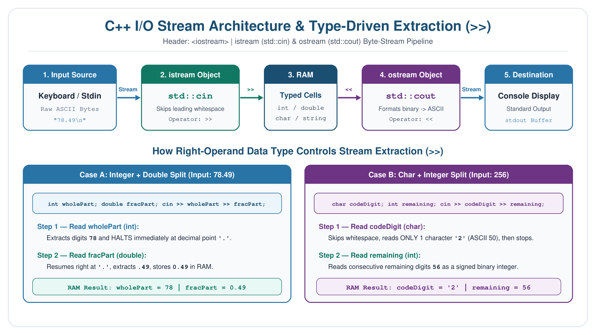
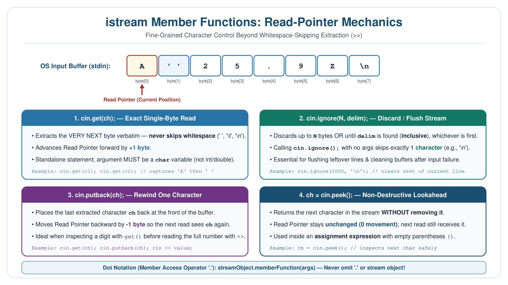
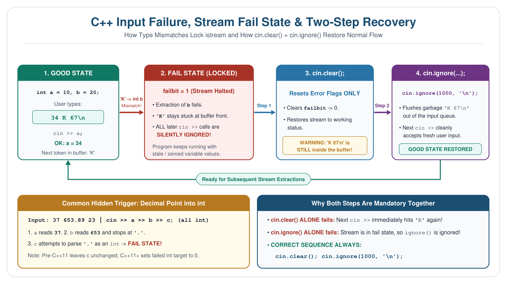
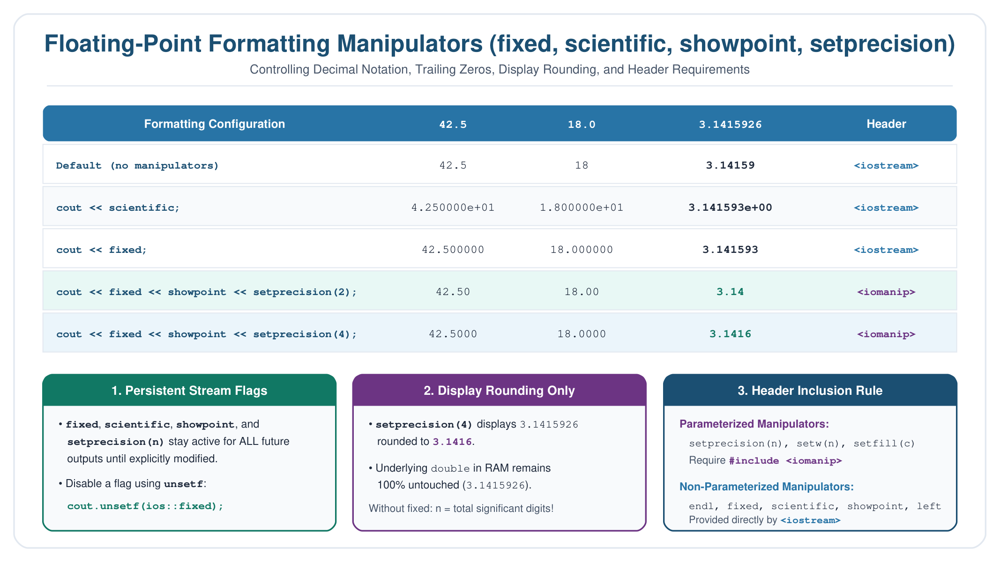
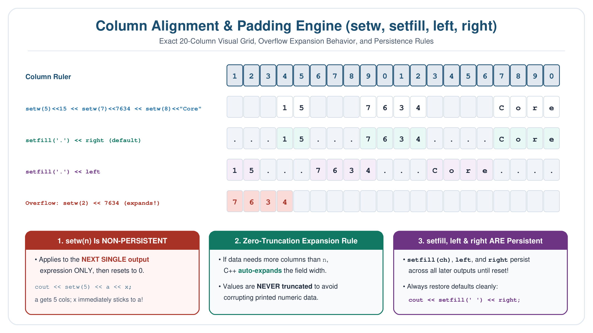
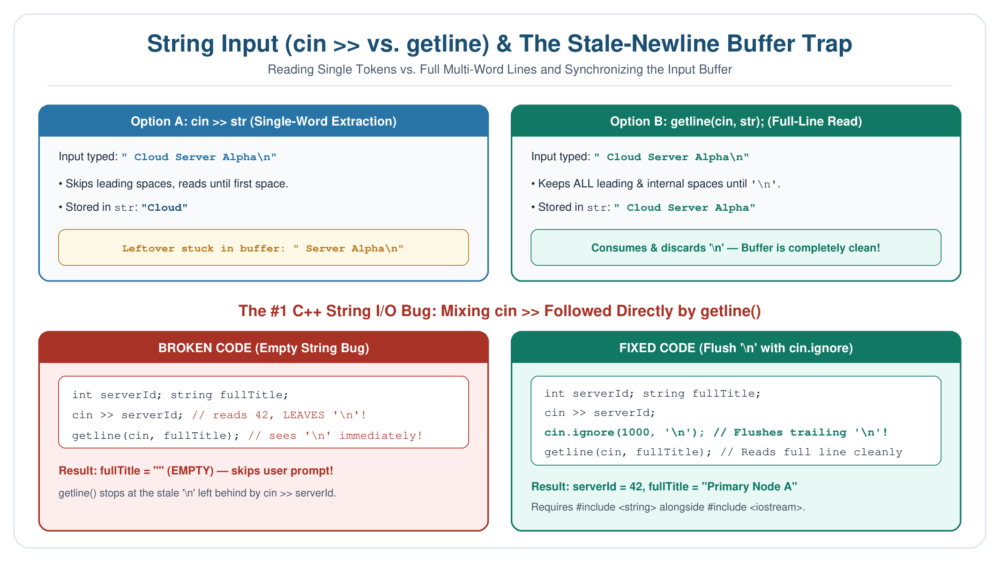
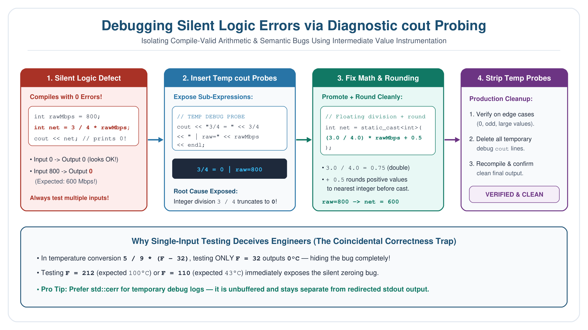
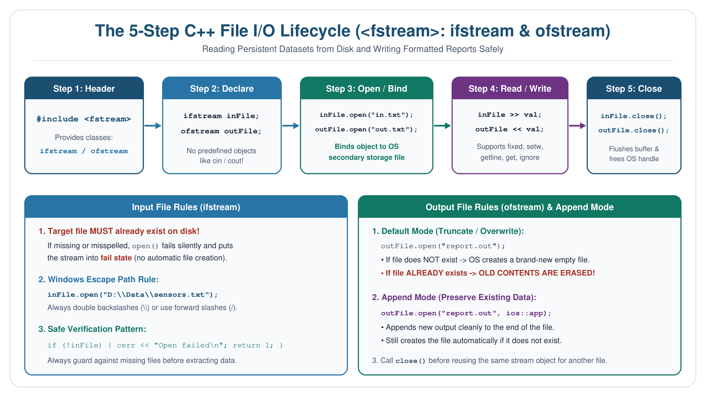

**Page 1**

## Table of Contents

- [Chapter 03 — Input and Output](#chapter-03--input-and-output)
  - [Introduction](#introduction)
  - [I/O Streams and Standard I/O Devices](#io-streams-and-standard-io-devices)
    - [cin and the Extraction Operator](#cin-and-the-extraction-operator)
  - [Using Predefined Functions in a Program](#using-predefined-functions-in-a-program)
    - [cin and the get Function](#cin-and-the-get-function)
    - [cin and the ignore Function](#cin-and-the-ignore-function)
    - [The putback and peek Functions](#the-putback-and-peek-functions)
    - [Dot Notation, Classes, and Stream Objects](#dot-notation-classes-and-stream-objects)
  - [Input Failure and Stream Recovery](#input-failure-and-stream-recovery)
    - [The clear Function and Two-Step Buffer Recovery](#the-clear-function-and-two-step-buffer-recovery)
  - [Output and Formatting Output](#output-and-formatting-output)
    - [The setprecision Manipulator](#the-setprecision-manipulator)
    - [The fixed and scientific Manipulators](#the-fixed-and-scientific-manipulators)
    - [The showpoint Manipulator](#the-showpoint-manipulator)
    - [The setw Manipulator](#the-setw-manipulator)
    - [The setfill Manipulator](#the-setfill-manipulator)
    - [The left and right Manipulators](#the-left-and-right-manipulators)
    - [Parameterized vs. Non-Parameterized Manipulators](#parameterized-vs-non-parameterized-manipulators)
  - [Input/Output and the string Type (getline)](#inputoutput-and-the-string-type-getline)
  - [Debugging: Logic Errors and Diagnostic cout Instrumentation](#debugging-logic-errors-and-diagnostic-cout-instrumentation)
  - [File Input and Output (fstream)](#file-input-and-output-fstream)
  - [Applied Engineering Case Studies](#applied-engineering-case-studies)
    - [Case Study 1: Cloud Compute Billing and Reserve Allocation Report](#case-study-1-cloud-compute-billing-and-reserve-allocation-report)
    - [Case Study 2: Automated Batch Sensor Telemetry File Processor](#case-study-2-automated-batch-sensor-telemetry-file-processor)
  - [Engineering I/O Trace Lab (Worked Diagnostic Drills)](#engineering-io-trace-lab-worked-diagnostic-drills)
  - [Chapter 03 Summary & Pitfalls Checklist](#chapter-03-summary--pitfalls-checklist)

---

**Page 2**

# <span style="color:#1B4F72">Chapter 03 — Input and Output</span>

## <span style="color:#2874A6">Introduction</span>

Every practical software system executes a continuous three-stage operational cycle: **acquiring external data (Input)**, **transforming and analyzing that data in memory (Processing)**, and **communicating structured results back to users or downstream systems (Output)**. While Chapter 2 established the core syntax for basic console I/O using `cin >>` and `cout <<`, real-world engineering demands far finer control over byte streams than whitespace-delimited reads and unformatted console dumps can provide.

Consider the practical realities of production software: interactive parsers must inspect incoming characters without losing whitespace or crashing when a user types text into a numeric field; financial ledgers and scientific telemetry reports require exact decimal precision, column alignment, and custom padding characters; multi-word strings must be captured safely without truncating at the first space; and large datasets must be ingested from and archived to **secondary storage files** rather than re-typed manually on every execution. This chapter builds a complete, systems-level mastery of C++ **I/O streams**, **predefined library functions**, **stream member functions** (`get`, `ignore`, `putback`, `peek`, `clear`), **output formatting manipulators** (`fixed`, `scientific`, `showpoint`, `setprecision`, `setw`, `setfill`, `left`, `right`), **full-line string extraction (`getline`)**, **diagnostic logic-error debugging**, and the **5-step file I/O architecture (`<fstream>`)**.

---

**Page 3**

#### <span style="color:#6C3483">المدخل الهندسي: لماذا لا يكفي `cin >>` و`cout <<` لبناء برمجيات حقيقية؟</span>

يرتكز أي نظام برمجي—من أنظمة التحكم المدمجة إلى خوادم البيانات السحابية—على ثلاث عمليات جوهرية: **جلب البيانات (`Input`)**، **معالجتها في الذاكرة (`Processing`)**، و**إخراج النتائج (`Output`)**. وفي حين قدّم الفصل الثاني الأساسيات الأولية للإدخال والإخراج، إلا أن التطبيقات الهندسية الواقعية تصطدم سريعاً بأربعة قيود حاسمة يعالجها هذا الفصل بالتفصيل الكامل:

1. **مشكلة فقدان المسافات والأسطر عند القراءة (`Whitespace Blindness`):**
   - يتجاهل مُشغّل الاستخراج `>>` جميع المسافات وعلامات الجدولة والأسطر الجديدة تلقائياً؛ وهذا يمنعك من معرفة أين ينتهي السطر، أو قراءة جملة متعددة الكلمات، أو تحليل سجل ثابت العرض. هنا تبرز دوال التدفق المتخصصة مثل **`get` و`ignore` و`putback` و`peek` و`getline`**.
2. **خطر انهيار التدفق الصامت (`Silent Input Failure`):**
   - إذا توقّع برنامجك عدداً صحيحاً فأدخل المستخدم حرفاً أو نقطة عشرية، يدخل كائن `cin` في **حالة فشل (`Fail State`)** تُعطّل جميع أوامر القراءة اللاحقة دون إيقاف البرنامج. يتناول هذا الفصل آلية التعافي الهندسي عبر **`cin.clear()`** و**`cin.ignore()`**.
3. **متطلبات التنسيق الاحترافي للتقارير (`Precision & Tabular Formatting`):**
   - لا يقبل تقرير مالي طباعة `$15` بدلاً من `$15.00`، ولا تقبل لوحة مراقبة هندسية أرقاماً مبعثرة غير مصطفة في أعمدة منتظمة؛ وهنا تأتي **مُنسِّقات التدفق (`Manipulators`)** في مكتبة `<iomanip>`.
4. **محدودية لوحة المفاتيح والشاشة (`Console Scalability Limits`):**
   - لا يمكن إدخال 50,000 قراءة مستشعر يدوياً في كل تشغيل، ولا يمكن تسليم تقرير من 200 سطر على شاشة طرفية تختفي بمجرد إغلاقها. يختتم الفصل بنقل كل مهارات الإدخال والإخراج إلى **ملفات التخزين الثانوي (`File I/O`)** عبر مكتبة **`<fstream>`**.

---

**Page 4**

## <span style="color:#2874A6">I/O Streams and Standard I/O Devices</span>

Because interfacing directly with physical peripheral controllers (keyboard interrupt handlers, terminal framebuffers, and disk block drivers) requires low-level, hardware-specific operating system code, C++ abstracts all I/O behind a unified software model called a **stream**. Formally, a **stream** is a continuous, ordered **sequence of bytes** (typically **ASCII** characters for text I/O, though streams can also transport raw binary payloads such as images or audio) flowing from a **source** to a **destination**.

C++ categorizes streams by data flow direction into two fundamental families:
- **Input Stream (`istream`):** A sequence of bytes flowing from an external input source (such as the keyboard or a disk file) *into* program memory (**RAM**).
- **Output Stream (`ostream`):** A sequence of bytes flowing *out of* program memory (**RAM**) toward an external destination (such as the console display, a printer, or a disk file).

Including the standard header **`#include <iostream>`** provides the definitions of two core stream classes—**`istream`** (input stream) and **`ostream`** (output stream)—along with two pre-instantiated global stream objects inside `namespace std`: **`cin`** (*common input*, bound to standard input `stdin`, typically the keyboard) and **`cout`** (*common output*, bound to standard output `stdout`, typically the screen). Conceptually, `<iostream>` contains declarations equivalent to:

```cpp
istream cin;
ostream cout;
```

Variables whose type is `istream` are termed **input stream variables** (or **input stream objects**), while variables of type `ostream` are termed **output stream variables** (or **output stream objects**). Because `cin` and `cout` are pre-initialized system objects with well-defined bindings, programmers must **never redefine or shadow** the identifiers `cin` or `cout` in their own code.

<p align="center">
  
</p>

---

**Page 5**

#### <span style="color:#6C3483">1. التشريح الهندسي لمفهوم «التدفق» (`Stream Abstraction`) وفصله عن العتاد</span>

في الأنظمة الحاسوبية الحقيقية، تختلف لوحة المفاتيح جذرياً في تصميمها الكهربائي عن القرص الصلب SSD وعن شاشة العرض وعن بطاقة الشبكة. لو أُجبر المبرمج على كتابة أوامر عتادية مختلفة لكل جهاز، لتحوّل أي برنامج بسيط إلى آلاف الأسطر غير القابلة للنقل بين أنظمة التشغيل.

لذلك تعتمد لغة C++ طبقة تجريد معمارية عبقرية تُعرف بـ **التدفق (`Stream`)**:
- يتعامل برنامجك مع **نهر متواصل من البايتات (`Byte Sequence`)** بغض النظر عمّا يقف خلف هذا النهر (لوحة مفاتيح، ملف نصي، أو أنبوب بيانات قادم من برنامج آخر).
- يوفّر ملف الترويسة **`<iostream>`** نوعين أساسيين (صنفين / `Classes`):
  1. **`istream`:** القالب البرمجي الذي يمتلك قدرات الاستخراج والقراءة (`>>`, `get`, `ignore`, `peek`, `putback`, `clear`).
  2. **`ostream`:** القالب البرمجي الذي يمتلك قدرات الإدراج والكتابة والتنسيق (`<<`, `setf`, `unsetf`).
- ويُنشئ النظام تلقائياً كائنين جاهزين ومربوطين مسبقاً بعتاد التشغيل القياسي قبل دخول `main()`:
  - **`std::cin`** (من النوع `istream`) ← مربوط بـ **جهاز الإدخال القياسي (`stdin`)** وهو لوحة المفاتيح افتراضياً.
  - **`std::cout`** (من النوع `ostream`) ← مربوط بـ **جهاز الإخراج القياسي (`stdout`)** وهو الشاشة افتراضياً.

| الكائن / النوع | التصنيف التقني | ملف الترويسة | النطاق (`Namespace`) | الجهاز المرتبط افتراضياً |
| --- | --- | --- | --- | --- |
| `istream` | صنف (`Class / Data Type`) | `<iostream>` | `std` | قالب عام لتدفقات الإدخال |
| `ostream` | صنف (`Class / Data Type`) | `<iostream>` | `std` | قالب عام لتدفقات الإخراج |
| `cin` | كائن (`istream Object`) | `<iostream>` | `std` | لوحة المفاتيح (`stdin`) |
| `cout` | كائن (`ostream Object`) | `<iostream>` | `std` | شاشة الطرفية (`stdout`) |

> **تحذير هندسي (`Never Shadow cin / cout`):** لا تعرّف أبداً متغيراً محلياً باسم `int cin;` أو `double cout;` داخل `main()`؛ لأن ذلك يحجب كائنات التدفق القياسية (**Name Shadowing**) ويحطم جميع أوامر الإدخال والإخراج في النطاق نفسه.

---

**Page 6**

### <span style="color:#117864">cin and the Extraction Operator</span>

The **stream extraction operator (`>>`)** is a **binary operator** requiring two strictly typed operands:
- **Left-side operand:** Must be an **input stream object** (such as `cin` or an `ifstream` file stream).
- **Right-side operand:** Must be a **modifiable variable** (an **L-value** referring to an allocated memory location in **RAM**), because the sole purpose of extraction is to write decoded data into memory. Literals (`cin >> 5;`), constants (`const`), and temporary expressions (`cin >> a + b;`) are illegal on the right-hand side.

Natively, `>>` is defined for C++'s **simple (primitive) data types** (`char`, `int`, `short`, `long`, `double`, `float`, `bool`) and is extended by the standard library via **operator overloading** for `std::string` (and can later be overloaded for programmer-defined classes). Chained extraction statements (`cin >> hourlyRate >> activeHours;`) evaluate strictly from **left to right** and behave identically to writing sequential standalone statements (`cin >> hourlyRate; cin >> activeHours;`).

Crucially, **the data type of the right-side operand determines how raw ASCII characters in the buffer are interpreted and where extraction halts**:
1. **Skipping Leading Whitespace:** Before reading *any* value, `>>` silently discards all leading whitespace characters (spaces `' '`, horizontal tabs `'\t'`, and newlines `'\n'`). Consequently, values separated by spaces, tabs, or separate lines parse identically.
2. **Reading `char`:** After skipping leading whitespace, `>>` extracts **exactly one non-whitespace character**, stores its 1-byte **ASCII** code, and immediately stops—leaving any adjacent characters untouched in the buffer.
3. **Reading `int`:** After skipping leading whitespace and an optional leading sign (`+` or `-`), `>>` consumes consecutive decimal digits (`0`–`9`) and halts immediately upon hitting whitespace or **any non-digit character** (including a decimal point `'.'` or a letter).
4. **Reading `double`:** After skipping leading whitespace and an optional sign (`+` or `-`), `>>` consumes digits and at most one decimal point `'.'` (plus optional scientific exponent notation such as `e-3`). If the input contains no decimal point (e.g., `39`), it is automatically stored as `39.0`.

---

**Page 7**

#### <span style="color:#6C3483">1. كيف يميّز `cin >>` بين المحرف `'2'` والعدد `2` والعدد `2.0`؟ (`Type-Driven Parsing`)</span>

على مستوى مخزن الإدخال (`stdin`)، لا توجد «أرقام» ولا «نصوص» — كل ما يكتبه المستخدم على لوحة المفاتيح يصل كسلسلة خام من بايتات **ASCII**. عندما يكتب المستخدم الرمزين `25` ثم يضغط `Enter`، ما يوجد في الذاكرة المؤقتة هو البايتان: `0x32` (`'2'`) ثم `0x35` (`'5'`) ثم `0x0A` (`'\n'`).

إذن، من يقرّر كيف تُفسَّر هذه البايتات؟ **نوع المتغير الموجود على يمين المُشغّل `>>`**! تأمّل تنفيذ الجملة `cin >> target;` على المدخل نفسه **`25`** باختلاف نوع `target`:

| نوع المتغير `target` | ماذا يقرأ `cin >> target;` من المدخل `25`؟ | القيمة المخزّنة في **RAM** | ما الذي يبقى في المخزن المؤقت؟ |
| --- | --- | --- | --- |
| **`char`** | يقرأ **أول محرف واحد فقط** (`'2'`) ويتوقف فوراً. | `'2'` *(رمز ASCII هو `50`)* | `'5'` و`'\n'` (محجوزان للقراءة التالية!) |
| **`int`** | يقرأ جميع الأرقام المتتالية (`25`) ويحوّلها لثنائي صحيح. | `25` *(عدد صحيح 4 بايت)* | `'\n'` فقط |
| **`double`** | يقرأ `25` ويحوّلها تلقائياً لتمثيل عائم **IEEE 754**. | `25.0` *(عدد عائم 8 بايت)* | `'\n'` فقط |

#### <span style="color:#6C3483">2. جدول المدخلات الصالحة لكل نوع بسيط (`Valid Input Contract`)</span>

| نوع المتغير الهدف | المدخل الصالح (`Valid Input`) | نقطة التوقف (`Halting Condition`) |
| --- | --- | --- |
| **`char`** | أي محرف قابل للطباعة ما عدا المسافة (`' '`). | يتوقف فور قراءة **محرف واحد بالضبط**. |
| **`int`** | عدد صحيح اختيارياً مسبوق بإشارة `+` أو `-`. | يتوقف عند أول مسافة بيضاء أو **أي محرف غير رقمي** (مثل `'.'` أو حرف). |
| **`double`** | عدد عشري أو صحيح مسبوق اختيارياً بإشارة `+` أو `-` (إن كان صحيحاً يُحوّل لـ `.0`). | يتوقف عند أول مسافة بيضاء أو محرف غير صالح ضمن صيغة الأعداد العشرية. |

---

**Page 8**

#### <span style="color:#6C3483">3. المختبر الشامل لتتبّع استخراج البيانات (`12-Case Extraction Matrix`)</span>

بفرض التصريحات التالية:

```cpp
int countA, countB;
double metricZ;
char tag, tag1, tag2;
```

ادرس بعناية كيف يتعامل `cin >>` مع 12 حالة حدّية متدرّجة التعقيد (خصوصاً الحالات التي تخلو من المسافات أو تخلط الأرقام بالأحرف والكسور):

| الحالة | جملة الإدخال (`Statement`) | المدخل في المخزن (`Input`) | حالة الذاكرة (`RAM`) والمخزن المؤقت بعد التنفيذ |
| --- | --- | --- | --- |
| **1** | `cin >> tag;` | `M` | `tag = 'M'` |
| **2** | `cin >> tag;` | `MK` | `tag = 'M'`، بينما **`'K'` تبقى معلّقة** في المخزن للأمر التالي! |
| **3** | `cin >> countA;` | `48` | `countA = 48` |
| **4** | `cin >> countA;` | `46.35` | `countA = 46`، بينما **`.35` تبقى معلّقة** في المخزن (خطر فشل لاحق لـ `int`!). |
| **5** | `cin >> metricZ;` | `39` | `metricZ = 39.0` *(تحويل تلقائي لعدد عائم)* |
| **6** | `cin >> countA >> metricZ;` | `46 32.4 68` | `countA = 46, metricZ = 32.4`؛ القيمة `68` تبقى في المخزن (وتُهمل عند انتهاء البرنامج). |
| **7** | `cin >> countA >> tag >> metricZ;` | `57A26.9` *(بلا مسافات!)* | `countA = 57` (يتوقف عند `'A'`)، `tag = 'A'`، `metricZ = 26.9`! |
| **8** | `cin >> metricZ >> tag >> countA;` | `36.78B34` *(بلا مسافات!)* | `metricZ = 36.78` (يتوقف عند `'B'`)، `tag = 'B'`، `countA = 34`! |
| **9** | `cin >> countA >> metricZ;` | `78.49` | `countA = 78` (يتوقف عند `'.'`)، ثم **`metricZ` يقرأ `.49` فتُخزَّن `0.49`**! |
| **10** | `cin >> tag >> countA;` | `256` | `tag = '2'` (محرف واحد)، ثم **`countA` يقرأ الأرقام المتبقية `56`**! |
| **11** | `cin >> countA >> tag;` | `256` *(فقط)* | `countA = 256`، ثم **يتوقف البرنامج منتظراً (`Blocked`)** إدخال محرف لـ `tag`! |
| **12** | `cin >> tag1 >> tag2;` | `X   Y` | `tag1 = 'X'`، يتخطى `>>` المسافات الثلاث، ويخزّن `tag2 = 'Y'`. |

---

**Page 9**

#### <span style="color:#6C3483">4. تشريح الحالات الحرجة الأربع التي يخطئ فيها المبرمجون (`Critical Parsing Edge Cases`)</span>

1. **فخ «نقص المدخلات» والانتظار اللانهائي (`Blocking Wait on Insufficient Input`):**
   - في الحالة رقم 11 (`cin >> countA >> tag;` مع إدخال `256` فقط وضغط `Enter`)، يبتلع `countA` العدد `256` بالكامل، ولا يجد `tag` أي محرف غير فراغي متبقٍّ؛ فيدخل البرنامج في حالة **تعليق/انتظار (`Blocked State`)** بلا أي رسالة على الشاشة حتى يكتب المستخدم قيمة جديدة ويضغط `Enter`.
2. **فخ «انشطار العدد العشري» (`Decimal Splitting Across int & double`):**
   - في الحالة رقم 9 (`cin >> countA >> metricZ;` مع إدخال `78.49`)، لا يُصدر النظام أي خطأ! يأخذ `countA` الجزء الصحيح `78` ويتوقف عند `'.'`، ثم يرى `metricZ` أن `'.49'` عدد عشري قانوني تماماً فيخزّن **`0.49`**. أما لو كان المتغير الثاني `int` أيضاً، فستصطدم القراءة بـ `'.'` ويدخل التدفق في **حالة فشل (`Fail State`)**!
3. **المدخلات الفائضة عند انتهاء البرنامج (`Excess Buffered Data`):**
   - إذا أدخل المستخدم 5 أرقام ولم يقرأ البرنامج سوى رقمين ثم وصل إلى `return 0;`، فإن القيم الثلاث المتبقية في مخزن `stdin` يُتخلّص منها تلقائياً عند إنهاء العملية (**Process Termination**) دون خطأ.
4. **استحالة قراءة المسافات بـ `>>`:**
   - إذا أردت قراءة نص مثل `"A 25"` بحيث يخزّن `ch1 = 'A'` و`ch2 = ' '` (المسافة نفسها) و`num = 25`، فإن `cin >> ch1 >> ch2 >> num;` سيفشل منطقياً تماماً لأنه يتخطى المسافة فيضع `'2'` في `ch2` و`5` في `num`! وهذا يقودنا مباشرةً إلى دوال التدفق المتقدمة (`get`, `ignore`, `putback`, `peek`).

#### <span style="color:#6C3483">5. برنامج التحقق العملي لتفكيك المدخلات المدمجة (`C++ Validation Program`)</span>

```cpp
#include <iostream>
using namespace std;

int main() {
    int sectorCode = 0;
    char zoneFlag = ' ';
    double tempCelsius = 0.0;

    // Test with: "42K19.75" (no spaces) OR "42   K   19.75" (spaced)
    cout << "Enter compact telemetry token (e.g., 42K19.75): ";
    cin >> sectorCode >> zoneFlag >> tempCelsius;

    cout << "Decoded Sector      : " << sectorCode << '\n';
    cout << "Decoded Zone Flag   : " << zoneFlag << '\n';
    cout << "Decoded Temperature : " << tempCelsius << " C\n";
    return 0;
}
```

---

**Page 10**

## <span style="color:#2874A6">Using Predefined Functions in a Program</span>

Before mastering stream member functions such as `get`, `ignore`, `putback`, and `peek`, an engineer must understand the fundamental mechanics of **functions** and **function calls**. A **function** (historically called a **subprogram**) is an encapsulated, reusable block of instructions engineered to perform one well-defined computational or I/O task. While `int main()` is invoked automatically by the operating system loader when a program starts, every other function executes **only when explicitly called (activated)** by name.

C++ ships with a rich catalog of **predefined (library) functions** organized across standard **header files**—such as `<cmath>` for mathematical computations (`pow`, `sqrt`, `fabs`, `ceil`, `floor`) and `<string>` for text operations (`.length()`). For example, the expression **`pow(2.0, 6.0)`** is a **function call** passing two **arguments (parameters)**—base `2.0` and exponent `6.0`—to the predefined power function declared in `<cmath>`, returning $2.0^{6.0} = 64.0$.

To invoke any predefined library function safely and accurately, four specifications must be known beforehand:
1. **Header File:** Which `#include <...>` directive declares the function's prototype (e.g., `#include <cmath>`).
2. **Exact Function Name:** Case-sensitive identifier (e.g., `pow`, `sqrt`, `length`).
3. **Parameter Signature:** Exact number of arguments, their order, and their required data types (e.g., `pow` expects two floating-point numbers).
4. **Return Value & Side Effect:** What value the function computes and returns (or what state mutation it performs).

---

**Page 11**

#### <span style="color:#6C3483">1. الفرق الهندسي بين الدوال المستقلة (`Standalone Functions`) والدوال العضو (`Member Functions`)</span>

عند التعامل مع مكتبة C++ القياسية، ستصادف شكلين مختلفين لاستدعاء الدوال الجاهزة، ومن الضروري التمييز بينهما مبكراً:

1. **الدوال القياسية المستقلة (`Free / Standalone Functions` — مثل دوال `<cmath>`):**
   - تُستدعى باسمها مباشرةً دون ربطها بكائن، مع تمرير المعاملات بين قوسين:
     - `pow(base, exponent)` ← تحسب $\text{base}^{\text{exponent}}$ وتعيد قيمة `double` (مثلاً `pow(4.0, 0.5)` تعيد $\sqrt{4.0} = 2.0$).
     - `sqrt(x)` ← تحسب الجذر التربيعي الموجب $\sqrt{x}$ وتعيد `double`.
     - `fabs(x)` ← تحسب القيمة المطلقة للعدد العشري $|x|$، بينما `abs(n)` في `<cstdlib>` أو `<cmath>` للأعداد الصحيحة.
     - `ceil(x)` و`floor(x)` ← تُقرّب للأعلى (السقف) أو للأسفل (الأرضية).

2. **الدوال العضو المرتبطة بكائن (`Member Functions` — مثل دوال `string` و`istream`):**
   - لا تُستدعى وحدها في الفراغ، بل تُستدعى **على كائن محدد** باستخدام **مُشغّل النقطة (`.` — Dot Notation)**، مثل `label.length()` أو `cin.get(ch)`؛ لأنها تعمل على البيانات الداخلية الخاصة بذلك الكائن بالتحديد.

| الدالة الجاهزة | ملف الترويسة | نوع الاستدعاء | المعاملات (`Parameters`) | ناتج التنفيذ / القيمة المُعادة |
| --- | --- | --- | --- | --- |
| `pow(x, y)` | `<cmath>` | مستقلة | عددان عشريان `(double, double)` | قيمة $x^y$ من النوع `double`. |
| `sqrt(x)` | `<cmath>` | مستقلة | عدد عشري غير سالب `(double)` | الجذر التربيعي $\sqrt{x}$ من النوع `double`. |
| `fabs(x)` | `<cmath>` | مستقلة | عدد عشري `(double)` | القيمة المطلقة $\lvert x \rvert$ من النوع `double`. |
| `str.length()` | `<string>` | عضو على كائن `string` | بلا معاملات `()` | عدد المحارف الفعلي داخل السلسلة `str`. |

---

**Page 12**

#### <span style="color:#6C3483">2. برنامج التحقق العملي: توظيف `<cmath>` و`<string>` في حاسبة هندسية للإشارات</span>

```cpp
//***********************************************************************
// Program: Signal Power & Identifier Telemetry Demo
// Purpose: Demonstrates calling predefined standalone math functions
//          (pow, sqrt, fabs) and string member function (.length()).
//***********************************************************************

#include <iostream>
#include <cmath>
#include <string>

using namespace std;

int main() {
    double baseVoltage = 12.5;
    double gainExponent = 3.0;
    double signalPower;
    string channelTag = "Telemetry-Alpha-09";

    // Casting pow() double result explicitly to int when an integer is needed
    cout << "2^8 discrete levels = "
         << static_cast<int>(pow(2.0, 8.0)) << '\n';             // 256

    // Using variables as arguments to pow()
    cout << baseVoltage << "^" << gainExponent << " = "
         << pow(baseVoltage, gainExponent) << '\n';              // 1953.125

    // Computing Euclidean RMS magnitude using sqrt()
    cout << "Square root of 50.0 = " << sqrt(50.0) << '\n';      // 7.07107

    // Storing function return value directly into a variable
    signalPower = pow(4.0, 2.5);                                 // 4^2.5 = 32.0
    cout << "Computed signalPower = " << signalPower << '\n';

    // Invoking member function .length() via dot notation on a string object
    cout << "Channel Tag : " << channelTag << '\n';
    cout << "Tag Length  : " << channelTag.length() << " characters\n"; // 18

    return 0;
}
```

> **ملاحظة حول دقة `pow()` مع الأسس الكسرية:** يمكن تمرير أس عشري مثل `pow(9.0, 0.5)` لحساب الجذر التربيعي أو `pow(27.0, 1.0 / 3.0)` لحساب الجذر التكعيبي؛ لكن احذر من كتابة `pow(27.0, 1 / 3)` لأن `1 / 3` قسمة صحيحة تساوي `0` فتُعيد `pow(27.0, 0) = 1.0`!

---

**Page 13**

### <span style="color:#117864">cin and the get Function</span>

Because the stream extraction operator `>>` aggressively skips all leading whitespace (`' '`, `'\t'`, `'\n'`), it is fundamentally incapable of reading input where **spaces or line breaks carry semantic meaning**. For instance, if the input stream contains `A 25` and the program must store `'A'` in `ch1`, the literal space `' '` in `ch2`, and `25` in `int num`, executing `cin >> ch1 >> ch2 >> num;` fails logically: `>>` skips the space, reads `'2'` into `ch2`, and reads only `5` into `num`. Similarly, line-by-line text processors cannot detect where one line ends and the next begins unless they can capture `'\n'` explicitly.

To solve this, the `istream` class provides the member function **`get`**, which reads the **very next character verbatim** from the input buffer—including spaces, tabs, and newline characters—and stores it into its single `char` argument:

```cpp
cin.get(varChar);
```

Here, `varChar` **must be a variable of type `char`** (passing an `int` or `double` variable to this single-argument overload is a compile-time type error). Executing `cin.get(ch1); cin.get(ch2); cin >> num;` on the input `A 25` accurately populates `ch1 = 'A'`, `ch2 = ' '`, and `num = 25`. Notice also that `cin >> ch1; cin.get(ch2); cin >> num;` produces the identical result when `'A'` is the first non-whitespace byte, because `cin >> ch1` stops right before the space, leaving `' '` as the exact next byte for `cin.get(ch2)`.

<p align="center">
  
</p>

---

**Page 14**

#### <span style="color:#6C3483">1. التشريح العتادي لمؤشر القراءة مع `cin.get(ch)` مقابل `cin >> ch`</span>

تخيّل أن المستخدم أدخل السطر التالي (حيث يمثّل الرمز `␣` مسافة فارغة واحدة):
`␣A␣25\n`

قارن خطوةً بخطوة حركة **مؤشر القراءة (`Read Pointer`)** داخل مخزن `stdin` في الحالتين التاليتين:

| تسلسل الأوامر | محتوى `ch1` | محتوى `ch2` | محتوى `num` | التحليل الدقيق لحركة مؤشر القراءة |
| --- | --- | --- | --- | --- |
| `cin >> ch1 >> ch2 >> num;` | `'A'` | **`'2'`** *(خطأ!)* | **`5`** *(خطأ!)* | تخطّى `>>` المسافة الأولى والثانية، فابتلع `'2'` داخل `ch2` وترك `5` فقط لـ `num`! |
| `cin >> ch1;` ثم `cin.get(ch2);` ثم `cin >> num;` | `'A'` | **`' '`** *(صحيح!)* | **`25`** *(صحيح!)* | تخطّى `>>` المسافة الأولى فقط وقرأ `'A'`، ثم التقط `get` المسافة التي تليها بالضبط، ثم قرأ `>>` العدد `25` كاملاً! |
| `cin.get(ch1); cin.get(ch2);` *(على المدخل نفسه)* | **`' '`** *(المسافة البادئة!)* | `'A'` | — | لأن `get` لا يتخطى المسافة البادئة، فإنه يقرأ المسافة الأولى في `ch1` والحرف `'A'` في `ch2`! |

#### <span style="color:#6C3483">2. القواعد الصارمة والفخاخ الشائعة لدالة `cin.get(ch)`</span>

1. **مقيد بنوع `char` فقط (`char`-Only Constraint):** لا يجوز كتابة `int num; cin.get(num);`؛ هذه الصيغة تقبل متغيراً من نوع `char` حصراً.
2. **عدم إمكانية التسلسل بحجة واحدة:** تقرأ كل استدعاءة لـ `cin.get(ch)` **بايتاً واحداً فقط**؛ لقراءة حرفين متتاليين يجب استدعاؤها مرتين.
3. **التقاط محرف السطر الجديد المتبقي (`Stale '\n'`):** إذا كتبت `cin >> x;` ثم أتبعتها مباشرةً بـ `cin.get(ch);`، فستلتقط `cin.get(ch)` محرف **`'\n'`** المتبقي من ضغطة `Enter` السابقة بدلاً من الحرف الجديد الذي ينوي المستخدم إدخاله!

```cpp
#include <iostream>
using namespace std;

int main() {
    char codeLetter, separator;
    int portNumber;

    // Try typing: "R 8080"
    cout << "Enter flag, a single separator char, and port (e.g., R 8080): ";
    cin >> codeLetter;      // Skips any leading spaces, reads 'R'
    cin.get(separator);     // Captures the exact next byte (even if it is ' ')
    cin >> portNumber;      // Reads 8080

    cout << "Flag      : [" << codeLetter << "]\n";
    cout << "Separator : [" << separator << "] (ASCII "
         << static_cast<int>(separator) << ")\n";
    cout << "Port      : " << portNumber << '\n';
    return 0;
}
```

---

**Page 15**

### <span style="color:#117864">cin and the ignore Function</span>

In structured data ingestion—such as parsing only the first telemetry value on each line of a multi-column report, skipping human-readable comments, or flushing corrupted bytes from an input buffer—a program often needs to **discard unwanted characters** cleanly. The `istream` member function **`ignore`** accomplishes this with a dual-termination guard:

```cpp
cin.ignore(intExp, chExp);
```

Here, **`intExp`** is an integer expression specifying the **maximum number of characters to discard**, and **`chExp`** is a `char` expression specifying a **stop delimiter character**. When executed, `cin.ignore(intExp, chExp)` discards characters from the stream until **either** `intExp` characters have been skipped **or** the delimiter `chExp` has been encountered **and itself discarded**—**whichever occurs first**.

For example, **`cin.ignore(100, '\n');`** flushes up to 100 characters or the entire remainder of the current line through `'\n'`:
- If no `'\n'` appears among the next 120 characters, `ignore` discards exactly characters 1 through 100, leaving character 101 at the front of the buffer.
- If `'\n'` appears at position 75, `ignore` discards characters 1 through 75 (including `'\n'`), leaving character 76 (the start of the next line) ready for the next read.

When invoked with **no arguments**—**`cin.ignore();`**—it defaults to `cin.ignore(1, EOF)`, simply skipping the **very next single character** (commonly used to consume a single stray `'\n'`).

---

**Page 16**

#### <span style="color:#6C3483">1. التشريح التنفيذي لقاعدة «أيهما أسبق» (`Whichever Comes First`) وحذف المحدِّد نفسه</span>

من أهم التفاصيل الهندسية التي يجب الانتباه لها في `cin.ignore(N, delim)` أن **محرف التوقف `delim` نفسه يُحذف (Inclusive Discard)** ولا يبقى في المخزن! تأمّل المثالين التاليين على المدخل الحرفي:
`Status: OK. Next node active.`

| التسلسل البرمجي | ما يُخزّن في `ch1` | ما تحذفه دالة `ignore` بدقة | ما يُخزّن في `ch2` | السبب الهندسي |
| --- | --- | --- | --- | --- |
| `cin >> ch1;`<br>`cin.ignore(100, '.');`<br>`cin >> ch2;` | `'S'` | تحذف `tatus: OK.` *(10 محارف، بما فيها النقطة `.`)* | **`'N'`** | وصلت إلى النقطة `.` قبل بلوغ 100 محرف، فحذفت النقطة وتوقفت؛ ثم تخطّى `cin >> ch2` المسافة بعد النقطة وقرأ `'N'`. |
| `cin >> ch1;`<br>`cin.ignore(5, '.');`<br>`cin >> ch2;` | `'S'` | تحذف 5 محارف فقط: `tatus` | **`':'`** | بلغت الحد الأقصى (`5` محارف) قبل أن تجد النقطة `.`، فتوقفت فوراً وأصبح المحرف التالي هو `':'`! |
| `cin >> ch1;`<br>`cin.ignore();`<br>`cin >> ch2;` | `'S'` | تحذف محرفاً واحداً فقط: `'t'` | **`'a'`** | الصيغة الخالية من المعاملات تحذف بايتاً واحداً فقط. |

#### <span style="color:#6C3483">2. مثال عملي: قراءة أول رقم فقط من كل سطر وتجاهل الباقي (`Line-Head Extraction`)</span>

بفرض أن ملفاً أو مدخلاً يحتوي على سطرين من القراءات، ونريد فقط **أول قراءة** من كل سطر:

```text
250 670 890 430 720
120 780 340
```

```cpp
#include <iostream>
using namespace std;

int main() {
    int line1First = 0, line2First = 0;

    cout << "Paste two lines of space-separated integers:\n";
    cin >> line1First;          // Reads 250 from line 1
    cin.ignore(1000, '\n');     // Discards " 670 890 430 720\n" completely!
    cin >> line2First;          // Reads 120 from line 2

    cout << "Line 1 head = " << line1First << '\n';   // 250
    cout << "Line 2 head = " << line2First << '\n';   // 120
    return 0;
}
```

> **نصيحة هندسية متقدمة:** في المشاريع الاحترافية، بدلاً من تخمين رقم عشوائي مثل `100` (قد يكون السطر أطول من 100 حرف!)، يستخدم مهندسو C++ الثابت `numeric_limits<streamsize>::max()` من `<limits>` لتجاهل أي طول ممكن للسطر حتى `'\n'`. وفي البرامج التأسيسية، يُعد `1000` أو `10000` خياراً عملياً آمناً.

---

**Page 17**

### <span style="color:#117864">The putback and peek Functions</span>

Consider parsing a heterogeneous data stream where some tokens start with alphabetic command letters (`'A'`, `'Q'`) while other tokens begin with numeric digits (`450`, `92.5`) that must be decoded directly as `int` or `double` values. Reading digits one character at a time and manually converting ASCII codes into multi-digit numbers is error-prone and unnecessary. C++ solves this lookahead problem cleanly with two complementary `istream` member functions: **`putback`** and **`peek`**.

1. **`putback` (Push Last Extracted Byte Back):**
   ```cpp
   istreamVar.putback(ch);
   ```
   Places the character `ch` (the last character previously extracted by `get`) **back at the front of the input stream**, rewinding the read pointer by 1 byte so the very next read (`get` or `>>`) receives `ch` again. For example, if you inspect a byte via `cin.get(ch)` and discover it is a digit `'4'`, calling `cin.putback(ch)` restores `'4'` to the buffer so `cin >> number;` parses the complete integer `450` seamlessly.

2. **`peek` (Non-Destructive Lookahead):**
   ```cpp
   ch = istreamVar.peek();
   ```
   Returns the next character sitting at the front of the input stream **without removing it** and **without advancing the read pointer**. Notice two syntactic differences from `get`, `ignore`, and `putback`:
   - **`peek()` is a value-returning function** used inside an **assignment statement** (or expression), never as a standalone statement.
   - **`peek()` takes zero arguments**, requiring **empty parentheses `()`**.

---

**Page 18**

#### <span style="color:#6C3483">1. المقارنة الهندسية الدقيقة بين `get` و`putback` و`peek`</span>

| الدالة (`Member Function`) | الصيغة النحوية الصحيحة | هل تحرّك مؤشر القراءة؟ | هل تُستخدم في جملة إسناد (`=`)؟ | الوظيفة الهندسية |
| --- | --- | --- | --- | --- |
| **`get`** | `cin.get(ch);` | نعم (**`+1`** للأمام) | لا (جملة مستقلة) | تسحب المحرف التالي (حتى الفراغ) وتخزّنه في `ch`. |
| **`putback`** | `cin.putback(ch);` | نعم (**`-1`** للخلف) | لا (جملة مستقلة) | تُعيد آخر محرف مسحوب إلى مقدمة طابور الإدخال. |
| **`peek`** | `ch = cin.peek();` | **لا (`0` حركة!)** | **نعم (دالة مُعيدة لقيمة)** | تسترق النظر إلى المحرف التالي دون سحبه من الطابور. |

#### <span style="color:#6C3483">2. برنامج التتبع الكامل وجدول حركة مؤشر المخزن (`Complete Trace Program`)</span>

تتبّع البرنامج التالي عند إدخال السلسلة **`K84M`** (مكوّنة من 4 بايتات متبوعة بـ `\n`):

```cpp
#include <iostream>
using namespace std;

int main() {
    char ch;

    cout << "Enter 4-character packet header (e.g., K84M): ";

    cin.get(ch);                                          // Step 1
    cout << "1. After 1st get(ch)      -> ch = " << ch << '\n';

    cin.get(ch);                                          // Step 2
    cout << "2. After 2nd get(ch)      -> ch = " << ch << '\n';

    cin.putback(ch);                                      // Step 3
    cin.get(ch);                                          // Step 4
    cout << "3. After putback + get    -> ch = " << ch << '\n';

    ch = cin.peek();                                      // Step 5
    cout << "4. After ch = cin.peek()  -> ch = " << ch << '\n';

    cin.get(ch);                                          // Step 6
    cout << "5. After get following peek -> ch = " << ch << '\n';

    return 0;
}
```

**جدول تتبع حالة المخزن المؤقت ومؤشر القراءة خطوةً بخطوة (المدخل: `K84M\n`):**

| الخطوة | الجملة المنفَّذة | قيمة `ch` في RAM | محتوى المخزن المتبقي أمام المؤشر | التحليل الهندسي |
| --- | --- | --- | --- | --- |
| **البداية** | *(قبل التنفيذ)* | `?` | `^K84M\n` | المؤشر يقف على البايت الأول `'K'`. |
| **Step 1** | `cin.get(ch);` | **`'K'`** | `^84M\n` | سُحب `'K'` وتقدّم المؤشر خطوة واحدة إلى `'8'`. |
| **Step 2** | `cin.get(ch);` | **`'8'`** | `^4M\n` | سُحب `'8'` وتقدّم المؤشر إلى `'4'`. |
| **Step 3** | `cin.putback(ch);` | `'8'` | **`^84M\n`** | أُعيد `'8'` إلى مقدمة المخزن وتراجع المؤشر خطوة للخلف! |
| **Step 4** | `cin.get(ch);` | **`'8'`** | `^4M\n` | سحب `'8'` مرة أخرى لأنها أُعيدت في الخطوة 3. |
| **Step 5** | `ch = cin.peek();` | **`'4'`** | **`^4M\n`** *(لم يتغير!)* | استراق نظر فقط: نسخ `'4'` إلى `ch` وبقيت `'4'` في المخزن! |
| **Step 6** | `cin.get(ch);` | **`'4'`** | `^M\n` | سُحبت `'4'` نفسها التي رآها `peek()` للتو وتقدّم المؤشر إلى `'M'`. |

---

**Page 19**

### <span style="color:#117864">Dot Notation, Classes, and Stream Objects</span>

Every time you write `cin.get(ch)`, `cin.ignore(100, '\n')`, `cin.peek()`, or `str.length()`, you are using C++'s **dot notation**—formally powered by the **member access operator (`.`)**. The dot operator bridges two distinct entities:
- **Left of the dot:** An **object** (instance) such as `cin`, `cout`, `inFile`, or a `string` variable `tag`.
- **Right of the dot:** A **member function** belonging to that object's **class** (such as `get`, `ignore`, `putback`, `peek`, `clear`, `open`, `close`, or `length`).

At this point in your C++ foundation, establish the exact object-oriented terminology that will govern Chapters 10–13:
- **`istream`, `ostream`, `ifstream`, `ofstream`, and `string`** are **classes** (user/library-defined blueprints that bundle internal state data with specialized member functions).
- **`cin`, `cout`, `inFile`, `outFile`, and `tag`** are **objects** (concrete runtime instances created from those classes; stream variables are formally called **stream objects**).

#### <span style="color:#6C3483">الأخطاء النحوية الثلاثة القاتلة في صيغة النقطة (`Dot Notation Traps`)</span>

| الكود الخاطئ | التشخيص المترجمي (`Compiler Error`) | الصيغة الهندسية الصحيحة |
| --- | --- | --- |
| `cinget(ch);` | حذف النقطة يدمج المعرفين في اسم غريب غير معرَّف `cinget`. | `cin.get(ch);` |
| `cin.getch;` | حذف القوسين يجعل المترجم يبحث عن حقل بيانات باسم `getch` بدلاً من استدعاء دالة. | `cin.get(ch);` |
| `get(ch);` أو `ignore(100, '\n');` | استدعاء دالة عضو دون تحديد الكائن الذي تنتمي إليه (`undeclared identifier`). | `cin.get(ch);` / `cin.ignore(100, '\n');` |

---

**Page 20**

## <span style="color:#2874A6">Input Failure and Stream Recovery</span>

Even when a program is 100% free of syntax errors, runtime execution can break catastrophically if **external input data does not match the data type of the receiving variable**. While C++ permits entering a whole number (e.g., `42`) into a `double` variable (storing `42.0`), it does **not** tolerate feeding non-numeric characters—such as a letter `'K'` or a stray decimal point `'.'`—into an `int` or `double` variable. Such a type mismatch triggers an **input failure**, immediately setting the stream's internal **`failbit`** and locking the stream into the **fail state**.

Once an `istream` object enters the **fail state**, two dangerous consequences unfold silently:
1. **Total Stream Paralysis:** Every subsequent input operation on that stream (`cin >> ...`, `cin.get(...)`, `cin.ignore(...)`, `getline(cin, ...)`) is **immediately ignored** and does nothing.
2. **Silent Program Continuation:** The program does **not** crash or print an error message; instead, it quietly marches forward executing calculations using whatever stale or zeroed values happen to reside in memory—producing completely corrupted outputs!

> **Note (Historical vs. Modern C++11+ Behavior on Failed Target Variable):** Under pre-C++11 compilers (such as C++98/03), when `cin >> b` fails on `'K'`, the target variable `b` retains its previous value untouched. Starting with **C++11 and all modern compilers**, a failed numeric extraction writes **`0`** into `b` (while all *subsequent* variables `c`, `d` in the same chain remain untouched because the stream is already locked in fail state). In both standards, the stream enters fail state and ignores every later read until explicitly recovered.

<p align="center">
  
</p>

---

**Page 21**

#### <span style="color:#6C3483">1. السيناريوهان الأشهر لحدوث «فشل الإدخال» (`Two Classic Fail-State Triggers`)</span>

تخيّل أن لدينا المتغيرات المهيأة مسبقاً التالية:

```cpp
int nodeA = 10, nodeB = 20, nodeC = 30, nodeD = 40;
cin >> nodeA >> nodeB >> nodeC >> nodeD;
```

1. **السيناريو الأول — إدخال حرف أبجدي في متغير رقمي (`34 K 67 28`):**
   - ينجح استخراج `34` وتُخزّن في `nodeA`.
   - يصل مؤشر القراءة إلى `'K'` ويحاول تحويلها إلى عدد صحيح لـ `nodeB` ← **يفشل التحويل فوراً** ويدخل `cin` في **`Fail State`**.
   - تبقى `'K'` محبوسة في مقدمة المخزن المؤقت، ويتجاهل النظام قراءة `nodeC` و`nodeD` تماماً (تحتفظ `nodeC = 30` و`nodeD = 40` بقيمتيهما القديمتين، بينما تحتفظ `nodeB` بـ `20` في المترجمات القديمة أو تُصفّر إلى `0` في معيار **C++11** وما بعده).

2. **السيناريو الثاني الخفيّ — إدخال عدد عشري في سلسلة متغيرات `int` (`37 653.89 23 76`):**
   - يُقرأ `37` بنجاح في `nodeA`.
   - يُقرأ الجزء الصحيح `653` بنجاح في `nodeB`، ثم يتوقف الاستخراج عند النقطة العشرية `'.'`.
   - يأتي دور `nodeC` (وهو من نوع `int`!) فيصطدم مباشرةً بالنقطة العشرية `'.'` — وهي ليست رقماً صحيحاً! يدخل `cin` فوراً في **`Fail State`** وتُهمل بقية الأرقام `23` و`76` بصمت تام!

| المدخل المُمرَّر إلى `cin >> a >> b >> c >> d;` | `a` (الأصل 10) | `b` (الأصل 20) | `c` (الأصل 30) | `d` (الأصل 40) | سبب تعثّر التدفق |
| --- | --- | --- | --- | --- | --- |
| `34 K 67 28` | **`34`** | `20` *(أو `0` في C++11+)* | `30` *(أُهمِلت)* | `40` *(أُهمِلت)* | اصطدام `b` بالمحرف `'K'`. |
| `37 653.89 23 76` | **`37`** | **`653`** | `30` *(أو `0` في C++11+)* | `40` *(أُهمِلت)* | اصطدام `c` بالنقطة العشرية `'.'` المتبقية بعد `653`. |

---

**Page 22**

### <span style="color:#117864">The clear Function and Two-Step Buffer Recovery</span>

To rescue a stream object locked in the **fail state**, C++ provides the `istream` member function **`clear()`**:

```cpp
istreamVar.clear();
```

However, **`cin.clear()` performs only half of the recovery**: it resets the stream's internal error state flags (`failbit` and `eofbit`) back to the working **good state**, **without removing a single byte from the input buffer**. The offending garbage characters (e.g., `'K 67\n'` or `'.89 23 76\n'`) are still sitting right at the read pointer!

Consequently, robust stream recovery in C++ is **always an indivisible two-step protocol**:
1. **`cin.clear();`** — Unlocks the stream by resetting internal error flags to `goodbit`.
2. **`cin.ignore(1000, '\n');`** — Flushes all remaining invalid characters on the corrupted line out of the input buffer.

#### <span style="color:#6C3483">1. لماذا تفشل أي خطوة منهما بمفردها؟ (`Why Order & Pairing Are Mandatory`)</span>

- **لو استدعيت `cin.clear()` وحدها (دون `ignore`):** يفتح التدفق من جديد، لكن أول جملة `cin >>` تالية تصطدم فوراً بالحرف `'K'` نفسه الموجود في مقدمة الطابور، فيعود التدفق إلى **`Fail State`** في أقل من ميكروثانية!
- **لو استدعيت `cin.ignore(...)` وحدها (دون `clear` أولاً):** لأن التدفق ما يزال في **`Fail State`**، فإن `cin.ignore(...)` نفسها تُتجاهل ولا تحذف حرفاً واحداً من المخزن!
- **الحل الهندسي الصحيح دوماً بالترتيب الصارم:**

```cpp
cin.clear();             // Step 1: Unlock the stream flags
cin.ignore(1000, '\n');  // Step 2: Flush the corrupted line from stdin
```

---

**Page 23**

#### <span style="color:#6C3483">2. برنامج التحقق العملي: محاكاة فشل الإدخال والتعافي الكامل (`C++ Validation Program`)</span>

```cpp
//***********************************************************************
// Program: Stream Fail-State Recovery Demonstration
// Purpose: Demonstrates how invalid character input locks std::cin,
//          and how cin.clear() + cin.ignore() restore normal reading.
//***********************************************************************

#include <iostream>
using namespace std;

int main() {
    int primaryId = 100;
    int backupId = 200;

    // Deliberately test by entering: "78 X"
    cout << "Phase 1 — Enter an integer followed by a letter (e.g., 78 X): ";
    cin >> primaryId >> backupId;

    cout << "After invalid input -> primaryId = " << primaryId
         << ", backupId = " << backupId << '\n';

    // Mandatory Two-Step Recovery Protocol
    cin.clear();                 // Step 1: Reset failbit -> goodbit
    cin.ignore(1000, '\n');      // Step 2: Discard "X\n" from buffer

    cout << "\nStream recovered! Now enter two valid integers (e.g., 512 768): ";
    cin >> primaryId >> backupId;

    cout << "After recovery      -> primaryId = " << primaryId
         << ", backupId = " << backupId << '\n';

    return 0;
}
```

**التشغيل النموذجي (`Sample Run`):**

```text
Phase 1 — Enter an integer followed by a letter (e.g., 78 X): 78 X
After invalid input -> primaryId = 78, backupId = 0

Stream recovered! Now enter two valid integers (e.g., 512 768): 512 768
After recovery      -> primaryId = 512, backupId = 768
```

> **ملاحظة:** يمكنك فحص ما إذا كان التدفق في حالة فشل برمجياً باستخدام الشرط `if (!cin)` أو `if (cin.fail())` (وسنتوسع في بنى الاختيار في الفصل الرابع)، ثم تنفيذ بروتوكول التعافي تلقائياً وإعادة مطالبة المستخدم بالإدخال الصحيح.

---

**Page 24**

#### <span style="color:#6C3483">3. الجدول المرجعي الشامل لأدوات التحكم بتدفق الإدخال (`Input Control Master Reference`)</span>

| الأداة (`Tool`) | الصيغة القياسية | هل تتخطى الفراغات؟ | الأثر على مؤشر القراءة وحالة التدفق |
| --- | --- | --- | --- |
| **`>>`** | `cin >> var;` | **نعم** | تقرأ قيمة حسب نوع `var`؛ تدخل `Fail State` عند عدم تطابق النوع. |
| **`get`** | `cin.get(ch);` | **لا** | تقرأ بايتاً واحداً حرفياً (`char` فقط) وتحرك المؤشر `+1`. |
| **`ignore`** | `cin.ignore(N, delim);` | **لا** | تحذف حتى `N` بايت أو حتى `delim` (شاملة `delim`)؛ بلا معاملات تحذف بايتاً واحداً. |
| **`putback`** | `cin.putback(ch);` | — | تعيد آخر محرف مسحوب إلى مقدمة المخزن (`-1`). |
| **`peek`** | `ch = cin.peek();` | **لا** | تعيد المحرف التالي في جملة إسناد دون تحريك المؤشر (`0`). |
| **`clear`** | `cin.clear();` | — | تصفّر رايات الخطأ (`failbit`) فقط؛ **لا تنظّف المخزن المؤقت**! |

---

**Page 25**

## <span style="color:#2874A6">Output and Formatting Output</span>

Computing mathematically exact values inside CPU registers and **RAM** is only half of engineering a reliable software system; rendering those values into a clear, domain-compliant visual format is equally critical. In production environments, unformatted default console output fails strict domain requirements:
- **Financial & Billing Systems:** Currencies must always print with exactly two fractional digits and trailing zeros (`$145.00`, never `$145` or `$145.5`).
- **Scientific & Telemetry Instrumentation:** Experimental measurements often require six to ten decimal places or normalized scientific notation (`3.545000e+01`, `1.000000e-03`) to prevent loss of visual significance.
- **Tabular Dashboards & Archival Reports:** Multi-column summaries demand uniform column widths, left-aligned text labels, right-aligned numeric values so decimal points align vertically, and custom visual leaders (such as dots `....` or dashes `----`) linking labels to figures.

Recall the general syntax of a C++ output statement:

```cpp
cout << expression_or_manipulator << expression_or_manipulator ...;
```

Internally, every `ostream` object (such as `cout` or an `ofstream` file stream) maintains a hidden **formatting state block** storing: (1) its current floating-point notation mode (`fixed`, `scientific`, or default general), (2) its active precision integer, (3) its decimal-point display flag (`showpoint`), (4) its alignment mode (`left` or `right`), (5) its fill character (default `' '`), and (6) its one-shot field width counter (`0` by default). Inserting a **stream manipulator** into `<<` modifies these internal state fields cleanly without altering any underlying variable in memory.

<p align="center">
  
</p>

---

**Page 26**

### <span style="color:#117864">The setprecision Manipulator</span>

By default—before any formatting manipulator is applied—C++ prints floating-point numbers using a compact general format limited typically to **six significant digits**, omitting unnecessary trailing zeros and switching automatically to scientific notation whenever numbers grow very large or very small. To control numeric precision deterministically, C++ provides the parameterized manipulator **`setprecision`**:

```cpp
cout << setprecision(n);
```

Here, **`n`** is a non-negative integer argument specifying the target precision. Because **`setprecision`** accepts a parameter, any source file using it **must include the `<iomanip>` header file** (`#include <iomanip>`). Once inserted into an output stream, `setprecision(n)` is **persistent**: it governs every subsequent floating-point output sent to that stream until a later `setprecision(k)` overrides it.

Crucially, **`setprecision(n)` alters ONLY the ASCII display representation**—applying standard **display rounding**—while leaving the underlying 64-bit **IEEE 754 `double`** stored in **RAM** completely unmodified.

#### <span style="color:#6C3483">1. السلوك المزدوج الخفي لـ `setprecision(n)`: مع `fixed` مقابل بدون `fixed`</span>

أكثر الأخطاء شيوعاً لدى طلاب الهندسة في اختبارات C++ هو الاعتقاد بأن `setprecision(n)` تعني دائماً «عدد الأرقام بعد الفاصلة العشرية». في الحقيقة، يفسّر كائن `ostream` القيمة `n` بطريقتين مختلفتين جذرياً اعتماداً على حالة راية `fixed`:

1. **بدون `fixed` (الوضع العام الافتراضي — Significant Digits Mode):**
   - تمثّل `n` **العدد الكلي للأرقام المعنوية (`Total Significant Digits`)** قبل الفاصلة العشرية وبعدها معاً!
   - إذا كان عدد خانات الجزء الصحيح **أكبر من `n`**، يقفز C++ تلقائياً إلى **الصيغة العلمية (`e+`)** لإجبار العدد على التوافق مع `n` أرقام معنوية!
2. **مع `fixed` أو `scientific` (وضع الخانات العشرية — Fractional Digits Mode):**
   - تمثّل `n` **عدد الخانات بعد الفاصلة العشرية بالضبط** بغض النظر عن طول الجزء الصحيح، وهو الوضع المطلوب في 95% من التطبيقات العملية.

---

**Page 27**

#### <span style="color:#6C3483">2. جدول مقارنة أثر `setprecision(n)` في كلا الوضعين على القيمة نفسها</span>

تأمّل المخرج الدقيق للقيمة `double metric = 1234.56789;` عند تغيير `n` مع غياب `fixed` ثم مع تفعيل `fixed`:

| الجملة المنفَّذة | المخرج بدون `fixed` (أرقام معنوية كلية) | المخرج مع `fixed` (خانات بعد الفاصلة) | التحليل الهندسي |
| --- | --- | --- | --- |
| `setprecision(2)` | **`1.2e+03`** *(قفز للعلمية!)* | **`1234.57`** | بدون `fixed`: `1234` يملك 4 خانات > 2 فحوّله إلى $1.2 \times 10^3$! |
| `setprecision(3)` | **`1.23e+03`** | **`1234.568`** | مع `fixed`: يطبع كل الجزء الصحيح ثم 3 خانات عشرية مقرَّبة. |
| `setprecision(4)` | **`1235`** *(بلا كسر!)* | **`1234.5679`** | بدون `fixed`: استهلكت الخانات الأربع للجزء الصحيح مع تقريب `.56` لأعلى! |
| `setprecision(6)` | **`1234.57`** | **`1234.567890`** | مع `fixed`: يُكمل الخانة السادسة بصفر لاحق (`0`). |

#### <span style="color:#6C3483">3. قاعدة «التقريب العرضي فقط» (`Display Rounding vs. RAM Precision`)</span>

عندما تخزّن قيمة عالية الدقة مثل `double calibrationFactor = 3.14159265;` وتطبعها مع `cout << fixed << setprecision(2) << calibrationFactor;`:
- تعرض الشاشة **`3.14`** فقط؛ وإذا غيّرتها لاحقاً إلى `setprecision(4)` تعرض **`3.1416`** (تقريب الخانة الرابعة لأن الخانة الخامسة `9 >= 5`).
- **الذاكرة (`RAM`) لم تُمسّ مطلقاً:** يظل المتغير `calibrationFactor` يحمل قيمته الثنائية الدقيقة `3.14159265` كاملةً لاستخدامها في أي حسابات لاحقة دون أي تراكم لخطأ التقريب.

---

**Page 28**

#### <span style="color:#6C3483">4. برنامج التحقق العملي لدالة `setprecision`: كشف مفاجأة الأرقام المعنوية والتبديل الفوري</span>

```cpp
//***********************************************************************
// Program: setprecision Behavior — General vs. Fixed Mode Comparison
// Purpose: Demonstrates how setprecision(n) counts total significant
//          digits by default, switches to decimal places under fixed,
//          rounds only the display output, and persists across outputs.
//***********************************************************************

#include <iostream>
#include <iomanip>    // Mandatory header for setprecision()

using namespace std;

int main() {
    double sensorPressure = 1234.56789;

    cout << "=== 1. Default General Mode (Significant Digits) ===\n";
    cout << "setprecision(2): " << setprecision(2) << sensorPressure << '\n';
    cout << "setprecision(4): " << setprecision(4) << sensorPressure << '\n';
    cout << "setprecision(6): " << setprecision(6) << sensorPressure << "\n\n";

    cout << "=== 2. Fixed Decimal Mode (Digits After Decimal Point) ===\n";
    cout << fixed;
    cout << "setprecision(2): " << setprecision(2) << sensorPressure << '\n';
    cout << "setprecision(4): " << setprecision(4) << sensorPressure << '\n';
    cout << "setprecision(6): " << setprecision(6) << sensorPressure << "\n\n";

    // Prove RAM was never altered by earlier setprecision(2) rounding:
    cout << "Full RAM check (precision 5): "
         << setprecision(5) << sensorPressure << '\n';

    return 0;
}
```

**المخرج المتوقّع (`Expected Output`):**

```text
=== 1. Default General Mode (Significant Digits) ===
setprecision(2): 1.2e+03
setprecision(4): 1235
setprecision(6): 1234.57

=== 2. Fixed Decimal Mode (Digits After Decimal Point) ===
setprecision(2): 1234.57
setprecision(4): 1234.5679
setprecision(6): 1234.567890

Full RAM check (precision 5): 1234.56789
```

---

**Page 29**

#### <span style="color:#6C3483">5. فخاخ شائعة مع `setprecision` (`Common Pitfalls`)</span>

1. **نسيان `#include <iomanip>`:** يسبّب خطأ ترجمة فوري (`'setprecision' was not declared in this scope`) حتى لو كان `#include <iostream>` موجوداً.
2. **نسيان تأثير الاستمرارية (`Persistence Surprise`):** إذا ضبطت `cout << setprecision(1);` لطباعة نسبة مئوية في بداية البرنامج، فستظل جميع القيم العشرية اللاحقة تُطبع بخانة واحدة فقط ما لم تُعد ضبطها صراحةً!
3. **لا يؤثر على الأعداد الصحيحة (`No Effect on int`):** جملة `cout << fixed << setprecision(2) << 42;` تطبع **`42`** كما هي دون `.00`؛ لأن مُنسِّقات الفاصلة العائمة لا تؤثر إلا على الأنواع العائمة (`float`, `double`, `long double`).

---

**Page 30**

### <span style="color:#117864">The fixed and scientific Manipulators</span>

Inside every `ostream` object, a dedicated bit-field named **`ios::floatfield`** controls how binary floating-point values are formatted into decimal text. C++ exposes two mutually exclusive non-parameterized manipulators (provided directly by **`<iostream>`**, requiring no `<iomanip>`) to configure this mode:

1. **`fixed` (Fixed-Point Decimal Notation):**
   ```cpp
   cout << fixed;
   ```
   Instructs the stream to print all subsequent floating-point values in standard non-exponential decimal notation (e.g., `35.450000`, `0.010000`). Unless `setprecision(n)` was already called, the default precision under `fixed` is **6 digits after the decimal point**.

2. **`scientific` (Normalized Exponential Notation):**
   ```cpp
   cout << scientific;
   ```
   Instructs the stream to print all subsequent floating-point values in normalized scientific form $d.dddddd\text{e}\pm xx$ with exactly one non-zero digit before the decimal point (e.g., `3.545000e+01`, `1.000000e-02`).

3. **Disabling `fixed` or `scientific` with `unsetf()`:**
   Both `fixed` and `scientific` are **persistent** flags. Switching from `scientific` to `fixed` automatically clears `scientific` (because they are mutually exclusive). To disable a mode completely and restore C++'s default general floating-point behavior, invoke the stream member function **`unsetf`**:
   ```cpp
   cout.unsetf(ios::fixed);       // Disables fixed mode -> restores general default
   cout.unsetf(ios::scientific);  // Disables scientific mode -> restores general default
   ```

> **Note (Legacy Compiler Syntax & Modern C++11):** Older compilers sometimes rejected `cout << fixed;` and required the member-function syntax `cout.setf(ios::fixed);` or `cout.setf(ios::scientific);`. On all ISO-compliant compilers, manipulator syntax works cleanly, and C++11 also added `cout << defaultfloat;` as a concise equivalent to `cout.unsetf(ios::floatfield);`.

---

**Page 31**

#### <span style="color:#6C3483">1. التشريح المعماري لرايات التنسيق الداخلية (`ios::floatfield Bit Flags`)</span>

كيف «يتذكر» كائن `cout` أنه في وضع `fixed` أو `scientific` عبر عشرات الأسطر اللاحقة؟ يحتفظ `cout` داخلياً بمتغير ثنائي من نوع قناع بتات (**Bitmask** — `ios::fmtflags`) يخصص فيه بتّين لتمثيل نمط العرض العائم:

| حالة بتّي `ios::floatfield` | النمط الفعّال | كيف يُفعَّل؟ | كيف يُعطَّل للوضع الافتراضي؟ |
| --- | --- | --- | --- |
| `00` *(كلاهما 0)* | **الوضع الافتراضي العام (`Default`)** | الوضع الابتدائي عند بدء البرنامج. | `cout.unsetf(ios::fixed);` أو `cout << defaultfloat;` |
| `01` (`ios::fixed`) | **العشري الثابت (`Fixed`)** | `cout << fixed;` | `cout.unsetf(ios::fixed);` |
| `10` (`ios::scientific`) | **الترميز العلمي (`Scientific`)** | `cout << scientific;` | `cout.unsetf(ios::scientific);` |

- لاحظ أنه عند الانتقال من `cout << scientific;` إلى `cout << fixed;` لا تحتاج إلى استدعاء `unsetf` بينهما؛ لأن مُنسِّق `fixed` يمسح بت `scientific` ويفعّل بت `fixed` تلقائياً في خطوة ذرية واحدة.
- أما إذا أردت **العودة إلى الوضع العام الافتراضي** (الذي يحذف الأصفار الزائدة تلقائياً مثل طباعة `15.00` كـ `15`)، فلا بد من استدعاء `cout.unsetf(ios::fixed);`.

---

**Page 32**

#### <span style="color:#6C3483">2. برنامج التحقق العملي: مقارنة الأنماط الأربعة (`Default` vs. `scientific` vs. `fixed` vs. `unsetf`)</span>

```cpp
//***********************************************************************
// Program: Floating-Point Display Modes (Default, Scientific, Fixed)
// Purpose: Demonstrates how scientific and fixed format numbers with
//          default 6 decimal places, and how unsetf() restores defaults.
//***********************************************************************

#include <iostream>   // Notice: <iomanip> is NOT needed for fixed/scientific!
using namespace std;

int main() {
    double activeHours = 35.45;
    double hourlyRate  = 15.00;
    double totalCharge = activeHours * hourlyRate;
    double errorMargin = 0.01000;

    cout << "1) Default General Mode (trailing zeros & .0 stripped):\n";
    cout << "   hours = " << activeHours << ", rate = " << hourlyRate
         << ", charge = " << totalCharge
         << ", margin = " << errorMargin << "\n\n";

    cout << scientific;
    cout << "2) Scientific Notation Mode (default 6 digits after decimal):\n";
    cout << "   hours = " << activeHours << ", rate = " << hourlyRate
         << ", charge = " << totalCharge
         << ", margin = " << errorMargin << "\n\n";

    cout << fixed;
    cout << "3) Fixed Decimal Mode (default 6 digits after decimal):\n";
    cout << "   hours = " << activeHours << ", rate = " << hourlyRate
         << ", charge = " << totalCharge
         << ", margin = " << errorMargin << "\n\n";

    cout.unsetf(ios::fixed);
    cout << "4) After cout.unsetf(ios::fixed) (back to general default):\n";
    cout << "   rate = " << hourlyRate << ", margin = " << errorMargin << '\n';

    return 0;
}
```

**المخرج المتوقّع (`Expected Output`):**

```text
1) Default General Mode (trailing zeros & .0 stripped):
   hours = 35.45, rate = 15, charge = 531.75, margin = 0.01

2) Scientific Notation Mode (default 6 digits after decimal):
   hours = 3.545000e+01, rate = 1.500000e+01, charge = 5.317500e+02, margin = 1.000000e-02

3) Fixed Decimal Mode (default 6 digits after decimal):
   hours = 35.450000, rate = 15.000000, charge = 531.750000, margin = 0.010000

4) After cout.unsetf(ios::fixed) (back to general default):
   rate = 15, margin = 0.01
```

---

**Page 33**

#### <span style="color:#6C3483">3. متى نستخدم `fixed` ومتى نستخدم `scientific` في الهندسة البرمجية؟</span>

- **استخدم `fixed`:** في الفواتير المالية، الإحصاءات اليومية، تقارير درجات الحرارة، الأوزان، والأطوال؛ حيث يتوقع القارئ البشري أرقاماً مألوفة ذات فاصلة عشرية ثابتة (مثل `531.75`).
- **استخدم `scientific`:** في المحاكاة الفيزيائية والفيزياء الفلكية والهندسة الكهربائية عند التعامل مع مقادير متطرفة جداً (مثل شحنة الإلكترون $1.602176 \times 10^{-19}$ أو كتلة الأرض $5.972200 \times 10^{24}$)؛ لأن طباعة $10^{-19}$ بوضع `fixed` مع `setprecision(2)` ستظهر ببساطة **`0.00`** وتخفي الرقم الحقيقي بالكامل!

---

**Page 34**

### <span style="color:#117864">The showpoint Manipulator</span>

When a `double` variable holds an exact integer value such as `12.00` or `50.0`, C++'s default output engine strips both the decimal point and all trailing zeros, printing simply `12` or `50`. Even in certain compiler configurations under `fixed` (especially when `setprecision(0)` is active), the decimal point may be omitted if the fractional part is zero. To guarantee unconditionally that **every floating-point number displays its decimal point and all trailing zeros up to the active precision**, C++ provides the non-parameterized manipulator **`showpoint`** (from `<iostream>`):

```cpp
cout << showpoint;
```

In production C++, `fixed`, `showpoint`, and `setprecision(n)` are combined into a single idiomatic opening configuration line—often called the **Golden Decimal Formatting Trio**:

```cpp
cout << fixed << showpoint << setprecision(2);
```

Like `fixed`, `showpoint` is **persistent** across all subsequent floating-point outputs on that stream and can be disabled later via **`cout << noshowpoint;`** or **`cout.unsetf(ios::showpoint);`**.

#### <span style="color:#6C3483">1. أثر `showpoint` مع `fixed` وبدون `fixed`</span>

| إعداد التدفق | القيمة `double h = 12.0;` | القيمة `double r = 12.67;` | التحليل |
| --- | --- | --- | --- |
| الافتراضي (بدون رايات) | `12` | `12.67` | حُذفت الفاصلة والأصفار اللاحقة تماماً. |
| `cout << showpoint;` *(بدون `fixed`)* | `12.0000` | `12.6700` | يفرض إظهار الفاصلة والأصفار حتى إكمال 6 أرقام معنوية! |
| `cout << fixed << showpoint << setprecision(2);` | **`12.00`** | **`12.67`** | يضمن خانتين عشريتين دائماً مع فاصلة واضحة. |
| `cout << fixed << showpoint << setprecision(4);` | **`12.0000`** | **`12.6700`** | يُكمل الخانات الناقصة بأصفار لاحقة (`00`). |

---

**Page 35**

#### <span style="color:#6C3483">2. برنامج التحقق العملي الكامل: ثلاثي التنسيق الذهبي والتبديل المتدرج للدقة (`2` ← `3` ← `4` ← تبديل سطري)</span>

```cpp
//***********************************************************************
// Program: Cylindrical Pressure Vessel Precision Audit
// Purpose: Demonstrates fixed + showpoint + setprecision(2, 3, 4) and
//          inline precision switching within a single chained cout line.
//***********************************************************************

#include <iostream>
#include <iomanip>

using namespace std;

const double PI = 3.14159265;

int main() {
    double vesselRadius = 12.67;
    double vesselHeight = 12.00;
    double vesselVolume = PI * vesselRadius * vesselRadius * vesselHeight;

    // Activate fixed decimal notation + mandatory decimal point & trailing zeros
    cout << fixed << showpoint;

    cout << setprecision(2) << "=== Precision: 2 Decimal Places ===\n";
    cout << "radius = " << vesselRadius << '\n';
    cout << "height = " << vesselHeight << '\n';
    cout << "volume = " << vesselVolume << '\n';
    cout << "PI     = " << PI << "\n\n";

    cout << setprecision(3) << "=== Precision: 3 Decimal Places ===\n";
    cout << "radius = " << vesselRadius << '\n';
    cout << "height = " << vesselHeight << '\n';
    cout << "volume = " << vesselVolume << '\n';
    cout << "PI     = " << PI << "\n\n";

    cout << setprecision(4) << "=== Precision: 4 Decimal Places ===\n";
    cout << "radius = " << vesselRadius << '\n';
    cout << "height = " << vesselHeight << '\n';
    cout << "volume = " << vesselVolume << '\n';
    cout << "PI     = " << PI << "\n\n";

    // Switching precision three times inside ONE output statement:
    cout << "Inline mixed precision: "
         << setprecision(3) << vesselRadius << ", "
         << setprecision(2) << vesselHeight << ", "
         << setprecision(5) << PI << '\n';

    return 0;
}
```

---

**Page 36**

#### <span style="color:#6C3483">3. المخرج الدقيق وتحليل تفاصيل التقريب والأصفار اللاحقة</span>

```text
=== Precision: 2 Decimal Places ===
radius = 12.67
height = 12.00
volume = 6051.80
PI     = 3.14

=== Precision: 3 Decimal Places ===
radius = 12.670
height = 12.000
volume = 6051.797
PI     = 3.142

=== Precision: 4 Decimal Places ===
radius = 12.6700
height = 12.0000
volume = 6051.7969
PI     = 3.1416

Inline mixed precision: 12.670, 12.00, 3.14159
```

**لاحظ أربع نقاط هندسية بالغة الأهمية في المخرج أعلاه:**
1. المتغير `vesselHeight = 12.00` طُبع بوضوح كـ `12.00` ثم `12.000` ثم `12.0000` دون اختفاء الفاصلة العشرية.
2. قيمة `vesselVolume` الفعلية هي `6051.79685...`؛ لاحظ كيف قُرّبت عرضياً إلى `6051.80` عند الدقة `2`، ثم `6051.797` عند الدقة `3`، ثم `6051.7969` عند الدقة `4` — وهو دليل عملي قاطع أن **التقريب يحدث للعرض فقط ولا يغيّر القيمة المخزّنة في الذاكرة**.
3. الثابت `PI = 3.14159265` قُرّب إلى `3.142` (دقة 3) و`3.1416` (دقة 4)، ثم عاد ليُطبع بدقة 5 خانات `3.14159` في السطر الأخير.
4. لو حذفت السطر `cout << fixed << showpoint;` وأعدت التشغيل، لانقلب ناتج `vesselVolume` عند الدقة `2` إلى الصيغة العلمية **`6.1e+03`**!

---

**Page 37**

### <span style="color:#117864">The setw Manipulator</span>

Controlling decimal digits solves vertical precision, but readable tabular output also requires aligning strings, integers, and decimals into strict vertical columns. C++ provides the parameterized manipulator **`setw(n)`** (*set width*, requiring **`#include <iomanip>`**), which reserves a minimum horizontal field of **`n` character columns** for the **very next output expression**:

```cpp
cout << setw(8) << value << '\n';
```

Three strict engineering laws govern `setw(n)`:
1. **Default Right-Justification:** If the printed expression requires fewer than `n` characters (e.g., `19` needs 2 columns inside `setw(5)`), the output is **right-justified** and the remaining leading columns (`5 - 2 = 3`) are padded on the left with the current fill character (blank spaces `' '` by default).
2. **Zero-Truncation Auto-Expansion Rule:** If the expression requires **more** columns than `n` (e.g., printing `7634` inside `setw(2)`), C++ **never truncates** or clips digits; instead, the field automatically expands to the exact width required (4 columns). Data integrity always supersedes visual column width.
3. **STRICT NON-PERSISTENCE (The #1 `setw` Trap):** Unlike `setprecision`, `fixed`, `showpoint`, `setfill`, `left`, and `right`, **`setw(n)` applies ONLY to the single immediately following expression** and automatically resets the stream's field width back to `0` immediately afterward!

<p align="center">
  
</p>

---

**Page 38**

#### <span style="color:#6C3483">1. التشريح التنفيذي لعدم استمرارية `setw(n)` وقاعدة التوسّع الآمن</span>

لنتتبّع ثلاث جمل متتالية بفرض `int a = 345; int x = 19; double y = 76.384;` (مع `fixed << showpoint << setprecision(2)`):

| الجملة المنفَّذة | المخرج الحرفي (`␣` = مسافة فارغة) | تفسير ما جرى في كل عمود |
| --- | --- | --- |
| `cout << setw(5) << a << x;` | `␣␣34519` | `setw(5)` حجزت 5 أعمدة لـ `a` فقط (`␣␣345`) ثم **تصفّرت فوراً**؛ فطُبع `x` (`19`) ملتصقاً مباشرةً بعد `5`! |
| `cout << setw(6) << a << setw(6) << y << setw(6) << x;` | `␣␣␣345␣76.38␣␣␣␣19` | كل عنصر أخذ 6 أعمدة كاملة (لاحظ أن `76.38` يستهلك **5 خانات** تشمل النقطة العشرية `.` فتُترك مسافة واحدة قبله!). |
| `cout << setw(2) << a << setw(4) << x;` | `345␣␣19` | `a` (`345`) يحتاج 3 خانات > `setw(2)`، فتوسّع الحقل تلقائياً لـ 3 خانات دون بتر، ثم أخذ `x` أربع خانات (`␣␣19`). |

> **ملاحظة مهمة حول حساب عرض الأعداد العشرية والسالبة:** عند حساب قيمة `n` المناسبة داخل `setw(n)`، تذكّر أن **النقطة العشرية `.`** و**الإشارة السالبة `-`** تُحسب كل منهما كعمود كامل! فالرقم `-76.38` يحتاج **6 أعمدة** (`-`, `7`, `6`, `.`, `3`, `8`).

---

**Page 39**

#### <span style="color:#6C3483">2. برنامج التحقق العملي لـ `setw`: جدول قياسات بمحور أعمدة (`20-Column Ruler`)</span>

```cpp
//***********************************************************************
// Program: setw Column Alignment & Non-Persistence Verification
// Purpose: Demonstrates right-aligned columns, decimal width counting,
//          setw non-persistence, and automatic overflow expansion.
//***********************************************************************

#include <iostream>
#include <iomanip>

using namespace std;

int main() {
    int nodeX = 19;
    int portA = 345;
    double loadY = 76.384;

    cout << fixed << showpoint;
    cout << "12345678901234567890" << '\n';   // Visual column ruler

    // 1. Single 5-column right-aligned integer
    cout << setw(5) << nodeX << '\n';

    // 2. Three 5-column fields (numbers and string literal)
    cout << setw(5) << portA << setw(5) << "OK" << setw(5) << nodeX << "\n\n";

    // 3. Aligned multi-row numeric table (6 columns per field)
    cout << setprecision(2);
    cout << setw(6) << portA << setw(6) << loadY << setw(6) << nodeX << '\n';
    cout << setw(6) << nodeX << setw(6) << portA << setw(6) << loadY << "\n\n";

    // 4. Non-persistence demonstration: setw(5) applies ONLY to portA!
    cout << setw(5) << portA << nodeX << '\n';

    // 5. Overflow auto-expansion: setw(2) expands to 3 columns for 345
    cout << setw(2) << portA << setw(4) << nodeX << '\n';

    return 0;
}
```

**المخرج الحرفي تحت مسطرة الأعمدة (`Exact Output`):**

```text
12345678901234567890
   19
  345   OK   19

   345 76.38    19
    19   345 76.38

  34519
345  19
```

---

**Page 40**

#### <span style="color:#6C3483">3. القاعدة الذهبية لدمج `setw` مع النصوص والأرقام في الجداول</span>

عند بناء جدول من أعمدة متعددة (مثل: اسم الخادم، المعرف، الحمولة):
- احسب أطول قيمة متوقعة في كل عمود وأضف إليها **2 إلى 3 أعمدة هامش أمان (`Gutter Margin`)** لمنع التصاق الأعمدة المتجاورة عند وجود قيم طويلة.
- إذا نسيت وضع مسافة فاصلة وتوسّع عمود رقمي بسبب `setw` صغير جداً، فستلتصق أرقام العمودين معاً (`34519`) ويستحيل قراءتها؛ لذا اجعل عرض `setw(n)` دائماً أكبر من أقصى طول متوقع للبيانات.

---

**Page 41**

### <span style="color:#117864">The setfill Manipulator</span>

Whenever an output expression occupies fewer columns than allocated by `setw(n)`, C++ fills the unused padding columns with the blank space `' '` by default. In many real-world layouts—such as table-of-contents dot leaders (`Chapter 3 .......... 118`), zero-padded serial numbers or clock digits (`0042`, `09:05`), or bank check security padding (`***$1250.00`)—engineers need a custom fill character. C++ provides the parameterized manipulator **`setfill(ch)`** (requiring **`#include <iomanip>`**):

```cpp
ostreamVar << setfill(ch);
```

Here, `ch` is a `char` expression specifying the new padding character (e.g., `'*'`, `'.'`, `'0'`, `'#'`, `'-'`). Unlike `setw(n)`, **`setfill(ch)` is strictly PERSISTENT**: once set, every future `setw(n)` field on that stream uses `ch` as its fill character until another `setfill(...)` replaces it. Therefore, **always restore the blank fill character with `cout << setfill(' ');`** immediately after finishing a custom-filled field or section.

#### <span style="color:#6C3483">1. استخدامات هندسية عملية لـ `setfill(ch)` في البرمجيات الحقيقية</span>

| الاستخدام الهندسي | الصيغة البرمجية | المخرج الفعلي |
| --- | --- | --- |
| **أرقام متسلسلة مبطّنة بالأصفار (`Zero-Padding`)** | `cout << setfill('0') << setw(6) << 42 << setfill(' ');` | **`000042`** |
| **تنسيق ساعة رقمية (`HH:MM:SS`)** | `cout << setfill('0') << setw(2) << 9 << ':' << setw(2) << 5;` | **`09:05`** |
| **نقاط وصل في الفواتير والفهارس (`Dot Leaders`)** | `cout << setfill('.') << left << setw(20) << "Subtotal: ";` | **`Subtotal: ..........`** |
| **حماية مبالغ الشيكات من التزوير (`Check Protection`)** | `cout << setfill('*') << right << setw(10) << 450.00;` | **`****450.00`** |

---

**Page 42**

#### <span style="color:#6C3483">2. برنامج التحقق العملي: التبديل الديناميكي لـ `setfill` واستعادة الفراغ</span>

```cpp
//***********************************************************************
// Program: setfill Persistence, Mid-Line Switching & Restoration
// Purpose: Demonstrates persistent custom fill characters, inline fill
//          changes per column, zero-padded IDs, and restoring ' '.
//***********************************************************************

#include <iostream>
#include <iomanip>

using namespace std;

int main() {
    int unitId = 15;
    int portNo = 7634;

    cout << "12345678901234567890\n";

    // Default space fill
    cout << setw(5) << unitId << setw(7) << portNo << setw(8) << "Core" << '\n';

    // Set persistent fill to '*'
    cout << setfill('*');
    cout << setw(5) << unitId << setw(7) << portNo << setw(8) << "Core" << '\n';

    // Switch fill mid-line to '#' (persists into "Core" column as well!)
    cout << setw(5) << unitId << setw(7) << setfill('#') << portNo
         << setw(8) << "Core" << '\n';

    // Distinct fill character per column
    cout << setw(5) << setfill('@') << unitId
         << setw(7) << setfill('#') << portNo
         << setw(8) << setfill('^') << "Core" << '\n';

    // Zero-padded invoice/packet serial number
    cout << "Packet Serial: PKT-" << setfill('0') << setw(6) << unitId << '\n';

    // MANDATORY cleanup: restore default blank space fill
    cout << setfill(' ');
    cout << setw(5) << unitId << setw(7) << portNo << setw(8) << "Core" << '\n';

    return 0;
}
```

**المخرج الحرفي (`Exact Output`):**

```text
12345678901234567890
   15   7634    Core
***15***7634****Core
***15###7634####Core
@@@15###7634^^^^Core
Packet Serial: PKT-000015
   15   7634    Core
```

---

**Page 43**

#### <span style="color:#6C3483">3. ملاحظة عتادية: لا يعمل `setfill` دون `setw`!</span>

تذكّر دوماً أن `setfill(ch)` لا يطبع أي محارف من تلقاء نفسه؛ وظيفته الوحيدة هي تحديد **المحرف الذي يملأ الأعمدة الفارغة الناتجة عن `setw(n)`**. فإذا كتبت `cout << setfill('*') << 15;` بدون `setw(n)`، فستُطبع `15` فقط دون أي نجمة لأن عدد الأعمدة الفارغة يساوي صفراً! كما يمكنك أيضاً ضبط أو قراءة محرف الحشو عبر الدالة العضو `cout.fill('*');` الموجودة مباشرةً في `<iostream>`.

---

**Page 44**

### <span style="color:#117864">The left and right Manipulators</span>

By default, every `setw(n)` field aligns its content flush against the **right edge** (`right`-justified), placing any fill characters to the left. While right-justification is ideal for numeric columns (so units, tens, and decimal points stack vertically), text labels and names look unnatural when pushed to the right edge. C++ provides two mutually exclusive, non-parameterized justification manipulators inside **`<iostream>`**:

- **`ostreamVar << left;`** — Aligns all subsequent `setw(n)` outputs flush against the **left edge**, pushing fill characters to the **right** of the value.
- **`ostreamVar << right;`** — Restores standard **right-edge alignment**, placing fill characters to the **left** of the value.

Both `left` and `right` are **persistent** flags inside the stream's `ios::adjustfield` bitmask. You can also disable `left` justification explicitly using **`ostreamVar.unsetf(ios::left);`**, which returns the stream to its default right-aligned behavior.

> **Note (Legacy Portability & `internal` Alignment):** As with `fixed`/`scientific`, legacy compilers occasionally required `cout.setf(ios::left);` / `cout.setf(ios::right);`. C++ also provides a third alignment manipulator **`internal`**, which places the sign (`-`) or currency prefix on the far left and the digits on the far right (e.g., `-   42` inside `setw(6)`).

---

**Page 45**

#### <span style="color:#6C3483">1. مقارنة بصرية فورية بين `right` و`left` مع `setfill`</span>

تأمّل كيف يتبدّل موضع محارف الحشو (`*`, `#`, `@`, `^`) بالكامل عند تفعيل `cout << left;` مقارنةً بـ `cout << right;`:

```cpp
//***********************************************************************
// Program: Left vs. Right Justification with Custom Fill Characters
// Purpose: Mirrors the 20-column ruler test under left-alignment, then
//          restores clean right-alignment and blank space padding.
//***********************************************************************

#include <iostream>
#include <iomanip>

using namespace std;

int main() {
    int unitId = 15;
    int portNo = 7634;

    cout << left;
    cout << "12345678901234567890\n";

    // Left-aligned with blank fill
    cout << setw(5) << unitId << setw(7) << portNo << setw(8) << "Core" << '\n';

    // Left-aligned with '*' fill (padding appears on the RIGHT!)
    cout << setfill('*');
    cout << setw(5) << unitId << setw(7) << portNo << setw(8) << "Core" << '\n';

    // Mid-line switch to '#'
    cout << setw(5) << unitId << setw(7) << setfill('#') << portNo
         << setw(8) << "Core" << '\n';

    // Per-column distinct fill characters
    cout << setw(5) << setfill('@') << unitId
         << setw(7) << setfill('#') << portNo
         << setw(8) << setfill('^') << "Core" << '\n';

    // Restore standard defaults: right-aligned + blank space fill
    cout << right << setfill(' ');
    cout << setw(5) << unitId << setw(7) << portNo << setw(8) << "Core" << '\n';

    return 0;
}
```

**المخرج الحرفي الدقيق (`Exact Character-Aligned Output`):**

```text
12345678901234567890
15   7634   Core    
15***7634***Core****
15***7634###Core####
15@@@7634###Core^^^^
   15   7634    Core
```

---

**Page 46**

#### <span style="color:#6C3483">2. القاعدة المهنية للمحاذاة في الجداول والتقارير (`Typography Best Practice`)</span>

في جميع التقارير الاحترافية والفواتير ولوحات المراقبة، طبّق دوماً قاعدة المحاذاة المزدوجة:
- **الأعمدة النصية (الأسماء، العناوين، أوصاف السلع):** تُضبط بـ **`left`** ليبدأ كل سطر على خط عمودي موحّد من اليسار.
- **الأعمدة الرقمية (الأسعار، الأعداد، النسب المئوية، القراءات العشرية):** تُضبط بـ **`right`** لتصطف الآحاد والعشرات والنقاط العشرية فوق بعضها بدقة بصرية فورية.

```cpp
// Clean professional row template: Left-aligned label + Right-aligned number
cout << left << setw(24) << "Memory Allocated (MB)"
     << right << setw(10) << fixed << setprecision(2) << 2048.50 << '\n';
```

---

**Page 47**

### <span style="color:#117864">Parameterized vs. Non-Parameterized Manipulators</span>

Understanding the architectural split between **parameterized** and **non-parameterized** manipulators eliminates one of the most frequent compile-time errors in C++ I/O programming—forgetting `#include <iomanip>`:

1. **Parameterized Stream Manipulators** accept arguments inside parentheses—specifically **`setprecision(n)`**, **`setw(n)`**, and **`setfill(ch)`**. They are declared in **`<iomanip>`** (*I/O manipulators*), so you **must** write `#include <iomanip>`.
2. **Non-Parameterized Stream Manipulators** take no arguments—specifically **`endl`**, **`fixed`**, **`scientific`**, **`showpoint`**, **`noshowpoint`**, **`left`**, and **`right`**. They are declared directly inside **`<iostream>`** (via `<ios>`), so `<iomanip>` is not required for them.
3. **Stream Member Functions** (`get`, `ignore`, `putback`, `peek`, `clear`, `setf`, `unsetf`, `fill`) are invoked via dot notation (`.`) and belong directly to **`<iostream>`**.

#### <span style="color:#6C3483">الجدول المرجعي الشامل لجميع مُنسِّقات ودوال التدفق (`Master Stream Control Matrix`)</span>

| الأداة / المُنسِّق | التصنيف | ملف الترويسة | الاستمرارية (`Persistence`) | الوظيفة الهندسية وكيفية الإلغاء / التعديل |
| --- | --- | --- | --- | --- |
| **`endl`** | غير معامل | `<iostream>` | فوري (`One-shot`) | يدرج `'\n'` ويفرّغ المخزن المؤقت فوراً (`flush`). |
| **`fixed`** | غير معامل | `<iostream>` | **مستمر** | عرض عشري ثابت؛ يُلغى بـ `cout.unsetf(ios::fixed);`. |
| **`scientific`** | غير معامل | `<iostream>` | **مستمر** | ترميز علمي (`e±xx`)؛ يُلغى بـ `cout.unsetf(ios::scientific);`. |
| **`showpoint`** | غير معامل | `<iostream>` | **مستمر** | يُظهر الفاصلة والأصفار اللاحقة دائماً؛ يُلغى بـ `noshowpoint`. |
| **`left` / `right`** | غير معامل | `<iostream>` | **مستمر** | محاذاة يسارية/يمينية؛ يُلغى بالتبديل أو `unsetf(ios::left)`. |
| **`setprecision(n)`** | **معامل** | **`<iomanip>`** | **مستمر** | خانات بعد الفاصلة (مع `fixed`) أو أرقام معنوية (بدونه). |
| **`setfill(ch)`** | **معامل** | **`<iomanip>`** | **مستمر** | يغيّر محرف الحشو داخل `setw`؛ يُعاد بـ `setfill(' ')`. |
| **`setw(n)`** | **معامل** | **`<iomanip>`** | **غير مستمر (العنصر التالي فقط!)** | يحجز `n` عموداً للتعبير التالي فقط ويتوسع دون بتر. |

---

**Page 48**

#### <span style="color:#6C3483">قائمة تدقيق سريعة لأخطاء مُنسِّقات الإخراج (`Formatting Pitfalls Checklist`)</span>

قبل اعتماد أي تقرير منسّق في C++، راجع النقاط الخمس التالية:
1. هل أضفت `#include <iomanip>` عند استخدام `setprecision` أو `setw` أو `setfill`؟
2. هل قرنت `setprecision(2)` بـ `fixed << showpoint` حتى لا ينقلب العدد الكبير إلى `1.2e+03` أو تختفي الأصفار اللاحقة `.00`؟
3. هل كرّرت `setw(n)` قبل **كل** عمود على حدة (ولم تعتمد على بقائه من العمود السابق)؟
4. هل أعدت `setfill(' ')` و`right` بعد الانتهاء من الحقول المعبّأة بالنقاط أو المحاذاة اليسارية؟
5. عند الكتابة إلى ملف (`ofstream outFile`)، هل طبّقت المُنسِّقات على **`outFile`** نفسها وليس على `cout`؟

---

**Page 49**

## <span style="color:#2874A6">Input/Output and the string Type (getline)</span>

As established in Chapter 2, working with dynamic text via **`std::string`** requires `#include <string>`. While emitting a `string` object via `cout << strVar;` outputs every character in the string—including spaces and punctuation—acquiring `string` input with the stream extraction operator **`cin >> strVar;`** imposes a severe tokenization restriction: `>>` skips all leading whitespace and **terminates extraction at the very first whitespace character encountered**. Thus, given the input `"Elena Vance"`, `cin >> fullName;` captures only `"Elena"`, stranding `" Vance\n"` unread inside `stdin`.

To ingest complete multi-word lines—such as full names, postal addresses, server descriptions, or log messages—C++ supplies the standard library function **`getline`** (declared in **`<string>`**):

```cpp
getline(istreamVar, strVar);
```

Unlike `>>`, `getline` is **newline-delimited (`'\n'`)**: it reads every byte verbatim—preserving leading spaces, internal blanks, tabs, and punctuation—until it encounters `'\n'`. Crucially, `getline` **extracts and discards the terminating `'\n'`** from the input stream without appending it to `strVar`. It also supports an optional third parameter for custom delimiters—**`getline(istreamVar, strVar, delimChar);`**—which is indispensable for parsing comma-separated (CSV) or colon-separated records.

<p align="center">
  > vs. getline) and The Stale-Newline Buffer Trap" />
</p>

---

**Page 50**

#### <span style="color:#6C3483">1. التتبّع الحرفي لـ `getline` مع المسافات البادئة والداخلية (`Leading & Internal Space Preservation`)</span>

افترض أن المستخدم أدخل السطر التالي المكون من 29 محرفاً، حيث يمثّل الرمز `␣` مسافة فارغة:

```text
␣␣␣␣Hello there. How are you?\n
```

قارن بدقة بين ما تخزّنه `cin >> myText;` وما تخزّنه `getline(cin, myText);`:
- **مع `cin >> myText;`:** يتخطى المُشغّل المسافات الأربع البادئة (`␣␣␣␣`)، يقرأ كلمة **`"Hello"`** فقط (5 محارف)، ويتوقف عند المسافة بعد `Hello` تاركاً `" there. How are you?\n"` كاملةً في المخزن!
- **مع `getline(cin, myText);`:** **لا يتخطى المسافات البادئة**؛ بل يقرأ جميع المحارف الـ 29 حرفياً، فتصبح قيمة `myText` هي **`"    Hello there. How are you?"`** (طولها 29 محرفاً تشمل المسافات الأربع البادئة)، ثم **يسحب `'\n'` ويحذفه** بحيث يصبح مخزن `stdin` نظيفاً تماماً للقراءة التالية.

#### <span style="color:#6C3483">2. الفخ الأشهر في لغة C++: دمج `cin >>` متبوعاً بـ `getline` (`The Stale-Newline Trap`)</span>

يكاد لا يخلو طالب أو مهندس C++ مبتدئ من الاصطدام بهذا السلوك المحيّر عند كتابة نموذج إدخال يجمع بين رقم ونص متعدد الكلمات:

```cpp
int nodeId;
string clusterTitle;

cout << "Enter Node ID: ";
cin >> nodeId;                  // User types: 42[Enter] -> Buffer holds: ['\n']

cout << "Enter Cluster Title: ";
getline(cin, clusterTitle);     // BUG! Reads the leftover '\n' -> clusterTitle = ""!
```

**لماذا تخطّى البرنامج سؤال `Enter Cluster Title` بالكامل دون انتظار المستخدم؟**
1. عند ضغط المستخدم `42` ثم `Enter`، وضع نظام التشغيل ثلاث خانات في مخزن الإدخال: `['4']['2']['\n']`.
2. سحب `cin >> nodeId;` الرقمين `'4'` و`'2'` وتوقف فور رؤيته `'\n'` — **تاركاً `'\n'` معلّقاً عند مؤشر القراءة**!
3. لحظة وصول المعالج إلى `getline(cin, clusterTitle);`، وجدت الدالة `'\n'` في مقدمة الطابور مباشرةً، ففسّرته كنهاية سطر فارغ، وحذفته، وخزّنت سلسلة فارغة `""` في `clusterTitle` وانتقلت للسطر التالي فوراً!

---

**Page 51**

#### <span style="color:#6C3483">3. القاعدة الذهبية لمزامنة المخزن (`Buffer Synchronization Rules`) وقراءة سجلات `CSV`</span>

1. **الانتقال من `cin >>` إلى `getline`:** **يجب** إدراج `cin.ignore(1000, '\n');` بينهما لتنظيف بقايا السطر بما فيها `'\n'`.
2. **الانتقال من `getline` إلى `getline` أخرى:** **لا تضع** `cin.ignore(...)` بينهما أبداً! لأن `getline` الأولى ابتلعت وحذفت `'\n'` بالفعل؛ ولو وضعت `cin.ignore()` فستبتلع أول حرف من السطر الثاني الذي يكتبه المستخدم!
3. **الانتقال من `getline` إلى `cin >>`:** **لا تحتاج** إلى `cin.ignore(...)`؛ لأن `cin >>` يتجاهل تلقائياً أي مسافات أو أسطر جديدة.
4. **استخدام محدِّد مخصص (`Custom Delimiter`) لتفكيك سجلات `CSV`:**
   بإضافة معامل ثالث إلى `getline`، يمكنك التوقف عند الفاصلة `','` أو النقطتين `':'` بدلاً من `'\n'`:
   ```cpp
   // Input line: "Server-Alpha,Frankfurt-DC2,99.95\n"
   getline(cin, serverName, ',');   // Reads "Server-Alpha" and discards ','
   getline(cin, regionCode, ',');   // Reads "Frankfurt-DC2" and discards ','
   cin >> uptimePercent;            // Reads 99.95
   ```

---

**Page 52**

#### <span style="color:#6C3483">4. برنامج التحقق العملي والمقارنة الشاملة (`Validation Program & Reference Table`)</span>

```cpp
//***********************************************************************
// Program: Data Center Asset Registration (cin >> + getline Sync Demo)
// Purpose: Demonstrates flushing stale '\n' between cin >> and getline,
//          chained getline calls without extra ignore(), and CSV parsing.
//***********************************************************************

#include <iostream>
#include <string>

using namespace std;

int main() {
    int rackNumber = 0;
    string facilityLocation;
    string leadEngineer;

    cout << "Enter Rack Number (integer): ";
    cin >> rackNumber;
    cin.ignore(1000, '\n');            // CRITICAL: Flush trailing '\n' left by >>

    cout << "Enter Facility Location (multiple words): ";
    getline(cin, facilityLocation);    // Captures full line + consumes its '\n'

    cout << "Enter Lead Engineer Full Name: ";
    getline(cin, leadEngineer);        // Safe directly after getline (NO ignore!)

    cout << "\n--- Registered Hardware Asset ---\n";
    cout << "Rack ID  : #" << rackNumber << '\n';
    cout << "Facility : " << facilityLocation << '\n';
    cout << "Engineer : " << leadEngineer << '\n';

    return 0;
}
```

| وجه المقارنة | `cin >> str;` | `getline(cin, str);` | `getline(cin, str, delim);` |
| --- | --- | --- | --- |
| **الفراغات البادئة** | **تُتجاهل** تماماً. | **تُحفظ** داخل `str`. | **تُحفظ** داخل `str`. |
| **نقطة التوقف** | أول مسافة بيضاء (`' '`, `'\t'`, `'\n'`). | محرف السطر الجديد `'\n'`. | المحرف المخصص `delim` (مثل `','`). |
| **مصير محرف التوقف** | **يبقى** في المخزن (`stdin`). | **يُسحب ويُحذف** من المخزن. | **يُسحب ويُحذف** من المخزن. |
| **الاستخدام المثالي** | رمز أو كلمة مفردة بلا مسافات. | أسماء كاملة وعناوين وجمل. | تفكيك حقول `CSV` وملفات الإعداد. |

---

**Page 53**

## <span style="color:#2874A6">Debugging: Logic Errors and Diagnostic cout Instrumentation</span>

In Chapter 2, you mastered diagnosing **syntax errors**—grammatical violations caught mechanically by the compiler before an executable binary can be built. Far more insidious are **logic errors (semantic defects)**: programs that adhere strictly to C++ grammar, compile with zero errors and zero warnings, and execute smoothly to `return 0;`, yet compute silently corrupted answers.

Because the compiler cannot know your mathematical intent (only trivial anomalies such as reading an uninitialized local variable trigger warnings), catching logic errors requires **multi-case empirical testing** paired with **diagnostic instrumentation**. Engineers guard against two classic traps:
1. **The Coincidental Correctness Trap:** Testing a formula on only one input where a broken expression accidentally produces the right output. For instance, evaluating `celsius = 5 / 9 * (fahrenheit - 32);` on `fahrenheit = 32` yields `0`—matching the true freezing point—completely hiding the fact that integer division `5 / 9` evaluates to `0` for *every* temperature!
2. **Guess-and-Edit Blindness:** Randomly changing parentheses or variables instead of observing the actual runtime values of intermediate sub-expressions.

The fastest, most transparent technique for isolating logic bugs is **temporary diagnostic `cout` (or unbuffered `cerr`) probing**: inserting print statements directly before a suspect formula to expose every intermediate sub-expression, identifying the exact point where reality diverges from mathematics, repairing the root cause, and stripping all temporary probe lines once verified.

<p align="center">
  
</p>

---

**Page 54**

#### <span style="color:#6C3483">1. التشريح الكامل لدورة التصحيح المنطقي عبر ثلاث نسخ متتابعة (`3-Stage Debugging Walkthrough`)</span>

تأمّل برنامجاً هندسياً يُفترض أن يحسب السعة الصافية الفعّالة لقناة اتصال (`effectiveMbps`) بعد خصم 25% من حيز ترويسات البروتوكول (أي ضرب السعة الخام في $\frac{3}{4}$)، وتطبيق المثال نفسه على تحويل الحرارة من فهرنهايت إلى مئوي:

**النسخة 1 — البرنامج المعيب (صفر أخطاء ترجمة، ناتج صفري دائماً!):**

```cpp
#include <iostream>
using namespace std;

int main() {
    int rawMbps;
    int effectiveMbps;

    cout << "Enter raw link speed (Mbps): ";
    cin >> rawMbps;

    effectiveMbps = 3 / 4 * rawMbps;   // SILENT LOGIC BUG!
    cout << rawMbps << " Mbps raw = " << effectiveMbps << " Mbps effective.\n";
    return 0;
}
```
- **التشغيل الاختباري 1 (`rawMbps = 0`):** يطبع `0 Mbps raw = 0 Mbps effective.` ← يبدو سليماً بالمصادفة!
- **التشغيل الاختباري 2 (`rawMbps = 800`):** يطبع **`800 Mbps raw = 0 Mbps effective.`** ← فضح الخلل فوراً (الناتج الصحيح هو `600`!).

**النسخة 2 — حقن مجسّات طباعة تشخيصية مؤقتة (`Diagnostic Instrumentation`):**

```cpp
    // TEMPORARY DEBUG PROBE: isolate both halves of the expression
    cout << "[PROBE] (3 / 4) = " << (3 / 4)
         << "; rawMbps = " << rawMbps << endl;

    effectiveMbps = 3 / 4 * rawMbps;
```
- **المخرج التشخيصي عند إدخال `800`:** `[PROBE] (3 / 4) = 0; rawMbps = 800`.
- **التشخيص القاطع:** المتغير `rawMbps` سليم (`800`)، لكن القسمة الصحيحة **`3 / 4`** تُقيَّم إلى **`0`** قبل الضرب بسبب قاعدة أولوية اليسار-لليمين وقسمة `int / int`! وبالمثل في معادلة الحرارة `5 / 9 * (fahrenheit - 32)`، تكون `5 / 9 = 0` دائماً!

---

**Page 55**

#### <span style="color:#6C3483">2. النسخة 3 — الإصلاح الجذري مع التقريب الرياضي وإزالة المجسّات</span>

لإصلاح المشكلة مع الحفاظ على تخزين النتيجة النهائية كعدد صحيح مقرَّب لأقرب رقم صحيح، نُرقّي القسمة إلى فاصلة عائمة (`3.0 / 4.0` أو `5.0 / 9.0`)، ثم نطبّق التقريب الصريح قبل `static_cast<int>`:

```cpp
//***********************************************************************
// Program: Verified Effective Link Throughput Calculator
// Purpose: Fixes silent integer-division zeroing with floating-point
//          promotion and nearest-integer rounding (+ 0.5).
//***********************************************************************

#include <iostream>
using namespace std;

int main() {
    int rawMbps = 0;
    int effectiveMbps = 0;

    cout << "Enter raw link speed (Mbps): ";
    cin >> rawMbps;

    // 3.0 / 4.0 yields 0.75 (double); adding 0.5 rounds positive values to nearest int
    effectiveMbps = static_cast<int>((3.0 / 4.0) * rawMbps + 0.5);

    cout << rawMbps << " Mbps raw = " << effectiveMbps << " Mbps effective.\n";
    return 0;
}
```
- عند إدخال `800`: `(3.0 / 4.0) * 800 + 0.5 = 600.5` ← يُبتر إلى **`600`**.
- عند إدخال `805`: `(3.0 / 4.0) * 805 + 0.5 = 603.75 + 0.5 = 604.25` ← يُقرّب لأقرب صحيح **`604`** (بدلاً من `603` لو أهملنا `+ 0.5`!).

#### <span style="color:#6C3483">3. ملاحظتان هندسيتان متقدمتان: الأعداد السالبة، والفرق بين `cout` و`cerr`</span>

1. **فخ `+ 0.5` مع الأعداد السالبة (`Negative Rounding Hazard`):**
   - إضافة `+ 0.5` قبل `static_cast<int>` تُقرّب الأعداد **الموجبة فقط** (`43.6 + 0.5 = 44.1 -> 44`).
   - أما للعدد السالب مثل `-43.6`، فإن `-43.6 + 0.5 = -43.1` يُبتر إلى `-43` (خطأ! الأقرب هو `-44`). للأعداد السالبة نطرح `- 0.5` أو نستخدم الدالة القياسية **`round(val)`** من `<cmath>` (متوفرة في C++11+) التي تُقرّب الموجب والسالب بدقة تامة.
2. **لماذا يُفضّل المهندسون `std::cerr` لرسائل التتبع المؤقتة؟**
   - لأن `cout` مخزّن مؤقتاً (`Buffered`)؛ فإذا انهار برنامجك فجأةً بعد سطر `cout << "[DEBUG]..."` دون `endl`، قد تختفي الرسالة من الشاشة قبل طباعتها فتظن أن البرنامج لم يصل لذلك السطر!
   - أما **`std::cerr`** (تدفق الأخطاء القياسي) فهو **غير مخزّن مؤقتاً (`Unbuffered`)** ويطبع فوراً، كما يبقى منفصلاً عن مخرجات البرنامج عند إعادة توجيه `stdout` إلى ملف.

---

**Page 56**

#### <span style="color:#6C3483">4. بروتوكول المهندس ذو النقاط الخمس لتشخيص الأخطاء المنطقية (`Logic Debugging Playbook`)</span>

1. **اختبر دائماً على ثلاث فئات من المدخلات على الأقل:** قيمة حدّية (`0` أو `32`)، قيمة اعتيادية معروفة النتيجة يدوياً (`110` أو `800`)، وقيمة فردية/عشرية تكشف أخطاء التقريب والبتر (`805`).
2. **احسب الناتج المتوقع باليد أو الآلة الحاسبة قبل تشغيل البرنامج:** لا تكتفِ بمجرد «يبدو الرقم منطقياً».
3. **قسّم المعادلات المركّبة بمجسّات طباعة مؤقتة:** اطبع كل جزء وسيط (`5 / 9`، `fahrenheit - 32`) للتحقق من موضع الانحراف بدقة.
4. **تحقّق من المشتبه بهم الأربعة الأوائل في C++:** القسمة الصحيحة الصامتة (`int / int`)، نسيان الأقواس وتغيّر الأولوية، البتر الضمني عند الإسناد لـ `int`، والمتغيرات غير المهيأة.
5. **نظّف الكود بعد الإصلاح:** احذف جميع أسطر `[PROBE]` المؤقتة وأعد الاختبار للتأكد من تطابق المخرج النهائي مع المواصفات.

---

**Page 57**

## <span style="color:#2874A6">File Input and Output (fstream)</span>

Standard keyboard input (`cin`) and console display output (`cout`) work effectively only when input payloads are tiny and results need not persist beyond a single terminal session. In engineering and enterprise workflows, console-only I/O breaks down for three decisive reasons:
1. **Batch Volume & Transcription Errors:** Manually re-entering thousands of telemetry logs or financial entries on every execution is prohibitively slow and guarantees human typos.
2. **Persistent, Printable Deliverables:** Terminal screens scroll away and disappear on exit; teams, auditors, and management need permanent reports stored on disk.
3. **Multi-Stage Program Pipelines:** Real systems routinely chain executables together where the output file written by Stage 1 feeds directly as the input file for Stage 2.

C++ solves these limitations by extending its exact stream abstraction to **secondary storage** (SSDs, HDDs, flash drives) via **File I/O**. Formally, a **file** is a named, persistent region in secondary storage allocated to hold information. While `<iostream>` serves exclusively the keyboard (`cin`) and screen (`cout`), the standard library header **`#include <fstream>`** defines two specialized file stream classes:
- **`ifstream`** (*input file stream* — derived from `istream`) for reading data from disk files.
- **`ofstream`** (*output file stream* — derived from `ostream`) for writing data to disk files.

Unlike `<iostream>`, **`<fstream>` does NOT declare any predefined file stream objects**—because the C++ library cannot predict the filenames or number of simultaneous files your program will process. You must declare your own `ifstream` and `ofstream` variables and explicitly associate each one with a physical file on disk.

<p align="center">
  
</p>

---

**Page 58**

#### <span style="color:#6C3483">1. الخطوات الثلاث الأولى من بروتوكول الملفات الخماسي (`Include`, `Declare`, `Open`)</span>

تخضع كل عملية تعامل مع الملفات في لغة C++ لدورة حياة قياسية صارمة من **خمس خطوات**؛ لنبدأ بتفكيك الخطوات الثلاث التأسيسية:

1. **الخطوة 1 — تضمين ملف الترويسة (`#include <fstream>`):**
   - يزوّد المترجم بتعريف الصنفين `ifstream` و`ofstream` وثوابت أوضاع الفتح مثل `ios::app` (ضمن النطاق `std`).
   - يُستحسن دائماً تضمين `<iostream>` إلى جانبه لطباعة رسائل التقدم أو رسائل الخطأ على الشاشة.

2. **الخطوة 2 — التصريح بكائنات تدفق الملفات (`Declare File Stream Variables`):**
   ```cpp
   ifstream inData;     // Unbound input file stream object
   ofstream outData;    // Unbound output file stream object
   ```
   حتى هذه اللحظة، لا يشير أي من المتغيرين إلى أي ملف فعلي على القرص؛ تماماً كالمتغيرات المحلية التي تنتظر التهيئة.

3. **الخطوة 3 — فتح الملفات وربطها بملفات القرص (`Associate / Open Files`):**
   تُربط كائنات التدفق بالملفات الفيزيائية عبر الدالة العضو **`.open(sourceName)`**:
   ```cpp
   inData.open("sensors.dat");     // Relative path (same folder as running program)
   outData.open("summary.out");    // Relative path (created in same folder)
   ```

#### <span style="color:#6C3483">2. المسارات النسبية والمطلقة وفخاخ بيئات التطوير (`Paths & IDE Working Directory`)</span>

- **المسار النسبي (`Relative Path` — مثل `"sensors.dat"`):** يفترض النظام وجود الملف داخل **مجلد العمل الحالي (`Working Directory`)** للمشروع (وهو في Visual Studio مجلد المشروع الذي يحوي ملف `.vcxproj` وليس بالضرورة مجلد `Debug/`!).
- **المسار المطلق على Windows (`Absolute Path`):** إذا كان الملف على قرص أو مجلد مختلف (مثل `H:\Data\sensors.dat`)، **يجب مضاعفة كل شرطة مائلة عكسية (`\\`)** لأن `\` المفردة تُفسّر كمحرف هروب:
  ```cpp
  inData.open("H:\\Data\\sensors.dat");    // Correct Windows escaped path
  inData.open("H:/Data/sensors.dat");      // Also valid & portable across OSes!
  ```
- **فخ الامتداد المخفي في Windows (`sensors.txt.txt`):** عند إنشاء ملف بيانات بـ Notepad بينما خيار «إخفاء الامتدادات المعروفة» مفعّل في Windows Explorer، قد يُحفظ الملف باسم `sensors.txt.txt` فيفشل `inData.open("sensors.txt")` فوراً!

---

**Page 59**

#### <span style="color:#6C3483">3. سلوك نظام التشغيل الحرج عند الفتح: `ifstream` مقابل `ofstream` ووضع الإلحاق `ios::app`</span>

يختلف تصرّف نظام التشغيل جذرياً عند تنفيذ `.open()` باختلاف نوع التدفق ووضع الفتح:

| نوع التدفق وأمر الفتح | إذا كان الملف **موجوداً مسبقاً** على القرص | إذا كان الملف **غير موجود** على القرص |
| --- | --- | --- |
| `inData.open("in.txt");` (`ifstream`) | يُفتح بنجاح ويقف مؤشر القراءة عند البايت رقم `0`. | **يفشل الفتح صامتاً** ويدخل `inData` في **`Fail State`** (لا يُنشئ ملفاً!). |
| `outData.open("out.txt");` (`ofstream` الافتراضي) | **تحذير خطير:** يُفتح الملف و**تُمحى جميع بياناته القديمة فوراً (`Truncate` إلى `0` بايت)**! | يُنشئ نظام التشغيل ملفاً جديداً فارغاً تلقائياً. |
| `outData.open("out.txt", ios::app);` (`Append Mode`) | **يحافظ على كامل المحتوى القديم** ويضيف الكتابة الجديدة في نهاية الملف. | يُنشئ نظام التشغيل ملفاً جديداً فارغاً تلقائياً ويكتب فيه. |

#### <span style="color:#6C3483">4. الخطوتان 4 و5: تماثل الواجهة البرمجية (`API Parity`) وأهمية `.close()` وإعادة استخدام الكائن</span>

- **الخطوة 4 — القراءة والكتابة والتنسيق (`I/O Operations`):**
  لأن `ifstream` يرث من `istream` و`ofstream` يرث من `ostream`، فإن **جميع الأدوات** التي تعلمتها في هذا الفصل تعمل بالحرف نفسه على ملفات القرص:
  - القراءة: `inData >> x;`, `inData.get(ch);`, `inData.ignore(1000, '\n');`, `inData.peek()`, `inData.putback(ch);`, `getline(inData, line);`.
  - الكتابة والتنسيق: `outData << fixed << showpoint << setprecision(2);`, `outData << left << setw(20) << setfill('.') << label;`.
  - **قاعدة استقلالية التنسيق (`Per-Stream State Isolation`):** ضبط `cout << fixed << setprecision(2);` يؤثر على **الشاشة فقط** ولا يمس `outData` إطلاقاً! يجب تطبيق المُنسِّقات مباشرةً على **`outData`**.

- **الخطوة 5 — إغلاق الملفات صراحةً (`inData.close(); outData.close();`):**
  مع أن نظام التشغيل يغلق الملفات تلقائياً عند انتهاء `main()`، إلا أن الاستدعاء الصريح لـ `.close()` التزام هندسي أساسي لثلاثة أسباب:
  1. **تفريغ مخزن الكتابة المؤقت (`Guaranteed Disk Flush`):** يضمن كتابة جميع البايتات العالقة في ذاكرة `RAM` إلى سطح القرص الصلب فعلياً.
  2. **تحرير مقبض الملف في النواة (`OS Handle Release`):** يسمح للعمليات والبرامج الأخرى بقراءة الملف أو تعديله فوراً دون قفل (`File Lock`).
  3. **إعادة استخدام كائن التدفق نفسه لفتح ملف ثانٍ (`Stream Reuse`):** لفتح ملف ثانٍ باستخدام `inData` نفسه، يجب إغلاق الملف الأول (`inData.close();`) وتصفير رايات الحالة (`inData.clear();` خصوصاً لو وصل الأول لـ EOF) ثم استدعاء `inData.open("batch2.dat");`.

---

**Page 60**

#### <span style="color:#6C3483">5. برنامج التحقق العملي: فتح ملفين متتاليين وإلحاق النتائج بـ `ios::app`</span>

```cpp
//***********************************************************************
// Program: Multi-File Sequential Ingestion & Append-Mode Audit Logger
// Purpose: Demonstrates defensive open checks, stream reuse across two
//          input files (.close() + .clear() + .open()), per-stream
//          formatting, and non-destructive append mode (ios::app).
//***********************************************************************

#include <iostream>
#include <fstream>
#include <iomanip>

using namespace std;

int main() {
    ifstream inBatch;
    ofstream auditLog;

    double reading1 = 0.0, reading2 = 0.0;

    // Open output log in APPEND mode so prior audit history is preserved
    auditLog.open("calibration_audit.log", ios::app);
    if (!auditLog) {
        cerr << "Error: Cannot open calibration_audit.log for appending.\n";
        return 1;
    }
    auditLog << fixed << showpoint << setprecision(2);

    // --- File 1 ---
    inBatch.open("morning_sensor.dat");
    if (!inBatch) {
        cerr << "Error: Missing morning_sensor.dat\n";
        auditLog.close();
        return 1;
    }
    inBatch >> reading1;
    inBatch.close();     // Release File 1 before reusing inBatch!
    inBatch.clear();     // Reset any EOF/state flags prior to next open

    // --- File 2 (reusing the SAME ifstream object cleanly) ---
    inBatch.open("evening_sensor.dat");
    if (!inBatch) {
        cerr << "Error: Missing evening_sensor.dat\n";
        auditLog.close();
        return 1;
    }
    inBatch >> reading2;
    inBatch.close();

    // Append structured summary line to audit log
    auditLog << "Morning: " << setw(7) << reading1
             << " | Evening: " << setw(7) << reading2
             << " | Delta: " << setw(7) << (reading2 - reading1) << '\n';

    auditLog.close();    // Flush disk write buffer & release OS handle
    cout << "Audit entry appended cleanly to calibration_audit.log.\n";
    return 0;
}
```

---

**Page 61**

#### <span style="color:#6C3483">6. الجدول المرجعي الشامل لملفات الإدخال والإخراج (`File I/O Master Reference`)</span>

| العنصر (`Component`) | الصيغة القياسية | الوظيفة والسلوك العتادي |
| --- | --- | --- |
| **الترويسة** | `#include <fstream>` | توفر الصنفين `ifstream` و`ofstream` دون كائنات مسبقة. |
| **ملف الإدخال** | `ifstream inFile;` | يقرأ من القرص؛ **يجب أن يوجد الملف مسبقاً** وإلا يدخل `Fail State`. |
| **ملف الإخراج (مسح)** | `outFile.open("r.out");` | ينشئ ملفاً جديداً أو **يمسح محتوى الملف الموجود فوراً**. |
| **ملف الإخراج (إلحاق)** | `outFile.open("r.out", ios::app);` | ينشئ ملفاً إن لم يوجد، أو **يُبقي القديم ويضيف في نهايته**. |
| **الفحص الدفاعي** | `if (!inFile) { return 1; }` | يكشف فشل الفتح فوراً قبل تلويث الحسابات بقمامة الذاكرة. |
| **المسارات في Windows** | `"D:\\Logs\\run.txt"` | مضاعفة `\\` (أو استخدام `/`) لتفادي تفسيرها كمتتاليات هروب. |
| **الإغلاق الصريح** | `outFile.close();` | يفرّغ مخزن الكتابة للقرص ويحرر مقبض نظام التشغيل ويسمح بإعادة الاستخدام. |

---

**Page 62**

## <span style="color:#2874A6">Applied Engineering Case Studies</span>

To unify every skill developed across Chapter 3—full-line string extraction (`getline`), mixed numeric extraction (`cin >>`), dot-leader tabular formatting (`fixed`, `showpoint`, `setprecision`, `setw`, `setfill`, `left`, `right`), console operator progress indicators, and the complete 5-step persistent file I/O lifecycle (`<fstream>`)—this section builds two complete, original end-to-end engineering applications from requirements through line-by-line verification.

### <span style="color:#117864">Case Study 1: Cloud Compute Billing and Reserve Allocation Report</span>

#### <span style="color:#6C3483">1. توصيف المشكلة والتحليل الرياضي (`Problem Analysis & Mathematical Model`)</span>

- **توصيف المشكلة (`Specification`):** بناء نظام فوترَة سحابي تفاعلي يقرأ من مهندس التشغيل:
  1. اسم المشروع السحابي متعدد الكلمات (`projectName` — يحتوي على مسافات، لذا يتطلب `getline`).
  2. تكلفة ساعة معالج الرسوميات (`gpuHourlyRate`) وتكلفة ساعة الخادم القياسي (`cpuHourlyRate`).
  3. إجمالي ساعات استهلاك GPU (`gpuHours`) وساعات استهلاك CPU (`cpuHours`).
  4. نسبة احتياطي الصيانة والاستدامة (`reservePercent`).
- **المعادلات الحسابية (`Mathematical Model`):**

$$\text{grossBilling} = (\text{gpuHourlyRate} \times \text{gpuHours}) + (\text{cpuHourlyRate} \times \text{cpuHours})$$

$$\text{reserveAmount} = \text{grossBilling} \times \frac{\text{reservePercent}}{100.0}$$

$$\text{netRevenue} = \text{grossBilling} - \text{reserveAmount}$$

- **مواصفات التنسيق الهندسي الصارم (`Formatting Architecture`):**
  - العمود الأيسر للتسميات: محاذى لليسار (`left`)، بعرض ثابت **`38` عموداً**، ومملوء بنقاط وصل (**`setfill('.')`**).
  - العمود الأيمن للأرقام: محاذى لليمين (`right`)، بمسافات فارغة (**`setfill(' ')`**)، ومنزلتين عشريتين ثابتتين (**`fixed << showpoint << setprecision(2)`**) بحيث تصطف جميع رموز `$` والفواصل العشرية عمودياً بدقة تامة.

---

**Page 63**

#### <span style="color:#6C3483">2. تصميم المتغيرات والخوارزمية (`Variables & 12-Step Main Algorithm`)</span>

| المتغير (`Variable`) | النوع (`Type`) | الدور الهندسي |
| --- | --- | --- |
| `projectName` | `string` | اسم المشروع متعدد الكلمات (يُقرأ بـ `getline`؛ يتطلب `#include <string>`). |
| `gpuHourlyRate`, `cpuHourlyRate` | `double` | تسعيرة الساعة للوحدتين (بالدولار). |
| `gpuHours`, `cpuHours` | `int` | إجمالي ساعات التشغيل المفوترة. |
| `reservePercent` | `double` | النسبة المئوية المقتطعة لاحتياطي الصيانة. |
| `grossBilling`, `reserveAmount`, `netRevenue` | `double` | المخرجات المالية المحسوبة بدقة عشرية كاملة. |

**الخوارزمية الكاملة (`Main Algorithm`):**
1. التصريح بالمتغيرات التسعة أعلاه.
2. ضبط التنسيق العشري المستمر على `cout`: `cout << fixed << showpoint << setprecision(2);`.
3. مطالبة المستخدم باسم المشروع وقراءته بـ **`getline(cin, projectName)`** (كونه أول مدخل في البرنامج، يكون المخزن نظيفاً بلا `'\n'` متبقٍّ).
4. قراءة `gpuHourlyRate` و`cpuHourlyRate` و`gpuHours` و`cpuHours` و`reservePercent` مع أسطر توجيه واضحة.
5. حساب `grossBilling` ثم `reserveAmount` ثم `netRevenue`.
6. طباعة سطر فاصل علوي، ثم طباعة كل سطر في الفاتورة مع تبديل `setfill('.') << left << setw(38)` للعمود الأيسر و`setfill(' ') << right << setw(...)` للعمود الأيمن.

---

**Page 64**

#### <span style="color:#6C3483">3. التنفيذ الكامل بلغة C++ (`Complete Program Listing`)</span>

```cpp
//***********************************************************************
// Program: Cloud Compute Billing & Reserve Allocation Report
// Purpose: Demonstrates getline(), mixed cin >> extraction, and precise
//          dot-leader tabular formatting using fixed, showpoint,
//          setprecision, setw, setfill, left, and right manipulators.
//***********************************************************************

#include <iostream>
#include <iomanip>
#include <string>

using namespace std;

int main() {
    // Step 1: Variable Declarations
    string projectName;
    double gpuHourlyRate;
    double cpuHourlyRate;
    int gpuHours;
    int cpuHours;
    double reservePercent;
    double grossBilling;
    double reserveAmount;
    double netRevenue;

    // Step 2: Configure persistent 2-decimal currency display
    cout << fixed << showpoint << setprecision(2);

    // Steps 3-8: Acquire multi-word project name and billing metrics
    cout << "Enter cloud project name: ";
    getline(cin, projectName);

    cout << "Enter GPU node hourly rate ($): ";
    cin >> gpuHourlyRate;

    cout << "Enter CPU node hourly rate ($): ";
    cin >> cpuHourlyRate;

    cout << "Enter total GPU node-hours billed: ";
    cin >> gpuHours;

    cout << "Enter total CPU node-hours billed: ";
    cin >> cpuHours;

    cout << "Enter maintenance reserve percentage (%): ";
    cin >> reservePercent;
    cout << "\n\n";

    // Steps 9-11: Compute billing totals
    grossBilling  = (gpuHourlyRate * gpuHours) + (cpuHourlyRate * cpuHours);
    reserveAmount = grossBilling * (reservePercent / 100.0);
    netRevenue    = grossBilling - reserveAmount;

    // Step 12: Emit precision-aligned dot-leader invoice
    cout << "=====================================================\n";
    cout << setfill('.') << left << setw(38) << "Cloud Project: "
         << setfill(' ') << right << "  " << projectName << '\n';

    cout << setfill('.') << left << setw(38) << "Total Compute Hours Billed: "
         << setfill(' ') << right << setw(12) << (gpuHours + cpuHours) << '\n';

    cout << setfill('.') << left << setw(38) << "Gross Compute Billing: "
         << setfill(' ') << right << " $" << setw(10) << grossBilling << '\n';

    cout << setfill('.') << left << setw(38) << "Maintenance Reserve Rate: "
         << setfill(' ') << right << setw(11) << reservePercent << "%\n";

    cout << setfill('.') << left << setw(38) << "Reserve Allocation: "
         << setfill(' ') << right << " $" << setw(10) << reserveAmount << '\n';

    cout << setfill('.') << left << setw(38) << "Net Operating Revenue: "
         << setfill(' ') << right << " $" << setw(10) << netRevenue << '\n';
    cout << "=====================================================\n";

    return 0;
}
```

---

**Page 65**

#### <span style="color:#6C3483">4. التشغيل النموذجي الدقيق وتدقيق الأعمدة (`Sample Run & Column Audit`)</span>

```text
Enter cloud project name: Helios Orbital Analytics
Enter GPU node hourly rate ($): 4.25
Enter CPU node hourly rate ($): 1.50
Enter total GPU node-hours billed: 600
Enter total CPU node-hours billed: 1200
Enter maintenance reserve percentage (%): 12.5


=====================================================
Cloud Project: .......................  Helios Orbital Analytics
Total Compute Hours Billed: ..........        1800
Gross Compute Billing: ............... $   4350.00
Maintenance Reserve Rate: ............      12.50%
Reserve Allocation: .................. $    543.75
Net Operating Revenue: ............... $   3806.25
=====================================================
```

**التدقيق الحسابي والهندسي للسطور:**
- `grossBilling` = $(4.25 \times 600) + (1.50 \times 1200) = 2550.00 + 1800.00 = 4350.00$.
- `reserveAmount` = $4350.00 \times (12.5 / 100.0) = 543.75$.
- `netRevenue` = $4350.00 - 543.75 = 3806.25$.
- لاحظ أهمية إعادة `setfill('.')` في بداية كل سطر؛ لأننا غيّرناه إلى `setfill(' ')` في النصف الثاني من السطر السابق، ولأن `setfill` **مستمر (`Persistent`)**، فلو نسينا إعادته إلى `'.'` لاختفت النقاط من جميع السطور التالية!

---

**Page 66**

### <span style="color:#117864">Case Study 2: Automated Batch Sensor Telemetry File Processor</span>

#### <span style="color:#6C3483">1. توصيف المشكلة وهندسة تدفق الملفات (`Problem Analysis & Disk Contract`)</span>

- **المشكلة (`Specification`):** في محطة رصد بيئي صناعي، يُخزَّن سجل القياسات داخل ملف نصي على القرص باسم **`telemetry_in.txt`** بصيغة: رمز المحطة (`stationCode`) + اسم القطاع (`zoneName`) متبوعين بخمس قراءات متتالية لدرجة الحرارة (`t1` إلى `t5`).
- **محتوى ملف الإدخال (`telemetry_in.txt`):**
  ```text
  Station-07 Sector-North 24.50 26 23.75 25.25 27.00
  ```
- **المطلوب:** بناء برنامج يقرأ السجل بالكامل من `telemetry_in.txt` عبر `ifstream`، ويحسب **متوسط درجة الحرارة (`meanTemp`)** و**الانحراف عن خط الأساس القياسي (`25.00 C`)**، ويحفظ تقريراً أرشيفياً مصفوفاً بمنزلتين عشريتين داخل ملف الإخراج **`telemetry_report.out`** عبر `ofstream`، مع إظهار رسائل تقدم واضحة على الشاشة عبر `cout` كي لا يرى المشغّل شاشة فارغة.

#### <span style="color:#6C3483">2. الخوارزمية ذات الخطوات الإحدى عشرة (`Main Algorithm`)</span>

1. التصريح بكائني الملفات (`ifstream inFile;`, `ofstream outFile;`) والمتغيرات النصية والرقمية.
2. فتح ملف الإدخال `"telemetry_in.txt"` مع فحص دفاعي فوري `if (!inFile)`.
3. فتح ملف الإخراج `"telemetry_report.out"` مع فحص دفاعي `if (!outFile)`.
4. ضبط تنسيق الأرقام العشرية **على كائن الملف `outFile` تحديداً**: `outFile << fixed << showpoint << setprecision(2);`.
5. عرض رسالة بدء المعالجة على الشاشة عبر `cout`.
6. قراءة `stationCode` و`zoneName` من `inFile`.
7. كتابة ترويسة المحطة إلى `outFile`.
8. قراءة القراءات الخمس (`t1` .. `t5`) من `inFile`.
9. كتابة القراءات الخمس مصفوفةً بعرض `setw(8)` لكل قراءة إلى `outFile`.
10. حساب `meanTemp = (t1 + t2 + t3 + t4 + t5) / 5.0;` و`baselineDelta = meanTemp - BASELINE_TEMP_C;` وكتابتهما إلى `outFile`.
11. إغلاق كلا الملفين صراحةً (`inFile.close(); outFile.close();`) وإعلان نجاح المهمة على الشاشة.

---

**Page 67**

#### <span style="color:#6C3483">3. التنفيذ الكامل بلغة C++ (`Complete Program Listing`)</span>

```cpp
//***********************************************************************
// Program: Automated Batch Sensor Telemetry File Processor
// Purpose: Reads a station ID, sector label, and five thermal readings
//          from "telemetry_in.txt", computes mean temperature and
//          baseline delta, and archives a formatted report to
//          "telemetry_report.out" using the 5-step <fstream> protocol.
//***********************************************************************

#include <iostream>   // Console progress & error notifications
#include <fstream>    // Step 1: ifstream & ofstream
#include <iomanip>    // setprecision & setw
#include <string>     // std::string

using namespace std;

const double BASELINE_TEMP_C = 25.00;

int main() {
    // Step 2: Declare file streams and processing variables
    ifstream inFile;
    ofstream outFile;

    string stationCode;
    string zoneName;
    double t1, t2, t3, t4, t5;
    double meanTemp;
    double baselineDelta;

    // Step 3: Bind file streams to physical disk files with safety guards
    inFile.open("telemetry_in.txt");
    if (!inFile) {
        cerr << "Fatal Error: Unable to open 'telemetry_in.txt'.\n";
        return 1;
    }

    outFile.open("telemetry_report.out");
    if (!outFile) {
        cerr << "Fatal Error: Unable to create 'telemetry_report.out'.\n";
        inFile.close();
        return 1;
    }

    // Configure formatting flags specifically on outFile (NOT cout!)
    outFile << fixed << showpoint << setprecision(2);

    cout << "Processing telemetry batch from 'telemetry_in.txt'...\n";

    // Step 4: Extract data, compute metrics, and emit formatted disk report
    inFile >> stationCode >> zoneName;
    inFile >> t1 >> t2 >> t3 >> t4 >> t5;

    meanTemp = (t1 + t2 + t3 + t4 + t5) / 5.0;
    baselineDelta = meanTemp - BASELINE_TEMP_C;

    outFile << "============================================================\n";
    outFile << "Telemetry Station : " << stationCode << " (" << zoneName << ")\n";
    outFile << "Thermal Readings  :"
            << setw(8) << t1 << setw(8) << t2 << setw(8) << t3
            << setw(8) << t4 << setw(8) << t5 << '\n';
    outFile << "Mean Temperature  :" << setw(8) << meanTemp << " C\n";
    outFile << "Baseline Delta    :" << setw(8) << baselineDelta << " C\n";
    outFile << "============================================================\n";

    // Step 5: Flush output write buffer and release OS file handles
    inFile.close();
    outFile.close();

    cout << "Success: Formatted report archived to 'telemetry_report.out'.\n";
    return 0;
}
```

---

**Page 68**

#### <span style="color:#6C3483">4. التحقق من ملفات القرص وجدول التتبع (`Disk Files & Execution Trace`)</span>

**محتوى ملف الإدخال (`telemetry_in.txt`):**
```text
Station-07 Sector-North 24.50 26 23.75 25.25 27.00
```

**محتوى ملف الإخراج المتولّد على القرص (`telemetry_report.out`):**
```text
============================================================
Telemetry Station : Station-07 (Sector-North)
Thermal Readings  :   24.50   26.00   23.75   25.25   27.00
Mean Temperature  :   25.30 C
Baseline Delta    :    0.30 C
============================================================
```

**جدول التتبّع التنفيذي (`State Trace Table`):**

| المرحلة | حالة التدفقات والذاكرة | الملاحظة الهندسية |
| --- | --- | --- |
| **الفتح (`open`)** | `inFile` مربوط بـ `telemetry_in.txt`؛ `outFile` أنشأ `telemetry_report.out`. | التحقق `if (!inFile)` يحمي البرنامج من السير في حالة فشل صامتة. |
| **قراءة الهوية** | `stationCode = "Station-07"`, `zoneName = "Sector-North"` | `>>` قرأ كلمتين مفصولتين بمسافة وتوقف قبل `24.50`. |
| **قراءة القراءات** | `t1=24.5`, `t2=26.0`, `t3=23.75`, `t4=25.25`, `t5=27.0` | تحوّل العدد الصحيح `26` تلقائياً إلى `26.0` (IEEE 754 `double`). |
| **الحساب** | `sum = 126.50` ← `meanTemp = 25.30` ← `baselineDelta = 0.30` | القسمة على `5.0` توثّق القسمة العشرية الصريحة. |
| **الكتابة والإغلاق** | جميع الأرقام مطبوعة بخانتين عشريتين و8 أعمدة، ثم `close()` يفرّغ القرص. | رسائل `cout` بقيت على الشاشة فقط دون تلويث ملف التقرير. |

---

**Page 69**

## <span style="color:#2874A6">Engineering I/O Trace Lab (Worked Diagnostic Drills)</span>

Mastery of C++ I/O is forged by manually tracing byte buffers, read pointers, stream state flags, and column grids. Work through the following **eight progressive exam-grade diagnostic drills** before consulting the worked solutions underneath each one.

#### <span style="color:#6C3483">Drill 1 — Mixed `>>`, `get()`, and `ignore()` Buffer Pointer Trace</span>

**المعطيات:** بفرض `int n1, n2; char c1, c2;` والمدخل التالي المكوّن من سطرين:
```text
42X95 108
77 Y
```
وتنفيذ:
```cpp
cin >> n1;
cin.get(c1);
cin.ignore(10, '\n');
cin >> n2 >> c2;
```
- **الحل والتتبّع الدقيق:**
  1. `cin >> n1;` ← يقرأ `42` ويتوقف عند `'X'` (`n1 = 42`).
  2. `cin.get(c1);` ← يسحب المحرف التالي بالضبط وهو `'X'` (`c1 = 'X'`).
  3. `cin.ignore(10, '\n');` ← يتجاهل `95 108\n` (7 بايتات شاملةً `'\n'` — وصل للـ `'\n'` قبل 10 فتوقف فور حذف `'\n'`).
  4. `cin >> n2 >> c2;` ← يقرأ `77` في `n2`، يتخطى المسافة، ويقرأ `'Y'` في `c2`.
  - **النتيجة النهائية:** `n1 = 42`, `c1 = 'X'`, `n2 = 77`, `c2 = 'Y'`.

#### <span style="color:#6C3483">Drill 2 — The `ignore(N, delim)` Character-Limit Truncation Trap</span>

**المعطيات:** بفرض `char a, b;` والمدخل `ALPHA-BETA-GAMMA` وتنفيذ:
```cpp
cin.get(a);
cin.ignore(4, '-');
cin.get(b);
```
- **الحل والتتبّع الدقيق:**
  1. `cin.get(a);` ← `a = 'A'`؛ المتبقي: `LPHA-BETA-GAMMA`.
  2. `cin.ignore(4, '-');` ← يحذف 4 بايتات (`L`, `P`, `H`, `A`) فيبلغ الحد الأقصى `4` **قبل** الوصول إلى `'-'`!
  3. `cin.get(b);` ← يقرأ المحرف التالي فوراً وهو **`'-'`** (`b = '-'`) — وليس `'B'`!

---

**Page 70**

#### <span style="color:#6C3483">Drill 3 — `peek()` Non-Destructive Lookahead vs. `putback()`</span>

**المعطيات:** بفرض `char ch1, ch2; int val;` والمدخل `512` وتنفيذ:
```cpp
ch1 = cin.peek();
cin.get(ch2);
cin.putback(ch2);
cin >> val;
```
- **الحل والتتبّع الدقيق:**
  1. `ch1 = cin.peek();` ← يطالع `'5'` (`ch1 = '5'`) دون تحريك المؤشر؛ المخزن ما يزال `512`.
  2. `cin.get(ch2);` ← يسحب `'5'` (`ch2 = '5'`)؛ المخزن يصبح `12`.
  3. `cin.putback(ch2);` ← يعيد `'5'` إلى مقدمة المخزن؛ المخزن يعود `512`.
  4. `cin >> val;` ← يقرأ الرقم الكامل **`512`** (`val = 512`)!

#### <span style="color:#6C3483">Drill 4 — `setw()` Non-Persistence & Zero-Truncation Expansion</span>

**المعطيات:** بفرض `int a = 9, b = 4567;` وتنفيذ:
```cpp
cout << setfill('_') << setw(4) << a << b << '\n';
cout << setw(2) << b << setw(5) << left << a << '\n';
```
- **الحل والتتبّع الدقيق:**
  1. **السطر الأول:** `setw(4)` ينطبق على `a` فقط (`___9`) ثم يتصفّر؛ فيلتصق `b` به مباشرةً: **`___94567`**.
  2. **السطر الثاني:** `setw(2)` يتوسع تلقائياً لـ `4567` دون بتر؛ ثم `setw(5) << left` على `a` مع استمرار `setfill('_')` يطبع `9____`. المخرج الكامل للسطر الثاني: **`45679____`**.

---

**Page 71**

#### <span style="color:#6C3483">Drill 5 — `setprecision(n)` Without `fixed` vs. With `fixed`</span>

**المعطيات:** بفرض `double v = 248.765;` وتنفيذ:
```cpp
cout << setprecision(3) << v << '\n';
cout << fixed << setprecision(3) << v << '\n';
```
- **الحل والتتبّع الدقيق:**
  1. **السطر الأول (بدون `fixed`):** 3 أرقام معنوية فقط ← يقرّب `248.765` إلى **`249`**!
  2. **السطر الثاني (مع `fixed`):** 3 خانات بعد الفاصلة العشرية ← يطبع **`248.765`**!

#### <span style="color:#6C3483">Drill 6 — Silent Fail State on Stray Decimal Point</span>

**المعطيات:** بفرض `int x = 1, y = 2, z = 3;` والمدخل `14 8.5 99` وتنفيذ `cin >> x >> y >> z;`:
- **الحل والتتبّع الدقيق:**
  1. `x` يقرأ `14`؛ `y` يقرأ `8` ويتوقف عند `'.'`.
  2. `z` يحاول قراءة `'.'` كعدد صحيح ← يدخل `cin` في **`Fail State`** (في C++11+ تصبح `z = 0`، وفي المترجمات القديمة تبقى `z = 3`، وتبقى `".5 99\n"` محبوسةً في المخزن).
  3. **التعافي الإلزامي:** `cin.clear(); cin.ignore(1000, '\n');`.

#### <span style="color:#6C3483">Drill 7 — Mixing `cin >>` with `getline` Without Buffer Flush</span>

**المعطيات:** بفرض `int year; string title;` والمدخل:
```text
2026
Advanced Systems Engineering
```
وتنفيذ `cin >> year; getline(cin, title);`:
- **الحل والتتبّع الدقيق:** `year = 2026`، لكن `'\n'` تبقى في المخزن فتلتقطها `getline` فوراً وتُصبح **`title = ""` (فارغة!)**. الحل: إضافة `cin.ignore(1000, '\n');` بين الجملتين.

#### <span style="color:#6C3483">Drill 8 — Per-Stream Formatting Isolation & `ios::app`</span>

**المعطيات:** فتح ملف إخراج موجود يحوي سطرين عبر `outFile.open("data.out");` بعد تنفيذ `cout << fixed << setprecision(2);` ثم كتابة `outFile << 15.0;`:
- **الحل والتتبّع الدقيق:** يحدث خطآن هندسيان معاً:
  1. **مسح السطرين القديمين** من `data.out` لعدم تمرير `ios::app`.
  2. **طباعة `15` بدلاً من `15.00`** لأن `fixed << setprecision(2)` طُبّقت على `cout` ولم تُطبّق على `outFile`!

---

**Page 72**

## <span style="color:#2874A6">Chapter 03 Summary & Pitfalls Checklist</span>

- **Streams & Standard I/O Objects (`<iostream>`):** A **stream** is a continuous sequence of bytes moving from a source to a destination. `<iostream>` defines the classes **`istream`** and **`ostream`** and pre-instantiates the objects **`cin`** (keyboard / `stdin`) and **`cout`** (console / `stdout`). Never shadow or redefine `cin` or `cout`.
- **Type-Driven Extraction (`>>`):** `>>` skips all leading whitespace (`' '`, `'\t'`, `'\n'`), requires an input stream on the left and a modifiable variable on the right, and decodes bytes strictly by target type: `char` extracts 1 byte; `int` extracts signed digits and halts at any non-digit (including `'.'`); `double` extracts signed decimal or whole numbers (promoting whole inputs to `.0`).
- **Predefined & Stream Member Functions:** Calling any library function requires knowing its **header**, **name**, **parameter count/types**, and **return behavior** (`pow`, `sqrt`, `fabs` in `<cmath>`; `.length()` in `<string>`). Stream member functions use **dot notation (`.`)**—the member access operator:
  - `cin.get(ch);` extracts the next exact byte (including spaces/`'\n'`); argument must be `char`.
  - `cin.ignore(N, delim);` discards up to `N` bytes or through `delim` (inclusive), whichever occurs first; `cin.ignore();` skips 1 byte.
  - `cin.putback(ch);` pushes the last extracted byte back onto the front of the stream (`-1` pointer movement).
  - `ch = cin.peek();` inspects the next byte without removing it (`0` pointer movement, value-returning with empty `()`).
- **Input Failure & Two-Step Recovery:** Type mismatches (`'K'` or `'.'` into an `int`) lock the stream in the **fail state**, causing all subsequent reads to be silently ignored. Always recover in strict order: **`cin.clear();`** (reset error flags) followed by **`cin.ignore(1000, '\n');`** (flush bad bytes from the buffer).
- **Output Formatting Manipulators:**
  - **Non-parameterized (`<iostream>`):** `endl`, `fixed`, `scientific`, `showpoint`, `noshowpoint`, `left`, `right`. Disable flags via `cout.unsetf(ios::fixed)` or `cout.unsetf(ios::left)`.
  - **Parameterized (`<iomanip>`):** `setprecision(n)` (persistent; decimal places under `fixed`/`scientific`, total significant digits without), `setfill(ch)` (persistent; restore via `setfill(' ')`), and **`setw(n)`** (**NON-PERSISTENT**—next item ONLY; auto-expands without truncation!). Formatting rounds only the displayed ASCII output; RAM values remain untouched.
- **Full-Line Strings (`getline`) & Stale Newlines:** Use `getline(cin, str)` (`<string>`) to read multi-word lines including leading/internal spaces while consuming `'\n'`, or `getline(cin, str, delim)` for CSV records. Whenever `getline` follows `cin >>`, always insert **`cin.ignore(1000, '\n');`** between them (never between two consecutive `getline` calls!).
- **Logic Error Debugging:** Break the **coincidental correctness trap** by testing multiple distinct inputs, insert temporary `cout`/`cerr` probes to expose intermediate sub-expressions (catching silent `int / int` zeroing), apply floating-point math + rounding (`+ 0.5` for positive values, `- 0.5` for negatives, or `std::round`), and strip temporary probes afterward.
- **The 5-Step File I/O Protocol (`<fstream>`):** (1) `#include <fstream>`, (2) declare `ifstream`/`ofstream` objects, (3) `.open("path")` (input files **must exist**; output files auto-create or **truncate** unless opened with **`ios::app`**; double backslashes `\\` or use `/` in paths), (4) read/write/format identically to `cin`/`cout` (applying formatting flags to **`outFile`**, not `cout`!), and (5) `.close()` explicitly to flush buffers, release OS handles, and enable stream reuse (with `.clear()` before reopening).

---

**Page 73**

#### <span style="color:#6C3483">ملخص وقائمة تحقق هندسية شاملة للفصل الثالث (`Arabic Master Checklist`)</span>

1. **مفهوم التدفق (`Stream`) وكائنات `<iostream>`:** التدفق هو سلسلة متواصلة من البايتات من مصدر إلى وجهة؛ الصنفان `istream` و`ostream` يولّدان الكائنين الجاهزين `cin` و`cout` ولا يجوز إعادة تعريف اسميهما أبداً.
2. **الاستخراج المعتمد على النوع (`>>`):** يتخطى `>>` الفراغات البادئة ويعتمد على نوع المتغير الأيمن في تحديد التفسير ونقطة التوقف (`char` بايت واحد، `int` يتوقف عند `.` وأي غير رقم، `double` يقبل الصحيح ويحوّله لـ `.0`).
3. **الدوال العضو وصيغة النقطة (`.`):** `cin.get(ch)` تقرأ أي بايت بما في ذلك الفراغ؛ `cin.ignore(N, delim)` تحذف حتى `N` أو حتى `delim` (شاملةً له)؛ `cin.putback(ch)` تعيد آخر بايت مسحوب؛ `ch = cin.peek()` تطالع دون تحريك المؤشر وتُستدعى في جملة إسناد.
4. **فشل الإدخال والتعافي ثنائي الخطوة:** عدم تطابق النوع يدخل التدفق في **`Fail State`** ويشلّ جميع القراءات اللاحقة بصمت؛ الحل الإلزامي بالترتيب هو **`cin.clear();`** ثم **`cin.ignore(1000, '\n');`**.
5. **مُنسِّقات الإخراج (`<iostream>` مقابل `<iomanip>`):** المُنسِّقات ذات المعاملات (`setprecision`, `setw`, `setfill`) تتطلب **`<iomanip>`**، وغير المعاملة (`fixed`, `scientific`, `showpoint`, `left`, `right`, `endl`) ضمن **`<iostream>`**. تذكّر دوماً أن **`setw(n)` غير مستمر** (ينطبق على العنصر التالي فقط ولا يبتر البيانات الزائدة!)، بينما `fixed` و`setprecision` و`setfill` و`left`/`right` **مستمرة**، ولا تغيّر القيمة في **RAM**.
6. **قراءة السطور الكاملة (`getline`) ومصيدة السطر الجديد:** استخدم `getline(cin, str)` للنصوص ذات المسافات، وضع **`cin.ignore(1000, '\n');`** بين أي `cin >>` وأي `getline` تليها (وليس بين استدعاءي `getline` متتاليين!).
7. **تصحيح الأخطاء المنطقية (`Logic Debugging`):** اختبر على عدة مدخلات لكسر فخ الصواب بالمصادفة، واستعمل مجسّات `cout`/`cerr` المؤقتة لكشف القسمة الصحيحة الصامتة، ثم احذفها بعد الإصلاح.
8. **بروتوكول الملفات الخماسي (`<fstream>`):** `#include <fstream>` ← التصريح بـ `ifstream`/`ofstream` ← الفتح بـ `.open()` (ملف الإدخال يجب أن يوجد، وملف الإخراج يمسح القديم افتراضياً إلا مع **`ios::app`**) ← القراءة والكتابة وتطبيق المُنسِّقات على **`outFile`** نفسها ← الإغلاق الصريح بـ `.close()` (مع `.clear()` عند إعادة استخدام الكائن لملف ثانٍ).

#### <span style="color:#6C3483">أسئلة التحقق الذاتي (`Self-Check Questions`)</span>

1. عند إدخال القيمة `84.62` إلى `int a; double b; cin >> a >> b;`، ما القيم المخزّنة في `a` و`b`؟ وماذا يحدث بدلاً من ذلك لو كان المتغيران `int a, b;`؟
2. اشرح بدقة لماذا تفشل استعادة `cin` من `Fail State` إذا استدعيت `cin.clear();` وحدها دون `cin.ignore(...)`، ولماذا تفشل أيضاً إذا استدعيت `cin.ignore(...)` وحدها دون `cin.clear();`؟
3. ما الفارق في المخرج بين `cout << setprecision(2) << 156.789;` و`cout << fixed << setprecision(2) << 156.789;`؟ وهل تتغير القيمة المخزّنة في الذاكرة؟
4. لماذا يطبع السطر `cout << setw(4) << 7 << 89;` النتيجة `   789` بدلاً من `   7  89`؟ وماذا يطبع `cout << setw(2) << 12345;`؟
5. لماذا يجب إدراج `cin.ignore(1000, '\n');` بعد `cin >> age;` قبل استدعاء `getline(cin, fullName);`، ولماذا يُعدّ خطأً إدراجها بين استدعاءين متتاليين لـ `getline`؟
6. ما الفارق الحرج في سلوك نظام التشغيل عند تنفيذ `outFile.open("log.txt")` مقارنةً بـ `outFile.open("log.txt", ios::app)` إذا كان الملف `log.txt` موجوداً بالفعل ويحتوي 500 سطر من البيانات؟ ولماذا يجب استدعاء `inFile.close();` و`inFile.clear();` قبل إعادة استخدام `inFile` لفتح ملف ثانٍ؟
