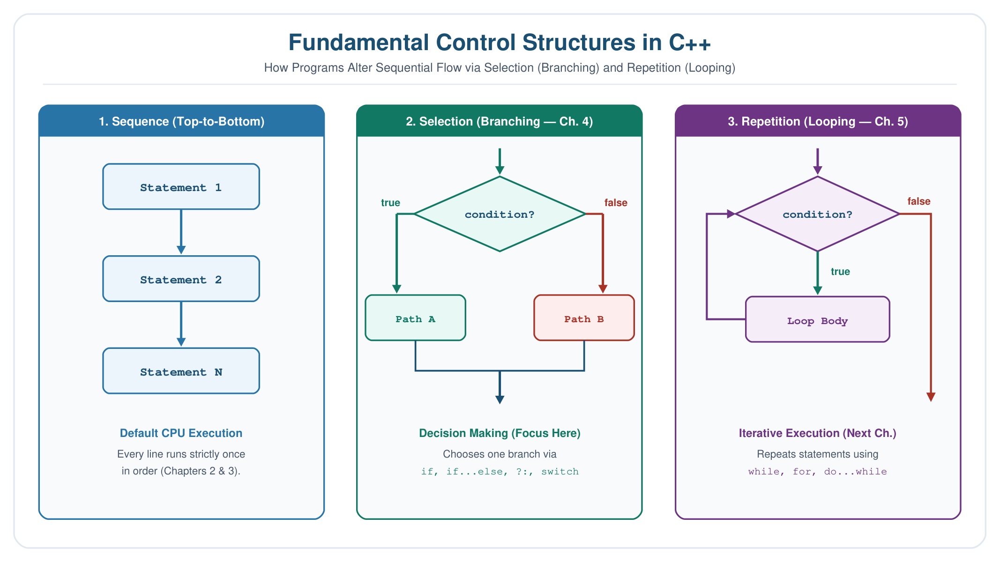
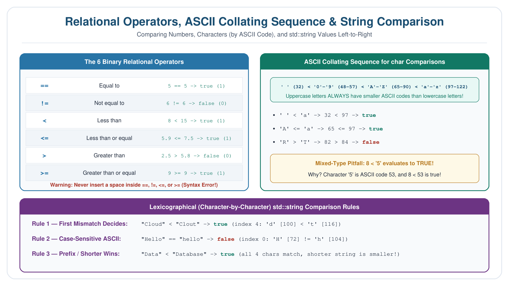
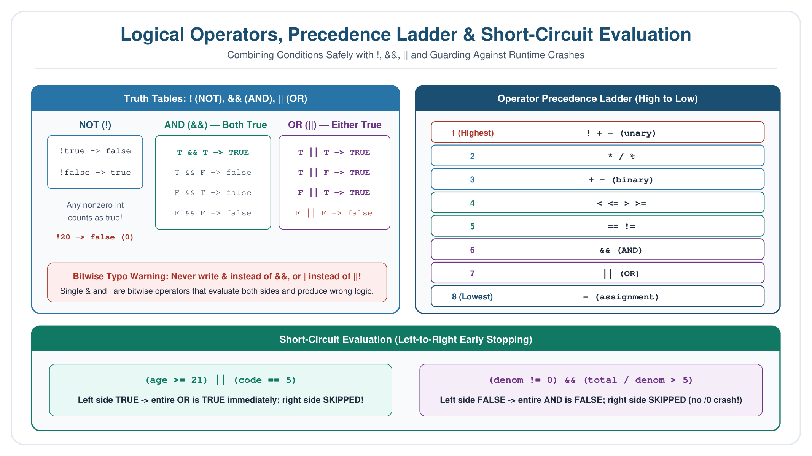
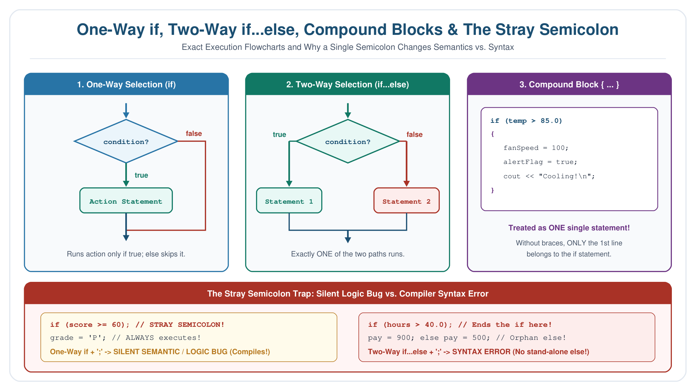
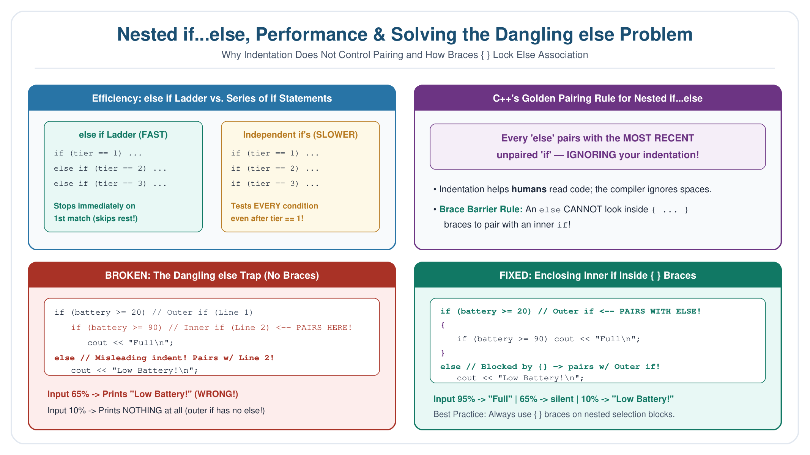
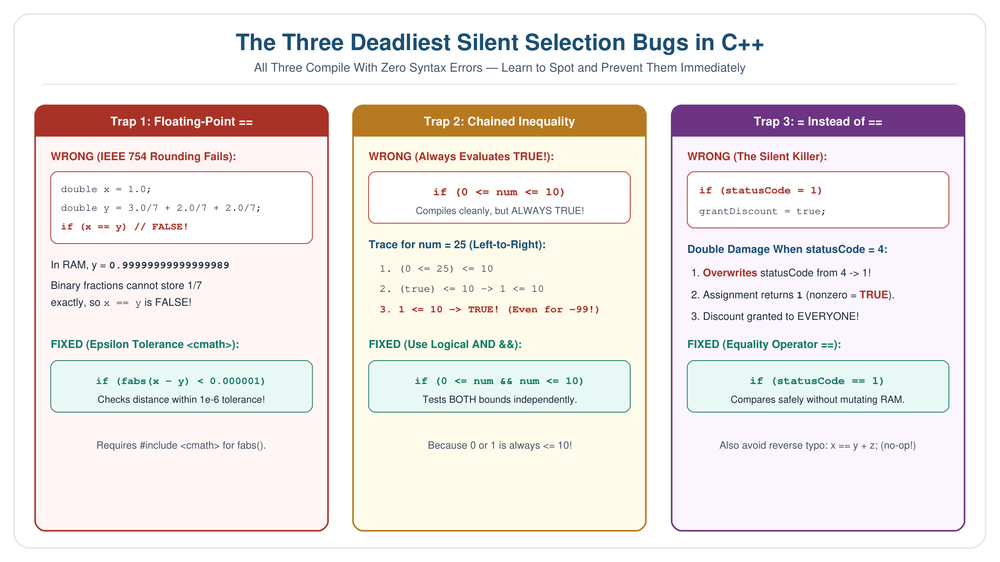
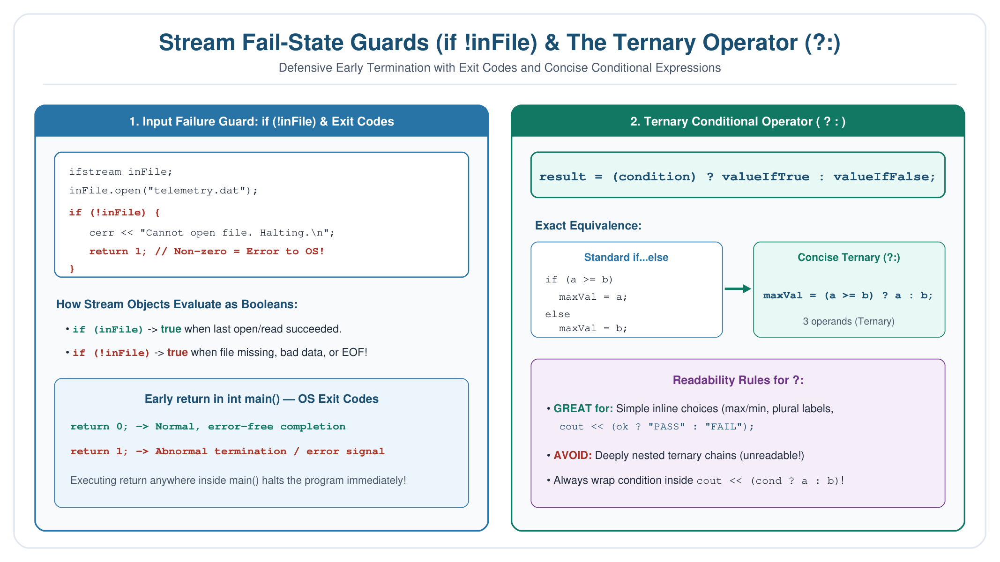
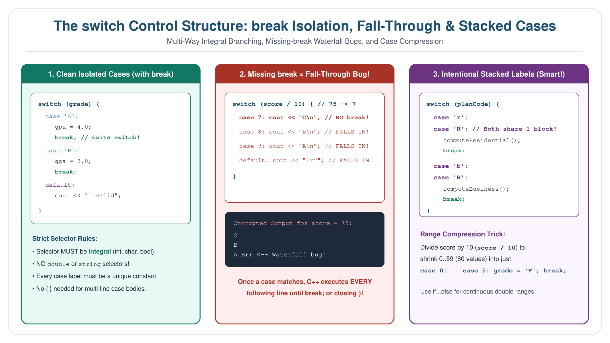
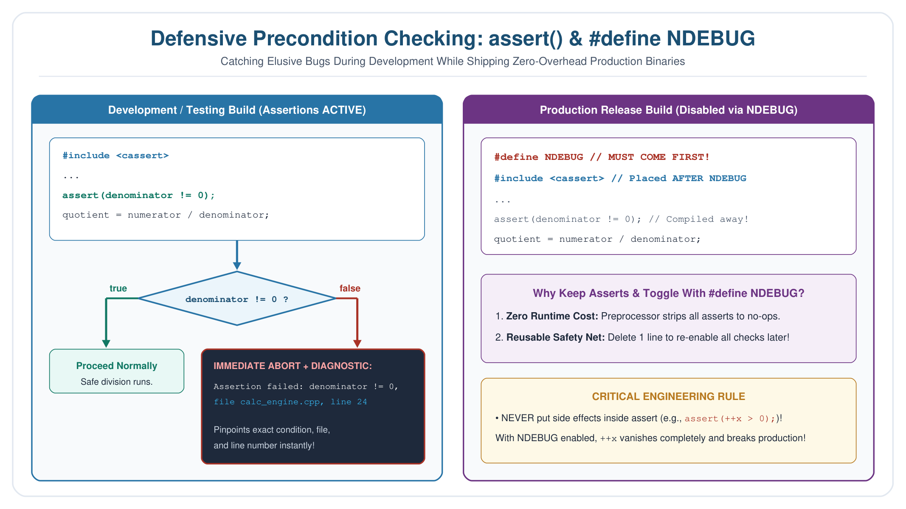

**Page 1**

## Table of Contents

- [Chapter 04 — Control Structures I (Selection)](#chapter-04--control-structures-i-selection)
  - [Introduction](#introduction)
  - [Control Structures](#control-structures)
  - [Relational Operators](#relational-operators)
    - [Relational Operators and Simple Data Types](#relational-operators-and-simple-data-types)
    - [Comparing Characters (ASCII Collating Sequence)](#comparing-characters-ascii-collating-sequence)
    - [Relational Operators and the string Type](#relational-operators-and-the-string-type)
  - [Logical (Boolean) Operators and Logical Expressions](#logical-boolean-operators-and-logical-expressions)
    - [The Logical Operators (NOT, AND, OR) and Truth Tables](#the-logical-operators-not-and-or-and-truth-tables)
    - [De Morgan's Laws: Negating Compound Conditions Simply](#de-morgans-laws-negating-compound-conditions-simply)
    - [Order of Precedence and Complex Expressions](#order-of-precedence-and-complex-expressions)
    - [Representing Truth Values: int vs. bool Data Types](#representing-truth-values-int-vs-bool-data-types)
  - [Selection: if and if...else](#selection-if-and-ifelse)
    - [One-Way Selection (if)](#one-way-selection-if)
    - [Two-Way Selection (if...else)](#two-way-selection-ifelse)
    - [Compound (Block of) Statements](#compound-block-of-statements)
    - [Multiple Selections: Nested if and the Dangling else Problem](#multiple-selections-nested-if-and-the-dangling-else-problem)
    - [Comparing if...else if Ladders with a Series of if Statements](#comparing-ifelse-if-ladders-with-a-series-of-if-statements)
    - [Short-Circuit Evaluation](#short-circuit-evaluation)
    - [Critical Selection Pitfalls: Floating-Point ==, Chained Inequalities, and = vs. ==](#critical-selection-pitfalls-floating-point--chained-inequalities-and--vs-)
    - [Input Failure and the if Statement](#input-failure-and-the-if-statement)
    - [The Conditional (Ternary) Operator (?:)](#the-conditional-ternary-operator-)
    - [Program Style and Form (Revisited): Indentation and Brace Styles](#program-style-and-form-revisited-indentation-and-brace-styles)
    - [Using Pseudocode to Develop, Test, and Debug a Program](#using-pseudocode-to-develop-test-and-debug-a-program)
  - [The switch Control Structure](#the-switch-control-structure)
    - [Syntax, Integral Selectors, and Execution Rules](#syntax-integral-selectors-and-execution-rules)
    - [Fall-Through Mechanics: Missing break Bugs vs. Intentional Stacked Cases](#fall-through-mechanics-missing-break-bugs-vs-intentional-stacked-cases)
    - [Choosing Between if...else if and switch](#choosing-between-ifelse-if-and-switch)
  - [Terminating a Program with the assert Function](#terminating-a-program-with-the-assert-function)
  - [Applied Engineering Case Study: Telecom Bandwidth Billing Engine](#applied-engineering-case-study-telecom-bandwidth-billing-engine)
  - [Engineering Selection Trace Lab (Worked Diagnostic Drills)](#engineering-selection-trace-lab-worked-diagnostic-drills)
  - [Chapter 04 Summary & Pitfalls Checklist](#chapter-04-summary--pitfalls-checklist)

---

**Page 2**

# <span style="color:#1B4F72">Chapter 04 — Control Structures I (Selection)</span>

## <span style="color:#2874A6">Introduction</span>

Every C++ program built in Chapters 2 and 3 shared one fundamental limitation: it behaved like a rigid train running down a single straight track. Execution began at the first line of `int main()`, stepped mechanically through every single statement in order, and halted at `return 0;`. No matter what inputs the user supplied, the program executed the exact same instructions every time.

Real software must **think and react dynamically** to runtime data. An automated thermostat must switch on cooling only when room temperature exceeds a threshold; a payroll system must apply an overtime multiplier only when hours exceed 40; a file processor must abort gracefully if a required file is missing; and a billing engine must route residential and enterprise accounts down completely different pricing formulas. This chapter equips you with the complete decision-making toolkit of C++: **relational and logical operators**, **truth tables**, **operator precedence**, **short-circuit evaluation**, **`if` / `if...else` / nested `if` branching**, the **ternary operator (`?:`)**, multi-way **`switch` structures**, **defensive `assert()` checks**, and a complete engineering playbook for eliminating the most notorious silent logic bugs in C++.

---

**Page 3**

## <span style="color:#2874A6">Control Structures</span>

A CPU can route execution through a program in four structured ways:
1. **Sequence:** Executing statements strictly one after another from top to bottom (Chapters 2 & 3).
2. **Selection (Branching):** Evaluating a runtime condition and choosing one execution path while skipping alternatives (the focus of **Chapter 4**).
3. **Repetition (Looping):** Executing a block of statements repeatedly while a condition holds true (covered in **Chapter 5**).
4. **Function Calls:** Temporarily jumping to a named reusable subprogram and returning once it completes (covered in **Chapters 6 & 7**).

**Control structures** are the language constructs that deliberately alter default sequential execution. The two foundational pillars are **selection** (`if`, `if...else`, `?:`, `switch`) and **repetition** (`while`, `for`, `do...while`).

<p align="center">
  
</p>

---

**Page 4**

#### <span style="color:#6C3483">1. الشرح المبسّط: كيف يتخذ الحاسوب قراراً؟ (`Conditional Statements`)</span>

تخيّل أنك تكتب تعليمات لمهندس يشغّل غرفة خوادم. في الحياة اليومية نستخدم **الجمل الشرطية (`Conditional Statements`)** طوال الوقت دون أن نشعر:
- **قرار باتجاه واحد:** «**إذا** تجاوزت حرارة المعالج 85 درجة، شغّل مروحة الطوارئ» *(وإن لم تتجاوز، لا تفعل شيئاً)*.
- **قرار باتجاهين:** «**إذا** كان وزن الطرد أقل من أو يساوي 5 كغ فالشحن 10 دولارات، **وإلا** فالشحن 25 دولاراً».
- **قرار مركّب (أكثر من شرط):** «**إذا** كانت البطارية أكبر من 30% **و** سرعة الرياح أقل من 40 كم/س، اسمح للدرون بالإقلاع».

في قلب كل جملة شرطية يوجد **شرط (`Condition`)** لا يحتمل إلا إجابتين فقط:
- **صائب (`true`):** الشرط متحقق ← ينفّذ الحاسوب الأمر المرتبط به.
- **خاطئ (`false`):** الشرط غير متحقق ← يتجاوز الحاسوب الأمر أو ينتقل للبديل الآخر.

على مستوى المعالج (`CPU`)، يحوّل المترجم هذه القرارات إلى تعليمة مقارنة بسيطة تتحقق من ناتج الشرط ثم **تقفز (`Conditional Jump`)** إلى عنوان السطر المناسب في الذاكرة بدلاً من السير الأعمى سطراً تلو الآخر!

---

**Page 5**

## <span style="color:#2874A6">Relational Operators</span>

To express comparisons in C++, programmers write **logical (Boolean) expressions**—expressions that always evaluate to one of two Boolean truth values: **`true`** or **`false`**. The building blocks that compare two values are C++'s **six binary relational operators** (each requiring two operands, one on the left and one on the right):

| Operator | Meaning | Example | Result |
| :---: | :--- | :--- | :---: |
| **`==`** | Equal to *(two equals signs!)* | `12 == 12` | **`true`** |
| **`!=`** | Not equal to | `6 != 6` | **`false`** |
| **`<`** | Less than | `8 < 15` | **`true`** |
| **`<=`** | Less than or equal to | `5.9 <= 7.5` | **`true`** |
| **`>`** | Greater than | `2.5 > 5.8` | **`false`** |
| **`>=`** | Greater than or equal to | `9 >= 9` | **`true`** |

> **Critical Syntax Rule:** The four two-character relational operators (**`==`**, **`!=`**, **`<=`**, **`>=`**) are indivisible tokens. Inserting a space between their characters (such as `= =`, `! =`, `< =`, or `> =`) or reversing them (`=<`, `=>`) produces an immediate **compile-time syntax error**.

<p align="center">
  
</p>

---

**Page 6**

### <span style="color:#117864">Relational Operators and Simple Data Types</span>

All six relational operators operate cleanly on C++'s numeric simple data types (`int`, `long long`, `double`, `float`), as well as `char` and `bool`. Pay immediate attention to the most important symbol distinction in C++:
- **`=` (علامة يساوي واحدة — Assignment Operator):** تعني **«خزّن القيمة اليمنى داخل المتغير الأيسر»** (`x = 5;` يغيّر محتوى `x` في الذاكرة).
- **`==` (علامتا يساوي — Equality Operator):** تعني **«هل الطرف الأيسر يساوي الطرف الأيمن؟»** (`x == 5` يسأل فقط ويعيد `true` أو `false` دون تغيير `x`).

#### <span style="color:#6C3483">كيف يخزّن C++ نتيجة أي مقارنة رقمياً؟ (`1` = صائب، `0` = خاطئ)</span>

عندما يقيّم معالج الحاسوب تعبيراً منطقياً مثل `8 < 15` أو `6 != 6`:
- إذا كانت الإجابة **صائبة (`true`)** ← يُعيد النظام القيمة الرقمية **`1`**.
- إذا كانت الإجابة **خاطئة (`false`)** ← يُعيد النظام القيمة الرقمية **`0`**.
- **القاعدة الذهبية في C++:** في أي موضع يتوقع فيه C++ قيمة منطقية (مثل داخل `if (...)`)، فإن **`0` وحده يُعامل كـ `false`**، بينما **أي رقم غير صفري** (موجباً كان مثل `1` أو `25` أو سالباً مثل `-7`) يُعامل كـ **`true`**!

| التعبير المنطقي | المعنى البشري المبسّط | النتيجة المنطقية | القيمة الرقمية |
| --- | --- | :---: | :---: |
| `8 < 15` | هل 8 أصغر من 15؟ | `true` | `1` |
| `6 != 6` | هل 6 لا تساوي 6؟ | `false` | `0` |
| `2.5 > 5.8` | هل 2.5 أكبر من 5.8؟ | `false` | `0` |
| `5.9 <= 7.5` | هل 5.9 أصغر من أو تساوي 7.5؟ | `true` | `1` |
| `10 >= 10` | هل 10 أكبر من أو تساوي 10؟ | `true` | `1` |

---

**Page 7**

### <span style="color:#117864">Comparing Characters (ASCII Collating Sequence)</span>

How does a computer decide whether `'A' < 'a'` or `' ' < '0'` is `true` or `false`? Because a computer stores every `char` as a 1-byte integer code in its **collating sequence** (almost universally **ASCII**), comparing two characters simply compares their underlying numeric ASCII codes!

#### <span style="color:#6C3483">1. الخريطة الذهنية السهلة لجدول ASCII (لا تحتاج لحفظ الجدول كاملاً!)</span>

لتعرف ناتج أي مقارنة بين محرفين في ثانية واحدة، يكفي أن تحفظ **أربع محطات رئيسية فقط** مرتّبةً من الأصغر إلى الأكبر:

| الفئة (`Category`) | رمز البداية | رمز النهاية | القاعدة السريعة للحفظ |
| --- | :---: | :---: | :--- |
| **المسافة الفارغة (`' '`)** | **`32`** | `32` | أصغر محرف قابل للطباعة — أصغر من الأرقام والحروف كلها! |
| **الأرقام النصية (`'0'` .. `'9'`)** | **`48`** | **`57`** | تبدأ من 48 وتزيد 1 لكل رقم (`'5'` = `53`). |
| **الحروف الكبيرة (`'A'` .. `'Z'`)** | **`65`** | **`90`** | تبدأ من 65 وتزيد 1 لكل حرف (`'B'` = `66`). |
| **الحروف الصغيرة (`'a'` .. `'z'`)** | **`97`** | **`122`** | تبدأ من 97 — **دائماً أكبر من الحروف الكبيرة بمقدار 32**! |

*(ملاحظة إضافية للرموز الشائعة: `'!'` = `33`، `'*'` = `42`، `'+'` = `43`، `'-'` = `45`، `'/'` = `47`، `'<'` = `60`، `'='` = `61`، `'>'` = `62`.)*

---

**Page 8**

#### <span style="color:#6C3483">مرجع سريع لأهم رموز ASCII المستخدمة في المقارنات (`Quick ASCII Lookup`)</span>

| الرمز | قيمة ASCII | الرمز | قيمة ASCII | الرمز | قيمة ASCII | الرمز | قيمة ASCII |
| :---: | :---: | :---: | :---: | :---: | :---: | :---: | :---: |
| `' '` *(مسافة)* | `32` | `'0'` | `48` | `'A'` | `65` | `'a'` | `97` |
| `'!'` | `33` | `'1'` | `49` | `'B'` | `66` | `'b'` | `98` |
| `'"'` | `34` | `'5'` | `53` | `'H'` | `72` | `'h'` | `104` |
| `'*'` | `42` | `'9'` | `57` | `'R'` | `82` | `'r'` | `114` |
| `'+'` | `43` | `'<'` | `60` | `'T'` | `84` | `'t'` | `116` |
| `'-'` | `45` | `'='` | `61` | `'Y'` | `89` | `'y'` | `121` |
| `'/'` | `47` | `'>'` | `62` | `'Z'` | `90` | `'z'` | `122` |

#### <span style="color:#6C3483">2. تطبيقات عملية وفخ مقارنة الأنواع المختلطة (`8 < '5'`)</span>

- `' ' < 'a'` ← نقارن `32 < 97` ← **`true`**.
- `'A' <= 'a'` ← نقارن `65 <= 97` ← **`true`** *(الحرف الكبير أصغر دائماً من الحرف الصغير!)*.
- `'R' > 'T'` ← نقارن `82 > 84` ← **`false`**.
- `'+' < '*'` ← نقارن `43 < 42` ← **`false`**.
- **تحذير — فخ المقارنة المختلطة بين `int` و`char` (`8 < '5'`):**
  قد تظن للوهلة الأولى أن `8 < '5'` خاطئة لأن 8 أكبر من 5! لكن `'5'` بين علامتي تنصيص مفردتين ليست الرقم خمسة، بل هي **المحرف `'5'`** الذي رمزه في ASCII هو **`53`**! فيُقارن المعالج `8 < 53` فتخرج النتيجة **`true`**! **القاعدة:** لا تقارن `int` مع `char` مباشرةً؛ قارن دائماً بين نوعين متجانسين.

---

**Page 9**

### <span style="color:#117864">Relational Operators and the string Type</span>

All six relational operators (`==`, `!=`, `<`, `<=`, `>`, `>=`) work directly on **`std::string`** variables as well (remember `#include <string>`). Rather than comparing string lengths first, C++ compares strings **lexicographically**—exactly like looking up words in a dictionary, **character by character from index `0` rightward** using the ASCII collating sequence!

#### <span style="color:#6C3483">القواعد الثلاث المبسّطة لمقارنة أي سلسلتين نصيتين (`std::string`)</span>

1. **القاعدة 1 — أول اختلاف يَحسم المقارنة فوراً (بغض النظر عن طول النص!):**
   يبدأ المعالج بالمقارنة عند الفهرس `0`، ثم `1`، ثم `2`... وبمجرد وجود أول موضع يختلف فيه الحرفان، يحكم رمز ASCII لكل منهما بالنتيجة النهائية فوراً ويتوقف عن فحص بقية الأحرف!
   - مثال: `"Cloud" < "Clout"` ← الحروف الأربعة الأولى متطابقة (`C-l-o-u`)، وفي الموضع الخامس `'d'` (`100`) < `'t'` (`116`) ← **`true`**.
   - مثال: `"Hi" > "Hello"` ← في الموضع الأول `'H' == 'H'`، وفي الموضع الثاني `'i'` (`105`) > `'e'` (`101`) ← **`true`** *(رغم أن `"Hi"` أقصر من `"Hello"`!)*.
2. **القاعدة 2 — المقارنة حساسة تماماً لحالة الأحرف (`Case-Sensitive`):**
   - مثال: `"Hello" == "hello"` ← في الموضع الأول `'H'` (`72`) ≠ `'h'` (`104`) ← **`false`**! بل إن `"Zebra" < "apple"` تساوي **`true`** لأن `'Z'` (`90`) < `'a'` (`97`)!
3. **القاعدة 3 — إذا تطابقت كل حروف النص الأقصر مع بداية النص الأطول، فالأقصر هو الأصغر:**
   - مثال: `"Data" < "Database"` ← تطابقت الحروف الأربعة `D-a-t-a` وانتهت الكلمة الأولى بينما لدى الثانية حروف إضافية ← **`true`**.
   - مثال: `"Bill" >= "Billy"` ← `"Bill"` أقصر ومتطابقة كبداية لـ `"Billy"`، إذن `"Bill" < "Billy"` ← وبالتالي `>=` تعطي **`false`**.

---

**Page 10**

#### <span style="color:#6C3483">توضيح بصري مبسّط: كيف يقارن المعالج `"Cloud"` مع `"Clout"` خانةً بخانة؟</span>

```text
Index:        [0]    [1]    [2]    [3]    [4]
"Cloud":      'C'    'l'    'o'    'u'    'd'  (ASCII 100)
               =      =      =      =      <   <-- FIRST MISMATCH DECIDES!
"Clout":      'C'    'l'    'o'    'u'    't'  (ASCII 116)

Verdict:  'd' (100) < 't' (116)  ==>  "Cloud" < "Clout" is TRUE!
```

```text
Index:        [0]    [1]    [2]    [3]    [4]    [5]    [6]    [7]
"Data":       'D'    'a'    't'    'a'   (END)
               =      =      =      =      <   <-- SHORTER PREFIX WINS!
"Database":   'D'    'a'    't'    'a'    'b'    'a'    's'    'e'

Verdict:  All 4 chars match, "Data" ends first  ==>  "Data" < "Database" is TRUE!
```

> **حيلة سريعة للامتحان:** لا تخدعك كلمة طويلة مقابل كلمة قصيرة! في مقارنة `"Hi"` مع `"Hello"`، يتوقف المعالج عند الخانة `[1]` فوراً لأن `'i'` > `'e'`، فلا ينظر إطلاقاً إلى أن `"Hello"` أطول من `"Hi"`!

---

**Page 11**

#### <span style="color:#6C3483">جدول التدريب المبسّط وبرنامج التحقق العملي لمقارنة النصوص</span>

بفرض `string s1 = "Cloud", s2 = "Hi", s3 = "Air", s4 = "Data", s5 = "Big";`:

| التعبير | النتيجة | التفسير السريع خطوة بخطوة |
| --- | :---: | :--- |
| `s1 < "Clout"` | **`true`** | أول اختلاف في الخانة 5: `'d'` (100) < `'t'` (116). |
| `s2 > "Hello"` | **`true`** | أول اختلاف في الخانة 2: `'i'` (105) > `'e'` (101). |
| `s3 < "An"` | **`true`** | أول اختلاف في الخانة 2: `'i'` (105) < `'n'` (110). |
| `s1 == "cloud"` | **`false`** | الخانة 1: `'C'` (67) ≠ `'c'` (99). |
| `s4 >= "Database"` | **`false`** | `"Data"` بادئة مطابقة وأقصر، فهي أصغر من `"Database"`. |
| `s5 <= "Bigger"` | **`true`** | `"Big"` بادئة مطابقة وأقصر، فهي أصغر من `"Bigger"`. |

```cpp
#include <iostream>
#include <string>
using namespace std;

int main() {
    string s1 = "Cloud";
    string s2 = "Hi";
    string s3 = "Data";

    // boolalpha prints "true" / "false" instead of 1 / 0 for readability!
    cout << boolalpha;
    cout << "Cloud < Clout     : " << (s1 < "Clout") << '\n';      // true
    cout << "Hi > Hello        : " << (s2 > "Hello") << '\n';      // true
    cout << "Cloud == cloud    : " << (s1 == "cloud") << '\n';     // false
    cout << "Data < Database   : " << (s3 < "Database") << '\n';   // true
    return 0;
}
```

> **معلومة مفيدة:** المُنسِّق **`boolalpha`** (من `<iostream>`) يجعل `cout` يطبع الكلمتين `"true"` و`"false"` بدلاً من `1` و`0`، مما يجعل اختباراتك المنطقية أوضح بكثير أثناء التعلم والتنقيح!

---

**Page 12**

## <span style="color:#2874A6">Logical (Boolean) Operators and Logical Expressions</span>

Single relational comparisons (`temp > 70`, `battery >= 20`) handle simple checks, but real engineering decisions routinely combine **multiple conditions simultaneously**—such as «unlock the vault only if the PIN is valid **AND** the badge is scanned», or «trigger an alarm if temperature exceeds 90°C **OR** pressure drops below 1.2 bar», or «launch only if the runway is **NOT** obstructed».

C++ provides **three logical (Boolean) operators** that take Boolean values as operands and return a Boolean result (`true` or `false`):

| Operator | Name | Arity | Plain-Language Rule |
| :---: | :--- | :--- | :--- |
| **`!`** | **NOT** (النفي) | Unary (معامل واحد) | Flips the truth value: `!true` → `false`, `!false` → `true`. |
| **`&&`** | **AND** (و) | Binary (معاملان) | `true` **ONLY** when **BOTH** sides are `true`; otherwise `false`. |
| **`\|\|`** | **OR** (أو) | Binary (معاملان) | `true` when **AT LEAST ONE** side is `true`; `false` only when **BOTH** are `false`. |

<p align="center">
  
</p>

---

**Page 13**

### <span style="color:#117864">The Logical Operators (NOT, AND, OR) and Truth Tables</span>

#### <span style="color:#6C3483">1. التشبيه الحياتي المبسّط لحفظ جداول الصواب (`Truth Tables`) دون عناء</span>

1. **مُشغّل النفي `!` (`NOT`) — مفتاح عكس الإشارة:**
   يقلب الحالة تماماً: ما كان صائباً يصبح خاطئاً، وما كان خاطئاً يصبح صائباً.
   - `!('A' > 'B')` ← داخل القوس `false` ← عكسها **`true`**.
   - `!(6 <= 7)` ← داخل القوس `true` ← عكسها **`false`**.
   - **انتبه مع الأرقام:** إذا كان `int age = 20;`، فإن `20` عدد غير صفري فيُعامل كـ `true`، وبالتالي **`!age` تساوي `false` (`0`)**! أما `!0` فتساوي **`true` (`1`)**.

| `Expr` | `!Expr` |
| :---: | :---: |
| `true` (أي قيمة غير `0`) | **`false` (`0`)** |
| `false` (`0`) | **`true` (`1`)** |

2. **مُشغّل العطف `&&` (`AND`) — خزنة بمفتاحين معاً:**
   لا تُفتح الخزنة (`true`) إلا إذا تحقّق الشرط الأول **والشرط الثاني معاً**! إذا فشل أحدهما فقط أغلقت النتيجة على `false`.
   - `(14 >= 5) && ('A' < 'B')` ← `true && true` ← **`true`**.
   - `(24 >= 35) && ('A' < 'B')` ← `false && true` ← **`false`**.

| `Expr1` | `Expr2` | `Expr1 && Expr2` |
| :---: | :---: | :---: |
| `true` | `true` | **`true` (`1`)** |
| `true` | `false` | `false` (`0`) |
| `false` | `true` | `false` (`0`) |
| `false` | `false` | `false` (`0`) |

3. **مُشغّل الاختيار `||` (`OR`) — غرفة ببابين:**
   يكفي أن يكون أحد البابين مفتوحاً (`true`) — أو كلاهما معاً — لتكون النتيجة **`true`**! ولا تكون `false` إلا إذا أُغلق البابان معاً.
   - `(14 >= 5) || ('A' > 'B')` ← `true || false` ← **`true`**.
   - `(24 >= 35) || ('A' > 'B')` ← `false || false` ← **`false`**.

| `Expr1` | `Expr2` | `Expr1 \|\| Expr2` |
| :---: | :---: | :---: |
| `true` | `true` | **`true` (`1`)** |
| `true` | `false` | **`true` (`1`)** |
| `false` | `true` | **`true` (`1`)** |
| `false` | `false` | `false` (`0`) |

> **تحذير خطير (`&` مقابل `&&` و`|` مقابل `||`):** الرمزان المفردان `&` و`|` موجودان في C++ لكنهما **مُشغّلا بتات (`Bitwise Operators`)** يقارنان الأصفار والواحدات بتّاً ببت وليسا للعمليات المنطقية! نسيان تكرار الرمز يمرّ دون خطأ ترجمة ويولّد نتائج غريبة جداً.

---

**Page 14**

### <span style="color:#117864">De Morgan's Laws: Negating Compound Conditions Simply</span>

One of the trickiest moments when writing `if` conditions is **inverting (negating) a compound condition** cleanly without making a subtle logic error. Suppose a valid sensor temperature lies inside the range `0 <= temp && temp <= 100`. How do you express **«temperature is INVALID (outside the range)»**?

Two simple, rock-solid rules from Boolean algebra—**De Morgan's Laws**—solve every negation instantly:

$$\neg(A \land B) \;\equiv\; (\neg A) \lor (\neg B) \qquad\text{and}\qquad \neg(A \lor B) \;\equiv\; (\neg A) \land (\neg B)$$

#### <span style="color:#6C3483">القاعدة المبسّطة لحفظ قوانين دي مورغان في 3 ثوانٍ: «وزّع النفي واقلب الإشارة!»</span>

عندما تُدخل علامة النفي **`!`** على قوس يحتوي `&&` أو `||`:
1. **انفِ كل شرط داخل القوس** (اعكس `<` إلى `>=`، و`<=` إلى `>`، و`==` إلى `!=`).
2. **اقلب `&&` إلى `||`**، واقلب **`||` إلى `&&`**!

| الشرط المنفي المعقّد | التبسيط النظيف بقانون دي مورغان | المعنى البشري الواضح |
| --- | --- | --- |
| `!(temp >= 0 && temp <= 100)` | **`temp < 0 \|\| temp > 100`** | الحرارة خارج النطاق: إما أقل من 0 **أو** أكبر من 100! |
| `!(code == 'Y' \|\| code == 'y')` | **`code != 'Y' && code != 'y'`** | الرمز ليس `'Y'` **وليس** `'y'` معاً! |
| `!(isAdmin && hasKey)` | **`!isAdmin \|\| !hasKey`** | إما ليس مشرفاً **أو** لا يملك المفتاح! |

> **فخ مشهور جداً يقع فيه المبتدئون:** عند التحقق أن الحرف ليس `'Y'` ولا `'y'`، كثيرون يكتبون خطأً `if (code != 'Y' || code != 'y')` — وهذا الشرط **دائماً `true`** (لأن أي حرف لا يمكن أن يساوي `'Y'` و`'y'` في الوقت نفسه)! قانون دي مورغان ينقذك فوراً ويُثبت أن الصحيح هو **`&&`**: `if (code != 'Y' && code != 'y')`!

---

**Page 15**

#### <span style="color:#6C3483">تدرّب سريع على فك الأولويات خطوة-بخطوة (`Step-by-Step Expression Reduction`)</span>

تأمّل كيف تُفكّك تعبيراً يخلط الحساب والمقارنة والمنطق معاً مثل **`5 + 3 <= 9 && 2 > 3`** دون أي ارتباك:

```text
Original:    5 + 3 <= 9 && 2 > 3
Step 1 (+):    8   <= 9 && 2 > 3      (Arithmetic + runs BEFORE <= and >)
Step 2 (<=):     true   && 2 > 3      (Relational <= runs BEFORE &&)
Step 3 (>):      true   && false      (Relational > runs BEFORE &&)
Step 4 (&&):          false           (Logical && runs last!)
```

والآن قارن **`11 > 5 || 6 < 15 && 7 >= 8`** (لاحظ كيف تسبق `&&` المُشغّل `||`!):

```text
Original:    11 > 5 || 6 < 15 && 7 >= 8
Step 1 (rel): true  ||  true  &&  false   (All relational ops first)
Step 2 (&&):  true  ||      false         (&& has HIGHER precedence than ||!)
Step 3 (||):        true                  (Final answer is TRUE!)
```

---

**Page 16**

### <span style="color:#117864">Order of Precedence and Complex Expressions</span>

When a single condition combines arithmetic (`+`, `*`), relational (`<`, `==`), and logical (`!`, `&&`, `||`) operators, **operator precedence** determines the exact evaluation sequence. Consider:

```cpp
11 > 5 || 6 < 15 && 7 >= 8
```

If `||` were evaluated first, `(true || true) && false` would evaluate to `false`. Because **`&&` has strictly higher precedence than `||`**, C++ actually parses this expression as:

```cpp
11 > 5 || (6 < 15 && 7 >= 8)
```

which evaluates to `true || (true && false)` → `true || false` → **`true`**!

#### <span style="color:#6C3483">1. سلّم الأولويات الكامل (من الأعلى للأدنى) بترتيب يسهل تذكّره</span>

احفظ القاعدة الذهبية المختصرة: **«الأحادي أولاً ← ثم الحساب ← ثم المقارنة ← ثم المساواة ← ثم `&&` ← ثم `||` ← وأخيراً الإسناد `=`»**:

| المرتبة | المُشغّلات (`Operators`) | اتجاه التجميع (`Associativity`) |
| :---: | :--- | :--- |
| **1 (الأعلى)** | `!`, `+`, `-` *(المُشغّلات الأحادية — Unary)* | من اليمين لليسار |
| **2** | `*`, `/`, `%` *(الضرب والقسمة والباقي)* | من اليسار لليمين |
| **3** | `+`, `-` *(الجمع والطرح الثنائي)* | من اليسار لليمين |
| **4** | `<`, `<=`, `>`, `>=` *(مقارنات الترتيب)* | من اليسار لليمين |
| **5** | `==`, `!=` *(المساواة وعدم المساواة)* | من اليسار لليمين |
| **6** | `&&` *(الربط المنطقي AND)* | من اليسار لليمين |
| **7** | `\|\|` *(الربط المنطقي OR)* | من اليسار لليمين |
| **8 (الأدنى)** | `=` *(الإسناد)* | من اليمين لليسار |

> **نصيحة المهندسين للتبسيط (`Use Parentheses Liberally`):** لا تعتمد على ذاكرة قارئ الكود في تمييز أولوية `&&` على `||`! أضف الأقواس دائماً لتوضيح نيتك الصريحة: `if ((temp > 80) || (pressure > 5.0 && valveClosed))`.

---

**Page 17**

#### <span style="color:#6C3483">2. تفكيك خطوة-بخطوة لـ 8 تعبيرات منطقية حقيقية (`Worked Precedence Walkthrough`)</span>

بفرض المتغيرات التالية:

```cpp
bool isActive = true;
int age = 20;
double hours = 45.30;
double overtime = 15.00;
int count = 20;
char code = 'B';
```

تتبّع كل تعبير خطوةً بخطوة:

| الرقم | التعبير (`Expression`) | التبسيط التدريجي خطوة بخطوة | النتيجة |
| :---: | :--- | :--- | :---: |
| **1** | `!isActive` | `!true` | **`false` (`0`)** |
| **2** | `hours > 40.00` | `45.30 > 40.00` | **`true` (`1`)** |
| **3** | `!age` | `!(20)` ← `20` غير صفري (`true`) ← `!true` | **`false` (`0`)** |
| **4** | `!isActive && (age >= 18)` | `(!true) && (20 >= 18)` ← `false && true` | **`false` (`0`)** |
| **5** | `!(isActive && (age >= 18))` | `!(true && true)` ← `!(true)` | **`false` (`0`)** |
| **6** | `hours + overtime <= 75.00` | `(45.30 + 15.00) <= 75.00` ← `60.30 <= 75.00` | **`true` (`1`)** |
| **7** | `(count >= 0) && (count <= 100)` | `(20 >= 0) && (20 <= 100)` ← `true && true` | **`true` (`1`)** |
| **8** | `'A' <= code && code <= 'Z'` | `('A' <= 'B') && ('B' <= 'Z')` ← `true && true` | **`true` (`1`)** |

**برنامج التحقق العملي (`C++ Validation Program`):**

```cpp
#include <iostream>
using namespace std;

int main() {
    bool isActive = true;
    int age = 20;
    double hours = 45.30, overtime = 15.00;
    int count = 20;
    char code = 'B';

    // Default cout outputs 1 for true and 0 for false
    cout << "!isActive                     = " << !isActive << '\n';                    // 0
    cout << "hours > 40.00                 = " << (hours > 40.00) << '\n';            // 1
    cout << "!age                          = " << !age << '\n';                         // 0
    cout << "!isActive && (age >= 18)      = " << (!isActive && (age >= 18)) << '\n'; // 0
    cout << "hours + overtime <= 75.00     = " << (hours + overtime <= 75.00) << '\n';// 1
    cout << "('A' <= code && code <= 'Z')  = " << ('A' <= code && code <= 'Z') << '\n';// 1
    return 0;
}
```

> **انتبه للأقواس داخل `cout`:** عند طباعة تعبير يحتوي على `<` أو `>` أو `&&` أو `||` عبر `cout <<`، **يجب** إحاطة التعبير المنطقي بأقواس مثل `cout << (hours > 40.00);` لأن أولوية `<<` أعلى من `>` و`&&`! بدون الأقواس يقع خطأ ترجمة فوري.

---

**Page 18**

### <span style="color:#117864">Representing Truth Values: int vs. bool Data Types</span>

In early C and pre-standard C++, no dedicated Boolean type existed; programmers stored logical outcomes inside **`int`** variables (`1` for true, `0` for false):

```cpp
int isAdult = (age >= 21);   // Stores 1 if age >= 21, otherwise 0
int flag = 21;               // Any nonzero integer evaluates to true!
```

Standard ISO C++ introduced the dedicated **`bool`** data type along with the two reserved keywords **`true`** (`1`) and **`false`** (`0`):

```cpp
bool isAdult = (age >= 21);  // Stores true (1) if age >= 21, otherwise false (0)
bool sensorReady = true;
```

#### <span style="color:#6C3483">لماذا نُفضّل `bool` دائماً على `int` لتخزين الشروط المنطقية؟</span>

| وجه المقارنة | `int` (الأسلوب القديم) | `bool` (المعيار الحديث الموصى به) |
| --- | --- | --- |
| **حجم الذاكرة** | 4 بايت (إهدار 3 بايتات بلا فائدة). | **1 بايت فقط**. |
| **وضوح القصد للقارئ** | غامض: هل `int status = 1;` عدّاد أم شرط منطقي؟ | **واضح 100%**: `bool isVerified = true;` يحمل إجابة نعم/لا فقط. |
| **تطبيع القيم (`Normalization`)** | `int flag = 25;` يحتفظ بالقيمة `25`. | `bool flag = 25;` يحوّل أي قيمة غير صفرية تلقائياً إلى **`1` (`true`)**! |
| **الطباعة بـ `boolalpha`** | يطبع الرقم دائماً (`1` أو `25`). | يطبع **`true` / `false`** عند تفعيل `cout << boolalpha;`. |

---

**Page 19**

## <span style="color:#2874A6">Selection: if and if...else</span>

With relational and logical expressions mastered, we can now direct the CPU to make runtime decisions. C++ provides two primary selection families: the **`if` / `if...else`** family (built on Boolean conditions) and the **`switch`** structure (built on discrete integral values).

### <span style="color:#117864">One-Way Selection (if)</span>

Use **one-way selection** whenever an action should run **only if a condition is true**, and otherwise simply be skipped (for example: «if temperature exceeds 80°C, trigger cooling fan»; «if a number is negative, flip its sign to compute absolute value»).

**Syntax:**

```cpp
if (expression)
    statement;
```

- **`if`** is a reserved keyword.
- **`(expression)`** is the **decision maker** (usually a Boolean expression); the **parentheses `(...)` are syntactically mandatory**! Writing `if score >= 60` without parentheses causes an immediate compiler syntax error.
- **`statement`** is the **action statement** executed only when `expression` evaluates to `true` (nonzero). If `expression` is `false` (`0`), execution skips `statement` and continues directly to the next line.

<p align="center">
  
</p>

---

**Page 20**

#### <span style="color:#6C3483">1. برنامج تطبيقي مبسّط: حساب القيمة المطلقة لعدد صحيح (`Absolute Value Program`)</span>

تأمّل كيف نحفظ النسخة الأصلية للمدخل في متغير مساعد `originalValue` قبل تعديل إشارة `value` في حالة العدد السالب:

```cpp
//***********************************************************************
// Program: Integer Absolute Value Calculator (One-Way Selection)
// Purpose: Flips the sign of negative inputs while preserving original
//          input for clear reporting.
//***********************************************************************

#include <iostream>
using namespace std;

int main() {
    int value, originalValue;

    cout << "Enter any integer (positive, negative, or zero): ";
    cin >> value;

    originalValue = value;   // Save original value before potential sign flip

    if (value < 0)           // One-way decision maker
        value = -value;      // Executes ONLY if value is negative

    cout << "The absolute value of " << originalValue
         << " is " << value << '\n';
    return 0;
}
```
- عند إدخال **`-6734`**: الشرط `(-6734 < 0)` صائب ← يُنفّذ `value = -(-6734) = 6734` ← يطبع `The absolute value of -6734 is 6734`.
- عند إدخال **`45`**: الشرط `(45 < 0)` خاطئ ← يتخطّى السطر التالي ← يطبع `The absolute value of 45 is 45`.

#### <span style="color:#6C3483">2. فخ الفاصلة المنقوطة الشاردة في `if` أحادية الاتجاه (`Silent Semantic Bug!`)</span>

```cpp
if (score >= 60);     // <--- DANGER! Stray semicolon terminates the if with an EMPTY action!
    grade = 'P';      // <--- NOT inside the if! Executes UNCONDITIONALLY every time!
```
لماذا لا يوقفك المترجم هنا؟ لأن الفاصلة المنقوطة `;` تُعدّ في C++ **جملة فارغة قانونية (`Null Statement`)**! وبالتالي يصبح معنى الكود للمعالج: «إذا كانت الدرجة $\ge 60$ لا تفعل شيئاً؛ ثم بعد ذلك اجعل العلامة `'P'` دائماً للجميع حتى لو كانت الدرجة `15`!» — وهذا **خطأ دلالي صامت** من أخطر أخطاء المبتدئين.

---

**Page 21**

### <span style="color:#117864">Two-Way Selection (if...else)</span>

Use **two-way selection** whenever a program must choose **strictly one** of two mutually exclusive paths—never both, and never neither (for example: regular pay vs. overtime pay; pass vs. fail; standard shipping vs. freight shipping).

**Syntax:**

```cpp
if (expression)
    statement1;
else
    statement2;
```

- If `expression` evaluates to **`true`**: **`statement1`** executes, and `statement2` is completely skipped.
- If `expression` evaluates to **`false`**: `statement1` is skipped, and **`statement2`** executes.

#### <span style="color:#6C3483">1. مقارنة الفخين الأشهر في الاختيار ثنائي الاتجاه (`Two Classic Traps`)</span>

1. **فخ الفاصلة المنقوطة الشاردة في `if...else` ← خطأ نحوي (`Syntax Error`):**
   ```cpp
   if (hours > 40.0);                          // Ends the if right here!
       wages = 40.0 * rate + 1.5 * rate * (hours - 40.0);
   else                                        // SYNTAX ERROR: orphaned stand-alone else!
       wages = hours * rate;
   ```
   **الفرق الذهبي للامتحانات:** الفاصلة المنقوطة الشاردة بعد `if` **أحادية الاتجاه** هي **خطأ دلالي صامت (`Semantic Error`)**؛ أما في **`if...else` ثنائية الاتجاه** فهي **خطأ نحوي (`Syntax Error`)** لأن جملة `wages = ...` فصلت `else` عن `if` ولا توجد `else` مستقلة في C++!

2. **فخ نسيان `else` (طباعة النتيجتين معاً!):**
   ```cpp
   // BUGGY: Missing 'else'
   if (score >= 60)
       cout << "Passing\n";
   cout << "Failing\n";    // ALWAYS runs! When score = 75, prints BOTH "Passing" AND "Failing"!
   ```
   عند غياب `else`، لا تتحكم `if` إلا في السطر الأول فقط (`"Passing"`), أما `"Failing"` فتُطبع دائماً للناجح والراسب!

---

**Page 22**

#### <span style="color:#6C3483">2. برنامج تطبيقي متكامل: حاسبة أجر العمل الإضافي (`Two-Way Selection Program`)</span>

```cpp
//***********************************************************************
// Program: Engineering Technician Weekly Payroll Calculator
// Purpose: Applies 1.5x overtime pay for hours exceeding 40.0 using
//          clean two-way if...else selection and 2-decimal formatting.
//***********************************************************************

#include <iostream>
#include <iomanip>

using namespace std;

const double REGULAR_HOURS_LIMIT = 40.0;
const double OVERTIME_MULTIPLIER = 1.5;

int main() {
    double hoursWorked = 0.0;
    double hourlyRate  = 0.0;
    double weeklyPay   = 0.0;

    cout << fixed << showpoint << setprecision(2);

    cout << "Enter hours worked and hourly rate ($): ";
    cin >> hoursWorked >> hourlyRate;

    if (hoursWorked > REGULAR_HOURS_LIMIT)
        weeklyPay = (REGULAR_HOURS_LIMIT * hourlyRate)
                  + (OVERTIME_MULTIPLIER * hourlyRate * (hoursWorked - REGULAR_HOURS_LIMIT));
    else
        weeklyPay = hoursWorked * hourlyRate;

    cout << "Total Weekly Pay: $" << weeklyPay << '\n';
    return 0;
}
```
- **تشغيل 1 (`56.45` ساعة بسعر `$12.50`):** لأن `56.45 > 40.0` صائب، ينفّذ الفرع الأول ← `$808.44`.
- **تشغيل 2 (`35.00` ساعة بسعر `$12.50`):** لأن `35.00 > 40.0` خاطئ، ينفّذ فرع `else` ← `$437.50`.

---

**Page 23**

### <span style="color:#117864">Compound (Block of) Statements</span>

By default, an `if` branch or an `else` branch controls **only ONE single statement**. Whenever a true or false branch must execute **two or more statements**, you MUST group them inside curly braces **`{ ... }`** to form a **compound statement (block)**:

```cpp
{
    statement_1;
    statement_2;
    ...
    statement_n;
}
```

Syntactically, the C++ compiler treats an entire `{ ... }` block as **one single statement**—with **no semicolon after the closing `}`**.

#### <span style="color:#6C3483">فخ الإزاحة الخادعة دون أقواس `{ }` (`The Misleading Indentation Bug`)</span>

تذكّر دائماً أن **المسافات البادئة (Indentation) لا تعني شيئاً للمترجم في C++** (بخلاف Python)! قارن الكودين التاليين:

```cpp
// BROKEN: Missing braces — line 2 ALWAYS executes even when battery is 90%!
if (batteryPercent < 20)
    cout << "WARNING: Low battery!\n";
    returnToBase = true;          // BUG! Runs EVEN IF batteryPercent == 90!

// FIXED: Compound block binds BOTH statements to the if condition
if (batteryPercent < 20)
{
    cout << "WARNING: Low battery!\n";
    returnToBase = true;
}
else
{
    cout << "Battery nominal.\n";
    returnToBase = false;
}
```

> **عادة المهندسين المحترفين (`Always Brace Rule`):** يلتزم كثير من فرق هندسة البرمجيات بوضع الأقواس المعقوفة `{ ... }` حول كل فرع `if` و`else` حتى لو كان سطراً واحداً فقط؛ لأن إضافة سطر ثانٍ لاحقاً أثناء الصيانة لن توقعك أبداً في فخ الإزاحة الخادعة!

---

**Page 24**

### <span style="color:#117864">Multiple Selections: Nested if and the Dangling else Problem</span>

Many decisions involve **three or more mutually exclusive outcomes** (e.g., 4 interest-rate tiers, 5 letter grades `A`–`F`, or 2D conditions checking both wind speed and battery level). Because the action statement of an `if` or `else` can itself be another `if...else` statement, C++ builds multi-way branches via **nested `if` structures**—most cleanly written as a flat **`else if` ladder** to avoid excessive rightward indentation:

```cpp
if (balance > 50000.00)
    interestRate = 0.07;
else if (balance >= 25000.00)
    interestRate = 0.05;
else if (balance >= 1000.00)
    interestRate = 0.03;
else
    interestRate = 0.00;
```

Notice how clean and bug-free the top-down threshold ordering is: when execution reaches `else if (balance >= 25000.00)`, we **already know mathematically** that `balance <= 50000.00` (otherwise the first branch would have matched and exited!). Thus, you never need redundant double bounds like `balance >= 25000.00 && balance <= 50000.00` inside a descending `else if` ladder.

<p align="center">
  
</p>

---

**Page 25**

#### <span style="color:#6C3483">1. القاعدة الذهبية لربط `else` مع `if` وحل مشكلة «الـ `else` المتدلية» (`Dangling else`)</span>

عندما تتداخل عدة جمل `if` داخل بعضها البعض، يبرز سؤال حاسم: **مع أي `if` يرتبط كل `else`؟**
- **قاعدة C++ الصارمة:** يربط المترجم كل **`else`** بـ **أقرب `if` سابقة لم تُغلق ولم ترتبط بـ `else` بعد** — متجاهلاً المسافات البادئة تماماً!
- **قاعدة حاجز الأقواس (`Brace Barrier Rule`):** لا يستطيع `else` أبداً «النظر إلى داخل أقواس `{ ... }`» ليرتبط بـ `if` محبوسة داخلها!

**دراسة حالة حقيقية (تجنّب الأخطاء الناتجة عن الفهم الجزئي — `Avoiding Partially Understood Concepts`):**
افترض أننا نراقب بطارية طائرة درون (`battery`): إذا كانت $\ge 90\%$ نطبع `"Full Charge"`، وإذا كانت $< 20\%$ نطبع `"Critical Low Battery"`، وما بين `20%` و`89%` لا نطبع شيئاً.

**النسخة المعيبة (بدون أقواس `{ }` حول `if` الداخلية):**
```cpp
if (battery >= 20)                  // Line 1 (Outer if)
    if (battery >= 90)              // Line 2 (Inner if)
        cout << "Full Charge.\n";
else                                // BUG! Pairs with Line 2, NOT Line 1!
    cout << "Critical Low Battery!\n";
```
- **المدخل `95`:** يطبع `Full Charge.` *(يبدو سليماً!)*.
- **المدخل `65`:** يطبع **`Critical Low Battery!`** *(كارثة! البطارية 65% ليست منخفضة!)*.
- **المدخل `10`:** **لا يطبع أي تحذير على الإطلاق!** *(لأن السطر 1 أصبح `if` أحادية بدون `else`!)*.

**النسخة المصحّحة هندسياً (إغلاق `if` الداخلية داخل `{ ... }`):**
```cpp
if (battery >= 20)                  // Outer if — NOW cleanly paired with else!
{
    if (battery >= 90)              // Sealed inside { } — else CANNOT reach it!
        cout << "Full Charge.\n";
}
else                                // Guaranteed to run ONLY when battery < 20!
    cout << "Critical Low Battery!\n";
```
- **المدخل `95`:** `Full Charge.` | **المدخل `65`:** *(صامت — سليم!)* | **المدخل `10`:** `Critical Low Battery!`.

---

**Page 26**

#### <span style="color:#6C3483">2. مثال متداخل ثنائي الأبعاد (`2D Nested Selection`: فئة العميل والعمر)</span>

تأمّل كيف تُنظّم قاعدة تسعير تأمين تعتمد على متغيرين معاً (`planType` و`driverAge`):

```cpp
if (planType == 'S')             // Standard plan
{
    if (driverAge < 25)
        policyRate = 0.050;
    else
        policyRate = 0.035;
}
else if (planType == 'P')        // Premium plan
{
    if (driverAge < 25)
        policyRate = 0.040;
    else
        policyRate = 0.030;
}
```
لاحظ أن استخدام الأقواس `{ ... }` في كل فرع يجعل شجرة القرار شفافة 100% ويقضي تماماً على أي لبس محتمل في ربط `else`.

---

**Page 27**

#### <span style="color:#6C3483">3. برنامج متكامل مبسّط: وحدة تحكم التكييف الذكي (`Smart Building HVAC Controller`)</span>

يجمع هذا البرنامج الواضح بين سلم `else if` والكتل المركّبة `{ ... }` لمراقبة حرارة غرفة الخوادم واتخاذ الإجراء المناسب مع ضبط سرعة المروحة:

```cpp
//***********************************************************************
// Program: Smart Server-Room HVAC Controller
// Purpose: Demonstrates a clean descending else-if ladder with compound
//          blocks handling four mutually exclusive thermal zones.
//***********************************************************************

#include <iostream>
using namespace std;

int main() {
    double roomTempC = 0.0;
    int fanSpeedPercent = 0;

    cout << "Enter current server-room temperature (C): ";
    cin >> roomTempC;

    if (roomTempC >= 35.0) {
        fanSpeedPercent = 100;
        cout << "ZONE: CRITICAL OVERHEAT — Emergency cooling active!\n";
    } else if (roomTempC >= 28.0) {
        fanSpeedPercent = 75;
        cout << "ZONE: WARM — High-speed cooling engaged.\n";
    } else if (roomTempC >= 20.0) {
        fanSpeedPercent = 40;
        cout << "ZONE: OPTIMAL — Standard airflow maintained.\n";
    } else {
        fanSpeedPercent = 10;
        cout << "ZONE: COOL — Low-power idle circulation.\n";
    }

    cout << "Fan Speed Setpoint: " << fanSpeedPercent << "%\n";
    return 0;
}
```

**تتبّع سريع للأربع حالات:** `38.5` ← `100%` (Critical) | `30.0` ← `75%` (Warm) | `22.5` ← `40%` (Optimal) | `17.0` ← `10%` (Cool). لاحظ أننا لم نحتاج لكتابة `roomTempC >= 28.0 && roomTempC < 35.0` لأن الوصول إلى `else if` الثاني يضمن تلقائياً أن الحرارة أصغر من `35.0`!

---

**Page 28**

#### <span style="color:#6C3483">4. مقارنة بصرية: كيف يقرأ الإنسان كود الـ `else` المتدلية مقابل كيف يقرؤه المترجم؟</span>

```text
+----------------------------------+    +----------------------------------+
|  WHAT THE HUMAN THINKS IT MEANS  |    |  HOW THE C++ COMPILER PARSES IT  |
+----------------------------------+    +----------------------------------+
|  if (battery >= 20)              |    |  if (battery >= 20)              |
|      if (battery >= 90)          |    |  {                               |
|          cout << "Full";         |    |      if (battery >= 90)          |
|  else   <-- Looks aligned w/ 1st |    |          cout << "Full";         |
|      cout << "Low!";             |    |      else   <-- Paired w/ 2nd!   |
|                                  |    |          cout << "Low!";         |
|                                  |    |  }                               |
+----------------------------------+    +----------------------------------+
```
هذه الصورة تختصر درس «تجنّب الفهم الجزئي» كله: المترجم يعمى تماماً عن المسافات البادئة، ولا ينفّذ إرادتك إلا حين تضع الأقواس `{ }` صراحةً حول الـ `if` الداخلية!

---

**Page 29**

### <span style="color:#117864">Comparing if...else if Ladders with a Series of if Statements</span>

When testing a variable against several mutually exclusive values—such as mapping month numbers `1` through `6` or server status codes `200`, `404`, `500`—beginners often write a **series of independent `if` statements** instead of a connected **`if...else if` ladder**. Although both produce the same output for mutually exclusive conditions, their **runtime performance** and **semantic safety** differ sharply:

```cpp
// Approach A: Connected if...else if Ladder (FAST — Mutual Exclusion)
if (month == 1)
    cout << "January\n";
else if (month == 2)
    cout << "February\n";
else if (month == 3)
    cout << "March\n";
else if (month == 4)
    cout << "April\n";
else if (month == 5)
    cout << "May\n";
else if (month == 6)
    cout << "June\n";

// Approach B: Series of Independent if Statements (SLOWER)
if (month == 1) cout << "January\n";
if (month == 2) cout << "February\n";
if (month == 3) cout << "March\n";
if (month == 4) cout << "April\n";
if (month == 5) cout << "May\n";
if (month == 6) cout << "June\n";
```

#### <span style="color:#6C3483">الفرق التنفيذي والهندسي بين الأسلوبين (متى نستخدم كلّاً منهما؟)</span>

1. **لماذا يُعدّ سلم `if...else if` أسرع وأنظف عند الشروط المتنافية؟**
   - إذا كانت `month == 1`:
     - في **الأسلوب (A):** يختبر المعالج الشرط الأول فقط، يطبع `"January"`، ثم **يقفز فوراً متجاوزاً كل الشروط الخمسة المتبقية** (`1` مقارنة فقط!).
     - في **الأسلوب (B):** يطبع `"January"` ثم يضيع وقت المعالج في اختبار `month == 2` و`3` و`4` و`5` و`6` جميعاً (`6` مقارنات في كل مرة!).
   - **خطر إضافي في الأسلوب (B) مع النطاقات:** لو كتبت سلم العلامات (`score >= 90`، `score >= 80`، `score >= 70`) كسلسلة `if` منفصلة دون `else if`، فستطبع الدرجة `95` جميع العلامات **`A` و`B` و`C` و`D` معاً**!

2. **متى نستخدم سلسلة `if` منفصلة عمداً؟**
   - فقط عندما تكون الشروط **مستقلة ويمكن أن يتحقق أكثر من شرط واحد في اللحظة نفسها** — مثل فحص تنبيهات متعددة في سيارة: قد يكون «الوقود منخفضاً» **و** «الباب مفتوحاً» في الوقت نفسه، فنحتاج إلى طباعة التنبيهين كليهما!

---

**Page 30**

| وجه المقارنة | سلم `if...else if...else` | سلسلة `if` منفصلة |
| --- | --- | --- |
| **طبيعة البدائل** | متنافية (**واحد فقط** يمكن أن ينفَّذ). | مستقلة (يمكن تنفيذ 0 أو 1 أو **عدة بدائل معاً**). |
| **عدد الاختبارات عند نجاح الأول** | **اختبار واحد فقط** (يتخطّى الباقي). | يختبر **كل الشروط** من الأول للآخر. |
| **أمان النطاقات المتداخلة (`>= 90`, `>= 80`)** | **آمن 100%** دون الحاجة لحدود مزدوجة. | **خاطئ تماماً** ما لم تكتب حدوداً مزدوجة لكل شرط. |

---

**Page 31**

### <span style="color:#117864">Short-Circuit Evaluation</span>

C++ evaluates binary logical expressions (`&&` and `||`) from **left to right** using a high-speed optimization called **short-circuit evaluation**: **the moment the final truth value of the entire expression is guaranteed, C++ immediately stops and does NOT evaluate the right-hand operand at all!**

- **Short-Circuit Rule for `||` (`OR`):**
  If the **left operand** is **`true`**, the whole `||` expression is already guaranteed to be `true` (because `true || anything` is always `true`). C++ **skips the right operand completely**.
- **Short-Circuit Rule for `&&` (`AND`):**
  If the **left operand** is **`false`**, the whole `&&` expression is already guaranteed to be `false` (because `false && anything` is always `false`). C++ **skips the right operand completely**.

#### <span style="color:#6C3483">1. الفائدة العتادية الجوهرية: حماية البرنامج من الانهيار (`Crash Prevention`)</span>

التقييم المختصر ليس مجرد تسريع بسيط؛ بل هو **درع حماية أساسي** لمنع أخطاء التشغيل القاتلة مثل **القسمة على صفر (`Division by Zero`)**! تأمّل الجملة التالية:

```cpp
if (itemCount != 0 && (totalCost / itemCount) > 50.0)
    cout << "High average item cost.\n";
```
- **ماذا يحدث عندما `itemCount == 0`؟**
  1. يفحص المعالج الطرف الأيسر أولاً: `itemCount != 0` ← النتيجة **`false`**.
  2. بفضل **التقييم المختصر (`Short-Circuit`)**، يدرك المعالج أن `false && ...` ستكون `false` حتماً، **فيتوقف فوراً ولا ينفّذ القسمة `totalCost / 0` إطلاقاً** — فينجو البرنامج من الانهيار!
- **تحذير — الترتيب حاسم جداً (`Order Matters!`):**
  لو عكست الطرفين وكتبت `if ((totalCost / itemCount) > 50.0 && itemCount != 0)`، فسيحاول المعالج تنفيذ القسمة `totalCost / 0` أولاً **فينهار البرنامج فوراً** قبل أن يصل إلى الحارس `itemCount != 0`!

---

**Page 32**

#### <span style="color:#6C3483">2. فخ التأثيرات الجانبية على يمين `&&` أو `||` (`Side-Effect Pitfall`)</span>

بما أن الطرف الأيمن قد لا يُنفَّذ أبداً، **إياك أن تضع تعبيراً يُعدّل متغيراً (مثل `++count`) على يمين `&&` أو `||`** وتتوقع تنفيذه دائماً:

```cpp
int x = 10, count = 0;
if (x > 5 || ++count > 0)   // x > 5 is TRUE -> ++count is NEVER EXECUTED!
    cout << "count = " << count << '\n';   // Prints 0, NOT 1!
```

| التعبير المنطقي | قيمة الطرف الأيسر | هل يُقيَّم الطرف الأيمن؟ | النتيجة النهائية |
| --- | :---: | :---: | :---: |
| `(age >= 21) \|\| (code == 5)` *(عند `age = 25`)* | `true` | **لا (يُتخطّى فوراً)** | **`true`** |
| `(age >= 21) \|\| (code == 5)` *(عند `age = 16`)* | `false` | **نعم** (يحدّد النتيجة) | حسب `code == 5` |
| `(grade == 'A') && (x >= 7)` *(عند `grade = 'B'`)* | `false` | **لا (يُتخطّى فوراً)** | **`false`** |
| `(grade == 'A') && (x >= 7)` *(عند `grade = 'A'`)* | `true` | **نعم** (يحدّد النتيجة) | حسب `x >= 7` |

---

**Page 33**

### <span style="color:#117864">Critical Selection Pitfalls: Floating-Point ==, Chained Inequalities, and = vs. ==</span>

Three notorious selection bugs account for more lost debugging hours in C++ than almost all syntax errors combined—specifically because **all three are 100% legal C++ syntax that compile silently without stopping the build!** Mastering these three traps will instantly elevate your code reliability to professional level.

<p align="center">
  
</p>

---

**Page 34**

#### <span style="color:#6C3483">1. الفخ الأول: مقارنة الأعداد العشرية بالمساواة المباشرة (`Comparing Floating-Point Numbers with ==`)</span>

على الورق بالرياضيات البشرية، نعلم يقيناً أن:

$$\frac{3}{7} + \frac{2}{7} + \frac{2}{7} = \frac{7}{7} = 1.0$$

لكن داخل معالج الحاسوب (**IEEE 754 Binary Floating-Point**)، الكسر $\frac{1}{7}$ هو كسر ثنائي دوري لا نهائي لا يمكن تخزينه بدقة تامة في 64 بت! فيُقرّب كل حد بمقدار ضئيل جداً ($\approx 10^{-16}$)، مما يجعل المجموع الفعلي في الذاكرة يساوي **`0.99999999999999989`** بدلاً من `1.00000000000000000`! وعندما تكتب `if (x == y)` يُجيبك المعالج بصدمة: **`false`!**

**الحل الهندسي القياسي — المقارنة بهامش سماح (`Epsilon Tolerance Comparison`):**
بدلاً من السؤال «هل `x` تساوي `y` حرفياً حتى آخر بت؟»، نسأل: **«هل المسافة المطلقة بين `x` و`y` أصغر من هامش تسامح صغير جداً مثل `0.000001` (`1e-6`)؟»** باستخدام دالة القيمة المطلقة العشرية **`fabs()`** من `<cmath>`:

```cpp
//***********************************************************************
// Program: Floating-Point Equality Trap vs. Epsilon Tolerance Fix
// Purpose: Proves why (x == y) fails on IEEE 754 arithmetic and shows
//          the safe fabs(x - y) < EPSILON engineering solution.
//***********************************************************************

#include <iostream>
#include <iomanip>
#include <cmath>      // Mandatory for fabs()

using namespace std;

const double EPSILON = 0.000001;   // 1e-6 tolerance threshold

int main() {
    double expected = 1.0;
    double computed = 3.0 / 7.0 + 2.0 / 7.0 + 2.0 / 7.0;

    cout << fixed << showpoint << setprecision(17);
    cout << "expected = " << expected << '\n';
    cout << "computed = " << computed << "\n\n";

    // WRONG: Direct binary equality fails!
    if (expected == computed)
        cout << "[Direct ==]  Equal.\n";
    else
        cout << "[Direct ==]  NOT equal! (IEEE 754 rounding mismatch)\n";

    // CORRECT: Tolerance-based comparison succeeds reliably!
    if (fabs(expected - computed) < EPSILON)
        cout << "[Tolerance]  Equal within tolerance 0.000001.\n";
    else
        cout << "[Tolerance]  Outside tolerance.\n";

    return 0;
}
```

**المخرج الفعلي (`Actual Output`):**
```text
expected = 1.00000000000000000
computed = 0.99999999999999989

[Direct ==]  NOT equal! (IEEE 754 rounding mismatch)
[Tolerance]  Equal within tolerance 0.000001.
```

---

**Page 35**

#### <span style="color:#6C3483">2. الفخ الثاني: المتباينة المتسلسلة (`Associativity of Relational Operators`: `0 <= num <= 10`)</span>

في كتب الرياضيات نكتب $0 \le x \le 10$ لنتحقق أن $x$ يقع بين `0` و`10`. فإذا نقلت هذه الصيغة حرفياً إلى C++:

```cpp
if (0 <= num <= 10)   // SILENT LOGIC BUG! ALWAYS TRUE for EVERY integer!
    cout << num << " is between 0 and 10.\n";
```

**لماذا يطبع هذا البرنامج أن `20` و`-50` كلاهما بين `0` و`10`؟!**
لأن مُشغّلات المقارنة في C++ تتجمّع من **اليسار إلى اليمين (`Left-to-Right Associativity`)**، وتُعيد `1` (لـ `true`) أو `0` (لـ `false`)! تتبّع التقييم الفعلي خطوة بخطوة:

| قيمة `num` | الخطوة 1 (الطرف الأيسر) | الخطوة 2 (استبدال `0`/`1`) | الخطوة 3 (النتيجة النهائية) |
| :---: | :--- | :--- | :---: |
| **`5`** | `(0 <= 5) <= 10` | `1 <= 10` | **`true`** *(صدفة!)* |
| **`20`** | `(0 <= 20) <= 10` | `1 <= 10` | **`true`** *(خطأ فادح!)* |
| **`-50`** | `(0 <= -50) <= 10` | `0 <= 10` | **`true`** *(خطأ فادح!)* |

لأن ناتج `(0 <= num)` لا يمكن أن يكون إلا **`0`** أو **`1`**، وكلاهما دائماً $\le 10$، فإن الشرط `0 <= num <= 10` يساوي **`true` للأبد لكل رقم في الكون**!

**الإصلاح الهندسي الصحيح دوماً — فصل الشرطين بمُشغّل `&&`:**
```cpp
if (0 <= num && num <= 10)
    cout << num << " is strictly within [0, 10].\n";
```

---

**Page 36**

#### <span style="color:#6C3483">3. الفخ الثالث («القاتل الصامت»): الخلط بين المساواة `==` والإسناد `=`</span>

تسمح لغة C++ بكتابة أي تعبير يُعيد رقماً داخل قوسي `if (...)` — بما في ذلك **تعبير الإسناد (`x = 5`)**! وعندما تكتب علامة `=` واحدة سهواً بدلاً من `==`:

```cpp
int driverTier = 4;    // 4 = high-risk driver (NO discount!)

// CATASTROPHIC BUG: '=' assigns 1 instead of comparing with 1!
if (driverTier = 1)
    cout << "25% safe-driver discount granted!\n";
```

**الدمار المزدوج (`Double Damage`) الذي يحدث في لحظة واحدة:**
1. **تدمير قيمة المتغير في الذاكرة:** يُنفّذ المعالج `driverTier = 1`، فيمسح القيمة الحقيقية `4` ويستبدلها بـ `1`!
2. **تقييم الشرط كـ `true` دائماً:** قيمة تعبير الإسناد `driverTier = 1` هي القيمة الجديدة المُسنَدة (`1`)، وبما أن `1` غير صفري فإن `if (1)` تكون **`true` دائماً**، فيُمنح الخصم لكل عميل دون استثناء!

**الوجه العكسي للفخ (`==` بدلاً من `=` في جملة إسناد عادية):**
```cpp
x == y + z;   // COMPILES SILENTLY! Compares x with (y+z), throws result away, x NEVER CHANGES!
```
تأمل خطورة الجملة أعلاه: لا يصدر خطأ ترجمة، ويحسب المعالج المقارنة ثم يرمي النتيجة في الهواء بينما تظل قيمة `x` قديمة دون تحديث!

> **نصيحة وقائية من مهندسي الإنتاج:** فعّل دوماً تحذيرات المترجم `-Wall` (في GCC/Clang) أو `/W4` (في MSVC)؛ فالمترجمات الحديثة تصدر فوراً تحذيراً واضحاً (`suggest parentheses around assignment used as truth value`) عند رؤية `if (x = 5)`.

---

**Page 37**

#### <span style="color:#6C3483">4. برنامج تجريبي حيّ لكشف فخي `0 <= x <= 10` و`=` مقابل `==`</span>

جرّب تشغيل هذا البرنامج الصغير على مدخل `25` لترى بعينك كيف يخدعك الفخان الصامتان وكيف تصحّحهما:

```cpp
//***********************************************************************
// Program: Live Demonstration of Chained Inequality & '=' vs '=='
// Purpose: Contrasts silent logic bugs against their safe C++ fixes.
//***********************************************************************

#include <iostream>
using namespace std;

int main() {
    int num = 25;

    // 1. Chained inequality trap vs. logical && fix
    if (0 <= num <= 10)
        cout << "[BUG]   0 <= 25 <= 10 evaluated to TRUE!\n";

    if (0 <= num && num <= 10)
        cout << "[FIXED] 25 is in [0, 10].\n";
    else
        cout << "[FIXED] 25 is correctly rejected (outside [0, 10]).\n";

    // 2. Assignment '=' vs. Equality '==' trap
    int securityLevel = 4;   // Level 4 = Guest (not Admin Level 1)

    if (securityLevel == 1)
        cout << "[SAFE ==] Admin access granted.\n";
    else
        cout << "[SAFE ==] Access denied. securityLevel is still "
             << securityLevel << '\n';

    // Demonstrate silent overwrite when '=' is typed by mistake:
    if (securityLevel = 1)
        cout << "[BUG =]   Admin granted by mistake! securityLevel corrupted to "
             << securityLevel << '\n';

    return 0;
}
```

**المخرج الفعلي (`Actual Output`):**
```text
[BUG]   0 <= 25 <= 10 evaluated to TRUE!
[FIXED] 25 is correctly rejected (outside [0, 10]).
[SAFE ==] Access denied. securityLevel is still 4
[BUG =]   Admin granted by mistake! securityLevel corrupted to 1
```

---

**Page 38**

### <span style="color:#117864">Input Failure and the if Statement</span>

In Chapter 3, you learned that when an input stream enters the **fail state**, every subsequent read is ignored silently while the program continues executing with corrupted data. Three distinct runtime events can push an input stream into the fail state:
1. **Type Mismatch:** Attempting to read non-numeric characters (e.g., `'K'`) into an `int` or `double`.
2. **Missing Input File:** Calling `inFile.open("missing.dat")` when the file does not exist on disk.
3. **Reading Past End-of-File (`EOF`):** Attempting to extract additional values after the stream has already reached the end of the file.

C++ allows any input stream object (`cin` or an `ifstream` variable `inFile`) to be tested **directly inside an `if` condition**:
- **`if (inFile)`** evaluates to **`true`** if the stream is in a healthy working state (the last open/read succeeded).
- **`if (!inFile)`** evaluates to **`true`** if the stream has entered the **fail state**!

Paired with an **early `return 1;`** inside `int main()`, `if (!inFile)` becomes the standard defensive shield of C++ file programming. Remember: `return` can appear **anywhere** inside `main()`; the moment it executes, the entire program terminates immediately—returning **`0`** to signal normal success to the operating system, or a **non-zero integer (such as `1`)** to signal an error!

<p align="center">
  
</p>

---

**Page 39**

#### <span style="color:#6C3483">برنامج تطبيقي دفاعي: حارس فتح الملفات والإيقاف المبكر برمز خطأ (`Defensive File Processor`)</span>

قارن كيف طوّرنا معالج الملفات من الفصل الثالث بإضافة بوابة الأمان `if (!inFile)` مباشرةً بعد `open()` لمنع أي قراءة فاسدة:

```cpp
//***********************************************************************
// Program: Guarded Sensor Telemetry Averager
// Purpose: Demonstrates testing stream state via if (!inFile) and
//          aborting cleanly with non-zero OS exit status (return 1).
//***********************************************************************

#include <iostream>
#include <fstream>
#include <iomanip>
#include <string>

using namespace std;

int main() {
    ifstream inFile;
    ofstream outFile;
    string nodeTag;
    double r1, r2, r3, r4, r5;

    inFile.open("node_readings.txt");
    if (!inFile) {
        cerr << "Error: Cannot open 'node_readings.txt'. Program terminated.\n";
        return 1;    // Immediate termination; signals failure (non-zero) to OS
    }

    outFile.open("node_summary.out");
    if (!outFile) {
        cerr << "Error: Cannot create 'node_summary.out'. Program terminated.\n";
        inFile.close();
        return 1;
    }

    outFile << fixed << showpoint << setprecision(2);
    cout << "Processing node telemetry...\n";

    inFile >> nodeTag >> r1 >> r2 >> r3 >> r4 >> r5;
    double meanVal = (r1 + r2 + r3 + r4 + r5) / 5.0;

    outFile << "Node Tag : " << nodeTag << '\n';
    outFile << "Readings :" << setw(7) << r1 << setw(7) << r2 << setw(7) << r3
            << setw(7) << r4 << setw(7) << r5 << '\n';
    outFile << "Average  :" << setw(7) << meanVal << '\n';

    inFile.close();
    outFile.close();
    return 0;        // Signals normal, error-free completion to OS
}
```

---

**Page 40**

### <span style="color:#117864">The Conditional (Ternary) Operator (?:)</span>

For short, value-producing `if...else` choices (such as selecting the maximum of two numbers or printing `"PASS"` vs. `"FAIL"`), C++ offers a compact **ternary operator** (`?:` — the only C++ operator taking **three** operands):

```cpp
expression1 ? expression2 : expression3
```

**How it works in one sentence:**
1. Evaluate **`expression1`** (the condition).
2. If **`expression1`** is **`true`** (nonzero), the entire expression yields **`expression2`** (and `expression3` is NOT evaluated).
3. Otherwise (`false`), the entire expression yields **`expression3`** (and `expression2` is NOT evaluated).

#### <span style="color:#6C3483">أمثلة مبسّطة وقواعد القراءة الواضحة لمُشغّل `?:`</span>

```cpp
// 1. Selecting the maximum of two values:
int maxVal = (a >= b) ? a : b;

// 2. Inline label selection inside cout (ALWAYS wrap ?: in parentheses!):
cout << "System Check: " << (temperature <= 85.0 ? "NOMINAL" : "OVERHEAT") << '\n';

// 3. Pluralization helper:
cout << fileCount << (fileCount == 1 ? " file processed.\n" : " files processed.\n");
```

- **قاعدة الأقواس مع `cout`:** أولوية `<<` أعلى من `?:`! لذا كتابة `cout << ok ? "Yes" : "No";` بدون أقواس حول التعبير الثلاثي خطأ شائع يطبع `1` أو `0` فقط! الصحيح دوماً: `cout << (ok ? "Yes" : "No");`.
- **متى تتجنّب `?:`؟** لا تداخل أكثر من `?:` داخل سطر واحد (مثل `a ? b : c ? d : e`)؛ لأن الكود يصبح لغزاً صعب الصيانة — استخدم `if...else if` الواضحة بدلاً منه!

---

**Page 41**

### <span style="color:#117864">Program Style and Form (Revisited): Indentation and Brace Styles</span>

As programs grow from flat sequences into nested decision trees, **consistent indentation and brace placement** transform from cosmetic polish into a primary bug-prevention tool. In C++, indentation visually maps which statements belong to which `if` or `else`, making missing braces and dangling-`else` mistakes jump off the screen immediately.

Two industry-standard brace conventions dominate professional C++ codebases—**pick one and stay 100% consistent throughout your project**:

```cpp
// Style 1: Allman Style (Braces on their own lines, aligned vertically)
if (pressure > MAX_SAFE_BAR)
{
    openReliefValve = true;
    cout << "Pressure relief activated.\n";
}
else
{
    openReliefValve = false;
}

// Style 2: K&R / One True Brace Style (Opening brace on condition line)
if (pressure > MAX_SAFE_BAR) {
    openReliefValve = true;
    cout << "Pressure relief activated.\n";
} else {
    openReliefValve = false;
}
```

- **قاعدة المسافات الأربع (`4-Space Indentation`):** أزح كل مستوى متداخل بمقدار **4 مسافات** لليمين، وافصل بين المجموعات المنطقية بسطر فارغ واحد.

---

**Page 42**

### <span style="color:#117864">Using Pseudocode to Develop, Test, and Debug a Program</span>

When tackling non-trivial decision logic, jumping straight into typing C++ code often entangles algorithmic thinking with syntax details. Seasoned engineers draft logic first in **pseudocode**—a lightweight, plain-language outline blending natural steps with basic control keywords (`if`, `else`)—then test edge cases on paper *before* touching the keyboard!

#### <span style="color:#6C3483">رحلة تطوير حقيقية خطوة بخطوة: من فكرة مبدئية معيبة إلى برنامج مصقول وخالٍ من الثغرات</span>

**المهمة:** مقارنة عددين صحيحين وإخبار المستخدم أيهما الأكبر.

1. **المسودة الأولى (`Pseudocode v1` — هدر في المقارنات):**
   ```text
   if (x > y) then x is larger
   if (y > x) then y is larger
   ```
   *المشكلة:* حتى لو كان `x > y` صائباً، يضيع الحاسوب وقته في اختبار `y > x` أيضاً!

2. **المسودة الثانية (`Pseudocode v2` — أسرع لكنها تتجاهل حالة التساوي!):**
   ```text
   if (x > y) then x is larger
   else y is larger
   ```
   *المشكلة عند الاختبار على الورق:* ماذا لو أدخل المستخدم **`10` و`10`**؟ ستقول المسودة خطأً أن `y` أكبر! كما أن الترجمة المتسرّعة قد توقعك في نسيان التصريح بالمتغيرات، أو نسيان قراءتها بـ `cin`، أو وضع `;` شاردة بعد `if (num1 > num2);`!

3. **المسودة النهائية المُختبَرة على جميع الحالات الحدية (`Verified C++ Program`):**
   اختبرنا على الورق: (أ) رقم موجب وصفر، (ب) سالب وموجب، (ج) سالبان، (د) **رقمان متساويان**!

```cpp
//***********************************************************************
// Program: Complete Two-Integer Comparator (Developed via Pseudocode)
// Purpose: Handles all three mutually exclusive outcomes: >, <, and ==.
//***********************************************************************

#include <iostream>
using namespace std;

int main() {
    int num1 = 0, num2 = 0;

    cout << "Enter any two integers: ";
    cin >> num1 >> num2;
    cout << "\nEntered values: " << num1 << " and " << num2 << '\n';

    if (num1 > num2)
        cout << "The larger number is " << num1 << '\n';
    else if (num2 > num1)
        cout << "The larger number is " << num2 << '\n';
    else
        cout << "Both numbers are equal (" << num1 << ").\n";

    return 0;
}
```

---

**Page 43**

## <span style="color:#2874A6">The switch Control Structure</span>

### <span style="color:#117864">Syntax, Integral Selectors, and Execution Rules</span>

Whereas `if` and `if...else` branch by evaluating Boolean (`true`/`false`) conditions, C++ provides a second multi-way selection structure designed specifically for matching a **single discrete integral value** against a clean list of constant choices: the **`switch` statement**.

**General Syntax:**

```cpp
switch (expression)
{
    case value1:
        statements1;
        break;
    case value2:
        statements2;
        break;
    ...
    case valueN:
        statementsN;
        break;
    default:
        defaultStatements;
}
```

Here, **`switch`**, **`case`**, **`break`**, and **`default`** are C++ reserved keywords. The expression inside `switch (expression)` is called the **selector** (because its value selects the matching branch).

#### <span style="color:#6C3483">القواعد الخمس الصارمة لبنية `switch` (احفظها بسهولة!)</span>

1. **شرط النوع الصحيح للمنتقي (`Integral Selector ONLY`):**
   يجب أن يكون ناتج `expression` من **نوع صحيح (`Integral Type`)** حصراً: مثل **`int`** أو **`char`** أو **`bool`** (أو `short`/`long`/`enum`). **يُمنع منعاً باتاً استخدام `double` أو `float` أو `std::string`** داخل `switch` (يُعطي خطأ ترجمة فورياً!).
2. **تفرّد ثوابت الحالات (`Unique Constant Case Labels`):**
   كل قيمة بعد `case` يجب أن تكون **ثابتاً حرفياً أو ثابتاً وقت الترجمة (`Constant Expression`)** مثل `1` أو `'A'` أو `true` (لا يجوز وضع متغير مثل `case x:` أو شرط مثل `case < 5:`), ولا يجوز تكرار القيمة نفسها في حالتين.
3. **لا حاجة لأقواس `{ }` حول سطور كل `case`:**
   يمكن كتابة سطر واحد أو عشرة أسطر متتالية تحت `case 'A':` دون إحاطتها بأقواس معقوفة `{ }` (تحتاج `{ }` فقط إذا أردت التصريح بمتغير محلي جديد داخل `case`).
4. **آلية القفز والتوقف عند `break`:**
   يقفز المعالج مباشرةً إلى الـ `case` المطابقة، ثم ينفّذ جميع الأوامر التالية بالتسلسل **حتى يصطدم بجملة `break;` أو يصل إلى القوس المغلق `}` لنهاية `switch`**.
5. **الفرع الاحتياطي الاختياري (`default:`):**
   إذا لم تطابق قيمة المنتقي أي `case`، تُنفّذ أوامر `default:`؛ وإذا لم توجد `default:` يتخطّى البرنامج كتلة `switch` بالكامل دون تنفيذ شيء.

<p align="center">
  
</p>

---

**Page 44**

#### <span style="color:#6C3483">مثال أساسي واضح: تحويل حرف التقدير إلى نقاط (`switch` مع `char`)</span>

بما أن النوع **`char`** هو نوع صحيح (`Integral Type` يخزّن رمز ASCII)، فهو مثالي جداً لبنية `switch`:

```cpp
//***********************************************************************
// Program: Letter Grade to GPA Points Converter (Clean switch)
// Purpose: Demonstrates exact char matching with isolated break guards
//          and a defensive default branch for invalid inputs.
//***********************************************************************

#include <iostream>
using namespace std;

int main() {
    char grade;
    cout << "Enter letter grade (A, B, C, D, or F): ";
    cin >> grade;

    switch (grade)
    {
        case 'A':
            cout << "Grade point = 4.0\n";
            break;
        case 'B':
            cout << "Grade point = 3.0\n";
            break;
        case 'C':
            cout << "Grade point = 2.0\n";
            break;
        case 'D':
            cout << "Grade point = 1.0\n";
            break;
        case 'F':
            cout << "Grade point = 0.0\n";
            break;
        default:
            cout << "Error: '" << grade << "' is not a valid grade.\n";
    }
    return 0;
}
```
- **لاحظ البساطة والوضوح:** مقارنةً بخمس جمل `else if (grade == '...')`، يختصر `switch` الشرط المكرّر ويمكّن المترجم عتادياً من بناء **جدول قفز فوري (`Jump Table` بزمن $O(1)$)** يقفز للحالة المطلوبة في خطوة واحدة!

---

**Page 45**

### <span style="color:#117864">Fall-Through Mechanics: Missing break Bugs vs. Intentional Stacked Cases</span>

The single most misunderstood behavior of C++'s `switch` statement is **fall-through**: **`case` labels are merely entry doors, NOT stop signs!** Once the CPU jumps into a matching `case`, it ignores every subsequent `case` label and keeps executing line after line downward like water tumbling down a waterfall until it hits either a **`break;`** statement or the closing brace `}` of the `switch`.

#### <span style="color:#6C3483">1. مختبر تتبّع سلوك `break` والانزلاق (`Fall-Through Trace Lab`)</span>

تتبّع البرنامج التالي جيداً — إنه يوضح كل حالات `break` والانزلاق الممكنة على أرقام من `0` إلى `8`:

```cpp
#include <iostream>
using namespace std;

int main() {
    int mode;
    cout << "Enter diagnostic mode (0 to 7): ";
    cin >> mode;
    cout << "Selected mode: " << mode << '\n';

    switch (mode)
    {
        case 0:
        case 1:
            cout << "Booting ";
        case 2:
            cout << "Core ";
        case 3:
            cout << "Kernel.\n";
            break;
        case 4:
            break;                     // Intentional empty action!
        case 5:
            cout << "Running ";
        case 6:
        case 7:
            cout << "Diagnostics.\n";
            break;
        default:
            cout << "Mode out of range.\n";
    }
    cout << "Exited switch block.\n";
    return 0;
}
```

**جدول المخرجات الفعلية لستة مدخلات مختلفة (اقرأه ببطء لتتقن `switch` للأبد!):**

| المدخل (`mode`) | أين يدخل المعالج؟ | أين يتوقف؟ | المخرج الدقيق على الشاشة |
| :---: | :--- | :--- | :--- |
| **`0`** | `case 0:` | `break;` بعد `case 3:` | `Booting Core Kernel.` ثم `Exited switch block.` |
| **`2`** | `case 2:` | `break;` بعد `case 3:` | `Core Kernel.` ثم `Exited switch block.` *(تجاوز `Booting`!)* |
| **`4`** | `case 4:` | `break;` الفورية | `Exited switch block.` فقط *(إجراء فارغ مقصود!)* |
| **`5`** | `case 5:` | `break;` بعد `case 7:` | `Running Diagnostics.` ثم `Exited switch block.` |
| **`7`** | `case 7:` | `break;` بعد `case 7:` | `Diagnostics.` ثم `Exited switch block.` |
| **`8`** | `default:` | نهاية `}` | `Mode out of range.` ثم `Exited switch block.` |

---

**Page 46**

#### <span style="color:#6C3483">2. الوجه السيئ للانزلاق: فخ نسيان `break` (`Avoiding Partially Understood Concepts — Revisited`)</span>

تأمّل كيف يدمّر نسيان جملة `break;` برنامجاً لتقدير الدرجات مبنياً على `switch (testScore / 10)`:

```cpp
// BUGGY: Missing 'break;' after every grade branch!
switch (testScore / 10)
{
    case 0: case 1: case 2: case 3: case 4: case 5:
        cout << "Grade: F\n";      // NO break!
    case 6:
        cout << "Grade: D\n";      // NO break!
    case 7:
        cout << "Grade: C\n";      // NO break!
    case 8:
        cout << "Grade: B\n";      // NO break!
    case 9: case 10:
        cout << "Grade: A\n";      // NO break!
    default:
        cout << "Invalid score.\n";
}
```
- **المفاجأة عند اختبار `110` أو `-70`:** يقفز إلى `default:` ويطبع `Invalid score.` ← **يبدو سليماً بالمصادفة!**
- **الكارثة عند اختبار `75` (`75 / 10 = 7`):** يدخل عند `case 7:`، ثم **ينزلق كالشلال** فيطبع أربعة أسطر متناقضة دفعة واحدة:
  ```text
  Grade: C
  Grade: B
  Grade: A
  Invalid score.
  ```
- **الإصلاح:** إضافة **`break;`** بعد كل فرع من فروع الدرجات (`F`, `D`, `C`, `B`, `A`)!

---

**Page 47**

#### <span style="color:#6C3483">3. الوجه الذكي للانزلاق: تكديس الحالات المتشابهة وضغط النطاقات (`Intentional Stacked Cases & Range Compression`)</span>

بدلاً من تكرار الكود نفسه 6 مرات، نستثمر الانزلاق المقصود بطريقتين هندسيتين أنيقتين:

1. **قبول الحروف الكبيرة والصغيرة معاً (`Case-Insensitive Matching`):**
   ```cpp
   switch (planCode) {
       case 'r':
       case 'R':
           cout << "Residential Tier Selected.\n";
           break;
       case 'b':
       case 'B':
           cout << "Business Tier Selected.\n";
           break;
   }
   ```
2. **ضغط نطاق كبير إلى حالات معدودة عبر القسمة الصحيحة (`Range Compression`):**
   بما أن الدرجات من `0` إلى `59` تشمل 60 قيمة، نقسم `score / 10` فينضغط النطاق بأكمله إلى 6 حالات فقط (`0`..`5`)! وحتى لو كانت الدرجة من نوع `double` (نطاق مستمر لا نهائي من الكسور)، يمكن تحويلها وضغطها بـ **`switch (static_cast<int>(score) / 10)`**!
   *(ملاحظة دقيقة: انتبه للدرجات السالبة الصغيرة مثل `-5` لأن `-5 / 10 == 0` في C++! لذا يجب فحص `if (score < 0 || score > 100)` قبل دخول `switch (score / 10)` في البرامج الإنتاجية.)*

3. **استخدام تعبير منطقي (`bool`) كمنتقٍ داخل `switch`:**
   بما أن `bool` نوع صحيح (`true = 1`, `false = 0`)، يجوز قانونياً كتابة `switch (age >= 18)` مع `case true:` و`case false:` (أو `case 1:` و`case 0:`)، وإن كانت `if...else` أكثر طبيعية وقراءةً للحالات الثنائية.

---

**Page 48**

#### <span style="color:#6C3483">4. برنامج تطبيقي كامل: ضغط نطاق الدرجات (`score / 10`) مع حماية الأعداد السالبة</span>

لاحظ في البرنامج التالي كيف نستخدم حارساً صغيراً (`if (score < 0 || score > 100)`) قبل `switch` لحل فخ `-5 / 10 == 0`، ثم نستخدم `switch` النظيفة لضغط 101 قيمة ممكنة في بضع حالات فقط:

```cpp
//***********************************************************************
// Program: Guarded Score-to-Grade Switch Converter
// Purpose: Uses integer division (score / 10) to compress 0..100 ranges
//          into clean switch cases while guarding against negative inputs.
//***********************************************************************

#include <iostream>
using namespace std;

int main() {
    int score = 0;
    char letterGrade = ' ';

    cout << "Enter exam score (0 to 100): ";
    cin >> score;

    // Guard prevents -5 / 10 == 0 from falsely entering case 0!
    if (score < 0 || score > 100) {
        cout << "Error: Score must be strictly between 0 and 100.\n";
        return 1;
    }

    switch (score / 10)
    {
        case 0:
        case 1:
        case 2:
        case 3:
        case 4:
        case 5:
            letterGrade = 'F';
            break;
        case 6:
            letterGrade = 'D';
            break;
        case 7:
            letterGrade = 'C';
            break;
        case 8:
            letterGrade = 'B';
            break;
        case 9:
        case 10:
            letterGrade = 'A';
            break;
    }

    cout << "Score " << score << " -> Grade: " << letterGrade << '\n';
    return 0;
}
```

#### <span style="color:#6C3483">5. مثال `switch` مع تعبير منطقي (`case true:` / `case false:`)</span>

```cpp
int driverAge = 22;
switch (driverAge >= 18) {
    case true:
        cout << "Eligible for license renewal.\n";
        break;
    case false:
        cout << "Parental consent required.\n";
        break;
}
```

---

**Page 49**

### <span style="color:#117864">Choosing Between if...else if and switch</span>

Although many multi-way branches can be written with either construct, following a clear engineering decision matrix keeps your code clean, fast, and effortless to read:

| المعيار (`Criterion`) | اختر **`if...else if`** | اختر **`switch`** |
| --- | :---: | :---: |
| **مقارنة قيم منفصلة من `int` أو `char`** (مثل قوائم `1, 2, 3` أو رموز `'A', 'B'`) | مقبول (أطول قليلاً) | **الأفضل والأسرع (`Jump Table`)** |
| **مقارنة نطاقات مستمرة من `double`** (مثل `temp >= 37.5 && temp < 39.0`) | **إلزامي** | غير ممكن مباشرةً (يرفض `double`) |
| **مقارنة نصوص `std::string`** (مثل `cmd == "START"`) | **إلزامي** | غير ممكن (يرفض `string`) |
| **شروط مركّبة تجمع عدة متغيرات** (`battery < 20 && wind > 40`) | **إلزامي** | غير مناسب |
| **عدة قيم منفصلة تنفّذ الإجراء نفسه** (`'y'` و`'Y'` أو `0..5`) | يحتاج `\|\|` متكررة | **أنيق جداً بتكديس `case`** |

---

**Page 50**

## <span style="color:#2874A6">Terminating a Program with the assert Function</span>

Some runtime faults—most famously **division by zero** (`numerator / denominator` when `denominator == 0`) or violated mathematical invariants—are notoriously hard to track down in large programs because the program may crash abruptly with a vague OS error (`Floating point exception` or `Illegal operation`) without telling you *which* expression failed or on *which* line.

During development and testing, C++ equips engineers with a built-in fail-fast verification macro called **`assert`**, declared in the standard header **`<cassert>`**:

```cpp
#include <cassert>
...
assert(expression);
```

**How `assert(expression)` works:**
- If `expression` evaluates to **`true`** (nonzero): nothing happens, and execution proceeds cleanly to the very next statement.
- If `expression` evaluates to **`false`** (`0`): `assert` **immediately halts the program** and prints a crystal-clear diagnostic message displaying:
  1. The exact failed logical expression,
  2. The full source filename, and
  3. The exact line number where the assertion failed!

```text
Assertion failed: denominator != 0, file calc_engine.cpp, line 24
```

<p align="center">
  
</p>

---

**Page 51**

#### <span style="color:#6C3483">1. تعطيل جميع فحوصات `assert` بسطر واحد عند التسليم للإنتاج (`#define NDEBUG`)</span>

رسائل `Assertion failed: file C:\src\engine.cpp, line 24` مفيدة جداً للمبرمج أثناء التطوير، لكنها مربكة وغير مقبولة للمستخدم النهائي في النسخة المنشورة (**Production Release**). ومع ذلك، حذف مئات سطور `assert` يدوياً من مشروع ضخم أمر شاق ويحرمك منها عند تعديل المشروع مستقبلاً!

الحل الهندسي العبقري في C++ هو **الاحتفاظ بجميع جمل `assert` في الكود وتعطيلها كلها دفعةً واحدة** عبر إضافة سطر المعالج القبلي التالي:

```cpp
#define NDEBUG        // MUST appear BEFORE #include <cassert>!
#include <cassert>
```

- عندما يرى المعالج القبلي `#define NDEBUG` (اختصار *No Debug*) قبل `<cassert>`، فإنه **يحذف كل سطور `assert(...)` من الكود المترجَم تلقائياً** فتصبح تكلفتها على سرعة البرنامج **صفراً (`0 CPU Cycles`)**!
- ولإعادة تفعيل جميع فحوصات الأمان عند العودة للتطوير لاحقاً، يكفي حذف أو تعليق السطر `#define NDEBUG` وحده!

#### <span style="color:#6C3483">2. مثال عملي والتحذير الهندسي الأهم حول التأثيرات الجانبية (`No Side Effects in assert!`)</span>

```cpp
// #define NDEBUG   // Uncomment this single line (BEFORE <cassert>) for release builds
#include <cassert>
#include <iostream>
using namespace std;

int main() {
    int totalBytes = 4096;
    int packetCount = 0;

    cout << "Enter packet count (must be > 0): ";
    cin >> packetCount;

    // Precondition guard: aborts immediately with file & line if packetCount <= 0
    assert(packetCount > 0);

    int bytesPerPacket = totalBytes / packetCount;
    cout << "Bytes per packet = " << bytesPerPacket << '\n';
    return 0;
}
```

> **تحذير هندسي قاتل (`Never Put Side Effects Inside assert()`):** إياك أن تضع تعديلاً لمتغير أو قراءة إدخال داخل `assert` — مثل `assert(++count > 0);` أو `assert(cin >> x);`! لأنك بمجرد تفعيل `#define NDEBUG` في نسخة الإنتاج، **سيختفي السطر بالكامل بما فيه `++count` أو `cin >> x`**، فيعمل برنامجك في وضع التطوير وينكسر تماماً في وضع الإنتاج! اجعل `assert` يفحص الشروط فقط دون تعديل أي متغير.

---

**Page 52**

#### <span style="color:#6C3483">3. متى نستخدم `if` للتعامل مع الخطأ ومتى نستخدم `assert()`؟ (`Engineering Decision Rule`)</span>

سؤال جوهري يطرحه كل طالب هندسة برمجيات: «لماذا لا نستخدم `assert` لكل شيء بدل `if`؟» الإجابة المبسّطة والفاصلة في الجدول التالي:

| نوع الخطأ (`Error Source`) | الأداة الصحيحة | السبب الهندسي البسيط |
| --- | :---: | :--- |
| **خطأ من المستخدم الخارجي** (إدخال رقم سالب، ملف مفقود على القرص، كلمة مرور خاطئة) | **`if` + رسالة واضحة** | المستخدم يخطئ باستمرار في الإنتاج؛ يجب التعامل معه بلطف وليس إغلاق البرنامج بانهيار `Abort`! |
| **خلل منطقي مستحيل من المبرمج نفسه** (قاسم يساوي `0` رغم التحقق المسبق، مؤشر فارغ غير متوقع، اختراق فرضية داخلية) | **`assert()`** | خطأ برمجي يجب أن يصرخ فوراً أثناء التطوير باسم الملف ورقم السطر كي يُصلح قبل النشر! |

**مثال على شرط مركّب داخل `assert()` للتحقق من نطاقين معاً:**

```cpp
assert(hours > 0.0 && (0.0 < hourlyRate && hourlyRate <= 25.50));
if (hours > 0.0 && (0.0 < hourlyRate && hourlyRate <= 25.50))
    totalPay = hours * hourlyRate;
```
إذا أخلّت أي قيمة بالشرط أثناء الاختبار، يتوقف البرنامج فوراً ويطبع الشرط الكامل ورقم السطر الدقيق!

---

**Page 53**

## <span style="color:#2874A6">Applied Engineering Case Study: Telecom Bandwidth Billing Engine</span>

To unify every selection mechanism mastered in Chapter 4—named constants, `switch` multi-way dispatching with intentional stacked case labels (`'h'`/`'H'` and `'e'`/`'E'`), nested `if...else` tiered pricing, defensive `default:` validation, and `<iomanip>` currency formatting—we design and implement a complete telecom fiber billing engine from specification to multi-branch verification.

#### <span style="color:#6C3483">1. توصيف المشكلة وجدول التعريفات (`Problem Specification & Pricing Model`)</span>

تقدّم شركة اتصالات خدمتي ألياف ضوئية بفئتين مختلفتين:
1. **فئة المنازل (`Home Fiber` — الرمز `'h'` أو `'H'`):**
   - رسوم معالجة الفاتورة الثابتة: **`$5.00`**
   - رسوم الاشتراك الأساسي: **`$24.50`**
   - باقات السرعة الإضافية (`Boost Add-ons`): **`$8.00`** لكل باقة.
2. **فئة الشركات (`Enterprise Dedicated` — الرمز `'e'` أو `'E'`):**
   - رسوم معالجة الفاتورة الثابتة: **`$18.00`**
   - رسوم الوصلات الأساسية: **`$85.00`** لأول **10 وصلات** (أو أقل)، وتُضاف **`$6.50`** لكل وصلة إضافية فوق الـ 10.
   - قنوات النسخ الاحتياطي المخصّصة (`Failover Channels`): **`$45.00`** لكل قناة بغض النظر عن عدد الوصلات.

**المدخلات (`Inputs`):** رقم حساب العميل (`int`)، رمز الفئة (`char`: `H/h` أو `E/e`)، عدد الباقات/القنوات الإضافية، وعند فئة الشركات أيضاً عدد الوصلات الأساسية.
**المخرجات (`Outputs`):** رقم الحساب والمبلغ المستحق منسّقاً بمنزلتين عشريتين (أو رسالة خطأ واضحة للرمز غير الصالح).

---

**Page 54**

#### <span style="color:#6C3483">2. الثوابت المسمّاة والمتغيرات ومعادلات الفوترَة (`Constants, Variables & Formulas`)</span>

نعزل جميع الأسعار في **ثوابت مسمّاة (`const`)** بـ `UPPER_SNAKE_CASE` أعلى الملف حتى يتمكن مهندس الصيانة من تحديث التسعيرة مستقبلاً من مكان واحد دون البحث داخل المعادلات:

```cpp
// Home Fiber tier constants
const double HOME_PROC_FEE        = 5.00;
const double HOME_BASE_SERVICE    = 24.50;
const double HOME_BOOST_RATE      = 8.00;

// Enterprise Dedicated tier constants
const double ENT_PROC_FEE         = 18.00;
const double ENT_BASE_10_LINKS    = 85.00;
const double ENT_EXTRA_LINK_RATE  = 6.50;
const double ENT_FAILOVER_RATE    = 45.00;
const int    ENT_BASE_LINK_LIMIT  = 10;
```

**معادلات الحساب (`Billing Formulas`):**
- **للمنازل (`H`/`h`):**
  $$\text{amountDue} = \text{HOME\_PROC\_FEE} + \text{HOME\_BASE\_SERVICE} + (\text{boostPacks} \times \text{HOME\_BOOST\_RATE})$$
- **للشركات (`E`/`e`) — فرع ثنائي متداخل (`Nested if...else`):**
  - إذا كان $\text{basicLinks} \le 10$:
    $$\text{amountDue} = \text{ENT\_PROC\_FEE} + \text{ENT\_BASE\_10\_LINKS} + (\text{failoverChannels} \times \text{ENT\_FAILOVER\_RATE})$$
  - وإلا ($\text{basicLinks} > 10$):
    $$\text{amountDue} = \text{ENT\_PROC\_FEE} + \text{ENT\_BASE\_10\_LINKS} + ((\text{basicLinks} - 10) \times \text{ENT\_EXTRA\_LINK\_RATE}) + (\text{failoverChannels} \times \text{ENT\_FAILOVER\_RATE})$$

**الخوارزمية ذات الخطوات الثماني (`Main Algorithm`):**
1. تفعيل تنسيق العملة الثابت على `cout` (`fixed << showpoint << setprecision(2)`).
2. قراءة رقم الحساب `accountNumber` ورمز العميل `planCode`.
3. استخدام **`switch (planCode)`** لتوجيه التنفيذ:
   - `case 'h': case 'H':` قراءة `boostPacks` ← حساب الفاتورة المنزلية ← طباعة النتيجة ← `break;`.
   - `case 'e': case 'E':` قراءة `basicLinks` و`failoverChannels` ← فحص `if (basicLinks <= 10)` لحساب الفاتورة المؤسسية ← طباعة النتيجة ← `break;`.
   - `default:` طباعة رسالة خطأ واضحة لرمز الفئة غير المعروف.

---

**Page 55**

#### <span style="color:#6C3483">3. التنفيذ الكامل بلغة C++ (`Complete Program Listing`)</span>

```cpp
//***********************************************************************
// Program: Telecom Fiber Bandwidth Billing Engine
// Purpose: Computes monthly fiber invoices for Home (H/h) and Enterprise
//          (E/e) accounts using switch with stacked case labels, nested
//          if...else tiered pricing, named constants, and <iomanip>.
//***********************************************************************

#include <iostream>
#include <iomanip>

using namespace std;

// Named constants — Home Fiber tier
const double HOME_PROC_FEE       = 5.00;
const double HOME_BASE_SERVICE   = 24.50;
const double HOME_BOOST_RATE     = 8.00;

// Named constants — Enterprise Dedicated tier
const double ENT_PROC_FEE        = 18.00;
const double ENT_BASE_10_LINKS   = 85.00;
const double ENT_EXTRA_LINK_RATE = 6.50;
const double ENT_FAILOVER_RATE   = 45.00;
const int    ENT_BASE_LINK_LIMIT = 10;

int main() {
    int accountNumber = 0;
    char planCode = ' ';
    int boostOrFailover = 0;
    int basicLinks = 0;
    double amountDue = 0.0;

    // Step 1: Currency formatting
    cout << fixed << showpoint << setprecision(2);

    // Steps 2 & 3: Read account ID and plan code
    cout << "=== Telecom Fiber Billing Engine ===\n";
    cout << "Enter account number (integer): ";
    cin >> accountNumber;

    cout << "Enter plan code — H/h (Home Fiber), E/e (Enterprise): ";
    cin >> planCode;
    cout << '\n';

    // Step 4: Multi-way dispatch via switch
    switch (planCode)
    {
        case 'h':
        case 'H':
            cout << "Enter number of speed boost add-ons: ";
            cin >> boostOrFailover;

            amountDue = HOME_PROC_FEE
                      + HOME_BASE_SERVICE
                      + (boostOrFailover * HOME_BOOST_RATE);

            cout << "\nAccount Number : " << accountNumber << '\n';
            cout << "Plan Tier      : Home Fiber\n";
            cout << "Amount Due     : $" << amountDue << '\n';
            break;

        case 'e':
        case 'E':
            cout << "Enter number of basic fiber links: ";
            cin >> basicLinks;
            cout << "Enter number of dedicated failover channels: ";
            cin >> boostOrFailover;

            if (basicLinks <= ENT_BASE_LINK_LIMIT) {
                amountDue = ENT_PROC_FEE
                          + ENT_BASE_10_LINKS
                          + (boostOrFailover * ENT_FAILOVER_RATE);
            } else {
                amountDue = ENT_PROC_FEE
                          + ENT_BASE_10_LINKS
                          + ((basicLinks - ENT_BASE_LINK_LIMIT) * ENT_EXTRA_LINK_RATE)
                          + (boostOrFailover * ENT_FAILOVER_RATE);
            }

            cout << "\nAccount Number : " << accountNumber << '\n';
            cout << "Plan Tier      : Enterprise Dedicated\n";
            cout << "Amount Due     : $" << amountDue << '\n';
            break;

        default:
            cout << "Error: Invalid plan code '" << planCode
                 << "'. Please enter H/h or E/e.\n";
    }

    return 0;
}
```

---

**Page 56**

#### <span style="color:#6C3483">4. اختبار تغطية الفروع الأربعة (`Full 4-Branch Test Verification`)</span>

لتتأكد من خلو برنامج يحتوي على `switch` و`if...else` متداخل من الأخطاء، يجب اختبار **كل مسار ممكن (`100% Branch Coverage`)**:

| الاختبار | المدخلات | المسار المنفَّذ | الحساب اليدوي للتحقق | المخرج المتوقّع |
| :---: | :--- | :--- | :--- | :--- |
| **1** | `acc=1042`, `code='H'`, `boost=3` | `case 'H'` | $5.00 + 24.50 + (3 \times 8.00) = 53.50$ | **`$53.50`** |
| **2** | `acc=2088`, `code='e'`, `links=8`, `failover=2` | `case 'e'` → `if (<= 10)` | $18.00 + 85.00 + (2 \times 45.00) = 193.00$ | **`$193.00`** |
| **3** | `acc=3099`, `code='E'`, `links=16`, `failover=4` | `case 'E'` → `else (> 10)` | $18.00 + 85.00 + (6 \times 6.50) + (4 \times 45.00) = 322.00$ | **`$322.00`** |
| **4** | `acc=4001`, `code='X'` | `default:` | رمز غير صالح | `Error: Invalid plan code 'X'.` |

---

**Page 57**

#### <span style="color:#6C3483">5. تطبيق هندسي ثانٍ شامل: نظام فحص سلامة إقلاع الدرون (`All-In-One Chapter 4 Capstone`)</span>

يجمع هذا البرنامج المختصر والواضح **كل أدوات الفصل الرابع معاً في ملف واحد**: فحص `if (!cin)`، و`assert()`، و`&&`/`||`، والتقييم المختصر لمنع القسمة على صفر، ومقارنة `fabs()` للأعداد العشرية، وسلم `else if`، والمُشغّل الثلاثي `?:`!

```cpp
//***********************************************************************
// Program: Autonomous Drone Pre-Flight Safety Monitor
// Purpose: Integrates if (!cin), assert(), short-circuit guards,
//          fabs() floating-point tolerance, else-if tiers, and ?:.
//***********************************************************************

#include <iostream>
#include <cmath>
#include <cassert>

using namespace std;

const double TARGET_VOLTAGE = 22.2;
const double VOLT_TOLERANCE = 0.05;

int main() {
    int batteryPercent = 0;
    int windSpeedKmh = 0;
    int rotorCount = 0;
    double measuredVoltage = 0.0;

    cout << "Enter battery (%), wind (km/h), active rotors, and voltage (V): ";
    cin >> batteryPercent >> windSpeedKmh >> rotorCount >> measuredVoltage;

    // 1. Stream fail-state guard
    if (!cin) {
        cerr << "Error: Invalid numeric telemetry input.\n";
        return 1;
    }

    // 2. Development precondition assertion
    assert(batteryPercent >= 0 && batteryPercent <= 100);

    // 3. Floating-point tolerance check (safe alternative to ==)
    bool voltageCalibrated = (fabs(measuredVoltage - TARGET_VOLTAGE) < VOLT_TOLERANCE);

    // 4. Short-circuit division guard (safe even if rotorCount == 0!)
    bool loadBalanced = (rotorCount > 0) && ((100.0 / rotorCount) <= 25.0);

    // 5. Descending else-if classification ladder
    if (batteryPercent < 25 || windSpeedKmh > 45 || !loadBalanced) {
        cout << "VERDICT: LAUNCH ABORTED (Safety threshold violated).\n";
    } else if (batteryPercent < 50 || windSpeedKmh > 30) {
        cout << "VERDICT: CAUTION — Short-range flight only.\n";
    } else {
        cout << "VERDICT: ALL SYSTEMS GO — Full flight cleared.\n";
    }

    // 6. Concise ternary summary
    cout << "Voltage Calibration: " << (voltageCalibrated ? "EXACT" : "DRIFT DETECTED") << '\n';
    return 0;
}
```

---

**Page 58**

## <span style="color:#2874A6">Engineering Selection Trace Lab (Worked Diagnostic Drills)</span>

Test your command of every subtle rule in Chapter 4 with these **ten progressive worked drills**. Solve each drill mentally before reading the step-by-step verification directly underneath!

#### <span style="color:#6C3483">Drill 1 — Mixed Integer & Character Comparison (`8 < '5'`)</span>
- **السؤال:** ما ناتج التعبير `8 < '5'`؟
- **الحل المبسّط:** `'5'` محرف ASCII رمزه **`53`** وليس الرقم `5`؛ وبما أن `8 < 53` صائبة ← النتيجة **`true` (`1`)**!

#### <span style="color:#6C3483">Drill 2 — Lexicographical `std::string` Prefix vs. Case Comparison</span>
- **السؤال:** ما ناتج `("Alpha" < "alpha")` وما ناتج `("Cat" >= "Catalog")`؟
- **الحل المبسّط:**
  1. `"Alpha" < "alpha"`: `'A'` (`65`) < `'a'` (`97`) ← **`true`**.
  2. `"Cat" >= "Catalog"`: `"Cat"` بادئة مطابقة وأقصر فهي أصغر من `"Catalog"` ← **`false`**.

#### <span style="color:#6C3483">Drill 3 — Operator Precedence (`&&` Outranks `||`)</span>
- **السؤال:** ما ناتج `10 > 3 || 4 < 2 && 5 == 5`؟
- **الحل المبسّط:** تُقيَّم `&&` قبل `||` ← `10 > 3 || (4 < 2 && 5 == 5)` ← `true || (false && true)` ← `true || false` ← **`true`**.

#### <span style="color:#6C3483">Drill 4 — Short-Circuit Evaluation Skipping `++`</span>
- **السؤال:** بفرض `int a = 5, b = 10;`，ما قيمة `b` بعد تنفيذ `if (a == 5 || ++b > 10) cout << b;`؟
- **الحل المبسّط:** الطرف الأيسر `a == 5` صائب (`true`) مع `||` ← يتوقف التقييم المختصر فوراً **ولا يُنفَّذ `++b`** ← يُطبع **`10`** (وليس `11`!).

#### <span style="color:#6C3483">Drill 5 — Stray Semicolon in One-Way vs. Two-Way `if`</span>
- **السؤال:** ما الفرق بين الخطأ في `if (x > 10); cout << "Big";` والخطأ في `if (x > 10); cout << "Big"; else cout << "Small";`؟
- **الحل المبسّط:** الأولى **خطأ دلالي صامت** (تُترجم وتطبع `"Big"` دائماً حتى لو `x = 1`)؛ أما الثانية فـ **خطأ نحوي (`Syntax Error`)** لأن `else` أصبحت يتيمة بلا `if`!

---

**Page 59**

#### <span style="color:#6C3483">Drill 6 — Dangling `else` Without Braces</span>
- **السؤال:** بفرض `int x = 10, y = 2;`，ما مخرج الكود التالي؟
  ```cpp
  if (x > 5)
      if (y > 5)
          cout << "A";
  else
      cout << "B";
  ```
- **الحل المبسّط:** رغم أن `else` مُزاحة تحت `if (x > 5)`، فإنها ترتبط بأقرب `if` غير مغلقة وهي **`if (y > 5)`**! وبما أن `x > 5` صائب (`10 > 5`) و`y > 5` خاطئ (`2 > 5`) ← يُطبع **`B`**!

#### <span style="color:#6C3483">Drill 7 — Chained Relational Expression (`0 <= num <= 10`)</span>
- **السؤال:** ما ناتج `0 <= -99 <= 10`؟
- **الحل المبسّط:** من اليسار لليمين: `(0 <= -99) <= 10` ← `false <= 10` ← `0 <= 10` ← **`true`**! الصحيح دوماً: `0 <= num && num <= 10`.

#### <span style="color:#6C3483">Drill 8 — Silent Assignment Inside `if` (`=` vs. `==`)</span>
- **السؤال:** بفرض `int x = 0;`，ما مخرج `if (x = 7) cout << x;`؟
- **الحل المبسّط:** يُسند `7` إلى `x`، ثم تُقيَّم `7` كـ `true` (غير صفري) ← يُطبع **`7`** (وتتغيّر قيمة `x` في الذاكرة!). وماذا لو كان `if (x = 0) cout << "Yes";`؟ يُسند `0` إلى `x` وتُقيَّم `0` كـ **`false`** فلا يُطبع شيء!

#### <span style="color:#6C3483">Drill 9 — Missing `break` Fall-Through in `switch`</span>
- **السؤال:** بفرض `int k = 2;`，ما مخرج الكود التالي؟
  ```cpp
  switch (k) {
      case 1: cout << "1";
      case 2: cout << "2";
      case 3: cout << "3"; break;
      case 4: cout << "4";
  }
  ```
- **الحل المبسّط:** يدخل عند `case 2:` ويطبع `2`، ثم ينزلق لعدم وجود `break` إلى `case 3:` ويطبع `3`، ثم يخرج عند `break;` ← المخرج **`23`**!

#### <span style="color:#6C3483">Drill 10 — `#define NDEBUG` Ordering Rule</span>
- **السؤال:** لماذا تظل `assert(x > 0);` فعّالة إذا كتبت `#include <cassert>` في السطر 1 ثم `#define NDEBUG` في السطر 2؟
- **الحل المبسّط:** لأن المعالج القبلي يقرأ `<cassert>` في السطر 1 قبل أن يكون الرمز `NDEBUG` معرَّفاً أصلاً! يجب دائماً وضع **`#define NDEBUG`** **قبل** **`#include <cassert>`**.

---

**Page 60**

## <span style="color:#2874A6">Chapter 04 Summary & Pitfalls Checklist</span>

- **Control Structures:** Programs alter default sequential flow via **selection (branching)** (`if`, `if...else`, `?:`, `switch`) and **repetition (looping)** (Chapter 5).
- **Relational Operators (`==`, `!=`, `<`, `<=`, `>`, `>=`):** Binary operators returning `true` (`1`) or `false` (`0`); never insert spaces inside `==`, `!=`, `<=`, `>=`. Characters compare via **ASCII collating sequence** (`' '`=32 < `'0'-'9'`=48..57 < `'A'-'Z'`=65..90 < `'a'-'z'`=97..122). `std::string` compares lexicographically character-by-character from index `0` (first mismatch decides; shorter matching prefix is smaller; case-sensitive).
- **Logical Operators (`!`, `&&`, `||`), Precedence & `bool`:** Unary `!` flips truth; `&&` needs **both** `true`; `||` needs **at least one** `true`. Never confuse `&&`/`||` with bitwise `&`/`|`. Precedence order: Unary `! + -` → `* / %` → `+ -` → `< <= > >=` → `== !=` → `&&` → `||` → `=`. Prefer **`bool`** over legacy `int` (any nonzero value counts as `true`; `0` is `false`).
- **Short-Circuit Evaluation:** Evaluates left-to-right and stops immediately once the outcome is guaranteed (`true || ...` skips right; `false && ...` skips right). Put safety guards like `(denom != 0)` on the **left** of `&&`, and never put side effects (`++x`) on the right.
- **`if`, `if...else`, Compound Blocks & Dangling `else`:** Parentheses `(...)` around conditions are mandatory. Use `{ ... }` braces to group multiple statements into one block. Every **`else`** pairs with the **most recent unpaired `if`**—indentation is ignored by the compiler; use `{ ... }` to seal an inner `if` from an outer `else`. Prefer connected `if...else if` ladders over separate `if` chains for mutually exclusive choices.
- **The Four Classic Silent Selection Traps:**
  1. **Stray Semicolon:** `if (cond);` = silent logic bug (empty action); `if (cond); ... else` = syntax error (orphan `else`).
  2. **Floating-Point Equality:** Never write `if (x == y)` on computed `double` values; use `if (fabs(x - y) < 0.000001)` (`<cmath>`).
  3. **Chained Inequality:** `0 <= num <= 10` is ALWAYS `true`; always write `0 <= num && num <= 10`.
  4. **Assignment vs. Equality:** `if (x = 5)` silently overwrites `x` and evaluates `true`; always double-check `==` in conditions and `=` in assignments.
- **Stream Guards & Ternary (`?:`):** Test `if (!inFile)` immediately after `open()` and exit cleanly with `return 1;` (`0` = normal, non-zero = error). Use `(cond) ? exprTrue : exprFalse` for concise value choices (wrapping in `(...)` inside `cout <<`).
- **`switch` Structure:** Accepts **only integral selectors** (`int`, `char`, `bool`—never `double` or `string`) with unique constant `case` labels. Always end isolated cases with **`break;`** to avoid unintended **fall-through**, or intentionally stack empty labels (`case 'h': case 'H':`) and compress ranges (`score / 10`). Include `default:` for invalid values.
- **`assert()` & `#define NDEBUG`:** Use `#include <cassert>` and `assert(expr);` during development to abort immediately with expression, file, and line number on failed preconditions. Disable all assertions for release builds by placing **`#define NDEBUG`** strictly **before** `#include <cassert>`, and never put side effects inside `assert()`.

---

**Page 61**

#### <span style="color:#6C3483">ملخص وقائمة تحقق هندسية شاملة للفصل الرابع (`Arabic Master Checklist`)</span>

1. **بنى التحكم:** الاختيار (`if`, `if...else`, `?:`, `switch`) يوجّه التنفيذ بين مسارات بديلة بناءً على شروط منطقية.
2. **مُشغّلات المقارنة (`==, !=, <, <=, >, >=`):** لا تضع مسافة داخل الرموز المزدوجة؛ الأحرف تُقارن بجدول **ASCII** (`' '` < `'0'-'9'` < `'A'-'Z'` < `'a'-'z'`)؛ النصوص `string` تُقارن حرفاً بحرف من اليسار (أول اختلاف يحسم، والأقصر أصغر عند تطابق البداية، وحساسة لحالة الأحرف).
3. **المُشغّلات المنطقية (`!, &&, ||`) والأولوية:** تسبق `&&` المُشغّل `||` دائماً؛ ولا تخلط بين `&&`/`||` والرمزين الأحاديين `&`/`|`. استخدم `bool` بدلاً من `int`، وتذكّر أن `0` = `false` وأي رقم غير صفري = `true`.
4. **التقييم المختصر (`Short-Circuit`):** ضع حارس الأمان `(denom != 0)` دائماً على **يسار `&&`** لحماية القسمة من الانهيار، ولا تضع `++` على اليمين.
5. **أخطر 5 أفخاخ صامتة في الاختيار:**
   - الفاصلة المنقوطة الشاردة: `if (cond);` خطأ منطقي صامت، بينما مع `else` تصبح خطأ نحوياً.
   - مساواة الأعداد العشرية: استخدم `fabs(x - y) < 0.000001` بدل `x == y`.
   - المتباينة المتسلسلة: اكتب `0 <= num && num <= 10` بدل `0 <= num <= 10`.
   - الخلط بين `=` و`==`: `if (x = 5)` يدمّر `x` ويُقيَّم كـ `true` دائماً.
   - الـ `else` المتدلية: تربط نفسها بأقرب `if` غير مغلقة بصرف النظر عن الإزاحة — أغلق `if` الداخلية داخل `{ }` دوماً!
6. **حارس الملفات و`?:`:** افحص `if (!inFile)` وأوقف البرنامج بـ `return 1;` عند فشل الفتح؛ واستخدم `(cond ? a : b)` للبدائل البسيطة مع وضع أقواس عند الطباعة بـ `cout`.
7. **بنية `switch`:** تقبل الأنواع **الصحيحة فقط** (`int`, `char`, `bool`) لا `double` ولا `string`؛ ضع `break;` بعد كل حالة مستقلة لمنع شلال الانزلاق، واستثمر التكديس المقصود (`case 'h': case 'H':`) وضغط النطاقات (`score / 10`).
8. **التحقق الدفاعي `assert()`:** يتطلب `<cassert>`؛ لتعطيله كلياً في الإنتاج ضع **`#define NDEBUG`** **قبل** `#include <cassert>`، ولا تضع أي تأثير جانبي (`++x`) داخل `assert()`.

#### <span style="color:#6C3483">أسئلة التحقق الذاتي (`Self-Check Questions`)</span>

1. لماذا يُقيَّم التعبير `0 <= x <= 10` إلى `true` حتى عندما تكون `x = 500` أو `x = -20`؟ اكتب الصيغة الصحيحة في C++.
2. ما الفرق الدقيق بين الخطأ الناتج عن `;` في `if (a > 0); b = 1;` والخطأ الناتج عن `;` في `if (a > 0); b = 1; else b = 2;`؟
3. لماذا يفشل الشرط `if (x == y)` أحياناً عندما `x = 1.0` و`y = 3.0/7.0 + 2.0/7.0 + 2.0/7.0`؟ اكتب الشرط البديل الآمن واذكر اسم ملف الترويسة المطلوب.
4. اشرح كيف يحمي التقييم المختصر (`Short-Circuit Evaluation`) الجملة `if (count != 0 && sum / count >= 60)` من الانهيار، ولماذا ينهار البرنامج لو عكسنا ترتيب الطرفين؟
5. لماذا لا يجوز استخدام `double` أو `std::string` كمنتقٍ داخل `switch (...)`؟ وكيف يمكن معالجة درجة عشريّة من `0.0` إلى `100.0` داخل `switch`؟
6. ماذا يحدث إذا نسيت كتابة `break;` في `case 2:` داخل `switch`، ومتى يكون ترك `case` بدون `break;` ميزةً ذكية مقصودة؟
7. أين يجب وضع `#define NDEBUG` بالضبط لتعطيل `assert()`، ولماذا يُعدّ وضع `assert(++index < 10);` خطأً هندسياً خطيراً؟
8. متى يكون سلم `if...else if` أسرع وأسلم من سلسلة جمل `if` منفصلة، ومتى نحتاج فعلياً إلى سلسلة `if` منفصلة؟
