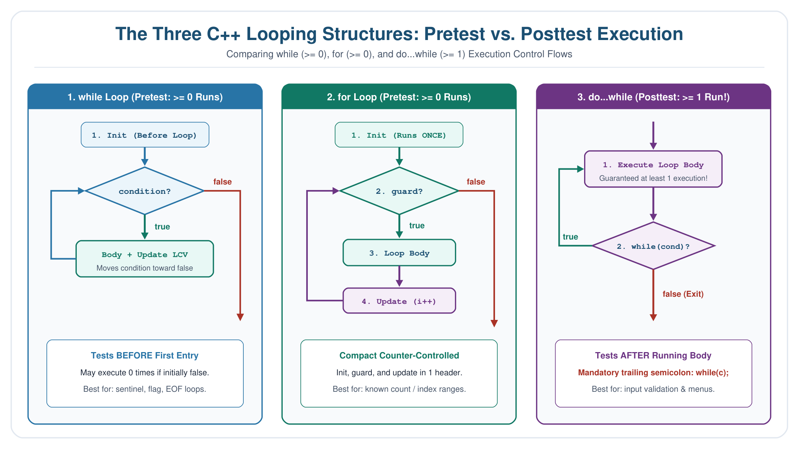
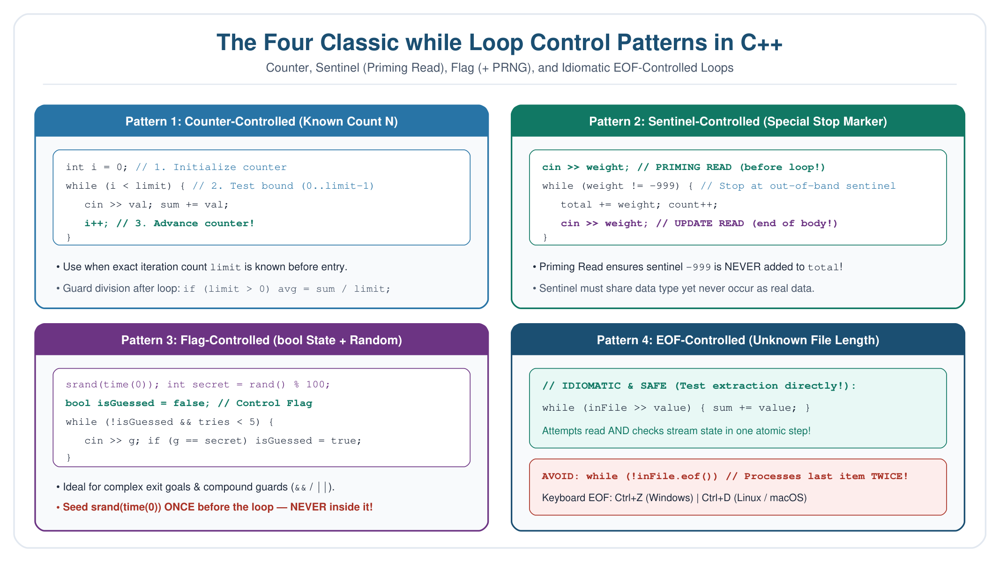
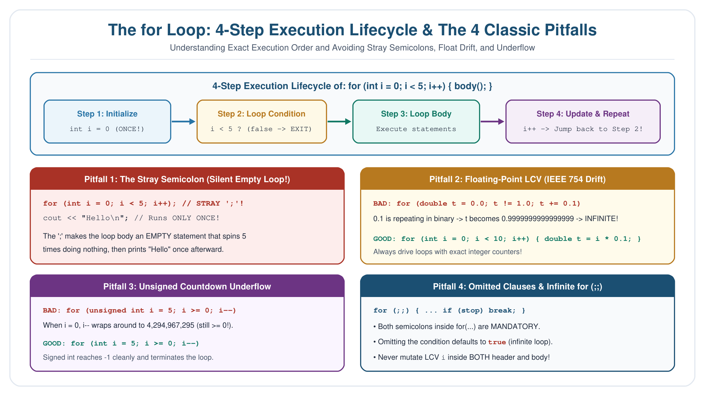
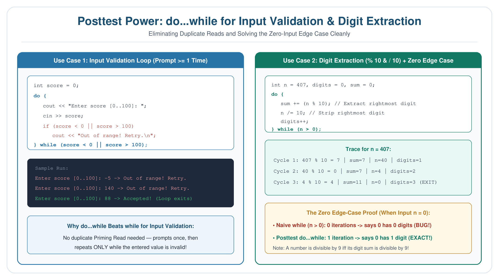
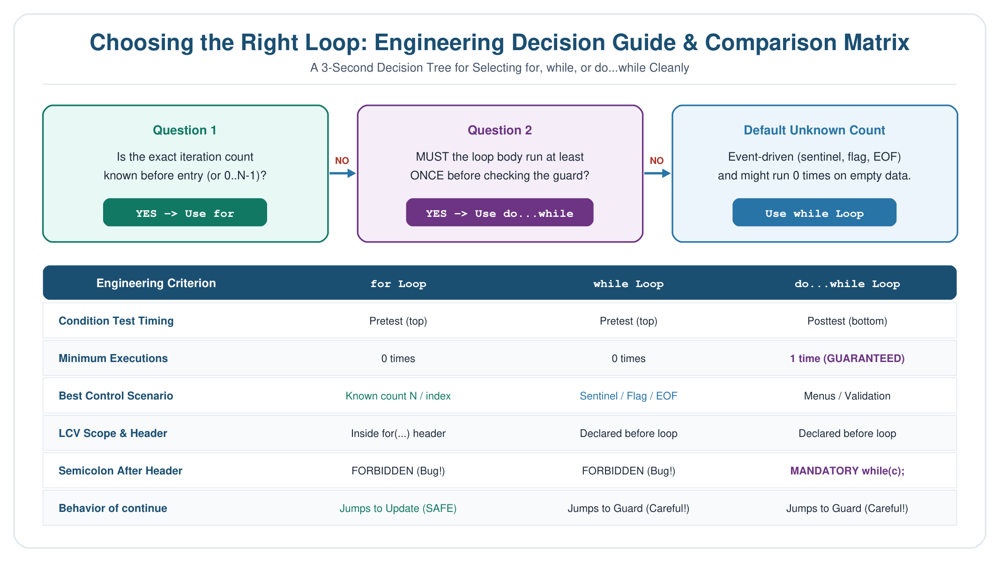
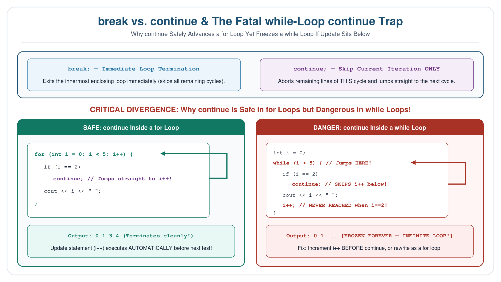
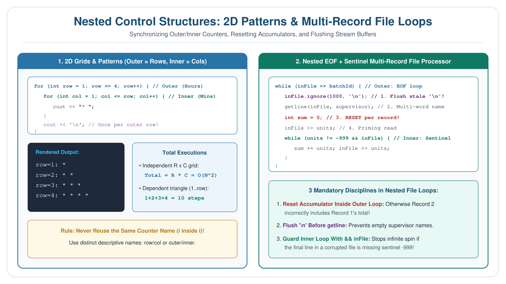
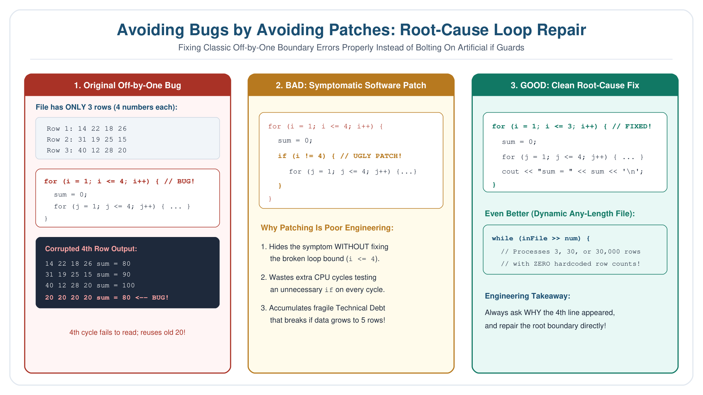
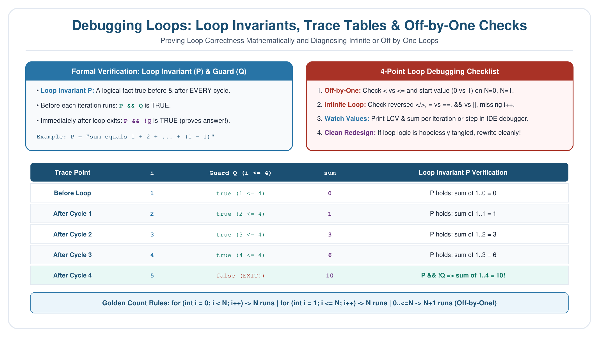

**Page 1**

## Table of Contents

- [Chapter 05 — Control Structures II (Repetition)](#chapter-05--control-structures-ii-repetition)
  - [Introduction](#introduction)
  - [Why Is Repetition Needed](#why-is-repetition-needed)
  - [The while Looping Structure](#the-while-looping-structure)
    - [Syntax, Pretest Mechanics, and Infinite Loops](#syntax-pretest-mechanics-and-infinite-loops)
    - [Case 1: Counter-Controlled while Loops](#case-1-counter-controlled-while-loops)
    - [Case 2: Sentinel-Controlled while Loops](#case-2-sentinel-controlled-while-loops)
    - [Applied Pattern: Character-to-Keypad Telephone Decoder](#applied-pattern-character-to-keypad-telephone-decoder)
    - [Case 3: Flag-Controlled while Loops and Pseudorandom Numbers](#case-3-flag-controlled-while-loops-and-pseudorandom-numbers)
    - [Case 4: EOF-Controlled while Loops](#case-4-eof-controlled-while-loops)
    - [More on Expressions in while Statements](#more-on-expressions-in-while-statements)
    - [Applied Case Study 1: Iterative Recurrence Sequence Engine (Fibonacci Pattern)](#applied-case-study-1-iterative-recurrence-sequence-engine-fibonacci-pattern)
  - [The for Looping Structure](#the-for-looping-structure)
    - [Syntax, 4-Step Execution Lifecycle, and Equivalence to while](#syntax-4-step-execution-lifecycle-and-equivalence-to-while)
    - [Loop Variable Scope, Countdowns, Strides, and Comma Expressions](#loop-variable-scope-countdowns-strides-and-comma-expressions)
    - [The Four Classic for Loop Pitfalls](#the-four-classic-for-loop-pitfalls)
    - [Applied Case Study 2: Batch Signal and Number Classifier](#applied-case-study-2-batch-signal-and-number-classifier)
  - [The do...while Looping Structure](#the-dowhile-looping-structure)
    - [Posttest Mechanics, Mandatory Semicolon, and Input Validation](#posttest-mechanics-mandatory-semicolon-and-input-validation)
    - [Digit Extraction, the Zero Edge Case, and Divisibility by 9](#digit-extraction-the-zero-edge-case-and-divisibility-by-9)
  - [Choosing the Right Looping Structure](#choosing-the-right-looping-structure)
  - [Flow Alteration: break and continue Statements](#flow-alteration-break-and-continue-statements)
    - [Immediate Exit with break and Iteration Skipping with continue](#immediate-exit-with-break-and-iteration-skipping-with-continue)
    - [The Critical continue Divergence: for Loops vs. while Loops](#the-critical-continue-divergence-for-loops-vs-while-loops)
  - [Nested Control Structures](#nested-control-structures)
    - [Two-Dimensional Grids, Dependent Bounds, and Time Complexity](#two-dimensional-grids-dependent-bounds-and-time-complexity)
    - [Multi-Record File Processing: Nested EOF and Sentinel Loops](#multi-record-file-processing-nested-eof-and-sentinel-loops)
  - [Avoiding Bugs by Avoiding Patches](#avoiding-bugs-by-avoiding-patches)
  - [Debugging Loops and Loop Invariants](#debugging-loops-and-loop-invariants)
    - [Formal Verification with Loop Invariants and Guards](#formal-verification-with-loop-invariants-and-guards)
    - [Diagnosing Off-by-One Errors, Infinite Loops, and Knowing When to Rewrite](#diagnosing-off-by-one-errors-infinite-loops-and-knowing-when-to-rewrite)
  - [Engineering Repetition Trace Lab (Worked Diagnostic Drills)](#engineering-repetition-trace-lab-worked-diagnostic-drills)
  - [Chapter 05 Summary & Pitfalls Checklist](#chapter-05-summary--pitfalls-checklist)

---

**Page 2**

# <span style="color:#1B4F72">Chapter 05 — Control Structures II (Repetition)</span>

## <span style="color:#2874A6">Introduction</span>

In Chapter 4, you gave your C++ programs the ability to **decide** between competing execution paths using `if`, `if...else`, `?:`, and `switch`. Yet even with branching, a program without repetition still hits a hard wall the moment data scales up. Suppose an environmental monitoring station receives 500 temperature readings from a sensor array, or a logistics hub processes 20,000 shipping manifests from a text file, or an interactive terminal must keep asking a user for a valid password until they enter it correctly. Writing 500 copies of `cin >> temp; sum += temp;` is absurd—and when the exact number of records is unknown until runtime, copying and pasting code is not merely tedious, it is **mathematically impossible**.

Repetition (also called **iteration** or **looping**) is the second foundational pillar of structured control flow. A loop instructs the CPU to execute a compact block of instructions repeatedly while a logical guard remains `true`, jumping backward to the top of the block on each cycle until the guard turns `false`. C++ provides three dedicated looping constructs—**`while`**, **`for`**, and **`do...while`**—along with two targeted flow-alteration statements (**`break`** and **`continue`**) and arbitrary **nesting** so loops and decisions can work together to solve two-dimensional and multi-record problems.

By the end of this chapter, you will not only know the syntax of every C++ loop, you will understand **exactly how the CPU traces every variable on every cycle**, **which loop fits each engineering scenario**, **how to eliminate silent off-by-one and infinite-loop bugs using formal loop invariants**, and **why root-cause fixes always beat quick software patches**.

---

**Page 3**

## <span style="color:#2874A6">Why Is Repetition Needed</span>

Before touching syntax, pause to appreciate the **three concrete problems** that repetition solves in software engineering. Think of an assembly line in an electronics factory: you do not build 10,000 separate robotic arms to solder 10,000 circuit boards—you build **one** precision robotic arm and program it to repeat the soldering cycle until the conveyor belt is empty.

| Engineering Problem | Without Loops (Sequential Copy-Paste) | With Loops (Iterative Control Flow) |
| :--- | :--- | :--- |
| **Scale & Memory Efficiency** | Averaging 10,000 voltages requires 10,000 variables (`v1`..`v10000`) and 10,000 input lines. Executable bloats and becomes unmaintainable. | Needs only **3 variables** (`voltage`, `sum`, `count`) and **5 lines of code**, whether processing 5 readings or 50,000,000. |
| **Unknown Runtime Volume** | Impossible to write code for a log file whose line count changes every day or a user who types an unpredictable number of entries. | A sentinel, flag, or End-of-File (EOF) loop adapts automatically to 0, 1, or 10 million records at runtime. |
| **Maintainability & Single Source of Truth** | Fixing a rounding bug or adding a unit conversion requires editing 10,000 duplicated lines—missing even one creates a silent defect. | The logic lives in **one** loop body. Fixing it once fixes every iteration immediately. |

### <span style="color:#117864">What Happens Inside the CPU During a Loop?</span>

At the machine-code level, a C++ loop is remarkably simple. Remember that the CPU tracks the address of the next instruction in a register called the **Program Counter (PC)** (also called the Instruction Pointer). Normally, the PC increments forward line by line. When the compiler translates a loop, it emits:
1. **A Test Instruction:** Evaluates your loop condition (for example, `count < 10`).
2. **A Conditional Jump:** If the condition is `false`, the CPU jumps forward *past* the closing brace `}` of the loop to exit.
3. **A Backward Jump:** At the bottom of the loop body, the CPU resets the PC *backward* to the condition test (or update step) to begin the next cycle.

Every single loop—whether `while`, `for`, or `do...while`—must obey **three universal structural requirements** to work reliably:
- **Initialization:** Set the starting state of the **Loop Control Variable (LCV)** (and any accumulators like `sum = 0`) *before* the loop relies on them.
- **Condition (Guard):** A Boolean expression that decides whether another iteration should execute.
- **Update (Progression):** At least one statement inside the loop (or `for` header) that moves the LCV systematically closer to making the condition `false`.

If you forget initialization, the loop reads garbage memory. If you write the wrong condition, the loop stops one step too early or too late (**off-by-one error**). If you forget the update—or push the LCV in the wrong direction—the loop runs forever (**infinite loop**).

---

**Page 4**

### <span style="color:#117864">Pretest vs. Posttest Loops: The Big Picture</span>

All three C++ loops divide cleanly into two execution families based on **when** the CPU tests the condition:

- **Pretest Loops (`while` and `for`):** The condition is tested **at the entrance**, *before* the loop body runs for the first time. If the condition starts out `false`, the loop body executes **0 times** (it is skipped completely). Think of checking whether a train ticket is valid *before* opening the boarding gate.
- **Posttest Loop (`do...while`):** The loop body executes **first**, and the condition is tested **at the exit**. Even if the condition is `false` on the very first check, the body has already executed **at least 1 time**. Think of eating one sample spoonful of soup *before* deciding whether to add more salt.

<p align="center">
  
</p>

Keep this single visual distinction in your head throughout the entire chapter:
- **`while`** $\rightarrow$ Pretest ($\ge 0$ executions). Best when repetition depends on a runtime event (sentinel, flag, or EOF).
- **`for`** $\rightarrow$ Pretest ($\ge 0$ executions). Best when repetition is driven by a counter or known range.
- **`do...while`** $\rightarrow$ Posttest ($\ge 1$ execution). Best when the body *must* run at least once (input validation, interactive menus, digit extraction).

---

**Page 5**

## <span style="color:#2874A6">The while Looping Structure</span>

### <span style="color:#117864">Syntax, Pretest Mechanics, and Infinite Loops</span>

The `while` loop is the simplest and most general looping statement in C++. Its formal syntax is:

```cpp
while (expression)
    statement;
```

In real engineering code, the loop body almost always contains multiple statements (at minimum, performing the work and updating the LCV), so you wrap the body in a **compound statement (block)** enclosed in curly braces `{ }`:

```cpp
while (condition) {
    // 1. Perform work for the current cycle
    // 2. Update the loop control variable (LCV) so condition eventually becomes false
}
```

#### <span style="color:#6C3483">Step-by-Step Execution Walk-Through</span>

Let us trace a tiny `while` loop that prints battery charge steps from `20` to `100` in jumps of `20`:

```cpp
int charge = 20;                // Step A: Initialize LCV before loop

while (charge <= 100) {         // Step B: Test condition (Pretest)
    cout << charge << "% ";     // Step C: Execute body work
    charge += 20;               // Step D: Update LCV toward exit
}
cout << "\nFully charged.\n";   // Step E: First line after loop exits
```

Watch the exact timeline in a **Variable Trace Table**—this is the exact mental model you should use whenever you read or debug any loop:

| Cycle | Value of `charge` at Test | Test `charge <= 100` | Printed Output | Value of `charge` After `charge += 20` |
| :---: | :---: | :---: | :--- | :---: |
| 1 | `20` | `true` | `20% ` | `40` |
| 2 | `40` | `true` | `40% ` | `60` |
| 3 | `60` | `true` | `60% ` | `80` |
| 4 | `80` | `true` | `80% ` | `100` |
| 5 | `100` | `true` | `100% ` | `120` |
| Exit Check | `120` | `false` (EXIT) | *(loop skipped)* | `120` (preserved after loop!) |

**Console Output:**
```text
20% 40% 60% 80% 100% 
Fully charged.
```

Look closely at the last row of the trace table. Notice two crucial facts that beginners frequently overlook:
1. **One extra test always happens:** The loop body ran **5 times**, yet the condition `charge <= 100` was evaluated **6 times** (5 `true` evaluations plus 1 final `false` evaluation that triggered the exit).
2. **The LCV overshoots the boundary:** When the loop exits, `charge` is **not** `100`—it is **`120`**, because `120` is the very first value that broke the condition `charge <= 100`.

---

**Page 6**

#### <span style="color:#6C3483">What If the Condition Is Initially False? (Zero-Iteration Behavior)</span>

Because `while` is a **pretest** loop, if `charge` started at `120`, the condition `120 <= 100` evaluates to `false` immediately. The CPU never enters `{ ... }`—not even once—and jumps directly to `cout << "\nFully charged.\n";`. This zero-iteration safety is essential when processing data that might legitimately be empty (such as an empty sensor log file or zero pending orders).

#### <span style="color:#6C3483">Anatomy of an Infinite Loop (And How to Recognize One Instantly)</span>

An **infinite loop** occurs whenever the loop condition remains `true` forever, trapping the CPU inside the loop until the user forcefully aborts the process (`Ctrl+C` in a terminal) or the operating system kills it. Infinite loops almost always come from one of **four specific mistakes**:

| Infinite Loop Cause | Broken Code Example | Why It Never Terminates | Clean Fix |
| :--- | :--- | :--- | :--- |
| **1. Missing Update** | `int k = 1; while (k <= 5) { cout << k; }` | `k` stays `1` forever; `1 <= 5` is always `true`. | Add `k++;` inside the braces. |
| **2. Wrong Update Direction** | `int k = 5; while (k >= 1) { cout << k; k++; }` | `k` grows (`5, 6, 7, ...`) away from `1` instead of down to `0` (spins until signed integer overflow!). | Change `k++` to `k--`. |
| **3. Missing Braces Around Body** | `int k = 0; while (k < 5) cout << k; k++;` | Without `{ }`, only `cout << k;` is inside the `while` loop; `k++;` sits *outside* and is never reached! | Wrap both statements inside `{ ... }`. |
| **4. Stray Semicolon After Header** | `int k = 0; while (k < 5); { cout << k; k++; }` | The stray `;` creates an **empty statement** as the loop body! The CPU checks `0 < 5`, does nothing, checks `0 < 5` again forever. | Delete the `;` right after `while (k < 5)`. |

> **Warning — The Stray Semicolon Trap (`while (cond);`):**
> The compiler will **not** reject `while (k < 5);` as a syntax error, because a standalone semicolon `;` is a legal empty (null) statement in C++. The compiler assumes you intentionally wanted an empty body! Your terminal will simply freeze blank with high CPU usage. Whenever a program hangs silently before printing anything, inspect the end of every `while (...)` and `for (...)` header for an accidental trailing semicolon.

#### <span style="color:#6C3483">The Four Classic `while` Loop Control Patterns</span>

In real-world C++ software, `while` loops fall cleanly into **four standard engineering patterns**, distinguished solely by *how the program knows when to stop*:
1. **Counter-Controlled:** Stop after an exact, pre-known number of cycles `N`.
2. **Sentinel-Controlled:** Stop when a special out-of-band marker value (the **sentinel**) arrives in the input stream.
3. **Flag-Controlled:** Stop when a `bool` status variable flips from `false` to `true` (or vice versa) because a complex goal or error occurred.
4. **EOF-Controlled:** Stop automatically when an input stream (file or keyboard) reaches **End-of-File**.

<p align="center">
  
</p>

Let us master each of these four patterns in complete detail with full original C++ programs and line-by-line traces.

---

**Page 7**

### <span style="color:#117864">Case 1: Counter-Controlled while Loops</span>

Use a **counter-controlled** `while` loop when your program knows **exactly how many items** to process *before* the loop starts—either as a fixed constant (like `12` months) or as a count `N` entered by the user at the beginning of the run.

Think of loading exactly `N` boxes onto a cargo pallet: you start a tally clicker at `0`, load one box and click the counter up by `1`, and stop the moment the clicker reaches `N`.

#### <span style="color:#6C3483">The Standard Counter-Controlled Blueprint</span>

```cpp
int counter = 0;           // 1. Initialize counter (0-based standard)
while (counter < limit) {  // 2. Test against exact target count
    // Process one item
    counter++;             // 3. Advance counter by 1
}
```

#### <span style="color:#6C3483">0-Based (`0` to `< N`) vs. 1-Based (`1` to `<= N`) Counting</span>

Both of the following loops execute **exactly `N` times** (when $N \ge 0$):

| Style | Initialization | Condition | Values Taken Inside Body (for `N = 4`) | Final Value After Exit | When to Prefer |
| :--- | :---: | :---: | :---: | :---: | :--- |
| **0-Based (C++ Idiom)** | `int i = 0;` | `i < N` | `0, 1, 2, 3` (4 cycles) | `4` | Default in C++ (matches array/string indices `0..N-1`). |
| **1-Based (Human Label)** | `int i = 1;` | `i <= N` | `1, 2, 3, 4` (4 cycles) | `5` | Handy when printing human-facing labels like `"Sensor #1"`..`"Sensor #4"`. |
| **BUG: Mixed Style!** | `int i = 0;` | `i <= N` | `0, 1, 2, 3, 4` (**5 cycles!**) | `5` | **Classic Off-by-One Bug!** Runs `N + 1` times instead of `N`. |
| **BUG: Mixed Style!** | `int i = 1;` | `i < N` | `1, 2, 3` (**3 cycles!**) | `4` | **Classic Off-by-One Bug!** Runs `N - 1` times instead of `N`. |

#### <span style="color:#6C3483">Accumulator Initialization & Post-Loop Division Guard</span>

Whenever a counter-controlled loop computes a **running total** (`sum`) and an **average** (`sum / count`), two defensive habits are mandatory:
1. **Always initialize `sum = 0.0` (or `0`) before the loop:** Local variables in C++ are *not* automatically zeroed; uninitialized accumulators hold random stack garbage, so `sum += reading;` adds onto nonsense!
2. **Always guard division with `if (count > 0)` after the loop:** What if the user enters `0` for `limit`? The `while` loop executes `0` times (which is safe!), leaving `limit == 0`. Dividing `sum / limit` without checking `if (limit > 0)` causes integer division-by-zero crash or floating-point `NaN` (`0.0 / 0.0`).

---

**Page 8**

#### <span style="color:#6C3483">Complete Engineering Program: Solar Panel Daily Output Analyzer</span>

Suppose an electrical technician wants to enter the exact number of solar panels inspected today, enter each panel's kilowatt-hour (`kWh`) output, and compute the total farm yield and average yield per panel.

```cpp
#include <iostream>
#include <iomanip>
using namespace std;

int main() {
    int panelCount = 0;
    int currentPanel = 1;       // 1-based LCV for clean user prompts
    double panelOutput = 0.0;
    double totalOutput = 0.0;   // Accumulator MUST start at 0.0

    cout << "Enter total number of solar panels tested: ";
    cin >> panelCount;

    while (currentPanel <= panelCount) {
        cout << "  Panel #" << currentPanel << " output (kWh): ";
        cin >> panelOutput;

        totalOutput += panelOutput;
        currentPanel++;         // Mandatory LCV progression
    }

    cout << fixed << setprecision(2);
    cout << "\n--- Solar Inspection Report ---\n";
    cout << "Panels Tested : " << panelCount << '\n';
    cout << "Total Yield   : " << totalOutput << " kWh\n";

    if (panelCount > 0) {       // Mandatory zero-division guard
        double averageYield = totalOutput / panelCount;
        cout << "Average Yield : " << averageYield << " kWh/panel\n";
    } else {
        cout << "Average Yield : N/A (no panels were tested)\n";
    }

    return 0;
}
```

#### <span style="color:#6C3483">Sample Execution & Variable Trace</span>

Suppose the technician enters `panelCount = 3`, followed by readings `4.50`, `5.25`, and `3.75`:

| Cycle | `currentPanel` Before Test | Condition `currentPanel <= 3` | Input `panelOutput` | `totalOutput` After `+=` | `currentPanel` After `++` |
| :---: | :---: | :---: | :---: | :---: | :---: |
| 1 | `1` | `true` | `4.50` | `4.50` | `2` |
| 2 | `2` | `true` | `5.25` | `9.75` | `3` |
| 3 | `3` | `true` | `3.75` | `13.50` | `4` |
| Exit | `4` | `false` | *(not read)* | `13.50` | `4` |

After exit, `panelCount > 0` (`3 > 0`) is `true`, so `averageYield = 13.50 / 3 = 4.50 kWh/panel`. And if the technician entered `0`, the loop runs 0 times and prints `Average Yield : N/A (no panels were tested)` cleanly with zero crash.

---

**Page 9**

### <span style="color:#117864">Case 2: Sentinel-Controlled while Loops</span>

What if the technician does **not** know in advance how many cargo boxes, exam scores, or sensor readings are coming? Counting 347 invoices by hand just to tell the computer `"347"` defeats the entire purpose of using a computer!

A **sentinel-controlled `while` loop** solves this cleanly. You agree on a special marker value—called the **sentinel**—that signals *"stop reading now."* To be valid, a sentinel **must obey two strict design rules**:
1. **Same Data Type:** The sentinel must be readable by the same input variable (e.g., an `int` sentinel like `-1` or `-999` for an `int` stream, or `'#'` for a `char` stream, or `"END"` for a `string` stream).
2. **Guaranteed Out-of-Band (Impossible as Real Data):** The sentinel must *never* collide with a legitimate data point. For example:
   - Exam scores (`0..100`) or package weights (`> 0`) $\rightarrow$ `-1` or `-999` is a safe sentinel.
   - Celsius temperatures in a freezer test (where `-1` is a real temperature!) $\rightarrow$ `-1` is a **terrible** sentinel! Use `-999.0` (well below absolute zero `-273.15°C`) so no real physics reading can ever accidentally halt the loop.

#### <span style="color:#6C3483">The Golden Architecture: Priming Read + Bottom Update Read</span>

The #1 mistake students make with sentinel loops is reading the input **inside the top of the loop** instead of using a **Priming Read** before the loop. Compare the broken design against the clean engineering design side by side:

```cpp
// WRONG DESIGN (No Priming Read — Sentinel Corrupts Sum and Count!)
int weight = 0, sum = 0, count = 0;
while (weight != -999) {
    cin >> weight;      // Suppose user types -999 here!
    sum += weight;      // BUG: Adds -999 to sum!!
    count++;            // BUG: Increments count for the sentinel!!
}

// CORRECT DESIGN (Priming Read Before Loop + Update Read at Bottom!)
const int SENTINEL = -999;
int weight = 0, sum = 0, count = 0;

cin >> weight;                  // 1. PRIMING READ (before loop!)
while (weight != SENTINEL) {    // 2. Test BEFORE processing!
    sum += weight;              // 3. Process ONLY verified real data
    count++;
    cin >> weight;              // 4. UPDATE READ (last line of body!)
}
```

Pause and appreciate why the **Priming Read + Bottom Update Read** pattern is bulletproof:
1. If the very first value entered is `-999` (empty dataset), the priming read loads `-999`, the pretest `weight != -999` is immediately `false`, and the loop runs **0 times**—neither `sum` nor `count` is polluted.
2. When real values arrive (`40`, `65`, `-999`), each real value is validated by `while (weight != SENTINEL)` *before* entering the body. When the bottom update read finally fetches `-999`, the loop jumps straight back to the `while` test, sees `-999 != -999` is `false`, and exits immediately **without ever adding `-999` to `sum` or incrementing `count`**.

---

**Page 10**

#### <span style="color:#6C3483">Complete Engineering Program: Warehouse Freight Scale Accumulator</span>

```cpp
#include <iostream>
#include <iomanip>
using namespace std;

int main() {
    const double SENTINEL = -1.0;

    double crateKg = 0.0;
    double totalKg = 0.0;
    int crateCount = 0;

    cout << "Warehouse Freight Logger (enter -1 to finish)\n";
    cout << "Enter crate weight in kg: ";
    cin >> crateKg;                     // Priming read

    while (crateKg != SENTINEL) {
        if (crateKg < 0.0) {            // Defensive check for other bad negatives
            cout << "  [Ignored] Weight cannot be negative.\n";
        } else {
            totalKg += crateKg;
            crateCount++;
        }

        cout << "Enter next crate weight in kg (-1 to finish): ";
        cin >> crateKg;                 // Update read at bottom of body
    }

    cout << fixed << setprecision(2);
    cout << "\n=== Shift Freight Summary ===\n";
    cout << "Valid Crates Logged : " << crateCount << '\n';
    cout << "Total Cargo Weight  : " << totalKg << " kg\n";

    if (crateCount > 0) {
        cout << "Mean Crate Weight   : " << (totalKg / crateCount) << " kg\n";
    } else {
        cout << "Mean Crate Weight   : N/A (zero crates recorded)\n";
    }

    return 0;
}
```

#### <span style="color:#6C3483">Step-by-Step Trace (Inputs: `18.5`, `-4.0`, `21.5`, `-1`)</span>

| Step | Event | `crateKg` | `crateKg != -1.0` | Action Taken | `totalKg` | `crateCount` |
| :---: | :--- | :---: | :---: | :--- | :---: | :---: |
| 0 | Priming Read | `18.5` | — | Loaded first value | `0.0` | `0` |
| 1 | Cycle 1 | `18.5` | `true` | Valid $\rightarrow$ added to total; bottom read gets `-4.0` | `18.5` | `1` |
| 2 | Cycle 2 | `-4.0` | `true` | Negative $\rightarrow$ ignored; bottom read gets `21.5` | `18.5` | `1` |
| 3 | Cycle 3 | `21.5` | `true` | Valid $\rightarrow$ added to total; bottom read gets `-1.0` | `40.0` | `2` |
| 4 | Exit Test | `-1.0` | `false` | Loop exits cleanly; `-1.0` never touched totals! | `40.0` | `2` |

Mean crate weight prints `40.00 / 2 = 20.00 kg`. Notice how combining an `if...else` filter inside a sentinel `while` loop lets you reject invalid inputs (`-4.0`) without mistaking them for the stop sentinel (`-1.0`).

---

**Page 11**

### <span style="color:#117864">Applied Pattern: Character-to-Keypad Telephone Decoder</span>

One of the classic interactive sentinel patterns in C++ is a **character-driven command loop** where the user enters `'Y'`/`'y'` to keep running and `'N'`/`'n'` (or `'#'`) to stop, combined with a `switch` or range mapping inside the loop.

Consider a real telecom utility: mapping alphabetic vanity call-letters (like `A..Z` or `a..z`) onto standard ITU telephone keypad digits (`2` through `9`), where:
- `A, B, C` $\rightarrow$ `2`
- `D, E, F` $\rightarrow$ `3`
- `G, H, I` $\rightarrow$ `4`
- `J, K, L` $\rightarrow$ `5`
- `M, N, O` $\rightarrow$ `6`
- `P, Q, R, S` $\rightarrow$ `7`
- `T, U, V` $\rightarrow$ `8`
- `W, X, Y, Z` $\rightarrow$ `9`

Notice two engineering subtleties here:
1. **Case Normalization (`toupper` or manual ASCII offset):** Instead of duplicating 26 lowercase `case 'a':` labels alongside 26 uppercase `case 'A':` labels, we normalize any lowercase letter `'a'..'z'` to uppercase first (`if (ch >= 'a' && ch <= 'z') ch = ch - ('a' - 'A');`) or use `static_cast<char>(toupper(static_cast<unsigned char>(ch)))` from `<cctype>`.
2. **Compound Sentinel Guard:** We let the user terminate by typing `'#'` (a single character sentinel), using a clean priming read + bottom update read.

```cpp
#include <iostream>
#include <cctype>
using namespace std;

int main() {
    const char STOP_MARKER = '#';
    char letter = ' ';

    cout << "Vanity Keypad Encoder (enter letters A-Z, or '#' to quit)\n";
    cout << "Enter a letter: ";
    cin >> letter;                              // Priming read

    while (letter != STOP_MARKER) {
        char upper = static_cast<char>(toupper(static_cast<unsigned char>(letter)));
        int keypadDigit = -1;

        switch (upper) {
            case 'A': case 'B': case 'C':
                keypadDigit = 2; break;
            case 'D': case 'E': case 'F':
                keypadDigit = 3; break;
            case 'G': case 'H': case 'I':
                keypadDigit = 4; break;
            case 'J': case 'K': case 'L':
                keypadDigit = 5; break;
            case 'M': case 'N': case 'O':
                keypadDigit = 6; break;
            case 'P': case 'Q': case 'R': case 'S':
                keypadDigit = 7; break;
            case 'T': case 'U': case 'V':
                keypadDigit = 8; break;
            case 'W': case 'X': case 'Y': case 'Z':
                keypadDigit = 9; break;
            default:
                keypadDigit = -1; break;
        }

        if (keypadDigit != -1) {
            cout << "  '" << letter << "' maps to keypad digit: "
                 << keypadDigit << '\n';
        } else {
            cout << "  [Error] '" << letter << "' is not an English letter.\n";
        }

        cout << "Enter next letter ('#' to quit): ";
        cin >> letter;                          // Update read at bottom
    }

    cout << "Encoder session ended.\n";
    return 0;
}
```

**Why this pattern matters:** Look how naturally Chapter 4 (`switch` with intentional stacked cases + `if...else`) integrates *inside* a Chapter 5 sentinel `while` loop. Because `cin >> letter` skips whitespace automatically, the user can type one letter per line *or* an entire word followed by `#` (e.g., `H E L P #`), and the loop decodes every single character cleanly and stops the instant it hits `#`.

---

**Page 12**

### <span style="color:#117864">Case 3: Flag-Controlled while Loops and Pseudorandom Numbers</span>

Sometimes neither a fixed counter nor a single sentinel value expresses *when* a loop should stop. Imagine a vault PIN lock, a network handshake retry loop, or an interactive diagnostic guessing challenge: you want to keep looping **until a specific event happens** (such as matching a target code, stabilizing a sensor reading, or triggering an alarm).

A **flag-controlled `while` loop** uses a `bool` variable—called a **flag**—to remember whether that stopping event has happened yet:

```cpp
bool isFound = false;           // 1. Initialize flag before loop

while (!isFound) {              // 2. Keep looping while NOT yet found
    // Perform search / trial step
    if (/* target condition met */) {
        isFound = true;         // 3. Flip flag to signal exit on next check
    }
}
```

Think of a flag like a physical mailbox flag: before the mail arrives, the flag stays **down** (`false`). Every hour you check `while (!mailArrived)`. The moment the envelope lands, you flip the flag **up** (`mailArrived = true`), and the loop stops cleanly on its very next guard check.

#### <span style="color:#6C3483">Generating Pseudorandom Numbers (`<cstdlib>` and `<ctime>`)</span>

Flag-controlled loops frequently pair with pseudorandom number generation (PRNG) for simulations, randomized tests, Monte Carlo sampling, and interactive games. Classic C++ provides two standard functions in `<cstdlib>` paired with `<ctime>`:

1. **`rand()`:** Returns a pseudorandom integer between `0` and `RAND_MAX` (at least `32767` on Windows/MSVC and often `2147483647` on Linux/GCC).
2. **`srand(seed)`:** Sets the starting **seed** of the internal PRNG sequence.
   - If you **never call `srand()`**, C++ defaults to `srand(1)`, so your program generates the **exact same sequence of numbers on every single execution**!
   - Passing `static_cast<unsigned int>(time(0))` (from `<ctime>`) seeds the generator with the current Unix timestamp (seconds elapsed since January 1, 1970), producing a fresh sequence on every run.

#### <span style="color:#6C3483">Mapping `rand()` to Any Target Range `[minVal, maxVal]`</span>

The modulo operator `%` wraps `rand()` cleanly into any desired integer interval:

| Desired Integer Range | Formula | Example Values Produced |
| :--- | :--- | :--- |
| `0` to `N - 1` (e.g., `0..99`) | `rand() % N` | `0, 1, 2, ..., 99` |
| `1` to `N` (e.g., a 6-sided die `1..6`) | `(rand() % N) + 1` | `1, 2, 3, 4, 5, 6` |
| Arbitrary `[minVal, maxVal]` (e.g., `25..75`) | `(rand() % (maxVal - minVal + 1)) + minVal` | `25, 26, ..., 75` (width = `51`) |

> **Critical Engineering Rule — Seed `srand()` ONCE, Never Inside a Loop!**
> Always place `srand(static_cast<unsigned int>(time(0)));` **once at the very top of `main()`**, never inside a loop body. Because `time(0)` ticks only once per second while a C++ loop runs millions of times per second, calling `srand(time(0))` inside a loop resets the generator to the *exact same seed* on every iteration, causing `rand()` to spit out the exact same number thousands of times in a row!

---

**Page 13**

#### <span style="color:#6C3483">Complete Engineering Program: Calibration Frequency Finder (Flag + Bounded Attempts)</span>

Combining a `bool` flag with a retry counter (`while (!isLocked && attemptsLeft > 0)`) gives you the safest real-world retry loop: the user wins early if they find the hidden calibration channel, or exits gracefully if they exhaust their `6` allowed attempts.

```cpp
#include <iostream>
#include <cstdlib>      // rand(), srand()
#include <ctime>        // time()
using namespace std;

int main() {
    // Seed PRNG exactly ONCE before any loop begins
    srand(static_cast<unsigned int>(time(0)));

    const int MIN_CH = 10;
    const int MAX_CH = 99;
    const int MAX_ATTEMPTS = 6;

    int secretChannel = (rand() % (MAX_CH - MIN_CH + 1)) + MIN_CH;
    int guess = 0;
    int attemptsLeft = MAX_ATTEMPTS;
    bool isLocked = false;          // Flag variable

    cout << "Radio Calibration Challenge: Locate channel ["
         << MIN_CH << ".." << MAX_CH << "]\n";
    cout << "You have " << MAX_ATTEMPTS << " diagnostic probes.\n\n";

    while (!isLocked && attemptsLeft > 0) {
        cout << "Probe (" << attemptsLeft << " left) -> Enter channel: ";
        cin >> guess;
        attemptsLeft--;

        if (guess == secretChannel) {
            isLocked = true;        // Flip flag -> stops loop immediately!
        } else if (guess < secretChannel) {
            cout << "  Signal too LOW. Tune higher.\n";
        } else {
            cout << "  Signal too HIGH. Tune lower.\n";
        }
    }

    cout << "\n--- Calibration Result ---\n";
    if (isLocked) {
        cout << "LOCK ACQUIRED on channel " << secretChannel
             << " using " << (MAX_ATTEMPTS - attemptsLeft) << " probe(s)!\n";
    } else {
        cout << "OUT OF PROBES. Target channel was " << secretChannel << ".\n";
    }

    return 0;
}
```

#### <span style="color:#6C3483">Trace Analysis of the Compound Guard (`!isLocked && attemptsLeft > 0`)</span>

Watch how the two clauses in `while (!isLocked && attemptsLeft > 0)` cooperate cleanly:
- **Case A (User locks on attempt 3):** `attemptsLeft` becomes `3`, `isLocked` becomes `true`. At the top of the next cycle, `!isLocked` is `false`. Thanks to short-circuit `&&`, the loop stops immediately and the `if (isLocked)` branch celebrates success.
- **Case B (User misses all 6 attempts):** `isLocked` stays `false`, while `attemptsLeft` decrements `6 -> 5 -> 4 -> 3 -> 2 -> 1 -> 0`. At the next test, `attemptsLeft > 0` is `false`, so the loop terminates and the `else` branch reveals `secretChannel`.
- **No infinite loop is possible:** Even if the user types wild wrong guesses, `attemptsLeft--` guarantees termination in at most `6` cycles.

---

**Page 14**

### <span style="color:#117864">Case 4: EOF-Controlled while Loops</span>

In production software, files rarely end with a special sentinel like `-999`. Imagine a CSV log exported by a weather station or a bank transaction feed: every valid line holds real data, and the file simply **ends** when there are no more bytes left on disk.

An **EOF-controlled `while` loop** reads directly until the input stream hits **End-of-File (EOF)** (or encounters a malformed token that places the stream into a fail state).

#### <span style="color:#6C3483">How to Trigger EOF from the Keyboard vs. Disk Files</span>

| Input Source | How EOF Occurs |
| :--- | :--- |
| **Disk File (`ifstream`)** | Automatically triggered by the operating system as soon as an extraction attempts to read past the final byte of the file. |
| **Keyboard (`cin`) on Windows** | Press **`Ctrl+Z`** on a fresh line, then press **`Enter`**. |
| **Keyboard (`cin`) on Linux / macOS** | Press **`Ctrl+D`** on a fresh line. |

#### <span style="color:#6C3483">The Idiomatic C++ Pattern: Testing the Extraction Expression Directly</span>

In C++, the extraction expression `(inFile >> value)` does **two things at once**:
1. It attempts to extract the next formatted value from `inFile` into `value`.
2. It returns a reference to `inFile` itself, which in a Boolean context (`while (...)`) automatically evaluates to **`true` if the extraction succeeded** and **`false` if EOF or a read error occurred**.

Therefore, the cleanest, safest EOF loop in all of C++ is a single line:

```cpp
double reading = 0.0;
while (inFile >> reading) {     // Attempts read AND checks success atomically!
    // Guaranteed: 'reading' holds a freshly extracted valid value!
    total += reading;
    count++;
}
```

Similarly, when reading entire lines of text with spaces (from Chapter 3), wrap `getline()` directly inside `while (...)`:

```cpp
string line;
while (getline(inFile, line)) { // Reads full line AND checks success atomically!
    lineCount++;
}
```

---

**Page 15**

#### <span style="color:#6C3483">Why `while (!inFile.eof())` Is a Famous C++ Bug (Step-by-Step Proof)</span>

Every C++ textbook warns about `inFile.eof()`, yet thousands of students still accidentally write `while (!inFile.eof())` and get mystified when their program **processes the last number in the file TWICE**. Let us trace *exactly why* this happens!

Suppose `temps.txt` contains just **two numbers** followed by a trailing newline:
```text
20
30
```

Now compare the broken `!inFile.eof()` loop against the idiomatic `while (inFile >> val)` loop:

```cpp
// BROKEN — NEVER WRITE THIS!
int val = 0, sum = 0, count = 0;
while (!inFile.eof()) {
    inFile >> val;      // Read happens AFTER checking eof()!
    sum += val;
    count++;
}
```

| Cycle | Stream Pointer Position Before Test | `inFile.eof()` Flag | `!inFile.eof()` | `inFile >> val` Result | Value in `val` | `sum` | `count` |
| :---: | :--- | :---: | :---: | :--- | :---: | :---: | :---: |
| 1 | At `'2'` of `20` | `false` | `true` | Extracts `20` (OK) | `20` | `20` | `1` |
| 2 | At `'3'` of `30` | `false` | `true` | Extracts `30` (OK); stops at `'\n'`! | `30` | `50` | `2` |
| **3 (BUG!)** | At trailing `'\n'` (NOT past EOF yet!) | **`false`!** | **`true`!** | Skips `'\n'`, hits EOF, **FAILS!** `val` stays **`30`**! | **`30` (STALE!)** | **`80` (WRONG!)** | **`3` (WRONG!)** |
| Exit | Past EOF (`eofbit` & `failbit` set) | `true` | `false` | Loop finally exits | `30` | **`80`** | **`3`** |

**The Root Cause Explained Simply:** In C++, `inFile.eof()` does **not** look into the future to tell you *"the next read will hit the end."* It only reports the past: *"a previous read ALREADY tried to read past the end and failed."* After reading `30`, the file pointer is sitting right before the trailing newline `'\n'`, so `eof()` is still `false`! The loop enters a **phantom 3rd cycle**, `inFile >> val` fails without modifying `val` (so `val` still holds the stale `30` from Cycle 2!), and your code blindly adds `30` a second time!

Even worse: if the file contains a corrupt text word like `"ERROR"` instead of a number, `inFile >> val` sets `failbit` (NOT `eofbit`), so `while (!inFile.eof())` becomes an **infinite loop**! By contrast, `while (inFile >> val)` checks *both* EOF and format failure *after* attempting the read and *before* touching `sum` or `count`, so it works flawlessly every single time.

---

**Page 16**

#### <span style="color:#6C3483">Complete Engineering Program: Telemetry Log Min / Max / Mean Analyzer</span>

Notice one extra engineering technique in this EOF file processor: how do you initialize `minVal` and `maxVal` safely without guessing magic constants like `999999` or `-999999`? **Seed both `minVal` and `maxVal` from the very first successfully extracted reading!**

```cpp
#include <iostream>
#include <fstream>
#include <iomanip>
using namespace std;

int main() {
    ifstream inFile("voltage_log.txt");
    if (!inFile) {
        cerr << "Error: Unable to open 'voltage_log.txt'.\n";
        return 1;
    }

    double voltage = 0.0;
    double sum = 0.0;
    double minV = 0.0;
    double maxV = 0.0;
    int count = 0;

    // Idiomatic EOF-controlled loop: read and validate in one atomic check
    while (inFile >> voltage) {
        if (count == 0) {           // First valid sample seeds min and max!
            minV = voltage;
            maxV = voltage;
        } else {
            if (voltage < minV) minV = voltage;
            if (voltage > maxV) maxV = voltage;
        }

        sum += voltage;
        count++;
    }

    inFile.close();

    cout << fixed << setprecision(3);
    cout << "=== Voltage Telemetry Audit ===\n";
    if (count > 0) {
        cout << "Samples Read : " << count << '\n';
        cout << "Minimum (V)  : " << minV << '\n';
        cout << "Maximum (V)  : " << maxV << '\n';
        cout << "Average (V)  : " << (sum / count) << '\n';
    } else {
        cout << "File contained zero valid numeric readings.\n";
    }

    return 0;
}
```

**Why seeding `minV` and `maxV` on `count == 0` beats hardcoding `minV = 9999`:** Suppose all voltages in a high-voltage transmission file are between `12,000 V` and `15,000 V`. A hardcoded `minV = 9999` would falsely report `9999` as the minimum even though `9999` never appeared in the file! Seeding from the first real data point guarantees exact results for *any* numeric range—negative, tiny, or astronomical.

---

**Page 17**

### <span style="color:#117864">More on Expressions in while Statements</span>

A `while` loop's condition does not have to be a simple single comparison like `count < 10`. Any valid Boolean expression from Chapter 4—including compound `&&`, `||`, `!`, stream-state checks, and mixed conditions—can govern a `while` loop.

In professional C++, **compound loop guards** are used whenever a loop must satisfy **multiple simultaneous safety boundaries**:

| Engineering Scenario | Compound `while` Guard | Why Both Conditions Are Necessary |
| :--- | :--- | :--- |
| **Bounded File Read (Cap at 100 Records)** | `while (count < 100 && (inFile >> item))` | Stops cleanly at 100 items *or* earlier if the file hits EOF first. Notice `count < 100` comes **first** so short-circuit `&&` does *not* extract and waste the 101st item! |
| **Sentinel + Stream Safety Guard** | `while (cin >> score && score != -1)` | Reads a score; stops cleanly if the user enters `-1` **OR** hits EOF / types non-numeric garbage (prevents infinite spin on broken input!). |
| **Convergence + Iteration Safety Cap** | `while (abs(error) > 0.0001 && iter < 1000)` | Stops numerical approximation once accurate enough **OR** aborts after 1,000 iterations if the math fails to converge. |
| **Character Range Validation** | `while (ch != 'Y' && ch != 'y' && ch != 'N' && ch != 'n')` | Keeps prompting until the user types a recognized confirmation letter. |

#### <span style="color:#6C3483">Subtle Precedence & Short-Circuit Order Trap</span>

Look closely at the first row in the table above. Compare the order of operands in these two loops:

```cpp
// GOOD ORDER: Check capacity FIRST, then read!
while (count < 100 && (inFile >> item)) {
    total += item;
    count++;
}

// SUBTLE BUG: Reads FIRST, then checks capacity!
while ((inFile >> item) && count < 100) {
    total += item;
    count++;
}
```

When `count` reaches `100`, the **GOOD ORDER** evaluates `100 < 100` (`false`) and short-circuits immediately—leaving the 101st number untouched inside `inFile` for the next part of the program to read! The **SUBTLE BUG** evaluates `(inFile >> item)` *first*, silently consuming and throwing away the 101st number from the file before noticing `count < 100` is `false`. Always put cheap boundary checks **before** input extractions in `&&` guards!

---

**Page 18**

### <span style="color:#117864">Applied Case Study 1: Iterative Recurrence Sequence Engine (Fibonacci Pattern)</span>

Many scientific, financial, and algorithmic problems compute each new term of a sequence from the **two previous terms**—the classic **Fibonacci recurrence relation**:

$$a_1 = \text{first}, \quad a_2 = \text{second}, \quad a_n = a_{n-1} + a_{n-2} \quad \text{for } n \ge 3$$

For example, starting with `first = 1` and `second = 1`, the sequence runs:
`1, 1, 2, 3, 5, 8, 13, 21, 34, 55, ...`

#### <span style="color:#6C3483">The Sliding-Window Mental Model (No Arrays Needed!)</span>

Beginners often think they need to store every past number in memory to compute the $N$-th term. You don't! Look at the formula $a_n = a_{n-1} + a_{n-2}$: at any moment, you only ever need **three variables** acting as a 3-slot sliding window:
- `prev2`: holds $a_{k-2}$ (two steps back)
- `prev1`: holds $a_{k-1}$ (one step back)
- `current`: computes $a_k = \text{prev2} + \text{prev1}$

On each cycle of the `while` loop, you compute `current`, then **slide the window forward by one position**:
```cpp
current = prev2 + prev1;
prev2 = prev1;          // Old prev1 slides back into prev2
prev1 = current;        // New current becomes the latest prev1
```

> **Watch the Assignment Order!**
> You **must** execute `prev2 = prev1;` **before** `prev1 = current;`. If you reverse those two lines (`prev1 = current; prev2 = prev1;`), both variables become `current` and the previous value of `prev1` is permanently overwritten!

#### <span style="color:#6C3483">Handling Base Cases ($N = 1$ and $N = 2$) Cleanly</span>

Before entering the loop, check the two base positions explicitly:
- If `targetPos == 1` $\rightarrow$ answer is `firstTerm` (loop runs 0 times).
- If `targetPos == 2` $\rightarrow$ answer is `secondTerm` (loop runs 0 times).
- If `targetPos >= 3` $\rightarrow$ loop starts at `step = 3` and runs `while (step <= targetPos)`.

Also notice the data type choice: Fibonacci numbers grow exponentially ($F_{47} = 2,971,215,073$ already overflows a 32-bit `int`, whose max is `2,147,483,647`!). Using **`long long`** (64-bit signed integer, max $\approx 9.22 \times 10^{18}$) lets our engine accurately compute all the way up to $F_{92}$ without overflow.

---

**Page 19**

#### <span style="color:#6C3483">Complete Engineering Program: Generalized Fibonacci Sequence Calculator</span>

```cpp
#include <iostream>
using namespace std;

int main() {
    long long firstTerm = 0;
    long long secondTerm = 0;
    int targetPosition = 0;

    cout << "=== Iterative Recurrence Sequence Engine ===\n";
    cout << "Enter first term  (a1): ";
    cin >> firstTerm;
    cout << "Enter second term (a2): ";
    cin >> secondTerm;
    cout << "Enter desired position (N >= 1): ";
    cin >> targetPosition;

    if (targetPosition < 1) {
        cout << "Error: Position N must be at least 1.\n";
        return 1;
    }

    long long result = 0;

    if (targetPosition == 1) {
        result = firstTerm;
    } else if (targetPosition == 2) {
        result = secondTerm;
    } else {
        long long prev2 = firstTerm;
        long long prev1 = secondTerm;
        long long current = 0;
        int step = 3;

        while (step <= targetPosition) {
            current = prev2 + prev1;
            prev2 = prev1;          // Slide window left-to-right safely
            prev1 = current;
            step++;
        }
        result = current;
    }

    cout << "\nTerm #" << targetPosition << " of the sequence is: "
         << result << '\n';

    return 0;
}
```

---

**Page 20**

#### <span style="color:#6C3483">Complete Variable Trace (`firstTerm = 2`, `secondTerm = 5`, `targetPosition = 6`)</span>

Let us hand-trace the entire loop to verify the sliding-window progression mathematically:

| Cycle | `step` Before Test | `step <= 6` | `prev2` (In) | `prev1` (In) | `current = prev2 + prev1` | `prev2` (After Slide) | `prev1` (After Slide) | `step` (After `++`) |
| :---: | :---: | :---: | :---: | :---: | :---: | :---: | :---: | :---: |
| Init | `3` | — | `2` | `5` | `0` | `2` | `5` | `3` |
| 1 | `3` | `true` | `2` | `5` | **`7`** ($a_3$) | `5` | `7` | `4` |
| 2 | `4` | `true` | `5` | `7` | **`12`** ($a_4$) | `7` | `12` | `5` |
| 3 | `5` | `true` | `7` | `12` | **`19`** ($a_5$) | `12` | `19` | `6` |
| 4 | `6` | `true` | `12` | `19` | **`31`** ($a_6$) | `19` | `31` | `7` |
| Exit | `7` | `false` | `19` | `31` | `31` | `19` | `31` | `7` |

**Verification by Hand:** $a_1=2,\; a_2=5,\; a_3=7,\; a_4=12,\; a_5=19,\; a_6=31$. Exact match! And the engine uses constant $O(1)$ memory (only 3 `long long` variables) and linear $O(N)$ time, even for `targetPosition = 90`.

---

**Page 21**

## <span style="color:#2874A6">The for Looping Structure</span>

### <span style="color:#117864">Syntax, 4-Step Execution Lifecycle, and Equivalence to while</span>

Look back at our Counter-Controlled `while` Loop on Page 7. Notice how its three control pieces were scattered across three different places in the code:
1. Initialization sat **above** the loop (`int i = 0;`).
2. The condition sat **at the top** (`while (i < limit)`).
3. The update sat **at the bottom** (`i++;`), sometimes 30 lines below the header—making it dangerously easy to forget or lose track of!

C++ designed the **`for` loop** specifically to bundle all three control mechanisms of a counter-controlled loop into **one single, scannable header line**:

```cpp
for (initial_statement; loop_condition; update_statement) {
    // Loop body statements
}
```

#### <span style="color:#6C3483">The Exact 4-Step Execution Lifecycle</span>

Do **not** read a `for` loop strictly left-to-right on every cycle! The update statement does **not** run before the body—it runs **after** the body finishes. Memorize the exact 4-step CPU rhythm:

1. **Step 1 — Initialize (Runs ONCE Only):** Execute `initial_statement` (e.g., `int i = 0`) when the CPU first arrives at the `for` loop. It is *never* executed again during this loop.
2. **Step 2 — Test Loop Condition (Pretest):** Evaluate `loop_condition` (e.g., `i < 5`).
   - If **`false`**: exit immediately and jump to the first statement after `}`.
   - If **`true`**: proceed to Step 3.
3. **Step 3 — Execute Loop Body:** Run every statement inside `{ ... }`.
4. **Step 4 — Execute Update & Repeat:** Execute `update_statement` (e.g., `i++`), then jump straight back to **Step 2** (never Step 1!).

<p align="center">
  
</p>

#### <span style="color:#6C3483">Exact Equivalence Between `for` and `while`</span>

Unless a `continue` statement appears inside the body (a crucial difference we dissect in detail later!), every `for` loop translates mechanically into an equivalent `while` loop wrapped in a scope block:

```cpp
// Compact for Loop
for (int k = 1; k <= 5; k++) {
    cout << k * k << " ";
}

// Mechanically Equivalent while Loop
{
    int k = 1;                  // Step 1: Initialize ONCE
    while (k <= 5) {            // Step 2: Pretest guard
        cout << k * k << " ";   // Step 3: Body
        k++;                    // Step 4: Update before jumping back to Step 2
    }
}
```

**Why engineers love `for` for counting:** At a single glance at `for (int k = 1; k <= 5; k++)`, you instantly know where `k` starts (`1`), where it stops (`5`), and how fast it moves (`+1`). Zero hunting through 40 lines of code to check whether `k++` was forgotten!

---

**Page 22**

### <span style="color:#117864">Loop Variable Scope, Countdowns, Strides, and Comma Expressions</span>

The `for` header is remarkably flexible once you understand its rules for variable scope, step size, and multi-variable control.

#### <span style="color:#6C3483">1. Lexical Scope of Header Variables (`int i`)</span>

When you declare the loop control variable inside the `for` header (`for (int i = 0; i < 10; i++)`), the variable `i` exists **only inside that loop**. The instant the loop exits, `i` goes out of scope and is destroyed:

```cpp
for (int i = 0; i < 5; i++) {
    cout << i << " ";
}
// cout << i;   // COMPILE ERROR: 'i' was not declared in this scope!

// Benefit: You can cleanly reuse 'i' in the very next loop without name clashes!
for (int i = 10; i > 0; i -= 2) {
    cout << i << " ";
}
```

If you genuinely need the final value of `i` *after* the loop ends (for example, to record the index where a search stopped), declare `int i = 0;` **above** the `for` loop and write `for (i = 0; i < limit; i++)` (or even `for (; i < limit; i++)`).

#### <span style="color:#6C3483">2. Countdowns, Custom Strides, and Geometric Steps</span>

The update clause is **not** limited to `i++`. Any valid C++ assignment or update expression works:

| Pattern | `for` Loop Header | Exact Sequence of Values Generated |
| :--- | :--- | :--- |
| **Standard Ascending** | `for (int i = 0; i < 6; i++)` | `0, 1, 2, 3, 4, 5` |
| **Countdown (Decrement)** | `for (int sec = 5; sec >= 1; sec--)` | `5, 4, 3, 2, 1` (Launch!) |
| **Even Stride (`+= 2`)** | `for (int n = 0; n <= 10; n += 2)` | `0, 2, 4, 6, 8, 10` |
| **Odd Stride (`+= 2`)** | `for (int n = 1; n <= 9; n += 2)` | `1, 3, 5, 7, 9` |
| **Reverse Stride (`-= 5`)** | `for (int deg = 20; deg >= 0; deg -= 5)` | `20, 15, 10, 5, 0` |
| **Powers of 2 (`*= 2`)** | `for (int p = 1; p <= 64; p *= 2)` | `1, 2, 4, 8, 16, 32, 64` |
| **ASCII Alphabet Walk** | `for (char ch = 'A'; ch <= 'F'; ch++)` | `'A', 'B', 'C', 'D', 'E', 'F'` |

---

**Page 23**

#### <span style="color:#6C3483">3. Multi-Variable Headers Using the Comma Operator (`,`)</span>

Sometimes two indices move in opposite directions simultaneously—for instance, comparing characters from the left end and right end of a string to check for a palindrome, or converging two calibration pointers toward the middle. You can initialize and update multiple variables of the same type using commas inside the `for` header:

```cpp
// Converging two pointers from both ends toward the center
for (int left = 0, right = 10; left < right; left++, right--) {
    cout << "(" << left << ", " << right << ") ";
}
// Output: (0, 10) (1, 9) (2, 8) (3, 7) (4, 6)
```

Notice the syntax carefully:
- **Two semicolons `;`** always divide the three header sections: `(init ; condition ; update)`.
- **Commas `,`** separate multiple items *within* the initialization section (`int left = 0, right = 10`) or *within* the update section (`left++, right--`).
- **Never use a comma inside the condition** to mean logical AND! Writing `left < 5, right > 0` discards the result of `left < 5` and tests *only* `right > 0`. Always use **`&&`** or **`||`** in the condition (`left < 5 && right > 0`).

#### <span style="color:#6C3483">4. Omitted Clauses & Intentional Infinite `for (;;)`</span>

All three clauses inside `for ( ; ; )` are optional—only the **two semicolons are mandatory**. If you omit the middle condition clause, C++ treats it as **`true`** by default:

```cpp
// Legal idiomatic infinite loop (equivalent to 'while (true)')
for (;;) {
    int cmd = 0;
    cout << "Command (0 to exit): ";
    cin >> cmd;
    if (cmd == 0)
        break;      // Controlled internal exit
    cout << "Executing command #" << cmd << "...\n";
}
```

#### <span style="color:#6C3483">5. Zero-Iteration Check: Initial Condition Already False</span>

Just like `while`, `for` is a **pretest** loop. Watch out for mismatched starting values and inequalities:

```cpp
// Runs 0 TIMES (Silent logic bug if you meant to count down!)
for (int i = 10; i < 5; i--) {
    cout << i << " ";   // Never executes: 10 < 5 is false immediately!
}

// Runs 0 TIMES (Impossible condition when counting up)
for (int i = 1; i > 10; i++) {
    cout << i << " ";   // Never executes: 1 > 10 is false immediately!
}
```

---

**Page 24**

### <span style="color:#117864">The Four Classic for Loop Pitfalls</span>

Even experienced developers occasionally get bitten by four specific `for`-loop traps. Study each wrong-vs-right pair below so you can spot them in under two seconds during exams or code reviews.

#### <span style="color:#6C3483">Pitfall 1: The Stray Semicolon After the `for` Header</span>

```cpp
// BROKEN: Stray ';' terminates the loop body immediately!
for (int i = 1; i <= 5; i++);
{
    cout << "Ping!\n";      // Runs ONLY ONCE after the empty loop finishes!
}

// FIXED: No semicolon after the closing parenthesis
for (int i = 1; i <= 5; i++) {
    cout << "Ping!\n";      // Runs 5 times!
}
```

**What the CPU actually executes in the broken code:** It runs an empty statement `;` five times (`i = 1, 2, 3, 4, 5`, then exits with `i = 6`), and *then* enters `{ cout << "Ping!\n"; }` as an ordinary standalone block once! Unlike `while (cond);` (which hangs forever), `for (int i = 1; i <= 5; i++);` **still terminates**, making it even sneakier because the program finishes fast with the wrong output!

#### <span style="color:#6C3483">Pitfall 2: Floating-Point Loop Control Variables (IEEE 754 Drift)</span>

Remember from Chapter 2 & Chapter 4 that binary floating-point (`double`) cannot represent `0.1` exactly—just as base-10 cannot represent $1/3 = 0.3333\ldots$ finitely. Driving a loop with `double` accumulation causes fatal precision drift:

```cpp
// BROKEN: Infinite loop OR wrong iteration count due to IEEE 754 drift!
for (double t = 0.0; t != 1.0; t += 0.1) {
    cout << t << " ";
}
// After 10 additions, t is 0.99999999999999989 != 1.0 -> NEVER STOPS!

// FIXED: Always drive loops with EXACT integer counters, then scale!
for (int step = 0; step < 10; step++) {
    double t = step * 0.1;  // Fresh multiplication: zero accumulated error!
    cout << t << " ";
}
```

**Engineering Rule:** Never use `float` or `double` as a loop counter—especially never with `!=` or `==`. Use an exact integer counter `step` and compute the decimal value inside the body via `step * delta`.

---

**Page 25**

#### <span style="color:#6C3483">Pitfall 3: Unsigned Integer Underflow in Countdowns</span>

Suppose you write a countdown loop using `unsigned int` (or `size_t`, the unsigned type returned by `string::length()`):

```cpp
// BROKEN: INFINITE LOOP! Unsigned integers can NEVER be negative!
for (unsigned int i = 5; i >= 0; i--) {
    cout << i << " ";
}
// Trace: 5, 4, 3, 2, 1, 0 -> i-- wraps around to 4,294,967,295 (which is >= 0)!!

// FIXED Option A: Use signed 'int' for countdowns to 0
for (int i = 5; i >= 0; i--) {
    cout << i << " ";       // Reaches -1 -> (-1 >= 0) is false -> CLEAN EXIT!
}
```

Because an `unsigned int` has **no negative values**, subtracting `1` from `0u` wraps around modulo $2^{32}$ to `4,294,967,295`—which satisfies `i >= 0`! The condition `unsigned_var >= 0` is **always `true`**.

#### <span style="color:#6C3483">Pitfall 4: Mutating the Loop Control Variable Inside Both Header and Body</span>

A `for` loop's header is a contract with the reader: *"this variable advances strictly as shown in the header."* Secretly modifying the counter inside the loop body breaks that contract and causes baffling skips or infinite loops:

```cpp
// BAD PRACTICE: Double-modifying 'i' hides true stride from readers!
for (int i = 0; i < 10; i++) {
    cout << i << " ";
    i++;                    // Secret extra increment -> prints 0 2 4 6 8!
}

// CLEAN ENGINEERING: Put the real stride honestly in the header!
for (int i = 0; i < 10; i += 2) {
    cout << i << " ";       // Crystal clear at first glance: 0 2 4 6 8!
}
```

Even worse, if a body statement sets `i = 0;` accidentally on every iteration, the loop turns into an infinite loop even though the header `i++` looks completely innocent.

---

**Page 26**

### <span style="color:#117864">Applied Case Study 2: Batch Signal and Number Classifier</span>

Let us build a complete engineering program combining a **counter-controlled `for` loop**, a **`switch` statement**, and **nested `if` selection**—our original counterpart to the classic *Classifying Numbers* problem.

**Engineering Specification:**
An automated quality-assurance script receives a batch of **`N` signed integer telemetry pulses** (for example, `N = 10` integers—positive, negative, or zero). For the entire batch, the program must classify and count:
1. Total **Zero** pulses (`val == 0`) — note that mathematically `0` is also an **even** number (`0 % 2 == 0`), so our program counts it in `evenCount` *and* tracks `zeroCount` separately!
2. Total **Even** integers (including `0`, positive evens like `4`, and negative evens like `-8`).
3. Total **Odd** integers (both positive odds like `7` and negative odds like `-5`).
4. Total **Negative** readings (`val < 0`) and **Positive** readings (`val > 0`).

#### <span style="color:#6C3483">Subtle C++ Modulo Trap for Negative Odd Integers!</span>

Look closely at what C++ computes for `(-5) % 2`:
- In C++ (since C++11), the remainder of `%` carries the **sign of the dividend** (left operand).
- Therefore, `7 % 2 == 1`, **but `(-5) % 2 == -1`**!
- If your `switch (pulse % 2)` only handled `case 1:` and forgot `case -1:`, every negative odd number would miss `oddCount`! By stacking **`case 1: case -1:`**, both positive and negative odd numbers are classified with 100% accuracy.

```cpp
#include <iostream>
#include <iomanip>
using namespace std;

int main() {
    int batchSize = 0;
    int pulse = 0;

    int evenCount = 0;
    int oddCount = 0;
    int zeroCount = 0;
    int positiveCount = 0;
    int negativeCount = 0;

    cout << "=== Batch Telemetry Pulse Classifier ===\n";
    cout << "How many integer pulses are in this batch? ";
    cin >> batchSize;

    if (batchSize <= 0) {
        cout << "Nothing to classify (batch size must be positive).\n";
        return 0;
    }

    cout << "Enter " << batchSize << " integers (positive, negative, or zero):\n";

    for (int i = 1; i <= batchSize; i++) {
        cin >> pulse;

        // 1. Parity classification via switch (handles negative odds cleanly!)
        switch (pulse % 2) {
            case 0:
                evenCount++;
                if (pulse == 0) {
                    zeroCount++;    // Zero is even AND tracked separately
                }
                break;

            case 1:
            case -1:                // Crucial: (-5) % 2 evaluates to -1 in C++!
                oddCount++;
                break;
        }

        // 2. Sign classification via mutually exclusive if...else if
        if (pulse > 0) {
            positiveCount++;
        } else if (pulse < 0) {
            negativeCount++;
        }
    }

    cout << "\n--- Classification Summary (" << batchSize << " Pulses) ---\n";
    cout << left << setw(22) << "Even numbers (incl. 0)" << ": " << evenCount << '\n';
    cout << left << setw(22) << "  of which are Zeros"   << ": " << zeroCount << '\n';
    cout << left << setw(22) << "Odd numbers"            << ": " << oddCount << '\n';
    cout << left << setw(22) << "Strictly Positive (>0)" << ": " << positiveCount << '\n';
    cout << left << setw(22) << "Strictly Negative (<0)" << ": " << negativeCount << '\n';

    return 0;
}
```

---

**Page 27**

#### <span style="color:#6C3483">Dry-Run Trace Verification (`batchSize = 6`, Input: `12 -7 0 -4 9 0`)</span>

| Iteration `i` | `pulse` | `pulse % 2` | `evenCount` | `zeroCount` | `oddCount` | `positiveCount` | `negativeCount` |
| :---: | :---: | :---: | :---: | :---: | :---: | :---: | :---: |
| 1 | `12` | `0` | `1` | `0` | `0` | `1` | `0` |
| 2 | `-7` | `-1` | `1` | `0` | `1` | `1` | `1` |
| 3 | `0` | `0` | `2` | `1` | `1` | `1` | `1` |
| 4 | `-4` | `0` | `3` | `1` | `1` | `1` | `2` |
| 5 | `9` | `1` | `3` | `1` | `2` | `2` | `2` |
| 6 | `0` | `0` | `4` | `2` | `2` | `2` | `2` |

**Consistency Audit (Always Check Sums!):**
- `evenCount + oddCount = 4 + 2 = 6 == batchSize` (Exact!)
- `positiveCount + negativeCount + zeroCount = 2 + 2 + 2 = 6 == batchSize` (Exact!)

Notice how two independent sanity invariants (`even + odd == N` and `pos + neg + zero == N`) immediately prove that not a single input fell through the cracks.

---

**Page 28**

## <span style="color:#2874A6">The do...while Looping Structure</span>

### <span style="color:#117864">Posttest Mechanics, Mandatory Semicolon, and Input Validation</span>

Both `while` and `for` are **pretest** loops—they check the door lock *before* letting you inside, so their bodies can run `0` times. Yet many real-world tasks **must execute at least once** before any condition can even be meaningfully tested:
- Displaying a main menu and reading the user's choice at least once.
- Asking a user to enter a valid PIN, age, or percentage score (`0..100`) and rejecting invalid inputs until a legal value arrives.
- Peeling decimal digits off an integer—even if that integer is `0`!

The **`do...while` loop** is C++'s dedicated **posttest** looping structure. Its formal syntax is:

```cpp
do {
    // Loop body — GUARANTEED to execute at least ONCE!
} while (condition);    // <--- MANDATORY trailing semicolon!
```

> **Syntax Alert — The Semicolon Rule Flips!**
> - `while (cond)` and `for (init; cond; upd)` $\rightarrow$ Trailing semicolon is **FORBIDDEN** (causes a silent empty-loop bug!).
> - `do { ... } while (cond);` $\rightarrow$ Trailing semicolon is **MANDATORY** (omitting it causes a compile-time syntax error!).

#### <span style="color:#6C3483">Pretest (`while`) vs. Posttest (`do...while`) When Initially False</span>

Compare what happens when `int x = 10;` and the guard is `x < 5` (immediately `false`):

```cpp
// Pretest while loop: prints NOTHING (0 executions)
int x = 10;
while (x < 5) {
    cout << x << " ";
    x++;
}

// Posttest do...while loop: prints "10 " (1 execution, then exits!)
int y = 10;
do {
    cout << y << " ";
    y++;
} while (y < 5);        // Tests 11 < 5 -> false -> exits!
```

<p align="center">
  
</p>

---

**Page 29**

#### <span style="color:#6C3483">Why `do...while` Beats `while` for Input Validation & Menus</span>

Suppose you must force the user to enter an exam score strictly inside `[0..100]`. Watch how clumsy a pretest `while` loop looks (requiring a duplicated prompt & read) compared to how clean `do...while` is:

```cpp
// CLUMSY with while (Duplicated prompt & cin!)
int score = 0;
cout << "Enter score [0..100]: ";
cin >> score;
while (score < 0 || score > 100) {
    cout << "Invalid! Enter score [0..100]: ";
    cin >> score;
}

// CLEAN & IDIOMATIC with do...while (Zero code duplication!)
int score = 0;
do {
    cout << "Enter score [0..100]: ";
    cin >> score;
    if (score < 0 || score > 100) {
        cout << "  [Error] Score must be between 0 and 100. Retry.\n";
    }
} while (score < 0 || score > 100);
```

#### <span style="color:#6C3483">Critical Scope Trap in `do...while` Conditions!</span>

Variables declared **inside** `{ ... }` of a `do...while` block go out of scope at the closing brace `}`—**before** `while (condition);` is evaluated!

```cpp
// COMPILE ERROR! 'choice' does not exist at the while(...) line!
do {
    int choice = 0;
    cin >> choice;
} while (choice != 4);      // ERROR: 'choice' was not declared in this scope!

// CORRECT: Declare any variable tested by while(...) BEFORE 'do'!
int choice = 0;
do {
    cin >> choice;
} while (choice != 4);      // Compiles and works cleanly!
```

#### <span style="color:#6C3483">Complete Engineering Program: Interactive Unit Converter Menu (`do...while` + `switch`)</span>

```cpp
#include <iostream>
#include <iomanip>
using namespace std;

int main() {
    int choice = 0;             // Declared BEFORE do so while() can read it!
    double inputVal = 0.0;

    cout << fixed << setprecision(2);

    do {
        cout << "\n=== Engineering Unit Converter ===\n";
        cout << "  1. Celsius to Fahrenheit\n";
        cout << "  2. Kilometers to Miles\n";
        cout << "  3. Kilograms to Pounds\n";
        cout << "  4. Exit Program\n";
        cout << "Select option [1-4]: ";
        cin >> choice;

        switch (choice) {
            case 1:
                cout << "  Enter Celsius: ";
                cin >> inputVal;
                cout << "  Result: " << (inputVal * 9.0 / 5.0 + 32.0) << " F\n";
                break;
            case 2:
                cout << "  Enter Kilometers: ";
                cin >> inputVal;
                cout << "  Result: " << (inputVal * 0.621371) << " mi\n";
                break;
            case 3:
                cout << "  Enter Kilograms: ";
                cin >> inputVal;
                cout << "  Result: " << (inputVal * 2.20462) << " lb\n";
                break;
            case 4:
                cout << "Shutting down converter. Goodbye!\n";
                break;
            default:
                cout << "  [Invalid Selection] Please enter 1, 2, 3, or 4.\n";
                break;
        }
    } while (choice != 4);      // Mandatory semicolon!

    return 0;
}
```

---

**Page 30**

### <span style="color:#117864">Digit Extraction, the Zero Edge Case, and Divisibility by 9</span>

One of the most famous algorithmic superpowers of `do...while` is **integer digit peeling** using `% 10` (extract the rightmost decimal digit) and `/ 10` (chop off the rightmost decimal digit).

#### <span style="color:#6C3483">How `% 10` and `/ 10` Peel Any Base-10 Integer</span>

Take any non-negative integer, say `n = 738`:
- **`738 % 10`** gives **`8`** (the rightmost digit).
- **`738 / 10`** gives **`73`** (integer division discards the fractional `.8`, shifting the remaining digits right!).
- Repeat on `73`: `73 % 10 = 3`, `73 / 10 = 7`.
- Repeat on `7`: `7 % 10 = 7`, `7 / 10 = 0` $\rightarrow$ stop because `n == 0`!

#### <span style="color:#6C3483">Why `do...while` Beats `while` Here: The Zero Edge-Case Proof</span>

Ask yourself: **How many digits does the integer `0` have?** Obviously **`1`** digit (`'0'`).
Now compare what happens when `n = 0` enters a naive `while (n > 0)` loop versus a `do...while (n > 0);` loop:

| Loop Implementation | Input `n = 0` Behavior | Reported `digitCount` | Verdict |
| :--- | :--- | :---: | :--- |
| `while (n > 0) { n /= 10; digitCount++; }` | `0 > 0` is `false` immediately $\rightarrow$ runs **0 times**! | **`0`** | **BUG!** Claims `0` has zero digits! |
| `do { n /= 10; digitCount++; } while (n > 0);` | Runs **1 time** (`0 / 10 = 0`, `digitCount = 1`), then exits! | **`1`** | **EXACT!** Works for `0` AND every positive number! |

#### <span style="color:#6C3483">Mathematical Application: The Divisibility-by-9 Checksum Test</span>

An ancient number-theory theorem states: **an integer $N$ is divisible by $9$ if and only if the sum of its decimal digits is divisible by $9$** (the same theorem holds for divisibility by `3`!). For example, `n = 4788`: $4 + 7 + 8 + 8 = 27$, and since $27 \bmod 9 = 0$, we know $4788$ is divisible by $9$ ($4788 = 9 \times 532$).

Notice also how we handle **negative numbers** cleanly: preserve the original number in `originalNum`, and work on its non-negative magnitude `workNum = (originalNum < 0) ? -originalNum : originalNum;` so `% 10` never produces negative digits!

```cpp
#include <iostream>
using namespace std;

int main() {
    long long originalNum = 0;
    cout << "Enter any integer (positive, negative, or 0): ";
    cin >> originalNum;

    // Preserve original input; work on non-negative magnitude
    long long workNum = (originalNum < 0) ? -originalNum : originalNum;
    int digitCount = 0;
    int digitSum = 0;

    do {
        int lastDigit = static_cast<int>(workNum % 10); // Extract rightmost digit
        digitSum += lastDigit;                          // Accumulate digit sum
        workNum /= 10;                                  // Remove rightmost digit
        digitCount++;
    } while (workNum > 0);

    cout << "\n--- Digit Analysis for " << originalNum << " ---\n";
    cout << "Total Digits : " << digitCount << '\n';
    cout << "Sum of Digits: " << digitSum << '\n';

    if (digitSum % 9 == 0) {
        cout << "Divisibility : " << originalNum << " IS divisible by 9 (and by 3).\n";
    } else if (digitSum % 3 == 0) {
        cout << "Divisibility : " << originalNum << " IS divisible by 3 (not by 9).\n";
    } else {
        cout << "Divisibility : " << originalNum << " is NOT divisible by 3 or 9.\n";
    }

    return 0;
}
```

#### <span style="color:#6C3483">Step-by-Step Trace for `originalNum = 4788` and `originalNum = 0`</span>

- **For `4788`:**
  - Cycle 1: `lastDigit = 8`, `digitSum = 8`, `workNum = 478`, `digitCount = 1` $\rightarrow$ `478 > 0` (`true`)
  - Cycle 2: `lastDigit = 8`, `digitSum = 16`, `workNum = 47`, `digitCount = 2` $\rightarrow$ `47 > 0` (`true`)
  - Cycle 3: `lastDigit = 7`, `digitSum = 23`, `workNum = 4`, `digitCount = 3` $\rightarrow$ `4 > 0` (`true`)
  - Cycle 4: `lastDigit = 4`, `digitSum = 27`, `workNum = 0`, `digitCount = 4` $\rightarrow$ `0 > 0` (`false` $\rightarrow$ EXIT)
  - Result: `4` digits, sum `27`, `27 % 9 == 0` $\rightarrow$ divisible by 9!
- **For `0`:**
  - Cycle 1: `lastDigit = 0`, `digitSum = 0`, `workNum = 0`, `digitCount = 1` $\rightarrow$ `0 > 0` (`false` $\rightarrow$ EXIT)
  - Result: `1` digit, sum `0`, `0 % 9 == 0` $\rightarrow$ exact!

---

**Page 31**

## <span style="color:#2874A6">Choosing the Right Looping Structure</span>

Technically, any C++ `for` loop can be rewritten as a `while` loop, and any `while` loop can be rewritten as a `for` loop. So why does C++ give you **all three**? Because great code communicates **intent immediately** to human engineers! Picking the right loop turns a confusing block of code into a self-documenting sentence.

Use this **3-Second Engineering Decision Tree** every time you design a loop:

1. **Question 1:** *Do you know the exact number of iterations (or an explicit start, bound, and step size) before the loop begins?*
   - **YES** $\rightarrow$ Choose **`for`**.
2. **Question 2:** *If the count is unknown, MUST the loop body execute at least once before the exit condition can be tested?*
   - **YES** $\rightarrow$ Choose **`do...while`**.
3. **Default (Unknown Count, May Run 0 Times):** *Does the loop depend on an external event—a sentinel value, a `bool` flag, or End-of-File—where zero iterations is a valid case?*
   - **YES** $\rightarrow$ Choose **`while`**.

<p align="center">
  
</p>

#### <span style="color:#6C3483">Scenario-to-Loop Rapid Selection Table</span>

| Real-World Engineering Task | Best Loop Choice | Why It Is the Cleanest Fit |
| :--- | :---: | :--- |
| Summing the first `100` squares (`1²..100²`) | **`for`** | Exact known count (`1..100`) with fixed `+1` stride. |
| Iterating over every index `0..N-1` of a string or array | **`for`** | Header keeps index `i` scoped strictly to the loop. |
| Reading sensor rows from a file until EOF | **`while`** | `while (inFile >> val)` handles empty files (`0` rows) cleanly. |
| Reading warehouse weights until sentinel `-999` | **`while`** | Priming read + pretest ensures `-999` never enters totals. |
| Retrying a network probe until `isConnected` becomes `true` | **`while`** | Flag-controlled pretest skips immediately if already connected. |
| Displaying a CLI menu until the user enters `4` (Quit) | **`do...while`** | Menu *must* display at least once before checking `choice != 4`. |
| Re-prompting for a valid percentage `[0..100]` | **`do...while`** | Eliminates duplicate priming prompt/read code. |
| Counting digits of an integer `n` (including `n = 0`) | **`do...while`** | Guarantees `n = 0` runs 1 cycle and reports `1` digit. |

---

**Page 32**

## <span style="color:#2874A6">Flow Alteration: break and continue Statements</span>

### <span style="color:#117864">Immediate Exit with break and Iteration Skipping with continue</span>

Normally, a loop finishes only when its Boolean condition turns `false`. Sometimes, however, an exceptional event happens *mid-cycle*—for example, you found the item you were searching for on slot #3 out of 10,000, or you encountered a corrupted negative sensor glitch that should be skipped without aborting the entire batch.

C++ provides two targeted jump statements for inside loops:
1. **`break;`** — **Emergency Exit:** Immediately terminates the **innermost enclosing** loop (or `switch` statement) and transfers control straight to the first statement *after* that loop's closing brace `}`. All remaining iterations are abandoned.
2. **`continue;`** — **Skip This Cycle Only:** Immediately aborts the *rest of the current iteration's body* and jumps straight to the next cycle of the **innermost enclosing** loop. (Note: `continue` is valid *only* inside loops—never inside a standalone `switch`!)

#### <span style="color:#6C3483">Everyday Analogy: Quality Inspector on a Conveyor Belt</span>

Imagine inspecting 50 boxes moving down a factory conveyor belt:
- **`continue;`** is like spotting **one damaged box**, tossing it off the belt, and immediately moving on to inspect the **next box**—the conveyor belt keeps running until all 50 boxes are checked.
- **`break;`** is like hitting the **big red emergency stop button** because you spotted a fire hazard (or found the exact single missing parcel you were looking for)—the conveyor belt halts **immediately** and ignores every remaining box!

#### <span style="color:#6C3483">Side-by-Side Output Comparison (`break` vs. `continue` in a `for` Loop)</span>

```cpp
// Example A: break stops the entire loop when i == 3
for (int i = 1; i <= 5; i++) {
    if (i == 3)
        break;
    cout << i << " ";
}
// Output A: 1 2

// Example B: continue skips ONLY i == 3 and finishes 4 and 5
for (int i = 1; i <= 5; i++) {
    if (i == 3)
        continue;
    cout << i << " ";
}
// Output B: 1 2 4 5
```

#### <span style="color:#6C3483">Scope Rule Inside Nested Loops</span>

Remember one ironclad rule: **`break` and `continue` affect ONLY the single innermost enclosing loop!** If you place `break;` inside an inner `for (j)` loop nested within an outer `for (i)` loop, `break;` exits **only** the inner `j` loop—the outer `i` loop immediately continues on to its next row `i + 1`! (To break out of *both* nested loops cleanly without using `goto`, set a `bool stopAll = true;` flag checked by the outer loop's guard.)

---

**Page 33**

### <span style="color:#117864">The Critical continue Divergence: for Loops vs. while Loops</span>

Here is one of the **single most important exam and interview traps** in all of Chapter 5. Earlier we noted that `for` and `while` are mechanically equivalent—**EXCEPT when `continue` appears in the body!**

Watch *where* `continue` jumps in each loop type:
- Inside a **`for` loop**: `continue;` jumps directly to the **Update Statement (`i++`)** in the header, and *then* re-evaluates the condition. The counter **still advances automatically!**
- Inside a **`while` or `do...while` loop**: `continue;` jumps directly to the **Loop Condition (`while (cond)`)**, completely **bypassing every line below `continue`**—including any `i++` or update read sitting at the bottom of the loop!

<p align="center">
  
</p>

#### <span style="color:#6C3483">Line-by-Line Proof of the `while` + `continue` Freeze</span>

```cpp
// FATAL INFINITE LOOP! Freezes forever when i == 2!
int i = 0;
while (i < 5) {
    if (i == 2)
        continue;       // Jumps straight back to while(i < 5), SKIPPING i++ below!
    cout << i << " ";
    i++;                // NEVER REACHED once i hits 2!
}
// Output: 0 1  ... [CPU SPINS AT 100% FOREVER!]
```

**Trace of the Freeze:**
- `i = 0` $\rightarrow$ `0 != 2` $\rightarrow$ prints `0 `, `i` becomes `1`.
- `i = 1` $\rightarrow$ `1 != 2` $\rightarrow$ prints `1 `, `i` becomes `2`.
- `i = 2` $\rightarrow$ `2 == 2` is `true` $\rightarrow$ `continue;` skips `cout` **AND skips `i++`**!
- Back at `while (i < 5)`: `i` is **still `2`**! `2 == 2` hits `continue;` again... forever!

**Two Clean Engineering Fixes:**
1. **Best Fix:** Use a **`for` loop** whenever you have a counter update—`continue` automatically runs `i++` before re-testing `i < 5`.
2. **If you must use `while`:** Always place the update (`i++` or update read `cin >> val`) **before** `continue;`, or avoid `continue` altogether by inverting the `if` into a clean `if (i != 2) { cout << i << " "; } i++;`!

---

**Page 34**

#### <span style="color:#6C3483">Complete Engineering Program: Sensor Telemetry Filter (`continue` for Noise, `break` for Emergency Shutdown)</span>

Watch how `continue` and `break` work together cleanly in a real industrial sensor stream processor:
- Readings strictly below `0` are **electronic noise** $\rightarrow$ log a warning and **`continue`** (skip adding to average, keep reading!).
- Readings strictly above `150.0°C` indicate **thermal runaway** $\rightarrow$ sound an emergency halt and **`break`** immediately!
- Readings in `[0.0..150.0]` are valid $\rightarrow$ accumulate into `totalTemp` and `validCount`.

```cpp
#include <iostream>
#include <iomanip>
using namespace std;

int main() {
    const int MAX_SAMPLES = 8;
    const double THERMAL_ABORT = 150.0;

    double tempC = 0.0;
    double totalTemp = 0.0;
    int validCount = 0;
    int skippedNoise = 0;
    bool emergencyAbort = false;

    cout << "Reactor Core Monitor (up to " << MAX_SAMPLES << " samples)\n";
    cout << "Rules: < 0 = sensor noise (skip) | > 150 = EMERGENCY ABORT\n\n";

    for (int sample = 1; sample <= MAX_SAMPLES; sample++) {
        cout << "Sample #" << sample << " temp (C): ";
        cin >> tempC;

        if (tempC < 0.0) {
            cout << "  [Noise] Negative glitch ignored.\n";
            skippedNoise++;
            continue;           // Safe in 'for': sample++ STILL executes!
        }

        if (tempC > THERMAL_ABORT) {
            cout << "  [CRITICAL] " << tempC << " C exceeds limit! Halting scan!\n";
            emergencyAbort = true;
            break;              // Immediate exit from the for loop!
        }

        totalTemp += tempC;
        validCount++;
    }

    cout << fixed << setprecision(2);
    cout << "\n=== Monitoring Summary ===\n";
    cout << "Status          : " << (emergencyAbort ? "ABORTED EARLY" : "COMPLETED") << '\n';
    cout << "Valid Readings  : " << validCount << '\n';
    cout << "Noise Skipped   : " << skippedNoise << '\n';
    if (validCount > 0) {
        cout << "Mean Core Temp  : " << (totalTemp / validCount) << " C\n";
    }

    return 0;
}
```

#### <span style="color:#6C3483">Style Guidance: When to Use vs. Avoid `break` / `continue`</span>

Structured programming favors loops with a **single clear entry and clear exit condition**. Use `break` and `continue` **sparingly and purposefully**:
- **Great uses:** Early-exit search once target is found, skipping malformed noise records at the top of a `for` loop (guard clauses), or aborting on a fatal threshold.
- **Avoid:** Scattering five different `break` and `continue` jumps deep inside nested `if` blocks—that creates "spaghetti flow" where nobody can tell from the loop header when or why the loop terminates. When a simple `if...else` or `bool` flag expresses the logic just as clearly, prefer the cleaner condition.

---

**Page 35**

## <span style="color:#2874A6">Nested Control Structures</span>

### <span style="color:#117864">Two-Dimensional Grids, Dependent Bounds, and Time Complexity</span>

Because the body of any loop can contain *any* valid C++ statements, you can place one loop completely **inside** the body of another loop. This is called a **nested loop**.

#### <span style="color:#6C3483">The Wall-Clock Analogy (Understand Nested Loops in 5 Seconds)</span>

Think of an analog clock with an **hour hand** and a **minute hand**:
- The **outer loop** is the **hour hand** (`row` or `hour`).
- The **inner loop** is the **minute hand** (`col` or `minute`).
- Every time the outer loop ticks forward by **1 single step**, the inner loop completes **its ENTIRE journey from start to finish** (`0..59`), resets back to its starting value, and waits for the outer loop's next tick!

<p align="center">
  
</p>

#### <span style="color:#6C3483">Case A: Independent Bounds (Rectangular $R \times C$ Grids)</span>

When the inner loop runs a fixed number of columns `C` regardless of which `row` the outer loop is on, the total number of inner-body executions is simply **$R \times C$** (quadratic $O(N^2)$ when $R = C = N$):

```cpp
// Clean Formatted 5x5 Engineering Multiplication Matrix
#include <iostream>
#include <iomanip>
using namespace std;

int main() {
    const int ROWS = 5;
    const int COLS = 5;

    for (int row = 1; row <= ROWS; row++) {         // Outer loop: selects row
        for (int col = 1; col <= COLS; col++) {     // Inner loop: walks all columns
            cout << setw(4) << (row * col);
        }
        cout << '\n';                               // Newline ONCE per outer row!
    }
    return 0;
}
```

**Rendered Output (`5 x 5 = 25` inner executions):**
```text
   1   2   3   4   5
   2   4   6   8  10
   3   6   9  12  15
   4   8  12  16  20
   5  10  15  20  25
```

Notice the critical placement of `cout << '\n';`: it sits **inside the outer loop** but **outside (after) the inner loop**. Putting `'\n'` inside the inner loop would print one number per line; putting it outside both loops would smear all 25 numbers onto one giant line!

---

**Page 36**

#### <span style="color:#6C3483">Case B: Dependent Bounds (Triangles, Pyramids, and Half-Matrices)</span>

Often the inner loop's stopping limit **depends directly on the outer loop's current counter** (`col <= row`). This generates triangular patterns and symmetric matrix traversals (like checking every unique pair $(i, j)$ without repeating $(j, i)$).

Let us compare **three classic dependent-bound shapes** side by side for `N = 4`:

```cpp
const int N = 4;

// Pattern 1: Left-Aligned Ascending Triangle (col runs 1..row)
for (int row = 1; row <= N; row++) {
    for (int col = 1; col <= row; col++) {
        cout << "* ";
    }
    cout << '\n';
}
// Output 1:
// * 
// * * 
// * * * 
// * * * * 

// Pattern 2: Inverted Descending Triangle (col runs 1..(N - row + 1))
for (int row = 1; row <= N; row++) {
    for (int col = 1; col <= (N - row + 1); col++) {
        cout << "* ";
    }
    cout << '\n';
}
// Output 2:
// * * * * 
// * * * 
// * * 
// * 

// Pattern 3: Centered Pyramid (2 sibling inner loops: spaces, then stars!)
for (int row = 1; row <= N; row++) {
    for (int sp = 1; sp <= (N - row); sp++) {        // Leading spaces
        cout << ' ';
    }
    for (int star = 1; star <= (2 * row - 1); star++) { // Odd star count: 1,3,5,7
        cout << '*';
    }
    cout << '\n';
}
// Output 3:
//    *
//   ***
//  *****
// *******
```

#### <span style="color:#6C3483">Counting Total Executions in Dependent Loops</span>

In Pattern 1 (`col` runs from `1` to `row`), how many total `*` characters are printed for `N` rows?
- Row 1 prints `1`, Row 2 prints `2`, ..., Row $N$ prints $N$.
- Total executions follow Gauss's arithmetic series formula:

$$1 + 2 + 3 + \cdots + N = \frac{N(N + 1)}{2}$$

For $N = 4$: $\frac{4 \times 5}{2} = 10$ stars. For $N = 1000$: $\frac{1000 \times 1001}{2} = 500,500$ iterations (still $O(N^2)$ growth!).

#### <span style="color:#6C3483">Never Shadow or Reuse the Outer Counter Name!</span>

```cpp
// DANGEROUS SHADOWING: Inner 'i' hides outer 'i'!
for (int i = 1; i <= 3; i++) {
    for (int i = 1; i <= 3; i++) {   // Legal syntax, TERRIBLE readability!
        cout << i << " ";            // Impossible to access outer 'i' here!
    }
}

// CLEAN ENGINEERING: Always use distinct, meaningful names!
for (int row = 1; row <= 3; row++) {
    for (int col = 1; col <= 3; col++) {
        cout << "(" << row << "," << col << ") ";
    }
}
```

And if both `i` variables were declared *outside* the loops (`int i; for (i = 0; ...) { for (i = 0; ...) }`), the inner loop literally **corrupts the outer loop's counter**, causing premature exit or an infinite loop! Always use distinct names like `row`/`col`, `batch`/`item`, or `i`/`j`.

---

**Page 37**

### <span style="color:#117864">Multi-Record File Processing: Nested EOF and Sentinel Loops</span>

In real data engineering, nested loops are not just for printing star pyramids—they are the backbone of **hierarchical file processing**.

Imagine a manufacturing log file `factory_batches.txt` where each batch record spans two lines:
- **Line 1:** An integer `batchId` (e.g., `101`) followed by a space and a multi-word `supervisorName` (e.g., `Tariq Al-Mansoor`).
- **Line 2:** A variable-length list of hourly production counts terminated by the sentinel **`-999`** (different batches may have 3 hours, 5 hours, or 0 hours of readings!).

**Sample `factory_batches.txt`:**
```text
101 Tariq Al-Mansoor
42 55 48 51 -999
102 Lina Haddad
60 64 -999
103 Omar Khalid
-999
```

Look at the **two nested loop types** working together:
- **Outer Loop (EOF-Controlled):** `while (inFile >> batchId)` — reads batches until the file ends.
- **Inner Loop (Sentinel-Controlled):** `while (units != -999 && inFile)` — sums hourly units for the current batch until `-999` arrives!

#### <span style="color:#6C3483">The Three Mandatory Disciplines of Nested File Loops</span>

Miss even **one** of these three details and your nested file processor will silently output garbage or freeze:
1. **Flush Whitespace Before `getline()`:** After `inFile >> batchId` reads `101`, the single space `' '` right after `101` is still sitting in the buffer. Use `inFile >> ws;` (or `inFile.ignore(1);`) before `getline(inFile, supervisorName)` so the supervisor's name has no stray leading space—and never leave a dangling `'\n'` before a `getline()` call!
2. **Reset Per-Record Accumulators INSIDE the Outer Loop:** Both `int batchTotal = 0;` and `int hourCount = 0;` **must** be reset to `0` at the start of *every* outer iteration! If you initialize `batchTotal = 0` only once *before* the outer loop, Batch #102's total will secretly include Batch #101's units!
3. **Add Defensive `&& inFile` to the Inner Sentinel Loop:** What if the last line of a corrupted file is accidentally missing `-999`? Writing `while (units != -999)` alone would hit EOF, fail to modify `units`, and spin in an **infinite loop forever**! Writing `while (units != -999 && inFile)` exits safely even on truncated files.

---

**Page 38**

#### <span style="color:#6C3483">Complete Engineering Program: Multi-Batch Production Audit Engine</span>

```cpp
#include <iostream>
#include <fstream>
#include <iomanip>
#include <string>
using namespace std;

int main() {
    const int SENTINEL = -999;

    ifstream inFile("factory_batches.txt");
    if (!inFile) {
        cerr << "Error: Could not open 'factory_batches.txt'.\n";
        return 1;
    }

    int batchId = 0;
    string supervisor;
    int grandTotalUnits = 0;
    int totalBatches = 0;

    cout << fixed << setprecision(1);
    cout << "=== Multi-Batch Factory Production Audit ===\n\n";

    // OUTER LOOP: EOF-controlled over an unknown number of batch records
    while (inFile >> batchId) {
        // Discipline 1: Consume leading whitespace before reading multi-word name
        inFile >> ws;
        getline(inFile, supervisor);

        // Discipline 2: RESET per-record accumulators on EVERY outer cycle!
        int batchUnits = 0;
        int hoursLogged = 0;
        int hourlyUnits = 0;

        // Priming read for the inner sentinel loop
        inFile >> hourlyUnits;

        // INNER LOOP: Sentinel-controlled with defensive '&& inFile' guard!
        while (hourlyUnits != SENTINEL && inFile) {
            batchUnits += hourlyUnits;
            hoursLogged++;
            inFile >> hourlyUnits;      // Bottom update read
        }

        cout << "Batch #" << batchId << " | Supervisor: " << supervisor << '\n';
        cout << "  Hours Logged : " << hoursLogged << '\n';
        cout << "  Batch Output : " << batchUnits << " units\n";
        if (hoursLogged > 0) {
            cout << "  Hourly Mean  : "
                 << (static_cast<double>(batchUnits) / hoursLogged)
                 << " units/hr\n\n";
        } else {
            cout << "  Hourly Mean  : N/A (zero hours logged)\n\n";
        }

        grandTotalUnits += batchUnits;
        totalBatches++;
    }

    inFile.close();

    cout << "--------------------------------------------\n";
    cout << "Batches Processed : " << totalBatches << '\n';
    cout << "Grand Total Units : " << grandTotalUnits << '\n';

    return 0;
}
```

#### <span style="color:#6C3483">Expected Output on Sample File</span>

```text
=== Multi-Batch Factory Production Audit ===

Batch #101 | Supervisor: Tariq Al-Mansoor
  Hours Logged : 4
  Batch Output : 196 units
  Hourly Mean  : 49.0 units/hr

Batch #102 | Supervisor: Lina Haddad
  Hours Logged : 2
  Batch Output : 124 units
  Hourly Mean  : 62.0 units/hr

Batch #103 | Supervisor: Omar Khalid
  Hours Logged : 0
  Batch Output : 0 units
  Hourly Mean  : N/A (zero hours logged)

--------------------------------------------
Batches Processed : 3
Grand Total Units : 320
```

Look how cleanly **Batch #103** (which immediately hits `-999`) runs the inner loop `0` times, resets `batchUnits = 0`, avoids dividing by zero, and keeps `grandTotalUnits` exact (`196 + 124 + 0 = 320`)!

---

**Page 39**

## <span style="color:#2874A6">Avoiding Bugs by Avoiding Patches</span>

When a loop prints an extra corrupted line, misses the last number, or loops one time too many, beginners almost always fall into the exact same trap: they bolt an ugly `if` statement or a `- 1` adjustment onto the symptom until the output *looks* right—without ever asking **why** the bug happened in the first place.

In software engineering, a quick bandage that hides a symptom while leaving the broken underlying logic untouched is called a **software patch**. Think of wrapping electrical tape around a burst water pipe instead of shutting off the valve and replacing the cracked pipe: the leak slows down for ten minutes, and then explodes twice as violently the moment water pressure changes!

<p align="center">
  
</p>

### <span style="color:#117864">Case Study A: The Phantom 4th Row Bug</span>

Suppose an input file `sensor_grid.txt` contains **3 rows** with **4 integer readings per row**:

```text
14 22 18 26
31 19 25 15
40 12 28 20
```

A junior developer accidentally writes an outer loop bound of **`i <= 4`** instead of `i <= 3`:

```cpp
// VERSION 1 — BUGGY ORIGINAL CODE (Off-by-One Outer Bound!)
int num = 0;
for (int i = 1; i <= 4; i++) {      // BUG: File only has 3 rows!
    int sum = 0;
    for (int j = 1; j <= 4; j++) {
        inFile >> num;              // Fails silently on Row 4!
        cout << num << " ";
        sum += num;
    }
    cout << "sum = " << sum << '\n';
}
```

#### <span style="color:#6C3483">Exactly Why Does Row 4 Print `20 20 20 20 sum = 80`?</span>

Trace the stream state carefully—this explains a mystery that confuses almost every C++ beginner:
- **Rows 1, 2, 3:** Work flawlessly! At the end of Row 3 (`i = 3`, `j = 4`), `inFile >> num` extracts the final number **`20`** from the file. So `num` currently stores **`20`**.
- **Row 4 (`i = 4`):** The outer loop mistakenly starts a 4th cycle!
  - `j = 1`: `inFile >> num` tries to read past EOF $\rightarrow$ **extraction fails** and `inFile` enters the fail/EOF state. Crucially, **a failed extraction does NOT overwrite `num`!** So `num` still holds its stale value **`20`**! The program prints `20` and adds `20` to `sum`.
  - `j = 2, 3, 4`: Because `inFile` is stuck in fail state, every subsequent `inFile >> num` is ignored immediately, leaving `num == 20` all four times!
  - Final output line: **`20 20 20 20 sum = 80`** — pure phantom garbage fabricated out of thin air!

---

**Page 40**

#### <span style="color:#6C3483">The Wrong Reaction: Bolting On a Symptomatic Patch</span>

Seeing an unwanted 4th line appear on screen, an inexperienced programmer panics and slaps an `if (i != 4)` patch inside the loop:

```cpp
// VERSION 2 — TERRIBLE ENGINEERING (Symptomatic Patch!)
for (int i = 1; i <= 4; i++) {      // Still broken!
    int sum = 0;
    if (i != 4) {                   // UGLY PATCH hiding the real bug!
        for (int j = 1; j <= 4; j++) {
            inFile >> num;
            cout << num << " ";
            sum += num;
        }
        cout << "sum = " << sum << '\n';
    }
}
```

Ask yourself **three devastating questions** about Version 2:
1. **Did it fix the defect?** No! The loop still needlessly enters a 4th iteration (`i = 4`), allocates and zeroes `sum = 0`, tests `4 != 4` (`false`), and exits empty-handed.
2. **What happens to readability?** A future teammate reading `for (int i = 1; i <= 4; i++)` followed immediately by `if (i != 4)` will rightly wonder: *"Why on earth did the author loop to 4 only to forbid 4?!"*
3. **What happens tomorrow when the file has 5 rows or 2 rows?** The patch **breaks immediately**! For 2 rows, Row 3 still prints stale garbage; for 5 rows, Row 4 is silently skipped and Row 5 is never read!

#### <span style="color:#6C3483">The Right Reaction: Root-Cause Repair (Level 1 & Level 2)</span>

**Level 1 Fix (Exact Fixed Count):** If the specification strictly guarantees 3 rows, fix the root cause—change the loop bound from `i <= 4` to **`i <= 3`**:

```cpp
// LEVEL 1 ROOT-CAUSE FIX (Exact Fixed Count = 3)
for (int i = 1; i <= 3; i++) {      // Root bound fixed directly!
    int sum = 0;
    for (int j = 1; j <= 4; j++) {
        inFile >> num;
        cout << num << " ";
        sum += num;
    }
    cout << "sum = " << sum << '\n';
}
```

**Level 2 Fix (Production-Grade Dynamic EOF Loop):** Better still—why hardcode `3` rows at all? Drive the outer loop with the file stream itself so your program automatically handles **0 rows, 3 rows, or 300,000 rows** with zero hardcoded row limits!

```cpp
// LEVEL 2 ENGINEERING FIX (Zero Hardcoded Row Count — Scales Forever!)
int firstInRow = 0;
while (inFile >> firstInRow) {      // Stops cleanly at true EOF!
    int sum = firstInRow;
    cout << firstInRow << " ";

    int nextNum = 0;
    for (int j = 2; j <= 4 && (inFile >> nextNum); j++) {
        cout << nextNum << " ";
        sum += nextNum;
    }
    cout << "sum = " << sum << '\n';
}
```

Look how clean Level 2 is: no magic row count `3`, no ugly `if (i != 4)` patch, and even if a row is unexpectedly truncated, `&& (inFile >> nextNum)` prevents stale data from ever leaking into `sum`!

---

**Page 41**

### <span style="color:#117864">Case Study B: Patching a Broken Sentinel Loop vs. Priming Read</span>

Patches show up everywhere in beginner loop code—not just in file row counts. Look at another classic example: a student forgets the **Priming Read** in a sentinel loop (`-1` to stop), discovers that `-1` got added into `sum` and `count`, and then tries to **patch** the damage *after* the loop exits!

```cpp
// BAD: Patching After the Loop (Fragile & Ugly!)
int score = 0, sum = 0, count = 0;
while (score != -1) {
    cin >> score;
    sum += score;       // Accidentally adds -1 on the last cycle!
    count++;            // Accidentally counts -1 as a real score!
}
sum += 1;               // UGLY PATCH #1: "Undo" the -1 we just added!
count--;                // UGLY PATCH #2: "Undo" the extra count!
```

**Why this patch is a ticking time bomb:**
- What if the sentinel constant later changes from `-1` to `-999`? Someone updates `while (score != -999)` and forgets `sum += 1;` $\rightarrow$ silent corruption of every average!
- What if `cin` hits EOF before `-1`? Then `-1` was *never* added, yet the patch `sum += 1; count--;` corrupts the real total anyway!

```cpp
// GOOD: Clean Root-Cause Architecture (Priming Read + Bottom Update!)
const int SENTINEL = -1;
int score = 0, sum = 0, count = 0;

cin >> score;                       // Priming read
while (cin && score != SENTINEL) {  // Guarded against BOTH sentinel AND EOF!
    sum += score;                   // Sentinel NEVER touches sum!
    count++;                        // Sentinel NEVER touches count!
    cin >> score;                   // Bottom update read
}
// Zero post-loop patches needed! 'sum' and 'count' are ALWAYS exact!
```

---

**Page 42**

### <span style="color:#117864">The Engineering "No-Patch" Protocol</span>

Before typing any workaround into a malfunctioning loop, run through this 4-step mental filter:

| Question to Ask Yourself | If the Answer Is "Patching" | What a Strong Engineer Does Instead |
| :--- | :--- | :--- |
| **1. Why did the wrong value appear?** | *"Don't know, I'll just subtract 1 at the end."* | Trace the loop variables cycle-by-cycle until you pinpoint the exact line and iteration where reality diverged from expectation. |
| **2. Does my fix remove the cause or mask the output?** | *"I added `if (i != 4)` so the bad line doesn't print."* | Repair the loop initialization, boundary (`<` vs `<=`), update order, or priming read directly. |
| **3. Will my fix survive changed input sizes (`0`, `1`, `1000`)?** | *"It works for this one 3-row test file!"* | Test boundary inputs (`0` items, `1` item, large `N`) to prove the logic is general, not tuned to one lucky test case. |
| **4. Is the code simpler or more complicated after my fix?** | *"I added two extra flags and three nested `if` blocks."* | A true root-cause fix almost always makes the loop **shorter, cleaner, and easier to read**, never more tangled. |

---

**Page 43**

## <span style="color:#2874A6">Debugging Loops and Loop Invariants</span>

### <span style="color:#117864">Formal Verification with Loop Invariants and Guards</span>

How do senior systems engineers and computer scientists *prove* that a loop computes the exact right answer—not just on two test cases, but for **every possible valid input**? They use a simple, powerful tool called a **Loop Invariant**.

Do not let the formal name intimidate you! A **Loop Invariant** is simply **one plain-English truth about your variables that stays `true` before the loop starts, stays `true` after every single cycle, and is still `true` the exact moment the loop finishes.**

#### <span style="color:#6C3483">Everyday Analogy: The Bank Vault Ledger</span>

Imagine a bank clerk counting stacks of cash and recording the running total in a ledger book:
- **Loop Invariant ($P$):** *"The number written in the ledger equals the exact total cash inside all stacks counted so far."*
- **Before Stack #1:** `0` stacks counted, ledger says `$0`. Does $P$ hold? **YES!**
- **After Each Stack:** Clerk adds Stack #$k$'s cash to the ledger and increments the stack counter. Does $P$ still hold? **YES!**
- **When No Stacks Remain ($\neg Q$):** Because $P$ is still true AND every stack has been counted, the ledger is **mathematically guaranteed** to hold the exact grand total!

<p align="center">
  
</p>

#### <span style="color:#6C3483">The Three Formal Pillars of a Loop Invariant Proof</span>

Let **`P`** be your **Loop Invariant** and **`Q`** be your **Loop Condition (Guard)**:

1. **Initialization (Base Case):** Verify that **`P` is `true` right before the loop tests `Q` for the very first time**.
   *(If you forgot `sum = 0;`, initialization fails immediately!)*
2. **Maintenance (Inductive Step):** Assume **`P && Q`** is `true` at the start of an arbitrary iteration. Verify that executing the loop body (and update) leaves **`P` still `true`** at the end of that iteration.
3. **Termination (Goal Achievement):** Verify that the loop eventually makes `Q` become `false` (**`!Q`**), and combine **`P && !Q`** to prove that your variables now hold the exact desired final answer!

---

**Page 44**

#### <span style="color:#6C3483">Worked Proof 1: Verifying a Summation Loop (`1 + 2 + ... + N`)</span>

Consider this loop meant to compute $S = 1 + 2 + \cdots + N$ (for any integer $N \ge 0$):

```cpp
int sum = 0;
int i = 1;
while (i <= N) {
    sum += i;
    i++;
}
```

- **Guard $Q$:** `i <= N`
- **Loop Invariant $P$:** *"At the top of each check, `sum` equals the sum of all integers from `1` through `i - 1` (which is `0` when `i == 1`), and $1 \le i \le N + 1$."*

Let us check all three pillars:
1. **Initialization (Before Cycle 1):** `i = 1`, `sum = 0`. The sum of integers from `1` to `i - 1 = 0` is empty = `0`, which matches `sum = 0`. **$P$ holds!** (Even when $N = 0$, $1 \le 1 \le 1$ holds!)
2. **Maintenance (During Any Cycle):** Suppose $P \land Q$ holds at entry: `sum` $= 1 + \cdots + (i - 1)$ and $i \le N$.
   - `sum += i;` updates `sum` to $1 + \cdots + (i - 1) + i$.
   - `i++;` increments `i` to $i_{\text{new}} = i_{\text{old}} + 1$, so $i_{\text{old}} = i_{\text{new}} - 1$.
   - Therefore `sum` now equals $1 + \cdots + (i_{\text{new}} - 1)$, and $i_{\text{new}} \le N + 1$. **$P$ is preserved!**
3. **Termination (At Exit):** Since `i` increases by `+1` each cycle, `i` eventually hits $N + 1$, making $Q$ (`i <= N`) **`false`** (`i > N`). Combining $i \le N + 1$ (from $P$) with $i > N$ (from $\neg Q$) forces **`i == N + 1`**. Substituting `i = N + 1` into $P$ yields:
   $$\text{sum} = 1 + 2 + \cdots + ((N + 1) - 1) = 1 + 2 + \cdots + N$$
   **Exact mathematical proof of correctness—including the edge case $N = 0$ (`sum = 0`)!**

#### <span style="color:#6C3483">Worked Proof 2: Spotting an Off-by-One Bug Using $P \land \neg Q$!</span>

Now watch how $P \land \neg Q$ **instantly catches a subtle bug**! Suppose someone wrote `while (i < N)` instead of `while (i <= N)` above:
- At termination, $\neg Q$ is `i >= N`, which combined with $P$ forces **`i == N`** (instead of `N + 1`)!
- Substituting `i = N` into $P$ proves: `sum` $= 1 + 2 + \cdots + (N - 1)$ — **missing the last term `N`!** You caught the off-by-one bug purely by algebra before even compiling the program!

---

**Page 45**

#### <span style="color:#6C3483">Worked Proof 3: Verifying a Running-Maximum Loop</span>

Let us also check a non-summation loop—finding the largest value among $N \ge 1$ readings:

```cpp
double maxVal = 0.0;
cin >> maxVal;                      // Read #1 seeds maxVal!
for (int k = 2; k <= N; k++) {
    double current = 0.0;
    cin >> current;
    if (current > maxVal) {
        maxVal = current;
    }
}
```

- **Loop Invariant $P$:** *"Before checking `k <= N`, `maxVal` equals the maximum of the first `k - 1` numbers read from input."*
- **Initialization (`k = 2`):** We already read 1 number into `maxVal`. The maximum of the first `2 - 1 = 1` numbers is that single number. **$P$ holds!**
- **Maintenance:** Reading the $k$-th number and replacing `maxVal` whenever `current > maxVal` guarantees `maxVal` is now the maximum of the first `k` numbers; then `k++` shifts `k` so `maxVal` is the maximum of the first `k_new - 1` numbers. **$P$ holds!**
- **Termination (`k == N + 1`):** `maxVal` equals the maximum of the first `(N + 1) - 1 = N` numbers. **Proved exact!** (And it works for all negative inputs like `-50, -12, -80` without ever using a bogus `maxVal = 0` initialization!)

---

**Page 46**

### <span style="color:#117864">Diagnosing Off-by-One Errors, Infinite Loops, and Knowing When to Rewrite</span>

Even with solid planning, every programmer encounters loop bugs. The difference between a frustrated beginner and a calm engineer is having a **systematic diagnostic checklist** instead of randomly tweaking `<` to `<=` and praying.

#### <span style="color:#6C3483">1. The 3-Boundary Off-by-One Test (`N = 0`, `N = 1`, `N = 2`)</span>

Off-by-one errors (OBOE)—executing a loop one time too few or one time too many—are the #1 most common loop bug in all programming languages. Never test a loop only with `N = 10`! Always hand-trace **three tiny boundary cases**:

| Test Case | What It Immediately Exposes |
| :---: | :--- |
| **`N = 0`** | Exposes unguarded division by zero, `do...while` running when 0 runs were required, or uninitialized accumulators. |
| **`N = 1`** | Exposes inverted bounds (`1 < 1` running 0 times instead of 1), broken priming reads, or skipped base cases. |
| **`N = 2`** | Exposes whether your update progression (`i++`, sliding windows, running min/max) transitions cleanly from Cycle 1 to Cycle 2 and stops right after Cycle 2. |

#### <span style="color:#6C3483">2. Golden Iteration-Count Formulas (Memorize These!)</span>

| Loop Header Pattern | Exact Number of Iterations (for $N \ge 0$) | Verdict |
| :--- | :---: | :--- |
| `for (int i = 0; i < N; i++)` | **$N$** | Standard 0-based count |
| `for (int i = 1; i <= N; i++)` | **$N$** | Standard 1-based count |
| `for (int i = a; i <= b; i++)` (for $b \ge a$) | **$b - a + 1$** | Inclusive range `[a..b]` |
| `for (int i = a; i < b; i++)` (for $b \ge a$) | **$b - a$** | Half-open range `[a..b)` |
| `for (int i = 0; i <= N; i++)` | **$N + 1$** | Watch out! Often an accidental off-by-one! |
| `for (int i = 1; i < N; i++)` | **$N - 1$** (when $N \ge 1$) | Watch out! Often an accidental off-by-one! |

---

**Page 47**

#### <span style="color:#6C3483">3. The Classic Fencepost Problem (Separators Without Trailing Commas)</span>

A famous relative of off-by-one errors is the **Fencepost Problem**: if you build a straight fence with `5` wooden posts, how many rails connect them? Only **`4`** rails (`N` posts, `N - 1` separators)!

In C++, this shows up every time you print a comma-separated list like `1, 2, 3, 4, 5`:

```cpp
// BUGGY: Prints an ugly trailing comma -> "1, 2, 3, 4, 5, "
for (int i = 1; i <= 5; i++) {
    cout << i << ", ";
}

// CLEAN FENCEPOST SOLUTION A: Print first post before loop, then ", post" inside!
int N = 5;
if (N >= 1) {
    cout << 1;                      // First post (no leading comma)
    for (int i = 2; i <= N; i++) {
        cout << ", " << i;          // Rail + next post
    }
}
// Output: 1, 2, 3, 4, 5

// CLEAN FENCEPOST SOLUTION B: Print separator only when i > 1 (or i > 0)
for (int i = 1; i <= N; i++) {
    if (i > 1) cout << ", ";
    cout << i;
}
// Output: 1, 2, 3, 4, 5
```

Both solutions eliminate the trailing comma cleanly and handle `N = 1` (`1`) and `N = 0` (empty output) with zero special-case patches!

---

**Page 48**

#### <span style="color:#6C3483">4. Master Infinite-Loop Forensics Table (All 8 Root Causes)</span>

When your terminal hangs motionless (or scrolls endlessly at lightning speed), press **`Ctrl+C`** to terminate the runaway process, and scan your loop against these **8 exact culprits**:

| # | Root Cause | Classic Code Signature | Instant Fix |
| :---: | :--- | :--- | :--- |
| **1** | **Stray Semicolon** | `while (x < 10); { x++; }` | Remove `;` immediately after `while (...)`. |
| **2** | **Forgotten Update** | `while (x < 10) { cout << x; }` | Add `x++;` (or update read) inside loop body. |
| **3** | **Missing Braces** | `while (x < 10) cout << x; x++;` | Wrap body and update inside `{ ... }`. |
| **4** | **Wrong Update Direction** | `for (int i = 10; i >= 1; i++)` | Change `i++` to `i--` so `i` moves *toward* exit. |
| **5** | **`continue` Before Update in `while`** | `while (i < 5) { if (i==2) continue; i++; }` | Move `i++` above `continue`, or switch to `for`. |
| **6** | **Assignment `=` Instead of `==`** | `while (done = false)` or `while (x = 5)` | Use `==` / `!=` (e.g., `while (x == 5)` or `while (!done)`). |
| **7** | **Unsigned Countdown Underflow** | `for (unsigned i = 5; i >= 0; i--)` | Use signed `int` for countdowns that check `>= 0`. |
| **8** | **Float Equality Drift / Broken Input Stream** | `for (double d = 0; d != 1.0; d += 0.1)` or `while (!cin.eof())` on bad text | Use integer counters; test `while (cin >> x)` directly! |

#### <span style="color:#6C3483">Bonus Culprit: Non-Numeric Input Inside a Validation `do...while` Loop!</span>

Remember Chapter 3's **Input Failure State** (`failbit`)! What happens if a user types `"abc"` when your validation loop executes `cin >> choice;`?
1. `cin >> choice` fails, sets `failbit`, leaves `"abc"` stuck in the input buffer, and leaves `choice` unchanged!
2. On the next iteration, `cin >> choice` sees `failbit` is already set, skips reading instantly, and loops **millions of times per second forever**!

**Bulletproof Fix (Integrating Chapter 3 + Chapter 5):**
```cpp
int age = 0;
while (true) {
    cout << "Enter age [1..120]: ";
    if (cin >> age && age >= 1 && age <= 120) {
        break;                      // Valid integer AND in range!
    }
    cout << "  [Invalid] Please enter a whole number between 1 and 120.\n";
    cin.clear();                    // 1. Reset failbit back to good state
    cin.ignore(10000, '\n');        // 2. Discard the corrupted line from buffer
}
```

That 9-line pattern is **completely crash-proof and freeze-proof**—even if someone slams random letters onto the keyboard!

---

**Page 49**

#### <span style="color:#6C3483">5. Live Debugging Techniques: Diagnostic Print Tracing vs. IDE Stepping</span>

When a loop compiles cleanly and terminates, yet produces the wrong numerical answer, **stop guessing and observe reality**! You have two high-precision microscopes:

**Microscope A — Temporary `cerr` Trace Lines (Fastest Everywhere):**
Insert one clean diagnostic line at the top or bottom of your loop printing the exact LCV and accumulator values using `cerr` (unbuffered error stream, so lines appear immediately even if the program later crashes):

```cpp
for (int i = 1; i <= n; i++) {
    sum += i * i;
    cerr << "[TRACE] i=" << i << " | i*i=" << (i * i) << " | sum=" << sum << '\n';
}
```

*(Always remove temporary `[TRACE]` prints—or guard them behind a `const bool DEBUG = false;` flag—before final submission!)*

**Microscope B — IDE Debugger (VS Code / Visual Studio / CLion):**
1. Click the left margin next to the loop body to set a red **Breakpoint**.
2. Launch in **Debug Mode (`F5`)**. Execution freezes right inside Cycle 1!
3. Open the **Variables / Watch Window** to inspect `i`, `sum`, `count`, and `inFile.fail()` live in RAM.
4. Press **Step Over (`F10`)** cycle by cycle to watch the exact line where a variable turns wrong.

---

**Page 50**

#### <span style="color:#6C3483">6. The Clean Redesign Rule: Knowing When to Throw Away a Tangled Loop</span>

There is a crucial lesson highlighted by experienced C++ instructors and senior engineers alike: **if you have patched a 15-line loop three or four times and it is still failing edge cases, STOP editing it!**

Staring at tangled, over-patched code triggers **cognitive tunnel vision**—your brain keeps defending the flawed structure instead of seeing the simple solution. Instead:
1. Close the messy loop (or comment it out).
2. Grab a blank piece of paper and write **4 lines of plain-English pseudocode**:
   - *What is the exact input format (count, sentinel, flag, or EOF)?*
   - *What variables must be initialized before the loop?*
   - *What exact invariant holds after every single cycle?*
   - *What exact condition stops the loop?*
3. Translate those 4 clean pseudocode lines into a fresh C++ loop from scratch.

Ninety percent of the time, rewriting a broken loop from a clean mental model takes **two minutes**, cuts the code length in half, and eliminates every hidden edge-case bug at once.

---

**Page 51**

### <span style="color:#117864">Comparing Buggy vs. Cleanly Redesigned Loop (Side-by-Side Walkthrough)</span>

Suppose a program must read positive test scores until `-1` is entered, and report the highest score and the average of all valid scores. Look at a classic tangled beginner attempt versus a clean 2-minute redesign:

```cpp
// TANGLED & OVER-PATCHED (4 Hidden Bugs!)
int score = 0, sum = 0, cnt = 0, best = 0;
while (score != -1) {
    cin >> score;
    if (score > best) best = score;     // Bug 1: Works only if scores > 0
    if (score != -1) {                  // Patch to stop -1 from joining sum
        sum += score;
        cnt++;
    }
    if (score < 0 && score != -1) {     // Patch #2 trying to undo bad negatives!
        sum -= score;
        cnt--;
    }
}
cout << "Avg: " << sum / cnt;           // Bug 2: Crashes if cnt == 0!
                                        // Bug 3: Integer division truncates decimals!
                                        // Bug 4: Infinite loop if EOF hits before -1!
```

Now watch the **Clean Redesign** written from a 4-line plan (priming read + clear filter + zero guard + `double` cast):

```cpp
// CLEAN ENGINEERING REDESIGN (Zero Bugs, Zero Patches!)
const int SENTINEL = -1;
int score = 0, sum = 0, count = 0, highest = 0;

cin >> score;                           // Priming read
while (cin && score != SENTINEL) {      // Safe against both -1 and EOF!
    if (score >= 0) {                   // Single positive filter — no "undo" math!
        if (count == 0 || score > highest) {
            highest = score;            // Seeded safely from first real score!
        }
        sum += score;
        count++;
    }
    cin >> score;                       // Bottom update read
}

if (count > 0) {
    cout << "Highest : " << highest << '\n';
    cout << "Average : " << (static_cast<double>(sum) / count) << '\n';
} else {
    cout << "No valid scores were entered.\n";
}
```

Compare both versions side by side: the clean redesign is **shorter**, handles empty input (`count == 0`), handles EOF safely, avoids integer division truncation, never adds and subtracts bogus negatives, and reads like crystal-clear English from top to bottom!

---

**Page 52**

### <span style="color:#117864">Quick Pre-Submission Loop Audit Checklist</span>

Before finishing *any* C++ assignment or production function that contains a loop, run this **7-point 30-second inspection**:

1. **Initialization Check:** Is every LCV (`i`, `count`), accumulator (`sum = 0`), and flag (`isFound = false`) explicitly initialized before its first read?
2. **Semicolon Check:** Zero stray `;` after `while (...)` or `for (...)` headers? Mandatory `;` present after `do { ... } while (...);`?
3. **Boundary Check:** Hand-checked `N = 0`, `N = 1`, and `N = 2` for off-by-one errors (`<` vs `<=`)?
4. **Progression Check:** Does every execution path inside the loop—including any `continue;` branch!—guarantee progress toward terminating the guard?
5. **Stream & Sentinel Check:** Does every sentinel loop use a Priming Read + Bottom Update Read, and does every EOF loop test `while (inFile >> x)` directly (never `while (!inFile.eof())`)?
6. **Nested Reset Check:** Inside nested loops, are per-row/per-record accumulators (`rowSum = 0`) reset *inside* the outer loop, and are outer/inner counter names distinct?
7. **Post-Loop Safety Check:** Is every division by `count` guarded with `if (count > 0)` and cast to `double` when decimal precision is needed?

---

**Page 53**

## <span style="color:#2874A6">Engineering Repetition Trace Lab (Worked Diagnostic Drills)</span>

Reading about loops is only half the skill—**hand-tracing loops like a CPU** is what separates students who guess on exams from engineers who predict exact outputs with 100% certainty. Work through each of the **12 progressive diagnostic drills** below: read the snippet, predict the output on paper first, and then check your mental model against the full cycle-by-cycle trace table.

### <span style="color:#117864">Drill 1: Pretest while Overshoot & Post-Loop Variable State</span>

**Problem:** Predict the exact console output, including the final line printed *after* the loop exits.

```cpp
int val = 3;
int total = 0;

while (val < 15) {
    total += val;
    cout << val << " ";
    val += 4;
}
cout << "| Final val=" << val << ", total=" << total << '\n';
```

#### <span style="color:#6C3483">Step-by-Step CPU Trace</span>

| Cycle | `val` at Test | `val < 15` | `total += val` | Printed | `val += 4` (End of Cycle) |
| :---: | :---: | :---: | :---: | :---: | :---: |
| 1 | `3` | `true` | `3` | `3 ` | `7` |
| 2 | `7` | `true` | `10` | `7 ` | `11` |
| 3 | `11` | `true` | `21` | `11 ` | `15` |
| Exit | `15` | `false` | *(unchanged)* | *(none)* | `15` |

**Exact Output:**
```text
3 7 11 | Final val=15, total=21
```

**Key Takeaway:** Notice that `15` is **never printed inside the loop** and **never added to `total`**, yet `val` equals **`15`** after exit because `val` had to reach `15` to turn `val < 15` false!

---

**Page 54**

### <span style="color:#117864">Drill 2: Broken Sentinel vs. Priming Read Trace</span>

**Problem:** Given input stream `10 20 30 -1`, compare the exact final values of `sum` and `cnt` produced by **Snippet A (No Priming Read)** vs. **Snippet B (Priming Read)**.

```cpp
// Snippet A (BROKEN)
int x = 0, sumA = 0, cntA = 0;
while (x != -1) {
    cin >> x;
    sumA += x;
    cntA++;
}

// Snippet B (CORRECT)
int y = 0, sumB = 0, cntB = 0;
cin >> y;
while (y != -1) {
    sumB += y;
    cntB++;
    cin >> y;
}
```

#### <span style="color:#6C3483">Side-by-Side Trace Comparison</span>

| Cycle | Snippet A (`x`, `sumA`, `cntA`) | Snippet B (`y`, `sumB`, `cntB`) |
| :---: | :--- | :--- |
| Before Loop | `x=0`, `sumA=0`, `cntA=0` | Priming read loads `y=10`, `sumB=0`, `cntB=0` |
| 1 | Reads `10` $\rightarrow$ `sumA=10`, `cntA=1` | Adds `10` $\rightarrow$ `sumB=10`, `cntB=1`; reads `20` |
| 2 | Reads `20` $\rightarrow$ `sumA=30`, `cntA=2` | Adds `20` $\rightarrow$ `sumB=30`, `cntB=2`; reads `30` |
| 3 | Reads `30` $\rightarrow$ `sumA=60`, `cntA=3` | Adds `30` $\rightarrow$ `sumB=60`, `cntB=3`; reads `-1` |
| 4 | `30 != -1` is `true`! Reads **`-1`** $\rightarrow$ `sumA=59`, `cntA=4`! | `-1 != -1` is `false` $\rightarrow$ **EXITS CLEANLY!** |

**Exact Comparison:**
- **Snippet A (Corrupted):** `sumA = 59`, `cntA = 4` (wrong average `14.75`!).
- **Snippet B (Exact):** `sumB = 60`, `cntB = 3` (exact average `20.00`!).

---

**Page 55**

### <span style="color:#117864">Drill 3: Catching the `while (!inFile.eof())` Double-Read Bug</span>

**Problem:** File `data.txt` contains `5 8 12\n` (note the trailing newline at the end of the file). What does the broken loop below print, and how do you fix it in one line?

```cpp
int n = 0, count = 0, sum = 0;
while (!inFile.eof()) {
    inFile >> n;
    sum += n;
    count++;
}
cout << "count=" << count << ", sum=" << sum << '\n';
```

#### <span style="color:#6C3483">Diagnostic Trace</span>

1. Cycle 1: Reads `5` $\rightarrow$ `sum = 5`, `count = 1`. Stream sits before `' '`. `eof()` is `false`.
2. Cycle 2: Reads `8` $\rightarrow$ `sum = 13`, `count = 2`. Stream sits before `' '`. `eof()` is `false`.
3. Cycle 3: Reads `12` $\rightarrow$ `sum = 25`, `count = 3`. Stream stops right before `'\n'`! **`eof()` is STILL `false`!**
4. Cycle 4 **(Phantom Iteration!)**: `!inFile.eof()` is still `true`! `inFile >> n` skips `'\n'`, hits EOF, **fails**, and leaves `n` untouched at **`12`**. Then `sum += 12` gives `37` and `count++` gives `4`!
5. Next check: `eof()` is finally `true` $\rightarrow$ exits.

**Broken Output:** `count=4, sum=37` (completely wrong!).
**One-Line Root-Cause Fix:** Replace the loop with `while (inFile >> n) { sum += n; count++; }` $\rightarrow$ prints exact **`count=3, sum=25`**.

---

**Page 56**

### <span style="color:#117864">Drill 4: The Stray Semicolon After a `for` Header</span>

**Problem:** Spot the trap and determine the exact output of this snippet.

```cpp
int product = 1;
int k = 0;

for (k = 1; k <= 4; k++);
{
    product *= k;
}
cout << "k=" << k << ", product=" << product << '\n';
```

#### <span style="color:#6C3483">Diagnostic Analysis</span>

Look at the end of Line 4: `for (k = 1; k <= 4; k++);` has a **stray semicolon**!
- The `for` loop executes an **empty statement `;`** four times (`k = 1, 2, 3, 4`).
- On the 4th update, `k++` advances `k` to **`5`**, `5 <= 4` is `false`, and the `for` loop terminates!
- *Only after the loop is completely finished* does the CPU execute `{ product *= k; }` **one single time** using **`k = 5`**!
- Therefore `product` becomes `1 * 5 = 5` (instead of $4! = 24$!).

**Exact Output:**
```text
k=5, product=5
```

*(Bonus observation: Notice that if `int k = 1` had been declared inside `for (int k = 1; k <= 4; k++);`, the compiler would immediately reject `product *= k;` with an undeclared-identifier error—another huge reason to declare loop counters inside the `for` header whenever possible!)*

---

**Page 57**

### <span style="color:#117864">Drill 5: Loop Boundary & Stride Arithmetic Prediction</span>

**Problem:** Predict the exact output and total number of loop iterations executed by this `for` loop.

```cpp
int sum = 0;
int steps = 0;

for (int x = 20; x > 4; x -= 5) {
    sum += x;
    steps++;
    cout << x << " ";
}
cout << "| steps=" << steps << ", sum=" << sum << '\n';
```

#### <span style="color:#6C3483">Step-by-Step CPU Trace</span>

| Cycle | `x` at Condition | `x > 4` | `sum` After `+= x` | `steps` | Printed | `x` After `x -= 5` |
| :---: | :---: | :---: | :---: | :---: | :---: | :---: |
| 1 | `20` | `true` | `20` | `1` | `20 ` | `15` |
| 2 | `15` | `true` | `35` | `2` | `15 ` | `10` |
| 3 | `10` | `true` | `45` | `3` | `10 ` | `5` |
| 4 | `5` | `true` | `50` | `4` | `5 ` | `0` |
| Exit | `0` | `false` | `50` | `4` | *(none)* | `0` |

**Exact Output:**
```text
20 15 10 5 | steps=4, sum=50
```

**Why this drill matters:** Watch the strict inequality `x > 4` when `x = 5`: `5 > 4` is `true` (so `5` runs!), then `5 - 5 = 0`, and `0 > 4` is `false`. If the guard had been `x >= 0`, a 5th cycle (`x = 0`) would also have executed!

---

**Page 58**

### <span style="color:#117864">Drill 6: Unsigned Countdown Underflow Diagnosis</span>

**Problem:** Why does Loop A below run forever (infinite loop), while Loop B terminates cleanly after 4 iterations?

```cpp
// Loop A (INFINITE!)
for (unsigned int i = 3; i >= 0; i--) {
    cout << i << " ";
}

// Loop B (TERMINATES CLEANLY!)
for (int i = 3; i >= 0; i--) {
    cout << i << " ";
}
```

#### <span style="color:#6C3483">Bit-Level Trace at `i == 0`</span>

- **Loop A (`unsigned int`):** Prints `3 2 1 0`. Then `i--` subtracts `1` from `0u`. Because unsigned 32-bit integers wrap modulo $2^{32}$, `i` becomes **`4294967295`** (`0xFFFFFFFF`). Next test: `4294967295 >= 0` is **`true`**! It never exits!
- **Loop B (signed `int`):** Prints `3 2 1 0`. Then `i--` updates `i` to **`-1`**. Next test: `-1 >= 0` is **`false`** $\rightarrow$ clean immediate exit!

**Loop B Exact Output:** `3 2 1 0 `

---

**Page 59**

### <span style="color:#117864">Drill 7: Posttest `do...while` Integer Reversal & Zero Edge Case</span>

**Problem:** Trace this `do...while` loop for two inputs: **`n = 508`** and **`n = 0`**.

```cpp
int n = 0;
cin >> n;

int reversed = 0;
int digits = 0;

do {
    int d = n % 10;
    reversed = reversed * 10 + d;
    n /= 10;
    digits++;
} while (n > 0);

cout << "reversed=" << reversed << ", digits=" << digits << '\n';
```

#### <span style="color:#6C3483">Trace for `n = 508`</span>

| Cycle | `n` (In) | `d = n % 10` | `reversed = reversed * 10 + d` | `n /= 10` | `digits` | `n > 0` |
| :---: | :---: | :---: | :---: | :---: | :---: | :---: |
| 1 | `508` | `8` | `0 * 10 + 8 = 8` | `50` | `1` | `true` |
| 2 | `50` | `0` | `8 * 10 + 0 = 80` | `5` | `2` | `true` |
| 3 | `5` | `5` | `80 * 10 + 5 = 805` | `0` | `3` | `false` (EXIT) |

- **Output for `508`:** `reversed=805, digits=3`
- **Trace for `n = 0`:** Cycle 1 sets `d = 0`, `reversed = 0`, `n = 0`, `digits = 1`; `0 > 0` is `false` $\rightarrow$ EXIT!
- **Output for `0`:** `reversed=0, digits=1` (exact! No zero-digit bug!).

---

**Page 60**

### <span style="color:#117864">Drill 8: The `continue` Divergence Trap (`for` vs. `while`)</span>

**Problem:** Predict the exact behavior of Snippet 1 and Snippet 2.

```cpp
// Snippet 1 (for loop)
int sum1 = 0;
for (int i = 1; i <= 5; i++) {
    if (i % 2 == 0)
        continue;
    sum1 += i;
}
cout << "sum1=" << sum1 << '\n';

// Snippet 2 (while loop — TRAP!)
int sum2 = 0, j = 1;
while (j <= 5) {
    if (j % 2 == 0)
        continue;
    sum2 += j;
    j++;
}
cout << "sum2=" << sum2 << '\n';
```

#### <span style="color:#6C3483">Diagnostic Verdict</span>

- **Snippet 1 (`for` loop):** Safe! When `i = 2` and `i = 4`, `continue;` skips `sum1 += i;` and jumps directly to `i++`. Only odd values (`1, 3, 5`) are summed $\rightarrow$ prints **`sum1=9`**.
- **Snippet 2 (`while` loop):** **INFINITE LOOP!**
  - `j = 1`: `1 % 2 != 0` $\rightarrow$ `sum2 = 1`, `j` becomes `2`.
  - `j = 2`: `2 % 2 == 0` is `true` $\rightarrow$ `continue;` jumps straight back to `while (j <= 5)`, **skipping `j++` forever**! `sum2` is never printed.

---

**Page 61**

### <span style="color:#117864">Drill 9: `break` Scope Inside Nested Loops</span>

**Problem:** Predict the exact output of this nested loop containing `break;`.

```cpp
for (int r = 1; r <= 3; r++) {
    for (int c = 1; c <= 4; c++) {
        if (c == 3)
            break;
        cout << r << "-" << c << " ";
    }
    cout << "| ";
}
cout << '\n';
```

#### <span style="color:#6C3483">Step-by-Step Nested Trace</span>

- **`r = 1`:** Inner loop runs `c = 1` (prints `1-1 `), `c = 2` (prints `1-2 `), `c = 3` hits `break;` $\rightarrow$ exits **ONLY the inner `c` loop**! Outer loop prints `| `.
- **`r = 2`:** Inner loop runs `c = 1` (`2-1 `), `c = 2` (`2-2 `), `c = 3` breaks inner loop $\rightarrow$ outer prints `| `.
- **`r = 3`:** Inner loop runs `c = 1` (`3-1 `), `c = 2` (`3-2 `), `c = 3` breaks inner loop $\rightarrow$ outer prints `| `.

**Exact Output:**
```text
1-1 1-2 | 2-1 2-2 | 3-1 3-2 | 
```

**Remember:** `break` NEVER exits an outer loop directly—only the single innermost loop enclosing it!

---

**Page 62**

### <span style="color:#117864">Drill 10: Dependent-Bound Nested Loop Execution Count & Accumulator</span>

**Problem:** Trace the exact value of `total` and `innerRuns` after this nested loop finishes.

```cpp
int total = 0;
int innerRuns = 0;

for (int i = 1; i <= 4; i++) {
    for (int j = i; j <= 4; j++) {      // Notice: j starts at 'i', NOT 1!
        total += (i + j);
        innerRuns++;
    }
}
cout << "innerRuns=" << innerRuns << ", total=" << total << '\n';
```

#### <span style="color:#6C3483">Row-by-Row Trace Table</span>

| Outer `i` | Inner `j` Values (`i..4`) | Pairs `(i, j)` & Sums `i + j` | Row Contribution | Cumulative `innerRuns` | Cumulative `total` |
| :---: | :--- | :--- | :---: | :---: | :---: |
| `1` | `1, 2, 3, 4` (4 runs) | `2 + 3 + 4 + 5` | `14` | `4` | `14` |
| `2` | `2, 3, 4` (3 runs) | `4 + 5 + 6` | `15` | `7` | `29` |
| `3` | `3, 4` (2 runs) | `6 + 7` | `13` | `9` | `42` |
| `4` | `4` (1 run) | `8` | `8` | `10` | `50` |

**Exact Output:**
```text
innerRuns=10, total=50
```

Notice the upper-triangular execution count: $4 + 3 + 2 + 1 = \frac{4 \times 5}{2} = 10$ inner executions!

---

**Page 63**

### <span style="color:#117864">Drill 11: Multi-Variable `for` Header & Comma Operator</span>

**Problem:** Trace this converging two-pointer `for` loop and predict its exact output.

```cpp
int a = 0, b = 0;
for (a = 1, b = 12; a < b; a += 2, b -= 3) {
    cout << "[" << a << "," << b << "] ";
}
cout << "END: a=" << a << ", b=" << b << '\n';
```

#### <span style="color:#6C3483">Step-by-Step Trace</span>

| Cycle | `a` (In) | `b` (In) | Test `a < b` | Printed | Update (`a += 2`, `b -= 3`) |
| :---: | :---: | :---: | :---: | :---: | :--- |
| 1 | `1` | `12` | `true` (`1 < 12`) | `[1,12] ` | `a = 3`, `b = 9` |
| 2 | `3` | `9` | `true` (`3 < 9`) | `[3,9] ` | `a = 5`, `b = 6` |
| 3 | `5` | `6` | `true` (`5 < 6`) | `[5,6] ` | `a = 7`, `b = 3` |
| Exit | `7` | `3` | `false` (`7 < 3`) | *(none)* | `a = 7`, `b = 3` |

**Exact Output:**
```text
[1,12] [3,9] [5,6] END: a=7, b=3
```

Because `a` and `b` were declared *above* the `for` header, their final crossed values (`a = 7`, `b = 3`) remain accessible right after the loop terminates.

---

**Page 64**

### <span style="color:#117864">Drill 12: Formal Loop Invariant Proof for Factorial ($N!$)</span>

**Problem:** Verify that the following loop computes $N!$ correctly for **every integer $N \ge 0$** (recall $0! = 1$) using Loop Invariant $P$ and Guard $Q$.

```cpp
long long fact = 1;
int k = 1;
while (k <= N) {
    fact *= k;
    k++;
}
```

#### <span style="color:#6C3483">Formal Verification</span>

- **Guard $Q$:** `k <= N`
- **Loop Invariant $P$:** *"At each guard test, `fact` $= (k - 1)!$ and $1 \le k \le N + 1$."*
- **1. Initialization:** Before Cycle 1, `k = 1` and `fact = 1`. Since $(1 - 1)! = 0! = 1$, **$P$ holds!** (Even when $N = 0$, $1 \le 1 \le 1$ holds!)
- **2. Maintenance:** Assume $P \land Q$ (`fact` $= (k - 1)!$ and $k \le N$).
  - `fact *= k;` makes `fact` $= (k - 1)! \times k = k!$.
  - `k++` makes $k_{\text{new}} = k + 1$, so `fact` $= (k_{\text{new}} - 1)!$ and $k_{\text{new}} \le N + 1$. **$P$ is preserved!**
- **3. Termination:** Combining $k \le N + 1$ (from $P$) with $k > N$ ($\neg Q$) yields **$k = N + 1$**. Substituting into $P$ proves:
  $$\text{fact} = ((N + 1) - 1)! = N!$$
  - For $N = 0$: Loop executes `0` times, leaving `fact = 1 = 0!` (Exact!).
  - For $N = 5$: Trace `fact`: $1 \to 1 \to 2 \to 6 \to 24 \to 120$, exiting at `k = 6` with `fact = 120 = 5!` (Exact!).

*(Engineering note: `20! = 2,432,902,008,176,640,000` fits inside a 64-bit `long long`, whereas `21!` overflows `long long`! Always document valid input upper bounds for rapidly growing loops.)*

---

**Page 65**

## <span style="color:#2874A6">Chapter 05 Summary & Pitfalls Checklist</span>

### <span style="color:#117864">Master Chapter 05 Quick-Reference Matrix</span>

| Construct / Pattern | Test Timing | Min Runs | Ideal Engineering Use Case | Mandatory Syntax / Safety Rule |
| :--- | :---: | :---: | :--- | :--- |
| **`while (cond) { ... }`** | Pretest | `0` | Sentinel, flag, or EOF-controlled loops where `0` runs is valid. | Never place `;` after `while (cond)`; ensure LCV updates on every path. |
| **Counter `while`** | Pretest | `0` | Known iteration count `N` (when `for` is not preferred). | Init `i = 0`, guard `i < N`, update `i++`, guard division with `if (N > 0)`. |
| **Sentinel `while`** | Pretest | `0` | Unknown count ending with out-of-band marker (e.g. `-999`). | **Priming Read** before loop + **Update Read** at bottom of body! |
| **Flag `while`** | Pretest | `0` | Searching, games, convergence, compound exit rules (`!found && tries > 0`). | Seed `srand(static_cast<unsigned int>(time(0)))` **once** before loops! |
| **EOF `while`** | Pretest | `0` | Reading arbitrary-length files or keyboard streams until end. | Write **`while (inFile >> x)`** or `while (getline(inFile, s))` — NEVER `!inFile.eof()`! |
| **`for (init; cond; upd)`** | Pretest | `0` | Known counts, array/string traversal, countdowns, fixed strides. | Two `;` mandatory inside `(...)`; zero `;` after `)`; use integer LCV (never `double`). |
| **`do { ... } while (cond);`** | Posttest | **`1`** | Interactive menus, range input validation, base-10 digit peeling (`0` edge case). | Trailing **`;` is MANDATORY**; declare tested variables *before* `do`. |
| **`break;`** | Mid-body | — | Immediate exit from **innermost** loop (or `switch`). | Never exits outer loops directly; use a `bool` flag for multi-level exit. |
| **`continue;`** | Mid-body | — | Skip remaining body of **innermost** loop for this cycle only. | Jumps to `update` in `for` (safe), but jumps to `cond` in `while` (**infinite-loop risk!**). |
| **Nested Loops** | Composite | $0$ or $R \times C$ | 2D grids, triangular patterns, multi-record EOF + sentinel files. | Distinct counter names (`row`/`col`); reset per-record `sum = 0` **inside** outer loop! |

---

**Page 66**

### <span style="color:#117864">Critical Pitfalls & Engineering Remedies (English + Arabic Quick-Review)</span>

1. **Stray Semicolon After `while (...)` or `for (...)` (الفاصلة المنقوطة الشاردة بعد رأس الحلقة):**
   - `while (i < 5);` hangs forever; `for (i = 0; i < 5; i++);` spins empty and runs the block once. Never put `;` after `while` or `for` headers—only after `do { ... } while (cond);`!
2. **Omitting the Priming Read in Sentinel Loops (نسيان القراءة التمهيدية في حلقة الحارس):**
   - Reading at the top of a sentinel loop adds the sentinel (`-1` or `-999`) into `sum` and `count`. Always read once **before** the loop and update at the **bottom** of the body.
3. **Writing `while (!inFile.eof())` (فخ تكرار آخر عنصر عند استخدام `eof()`):**
   - `eof()` turns `true` only *after* a failed read, causing a phantom extra iteration with stale data. Always use **`while (inFile >> val)`** or **`while (getline(inFile, line))`**.
4. **Calling `srand(time(0))` Inside a Loop (توليد البذرة العشوائية داخل الحلقة):**
   - Resets the PRNG to the exact same second on every cycle, outputting identical numbers. Always seed `srand()` **exactly once** at the start of `main()`.
5. **Driving a `for` Loop with `double` Counters (استخدام `double` كعداد للحلقة):**
   - IEEE 754 binary rounding makes `0.1 + 0.1 + ...` miss `1.0` (`!= 1.0` spins forever). Always drive loops with exact integers (`int`) and multiply (`step * 0.1`).
6. **Unsigned Countdown Underflow (التفاف العداد غير الموقّع `unsigned`):**
   - `for (unsigned int i = 5; i >= 0; i--)` wraps `0 - 1` to `4,294,967,295` and runs forever. Use signed `int` for countdowns reaching `0`.
7. **Forgetting the Mandatory Semicolon or Scope in `do...while` (الفاصلة المنقوطة والنطاق في `do...while`):**
   - Always end `do { ... } while (cond);` with `;`, and declare any variable tested inside `while (cond)` **before** the `do` keyword.
8. **Using `continue` Above the Update in a `while` Loop (فخ `continue` داخل `while`):**
   - In `while`, `continue` jumps straight to the guard and **skips `i++` below**, causing an instant infinite loop. Put updates above `continue` or use a `for` loop.
9. **Forgetting to Reset Per-Record Accumulators in Nested Loops (نسيان تصفير المجموع داخل الحلقة الخارجية):**
   - Always reset `int batchSum = 0;` **inside** the outer loop before entering the inner loop, and always flush stale whitespace (`inFile >> ws` or `inFile.ignore()`) before `getline()`.
10. **Patching Symptoms Instead of Fixing Root Causes (الترقيع بدل إصلاح السبب الجذري):**
    - Never hide an off-by-one loop bound with `if (i != 4)` or undo a sentinel with `sum += 1; count--;`. Trace variables, verify your Loop Invariant $P \land \neg Q$, and fix the root boundary—or rewrite the loop cleanly in 4 lines.

---

**Page 67**

### <span style="color:#117864">Self-Check Mastery Questions</span>

Test your complete mastery of Chapter 5 by answering all **10 questions** before checking the verified answer key on Page 68:

1. **Minimum Executions:** If the condition of a loop is `false` on entry, how many times does the body execute in `while`, `for`, and `do...while` respectively?
2. **Condition Evaluations:** If a `while` loop executes its body exactly `12` times and terminates normally (without `break`), how many total times was its Boolean condition evaluated?
3. **Sentinel Safety:** Why is `-1` a safe sentinel for exam scores `[0..100]`, yet a dangerous sentinel for outdoor winter temperatures in Celsius?
4. **PRNG Formula:** Write a single C++ expression using `rand()` that generates a uniform random integer strictly in the inclusive range **`[15..40]`**.
5. **EOF Idiom:** Explain in one crisp sentence why `while (inFile >> x)` works cleanly on a file with a trailing newline while `while (!inFile.eof())` double-counts the last value.
6. **Modulo Negative Parity:** What does `(-9) % 2` evaluate to in standard C++? How does this affect a `switch (num % 2)` classifier?
7. **Zero Edge Case:** Why does a digit-counting loop using `while (n > 0)` return the wrong answer for `n = 0`, and which loop structure fixes it with zero extra `if` patches?
8. **`continue` Behavior:** How does the jump destination of `continue;` inside a `for` loop differ from its jump destination inside a `while` loop?
9. **Nested Execution Count:** How many times does `cout << '*';` execute inside:
   ```cpp
   for (int r = 1; r <= 6; r++)
       for (int c = 1; c <= r; c++)
           cout << '*';
   ```
10. **Loop Invariant Deduction:** In a loop with Guard $Q$: `i < 10` and Loop Invariant $P$: *"sum equals the sum of integers `0..i-1` and $0 \le i \le 10$,"* what exact mathematical fact does $P \land \neg Q$ prove immediately after the loop exits?

---

**Page 68**

### <span style="color:#117864">Verified Answer Key</span>

1. **`while`:** `0` times (pretest); **`for`:** `0` times (pretest); **`do...while`:** `1` time (posttest).
2. **`13` times** (`12` `true` evaluations that entered the body, plus `1` final `false` evaluation that caused exit).
3. `-1` can never be a valid exam score in `[0..100]`, so it is safely out-of-band; however, `-1°C` is a completely normal winter temperature, so it would prematurely abort temperature logging! (Use a value below absolute zero such as `-999.0` instead.)
4. **`(rand() % 26) + 15`** (since `max - min + 1 = 40 - 15 + 1 = 26`, producing offsets `0..25`, shifted by `+ 15` to `15..40`).
5. `inFile.eof()` only turns `true` *after* a failed extraction past EOF, allowing one extra cycle with a stale value in `x`, whereas `while (inFile >> x)` attempts extraction *first* and enters the body only if that extraction succeeded.
6. `(-9) % 2` evaluates to **`-1`** (not `1`); therefore a `switch (num % 2)` must stack **`case 1: case -1:`** to classify negative odd integers accurately.
7. Because `0 > 0` is immediately `false`, `while (n > 0)` runs `0` times and claims `0` has `0` digits; **`do { ... } while (n > 0);`** guarantees 1 execution and accurately reports `1` digit.
8. In a **`for` loop**, `continue;` jumps to the **update clause** (`i++`) before re-testing the condition; in a **`while` (or `do...while`) loop**, `continue;` jumps directly to the **Boolean condition**, skipping any update statements written below `continue;`.
9. **`21` times** ($1 + 2 + 3 + 4 + 5 + 6 = \frac{6 \times 7}{2} = 21$).
10. Combining $i \le 10$ (from $P$) with $i \ge 10$ ($\neg Q$) forces **`i == 10`**, proving **`sum` equals $0 + 1 + 2 + \cdots + 9 = 45$**.

---
