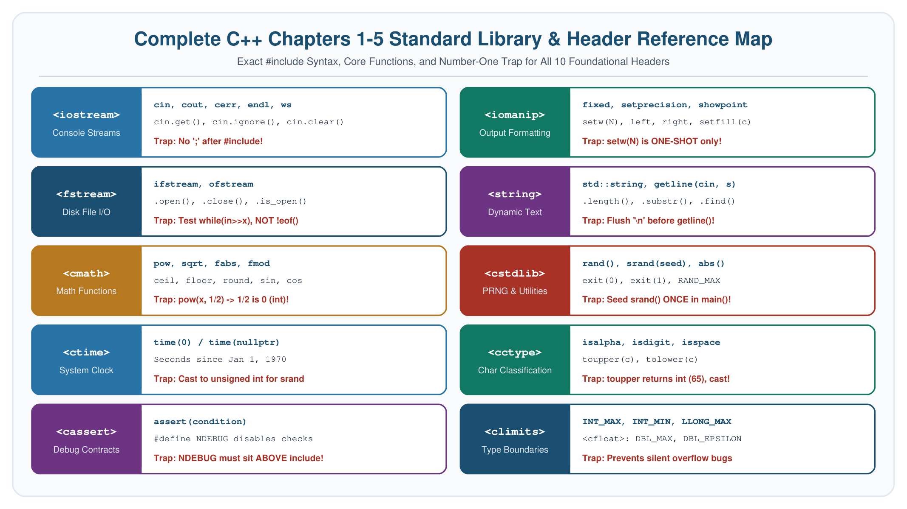
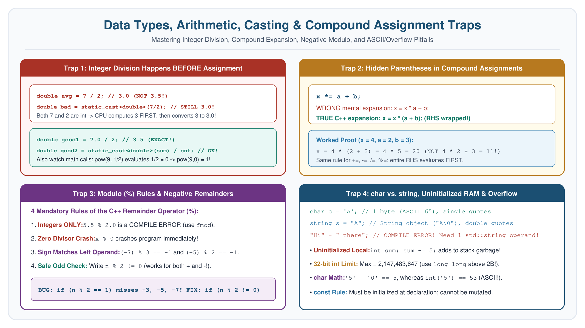
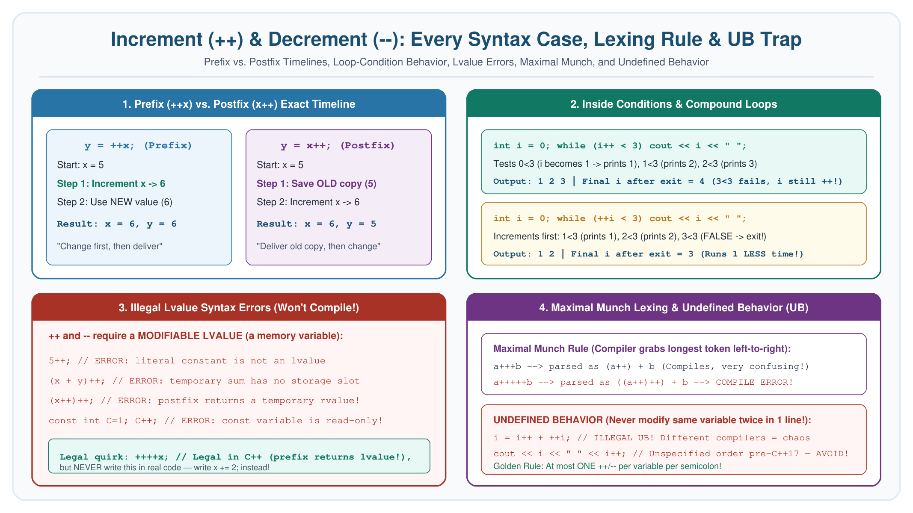
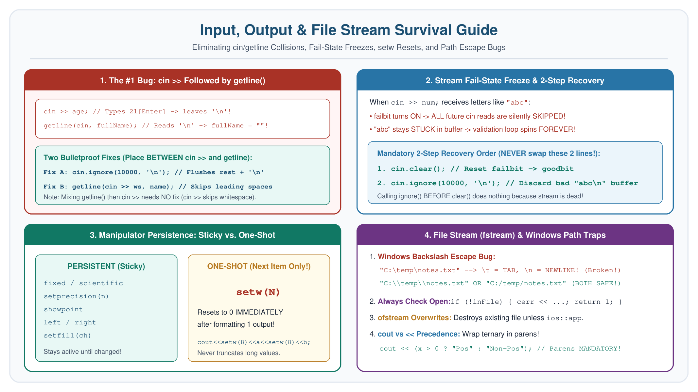
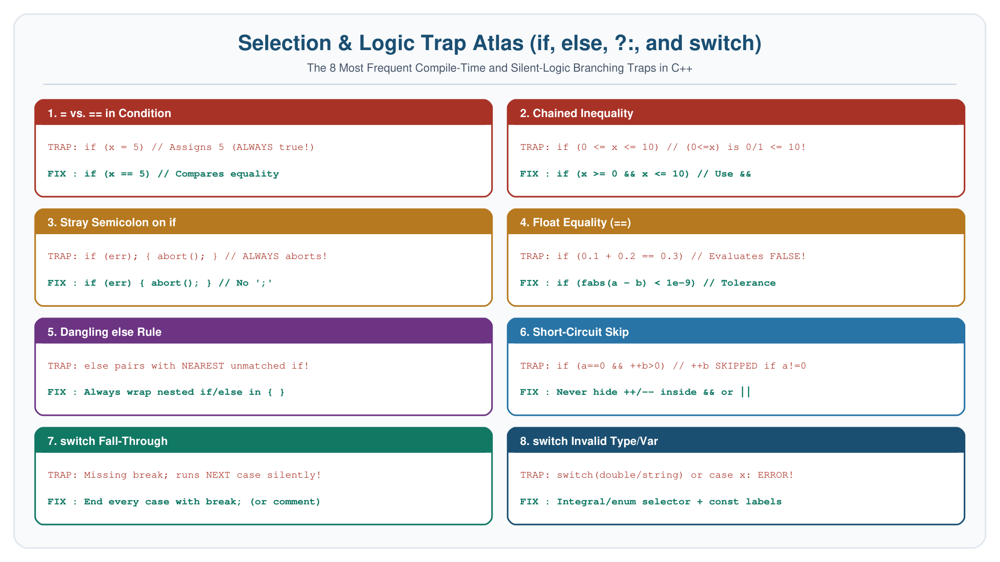
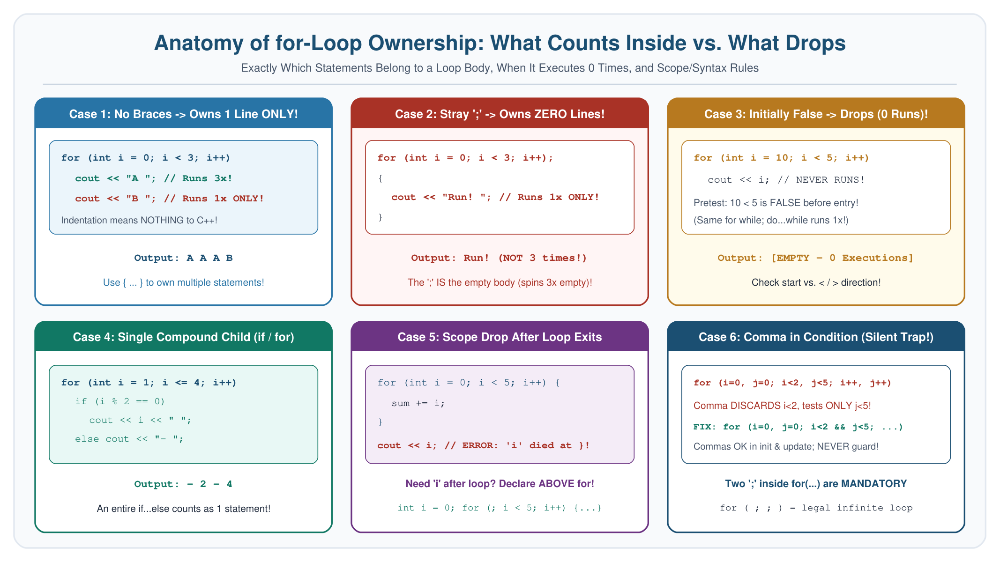
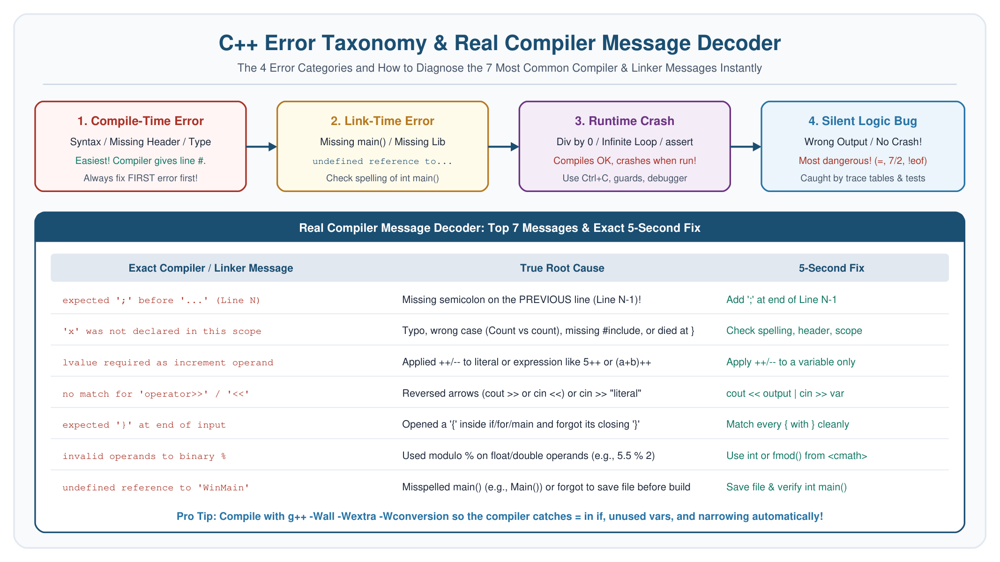
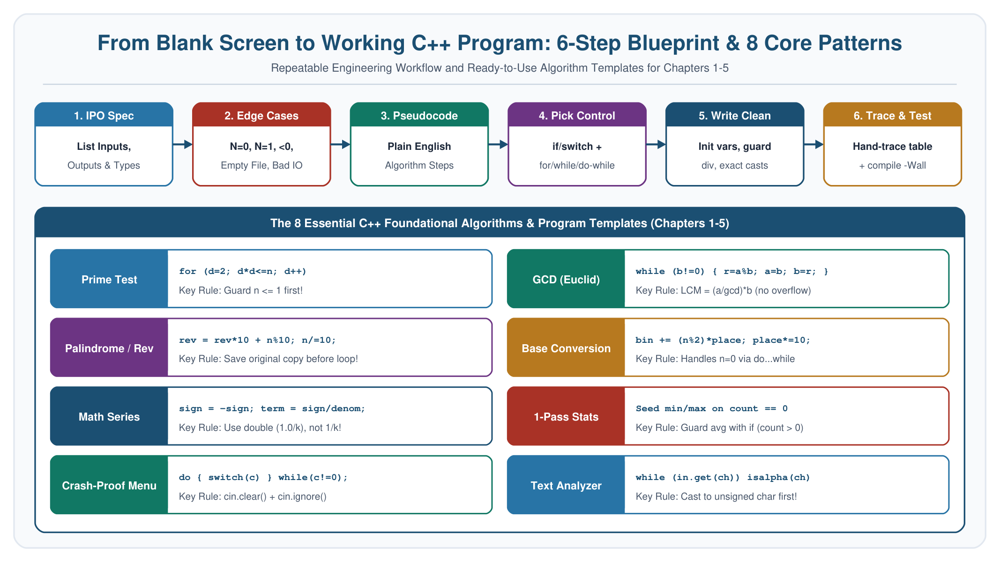

**Page 1**

## Table of Contents

- [Chapter 05.5 — Core C++ Survival Playbook (Traps, Debugging & Program Design)](#chapter-055--core-c-survival-playbook-traps-debugging--program-design)
  - [Introduction: Why This Survival Playbook Exists](#introduction-why-this-survival-playbook-exists)
  - [Part 1: Anatomy of a C++ File, Preprocessor & Complete Library Encyclopedia](#part-1-anatomy-of-a-c-file-preprocessor--complete-library-encyclopedia)
    - [Exact Preprocessor & Header Syntax (#include, #define, Namespaces, main)](#exact-preprocessor--header-syntax-include-define-namespaces-main)
    - [Complete Standard Library Reference (All 10 Headers, Functions & Traps)](#complete-standard-library-reference-all-10-headers-functions--traps)
    - [Missing-Header & Return-Type Traps (cmath, cctype, cstdlib, string)](#missing-header--return-type-traps-cmath-cctype-cstdlib-string)
  - [Part 2: Identifiers, Data Types, Arithmetic, Casting & Compound Assignment Traps](#part-2-identifiers-data-types-arithmetic-casting--compound-assignment-traps)
    - [Identifiers, Uninitialized Memory, Constants, and char vs. string](#identifiers-uninitialized-memory-constants-and-char-vs-string)
    - [Integer Division, Modulo (%) Edge Cases, Overflow & Casting Placement](#integer-division-modulo--edge-cases-overflow--casting-placement)
    - [Operator Precedence, Chained Assignment & Hidden Compound Parentheses](#operator-precedence-chained-assignment--hidden-compound-parentheses)
  - [Part 3: The Complete Increment and Decrement Syntax & Trap Encyclopedia](#part-3-the-complete-increment-and-decrement-syntax--trap-encyclopedia)
    - [Prefix vs. Postfix Mechanics: Standalone, Assignments & Complex Expressions](#prefix-vs-postfix-mechanics-standalone-assignments--complex-expressions)
    - [Increment & Decrement Inside Conditions, while Loops & cout Statements](#increment--decrement-inside-conditions-while-loops--cout-statements)
    - [Illegal Lvalue Compile Errors (5++, (a+b)++, (x++)++, const)](#illegal-lvalue-compile-errors-5-ab-x-const)
    - [Maximal Munch Lexing (a+++b) & Undefined Behavior (i = i++ + ++i)](#maximal-munch-lexing-ab--undefined-behavior-i--i--i)
  - [Part 4: Input, Output & File Stream Survival Guide](#part-4-input-output--file-stream-survival-guide)
    - [cin Extraction, cin.get(), getline() & The Newline Collision Bug](#cin-extraction-cinget-getline--the-newline-collision-bug)
    - [Stream Fail-State Freezes & The Mandatory 2-Step Recovery Pattern](#stream-fail-state-freezes--the-mandatory-2-step-recovery-pattern)
    - [Output Manipulators (Sticky vs. One-Shot setw) & File Stream Traps](#output-manipulators-sticky-vs-one-shot-setw--file-stream-traps)
  - [Part 5: Selection & Boolean Logic Traps (if, else, Ternary, switch)](#part-5-selection--boolean-logic-traps-if-else-ternary-switch)
    - [The 6 Silent if/else Killers (= vs ==, Chained Bounds, Stray ;, Dangling else)](#the-6-silent-ifelse-killers--vs--chained-bounds-stray--dangling-else)
    - [Floating-Point Equality, Short-Circuit Side Effects & Ternary Precedence](#floating-point-equality-short-circuit-side-effects--ternary-precedence)
    - [Complete switch Syntax Rules, Fall-Through & Variable Initialization Trap](#complete-switch-syntax-rules-fall-through--variable-initialization-trap)
  - [Part 6: Loop Ownership, Execution Drops & The Complete Loop Trap Catalog](#part-6-loop-ownership-execution-drops--the-complete-loop-trap-catalog)
    - [Exact Ownership Rules: When for and while Count a Line vs. When They Drop](#exact-ownership-rules-when-for-and-while-count-a-line-vs-when-they-drop)
    - [Pretest Zero-Run Drops, Omitted Clauses, Scope Death & Comma Traps](#pretest-zero-run-drops-omitted-clauses-scope-death--comma-traps)
    - [The 10 Fatal Loop Bugs (Off-by-One, Drift, Underflow, continue, eof, Nesting)](#the-10-fatal-loop-bugs-off-by-one-drift-underflow-continue-eof-nesting)
  - [Part 7: Decoding Compiler, Linker, Runtime & Logic Errors](#part-7-decoding-compiler-linker-runtime--logic-errors)
    - [The Four Error Categories & The First-Error Cascade Rule](#the-four-error-categories--the-first-error-cascade-rule)
    - [Real Compiler Error Dictionary (Top 15 Messages & 5-Second Fixes)](#real-compiler-error-dictionary-top-15-messages--5-second-fixes)
  - [Part 8: How to Write Any C++ Program From Scratch (6-Step Blueprint)](#part-8-how-to-write-any-c-program-from-scratch-6-step-blueprint)
    - [From Word Problem to Verified Code (IPO, Edge Cases, Pseudocode, Trace)](#from-word-problem-to-verified-code-ipo-edge-cases-pseudocode-trace)
    - [Live Walkthrough: Designing a Complete Program From a Blank Screen](#live-walkthrough-designing-a-complete-program-from-a-blank-screen)
  - [Part 9: The 8 Essential Classic C++ Applications & Algorithm Templates](#part-9-the-8-essential-classic-c-applications--algorithm-templates)
    - [Number-Theory Engines (Prime Checker, Euclidean GCD/LCM, Base Converter)](#number-theory-engines-prime-checker-euclidean-gcdlcm-base-converter)
    - [Digit & Series Engines (Palindrome/Armstrong, Alternating Math Series)](#digit--series-engines-palindromearmstrong-alternating-math-series)
    - [Data & Interactive Shells (Single-Pass Stats, Crash-Proof Menu, Text Analyzer)](#data--interactive-shells-single-pass-stats-crash-proof-menu-text-analyzer)
  - [Part 10: Master Find-and-Fix-the-Bug Forensic Lab (15 Tricky Challenges)](#part-10-master-find-and-fix-the-bug-forensic-lab-15-tricky-challenges)
  - [Master Pre-Exam Bilingual Survival Checklist (English & Arabic)](#master-pre-exam-bilingual-survival-checklist-english--arabic)
  - [Part 11: The 20-Program C++ Stamina Gauntlet (Problems Only)](#part-11-the-20-program-c-stamina-gauntlet-problems-only)
    - [Tier 1: 5 Medium Engineering Programs (Programs 1–5)](#tier-1-5-medium-engineering-programs-programs-15)
    - [Tier 2: 10 Hard Engineering Programs (Programs 6–15)](#tier-2-10-hard-engineering-programs-programs-615)
    - [Tier 3: 5 High-Order Brain-Burner Programs (Programs 16–20)](#tier-3-5-high-order-brain-burner-programs-programs-1620)
  - [Part 12: Complete Verified Solutions Vault (Programs 1–20)](#part-12-complete-verified-solutions-vault-programs-120)
    - [Tier 1 Verified Solutions (Programs 1–5)](#tier-1-verified-solutions-programs-15)
    - [Tier 2 Verified Solutions (Programs 6–15)](#tier-2-verified-solutions-programs-615)
    - [Tier 3 Verified Solutions (Programs 16–20)](#tier-3-verified-solutions-programs-1620)

---

**Page 2**

# <span style="color:#1B4F72">Chapter 05.5 — Core C++ Survival Playbook (Traps, Debugging & Program Design)</span>

## <span style="color:#2874A6">Introduction: Why This Survival Playbook Exists</span>

Chapters 1 through 5 gave you the **entire procedural engine of C++**: memory and types, arithmetic, console and file I/O, conditional branching, and repetition. Before you step up to **Chapter 6 (User-Defined Functions)** and start splitting software into multi-function architectures, there is a crucial engineering truth every C++ programmer discovers the hard way:

**Knowing the basic syntax of C++ is NOT the same as being immune to its traps.**

C++ is famously unforgiving. Unlike scripting languages that stop you politely, C++ assumes **you know exactly what you are doing**—so a single stray semicolon after `for (...)`, a missing `static_cast<double>`, an unescaped backslash in a Windows file path, an unsequenced `i++ + ++i`, or forgetting `cin.ignore()` before `getline()` will often **compile with zero errors** and silently corrupt your output!

This dedicated milestone chapter (**Chapter 05.5**) is your **complete, zero-omission field manual** built strictly from top to bottom of a C++ program:
1. **Every `#include` header library** and every function/manipulator inside it—exact syntax, return types, and hidden gotchas.
2. **Every syntax rule and silent trap** for variables, types, casting, compound assignments, and **every single case of `++` and `--`** (prefix, postfix, conditions, lvalue compile errors, maximal munch `a+++b`, and undefined behavior).
3. **Every I/O, selection (`if`/`switch`), and loop ownership trap**—including the exact grammatical rules for **when a `for`/`while` loop claims a line, when it claims zero lines, and when it drops immediately**.
4. **A real Compiler Error Decoder**, a **6-step blueprint for writing any C++ program from a blank screen**, **8 classic ready-to-adapt engineering algorithms**, and a **15-problem forensic Bug Lab**.

Keep this playbook open beside your editor whenever you code, debug, or prepare for an exam.

---

**Page 3**

## <span style="color:#2874A6">Part 1: Anatomy of a C++ File, Preprocessor & Complete Library Encyclopedia</span>

### <span style="color:#117864">Exact Preprocessor & Header Syntax (#include, #define, Namespaces, main)</span>

Every C++ source file starts with **preprocessor directives**—lines beginning with **`#`** that are processed *before* the C++ compiler even parses your code. Because they are **not** C++ statements, they follow completely different punctuation rules!

```cpp
// =========================================================================
// ANATOMY OF A CLEAN C++ FILE HEADER (Zero Syntax Errors!)
// =========================================================================
#include <iostream>     // System/standard library header -> Angle brackets < >
#include <iomanip>      // NO trailing semicolon ';' on ANY #include line!
#include <cmath>        // Order of standard #includes rarely matters (except NDEBUG!)
#include "my_utils.h"   // Local user-created header -> Double quotes " "

using namespace std;    // C++ statement -> MUST end with semicolon ';' !

int main() {            // Exact lowercase 'main', returns 'int' (NEVER void main!)
    // Executable body...
    return 0;           // 0 signals OS: "Program completed with zero errors"
}                       // NO semicolon after closing brace of main()!
```

#### <span style="color:#6C3483">The 6 Preprocessor & Entry-Point Syntax Traps</span>

| # | Broken Code | Exact Failure / Trap | Clean Fix |
| :---: | :--- | :--- | :--- |
| **1** | `#include <iostream>;` | **Warning / Error!** `#include` is a preprocessor directive, NOT a C++ statement. Never put `;` after it! | `#include <iostream>` |
| **2** | `#include <iostream.h>` | **Fatal Error!** `.h` headers (`iostream.h`, `math.h`) belong to pre-1998 C++ / C. Modern C++ drops `.h` (`<iostream>`, `<cmath>`). | `#include <iostream>` / `<cmath>` |
| **3** | `#define PI 3.14159;` | **Catastrophic Macro Bug!** Preprocessor pastes `3.14159;` literally! So `2 * PI * r` turns into `2 * 3.14159; * r` $\rightarrow$ syntax error! | Use typed `const double PI = 3.14159;` (never `#define` for constants!). |
| **4** | `using namespace std` (missing `;`) | **Compile Error!** `using` IS a C++ statement—it *must* end with `;`! | `using namespace std;` (or prefix explicitly: `std::cout`, `std::string`). |
| **5** | `void main()` or `int Main()` | **Non-Standard / Linker Error!** C++ requires `int main()`. Capital `Main()` causes `undefined reference to 'main'` / `'WinMain'`. | Always write exact lowercase `int main()`. |
| **6** | Missing `#include <string>` when using `string` | **Non-Portable Trap!** Some compilers accidentally pull `<string>` inside `<iostream>`, others fail to compile `getline()` or `string`! | Always explicitly `#include <string>` whenever you use `string` or `getline()`. |

#### <span style="color:#6C3483">Angle Brackets `< >` vs. Double Quotes `" "`</span>

- **`#include <filename>`:** Tells the preprocessor to search **only the compiler's standard system include folders** (always use `< >` for standard libraries like `<iostream>`, `<cmath>`, `<fstream>`).
- **`#include "filename"`:** Tells the preprocessor to search **your own project's current folder first**, and only fall back to system folders if not found.

---

**Page 4**

### <span style="color:#117864">Complete Standard Library Reference (All 10 Headers, Functions & Traps)</span>

Think of C++ standard libraries like **sealed toolboxes** in a workshop: the compiler does *not* automatically open all toolboxes (that would slow down compilation massively). Whenever you want a tool (`sqrt`, `setw`, `ifstream`, `toupper`, `rand`), you must first unlock its exact toolbox with `#include <toolbox>`.

<p align="center">
  
</p>

Below is your **exhaustive function-by-function encyclopedia** of all **10 foundational C++ headers** from Chapters 1–5.

---

**Page 5**

#### <span style="color:#6C3483">1. `#include <iostream>` — Console Input & Output Streams</span>

| Symbol / Function | Exact Syntax | What It Does | Critical Trap to Watch |
| :--- | :--- | :--- | :--- |
| **`cout`** | `cout << expr1 << expr2;` | Sends formatted text/numbers to standard console output. | Reversing arrows (`cout >> x;`) is a compile error! |
| **`cin`** | `cin >> var1 >> var2;` | Skips leading whitespace (`' '`, `'\t'`, `'\n'`) and extracts typed tokens. | Stops at whitespace (cannot read `"Ali Hasan"` cleanly) AND leaves `'\n'` in buffer! |
| **`cerr`** | `cerr << "Error\n";` | Unbuffered error output stream (prints instantly even before crash). | Prefer `cerr` for error messages and debug `[TRACE]` lines. |
| **`endl`** vs. **`'\n'`** | `cout << x << '\n';` | `endl` writes `'\n'` AND flushes output buffer; `'\n'` just writes newline. | Calling `endl` inside a 1,000,000-iteration loop makes output 10x–50x slower! |
| **`boolalpha`** | `cout << boolalpha << flag;` | Prints `bool` values as `true`/`false` instead of `1`/`0` (sticky until `noboolalpha`). | Without `boolalpha`, `cout << true` always prints `1`! |
| **`ws`** | `getline(cin >> ws, str);` | Stream manipulator that consumes and discards all leading whitespace. | Very clean fix before `getline()` after `cin >>`. |
| **`cin.get(ch)`** | `cin.get(ch);` or `ch = cin.get();` | Reads the **exact next single character**—INCLUDING spaces `' '` and `'\n'`! | Does NOT skip whitespace like `cin >> ch` does! |
| **`cin.ignore(n, ch)`** | `cin.ignore(10000, '\n');` | Discards up to `n` characters OR stops immediately after discarding `ch`. | Calling `cin.ignore();` with no arguments discards only **1** character! |
| **`cin.peek()`** | `int next = cin.peek();` | Looks at the next buffered character *without* removing it. | Returns `int` (`EOF` on end), not `char`. |
| **`cin.putback(ch)`** | `cin.putback(ch);` | Pushes a previously read character back to the front of the input stream. | Can fail if called on an empty or failed stream. |
| **`cin.clear()`** | `cin.clear();` | Resets stream error flags (`failbit`, `eofbit`) back to `goodbit`. | Does **NOT** empty bad text from the buffer—you MUST call `cin.ignore()` right after! |
| **`cin.fail()` / `cin.eof()`** | `if (cin.fail()) ...` | Checks whether extraction failed or EOF was reached. | Never use `while (!cin.eof())`—always test `while (cin >> x)`. |

---

**Page 6**

#### <span style="color:#6C3483">2. `#include <iomanip>` — Precision & Tabular Output Formatting</span>

*(Note: `fixed`, `scientific`, `showpoint`, `left`, `right` are actually defined in `<ios>` pulled by `<iostream>`, while every manipulator taking an argument—`setprecision(n)`, `setw(n)`, `setfill(c)`—REQUIRES `#include <iomanip>`! Always include `<iomanip>` whenever formatting output.)*

| Manipulator | Exact Syntax | Persistence | What It Does & Key Trap |
| :--- | :--- | :---: | :--- |
| **`fixed`** | `cout << fixed;` | **Sticky** | Forces decimal notation (`12.50`) instead of scientific (`1.25e+01`). Pair with `setprecision(n)` so `n` means **digits after the decimal point**! |
| **`scientific`** | `cout << scientific;` | **Sticky** | Forces exponential notation (`1.25e+02`). |
| **`showpoint`** | `cout << showpoint;` | **Sticky** | Forces trailing zeros and decimal point (`5.00` instead of `5`). |
| **`setprecision(n)`** | `cout << setprecision(2);` | **Sticky** | **TRAP:** *Without* `fixed`, `setprecision(2)` means 2 **total significant digits** (`123.45` prints `1.2e+02`!). *With* `fixed`, it means 2 **decimal places** (`123.45`)! |
| **`setw(n)`** | `cout << setw(10) << x;` | **ONE-SHOT!** | Sets minimum column width for the **next single output item ONLY**, then resets to `0`! Never truncates if `x` is wider than `n`. |
| **`left` / `right`** | `cout << left << setw(12) << name;` | **Sticky** | Aligns text left or right inside the `setw(n)` field. Default is `right`. |
| **`setfill(ch)`** | `cout << setfill('0') << setw(4) << 7;` | **Sticky!** | Replaces blank padding spaces with `ch` (prints `0007`). **TRAP:** Stays `'0'` forever until you reset `cout << setfill(' ');`! |

#### <span style="color:#6C3483">3. `#include <fstream>` — Disk File Streams</span>

| Type / Member | Exact Syntax | What It Does & Key Trap |
| :--- | :--- | :--- |
| **`ifstream`** | `ifstream inFile("data.txt");` | Opens an existing file for **reading**. Fails silently if file doesn't exist—ALWAYS check `if (!inFile)`! |
| **`ofstream`** | `ofstream outFile("report.txt");` | Creates/opens a file for **writing**. **TRAP:** Silently ERASES any existing file with the same name unless opened with `ios::app` (`ofstream out("log.txt", ios::app);`)! |
| **`.open()` / `.close()`** | `inFile.open("a.txt"); inFile.close();` | Opens/closes manually. If reusing one `ifstream` for a second file, call `.close()` AND **`inFile.clear()`** (clears old `eofbit`!) before the second `.open()`! |
| **`.is_open()`** | `if (!inFile.is_open()) return 1;` | Explicit check returning `true` iff file opened cleanly. |

---

**Page 7**

#### <span style="color:#6C3483">4. `#include <string>` — Dynamic Text Objects</span>

| Symbol / Function | Exact Syntax | What It Does & Key Trap |
| :--- | :--- | :--- |
| **`string`** | `string s = "Hello";` | Safe resizable text object (default-initializes to `""`, never garbage!). |
| **`getline(stream, s)`** | `getline(cin, fullName);` | Reads an entire line including spaces up to `'\n'` (and discards `'\n'`). **TRAP:** Never call right after `cin >>` without flushing `'\n'` first! |
| **`.length()` / `.size()`** | `s.length()` | Returns exact character count as unsigned `size_t`. Watch countdown underflow! |
| **`.empty()`** | `if (s.empty()) ...` | Returns `true` if string has 0 characters. |
| **`.at(i)` vs `[i]`** | `s.at(0)` / `s[0]` | Accesses character at 0-based index `i`. `.at(i)` checks bounds; `[i]` does not! |
| **`+` Concatenation** | `string full = first + " " + last;` | **TRAP:** At least **one** operand of `+` must be a `std::string`! `"Hello" + "World"` is a **COMPILE ERROR** (adding two raw C-string pointers!). |
| **`.substr(pos, len)`** | `s.substr(0, 4)` | Returns substring starting at `pos` of length `len`. |
| **`.find(target)`** | `if (s.find("OK") != string::npos)` | Returns index of first match, or `string::npos` if not found. |

#### <span style="color:#6C3483">5. `#include <cmath>` — Mathematical Functions</span>

| Function | Exact Syntax | Return Type & Exact Trap |
| :--- | :--- | :--- |
| **`pow(base, exp)`** | `pow(2.0, 8.0)` | Returns `double` (`256.0`). **TRAP 1:** `pow(9, 1/2)` evaluates `1/2 == 0` $\rightarrow$ returns `1.0` instead of `3.0`! Write `pow(9.0, 0.5)` or `sqrt(9.0)`. **TRAP 2:** `pow(-2.0, 0.5)` returns `NaN`! |
| **`sqrt(x)`** | `sqrt(25.0)` | Returns `double` (`5.0`). **TRAP:** Negative `x` returns `NaN`—always guard `if (x >= 0.0)`! |
| **`fabs(x)`** | `fabs(a - b) < 1e-9` | Absolute value for `double` / `float`. (Do NOT call integer `abs()` on `double` in older code—always use `fabs` or `<cmath>` `std::abs`!) |
| **`ceil(x)` / `floor(x)`** | `ceil(2.1)` (`3.0`), `floor(2.9)` (`2.0`) | Rounds UP / DOWN toward $+\infty$ / $-\infty$. **TRAP on negatives:** `floor(-2.1) == -3.0` and `ceil(-2.1) == -2.0`! |
| **`round(x)`** | `round(2.5)` (`3.0`) | Rounds to nearest integer (halfway away from zero). Returns `double`. |
| **`fmod(x, y)`** | `fmod(5.5, 2.0)` (`1.5`) | Floating-point remainder (because `%` ONLY compiles for integers!). |
| **`sin`, `cos`, `tan`** | `sin(angleRad)` | **TRAP:** Expects **RADIANS**, NOT degrees! Convert degrees first: `rad = deg * 3.141592653589793 / 180.0;` |
| **`log(x)` / `log10(x)`** | `log(2.71828)` / `log10(1000.0)` | **`log(x)` is Natural Log ($\ln x$), NOT base-10!** Use `log10(x)` for $\log_{10}(x)$ and `log2(x)` for $\log_2(x)$. |

---

**Page 8**

#### <span style="color:#6C3483">6–10. `<cstdlib>`, `<ctime>`, `<cctype>`, `<cassert>`, and `<climits>` / `<cfloat>`</span>

| Header | Key Functions / Constants | Exact Syntax & Critical Trap |
| :--- | :--- | :--- |
| **`<cstdlib>`** | `rand()`, `srand(seed)`, `abs(int)`, `exit(code)`, `RAND_MAX` | Range `[min..max]`: **`(rand() % (max - min + 1)) + min`**. **TRAP:** Call `srand(...)` **ONCE** at top of `main()`, NEVER inside a loop! `exit(1)` terminates immediately from anywhere. |
| **`<ctime>`** | `time(0)` or `time(nullptr)` | Returns current Unix timestamp in seconds (`time_t`). Always cast when seeding: `srand(static_cast<unsigned int>(time(0)));` to avoid conversion warnings. |
| **`<cctype>`** | `isalpha(c)`, `isdigit(c)`, `isalnum(c)`, `isspace(c)`, `isupper(c)`, `islower(c)`, `toupper(c)`, `tolower(c)` | **TRAP 1:** `toupper('a')` returns **`int` (`65`)**, NOT `char`! Writing `cout << toupper('a');` prints **`65`** instead of `'A'`! Fix: `static_cast<char>(toupper(static_cast<unsigned char>(c)))`. **TRAP 2:** Classification functions return non-zero `int` for true (not strictly `1`). |
| **`<cassert>`** | `assert(expr);` | Aborts immediately with file & line number if `expr` is `false`. **TRAP:** To disable asserts for release, `#define NDEBUG` MUST appear **ABOVE** `#include <cassert>`! Never put side effects like `assert(++x > 0);` inside `assert` (disappears in release builds!). |
| **`<climits>`**, **`<cfloat>`** & **`<limits>`** | `INT_MAX` (`2147483647`), `INT_MIN` (`-2147483648`), `LLONG_MAX`, `DBL_MAX`, `numeric_limits<streamsize>::max()` | Gives exact hardware limits so you never guess magic numbers when checking overflow or flushing arbitrary-length lines with `cin.ignore(...)`. |

### <span style="color:#117864">Missing-Header & Return-Type Traps (cmath, cctype, cstdlib, string)</span>

Look at these **4 sneaky real-world bugs** that trip up even students who remember `#include`:

```cpp
// TRAP A: Printing toupper() directly prints ASCII number 65, NOT 'A'!
char ch = 'a';
cout << toupper(ch);                                    // Prints: 65 (SURPRISE!)
cout << static_cast<char>(toupper(static_cast<unsigned char>(ch))); // Prints: A

// TRAP B: Integer division inside pow()!
double root = pow(16.0, 1 / 2);     // 1 / 2 == 0 -> pow(16.0, 0) == 1.0 (WRONG!)
double rootOk = pow(16.0, 1.0 / 2); // 1.0 / 2 == 0.5 -> 4.0 (or just sqrt(16.0)!)

// TRAP C: Putting #define NDEBUG BELOW #include <cassert>!
#include <cassert>
#define NDEBUG                      // TOO LATE! assert() is STILL active!

// TRAP D: Using log(100) thinking it is base-10!
cout << log(100.0);                 // Prints: 4.60517 (Natural log ln(100)!)
cout << log10(100.0);               // Prints: 2 (Base-10 log!)
```

---

**Page 9**

## <span style="color:#2874A6">Part 2: Identifiers, Data Types, Arithmetic, Casting & Compound Assignment Traps</span>

### <span style="color:#117864">Identifiers, Uninitialized Memory, Constants, and char vs. string</span>

#### <span style="color:#6C3483">1. Identifier Naming Rules (Compile-Time Syntax)</span>

A valid C++ identifier (variable or constant name) can contain **only letters (`A-Z`, `a-z`), digits (`0-9`), and underscores (`_`)**, MUST **start with a letter or underscore** (never a digit), can contain **no spaces or hyphens**, and can **never be a C++ keyword** (`int`, `double`, `return`, `while`, `for`, `switch`, `class`, `bool`, `const`, `break`, `continue`, `true`, `false`).

| Candidate Name | Legal? | Why? |
| :--- | :---: | :--- |
| `total_score_2` | **LEGAL** | Letters, underscores, digit not at start. |
| `2ndPlace` | **ILLEGAL** | Cannot start with a digit (`2`). |
| `net-pay` | **ILLEGAL** | `-` is subtraction operator! Compiler parses `net - pay`. |
| `user age` | **ILLEGAL** | Spaces are never allowed inside an identifier. |
| `double` / `return` | **ILLEGAL** | Reserved C++ keywords. |
| `Count` vs `count` | **2 DIFFERENT VARS** | C++ is strictly **case-sensitive**! Misspelling `Count` as `count` causes undeclared-identifier errors or silent wrong-variable bugs. |
| `_internal` / `__temp` | **AVOID** | Names starting with `__` or `_Uppercase` are reserved for the C++ compiler/standard library! |

#### <span style="color:#6C3483">2. Uninitialized Local Variables (Stack Garbage Trap)</span>

In C++, **local variables inside `main()` (like `int sum;`, `double total;`, `bool found;`) are NOT initialized to zero!** They inherit whatever random leftover bits happen to sit in that RAM slot from previous CPU activity:

```cpp
// FATAL SILENT BUG: 'sum' starts as random garbage like -858993460!
int sum;
for (int i = 1; i <= 5; i++) {
    sum += i;               // Garbage + 15 = Garbage!
}

// ALWAYS INITIALIZE AT DECLARATION:
int sum = 0;                // Deterministic, safe, zero overhead!
```

*(Note: `std::string name;` is a special exception—its constructor automatically initializes it to `""`. Still, ALWAYS initialize every primitive `int`, `double`, `char`, and `bool` explicitly!)*

#### <span style="color:#6C3483">3. `const` Rules & `char` vs. `string`</span>

- **`const` variables MUST be initialized on the exact line they are declared** (`const double TAX;` is a compile error!) and can **never** be assigned to again (`TAX = 0.2;` or `TAX++;` is a compile error!).
- **`'A'` vs. `"A"`:** `'A'` is a single 1-byte `char` (ASCII `65`); `"A"` is a 2-byte null-terminated string literal (`'A'` + `'\0'`). Writing `char c = "A";` or `string s = 'A';` is a **compile error**!
- **ASCII Digit Conversion Trap:** Character `'7'` is **NOT** integer `7`—its ASCII code is **`55`**! To convert a digit character `'0'..'9'` into its numeric value `0..9`, subtract `'0'`: **`int digit = ch - '0';`** (`'7' - '0' = 55 - 48 = 7`).

---

**Page 10**

### <span style="color:#117864">Integer Division, Modulo (%) Edge Cases, Overflow & Casting Placement</span>

<p align="center">
  
</p>

#### <span style="color:#6C3483">1. Integer Division Truncation & The `static_cast` Placement Trap</span>

Whenever **both** operands of `/` are integer types (`int`, `short`, `long`, `long long`, `char`), C++ performs **truncating integer division**—discarding the fractional part *toward zero* (`7 / 2 == 3`, `-7 / 2 == -3`, `1 / 2 == 0`) **BEFORE** looking at the variable on the left side of `=`!

| Expression | Step-by-Step Evaluation | Final Result | Verdict |
| :--- | :--- | :---: | :---: |
| `double r = 5 / 2;` | `5 / 2` $\rightarrow$ `2` (int) $\rightarrow$ widened to `2.0` | **`2.0`** | **BUG!** |
| `double r = static_cast<double>(5 / 2);` | Parentheses evaluate `5 / 2` $\rightarrow$ `2` FIRST $\rightarrow$ cast to `2.0`! | **`2.0`** | **BUG (Cast too late!)** |
| `double r = 5.0 / 2;` | `5.0` is `double`, promotes `2` $\rightarrow$ `2.0`, divides | **`2.5`** | **EXACT!** |
| `double r = static_cast<double>(sum) / n;` | Casts `sum` FIRST $\rightarrow$ `double / int` promotes `n` | **Exact decimal** | **EXACT!** |
| `double f = (9 / 5) * c + 32;` | `9 / 5 == 1` $\rightarrow$ becomes `1 * c + 32`!! | **Wrong formula!** | **BUG! Use `9.0 / 5.0`!** |

#### <span style="color:#6C3483">2. Modulo (`%`) Rules & The Negative Odd Trap</span>

1. **Integers ONLY:** `5.5 % 2.0` or `5 % 2.0` **will NOT compile**! Use `fmod(5.5, 2.0)` from `<cmath>` for decimals.
2. **Zero Right Operand Crashes:** Both `x / 0` and `x % 0` cause immediate **Undefined Behavior / Division-by-Zero Crash**!
3. **Sign Follows Left Operand (Dividend):**
   - `7 % 3 == 1`, **`(-7) % 3 == -1`**, `7 % (-3) == 1`, `(-7) % (-3) == -1`.
   - **Classic Bug:** Writing `if (n % 2 == 1)` to test if `n` is odd **FAILS for every negative odd number** (`-3 % 2 == -1 != 1`)!
   - **Universal Fix:** Always test oddness with **`if (n % 2 != 0)`** (works cleanly for positive AND negative integers!).

#### <span style="color:#6C3483">3. Narrowing & Integer Overflow</span>

- **Silent Narrowing:** `int x = 9.99;` compiles silently and **truncates** (does NOT round!) to **`9`**! Use `static_cast<int>(round(val))` when rounding is intended.
- **32-bit `int` Overflow:** `int` holds at most `2,147,483,647` ($\approx 2.14 \times 10^9$). Computing `int p = 100000 * 100000;` overflows silently into negative garbage! Even if you assign to `long long`:
  - `long long p = 100000 * 100000;` $\rightarrow$ **STILL OVERFLOWS** because `100000` is an `int` literal!
  - Fix: **`long long p = 100000LL * 100000LL;`** (suffix `LL` forces 64-bit math before multiplying!).

---

**Page 11**

### <span style="color:#117864">Operator Precedence, Chained Assignment & Hidden Compound Parentheses</span>

#### <span style="color:#6C3483">1. The Hidden Parentheses Rule in Compound Assignments (`+=`, `-=`, `*=`, `/=`, `%=`)</span>

Many students expand `x *= a + b;` mechanically into `x = x * a + b;`. **THAT IS WRONG!**
In C++, every compound assignment operator evaluates its **entire right-hand side inside invisible parentheses first**:

$$\text{lhs } \text{op}= \text{ rhs} \quad \Longleftrightarrow \quad \text{lhs} = \text{lhs } \text{op } (\text{rhs})$$

| Statement (Start: `x = 10`, `a = 2`, `b = 3`) | Wrong Naive Expansion | TRUE C++ Expansion | True Final `x` |
| :--- | :--- | :--- | :---: |
| `x *= a + b;` | `10 * 2 + 3 = 23` (WRONG) | `10 * (2 + 3)` | **`50`** |
| `x /= a + b;` | `10 / 2 + 3 = 8` (WRONG) | `10 / (2 + 3)` | **`2`** |
| `x -= a - b;` | `10 - 2 - 3 = 5` (WRONG) | `10 - (2 - 3) = 10 - (-1)` | **`11`** |
| `x %= a + 1;` | `10 % 2 + 1 = 1` (WRONG) | `10 % (2 + 1) = 10 % 3` | **`1`** |

#### <span style="color:#6C3483">2. Right-to-Left Chained Assignment vs. Illegal Chained Declaration</span>

- **Legal:** `int a, b, c; a = b = c = 5;` evaluates **right-to-left**: `c = 5`, then `b = 5`, then `a = 5`.
- **COMPILE ERROR (Famous Beginner Trap!):** Writing **`int a = b = c = 5;`** fails to compile because `b` and `c` have not been declared yet! Write `int a = 5, b = 5, c = 5;`.

#### <span style="color:#6C3483">3. Complete Precedence Hierarchy (High $\rightarrow$ Low) for Chapters 1–5</span>

| Priority | Operators | Associativity | Common Trap to Remember |
| :---: | :--- | :---: | :--- |
| **1 (Highest)** | `( )` grouping, postfix `x++`, `x--`, `static_cast<T>()` | Left $\rightarrow$ Right | Postfix `++` binds tighter than unary `-` (`-x++` means `-(x++)`!). |
| **2** | Unary `+`, `-`, `!`, prefix `++x`, `--x` | Right $\rightarrow$ Left | `!a == b` means `(!a) == b`, NOT `!(a == b)`! |
| **3** | `*`, `/`, `%` | Left $\rightarrow$ Right | Same level! `12 / 4 * 3` is `(12 / 4) * 3 = 9`, NOT `12 / 12 = 1`! |
| **4** | `+`, `-` | Left $\rightarrow$ Right | Evaluated left-to-right. |
| **5** | `<<`, `>>` (Stream I/O) | Left $\rightarrow$ Right | **Higher than `<`, `==`, `&&`, `?:`!** Always wrap comparisons/ternaries in `cout << (a > b);`! |
| **6** | `<`, `<=`, `>`, `>=` | Left $\rightarrow$ Right | Higher than `==` and `!=`! |
| **7** | `==`, `!=` | Left $\rightarrow$ Right | Lower than `<`, `<=`, `>`, `>=`. |
| **8** | `&&` (Logical AND) | Left $\rightarrow$ Right | **Higher than `||`!** `a \|\| b && c` means `a \|\| (b && c)`! |
| **9** | `\|\|` (Logical OR) | Left $\rightarrow$ Right | Always parenthesize mixed `&&` and `\|\|` for clarity! |
| **10** | `?:` (Ternary), `=`, `+=`, `-=`, `*=`, `/=`, `%=` | Right $\rightarrow$ Left | Lowest except comma! `cout << x > 0 ? 1 : 0;` FAILS to compile without `( )`! |
| **11 (Lowest)** | `,` (Comma operator) | Left $\rightarrow$ Right | `int x = (1, 2, 3);` gives `3`, while `int x; x = 1, 2, 3;` gives `1`! |

---

**Page 12**

## <span style="color:#2874A6">Part 3: The Complete Increment and Decrement Syntax & Trap Encyclopedia</span>

No two operators in C++ generate more exam questions, trick traces, syntax errors, and subtle runtime bugs than **increment (`++`)** and **decrement (`--`)**. Let us dissect **every single legal form, illegal form, lexing rule, and undefined-behavior trap** so you can predict any `++`/`--` expression with 100% precision.

<p align="center">
  
</p>

### <span style="color:#117864">Prefix vs. Postfix Mechanics: Standalone, Assignments & Complex Expressions</span>

Both `++x` (prefix) and `x++` (postfix) add **`1`** to `x`. Both `--x` and `x--` subtract **`1`** from `x`. The **ONLY** difference between prefix and postfix is **which value the expression hands back to the surrounding line of code**:

- **Prefix (`++x` / `--x`) — "Change First, Deliver NEW":**
  1. Immediately increment/decrement `x` in memory.
  2. Return the **updated (NEW)** value of `x`.
- **Postfix (`x++` / `x--`) — "Deliver OLD Copy, Then Change":**
  1. Snapshot the **current (OLD)** value of `x` in a temporary register.
  2. Increment/decrement `x` in memory.
  3. Return the **saved (OLD)** snapshot to the surrounding expression.

#### <span style="color:#6C3483">Case 1: Standalone Statements (`x++;` vs. `++x;`)</span>

When nothing uses the returned value—such as a standalone line `count++;` or the update clause of a `for` loop (`for (int i = 0; i < N; i++)` vs. `++i`)—**prefix and postfix produce the exact same final state of `count`!**

```cpp
int a = 5, b = 5;
a++;        // a becomes 6 (old value 5 is discarded)
++b;        // b becomes 6 (new value 6 is discarded)
// Both a and b are now identically 6!
```

*(Performance note: For built-in `int`, modern compilers emit identical machine code for `i++` and `++i`. For complex C++ iterators later in Data Structures, `++it` avoids creating a temporary copy, which is why senior C++ engineers often prefer `++it` as a habit.)*

---

**Page 13**

#### <span style="color:#6C3483">Case 2: Inside Assignments & Multi-Variable Expressions</span>

Trace these **6 classic expressions** carefully—each starts fresh from **`a = 5, b = 10`**:

| # | Expression (Start: `a = 5, b = 10`) | Exact Step-by-Step Mechanics | Final `a` | Final `b` | Result `r` |
| :---: | :--- | :--- | :---: | :---: | :---: |
| **1** | `int r = ++a;` | `a` becomes `6`, returns `6` | `6` | `10` | **`6`** |
| **2** | `int r = a++;` | Saves `5`, `a` becomes `6`, returns `5` | `6` | `10` | **`5`** |
| **3** | `int r = ++a + b--;` | `++a` $\rightarrow$ `a=6` (uses `6`); `b--` $\rightarrow$ uses `10`, `b=9`; `6 + 10` | `6` | `9` | **`16`** |
| **4** | `int r = a++ * --b;` | `a++` $\rightarrow$ uses `5`, `a=6`; `--b` $\rightarrow$ `b=9` (uses `9`); `5 * 9` | `6` | `9` | **`45`** |
| **5** | `int r = -a++;` | Postfix `++` has HIGHER precedence than unary `-`! Means `-(a++)` $\rightarrow$ `-(5)`, then `a=6`! | `6` | `10` | **`-5`** |
| **6** | `int r = ++a * 2 + b++;` | `++a` uses `6` (`a=6`), `6*2 = 12`, `b++` uses `10` (`b=11`), `12 + 10` | `6` | `11` | **`22`** |

#### <span style="color:#6C3483">Case 3: `++` and `--` on Non-`int` Types (`char`, `double`, `bool`)</span>

| Type | Code Example | Valid in C++? | Exact Result |
| :--- | :--- | :---: | :--- |
| **`char`** | `char c = 'A'; c++;` | **YES** | Advances ASCII code `65` $\rightarrow$ `66` (`'B'`). Works great for walking alphabets (`'a'..'z'`)! |
| **`double` / `float`** | `double d = 2.5; d++;` | **YES** | Adds `1.0` $\rightarrow$ `d` becomes **`3.5`**. |
| **`bool`** | `bool f = false; f++;` | **REMOVED IN C++17!** | Compile Error in C++17/C++20/C++23! Never apply `++` or `--` to a `bool`! |
| **`string`** | `string s = "hi"; s++;` | **COMPILE ERROR!** | Strings do not define `++` or `--`. |

---

**Page 14**

### <span style="color:#117864">Increment & Decrement Inside Conditions, while Loops & cout Statements</span>

Putting `++` or `--` directly inside an `if (...)` or `while (...)` guard is a favorite professor exam question because **the side effect happens EVEN WHEN THE CONDITION EVALUATES TO `false`!**

#### <span style="color:#6C3483">Watch Closely: `while (i++ < 3)` vs. `while (++i < 3)`</span>

Compare these two loops side by side—starting from **`int i = 0;`**:

```cpp
// LOOP A: Postfix inside while condition
int i = 0;
while (i++ < 3) {
    cout << i << " ";
}
cout << "| Exit i=" << i << '\n';

// LOOP B: Prefix inside while condition
int j = 0;
while (++j < 3) {
    cout << j << " ";
}
cout << "| Exit j=" << j << '\n';
```

| Cycle | Loop A: `while (i++ < 3)` | Loop B: `while (++j < 3)` |
| :---: | :--- | :--- |
| 1 | Compares old `0 < 3` (`true`), `i` becomes **`1`** $\rightarrow$ prints **`1 `** | Increments `j` to **`1`**, compares `1 < 3` (`true`) $\rightarrow$ prints **`1 `** |
| 2 | Compares old `1 < 3` (`true`), `i` becomes **`2`** $\rightarrow$ prints **`2 `** | Increments `j` to **`2`**, compares `2 < 3` (`true`) $\rightarrow$ prints **`2 `** |
| 3 | Compares old `2 < 3` (`true`), `i` becomes **`3`** $\rightarrow$ prints **`3 `** | Increments `j` to **`3`**, compares `3 < 3` (**`false`** $\rightarrow$ EXIT!) |
| 4 (Exit) | Compares old `3 < 3` (**`false`**), **AND `i++` STILL RUNS $\rightarrow$ `i` becomes `4`!** | *(Already exited with `j = 3`)* |

- **Loop A Output:** **`1 2 3 | Exit i=4`** (Notice `i` is **`4`**, NOT `3`!)
- **Loop B Output:** **`1 2 | Exit j=3`** (Runs **1 fewer time**!)

#### <span style="color:#6C3483">Trap: `if (x-- > 0)` vs. Short-Circuit `&&` / `||`</span>

```cpp
int a = 0, b = 5;
if (a > 0 && ++b > 5) {
    cout << "Entered\n";
}
cout << "b = " << b << '\n';    // Prints: b = 5! (++b NEVER EXECUTED due to short-circuit!)

int c = 1, d = 5;
if (c == 1 || d++ > 0) {
    cout << "Entered\n";
}
cout << "d = " << d << '\n';    // Prints: d = 5! (d++ NEVER EXECUTED because left side was true!)
```

**Engineering Rule:** Never hide `++` or `--` inside `&&` or `||` right-hand operands—whether the variable increments becomes secretly conditional on the left operand!

---

**Page 15**

### <span style="color:#117864">Illegal Lvalue Compile Errors (5++, (a+b)++, (x++)++, const)</span>

To understand *every* `++`/`--` compile error instantly, learn two fundamental compiler words:
- **Lvalue ("Locator value"):** An object with a **real addressable storage slot in RAM** that you can modify (e.g., a non-`const` variable `x`).
- **Rvalue ("Read-only temporary value"):** A **temporary computed value or literal** with no assignable memory slot (e.g., `5`, `x + y`, or the temporary old copy returned by `x++`).

**Ironclad C++ Rule:** Both `++` and `--` **MUST** receive a **modifiable lvalue**. Applying them to an rvalue or `const` variable triggers a compile-time error: **`error: lvalue required as increment operand`**.

| Expression | Compiles? | Exact Technical Reason |
| :--- | :---: | :--- |
| `5++;` or `++5;` | **NO (Error)** | Literal `5` is a temporary rvalue—you cannot turn the constant `5` into `6`! |
| `(x + y)++;` | **NO (Error)** | `x + y` computes a temporary rvalue sum; neither `x` nor `y` is incremented. |
| `++(x + 1);` | **NO (Error)** | Same reason: `(x + 1)` is a temporary rvalue. |
| `(x++)++;` | **NO (Error)** | Postfix `x++` returns a **temporary copy (rvalue)** of old `x`! You cannot apply `++` to a temporary copy! |
| `++(x++);` | **NO (Error)** | Same reason: inner `x++` yields an rvalue! |
| `const int K = 10; K++;` | **NO (Error)** | `K` is a **non-modifiable** (`const`) lvalue! |
| `++x;` / `x++;` | **YES** | `x` is a modifiable lvalue variable. |
| `++++x;` (i.e., `++(++x)`) | **YES (C++ Quirk!)** | In C++ (unlike C!), **prefix `++x` returns an lvalue reference to `x` itself**! So `++(++x)` increments `x` twice! *(Never write this in real code—write `x += 2;`!)* |
| `(++x)++;` | **YES (C++ Quirk!)** | Because prefix `++x` returns `x` as an lvalue, postfix `++` can run on it (valid since C++17 sequencing, though **terrible style**!). |
| `x++ = 10;` | **NO (Error)** | Left side of `=` must be an lvalue; `x++` yields an rvalue! |
| `++x = 10;` | **YES (C++ Quirk!)** | Prefix `++x` returns lvalue `x`, which is then overwritten with `10` (pointless—never write this!). |

---

**Page 16**

### <span style="color:#117864">Maximal Munch Lexing (a+++b) & Undefined Behavior (i = i++ + ++i)</span>

#### <span style="color:#6C3483">1. The Maximal Munch Lexing Rule (`a+++b` vs. `a+++++b`)</span>

Before parsing grammar, the C++ compiler's **lexer (tokenizer)** scans characters strictly left-to-right and greedily grabs the **longest valid token possible** at every position. This is called the **Maximal Munch Rule**.

Watch what happens when someone omits spaces around `+` and `++`:

| Written Code (No Spaces) | How Maximal Munch Splits Tokens | Parsed Meaning | Compiles? |
| :--- | :--- | :--- | :---: |
| `a+++b` | `a` , `++` , `+` , `b` | **`(a++) + b`** | **YES** (uses old `a`, adds `b`, then increments `a`!) |
| `a+ ++b` | `a` , `+` , `++` , `b` | **`a + (++b)`** | **YES** (space forces `+` then `++b`!) |
| `a++++b` | `a` , `++` , `++` , `b` | `((a++)++) b` | **NO (Syntax Error!)** |
| `a+++++b` | `a` , `++` , `++` , `+` , `b` | **`((a++)++) + b`** | **NO (Lvalue Error on `(a++)++`!)** |
| `a++ + ++b` | `a` , `++` , `+` , `++` , `b` | **`(a++) + (++b)`** | **YES** (clean spaces remove all ambiguity!) |

**Simple Rule:** Always put spaces around binary `+` and `-` (`a++ + ++b`), and never write three plus signs in a row!

#### <span style="color:#6C3483">2. Undefined Behavior (UB): Modifying the Same Variable Twice in One Statement</span>

Here is the **single deadliest `++`/`--` myth** on the internet: students ask *"What is the exact output of `int i = 5; int y = i++ + ++i;`?"*

**THE ONLY SCIENTIFICALLY CORRECT ANSWER IS: UNDEFINED BEHAVIOR (UB)!**

In C++, the evaluation order of operands around `+`, `-`, `*`, `/`, and function arguments is **unsequenced**. When you modify the *same* variable `i` more than once (or read and modify `i` unsequenced) within a single expression without an intervening sequence boundary (`;`, `&&`, `||`, `?:`, `,`):
- GCC might print **`12`**.
- Clang might print **`11`**.
- MSVC might print **`10`** or **`13`**.
- With `-O2` optimization turned on, the compiler is legally permitted to produce **any value whatsoever**!

| Dangerous Code (NEVER Write!) | Why It Is Illegal / Unspecified | Clean, Guaranteed-Portable Rewrite |
| :--- | :--- | :--- |
| `y = i++ + ++i;` | **Undefined Behavior!** Two unsequenced writes to `i`. | `int a = i++; int b = ++i; y = a + b;` |
| `i = i++;` | **UB (pre-C++17) / Useless (C++17)!** In C++17+, `i` stays unchanged! | Just write `i++;` (never assign `i = i++`!). |
| `cout << i << " " << i++ << " " << ++i;` | Unspecified argument evaluation order in C++11/14 (changed in C++17). | Compute each step on its own statement before `cout`! |
| `z = (i++) * (i++);` | **Undefined Behavior!** Unsequenced writes to `i`. | Split into separate statements! |

> **The Golden `++` / `--` Law of Professional C++:**
> **Never touch the same variable more than ONCE in any statement that applies `++` or `--` to it!** Keep `++` and `--` on standalone lines or as a single clean operation per variable per semicolon.

---

**Page 17**

## <span style="color:#2874A6">Part 4: Input, Output & File Stream Survival Guide</span>

<p align="center">
  
</p>

### <span style="color:#117864">cin Extraction, cin.get(), getline() & The Newline Collision Bug</span>

Every keyboard keypress enters an internal waiting queue called the **input buffer**. The three C++ input tools behave completely differently when they encounter whitespace (`' '`, `'\t'`, `'\n'`):

| Input Tool | Skips Leading Whitespace? | Stops At | Consumes the Stopping `'\n'`? | Ideal Use Case |
| :--- | :---: | :--- | :---: | :--- |
| **`cin >> var`** | **YES** (skips all `' '`, `'\t'`, `'\n'`) | First whitespace or invalid char | **NO! Leaves `'\n'` in buffer!** | Numbers (`int`, `double`), single words, single non-space `char`. |
| **`cin.get(ch)`** | **NO!** Reads `' '` and `'\n'` literally | After exactly 1 character | Reads `'\n'` as a normal char | Counting spaces/newlines, character-by-character parsing. |
| **`getline(cin, str)`** | **NO!** Reads leading spaces too | The `'\n'` character | **YES! Discards `'\n'`** | Full names (`"Sara Al-Nasser"`), sentences, addresses. |

#### <span style="color:#6C3483">The #1 I/O Bug in C++: `cin >>` Followed Directly by `getline()`</span>

```cpp
// BROKEN: 'fullName' is silently skipped and stays ""!
int id = 0;
string fullName;
cout << "Enter ID: ";
cin >> id;                  // User types: 402[Enter] -> Buffer still has '\n'!
cout << "Enter full name: ";
getline(cin, fullName);     // Immediately hits leftover '\n' -> fullName = ""!

// FIX A (Standard — flushes entire rest of line including '\n'):
cin >> id;
cin.ignore(10000, '\n');    // Or (with #include <limits>): cin.ignore(numeric_limits<streamsize>::max(), '\n');
getline(cin, fullName);     // Works 100%!

// FIX B (Compact — skips all leading whitespace & newlines):
cin >> id;
getline(cin >> ws, fullName); // Works 100%! (Note: strips leading spaces of name too)
```

*(What about the reverse order—`getline()` followed by `cin >>`? That needs **ZERO** fix because `getline()` consumes its own `'\n'` AND `cin >>` skips leading whitespace automatically!)*

---

**Page 18**

### <span style="color:#117864">Stream Fail-State Freezes & The Mandatory 2-Step Recovery Pattern</span>

Suppose your program runs `int age; cin >> age;` and the user accidentally types **`twenty`** (or **`25.7`**? Wait: let's trace BOTH!).

#### <span style="color:#6C3483">Two Subtle Type-Mismatch Input Scenarios</span>

1. **User types `"twenty"` for `int age;`:**
   - `'t'` cannot start an integer!
   - `cin` flips its **`failbit`** ON (stream enters **Input Failure State**).
   - `age` is set to `0` (C++11+) and `"twenty\n"` remains **unconsumed in the buffer**.
   - **Every future `cin >>` call in the entire program is silently skipped!** Inside a validation loop, this creates an **instant infinite loop**!
2. **User types `"25.7"` when reading `int a; double b; cin >> a >> b;`:**
   - `cin >> a` reads **`25`** and **STOPS at `'.'`** (does NOT fail!).
   - `cin >> b` immediately reads **`0.7`** from the leftover `.7` in the buffer! Zero error, completely mangled numbers!

#### <span style="color:#6C3483">The Mandatory 2-Step Recovery Order (Never Swap!)</span>

```cpp
// WRONG ORDER (Does NOTHING!):
cin.ignore(10000, '\n');    // Ignored silently because failbit is still ON!
cin.clear();                // Clears flag, but "twenty\n" is STILL stuck in buffer!

// CORRECT ORDER (Always clear FIRST, then ignore!):
cin.clear();                // Step 1: Turn failbit OFF (revive stream)
cin.ignore(10000, '\n');    // Step 2: Flush corrupted "twenty\n" out of buffer
```

### <span style="color:#117864">Output Manipulators (Sticky vs. One-Shot setw) & File Stream Traps</span>

1. **`setw(N)` Vanishes After One Value:**
   ```cpp
   // BUG: Only 'a' gets width 10; 'b' is jammed right next to it!
   cout << setw(10) << a << b << '\n';
   // FIX: Put setw(10) immediately before EVERY column!
   cout << setw(10) << a << setw(10) << b << '\n';
   ```
2. **`setfill('*')` Does NOT Reset Automatically:** If you print a divider using `cout << setfill('-') << setw(20) << "" << '\n';`, every later `setw()` table row will fill with `----` until you explicitly restore **`cout << setfill(' ');`**!
3. **Windows File Path Backslash Bug:**
   - **BROKEN:** `ifstream f("C:\new\test.txt");` $\rightarrow$ `\n` becomes a newline and `\t` becomes a TAB! File open fails silently!
   - **SAFE:** Use double backslashes **`"C:\\new\\test.txt"`** OR forward slashes **`"C:/new/test.txt"`** (Windows C++ supports `/` natively!).
4. **Always Check Open Success:** Never assume a file opened—always write `if (!inFile) { cerr << "Cannot open file!\n"; return 1; }`.
5. **Reusing a File Stream Object:** If you close `inFile.close();` after hitting EOF and call `inFile.open("file2.txt");`, old `eofbit` can linger in older standards—always call **`inFile.clear();`** before re-opening!

---

**Page 19**

## <span style="color:#2874A6">Part 5: Selection & Boolean Logic Traps (if, else, Ternary, switch)</span>

Selection statements look innocent because they read like English—yet C++ packs **more silent logic traps** into `if`, `?:`, and `switch` than almost any other part of the language. Notice that almost every trap below **compiles cleanly with zero errors**!

<p align="center">
  
</p>

### <span style="color:#117864">The 6 Silent if/else Killers (= vs ==, Chained Bounds, Stray ;, Dangling else)</span>

#### <span style="color:#6C3483">Killer 1: Assignment (`=`) Instead of Equality (`==`)</span>

In C++, an assignment expression like `x = 5` is a valid expression whose value is `5`—and **any non-zero number converts to `true`**, while **`0` converts to `false`**!

```cpp
int status = 0;

// TRAP A: Overwrites status with 1 -> ALWAYS enters the if branch!
if (status = 1) {
    cout << "Active\n";     // ALWAYS prints, and permanently corrupts status to 1!
}

// TRAP B: Overwrites status with 0 -> NEVER enters the if branch!
if (status = 0) {
    cout << "Zero\n";       // NEVER prints, even if status was 0!
}

// FIX: Double equals '==' for comparison!
if (status == 1) { cout << "Active\n"; }
```

#### <span style="color:#6C3483">Killer 2: Chained Mathematical Inequalities (`0 <= x <= 10`)</span>

In mathematics, $0 \le x \le 10$ means "$x$ is between $0$ and $10$." In C++, `<=` groups **left-to-right** into **`(0 <= x) <= 10`**:
- Suppose **`x = 500`**!
- Step 1: `0 <= 500` evaluates to `true` (integer **`1`**).
- Step 2: **`1 <= 10`** evaluates to **`true`**!
- Even for **`x = -50`**: `0 <= -50` is `false` (**`0`**), and **`0 <= 10`** is STILL **`true`**!
- **Result:** `if (0 <= x <= 10)` is **ALWAYS `true` for EVERY number in the universe!**
- **FIX:** Always split with `&&`: **`if (x >= 0 && x <= 10)`**.

#### <span style="color:#6C3483">Killer 3: Stray Semicolon After `if (condition);`</span>

```cpp
// BROKEN: Stray ';' ends the if statement immediately with an empty body!
if (balance < 0);
{
    cout << "OVERDRAFT ALERT!\n";   // Executes UNCONDITIONALLY every time!
}
// FIX: Never place ';' after if (...) or else!
if (balance < 0) {
    cout << "OVERDRAFT ALERT!\n";
}
```

---

**Page 20**

#### <span style="color:#6C3483">Killer 4: Missing Braces `{}` (Indentation Lies to Humans, Never to C++!)</span>

```cpp
// BROKEN: Indentation makes BOTH lines look inside the if, but ONLY Line 1 is!
if (score >= 60)
    cout << "Passed!\n";
    bonus += 10;            // RUNS EVEN WHEN score == 20!!

// ALSO BROKEN: Adding 'else' after 2 unbraced lines is a COMPILE ERROR!
if (score >= 60)
    cout << "Passed!\n";
    bonus += 10;
else                        // COMPILE ERROR: 'else' without a previous 'if'!
    cout << "Failed!\n";
```

#### <span style="color:#6C3483">Killer 5: The Dangling `else` Rule</span>

Without braces `{ }`, an `else` **ALWAYS attaches to the nearest preceding unmatched `if`**—completely ignoring your visual indentation!

```cpp
// TRAP: Indentation suggests else pairs with outer if(a > 0),
//       but C++ ACTUALLY pairs else with inner if(b > 0)!
if (a > 0)
    if (b > 0)
        cout << "Both positive\n";
else
    cout << "a is NOT positive\n";  // WRONG! Runs when a > 0 AND b <= 0!

// FIX: ALWAYS wrap nested if/else in explicit { } braces!
if (a > 0) {
    if (b > 0) {
        cout << "Both positive\n";
    }
} else {
    cout << "a is NOT positive\n";  // Now pairs with outer if(a > 0)!
}
```

#### <span style="color:#6C3483">Killer 6: Independent `if` Chain vs. `if...else if` Ladder & De Morgan's Law</span>

- **Independent `if` chain:** Tests *every* condition (`if (score >= 90) ... if (score >= 80) ...` $\rightarrow$ score `95` prints **BOTH** `A` and `B`!). Use **`if...else if...else`** whenever outcomes are mutually exclusive!
- **De Morgan's Negation Trap:** Beginners often invert `!(x >= 0 && x <= 100)` into `x < 0 && x > 100` (which is **impossible—always `false`**!). Remember De Morgan's flip rule:
  - **`!(A && B)`** $\equiv$ **`!A || !B`** (AND flips to **OR**!)
  - **`!(A || B)`** $\equiv$ **`!A && !B`** (OR flips to **AND**!)
  - Therefore: `!(x >= 0 && x <= 100)` $\equiv$ **`x < 0 || x > 100`**.

---

**Page 21**

### <span style="color:#117864">Floating-Point Equality, Short-Circuit Side Effects & Ternary Precedence</span>

#### <span style="color:#6C3483">1. Why `0.1 + 0.2 == 0.3` Evaluates to `false`</span>

In binary IEEE 754 `double`, `0.1 + 0.2` produces `0.30000000000000004`, which is **not bit-identical** to `0.3`.
- **NEVER write:** `if (a + b == 0.3)`
- **ALWAYS write:** **`if (fabs((a + b) - 0.3) < 1e-9)`** (using `<cmath>`).

#### <span style="color:#6C3483">2. Short-Circuit Evaluation (`&&` and `||`) — Protection vs. Trap</span>

- **How it protects you (GOOD):** `if (count != 0 && sum / count > 50)` — when `count == 0`, C++ stops at the left operand (`false`) and **never divides by zero**! (Reversing the operands to `sum / count > 50 && count != 0` CRASHES!)
- **How it traps you (BAD):** `if (flag || ++tries > 3)` — whenever `flag` is `true`, `++tries` is **completely skipped**! Never hide mutations (`++`, `--`, `=`) on the right side of `&&` or `||`.

#### <span style="color:#6C3483">3. Ternary Operator (`?:`) Traps</span>

The conditional operator `condition ? exprIfTrue : exprIfFalse` has **very low precedence** (lower than `<<`!) and **both branches must have compatible types**:

```cpp
// TRAP A: Missing parentheses inside cout! (COMPILE ERROR!)
cout << x >= 0 ? "Pos" : "Neg";         // Parsed as (cout << x) >= 0 ? ... -> ERROR!
// FIX A: Always wrap entire ternary inside ( )!
cout << (x >= 0 ? "Pos" : "Neg");       // Prints cleanly!

// TRAP B: Incompatible branch types! (COMPILE ERROR!)
auto r = (x > 0) ? 100 : "Error";       // Cannot mix int and const char*!
```

### <span style="color:#117864">Complete switch Syntax Rules, Fall-Through & Variable Initialization Trap</span>

| `switch` Rule | Illegal / Buggy Code | Exact Failure | Clean Fix |
| :--- | :--- | :--- | :--- |
| **1. Selector Type** | `switch (gpa)` (`double`) or `switch (name)` (`string`) | **COMPILE ERROR!** Only integral types (`int`, `char`, `short`, `long`, `bool`, `enum`) allowed! | Use `if...else if` for `double` or `string`. |
| **2. Constant `case` Labels** | `case limit:` (non-`const` var) or `case 1..5:` | **COMPILE ERROR!** Every `case` must be a **compile-time constant** (`const int`, literal, `char`). No ranges! | Stack cases (`case 1: case 2:`) or use `if`. |
| **3. Duplicate `case`** | Two `case 1:` in same `switch` | **COMPILE ERROR!** Every `case` constant must be unique. | Merge logic under one `case 1:`. |
| **4. Missing `break;`** | Forgetting `break;` at end of a case | **Silent Fall-Through Bug!** Execution cascades into the *next* `case` and runs it too! | Put `break;` at end of every case (except intentional stacked labels). |
| **5. Variable Init Inside `case`** | `case 1: int x = 5; break; case 2: ...` | **COMPILE ERROR (`crosses initialization of 'int x'`)!** Jumping to `case 2:` skips `x`'s initializer while `x` is still in scope! | **Wrap that `case` body in braces `{ int x = 5; ... }`**! |

```cpp
// FIX FOR TRAP #5: Wrap case body in { } whenever declaring local variables!
switch (mode) {
    case 1: {
        int factor = 10;        // Scoped safely inside case 1's block!
        cout << val * factor << '\n';
        break;
    }
    case 2:
        cout << val * 2 << '\n';
        break;
    default:
        cout << "Unknown mode\n";
        break;
}
```

---

**Page 22**

## <span style="color:#2874A6">Part 6: Loop Ownership, Execution Drops & The Complete Loop Trap Catalog</span>

This section answers one of the single most practical questions in C++ programming and exams: **When does a `for` (or `while`) loop actually count a line inside its body, when does it claim zero lines, and when does the entire loop drop without executing even once?**

<p align="center">
  
</p>

### <span style="color:#117864">Exact Ownership Rules: When for and while Count a Line vs. When They Drop</span>

Grammatically, C++ defines the syntax of `for` and `while` as:
```cpp
for (init; condition; update)
    SINGLE_STATEMENT;
```

Notice the phrase **`SINGLE_STATEMENT`**—NOT "indented lines"! The compiler **completely ignores spaces, tabs, and line breaks**. Here are all **5 exact ownership cases** you will ever see in C++:

#### <span style="color:#6C3483">Rule 1: No Braces `{}` $\rightarrow$ Loop Owns ONLY the Very Next Single Statement!</span>

```cpp
int sum = 0;
for (int i = 1; i <= 3; i++)
    sum += i;               // OWNED by the for loop (runs 3 times: 1+2+3 = 6)
    cout << sum << " ";     // DROPPED OUTSIDE the loop! Runs ONLY ONCE after exit!
// Output: 6  (NOT "1 3 6"!)
```

Even though `cout << sum << " ";` is indented identically to `sum += i;`, the semicolon at the end of `sum += i;` **terminated the loop's single owned statement**! `cout` runs once after `for` finishes.

#### <span style="color:#6C3483">Rule 2: Braces `{ ... }` $\rightarrow$ The Entire Block Counts as ONE Compound Statement!</span>

```cpp
int sum = 0;
for (int i = 1; i <= 3; i++) {
    sum += i;               // Runs 3 times
    cout << sum << " ";     // Runs 3 times!
}
// Output: 1 3 6 
```

**Engineering Habit:** Always use `{ ... }` braces on every `for`, `while`, and `if`, even for a 1-line body—then adding a second line later can NEVER silently fall outside the loop!

---

**Page 23**

#### <span style="color:#6C3483">Rule 3: Stray Semicolon (`for (...);`) $\rightarrow$ Loop Owns ZERO Real Lines!</span>

```cpp
int i = 0;
for (i = 1; i <= 5; i++);   // <-- This ';' IS the single owned statement (empty!)
{                           // Standalone block AFTER the loop!
    cout << i << " ";       // Runs ONCE with i == 6!
}
// Output: 6  (NOT "1 2 3 4 5"!)
```

Look closely at the contrast between `for` and `while` when a stray `;` hits:
- **`for (int i = 0; i < 5; i++);`** $\rightarrow$ Spins empty 5 times (`i++` still runs inside the header!), finishes fast, then executes the block below **ONCE**.
- **`while (i < 5);`** $\rightarrow$ `i` NEVER updates inside the empty `;`, so if `i < 5` starts `true`, the program **FREEZES FOREVER (infinite loop!)**.

#### <span style="color:#6C3483">Rule 4: Nested Control Structure Without Braces (`if...else` or Inner `for`) Counts as ONE Statement!</span>

Students often get surprised on exams when an unbraced `for` loop still seems to "own" 4 or 6 lines below it! Why? Because an **entire `if...else` ladder** or an **entire inner `for` loop** is grammatically **ONE single statement**:

```cpp
// NO braces on outer loop — yet ALL 4 lines below belong to the outer for!
for (int r = 1; r <= 2; r++)
    for (int c = 1; c <= 3; c++)
        if (c == 2)
            cout << "*";
        else
            cout << ".";
// Runs ALL 2x3 = 6 cycles! Output: .*..*.

// NOW WATCH WHAT HAPPENS IF YOU ADD ONE LINE AFTER 'else':
for (int r = 1; r <= 2; r++)
    for (int c = 1; c <= 3; c++)
        cout << "*";
    cout << '\n';           // DROPPED OUTSIDE BOTH LOOPS! Prints '\n' ONLY ONCE!
// Output: ******\n  (NOT two rows of 3 stars!)
```

Look at that second snippet: because the outer `for (r)` had no `{ }`, it owned **only** the inner `for (c)`. So `cout << '\n';`—despite being indented under the outer `for`!—**dropped completely outside BOTH loops** and printed all 6 stars on one line!

#### <span style="color:#6C3483">Rule 5: Unbraced Variable Declaration Inside `for`</span>

```cpp
for (int i = 0; i < 3; i++)
    int temp = i * 2;       // Legal C++, but temp is created AND destroyed immediately!
// cout << temp;            // COMPILE ERROR: 'temp' does not exist here!
```

---

**Page 24**

### <span style="color:#117864">Pretest Zero-Run Drops, Omitted Clauses, Scope Death & Comma Traps</span>

#### <span style="color:#6C3483">1. Exactly When Does a Loop Drop Completely (0 Executions)?</span>

Both `for` and `while` are **pretest** loops: if the condition is **`false` on the very first check**, the loop **drops immediately** (0 body runs, 0 update runs!):

| Loop Header | Initial Condition Test | Body Executions | Why It Dropped (or Didn't!) |
| :--- | :---: | :---: | :--- |
| `for (int i = 10; i < 5; i++)` | `10 < 5` $\rightarrow$ `false` | **`0` (Dropped!)** | Start (`10`) already violates `< 5`. |
| `for (int i = 1; i >= 5; i++)` | `1 >= 5` $\rightarrow$ `false` | **`0` (Dropped!)** | Reversed comparison (`>=` instead of `<=`). |
| `for (int i = 5; i < 5; i++)` | `5 < 5` $\rightarrow$ `false` | **`0` (Dropped!)** | Strict `<` drops when `start == limit`. |
| `for (int i = 5; i <= 5; i++)` | `5 <= 5` $\rightarrow$ `true` | **`1` run (`i=5`)** | Inclusive `<=` runs once when `start == limit`. |
| `while (false) { ... }` | `false` | **`0` (Dropped!)** | Pretest skips completely. |
| `do { ... } while (false);` | *(Tested AFTER body)* | **`1` run!** | **Posttest NEVER drops before Run #1!** |

#### <span style="color:#6C3483">2. All Legal & Illegal Omitted-Clause Variants of `for`</span>

Inside `for (init ; cond ; update)`, the **two semicolons `; ;` are MANDATORY**—omitting either semicolon (e.g., `for (int i = 0; i < 5)`) is a **COMPILE ERROR**! All three expressions, however, are individually optional:

| Variant | Syntax | Exact Behavior |
| :--- | :--- | :--- |
| **Omit `init`** | `int i = 0; for (; i < 5; i++)` | Legal! Uses existing `i` (which survives *after* the loop!). |
| **Omit `update`** | `for (int i = 0; i < 5; ) { ... i++; }` | Legal! Update happens inside body (works like a scoped `while`). |
| **Omit `cond`** | `for (int i = 0; ; i++) { if (i==5) break; }` | Legal! Empty condition defaults to **`true`** (infinite unless `break`/`return`). |
| **Omit ALL 3** | `for ( ; ; ) { ... if (done) break; }` | Legal! Classic idiomatic infinite loop (same as `while (true)`). |
| **Missing `;`** | `for (int i = 0; i < 5)` | **COMPILE ERROR!** Must always have **2** semicolons inside `(...)`! |

#### <span style="color:#6C3483">3. Scope Death & Shadowing in `for`</span>

```cpp
// TRAP A: Scope death after '}'
for (int i = 0; i < 5; i++) {
    // 'i' is alive here
}
// cout << i;               // COMPILE ERROR! 'i' died at '}'!

// TRAP B: Silent Variable Shadowing!
int i = 99;
for (int i = 0; i < 3; i++) {   // Declares a BRAND-NEW inner 'i' hiding outer 'i'!
    cout << i << " ";           // Prints: 0 1 2
}
cout << "| Outer i = " << i;    // Prints: | Outer i = 99 (Outer 'i' was NEVER touched!)
```

#### <span style="color:#6C3483">4. The Comma-in-Condition Trap (`for (i=0, j=0; i<2, j<5; i++, j++)`)</span>

Commas `,` work great in **init** (`int i = 0, j = 10`) and **update** (`i++, j--`). **NEVER use a comma inside the middle condition!** The C++ comma operator `(expr1, expr2)` evaluates `expr1`, **THROWS AWAY ITS RESULT**, and returns ONLY `expr2`!
- `for (int i = 0, j = 0; i < 2, j < 5; i++, j++)` $\rightarrow$ **completely ignores `i < 2`** and runs **5 times** until `j == 5`!
- **FIX:** Always use **`&&`** or **`||`** in conditions: `i < 2 && j < 5`.

---

**Page 25**

### <span style="color:#117864">The 10 Fatal Loop Bugs (Off-by-One, Drift, Underflow, continue, eof, Nesting)</span>

Here is the complete rapid-reference table of the **10 deadliest loop bugs across all three loop types** so not a single one can ever slip past you:

| # | Bug Name | Classic Broken Signature | Exact Symptom | Root-Cause Fix |
| :---: | :--- | :--- | :--- | :--- |
| **1** | **Off-by-One Bound** | `for (int i = 0; i <= N; i++)` | Runs **`N + 1`** times instead of `N`! | Use `0 .. < N` OR `1 .. <= N` (never mix!). |
| **2** | **Float LCV Drift** | `for (double d=0; d!=1.0; d+=0.1)` | `0.99999999999999989 != 1.0` $\rightarrow$ **Infinite loop!** | Drive with `int step`, compute `step * 0.1`. |
| **3** | **Unsigned Underflow** | `for (unsigned i = 5; i >= 0; i--)` | `0u - 1` wraps to `4,294,967,295` $\rightarrow$ **Infinite loop!** | Use signed **`int`** for countdowns to `0`. |
| **4** | **Body Mutating `for` LCV** | `for (int i=0; i<10; i++) { ... i++; }` | Secret double-step skips half the data! | Put real stride honestly in header (`i += 2`). |
| **5** | **`continue` Freeze in `while`** | `while (i<5) { if(i==2) continue; i++; }` | Jumps to guard, **skips `i++` forever**! | Move `i++` above `continue`, or use `for`. |
| **6** | **`break` Outer Misconception** | `break;` inside inner nested loop | Exits **inner loop ONLY**, outer keeps running! | Use a `bool stopAll = true;` flag for outer guard. |
| **7** | **`!inFile.eof()` Double-Read** | `while (!inFile.eof()) { inFile >> x; ... }` | Processes **last item TWICE** (stale `x`)! | Always write **`while (inFile >> x)`**! |
| **8** | **Sentinel Without Priming Read** | `while (x != -1) { cin >> x; sum += x; }` | Adds `-1` into `sum` and increments `count`! | Read once **before** loop, update at **bottom**! |
| **9** | **Nested Accumulator Not Reset** | `int sum=0;` placed *above* outer loop | Row 2 inherits Row 1's leftover `sum`! | Reset `int sum = 0;` **inside** the outer loop! |
| **10** | **`do...while` Semicolon & Scope** | `do { int x; cin>>x; } while (x!=0)` | Two compile errors: `x` out of scope + missing `;`! | Declare `int x = 0;` **before `do`**, end with **`;`**! |

---

**Page 26**

## <span style="color:#2874A6">Part 7: Decoding Compiler, Linker, Runtime & Logic Errors</span>

### <span style="color:#117864">The Four Error Categories & The First-Error Cascade Rule</span>

Every C++ defect falls into **one of four distinct lifecycle stages**—ordered from easiest to hardest to catch:

<p align="center">
  
</p>

#### <span style="color:#6C3483">The Golden "Fix Error #1 First" Cascade Rule</span>

Have you ever forgotten **one single semicolon `;`** or **one closing brace `}`** and watched the compiler explode with **47 red error messages**? Do NOT panic and start editing line 80!
- One missing `;` or `}` throws the compiler's parser completely out of sync, causing **46 fake "cascade" errors** on every line afterward!
- **Always scroll to the VERY FIRST error at the top of the output**, inspect **that exact line AND the line immediately above it**, fix that single error, and recompile! Often all 47 errors vanish in one click.

#### <span style="color:#6C3483">Turn Your Compiler Into a Free Bug-Hunter (`-Wall -Wextra -Wconversion`)</span>

By default, compilers stay silent about many nasty legal-but-buggy C++ constructs (`if (x = 5)`, unused variables, signed/unsigned mismatch, implicit `double`-to-`int` narrowing). Compiling with warning flags immediately flags them for you:

```bash
g++ -std=c++17 -Wall -Wextra -Wconversion main.cpp -o app
```

---

**Page 27**

### <span style="color:#117864">Real Compiler Error Dictionary (Top 15 Messages & 5-Second Fixes)</span>

Keep this lookup table handy whenever GCC, Clang, or MSVC prints cryptic red text:

| # | Real Compiler / Linker Message | What Actually Went Wrong | Exact 5-Second Fix |
| :---: | :--- | :--- | :--- |
| **1** | `expected ';' before '...'` (at Line `N`) | Missing semicolon on **Line `N - 1`** (the previous line!), or forgot `;` after `do { ... } while (c);`. | Put `;` at the end of Line `N - 1`. |
| **2** | `'cout' / 'string' / 'setw' was not declared in this scope` | Missing `#include <iostream>` / `<string>` / `<iomanip>`, OR missing `using namespace std;` / `std::`. | Add the matching `#include` and `using namespace std;`. |
| **3** | `'x' was not declared in this scope` | Misspelled variable (`Count` vs `count`), used `x` before declaring it, OR `x` died at `}` of `for`/`if`/`do`. | Fix spelling/case or declare `x` in outer scope. |
| **4** | `redeclaration of 'int x'` | Wrote `int x = 5;` and later `int x = 10;` in the same block instead of `x = 10;`. | Remove the second `int` keyword. |
| **5** | `lvalue required as left operand of assignment` | Wrote `5 = x;` or `a + b = c;` or `x++ = 10;`. | Put the modifiable variable on the **left** side of `=`. |
| **6** | `lvalue required as increment operand` | Wrote `5++`, `(a + b)++`, or `(x++)++`. | Apply `++`/`--` ONLY to a modifiable variable. |
| **7** | `assignment of read-only variable 'MAX'` | Tried to modify a `const` variable (`MAX = 20;` or `MAX++;`). | Remove `const` if it must change, or don't mutate it. |
| **8** | `no match for 'operator>>'` / `'operator<<'` | Reversed stream arrows (`cout >> x;` or `cin << x;`), or tried `cin >> "Enter";`, or forgot `( )` around `?:` in `cout`. | Use `cout <<` (out), `cin >> var` (in), wrap `?:` in `( )`. |
| **9** | `invalid operands of types 'double' and 'int' to binary 'operator%'` | Used `%` on a `double` or `float`. | Use integer operands or `fmod()` from `<cmath>`. |
| **10** | `invalid operands of types 'const char[...]' to binary 'operator+'` | Tried `"Hello" + "World"` (adding two string literals with no `std::string`). | Make at least one operand a `string`: `string("Hello") + "World"`. |
| **11** | `expected '}' at end of input` | Opened `{` (in `main`, `for`, `if`, `switch`) and forgot its matching closing `}`. | Use editor auto-format / brace matching to close the missing `}`. |
| **12** | `'else' without a previous 'if'` | Put a stray `;` after `if (c);`, OR put 2 unbraced statements between `if` and `else`. | Remove stray `;` or wrap the `if` body in `{ ... }`. |
| **13** | `jump to case label ... crosses initialization of 'int x'` | Declared and initialized a variable inside a `switch` `case` without `{ }`. | Wrap that `case` block inside `{ ... }`. |
| **14** | `break / continue statement not within loop` | Wrote `continue;` inside a standalone `switch` or `break;` inside an `if` outside any loop/`switch`. | Only use `continue` in loops, `break` in loops/`switch`. |
| **15** | `undefined reference to 'WinMain'` or `'main'` | Misspelled `int main()` (e.g., `int Main()`), OR forgot to **Save** (`Ctrl+S`) an empty file before compiling! | Save file and verify exact lowercase `int main()`. |

---

**Page 28**

## <span style="color:#2874A6">Part 8: How to Write Any C++ Program From Scratch (6-Step Blueprint)</span>

Every beginner knows the feeling of **"blank-screen paralysis"**: you read a programming assignment, stare at an empty `.cpp` file, and have no idea which line to type first. Senior engineers never start by typing `int main()` and guessing! They follow a calm, repeatable **6-Step Problem-to-Code Blueprint** that converts *any* word problem into clean, bug-free C++ every single time.

<p align="center">
  
</p>

### <span style="color:#117864">From Word Problem to Verified Code (IPO, Edge Cases, Pseudocode, Trace)</span>

1. **Step 1 — IPO Specification (Inputs, Processing Rules, Outputs):**
   - Underline every **Input** (what arrives from keyboard/file, its exact type: `int`, `long long`, `double`, `char`, `string`, and how input ends: count `N`, sentinel, or EOF).
   - Underline every **Output** (exact formatting: 2 decimals? aligned columns? summary counts?).
   - Write down every **Formula / Business Rule** explicitly on paper (watch for integer division like `9.0 / 5.0`!).
2. **Step 2 — Edge-Case Hunt (Before Writing a Single Line of Code!):**
   - Ask: *What if `N == 0`? What if `N == 1`? What if the user enters a negative number or `0`? What if the file is empty or missing? What if a product overflows 32-bit `int`?*
   - Every edge case you spot in Step 2 prevents a runtime crash or silent bug in Step 5.
3. **Step 3 — Plain-English Pseudocode:**
   - Write 6–12 short English steps showing the exact order of initialization, loops, decisions, and output. Never worry about semicolons yet—get the **logic** 100% right first!
4. **Step 4 — Control-Structure & Header Selection:**
   - Known count `N` $\rightarrow$ **`for`**.
   - Sentinel, flag, or EOF (may run 0 times) $\rightarrow$ **`while`**.
   - Must execute at least once (menu, validation, digit peeling) $\rightarrow$ **`do...while`**.
   - Exact discrete integer/`char` menu choices $\rightarrow$ **`switch`**; ranges or `double`/`string` $\rightarrow$ **`if...else if`**.
   - List exact required headers (`<iostream>`, `<iomanip>`, `<cmath>`, `<fstream>`, `<string>`, `<cctype>`).
5. **Step 5 — Clean Implementation (Zero Shortcuts):**
   - Initialize **every** variable at declaration (`= 0`, `= 0.0`, `= false`).
   - Always use `{ }` braces on every `if`, `for`, `while`.
   - Use `static_cast<double>` on integer averages and guard every division with `if (count > 0)`.
6. **Step 6 — 3-Boundary Trace & `-Wall` Compilation:**
   - Compile with `-Wall -Wextra -Wconversion`.
   - Test with **`N = 0`**, **`N = 1`**, a **normal dataset**, and **dirty/invalid input** (`-5`, `"abc"`).

---

**Page 29**

### <span style="color:#117864">Live Walkthrough: Designing a Complete Program From a Blank Screen</span>

**Problem Statement:**
*Build a Smart Utility Billing Auditor that reads residential electricity meter consumption values (in `kWh`, decimal numbers) until the sentinel `-1` is entered. Reject any negative non-sentinel reading with a warning. For each valid meter, calculate the tiered bill: the first `100 kWh` cost `0.10 $/kWh`, the next `200 kWh` (from `100` to `300`) cost `0.15 $/kWh`, and any usage above `300 kWh` costs `0.22 $/kWh`. Finally, display total valid meters, total revenue, highest single bill, and average bill formatted to 2 decimal places.*

#### <span style="color:#6C3483">Applying Steps 1–4 Before Touching the Keyboard</span>

- **Step 1 (IPO):**
  - *Input:* Stream of `double kwh` values ending at sentinel `-1.0`.
  - *Processing:* Reject `kwh < 0.0` (not `-1`). Piecewise bill formula:
    - `kwh <= 100`: `bill = kwh * 0.10`
    - `kwh <= 300`: `bill = 100 * 0.10 + (kwh - 100) * 0.15`
    - `kwh > 300`: `bill = 100 * 0.10 + 200 * 0.15 + (kwh - 300) * 0.22`
  - *Outputs:* `validCount`, `totalRevenue`, `maxBill`, `avgBill` (with `fixed << setprecision(2)`).
- **Step 2 (Edge Cases):**
  - First input is `-1` (`validCount == 0`) $\rightarrow$ guard `totalRevenue / validCount`!
  - `kwh == 0.0` $\rightarrow$ valid (`$0.00` bill)!
  - Negative garbage like `-45` $\rightarrow$ ignore without stopping loop!
  - `kwh == 100.0` and `kwh == 300.0` $\rightarrow$ boundary check (`100` gives `$10.00`, `300` gives `$10 + $30 = $40.00`).
- **Step 3 & 4 (Structure & Pseudocode):**
  - Sentinel loop $\rightarrow$ **`while`** with **Priming Read + Bottom Update Read** + defensive `cin` check!
  - Tiered brackets $\rightarrow$ **`if...else if...else`** ladder!
  - Headers needed: `<iostream>`, `<iomanip>`.

#### <span style="color:#6C3483">Step 5: Complete Clean Implementation</span>

```cpp
#include <iostream>
#include <iomanip>
using namespace std;

int main() {
    const double SENTINEL = -1.0;
    const double TIER1_LIMIT = 100.0, TIER1_RATE = 0.10;
    const double TIER2_LIMIT = 300.0, TIER2_RATE = 0.15;
    const double TIER3_RATE = 0.22;

    double kwh = 0.0;
    double totalRevenue = 0.0;
    double maxBill = 0.0;
    int validCount = 0;

    cout << fixed << setprecision(2);
    cout << "=== Smart Utility Billing Auditor (-1 to finish) ===\n";
    cout << "Enter meter usage (kWh): ";
    cin >> kwh;                                 // Priming read

    while (cin && kwh != SENTINEL) {
        if (kwh < 0.0) {
            cout << "  [Ignored] Usage cannot be negative.\n";
        } else {
            double bill = 0.0;
            if (kwh <= TIER1_LIMIT) {
                bill = kwh * TIER1_RATE;
            } else if (kwh <= TIER2_LIMIT) {
                bill = (TIER1_LIMIT * TIER1_RATE)
                     + ((kwh - TIER1_LIMIT) * TIER2_RATE);
            } else {
                bill = (TIER1_LIMIT * TIER1_RATE)
                     + ((TIER2_LIMIT - TIER1_LIMIT) * TIER2_RATE)
                     + ((kwh - TIER2_LIMIT) * TIER3_RATE);
            }

            cout << "  Meter #" << (validCount + 1) << " Bill: $" << bill << '\n';

            if (validCount == 0 || bill > maxBill) {
                maxBill = bill;                 // Seeded safely from first real bill
            }
            totalRevenue += bill;
            validCount++;
        }

        cout << "Enter next meter usage (kWh, -1 to finish): ";
        cin >> kwh;                             // Bottom update read
    }

    cout << "\n--- Audit Summary ---\n";
    cout << "Valid Meters  : " << validCount << '\n';
    cout << "Total Revenue : $" << totalRevenue << '\n';
    if (validCount > 0) {
        cout << "Highest Bill  : $" << maxBill << '\n';
        cout << "Average Bill  : $" << (totalRevenue / validCount) << '\n';
    } else {
        cout << "Highest / Avg : N/A (zero meters processed)\n";
    }

    return 0;
}
```

#### <span style="color:#6C3483">Step 6: Verification Check (Inputs: `50`, `-12`, `350`, `-1`)</span>

- `50` $\rightarrow$ Tier 1: `50 * 0.10 = $5.00` (`validCount=1`, `maxBill=5.00`, `total=5.00`).
- `-12` $\rightarrow$ Ignored cleanly (totals untouched!).
- `350` $\rightarrow$ Tier 3: `$10.00 + $30.00 + 50 * 0.22 = $51.00` (`validCount=2`, `maxBill=51.00`, `total=56.00`).
- `-1` $\rightarrow$ Loop exits cleanly $\rightarrow$ Average = `$56.00 / 2 = $28.00`. Zero bugs, zero patches!

---

**Page 30**

## <span style="color:#2874A6">Part 9: The 8 Essential Classic C++ Applications & Algorithm Templates</span>

Every university CS1 course, coding lab, and foundational technical interview tests variations of the **same 8 classic procedural algorithms**. Study how cleanly each one combines Chapters 2–5 without falling into a single trap.

### <span style="color:#117864">Number-Theory Engines (Prime Checker, Euclidean GCD/LCM, Base Converter)</span>

#### <span style="color:#6C3483">Template 1: Fast Prime Number Checker ($O(\sqrt{N})$ Optimization)</span>

**Why we stop at `d * d <= n` (instead of `d < n`):** If $n$ has a divisor larger than $\sqrt{n}$, its partner divisor MUST be smaller than or equal to $\sqrt{n}$ (e.g., for $36$: $9 \times 4 = 36$, and $4 \le 6$). Checking up to `d * d <= n` avoids floating-point `sqrt()` inaccuracy AND speeds up checking $n = 1,000,000,007$ from 1 billion iterations down to just 31,622!

```cpp
#include <iostream>
using namespace std;

int main() {
    long long n = 0;
    cout << "Enter an integer to test for primality: ";
    cin >> n;

    bool isPrime = true;

    if (n <= 1) {                       // Mandatory edge case: 0, 1, negatives are NOT prime!
        isPrime = false;
    } else if (n == 2) {
        isPrime = true;
    } else if (n % 2 == 0) {            // Eliminate all even numbers > 2 immediately
        isPrime = false;
    } else {
        // Check odd divisors only: 3, 5, 7, ... up to sqrt(n)
        for (long long d = 3; d * d <= n; d += 2) {
            if (n % d == 0) {
                isPrime = false;
                break;                  // Early exit the instant a factor is found!
            }
        }
    }

    cout << n << (isPrime ? " IS a prime number.\n" : " is NOT a prime number.\n");
    return 0;
}
```

*(Trap Check: Always test `n = -7`, `0`, `1`, `2`, `9`, `29` — notice `2` is the ONLY even prime, and `1` is NOT prime!)*

---

**Page 31**

#### <span style="color:#6C3483">Template 2: Euclidean GCD & Overflow-Safe LCM</span>

Euclid's algorithm computes the Greatest Common Divisor of two integers in logarithmic time using the identity $\gcd(a, b) = \gcd(b, a \bmod b)$ until $b = 0$:

```cpp
#include <iostream>
#include <cstdlib>      // llabs()
using namespace std;

int main() {
    long long origA = 0, origB = 0;
    cout << "Enter two integers (a b): ";
    cin >> origA >> origB;

    long long a = llabs(origA);
    long long b = llabs(origB);

    if (a == 0 && b == 0) {
        cout << "GCD(0, 0) is undefined (or 0 by convention); LCM is 0.\n";
        return 0;
    }

    // Euclidean modulo reduction loop
    while (b != 0) {
        long long rem = a % b;
        a = b;
        b = rem;
    }

    long long gcdVal = a;
    // Overflow-safe LCM: DIVIDE by gcdVal FIRST, then multiply!
    long long lcmVal = (llabs(origA) / gcdVal) * llabs(origB);

    cout << "GCD(" << origA << ", " << origB << ") = " << gcdVal << '\n';
    cout << "LCM(" << origA << ", " << origB << ") = " << lcmVal << '\n';
    return 0;
}
```

**Trace (`origA = 48, origB = 18`):** `(48, 18)` $\rightarrow$ `(18, 12)` $\rightarrow$ `(12, 6)` $\rightarrow$ `(6, 0)` $\rightarrow$ `GCD = 6`, `LCM = (48 / 6) * 18 = 144`. Notice why `(a / gcd) * b` beats `(a * b) / gcd`: dividing first prevents intermediate overflow!

---

**Page 32**

#### <span style="color:#6C3483">Template 3: Decimal-to-Binary Converter (`do...while` Remainder Stacking)</span>

Repeatedly dividing a non-negative integer by `2` yields its binary bits from **right to left** (least-significant bit first). Stacking them into a `string` (prepending `'0'` or `'1'`) avoids `int` overflow for large numbers and handles `n = 0` cleanly via `do...while`:

```cpp
#include <iostream>
#include <string>
using namespace std;

int main() {
    long long decimalVal = 0;
    cout << "Enter a non-negative integer: ";
    cin >> decimalVal;

    if (decimalVal < 0) {
        cout << "Error: Please enter a non-negative integer (>= 0).\n";
        return 1;
    }

    long long work = decimalVal;
    string binaryStr = "";

    do {
        char bitChar = (work % 2 == 0) ? '0' : '1';
        binaryStr = bitChar + binaryStr;    // Prepend bit on the LEFT!
        work /= 2;
    } while (work > 0);

    cout << decimalVal << " in binary is: " << binaryStr << '\n';
    return 0;
}
```

**Trace (`decimalVal = 13`):**
- `13 % 2 = 1` $\rightarrow$ `"1"`, `work = 6`
- `6 % 2 = 0` $\rightarrow$ `"01"`, `work = 3`
- `3 % 2 = 1` $\rightarrow$ `"101"`, `work = 1`
- `1 % 2 = 1` $\rightarrow$ `"1101"`, `work = 0` $\rightarrow$ EXIT! Exact: $8 + 4 + 0 + 1 = 13$. And for `0`: outputs `"0"`!

---

**Page 33**

### <span style="color:#117864">Digit & Series Engines (Palindrome/Armstrong, Alternating Math Series)</span>

#### <span style="color:#6C3483">Template 4: Numeric Palindrome & Armstrong Number Analyzer</span>

- **Palindrome:** Reads the same forward and backward (e.g., `12321`, `4004`, `7`).
- **Armstrong (Narcissistic) Number:** A $k$-digit number equal to the sum of its digits each raised to the $k$-th power (e.g., $153 = 1^3 + 5^3 + 3^3 = 1 + 125 + 27 = 153$; $9474 = 9^4 + 4^4 + 7^4 + 4^4$).
- **Key Rule:** Always preserve `original` untouched before destructive `work /= 10;` loops! Also compute integer powers with an exact integer loop rather than floating-point `pow()` so rounding errors never break equality!

```cpp
#include <iostream>
using namespace std;

int main() {
    long long original = 0;
    cout << "Enter a non-negative integer: ";
    cin >> original;

    if (original < 0) {
        cout << "Negative numbers are not evaluated here.\n";
        return 0;
    }

    // Pass 1: Reverse number AND count digits simultaneously
    long long work = original;
    long long reversed = 0;
    int digitCount = 0;

    do {
        int d = static_cast<int>(work % 10);
        reversed = reversed * 10 + d;
        work /= 10;
        digitCount++;
    } while (work > 0);

    // Pass 2: Exact integer sum of (digit ^ digitCount) for Armstrong check
    work = original;
    long long armstrongSum = 0;
    do {
        int d = static_cast<int>(work % 10);
        long long powerVal = 1;
        for (int p = 0; p < digitCount; p++) {
            powerVal *= d;              // Exact integer exponentiation (no float drift!)
        }
        armstrongSum += powerVal;
        work /= 10;
    } while (work > 0);

    cout << "Reversed Value : " << reversed << '\n';
    cout << "Palindrome?    : " << (original == reversed ? "YES" : "NO") << '\n';
    cout << "Armstrong?     : " << (original == armstrongSum ? "YES" : "NO") << '\n';

    return 0;
}
```

---

**Page 34**

#### <span style="color:#6C3483">Template 5: Alternating Mathematical Series Engine (Leibniz $\pi$ Approximation)</span>

The Leibniz series approximates $\pi$ using alternating signs over odd denominators:

$$\pi \approx 4 \times \left(1 - \frac{1}{3} + \frac{1}{5} - \frac{1}{7} + \frac{1}{9} - \cdots\right)$$

Look at the **two classic traps** avoided here:
1. Using **`1.0 / denominator`** (never `1 / denominator`, which truncates to `0` for every term after the first!).
2. Flipping **`sign = -sign;`** (`+1.0 -> -1.0 -> +1.0`) cleanly instead of slow `pow(-1, k)`.

```cpp
#include <iostream>
#include <iomanip>
using namespace std;

int main() {
    int terms = 0;
    cout << "Enter number of series terms (e.g., 100000): ";
    cin >> terms;

    double seriesSum = 0.0;
    double sign = 1.0;

    for (int k = 0; k < terms; k++) {
        double denominator = 2.0 * k + 1.0;     // 1.0, 3.0, 5.0, 7.0, ...
        seriesSum += sign / denominator;
        sign = -sign;                           // Alternate + and - cleanly
    }

    double piApprox = 4.0 * seriesSum;
    cout << fixed << setprecision(8);
    cout << "Approximation of pi (" << terms << " terms): " << piApprox << '\n';

    return 0;
}
```

---

**Page 35**

### <span style="color:#117864">Data & Interactive Shells (Single-Pass Stats, Crash-Proof Menu, Text Analyzer)</span>

#### <span style="color:#6C3483">Template 6: Single-Pass Streaming Statistics (Min, Max, Second-Max, Pass Rate)</span>

How do you find BOTH the **largest (`max1`)** and **second-largest (`max2`)** values in an unknown-length stream in a single pass with zero arrays? Track a `bool hasSecond = false;` flag alongside `count == 0` seeding!

```cpp
#include <iostream>
#include <iomanip>
using namespace std;

int main() {
    const double PASS_MARK = 60.0;
    double score = 0.0, sum = 0.0;
    double minVal = 0.0, max1 = 0.0, max2 = 0.0;
    int count = 0, passCount = 0;
    bool hasSecond = false;

    cout << "Enter exam scores (Ctrl+Z on Windows / Ctrl+D on Linux to finish):\n";

    while (cin >> score) {
        if (count == 0) {
            minVal = max1 = score;
        } else {
            if (score < minVal) minVal = score;

            if (score > max1) {
                max2 = max1;            // Old champion becomes runner-up!
                hasSecond = true;
                max1 = score;
            } else if (score < max1 && (!hasSecond || score > max2)) {
                max2 = score;           // Strictly distinct second-highest
                hasSecond = true;
            }
        }

        if (score >= PASS_MARK) passCount++;
        sum += score;
        count++;
    }

    cout << fixed << setprecision(2);
    if (count > 0) {
        cout << "\nCount      : " << count << '\n';
        cout << "Minimum    : " << minVal << '\n';
        cout << "Highest    : " << max1 << '\n';
        if (hasSecond) cout << "2nd Highest: " << max2 << '\n';
        else           cout << "2nd Highest: N/A (fewer than 2 distinct values)\n";
        cout << "Average    : " << (sum / count) << '\n';
        cout << "Pass Rate  : " << (100.0 * passCount / count) << "%\n";
    } else {
        cout << "No scores were entered.\n";
    }
    return 0;
}
```

---

**Page 36**

#### <span style="color:#6C3483">Template 7: Crash-Proof Interactive Application Shell (`do...while` + `switch` + Recovery)</span>

Copy this reusable skeleton whenever you build a menu-driven console tool—even if the user types `"hello"` instead of a menu number, it recovers cleanly with zero infinite-loop freeze!

```cpp
#include <iostream>
using namespace std;

int main() {
    int choice = -1;

    do {
        cout << "\n=== Main Operations Menu ===\n";
        cout << "  1. Compute Square\n";
        cout << "  2. Check Even / Odd\n";
        cout << "  0. Exit\n";
        cout << "Choice: ";

        if (!(cin >> choice)) {         // Guard against non-numeric garbage!
            cout << "  [Input Error] Please enter a whole number.\n";
            cin.clear();                // Step 1: Clear failbit
            cin.ignore(10000, '\n');    // Step 2: Flush corrupted line
            choice = -1;                // Keep loop alive
            continue;
        }

        switch (choice) {
            case 1: {
                double x = 0.0;
                cout << "  Enter number: ";
                if (cin >> x) cout << "  Square = " << (x * x) << '\n';
                else { cin.clear(); cin.ignore(10000, '\n'); }
                break;
            }
            case 2: {
                int n = 0;
                cout << "  Enter integer: ";
                if (cin >> n) cout << "  " << n << (n % 2 != 0 ? " is ODD\n" : " is EVEN\n");
                else { cin.clear(); cin.ignore(10000, '\n'); }
                break;
            }
            case 0:
                cout << "Exiting cleanly.\n";
                break;
            default:
                cout << "  [Unknown Option] Choose 0, 1, or 2.\n";
                break;
        }
    } while (choice != 0);

    return 0;
}
```

---

**Page 37**

#### <span style="color:#6C3483">Template 8: Character-by-Character Text & Word Stream Analyzer (`<cctype>`)</span>

Notice how `inFile.get(ch)` preserves every single space and newline so we can count exact characters, vowels, consonants, digits, lines, and words—using a **`bool inWord = false;`** state flag so multiple consecutive spaces never over-count words!

```cpp
#include <iostream>
#include <fstream>
#include <cctype>
using namespace std;

int main() {
    ifstream inFile("notes.txt");
    if (!inFile) {
        cerr << "Error: Could not open 'notes.txt'.\n";
        return 1;
    }

    char ch = '\0', lastCh = '\0';
    int chars = 0, letters = 0, vowels = 0, digits = 0, lines = 0, words = 0;
    bool inWord = false;

    while (inFile.get(ch)) {            // Reads EVERY char including ' ' and '\n'
        unsigned char uch = static_cast<unsigned char>(ch);
        chars++;
        lastCh = ch;

        if (ch == '\n') lines++;

        if (isalpha(uch)) {
            letters++;
            char lo = static_cast<char>(tolower(uch));
            if (lo == 'a' || lo == 'e' || lo == 'i' || lo == 'o' || lo == 'u') {
                vowels++;
            }
        } else if (isdigit(uch)) {
            digits++;
        }

        // State machine for exact word counting (handles multiple spaces/tabs!)
        if (isspace(uch)) {
            inWord = false;
        } else if (!inWord) {
            inWord = true;
            words++;
        }
    }

    // Count final line if file is non-empty and does not end with '\n'
    if (chars > 0 && lastCh != '\n') lines++;

    inFile.close();

    cout << "=== File Text Analysis ===\n";
    cout << "Characters : " << chars << '\n';
    cout << "Words      : " << words << '\n';
    cout << "Lines      : " << lines << '\n';
    cout << "Letters    : " << letters << " (Vowels: " << vowels
         << ", Consonants: " << (letters - vowels) << ")\n";
    cout << "Digits     : " << digits << '\n';

    return 0;
}
```

---

**Page 38**

## <span style="color:#2874A6">Part 10: Master Find-and-Fix-the-Bug Forensic Lab (15 Tricky Challenges)</span>

Treat these **15 forensic code snippets** like real exam and job-interview debugging rounds. For every snippet:
1. Classify the defect (**Compile-Time Error**, **Runtime Crash / Hang**, or **Silent Logic Bug**).
2. Spot **every** hidden trap before reading the diagnosis.
3. Verify your root-cause fix against the clean solution!

### <span style="color:#117864">Challenge 1: Preprocessor Macro Semicolon & `<cmath>` Integer Exponent</span>

```cpp
#include <iostream>;
#include <cmath>
using namespace std;

#define SCALE 10;

int main() {
    double area = 25.0;
    double side = pow(area, 1 / 2) * SCALE;
    cout << side << '\n';
    return 0;
}
```

- **Error Types:** 2 Compile-Time / Warning Issues + 1 Silent Logic Bug!
- **Forensic Diagnosis:**
  1. `#include <iostream>;` has an illegal trailing `;` on a preprocessor directive.
  2. `#define SCALE 10;` pastes `10;` directly into `pow(...) * 10;;` (and breaks any expression where `SCALE` is followed by `+` or `)`!).
  3. **`pow(area, 1 / 2)`:** Integer division `1 / 2` evaluates to **`0`**, so `pow(25.0, 0)` returns **`1.0`** instead of `5.0`!
- **Root-Cause Fix:**
  ```cpp
  #include <iostream>
  #include <cmath>
  using namespace std;

  int main() {
      const double SCALE = 10.0;
      double area = 25.0;
      double side = sqrt(area) * SCALE;   // Or pow(area, 0.5) * SCALE -> 50.0!
      cout << side << '\n';
      return 0;
  }
  ```

---

**Page 39**

### <span style="color:#117864">Challenge 2: `<cctype>` `toupper()` Return Type Surprise</span>

```cpp
#include <iostream>
#include <cctype>
using namespace std;

int main() {
    char grade = 'b';
    cout << "Grade: " << toupper(grade) << '\n';
    return 0;
}
```

- **Error Type:** Silent Logic Bug (compiles cleanly!).
- **Forensic Diagnosis:** `toupper()` returns an **`int`** (ASCII value `66`), NOT a `char`! So `cout << toupper('b')` prints **`Grade: 66`** instead of `Grade: B`!
- **Root-Cause Fix:** Cast the result explicitly back to `char` (and cast input to `unsigned char` for safety):
  ```cpp
  cout << "Grade: " << static_cast<char>(toupper(static_cast<unsigned char>(grade))) << '\n';
  ```

### <span style="color:#117864">Challenge 3: Late `static_cast` & 32-Bit Literal Overflow</span>

```cpp
#include <iostream>
using namespace std;

int main() {
    int sum = 7, count = 2;
    double avg = static_cast<double>(sum / count);
    long long cells = 100000 * 100000;
    cout << avg << " | " << cells << '\n';
    return 0;
}
```

- **Error Type:** 2 Silent Logic / Overflow Bugs!
- **Forensic Diagnosis:**
  1. `static_cast<double>(sum / count)` divides `7 / 2 == 3` in integer math **FIRST**, then converts `3` to **`3.0`** (loses `.5`)!
  2. `100000 * 100000` multiplies two 32-bit `int` literals (`10^10 > 2.14 * 10^9`) $\rightarrow$ **signed `int` overflow** *before* assigning to `long long`!
- **Root-Cause Fix:**
  ```cpp
  double avg = static_cast<double>(sum) / count;  // 3.5!
  long long cells = 100000LL * 100000LL;          // 10000000000 (Exact!)
  ```

---

**Page 40**

### <span style="color:#117864">Challenge 4: Compound Assignment Hidden Parentheses Trap</span>

```cpp
int total = 10;
int a = 3, b = 2;
// Author intended: total = (total * a) + b  -> 32
total *= a + b;
cout << total << '\n';
```

- **Error Type:** Silent Logic Bug!
- **Forensic Diagnosis:** Compound assignment wraps the **entire RHS** in parentheses: `total *= a + b;` executes **`total = total * (a + b)`** $= 10 \times 5 = \mathbf{50}$, NOT `32`!
- **Root-Cause Fix:** When operator precedence differs from `lhs = lhs op (rhs)`, write the full assignment explicitly: `total = total * a + b;`.

### <span style="color:#117864">Challenge 5: Negative Odd Modulo Failure</span>

```cpp
int val = 0;
cin >> val;             // User enters -9
if (val % 2 == 1) {
    cout << "ODD\n";
} else {
    cout << "EVEN\n";
}
```

- **Error Type:** Silent Logic Bug!
- **Forensic Diagnosis:** In C++, `(-9) % 2` evaluates to **`-1`**, NOT `1`! So `-1 == 1` is `false`, falsely reporting `-9` as **`EVEN`**!
- **Root-Cause Fix:** Test oddness with **`if (val % 2 != 0)`** (works for all positive and negative integers!).

---

**Page 41**

### <span style="color:#117864">Challenge 6: Increment Lvalue, Maximal Munch & Undefined Behavior Triple Threat</span>

```cpp
int x = 4, y = 2;
int a = (x + 1)++;          // Line A
int b = x+++++y;            // Line B
int c = x++ + ++x;          // Line C
```

- **Error Types:** Line A = Compile Error | Line B = Compile Error | Line C = Undefined Behavior!
- **Forensic Diagnosis:**
  1. **Line A:** `(x + 1)` is a temporary rvalue—`++` requires a modifiable lvalue (`error: lvalue required as increment operand`).
  2. **Line B:** Maximal Munch tokenizes `x+++++y` as `((x++)++) + y`. Since `x++` yields an rvalue, applying a second `++` fails to compile!
  3. **Line C:** Modifies `x` twice unsequenced in one expression $\rightarrow$ **Undefined Behavior** (unpredictable across compilers!).
- **Root-Cause Fix:** Never chain `++` on temporaries or modify the same variable twice in one statement:
  ```cpp
  x++;
  int a = x + 1;
  int b = (x++) + (++y);    // Distinct variables + clear spaces!
  ```

### <span style="color:#117864">Challenge 7: Postfix vs. Prefix Inside a `while` Condition</span>

```cpp
int k = 0;
while (k++ < 4) {
    cout << k << " ";
}
cout << "Final k=" << k << '\n';
```

- **Error Type:** Exam Trace Trap (Not a crash, but surprises almost everyone!).
- **Forensic Diagnosis:**
  - `0 < 4` (`true`), `k` becomes `1` $\rightarrow$ prints `1 `
  - `1 < 4` (`true`), `k` becomes `2` $\rightarrow$ prints `2 `
  - `2 < 4` (`true`), `k` becomes `3` $\rightarrow$ prints `3 `
  - `3 < 4` (`true`), `k` becomes `4` $\rightarrow$ prints `4 `
  - **`4 < 4` (`false`), YET `k++` STILL EXECUTES $\rightarrow$ `k` becomes `5`!**
- **Exact Output:** `1 2 3 4 Final k=5`.
- **Clean Engineering Rewrite:** Keep counter updates *out* of the condition: `for (int k = 1; k <= 4; k++) cout << k << " ";`.

---

**Page 42**

### <span style="color:#117864">Challenge 8: `cin >>` Followed by `getline()` Skipped Input</span>

```cpp
int zipCode = 0;
string streetAddress;

cout << "ZIP code: ";
cin >> zipCode;
cout << "Street address: ";
getline(cin, streetAddress);
cout << "Saved: [" << streetAddress << "]\n";
```

- **Error Type:** Silent Runtime I/O Bug!
- **Forensic Diagnosis:** After `cin >> zipCode` reads `11183`, the user's Enter keypress `'\n'` remains sitting in `cin`'s buffer. `getline()` reads that leftover `'\n'` immediately and stores **`""`** (empty string), never letting the user type an address!
- **Root-Cause Fix:** Insert **`cin.ignore(10000, '\n');`** (or use `getline(cin >> ws, streetAddress);`) right between `cin >> zipCode;` and `getline()`.

### <span style="color:#117864">Challenge 9: Sticky `setfill` & One-Shot `setw` Table Corruption</span>

```cpp
cout << setfill('0') << setw(4) << 7 << '\n';
cout << setw(10) << "Item" << "Price\n";
cout << setw(10) << "Bolt" << 4.5 << '\n';
```

- **Error Type:** Silent Formatting Bug!
- **Forensic Diagnosis:**
  1. `setfill('0')` is **sticky**, so `"Item"` and `"Bolt"` print as **`000000Item`** and **`000000Bolt`**!
  2. `setw(10)` is **one-shot**, so `"Price"` and `4.5` receive `width = 0` and slam straight against `"Item"` / `"Bolt"`!
- **Root-Cause Fix:** Restore `cout << setfill(' ');` after printing `0007`, and put `setw(10)` before **every** column (`cout << setw(10) << "Item" << setw(10) << "Price" << '\n';`)!

---

**Page 43**

### <span style="color:#117864">Challenge 10: Selection Triple Trap (`0 <= x <= 10`, Stray `;`, and `=`)</span>

```cpp
int age = 45;
int role = 0;

if (0 <= age <= 18);
    cout << "Minor discount applied!\n";

if (role = 1)
    cout << "Admin granted!\n";
```

- **Error Type:** 3 Silent Logic Bugs (Zero compile errors by default!).
- **Forensic Diagnosis:**
  1. `0 <= age <= 18` evaluates `(0 <= 45)` $\rightarrow$ `1`, then `1 <= 18` $\rightarrow$ **`true`**!
  2. Even if the condition were false, the stray `;` after `if (...);` makes `"Minor discount applied!"` execute **unconditionally**!
  3. `if (role = 1)` **assigns** `1` to `role` (non-zero = `true`), silently escalating a non-admin (`role = 0`) to Admin!
- **Root-Cause Fix:**
  ```cpp
  if (age >= 0 && age <= 18) {
      cout << "Minor discount applied!\n";
  }
  if (role == 1) {
      cout << "Admin granted!\n";
  }
  ```

### <span style="color:#117864">Challenge 11: `switch` Variable Initialization Error & Unintended Fall-Through</span>

```cpp
int tier = 1;
switch (tier) {
    case 1:
        int bonus = 500;
        cout << "Gold: " << bonus << '\n';
    case 2:
        cout << "Silver: 100\n";
        break;
}
```

- **Error Types:** 1 Compile Error + 1 Silent Logic Bug!
- **Forensic Diagnosis:**
  1. Declaring and initializing `int bonus = 500;` inside `case 1:` without `{ }` causes **`jump to case label crosses initialization of 'int bonus'`**!
  2. Missing **`break;`** at the end of `case 1:` causes Gold members to fall through and ALSO print `"Silver: 100"`!
- **Root-Cause Fix:** Wrap `case 1:` in `{ ... }` and add `break;` before `}`!

---

**Page 44**

### <span style="color:#117864">Challenge 12: Unbraced Nested `for` Loop Ownership Drop</span>

```cpp
for (int r = 1; r <= 3; r++)
    for (int c = 1; c <= 4; c++)
        cout << "* ";
    cout << '\n';
```

- **Error Type:** Silent Logic Bug (Misleading Indentation!).
- **Forensic Diagnosis:** The outer `for (r)` has **no `{ }` braces**, so it owns **ONLY** the inner `for (c)` statement! `cout << '\n';` sits **completely outside BOTH loops** and executes **once** at the very end—printing all 12 stars on a single flat line instead of a `3 x 4` rectangle!
- **Root-Cause Fix:** Wrap the outer loop's body in `{ ... }` so both the inner loop AND `cout << '\n';` belong to the outer `for (r)`!

### <span style="color:#117864">Challenge 13: The `while` + `continue` Freeze Trap</span>

```cpp
int i = 1;
while (i <= 5) {
    if (i == 3)
        continue;
    cout << i << " ";
    i++;
}
```

- **Error Type:** Runtime Infinite Loop (CPU spins at 100% forever!).
- **Forensic Diagnosis:** Prints `1 2 `, then when `i == 3`, `continue;` jumps directly back to `while (i <= 5)`, **skipping `i++` forever**!
- **Root-Cause Fix:** Switch to a `for` loop (`for (int i = 1; i <= 5; i++)`), where `continue;` safely executes `i++` before re-testing `i <= 5`!

---

**Page 45**

### <span style="color:#117864">Challenge 14: `!inFile.eof()` Double-Read & Unreset Nested Accumulator</span>

```cpp
int id = 0, score = 0, total = 0;
while (!inFile.eof()) {
    inFile >> id;
    inFile >> score;
    while (score != -1) {
        total += score;
        inFile >> score;
    }
    cout << "ID " << id << " Total=" << total << '\n';
}
```

- **Error Type:** 3 Compound Silent Bugs!
- **Forensic Diagnosis:**
  1. `while (!inFile.eof())` executes an extra phantom cycle after the last student when a trailing newline sits at EOF!
  2. `total` is initialized to `0` **outside** the outer loop—so Student #2 inherits Student #1's `total`!
  3. Inner `while (score != -1)` lacks `&& inFile`—if the final line is missing `-1`, it freezes in an infinite loop!
- **Root-Cause Fix:**
  ```cpp
  int id = 0;
  while (inFile >> id) {                // 1. Idiomatic EOF guard
      int total = 0;                    // 2. Reset per student INSIDE outer loop!
      int score = 0;
      inFile >> score;                  // Priming read
      while (score != -1 && inFile) {   // 3. Defensive stream guard!
          total += score;
          inFile >> score;
      }
      cout << "ID " << id << " Total=" << total << '\n';
  }
  ```

### <span style="color:#117864">Challenge 15: Unsigned Countdown Underflow & `srand()` Inside Loop</span>

```cpp
#include <iostream>
#include <cstdlib>
#include <ctime>
using namespace std;

int main() {
    for (unsigned int i = 3; i >= 0; i--) {
        srand(time(0));
        cout << (rand() % 10) << " ";
    }
    return 0;
}
```

- **Error Types:** Runtime Infinite Loop + Broken PRNG Logic!
- **Forensic Diagnosis:**
  1. `unsigned int i` can NEVER be negative: after `i == 0`, `i--` wraps to **`4,294,967,295`** (`>= 0`), looping forever!
  2. Calling `srand(time(0))` **inside** the loop re-seeds the generator with the exact same second every microsecond, outputting the exact same digit repeatedly!
- **Root-Cause Fix:** Move `srand(static_cast<unsigned int>(time(0)));` **once above the loop**, and change `unsigned int i` to signed **`int i`**!

---

**Page 46**

## <span style="color:#2874A6">Master Pre-Exam Bilingual Survival Checklist (English & Arabic)</span>

Review these **25 Golden C++ Survival Rules** in 5 minutes before any exam, coding lab, or project build:

### <span style="color:#117864">Group A: Preprocessor, Headers & Basics (المكتبات والأساسيات)</span>

1. **No `;` on `#include` or `#define` (ممنوع `;` بعد `#include` أو `#define`):** Only C++ statements (`using namespace std;`) end with `;`. Use `const` instead of `#define`.
2. **Exact Header Matching (تطابق المكتبة مع الدالة):** `<iostream>` (`cin`/`cout`), `<iomanip>` (`setw`/`setprecision`/`setfill`), `<fstream>` (`ifstream`/`ofstream`), `<string>` (`string`/`getline`), `<cmath>` (`sqrt`/`pow`/`fabs`), `<cstdlib>` (`rand`/`srand`/`exit`), `<ctime>` (`time`), `<cctype>` (`isalpha`/`isdigit`/`toupper`), `<cassert>` (`assert`).
3. **Cast `toupper` / `tolower` (تحويل ناتج `toupper` إلى `char`):** They return `int` (`65`), so always wrap in `static_cast<char>(...)`.
4. **Seed `srand()` ONCE (توليد البذرة مرة واحدة فقط):** Put `srand(static_cast<unsigned int>(time(0)));` at the top of `main()`, never inside a loop.
5. **Always Initialize Locals (صفّر كل متغير محلي فور تعريفه):** `int sum = 0;`, `double total = 0.0;`, `bool found = false;` — never trust stack RAM!

### <span style="color:#117864">Group B: Arithmetic, Casting & `++` / `--` (العمليات والزيادة والنقصان)</span>

6. **Integer Division Truncates Early (قسمة الصحيح تقطع الكسر فوراً):** `7 / 2 == 3` and `pow(x, 1/2) == 1`! Cast **one operand BEFORE dividing**: `static_cast<double>(sum) / n`.
7. **Negative Modulo Sign (إشارة باقي القسمة تتبع المقسوم):** `(-7) % 2 == -1`! Always test odd numbers with **`n % 2 != 0`** (never `n % 2 == 1`).
8. **Compound Assignment Wraps RHS (العمليات المركبة تضع أقواساً حول الطرف الأيمن):** `x *= a + b;` means `x = x * (a + b);`.
9. **Prefix vs. Postfix (السابق واللاحق):** `++x` changes first then returns NEW; `x++` saves OLD copy, changes `x`, then returns OLD.
10. **Lvalue & UB Law for `++`/`--` (قانون الـ Lvalue والسلوك غير المعرّف):** Never apply `++` to literals/temporaries (`5++`, `(a+b)++`, `(x++)++`), never write `a+++++b`, and **NEVER modify the same variable twice in one statement** (`i = i++ + ++i` = UB!).

### <span style="color:#117864">Group C: Console & File Streams (الإدخال والإخراج والملفات)</span>

11. **Flush Before `getline()` (نظّف الـ Buffer قبل `getline`):** After `cin >> x;`, always call `cin.ignore(10000, '\n');` or `getline(cin >> ws, s);`.
12. **2-Step Stream Recovery (إنعاش `cin` بخطوتين بالترتيب):** Always **`cin.clear();`** FIRST, then **`cin.ignore(10000, '\n');`** SECOND!
13. **`setw(N)` Is One-Shot; `setfill` Is Sticky (`setw` لمرة واحدة و `setfill` دائم):** Repeat `setw(N)` before every column and reset `setfill(' ')` when done.
14. **Windows File Paths (مسارات ويندوز في الملفات):** Use `"C:\\dir\\file.txt"` or `"C:/dir/file.txt"`, and always verify `if (!inFile)`.
15. **Never Write `while (!inFile.eof())` (لا تستخدم `!eof()` كشرط حلقة):** Always test extraction atomically: **`while (inFile >> val)`** or **`while (getline(inFile, line))`**.

---

**Page 47**

### <span style="color:#117864">Group D: Selection & Logic (الشروط والمنطق)</span>

16. **`==` vs. `=` (المقارنة مقابل الإسناد):** `if (x == 5)` compares; `if (x = 5)` overwrites `x` and is ALWAYS `true`!
17. **Never Chain Inequalities (لا تربط متباينتين مباشرة):** Write `x >= 0 && x <= 10`, NEVER `0 <= x <= 10`!
18. **Never Compare `double` with `==` (لا تقارن الأعداد العشرية بـ `==`):** Use `fabs(a - b) < 1e-9`.
19. **Wrap Ternary `?:` in `cout` (ضع أقواساً حول `?:` داخل `cout`):** `cout << (a > b ? a : b);`.
20. **`switch` Hygiene (قواعد `switch` الصارمة):** Integral/enum selector only, constant `case` labels only, `break;` on every case, and `{ }` braces around any `case` that declares an initialized local variable!

### <span style="color:#117864">Group E: Loops, Ownership & Debugging (الحلقات والملكية والتنقيح)</span>

21. **Exact Ownership Rule (متى تحسب `for`/`while` السطر ومتى تسقط):** Without `{ }`, a loop owns **ONLY the next 1 statement** (indentation means nothing!); with a stray `;` (`for(...);`), it owns **0 real statements**; if pretest condition starts `false`, it **drops (0 runs)** immediately!
22. **Semicolon Flip Rule (قاعدة الفاصلة المنقوطة المقلوبة):** NO `;` after `if (...)`, `while (...)`, or `for (...)` — MANDATORY `;` after `do { ... } while (...);`!
23. **`continue` Divergence (اختلاف `continue` بين `for` و `while`):** Safe in `for` (runs `i++`); dangerous in `while` (jumps to guard and skips `i++` below $\rightarrow$ infinite loop!).
24. **No `double` LCVs & No `unsigned` Countdowns (ممنوع عداد `double` أو عد تنازلي بـ `unsigned`):** Use signed `int` for all loop counters and countdowns to `0`.
25. **Fix Error #1 First & Never Patch Symptoms (أصلح أول خطأ ولا ترقّع):** Always compile with `-Wall -Wextra`, test `N = 0, 1, 2`, reset nested accumulators inside the outer loop, guard divisions with `if (count > 0)`, and fix root causes instead of bolting on `if` patches!

---

**Page 48**

## <span style="color:#2874A6">Part 11: The 20-Program C++ Stamina Gauntlet (Problems Only)</span>

Welcome to your **20-Program Procedural Mastery Gauntlet**. Every single problem below is engineered to be solved **strictly using Chapters 1 through 5**—with **NO arrays, NO vectors, NO user-defined functions, NO structs, and NO pointers**!

**How to Use This Gauntlet for Maximum Skill Growth:**
- **Zero Spoilers Here:** All **20 problem statements** live cleanly inside **Part 11**. Every full C++ solution is locked away separately behind the Spoiler Wall in **Part 12**—do **not** scroll to Part 12 until you have written, compiled, and tested your own solution!
- **Three Difficulty Tiers:**
  - **Tier 1 (Programs 1–5 — Medium):** Solid multi-rule procedural programs cementing I/O, formatting, `if`/`switch`, and loops.
  - **Tier 2 (Programs 6–15 — Hard):** Multi-loop, file-driven, stateful, edge-case-heavy engineering challenges.
  - **Tier 3 (Programs 16–20 — High-Order Brain-Burners):** Zero new C++ syntax, maximum algorithmic thinking, state-machine discipline, typing speed, and long-code stamina (`100–180+` lines of clean code inside `main()`).
- **Universal Grading Rules:** Compile with `-Wall -Wextra -Wconversion` (aim for 0 warnings!), initialize every variable, guard every division against `0`, and test every listed edge case!

---

### <span style="color:#117864">Tier 1: 5 Medium Engineering Programs (Programs 1–5)</span>

#### <span style="color:#6C3483">Program 1 (Medium): Smart Parking Garage Progressive Fee & Shift Ledger</span>
- **Goal:** Track vehicles exiting a garage during a shift until the sentinel vehicle code `'Q'` (or `'q'`) is entered.
- **Rules:**
  - For each vehicle, read a single-character class (`'C'` = Car, `'T'` = Truck, `'M'` = Motorcycle, case-insensitive) and parked duration in `minutes` (`int`).
  - Reject unknown class letters or negative minutes with an error message (do not count them).
  - Billing rounds **up** to whole hours (`1..60 min = 1 hr`, `61..120 min = 2 hr`, `0 min = 0 hr`).
  - Rates & Daily Caps:
    - **Motorcycle (`M`):** `$1.50/hr`, daily max cap `$10.00`.
    - **Car (`C`):** `$3.00/hr`, daily max cap `$24.00`.
    - **Truck (`T`):** `$5.00/hr`, daily max cap `$40.00`.
  - Print each vehicle's charged hours and fee (`$XX.XX`). After `'Q'`, print a formatted summary table showing vehicle count per class, total vehicles, total revenue, and average fee per vehicle.
- **Edge Cases to Survive:** `0` minutes (`$0.00`), exact boundary `60` minutes (`1` hr) vs `61` minutes (`2` hrs), cap saturation (`20` hours), lowercase `'c'`/`'q'`, and zero valid vehicles entered (`count == 0`).

#### <span style="color:#6C3483">Program 2 (Medium): Gregorian Date Validator & +K Days Calendar Stepper</span>
- **Goal:** Read a calendar date (`day month year`) and a non-negative offset `K` (`0 <= K <= 100000`). Validate the date completely, then advance it forward by exactly `K` days and print the final date (`DD/MM/YYYY`).
- **Rules:**
  - Leap year rule: `(year % 4 == 0 && year % 100 != 0) || (year % 400 == 0)`.
  - Validate `year >= 1`, `1 <= month <= 12`, and exact days in that month (`28/29` for Feb, `30` for Apr/Jun/Sep/Nov, `31` for the rest). If invalid, print a clear error and exit.
  - Step forward day-by-day using a loop, rolling over month boundaries (including leap-year Feb 28 $\rightarrow$ Feb 29 $\rightarrow$ Mar 1) and year boundaries (`31/12/Y` $\rightarrow$ `01/01/(Y+1)`).
  - Print the final date zero-padded (`01/03/2024` using `setfill('0') << setw(2)` — remember to reset `setfill(' ')`!).
- **Edge Cases to Survive:** `29/02/2024` (valid leap), `29/02/2023` (invalid), `29/02/1900` (invalid century!), `29/02/2000` (valid 400-year!), `K = 0`, and crossing Dec 31 into next year.

---

**Page 49**

#### <span style="color:#6C3483">Program 3 (Medium): Compound Loan Amortization Schedule Printer</span>
- **Goal:** Read loan principal `P` (`> 0`), annual interest rate `annualRate` in percent (e.g., `6.0` for 6%, `>= 0`), and fixed monthly payment `M` (`> 0`). Print a clean tabular amortization schedule until the balance reaches `$0.00`.
- **Rules:**
  - Monthly interest rate: `r = (annualRate / 100.0) / 12.0`.
  - **Infinite-Debt Trap Check:** Before entering the loop, compute Month 1's interest (`P * r`). If `M <= P * r`, print `"Error: Monthly payment is too small to ever pay off this loan!"` and terminate immediately!
  - Each month: `interest = balance * r`. If `balance + interest <= M`, this is the **final month**: `actualPayment = balance + interest`, `principalPaid = balance`, `balance = 0.0`. Otherwise `actualPayment = M`, `principalPaid = M - interest`, `balance -= principalPaid`.
  - Print columns aligned with `setw`: `Month`, `Payment`, `Interest`, `Principal`, `Balance` (all to 2 decimal places). At the end, print total months and total interest paid.
- **Edge Cases to Survive:** `annualRate = 0.0` (0% interest loan), payment bigger than entire loan (`1`-month payoff), payment exactly equal to first month's interest (abort!), and floating-point tiny residual balance (`< 1e-9`).

#### <span style="color:#6C3483">Program 4 (Medium): Interactive Password Policy Auditor & Strength Scorer</span>
- **Goal:** Repeatedly prompt the user for a new password via `getline(cin, pwd)` inside a `do...while` loop until it satisfies **all 5 security rules**.
- **Rules:**
  1. Length is at least `8` characters (`pwd.length() >= 8`).
  2. Contains **zero** whitespace characters (`!isspace`).
  3. Contains at least **1 uppercase** letter (`isupper`).
  4. Contains at least **1 lowercase** letter (`islower`).
  5. Contains at least **1 digit** (`isdigit`) AND at least **1 special symbol** (printable non-alphanumeric, e.g., `!@#$%^&*`).
  - On each attempt, inspect every character with `<cctype>`, list **every failed rule** clearly, and compute a **0–100 strength score** (`20` pts each for length $\ge 8$, upper, lower, digit, special; `+10` bonus if length $\ge 12$, capped at `100`; `-25` penalty if any space exists, floored at `0`).
  - Accept and exit the loop ONLY when all 5 rules pass!
- **Edge Cases to Survive:** Empty line (`""`), password containing spaces (`"Abc 123!"`), long password with no special symbol, and exact 8-char valid password (`"Aa1!xxxx"`).

#### <span style="color:#6C3483">Program 5 (Medium): Collatz Hailstone Sequence Explorer & Peak Finder</span>
- **Goal:** Read two integers `startA` and `endB` (`1 <= startA <= endB <= 100000`). Validate the range, then simulate the **Collatz ($3n+1$) sequence** for every integer $s \in [\text{startA}, \text{endB}]$.
- **Rules:**
  - Starting at `long long cur = s`, while `cur != 1`: if `cur % 2 == 0` then `cur /= 2`, else `cur = 3 * cur + 1`. Count `steps` and track `peak` (maximum value reached during `s`'s journey, including `s` itself).
  - Across the entire range `[startA..endB]`, report:
    1. Seed with the **maximum step count** (and its step count).
    2. Seed that reached the **highest peak altitude** (and that peak value).
    3. Average steps per seed across `[startA..endB]` (2 decimal places).
- **Edge Cases to Survive:** `startA == endB == 1` (`0` steps, peak `1`), intermediate values exceeding 32-bit `int` (MANDATORY `long long`!), and tie-breaking (keep the smaller seed on ties).

---

**Page 50**

### <span style="color:#117864">Tier 2: 10 Hard Engineering Programs (Programs 6–15)</span>

#### <span style="color:#6C3483">Program 6 (Hard): Multi-Record Student Transcript & GPA File Processor</span>
- **Goal:** Read an arbitrary-length file `grades.txt` containing student academic records and write a clean formatted transcript summary to **both console and `gpa_report.txt`**.
- **File Format (repeating until EOF):**
  ```text
  202601 Sara Al-Mansoor
  3 A 4 B 3 C 0 X
  202602 Tariq Haddad
  4 A 3 A 0 X
  202603 Omar Khalid
  0 X
  ```
- **Rules:**
  - Outer loop reads `studentId` (EOF-controlled), flushes whitespace, reads full multi-word `name` via `getline()`, then runs an inner sentinel loop reading pairs `(credits, gradeChar)` until `credits == 0` (guarded with `&& inFile`).
  - Grade points: `A=4.0, B=3.0, C=2.0, D=1.0, F=0.0` (case-insensitive; ignore invalid grade letters with a warning).
  - Reset per-student `totalPoints` and `totalCredits` **inside** the outer loop!
  - Report each student's GPA (or `N/A` if 0 credits), total students processed, Dean's List count (`GPA >= 3.50` with `totalCredits >= 6`), and the Top GPA Student's name & GPA.
- **Edge Cases to Survive:** Student with `0` courses (`0 X` immediately), lowercase grades (`'a'`), trailing newline at EOF, and missing `grades.txt`.

#### <span style="color:#6C3483">Program 7 (Hard): Hollow Diamond with Numeric Border & Center Crosshairs</span>
- **Goal:** Prompt the user with crash-proof input validation (`cin.clear()` + `cin.ignore()`) for an **odd integer `N`** in `[3..19]`. Render an `N x N` hollow diamond with a numeric perimeter and internal crosshairs.
- **Exact Visual Rules (`mid = N / 2`, using 0-based `r, c` in `0..N-1`):**
  - Manhattan distance from center: `dist = abs(r - mid) + abs(c - mid)`.
  - If `dist == mid` (exact diamond border): print digit **`(mid - abs(r - mid) + 1) % 10`** (so top/bottom tips print `1`, next layer `2`, widest middle tips print `(mid + 1) % 10`).
  - Else if `r == mid && c == mid` (exact center): print **`'X'`**.
  - Else if `dist < mid && (r == mid || c == mid)` (interior crosshairs): print **`'-'`** on the horizontal row and **`'|'`** on the vertical column.
  - Everywhere else: print space `' '`.
- **Sample Output for `N = 7` (`mid = 3`):**
  ```text
     1   
    2|2  
   3 | 3 
  4--X--4
   3 | 3 
    2|2  
     1   
  ```
- **Edge Cases to Survive:** `N = 3` (minimal diamond), `N = 19` (digit wraps modulo 10 cleanly), even input (`6`), out-of-range (`1`, `21`), and non-numeric text (`"abc"`).

---

**Page 51**

#### <span style="color:#6C3483">Program 8 (Hard): Prime Gap, Twin-Prime & Composite Desert Cartographer</span>
- **Goal:** Read range `[L..R]` (`2 <= L <= R <= 200000`). Scan every integer in `[L..R]` using fast $O(\sqrt{n})$ primality testing (no arrays!).
- **Report ALL 5 Metrics:**
  1. Total number of primes found in `[L..R]`.
  2. Number of **Twin Prime pairs** $(p, q)$ inside `[L..R]` where $q - p = 2$ (e.g., `(3,5)`, `(5,7)`, `(11,13)`).
  3. **Largest Prime Gap** (`maxGap = q - p` between two consecutive primes inside `[L..R]`) and the exact pair `(bestP, bestQ)`.
  4. **Longest Composite Desert** (maximum consecutive non-prime integers inside `[L..R]`) and its starting/ending bounds.
  5. Sum of all primes in `[L..R]` (`long long`!).
- **Edge Cases to Survive:** Range with **0** primes (e.g., `[24..28]`), range with **1** prime (e.g., `[22..26]` $\rightarrow$ no prime gap exists!), and `[2..3]` (gap = `1`, not a twin prime!).

#### <span style="color:#6C3483">Program 9 (Hard): Canonical Roman Numeral Encoder (1..3999 — Zero Arrays)</span>
- **Goal:** Read integers in a loop until the sentinel `0` is entered. Reject numbers outside `[1..3999]`. Convert each valid integer into its canonical Roman numeral string (`M=1000, CM=900, D=500, CD=400, C=100, XC=90, L=50, XL=40, X=10, IX=9, V=5, IV=4, I=1`) **without using arrays**.
- **Sample Runs:**
  - `1994` $\rightarrow$ `MCMXCIV`
  - `2026` $\rightarrow$ `MMXXVI`
  - `3999` $\rightarrow$ `MMMCMXCIX`
  - `444` $\rightarrow$ `CDXLIV`
- **Edge Cases to Survive:** `1` (`I`), `4` (`IV`), `9` (`IX`), `40` (`XL`), `90` (`XC`), `400` (`CD`), `900` (`CM`), `3999`, negative inputs (`-5`), and `4000`.

#### <span style="color:#6C3483">Program 10 (Hard): Run-Length Text Compressor & Ratio Auditor</span>
- **Goal:** Read a line of text via `getline(cin, raw)`. Reject empty strings or strings containing digits/spaces (only English letters allowed). Compress consecutive identical letters into `<Letter><Count>` format (case-sensitive: `'A'` and `'a'` are distinct!).
- **Rules:**
  - Example: `AAABBBCCCCDDAA` $\rightarrow$ `A3B3C4D2A2` (Original `14` $\rightarrow$ Compressed `10`, Savings: **`28.57%`**).
  - Example: `ABCD` $\rightarrow$ `A1B1C1D1` (Original `4` $\rightarrow$ Compressed `8`, Savings: **`-100.00%`** — print `"Expansion warning: compressed output is larger!"`).
  - Use `to_string(runLen)` (from `<string>`) to append multi-digit run lengths like `A12` cleanly!
- **Edge Cases to Survive:** Single character (`"Z"` $\rightarrow$ `"Z1"`), all identical (`"AAAAAAAAAAAA"` $\rightarrow$ `"A12"`), and flushing the **very last run** after the loop finishes!

---

**Page 52**

#### <span style="color:#6C3483">Program 11 (Hard): Multi-Denomination ATM Vault & Atomic Cash Dispenser</span>
- **Goal:** Simulate a real ATM loaded with finite physical bills: start with `10 x $100`, `10 x $50`, `20 x $20`, `20 x $10`, `20 x $5`, and `50 x $1` (total `$2,250`). Run a crash-proof `do...while` menu:
  - `1. Withdraw Cash` | `2. Refill Bills` | `3. Vault Status` | `0. Shutdown`
- **Exact Withdrawal Rules:**
  - Reject amounts `<= 0` or exceeding total vault cash.
  - Compute greedy withdrawal using **temporary trial counts** (`use100 = min(rem / 100, stock100)`, etc. — written with simple `if` statements!).
  - **Atomic Commit/Rollback:** ONLY if `rem == 0` after `$1` bills do you subtract `use100..use1` from `stock100..stock1` and print the exact bill breakdown! If `rem > 0` (e.g., `$1` and `$5` bills ran out), **roll back** (change zero stock!) and explain `"Cannot dispense exact change with remaining denominations!"`.
- **Edge Cases to Survive:** Emptying `$100` bills so `$50` and `$20` take over seamlessly, requesting `$3` when only `$10` bills remain (must roll back cleanly!), and non-numeric menu input.

#### <span style="color:#6C3483">Program 12 (Hard): Left-to-Right Token-Stream Calculator (Ending at `=`)</span>
- **Goal:** Read an arithmetic expression made of `double` operands and binary operators (`+`, `-`, `*`, `/`, `^` for power via `pow`), terminated by **`=`** (e.g., `10 + 5 * 2 - 4 / 2 =` evaluated strictly left-to-right: `10 -> 15 -> 30 -> 26 -> 13`).
- **Rules:**
  - Read the initial number as a priming read (`acc`), then loop reading `char op` until `op == '='`.
  - For each operator, read the next `double rhs` and print each intermediate step (`Step 1: 10.00 + 5.00 = 15.00`).
  - Guard against division by zero (`fabs(rhs) < 1e-12`), unknown operators (flush rest of line and abort current expression), and `0^negative`.
  - Wrap the entire calculator in an outer `"Evaluate another expression? (Y/N): "` loop!
- **Edge Cases to Survive:** Immediate `42 =` (0 operators, outputs `42.00`), negative numbers (`-5 + 10 =`), division by `0`, and extra spaces between tokens.

#### <span style="color:#6C3483">Program 13 (Hard): Single-Pass Monotonic Streak, Plateau & Turning-Point Analyzer</span>
- **Goal:** Read an unknown-length stream of integers ending at sentinel `-9999` (using **ZERO arrays**—pure $O(1)$ scalar state!).
- **Report ALL 5 Metrics:**
  1. Total valid readings count.
  2. **Longest Strictly Increasing Streak** (`cur > prev`) — length, start value, and end value.
  3. **Longest Strictly Decreasing Streak** (`cur < prev`) — length, start value, and end value.
  4. **Longest Flat Plateau** (`cur == prev`) — length and repeated value.
  5. **Total Strict Direction Reversals** (transitions from going UP to going DOWN, or DOWN to UP, ignoring flat segments!).
- **Edge Cases to Survive:** `0` readings (`-9999` immediately), `1` reading (all longest streaks = `1`, reversals = `0`), all equal (`5 5 5 5 -9999`), and strictly alternating zigzag (`1 5 2 8 3 -9999` $\rightarrow$ `3` reversals!).

---

**Page 53**

#### <span style="color:#6C3483">Program 14 (Hard): Universal Multi-Base Converter (Bases 2, 8, 10, 16)</span>
- **Goal:** Build a crash-proof base converter loop (`Q` to quit). On each cycle, ask for a **source base** (`2`, `8`, `10`, or `16`) and a **number string** (e.g., `"1A3F"` in base 16, or `"101101"` in base 2).
- **Rules:**
  - Validate EVERY character of the string against the chosen base (`0..1` for Base 2, `0..7` for Base 8, `0..9` for Base 10, `0..9` and `A..F`/`a..f` for Base 16; optional leading `-` allowed). Reject invalid digits immediately!
  - Convert the validated string to exact 64-bit `long long` decimal using Horner's loop (`value = value * base + digitVal`), checking for overflow against `LLONG_MAX`!
  - Convert that decimal magnitude into **all four bases** (`BIN`, `OCT`, `DEC`, `HEX`) using `do...while` remainder stacking (preserving the `'-'` sign for negatives and outputting `"0"` cleanly for zero!).
- **Edge Cases to Survive:** `"0"`, negative hex `"-FF"` (`-255`), lowercase `"deadbeef"`, invalid binary `"10201"`, and empty input.

#### <span style="color:#6C3483">Program 15 (Hard): Monte Carlo $\pi$ Estimator & 2-Dice ASCII Histogram</span>
- **Goal:** Seed `srand(static_cast<unsigned int>(time(0)))` ONCE.
  - **Part A ($\pi$ Simulation):** Ask for `N` darts (`1000 <= N <= 5000000`). For each dart, generate uniform `x, y` in `[0.0, 1.0]` (`static_cast<double>(rand()) / RAND_MAX`). Count darts inside the quarter-circle ($x^2 + y^2 \le 1.0$). Estimate $\pi \approx 4.0 \times \frac{\text{inside}}{N}$ and print the exact percentage error relative to `3.1415926535`.
  - **Part B (2-Dice Histogram — Zero Arrays!):** Ask for `M` rolls (`100 <= M <= 1000000`). Roll two 6-sided dice (`(rand() % 6) + 1`) and count sums `2..12` in 11 explicit scalar counters (`c2..c12`) via `switch`. Find the max frequency, scale bars to max width `40` `'#'` characters, and print a clean aligned ASCII distribution chart!
- **Edge Cases to Survive:** Integer division in `4.0 * inside / N`, exact scaling of histogram bar lengths (`barLen = (freq * 40) / maxFreq`), and out-of-range `N`/`M`.

---

**Page 54**

### <span style="color:#117864">Tier 3: 5 High-Order Brain-Burner Programs (Programs 16–20)</span>

> **Stamina Warning — No New C++ Topics Required!**
> None of these 5 elite challenges require arrays, vectors, or user-defined functions. What they demand is **crystal-clear state design, careful math, zero-bug discipline, and sustained coding stamina**!

#### <span style="color:#6C3483">Program 16 (High-Order): Full-Year Perpetual Gregorian Calendar Renderer</span>
- **Goal:** Read ANY valid Gregorian year `Y` (`1583 <= Y <= 9999`), compute the exact weekday (`0 = Sun, 1 = Mon, ..., 6 = Sat`) of **January 1st** of year `Y` using pure integer arithmetic (Sakamoto's formula or Zeller's congruence), and print the **ENTIRE 12-MONTH CALENDAR** formatted in crisp `Sun Mon Tue Wed Thu Fri Sat` grids!
- **Mathematical Hint (Sakamoto's Exact Weekday Formula for Jan 1 of Year `Y`):**
  - Let `y = Y - 1;` (because January is shifted in the formula).
  - `jan1Weekday = (y + y / 4 - y / 100 + y / 400 + 1) % 7;` where **`0 = Sun, 1 = Mon, 2 = Tue, 3 = Wed, 4 = Thu, 5 = Fri, 6 = Sat`**!
  - *(Sanity checks: Jan 1, 2000 $\rightarrow$ `6` (Sat); Jan 1, 2024 $\rightarrow$ `1` (Mon); Jan 1, 2026 $\rightarrow$ `4` (Thu)!)*
- **Stamina Requirements:**
  - Outer `for (int month = 1; month <= 12; month++)` uses `switch (month)` to set `monthName` and exact `daysInMonth` (including leap-year check for Feb!).
  - Print the month banner, `Sun Mon Tue Wed Thu Fri Sat`, leading blank 4-char slots for `currentWeekday`, and every day `1..daysInMonth` aligned with `setw(4)`—breaking lines cleanly every Saturday (`currentWeekday == 6`) and carrying the exact next weekday seamlessly into the following month!
  - Also print a year-end summary: leap-year status, total days (`365` or `366`), and how many **Friday the 13ths** occurred in year `Y`!

#### <span style="color:#6C3483">Program 17 (High-Order): Luhn Credit Card Validator, Brand Detector & Check-Digit Repairer</span>
- **Goal:** Build a complete payment-card auditor running in a loop until `"EXIT"` is typed.
- **Exact Rules:**
  1. Read raw card input via `getline()`. Strip spaces `' '` and hyphens `'-'` into a clean `digits` string; if any other non-digit character appears, report its exact position and reject!
  2. Validate length (`13 <= len <= 19`).
  3. **Identify Card Network** strictly by prefix & length:
     - **Visa:** starts with `'4'`, length `13`, `16`, or `19`.
     - **MasterCard:** starts with `51..55` OR `2221..2720`, length `16`.
     - **American Express:** starts with `"34"` or `"37"`, length `15`.
     - **Discover:** starts with `"6011"` or `"65"`, length `16`.
     - Otherwise: `"Other / Unknown Network"`.
  4. **Run the Luhn Mod-10 Checksum** scanning **right-to-left** (`i = len - 1` down to `0`, using signed `int`!):
     - Double every **second** digit from the right (`posFromRight = 1, 3, 5, ...`). If doubled value `> 9`, subtract `9`. Sum all digits.
     - Valid iff `luhnSum % 10 == 0`!
  5. **Auto-Repair Feature:** If the card is **INVALID**, compute the exact corrected final check digit (`correctLast = (10 - ((luhnSum - lastDigit) % 10)) % 10`) and display the repaired valid card number!
- **Edge Cases to Survive:** Single-digit / empty strings, spaces & hyphens (`"4532-0151-1283-0366"`), unsigned loop underflow trap when walking backward, and when `correctLast` wraps cleanly to `0`.

---

**Page 55**

#### <span style="color:#6C3483">Program 18 (High-Order): Full 3-Account Bank Terminal & File Audit Ledger</span>
- **Goal:** Build a **long, rock-solid, crash-proof banking console application** managing **3 distinct accounts** (zero arrays—explicit scalar variables!):
  - **Account 1 — Checking:** Starts at `$1,500.00`, `0.5%` annual interest, `$25.00` overdraft fee if withdrawal exceeds balance by up to `$200` (decline if overdraft exceeds `$200`!).
  - **Account 2 — Savings:** Starts at `$5,000.00`, `4.2%` annual interest, **zero overdraft allowed**, `$5.00` fee if more than `3` withdrawals happen in one session.
  - **Account 3 — Business:** Starts at `$12,000.00`, `1.8%` annual interest, `$10.00` flat fee on withdrawals above `$2,500.00`, zero overdraft allowed.
- **Required Features & Stamina Checklist:**
  1. **PIN Security Gate:** Constant PIN `4829`; allow at most **3 attempts** (with `cin.clear()`/`cin.ignore()` protection) before locking out the terminal (`return 1;`).
  2. **Crash-Proof Menu Loop:**
     - `1. View All Balances & High-Water Marks`
     - `2. Deposit to Account (1/2/3)`
     - `3. Withdraw from Account (1/2/3)` — enforcing each account's exact fee/overdraft policy!
     - `4. Transfer Between Accounts` — reject same-account transfers (`from == to`) or insufficient funds!
     - `5. Apply Monthly Interest (1 Month) to All 3 Accounts`
     - `0. Close Session & Export Audit File (bank_audit.txt)`
  3. **Live Audit Telemetry:** Track per-account deposit count, withdrawal count, total fees charged, highest balance ever reached (high-water mark), and net session cash flow.
  4. **Dual Output on Exit:** Print a crisp `setw`-aligned End-of-Day Reconciliation Statement to **console AND `ofstream("bank_audit.txt")`**!

#### <span style="color:#6C3483">Program 19 (High-Order): C++ Comment & String-Aware Lexical Scanner & Bracket Auditor</span>
- **Goal:** Read a C++ source file `input_code.txt` character-by-character (`inFile.get(ch)`) and build a **5-state finite automaton** (using an `int state` variable and `switch`) that accurately separates real C++ code from comments and literals!
- **The 5 Lexer States:**
  - `0 = NORMAL_CODE`
  - `1 = LINE_COMMENT` (entered on `//`, exits at `'\n'`)
  - `2 = BLOCK_COMMENT` (entered on `/*`, exits ONLY on `*/`)
  - `3 = STRING_LITERAL` (entered on `"`, handles `\"` and `\\` escapes so `\"` does NOT close the string!)
  - `4 = CHAR_LITERAL` (entered on `'`, handles `\'` and `\\` escapes!)
- **What Your Scanner Must Compute & Audit:**
  1. Exact count of **Code Lines**, **Comment-Only Lines**, and **Blank Lines**.
  2. Total count of `//` line comments and `/* ... */` block comments (and detect an **unclosed `/*` block comment** at EOF!).
  3. **Real-Code-Only Bracket Depth Audit:** Track open/close balance for `()`, `{}`, and `[]` **ONLY while in `NORMAL_CODE`** (completely ignoring brackets inside `"hello ){"` or `// (ignored)`!). Flag the **exact line number** if any closing bracket drops depth below `0`, and report any unclosed brackets left at EOF!

#### <span style="color:#6C3483">Program 20 (High-Order): Reversible 4-Stage Progressive Cipher & Tamper-Checksum Engine</span>
- **Goal:** Build a bidirectional cryptographic & integrity pipeline operating on multi-line text until a standalone line `"END"` is entered.
- **Rules:**
  1. Prompt for mode: **`E`** (Encrypt) or **`D`** (Decrypt) and integer key `K` (`-1000000 <= K <= 1000000`; normalize mathematically to positive `shiftBase = ((K % 26) + 26) % 26`!).
  2. Read text lines via `getline()` until a line equals exact `"END"`. Maintain a running `letterIndex` (`0, 1, 2, ...` across all letters seen across all lines!).
  3. **Transform Every Character:**
     - **Letters (`A-Z` or `a-z`):** Effective shift for this character is **`effShift = (shiftBase + letterIndex) % 26`**.
       - In **`E` mode:** shift forward `(offset + effShift) % 26`.
       - In **`D` mode:** shift backward `(offset - effShift + 26) % 26`!
       - Increment `letterIndex++` ONLY on English letters, preserving exact uppercase/lowercase!
     - **Digits (`0-9`):** Self-inverting complement `'0' + (9 - (ch - '0'))` (`0<->9, 1<->8, ..., 4<->5`).
     - **Punctuation & Spaces:** Kept unchanged.
  4. **Dual Tamper-Detection Checksums:** Compute rolling polynomial hash `h = (h * 31 + static_cast<unsigned char>(ch)) % 1000000007` on **BOTH** the input text AND the transformed output text!
  5. Verify symmetry: encrypting any text with key `K` produces `Ciphertext` + `InputHash`/`OutputHash`; feeding `Ciphertext` back into `D` mode with the same key `K` MUST reproduce the **exact original text AND exact matching `InputHash`!**

---

**Page 56**

## <span style="color:#2874A6">Part 12: Complete Verified Solutions Vault (Programs 1–20)</span>

> **SPOILER WALL — STOP BEFORE READING!**
> Every solution below is a complete, standalone, edge-case-hardened C++ program using **strictly Chapters 1–5** (zero arrays, zero vectors, zero user-defined functions). Attempt each problem in **Part 11** on your own first, compile with `-Wall -Wextra -Wconversion`, test your edge cases, and **only then** compare your architecture against the reference vault below!

---

### <span style="color:#117864">Tier 1 Verified Solutions (Programs 1–5)</span>

#### <span style="color:#6C3483">Solution 1: Smart Parking Garage Progressive Fee & Shift Ledger</span>

```cpp
#include <iostream>
#include <iomanip>
#include <cctype>
using namespace std;

int main() {
    const double RATE_M = 1.50, CAP_M = 10.00;
    const double RATE_C = 3.00, CAP_C = 24.00;
    const double RATE_T = 5.00, CAP_T = 40.00;

    int countM = 0, countC = 0, countT = 0;
    double revM = 0.0, revC = 0.0, revT = 0.0;

    cout << fixed << setprecision(2);
    cout << "=== Smart Parking Garage Shift Ledger ===\n";
    cout << "Vehicle codes: M=Motorcycle, C=Car, T=Truck, Q=Quit\n\n";

    char code = ' ';
    cout << "Enter vehicle code (M/C/T or Q to finish): ";
    cin >> code;
    code = static_cast<char>(toupper(static_cast<unsigned char>(code)));

    while (cin && code != 'Q') {
        if (code != 'M' && code != 'C' && code != 'T') {
            cout << "  [Error] Unknown vehicle class '" << code << "'. Ignored.\n";
            cin.ignore(10000, '\n');
        } else {
            int minutes = 0;
            cout << "  Enter parked duration (minutes): ";
            if (!(cin >> minutes) || minutes < 0) {
                cout << "  [Error] Minutes must be a non-negative integer. Ignored.\n";
                cin.clear();
                cin.ignore(10000, '\n');
            } else {
                // Exact integer ceiling division: 0->0, 1..60->1, 61..120->2
                int hours = (minutes == 0) ? 0 : ((minutes + 59) / 60);
                double fee = 0.0;

                switch (code) {
                    case 'M':
                        fee = hours * RATE_M;
                        if (fee > CAP_M) fee = CAP_M;
                        countM++;
                        revM += fee;
                        break;
                    case 'C':
                        fee = hours * RATE_C;
                        if (fee > CAP_C) fee = CAP_C;
                        countC++;
                        revC += fee;
                        break;
                    case 'T':
                        fee = hours * RATE_T;
                        if (fee > CAP_T) fee = CAP_T;
                        countT++;
                        revT += fee;
                        break;
                }
                cout << "  Charged Hours: " << hours << " | Fee: $" << fee << '\n';
            }
        }

        cout << "Enter next vehicle code (M/C/T or Q to finish): ";
        cin >> code;
        code = static_cast<char>(toupper(static_cast<unsigned char>(code)));
    }

    int totalVehicles = countM + countC + countT;
    double totalRevenue = revM + revC + revT;

    cout << "\n================ SHIFT FINANCIAL SUMMARY ================\n";
    cout << left << setw(16) << "Class" << right << setw(12) << "Vehicles"
         << setw(16) << "Revenue ($)" << '\n';
    cout << "---------------------------------------------------------\n";
    cout << left << setw(16) << "Motorcycle (M)" << right << setw(12) << countM << setw(16) << revM << '\n';
    cout << left << setw(16) << "Car        (C)" << right << setw(12) << countC << setw(16) << revC << '\n';
    cout << left << setw(16) << "Truck      (T)" << right << setw(12) << countT << setw(16) << revT << '\n';
    cout << "---------------------------------------------------------\n";
    cout << left << setw(16) << "TOTAL" << right << setw(12) << totalVehicles << setw(16) << totalRevenue << '\n';

    if (totalVehicles > 0) {
        cout << "Average Fee / Vehicle: $" << (totalRevenue / totalVehicles) << '\n';
    } else {
        cout << "Average Fee / Vehicle: N/A (zero vehicles logged)\n";
    }
    return 0;
}
```

---

**Page 57**

#### <span style="color:#6C3483">Solution 2: Gregorian Date Validator & +K Days Calendar Stepper</span>

```cpp
#include <iostream>
#include <iomanip>
using namespace std;

int main() {
    int day = 0, month = 0, year = 0;
    int offsetK = 0;

    cout << "Enter start date (day month year): ";
    if (!(cin >> day >> month >> year)) {
        cerr << "Error: Invalid numeric date input.\n";
        return 1;
    }

    cout << "Enter days to advance (0 <= K <= 100000): ";
    if (!(cin >> offsetK) || offsetK < 0 || offsetK > 100000) {
        cerr << "Error: K must be between 0 and 100000.\n";
        return 1;
    }

    // Validate start date completely
    if (year < 1 || month < 1 || month > 12) {
        cerr << "Error: Invalid year or month.\n";
        return 1;
    }

    bool isLeap = (year % 4 == 0 && year % 100 != 0) || (year % 400 == 0);
    int maxDay = 31;
    switch (month) {
        case 2:
            maxDay = isLeap ? 29 : 28;
            break;
        case 4: case 6: case 9: case 11:
            maxDay = 30;
            break;
        default:
            maxDay = 31;
            break;
    }

    if (day < 1 || day > maxDay) {
        cerr << "Error: Day " << day << " is out of range for month " << month
             << "/" << year << " (max " << maxDay << ").\n";
        return 1;
    }

    // Step forward exactly K days, rolling over month & year boundaries
    for (int step = 0; step < offsetK; step++) {
        day++;
        if (day > maxDay) {
            day = 1;
            month++;
            if (month > 12) {
                month = 1;
                year++;
                isLeap = (year % 4 == 0 && year % 100 != 0) || (year % 400 == 0);
            }
            switch (month) {
                case 2:
                    maxDay = isLeap ? 29 : 28;
                    break;
                case 4: case 6: case 9: case 11:
                    maxDay = 30;
                    break;
                default:
                    maxDay = 31;
                    break;
            }
        }
    }

    cout << "Resulting Date (+" << offsetK << " days): "
         << setfill('0') << setw(2) << day << '/'
         << setw(2) << month << '/'
         << setw(4) << year << setfill(' ') << '\n';
    return 0;
}
```

---

**Page 58**

#### <span style="color:#6C3483">Solution 3: Compound Loan Amortization Schedule Printer</span>

```cpp
#include <iostream>
#include <iomanip>
using namespace std;

int main() {
    double principal = 0.0, annualRatePct = 0.0, monthlyPayment = 0.0;

    cout << "Enter loan principal ($ > 0): ";
    cin >> principal;
    cout << "Enter annual interest rate (% >= 0): ";
    cin >> annualRatePct;
    cout << "Enter fixed monthly payment ($ > 0): ";
    cin >> monthlyPayment;

    if (!cin || principal <= 0.0 || annualRatePct < 0.0 || monthlyPayment <= 0.0) {
        cerr << "Error: Invalid loan parameters.\n";
        return 1;
    }

    double monthlyRate = (annualRatePct / 100.0) / 12.0;
    double firstInterest = principal * monthlyRate;

    // Mandatory infinite-debt guard!
    if (monthlyPayment <= firstInterest) {
        cerr << "Error: Monthly payment ($" << fixed << setprecision(2)
             << monthlyPayment << ") does not exceed Month 1 interest ($"
             << firstInterest << "). Debt will never terminate!\n";
        return 1;
    }

    double balance = principal;
    double totalInterest = 0.0;
    double totalPaid = 0.0;
    int month = 0;

    cout << fixed << setprecision(2);
    cout << '\n'
         << right << setw(6) << "Month"
         << setw(13) << "Payment"
         << setw(13) << "Interest"
         << setw(13) << "Principal"
         << setw(14) << "Balance" << '\n';
    cout << "-----------------------------------------------------------\n";

    while (balance > 1e-9) {
        month++;
        double interest = balance * monthlyRate;
        double actualPayment = 0.0;
        double principalPaid = 0.0;

        if (balance + interest <= monthlyPayment) {
            actualPayment = balance + interest;
            principalPaid = balance;
            balance = 0.0;
        } else {
            actualPayment = monthlyPayment;
            principalPaid = monthlyPayment - interest;
            balance -= principalPaid;
        }

        totalInterest += interest;
        totalPaid += actualPayment;

        cout << right << setw(6) << month
             << setw(13) << actualPayment
             << setw(13) << interest
             << setw(13) << principalPaid
             << setw(14) << balance << '\n';
    }

    cout << "-----------------------------------------------------------\n";
    cout << "Months to Payoff : " << month << '\n';
    cout << "Total Interest   : $" << totalInterest << '\n';
    cout << "Total Paid       : $" << totalPaid << '\n';
    return 0;
}
```

---

**Page 59**

#### <span style="color:#6C3483">Solution 4: Interactive Password Policy Auditor & Strength Scorer</span>

```cpp
#include <iostream>
#include <string>
#include <cctype>
using namespace std;

int main() {
    string pwd;
    bool allPassed = false;
    int attempts = 0;

    do {
        attempts++;
        cout << "\nAttempt #" << attempts << " - Enter candidate password: ";
        if (!getline(cin, pwd)) {
            cerr << "Input stream closed.\n";
            return 1;
        }

        bool hasLen = (pwd.length() >= 8);
        bool hasSpace = false;
        bool hasUpper = false;
        bool hasLower = false;
        bool hasDigit = false;
        bool hasSpecial = false;

        for (size_t i = 0; i < pwd.length(); i++) {
            unsigned char uch = static_cast<unsigned char>(pwd[i]);
            if (isspace(uch)) {
                hasSpace = true;
            } else if (isupper(uch)) {
                hasUpper = true;
            } else if (islower(uch)) {
                hasLower = true;
            } else if (isdigit(uch)) {
                hasDigit = true;
            } else if (isprint(uch)) {
                hasSpecial = true;
            }
        }

        int score = 0;
        if (hasLen) score += 20;
        if (hasUpper) score += 20;
        if (hasLower) score += 20;
        if (hasDigit) score += 20;
        if (hasSpecial) score += 20;
        if (pwd.length() >= 12) score += 10;
        if (score > 100) score = 100;
        if (hasSpace) score -= 25;
        if (score < 0) score = 0;

        allPassed = hasLen && !hasSpace && hasUpper && hasLower && hasDigit && hasSpecial;

        cout << "  Strength Score: " << score << " / 100\n";
        if (!allPassed) {
            cout << "  Policy Violations:\n";
            if (!hasLen)     cout << "    - Must be at least 8 characters long.\n";
            if (hasSpace)    cout << "    - Must NOT contain spaces or whitespace.\n";
            if (!hasUpper)   cout << "    - Missing at least 1 uppercase letter (A-Z).\n";
            if (!hasLower)   cout << "    - Missing at least 1 lowercase letter (a-z).\n";
            if (!hasDigit)   cout << "    - Missing at least 1 digit (0-9).\n";
            if (!hasSpecial) cout << "    - Missing at least 1 special symbol (!@#$...).\n";
        }
    } while (!allPassed);

    cout << "\nPassword ACCEPTED on attempt #" << attempts << "!\n";
    return 0;
}
```

#### <span style="color:#6C3483">Solution 5: Collatz Hailstone Sequence Explorer & Peak Finder</span>

```cpp
#include <iostream>
#include <iomanip>
using namespace std;

int main() {
    int startA = 0, endB = 0;
    cout << "Enter range [startA endB] (1 <= startA <= endB <= 100000): ";
    if (!(cin >> startA >> endB) || startA < 1 || endB < startA || endB > 100000) {
        cerr << "Error: Invalid range.\n";
        return 1;
    }

    int bestStepSeed = startA;
    int maxSteps = -1;

    int bestPeakSeed = startA;
    long long globalPeak = 0;

    long long totalSteps = 0;
    int totalSeeds = endB - startA + 1;

    for (int seed = startA; seed <= endB; seed++) {
        long long cur = seed;
        int steps = 0;
        long long localPeak = cur;

        while (cur != 1) {
            if (cur % 2 == 0) {
                cur /= 2;
            } else {
                cur = 3 * cur + 1;
            }
            steps++;
            if (cur > localPeak) {
                localPeak = cur;
            }
        }

        totalSteps += steps;
        if (steps > maxSteps) {         // Strict '>' keeps smaller seed on tie
            maxSteps = steps;
            bestStepSeed = seed;
        }
        if (localPeak > globalPeak) {   // Strict '>' keeps smaller seed on tie
            globalPeak = localPeak;
            bestPeakSeed = seed;
        }
    }

    cout << fixed << setprecision(2);
    cout << "\n=== Collatz Range Report [" << startA << ".." << endB << "] ===\n";
    cout << "Seeds Tested   : " << totalSeeds << '\n';
    cout << "Longest Chain  : Seed " << bestStepSeed << " (" << maxSteps << " steps)\n";
    cout << "Highest Peak   : Seed " << bestPeakSeed << " (Peak = " << globalPeak << ")\n";
    cout << "Average Steps  : " << (static_cast<double>(totalSteps) / totalSeeds) << '\n';
    return 0;
}
```

---

**Page 60**

### <span style="color:#117864">Tier 2 Verified Solutions (Programs 6–15)</span>

#### <span style="color:#6C3483">Solution 6: Multi-Record Student Transcript & GPA File Processor</span>

```cpp
#include <iostream>
#include <fstream>
#include <iomanip>
#include <string>
#include <cctype>
using namespace std;

int main() {
    ifstream inFile("grades.txt");
    if (!inFile) {
        cerr << "Error: Could not open 'grades.txt'.\n";
        return 1;
    }

    ofstream outFile("gpa_report.txt");
    if (!outFile) {
        cerr << "Error: Could not create 'gpa_report.txt'.\n";
        return 1;
    }

    int studentId = 0;
    string fullName;
    int studentCount = 0;
    int deansListCount = 0;
    bool hasTop = false;
    double topGpa = -1.0;
    string topName;

    cout << fixed << setprecision(2);
    outFile << fixed << setprecision(2);

    cout << left << setw(10) << "ID" << setw(24) << "Student Name"
         << right << setw(10) << "Credits" << setw(10) << "GPA" << '\n';
    cout << "------------------------------------------------------\n";
    outFile << left << setw(10) << "ID" << setw(24) << "Student Name"
            << right << setw(10) << "Credits" << setw(10) << "GPA" << '\n';
    outFile << "------------------------------------------------------\n";

    while (inFile >> studentId) {
        inFile >> ws;
        getline(inFile, fullName);

        // Reset per-student accumulators INSIDE outer loop!
        int totalCredits = 0;
        double totalPoints = 0.0;
        int credits = 0;
        char grade = ' ';

        inFile >> credits >> grade;     // Priming read
        while (inFile && credits != 0) {
            char g = static_cast<char>(toupper(static_cast<unsigned char>(grade)));
            double pts = -1.0;
            switch (g) {
                case 'A': pts = 4.0; break;
                case 'B': pts = 3.0; break;
                case 'C': pts = 2.0; break;
                case 'D': pts = 1.0; break;
                case 'F': pts = 0.0; break;
                default:  pts = -1.0; break;
            }
            if (credits > 0 && pts >= 0.0) {
                totalCredits += credits;
                totalPoints += pts * credits;
            } else {
                cerr << "  [Warning] Ignored invalid entry (" << credits
                     << ", " << grade << ") for ID " << studentId << '\n';
            }
            inFile >> credits >> grade; // Bottom update read
        }

        studentCount++;
        cout << left << setw(10) << studentId << setw(24) << fullName
             << right << setw(10) << totalCredits;
        outFile << left << setw(10) << studentId << setw(24) << fullName
                << right << setw(10) << totalCredits;

        if (totalCredits > 0) {
            double gpa = totalPoints / totalCredits;
            cout << setw(10) << gpa << '\n';
            outFile << setw(10) << gpa << '\n';

            if (gpa >= 3.50 && totalCredits >= 6) {
                deansListCount++;
            }
            if (!hasTop || gpa > topGpa) {
                hasTop = true;
                topGpa = gpa;
                topName = fullName;
            }
        } else {
            cout << setw(10) << "N/A" << '\n';
            outFile << setw(10) << "N/A" << '\n';
        }
    }

    cout << "------------------------------------------------------\n";
    cout << "Total Students : " << studentCount << '\n';
    cout << "Dean's List    : " << deansListCount << '\n';
    if (hasTop) {
        cout << "Top GPA Student: " << topName << " (" << topGpa << ")\n";
    }

    outFile << "------------------------------------------------------\n";
    outFile << "Total Students : " << studentCount << '\n';
    outFile << "Dean's List    : " << deansListCount << '\n';
    if (hasTop) {
        outFile << "Top GPA Student: " << topName << " (" << topGpa << ")\n";
    }

    inFile.close();
    outFile.close();
    return 0;
}
```

---

**Page 61**

#### <span style="color:#6C3483">Solution 7: Hollow Diamond with Numeric Border & Center Crosshairs</span>

```cpp
#include <iostream>
#include <cstdlib>      // abs()
using namespace std;

int main() {
    int n = 0;

    // Crash-proof validation for odd N in [3..19]
    while (true) {
        cout << "Enter odd diamond height N [3..19]: ";
        if (cin >> n && n >= 3 && n <= 19 && n % 2 != 0) {
            break;
        }
        cout << "  [Invalid] N must be an ODD whole number between 3 and 19.\n";
        cin.clear();
        cin.ignore(10000, '\n');
    }

    int mid = n / 2;
    cout << '\n';

    for (int r = 0; r < n; r++) {
        for (int c = 0; c < n; c++) {
            int dr = abs(r - mid);
            int dc = abs(c - mid);
            int dist = dr + dc;

            if (dist == mid) {
                int layerDigit = (mid - dr + 1) % 10;
                cout << layerDigit;
            } else if (r == mid && c == mid) {
                cout << 'X';
            } else if (dist < mid && r == mid) {
                cout << '-';
            } else if (dist < mid && c == mid) {
                cout << '|';
            } else {
                cout << ' ';
            }
        }
        cout << '\n';
    }

    return 0;
}
```

---

**Page 62**

#### <span style="color:#6C3483">Solution 8: Prime Gap, Twin-Prime & Composite Desert Cartographer</span>

```cpp
#include <iostream>
using namespace std;

int main() {
    int leftBound = 0, rightBound = 0;
    cout << "Enter range [L R] (2 <= L <= R <= 200000): ";
    if (!(cin >> leftBound >> rightBound) || leftBound < 2
        || rightBound < leftBound || rightBound > 200000) {
        cerr << "Error: Invalid range.\n";
        return 1;
    }

    int primeCount = 0;
    int twinCount = 0;
    long long primeSum = 0;

    int prevPrime = -1;
    int maxGap = -1, bestP = 0, bestQ = 0;

    int curCompRun = 0, curCompStart = 0;
    int maxCompRun = 0, bestCompStart = 0, bestCompEnd = 0;

    for (int n = leftBound; n <= rightBound; n++) {
        bool isPrime = true;
        if (n == 2) {
            isPrime = true;
        } else if (n % 2 == 0) {
            isPrime = false;
        } else {
            for (long long d = 3; d * d <= n; d += 2) {
                if (n % d == 0) {
                    isPrime = false;
                    break;
                }
            }
        }

        if (isPrime) {
            primeCount++;
            primeSum += n;
            curCompRun = 0;

            if (prevPrime != -1) {
                int gap = n - prevPrime;
                if (gap == 2) {
                    twinCount++;
                }
                if (gap > maxGap) {
                    maxGap = gap;
                    bestP = prevPrime;
                    bestQ = n;
                }
            }
            prevPrime = n;
        } else {
            if (curCompRun == 0) {
                curCompStart = n;
            }
            curCompRun++;
            if (curCompRun > maxCompRun) {
                maxCompRun = curCompRun;
                bestCompStart = curCompStart;
                bestCompEnd = n;
            }
        }
    }

    cout << "\n=== Prime Cartography [" << leftBound << ".." << rightBound << "] ===\n";
    cout << "Total Primes     : " << primeCount << '\n';
    cout << "Sum of Primes    : " << primeSum << '\n';
    cout << "Twin Prime Pairs : " << twinCount << '\n';
    if (maxGap != -1) {
        cout << "Largest Gap      : " << maxGap << " between (" << bestP << ", " << bestQ << ")\n";
    } else {
        cout << "Largest Gap      : N/A (fewer than 2 primes in range)\n";
    }
    if (maxCompRun > 0) {
        cout << "Composite Desert : " << maxCompRun << " consecutive composites ["
             << bestCompStart << ".." << bestCompEnd << "]\n";
    } else {
        cout << "Composite Desert : 0 (no composite numbers in range)\n";
    }
    return 0;
}
```

---

**Page 63**

#### <span style="color:#6C3483">Solution 9: Canonical Roman Numeral Encoder (1..3999 — Zero Arrays)</span>

```cpp
#include <iostream>
#include <string>
using namespace std;

int main() {
    int num = 0;
    cout << "Roman Numeral Encoder (1..3999, enter 0 to quit)\n";
    cout << "Enter integer: ";
    cin >> num;

    while (cin && num != 0) {
        if (num < 1 || num > 3999) {
            cout << "  [Out of Range] Enter an integer strictly between 1 and 3999.\n";
        } else {
            int rem = num;
            string roman = "";

            while (rem >= 1000) { roman += "M";  rem -= 1000; }
            if    (rem >= 900)  { roman += "CM"; rem -= 900;  }
            if    (rem >= 500)  { roman += "D";  rem -= 500;  }
            if    (rem >= 400)  { roman += "CD"; rem -= 400;  }
            while (rem >= 100)  { roman += "C";  rem -= 100;  }
            if    (rem >= 90)   { roman += "XC"; rem -= 90;   }
            if    (rem >= 50)   { roman += "L";  rem -= 50;   }
            if    (rem >= 40)   { roman += "XL"; rem -= 40;   }
            while (rem >= 10)   { roman += "X";  rem -= 10;   }
            if    (rem >= 9)    { roman += "IX"; rem -= 9;    }
            if    (rem >= 5)    { roman += "V";  rem -= 5;    }
            if    (rem >= 4)    { roman += "IV"; rem -= 4;    }
            while (rem >= 1)    { roman += "I";  rem -= 1;    }

            cout << "  " << num << " -> " << roman << '\n';
        }

        cout << "Enter next integer (0 to quit): ";
        cin >> num;
    }

    cout << "Encoder closed.\n";
    return 0;
}
```

#### <span style="color:#6C3483">Solution 10: Run-Length Text Compressor & Ratio Auditor</span>

```cpp
#include <iostream>
#include <iomanip>
#include <string>
#include <cctype>
using namespace std;

int main() {
    string raw;
    cout << "Enter letters-only string to compress: ";
    if (!getline(cin, raw) || raw.empty()) {
        cerr << "Error: Input cannot be empty.\n";
        return 1;
    }

    // Validate letters-only constraint first
    for (size_t i = 0; i < raw.length(); i++) {
        if (!isalpha(static_cast<unsigned char>(raw[i]))) {
            cerr << "Error: Invalid character '" << raw[i]
                 << "' at index " << i << ". Only English letters allowed.\n";
            return 1;
        }
    }

    string compressed = "";
    char currentChar = raw[0];
    int runLen = 1;

    for (size_t i = 1; i < raw.length(); i++) {
        if (raw[i] == currentChar) {
            runLen++;
        } else {
            compressed += currentChar;
            compressed += to_string(runLen);
            currentChar = raw[i];
            runLen = 1;
        }
    }
    // Mandatory flush of the FINAL run after loop ends!
    compressed += currentChar;
    compressed += to_string(runLen);

    double origLen = static_cast<double>(raw.length());
    double compLen = static_cast<double>(compressed.length());
    double savingsPct = ((origLen - compLen) / origLen) * 100.0;

    cout << fixed << setprecision(2);
    cout << "\nOriginal   (" << raw.length() << " chars): " << raw << '\n';
    cout << "Compressed (" << compressed.length() << " chars): " << compressed << '\n';
    cout << "Space Saved: " << savingsPct << "%\n";
    if (compLen > origLen) {
        cout << "Expansion warning: compressed output is larger than original!\n";
    }
    return 0;
}
```

---

**Page 64**

#### <span style="color:#6C3483">Solution 11: Multi-Denomination ATM Vault & Atomic Cash Dispenser</span>

```cpp
#include <iostream>
using namespace std;

int main() {
    int s100 = 10, s50 = 10, s20 = 20, s10 = 20, s5 = 20, s1 = 50;
    int choice = -1;

    do {
        long long vaultTotal = 100LL * s100 + 50LL * s50 + 20LL * s20
                             + 10LL * s10 + 5LL * s5 + 1LL * s1;

        cout << "\n=== ATM Vault Terminal (Cash Available: $" << vaultTotal << ") ===\n";
        cout << "  1. Withdraw Cash\n";
        cout << "  2. Refill Bills\n";
        cout << "  3. Vault Status\n";
        cout << "  0. Shutdown\n";
        cout << "Choice: ";

        if (!(cin >> choice)) {
            cout << "  [Error] Enter a valid numeric menu option.\n";
            cin.clear();
            cin.ignore(10000, '\n');
            choice = -1;
            continue;
        }

        switch (choice) {
            case 1: {
                long long amount = 0;
                cout << "  Enter withdrawal amount ($ whole dollars): ";
                if (!(cin >> amount) || amount <= 0) {
                    cout << "  [Error] Amount must be a positive whole dollar amount.\n";
                    cin.clear();
                    cin.ignore(10000, '\n');
                    break;
                }
                if (amount > vaultTotal) {
                    cout << "  [Declined] Insufficient total cash in vault.\n";
                    break;
                }

                // Compute trial greedy dispensing without mutating real stock yet!
                long long rem = amount;
                int u100 = static_cast<int>(rem / 100); if (u100 > s100) u100 = s100; rem -= 100LL * u100;
                int u50  = static_cast<int>(rem / 50);  if (u50  > s50)  u50  = s50;  rem -= 50LL  * u50;
                int u20  = static_cast<int>(rem / 20);  if (u20  > s20)  u20  = s20;  rem -= 20LL  * u20;
                int u10  = static_cast<int>(rem / 10);  if (u10  > s10)  u10  = s10;  rem -= 10LL  * u10;
                int u5   = static_cast<int>(rem / 5);   if (u5   > s5)   u5   = s5;   rem -= 5LL   * u5;
                int u1   = static_cast<int>(rem);       if (u1   > s1)   u1   = s1;   rem -= 1LL   * u1;

                // Atomic commit ONLY when exact change is achievable!
                if (rem == 0) {
                    s100 -= u100; s50 -= u50; s20 -= u20;
                    s10  -= u10;  s5  -= u5;  s1  -= u1;
                    cout << "  [DISPENSED $" << amount << "]:\n";
                    if (u100 > 0) cout << "    $100 x " << u100 << '\n';
                    if (u50  > 0) cout << "    $50  x " << u50  << '\n';
                    if (u20  > 0) cout << "    $20  x " << u20  << '\n';
                    if (u10  > 0) cout << "    $10  x " << u10  << '\n';
                    if (u5   > 0) cout << "    $5   x " << u5   << '\n';
                    if (u1   > 0) cout << "    $1   x " << u1   << '\n';
                } else {
                    cout << "  [Rolled Back] Cannot dispense exact change with remaining denominations!\n";
                }
                break;
            }
            case 2: {
                int denom = 0, qty = 0;
                cout << "  Enter denomination (100/50/20/10/5/1) and bill count: ";
                if (!(cin >> denom >> qty) || qty <= 0) {
                    cout << "  [Error] Invalid refill values.\n";
                    cin.clear();
                    cin.ignore(10000, '\n');
                    break;
                }
                switch (denom) {
                    case 100: s100 += qty; break;
                    case 50:  s50  += qty; break;
                    case 20:  s20  += qty; break;
                    case 10:  s10  += qty; break;
                    case 5:   s5   += qty; break;
                    case 1:   s1   += qty; break;
                    default:  cout << "  [Error] Unsupported bill denomination.\n"; break;
                }
                break;
            }
            case 3:
                cout << "  --- Vault Inventory ---\n";
                cout << "    $100: " << s100 << " | $50: " << s50 << " | $20: " << s20 << '\n';
                cout << "    $10 : " << s10  << " | $5 : " << s5  << " | $1 : " << s1  << '\n';
                cout << "    Total Vault Cash: $" << vaultTotal << '\n';
                break;
            case 0:
                cout << "ATM shutting down safely.\n";
                break;
            default:
                cout << "  [Unknown Option] Select 0..3.\n";
                break;
        }
    } while (choice != 0);

    return 0;
}
```

---

**Page 65**

#### <span style="color:#6C3483">Solution 12: Left-to-Right Token-Stream Calculator (Ending at `=`)</span>

```cpp
#include <iostream>
#include <iomanip>
#include <cmath>
#include <cctype>
using namespace std;

int main() {
    cout << fixed << setprecision(2);
    char again = 'Y';

    while (again == 'Y' || again == 'y') {
        cout << "\nEnter left-to-right expression ending with '=' (e.g., 10 + 5 * 2 =):\n> ";
        double acc = 0.0;
        if (!(cin >> acc)) {
            cout << "  [Error] Expression must start with a valid number.\n";
            cin.clear();
            cin.ignore(10000, '\n');
            continue;
        }

        char op = ' ';
        int step = 0;
        bool aborted = false;

        cin >> op;                      // Priming read for operator
        while (cin && op != '=') {
            double rhs = 0.0;
            if (!(cin >> rhs)) {
                cout << "  [Error] Expected number after operator '" << op << "'.\n";
                cin.clear();
                cin.ignore(10000, '\n');
                aborted = true;
                break;
            }

            double prev = acc;
            step++;
            if (op == '+') {
                acc += rhs;
            } else if (op == '-') {
                acc -= rhs;
            } else if (op == '*') {
                acc *= rhs;
            } else if (op == '/') {
                if (fabs(rhs) < 1e-12) {
                    cout << "  [Error] Division by zero at step " << step << "!\n";
                    cin.ignore(10000, '\n');
                    aborted = true;
                    break;
                }
                acc /= rhs;
            } else if (op == '^') {
                if (fabs(acc) < 1e-12 && rhs < 0.0) {
                    cout << "  [Error] Zero raised to negative exponent at step " << step << "!\n";
                    cin.ignore(10000, '\n');
                    aborted = true;
                    break;
                }
                acc = pow(acc, rhs);
            } else {
                cout << "  [Error] Unsupported operator '" << op << "'.\n";
                cin.ignore(10000, '\n');
                aborted = true;
                break;
            }

            cout << "  Step " << step << ": " << prev << " " << op << " "
                 << rhs << " = " << acc << '\n';
            cin >> op;                  // Bottom update read for next operator
        }

        if (!aborted) {
            cout << "Final Result = " << acc << '\n';
        }

        cout << "Evaluate another expression? (Y/N): ";
        cin >> again;
    }

    return 0;
}
```

---

**Page 66**

#### <span style="color:#6C3483">Solution 13: Single-Pass Monotonic Streak, Plateau & Turning-Point Analyzer</span>

```cpp
#include <iostream>
using namespace std;

int main() {
    const int SENTINEL = -9999;
    int val = 0;

    cout << "Enter integer telemetry stream (end with -9999):\n";
    cin >> val;

    if (!cin || val == SENTINEL) {
        cout << "Zero valid readings received.\n";
        return 0;
    }

    int count = 1;
    int prev = val;

    int curInc = 1, curIncStart = val;
    int maxInc = 1, bestIncStart = val, bestIncEnd = val;

    int curDec = 1, curDecStart = val;
    int maxDec = 1, bestDecStart = val, bestDecEnd = val;

    int curFlat = 1;
    int maxFlat = 1, bestFlatVal = val;

    int lastDir = 0;    // 0 = none yet, +1 = up, -1 = down
    int reversals = 0;

    cin >> val;
    while (cin && val != SENTINEL) {
        count++;

        if (val > prev) {
            if (curInc == 1) curIncStart = prev;
            curInc++;
            if (curInc > maxInc) {
                maxInc = curInc;
                bestIncStart = curIncStart;
                bestIncEnd = val;
            }
            curDec = 1;
            curFlat = 1;

            if (lastDir == -1) reversals++;
            lastDir = 1;
        } else if (val < prev) {
            if (curDec == 1) curDecStart = prev;
            curDec++;
            if (curDec > maxDec) {
                maxDec = curDec;
                bestDecStart = curDecStart;
                bestDecEnd = val;
            }
            curInc = 1;
            curFlat = 1;

            if (lastDir == 1) reversals++;
            lastDir = -1;
        } else {
            curFlat++;
            if (curFlat > maxFlat) {
                maxFlat = curFlat;
                bestFlatVal = val;
            }
            curInc = 1;
            curDec = 1;
            // Flat steps do NOT alter lastDir!
        }

        prev = val;
        cin >> val;
    }

    cout << "\n=== Single-Pass Telemetry Streak Report ===\n";
    cout << "Total Readings      : " << count << '\n';
    cout << "Longest Increasing  : length " << maxInc
         << " (from " << bestIncStart << " to " << bestIncEnd << ")\n";
    cout << "Longest Decreasing  : length " << maxDec
         << " (from " << bestDecStart << " to " << bestDecEnd << ")\n";
    cout << "Longest Flat Plateau: length " << maxFlat
         << " (value = " << bestFlatVal << ")\n";
    cout << "Direction Reversals : " << reversals << '\n';
    return 0;
}
```

---

**Page 67**

#### <span style="color:#6C3483">Solution 14: Universal Multi-Base Converter (Bases 2, 8, 10, 16)</span>

```cpp
#include <iostream>
#include <string>
#include <cctype>
#include <climits>
using namespace std;

int main() {
    while (true) {
        int srcBase = 0;
        cout << "\nEnter source base (2, 8, 10, 16) or 0 to quit: ";
        if (!(cin >> srcBase)) {
            cout << "  [Error] Enter a numeric base.\n";
            cin.clear();
            cin.ignore(10000, '\n');
            continue;
        }
        if (srcBase == 0) break;
        if (srcBase != 2 && srcBase != 8 && srcBase != 10 && srcBase != 16) {
            cout << "  [Error] Only bases 2, 8, 10, and 16 are supported.\n";
            continue;
        }

        string token;
        cout << "Enter number in base " << srcBase << ": ";
        cin >> token;

        bool isNeg = false;
        size_t startIdx = 0;
        if (!token.empty() && token[0] == '-') {
            isNeg = true;
            startIdx = 1;
        } else if (!token.empty() && token[0] == '+') {
            startIdx = 1;
        }

        if (startIdx >= token.length()) {
            cout << "  [Error] No digits supplied.\n";
            continue;
        }

        // Horner's loop: validate every digit AND guard 64-bit overflow!
        long long mag = 0;
        bool valid = true;
        for (size_t i = startIdx; i < token.length(); i++) {
            char ch = static_cast<char>(toupper(static_cast<unsigned char>(token[i])));
            int dVal = -1;
            if (ch >= '0' && ch <= '9') dVal = ch - '0';
            else if (ch >= 'A' && ch <= 'F') dVal = 10 + (ch - 'A');

            if (dVal < 0 || dVal >= srcBase) {
                cout << "  [Error] Invalid digit '" << token[i]
                     << "' for base " << srcBase << ".\n";
                valid = false;
                break;
            }
            if (mag > (LLONG_MAX - dVal) / srcBase) {
                cout << "  [Error] Magnitude overflows 64-bit signed integer!\n";
                valid = false;
                break;
            }
            mag = mag * srcBase + dVal;
        }

        if (!valid) continue;
        if (mag == 0) isNeg = false;        // Avoid printing "-0"

        string signPrefix = isNeg ? "-" : "";

        // Convert mag to BIN, OCT, and HEX via do...while remainder stacking
        string binStr = "", octStr = "", hexStr = "";
        long long w = mag;
        do { binStr = static_cast<char>('0' + (w % 2)) + binStr; w /= 2; } while (w > 0);

        w = mag;
        do { octStr = static_cast<char>('0' + (w % 8)) + octStr; w /= 8; } while (w > 0);

        w = mag;
        do {
            int r = static_cast<int>(w % 16);
            char hexCh = (r < 10) ? static_cast<char>('0' + r)
                                  : static_cast<char>('A' + (r - 10));
            hexStr = hexCh + hexStr;
            w /= 16;
        } while (w > 0);

        cout << "  BIN (2)  : " << signPrefix << binStr << '\n';
        cout << "  OCT (8)  : " << signPrefix << octStr << '\n';
        cout << "  DEC (10) : " << signPrefix << mag << '\n';
        cout << "  HEX (16) : " << signPrefix << hexStr << '\n';
    }

    cout << "Converter closed.\n";
    return 0;
}
```

---

**Page 68**

#### <span style="color:#6C3483">Solution 15: Monte Carlo $\pi$ Estimator & 2-Dice ASCII Histogram</span>

```cpp
#include <iostream>
#include <iomanip>
#include <cstdlib>
#include <ctime>
#include <cmath>
using namespace std;

int main() {
    // Seed PRNG exactly ONCE!
    srand(static_cast<unsigned int>(time(0)));

    long long darts = 0;
    cout << "Part A - Enter number of Monte Carlo darts [1000..5000000]: ";
    if (!(cin >> darts) || darts < 1000 || darts > 5000000) {
        cerr << "Error: Invalid dart count.\n";
        return 1;
    }

    long long inside = 0;
    for (long long i = 0; i < darts; i++) {
        double x = static_cast<double>(rand()) / RAND_MAX;
        double y = static_cast<double>(rand()) / RAND_MAX;
        if (x * x + y * y <= 1.0) {
            inside++;
        }
    }

    const double TRUE_PI = 3.1415926535;
    double estPi = 4.0 * static_cast<double>(inside) / darts;
    double errPct = (fabs(estPi - TRUE_PI) / TRUE_PI) * 100.0;

    cout << fixed << setprecision(6);
    cout << "  Estimated pi : " << estPi << '\n';
    cout << "  Percent Error: " << setprecision(4) << errPct << "%\n\n";

    // Part B: 2-Dice Histogram using 11 explicit scalar counters (NO arrays!)
    int rolls = 0;
    cout << "Part B - Enter number of 2-dice rolls [100..1000000]: ";
    if (!(cin >> rolls) || rolls < 100 || rolls > 1000000) {
        cerr << "Error: Invalid roll count.\n";
        return 1;
    }

    int c2 = 0, c3 = 0, c4 = 0, c5 = 0, c6 = 0, c7 = 0;
    int c8 = 0, c9 = 0, c10 = 0, c11 = 0, c12 = 0;

    for (int r = 0; r < rolls; r++) {
        int sum = ((rand() % 6) + 1) + ((rand() % 6) + 1);
        switch (sum) {
            case 2:  c2++;  break;
            case 3:  c3++;  break;
            case 4:  c4++;  break;
            case 5:  c5++;  break;
            case 6:  c6++;  break;
            case 7:  c7++;  break;
            case 8:  c8++;  break;
            case 9:  c9++;  break;
            case 10: c10++; break;
            case 11: c11++; break;
            case 12: c12++; break;
        }
    }

    int maxFreq = c2;
    if (c3  > maxFreq) maxFreq = c3;
    if (c4  > maxFreq) maxFreq = c4;
    if (c5  > maxFreq) maxFreq = c5;
    if (c6  > maxFreq) maxFreq = c6;
    if (c7  > maxFreq) maxFreq = c7;
    if (c8  > maxFreq) maxFreq = c8;
    if (c9  > maxFreq) maxFreq = c9;
    if (c10 > maxFreq) maxFreq = c10;
    if (c11 > maxFreq) maxFreq = c11;
    if (c12 > maxFreq) maxFreq = c12;

    cout << "\n=== 2-Dice Distribution (" << rolls << " Rolls) ===\n";
    for (int s = 2; s <= 12; s++) {
        int freq = 0;
        switch (s) {
            case 2:  freq = c2;  break;
            case 3:  freq = c3;  break;
            case 4:  freq = c4;  break;
            case 5:  freq = c5;  break;
            case 6:  freq = c6;  break;
            case 7:  freq = c7;  break;
            case 8:  freq = c8;  break;
            case 9:  freq = c9;  break;
            case 10: freq = c10; break;
            case 11: freq = c11; break;
            case 12: freq = c12; break;
        }
        int barLen = (maxFreq > 0) ? static_cast<int>((40LL * freq) / maxFreq) : 0;
        cout << "Sum " << setw(2) << s << " (" << setw(7) << freq << ") | ";
        for (int b = 0; b < barLen; b++) cout << '#';
        cout << '\n';
    }
    return 0;
}
```

---

**Page 69**

### <span style="color:#117864">Tier 3 Verified Solutions (Programs 16–20)</span>

#### <span style="color:#6C3483">Solution 16: Full-Year Perpetual Gregorian Calendar Renderer</span>

```cpp
#include <iostream>
#include <iomanip>
#include <string>
using namespace std;

int main() {
    int year = 0;
    cout << "Enter Gregorian year [1583..9999]: ";
    if (!(cin >> year) || year < 1583 || year > 9999) {
        cerr << "Error: Year must be between 1583 and 9999.\n";
        return 1;
    }

    bool isLeap = (year % 4 == 0 && year % 100 != 0) || (year % 400 == 0);

    // Sakamoto's exact integer formula for Jan 1 weekday (0=Sun .. 6=Sat)
    int y = year - 1;
    int currentWeekday = (y + y / 4 - y / 100 + y / 400 + 1) % 7;

    int friday13Count = 0;

    cout << "\n=========================================\n";
    cout << "          PERPETUAL CALENDAR " << year << '\n';
    cout << "=========================================\n";

    for (int month = 1; month <= 12; month++) {
        string monthName;
        int daysInMonth = 31;

        switch (month) {
            case 1:  monthName = "JANUARY";   daysInMonth = 31; break;
            case 2:  monthName = "FEBRUARY";  daysInMonth = isLeap ? 29 : 28; break;
            case 3:  monthName = "MARCH";     daysInMonth = 31; break;
            case 4:  monthName = "APRIL";     daysInMonth = 30; break;
            case 5:  monthName = "MAY";       daysInMonth = 31; break;
            case 6:  monthName = "JUNE";      daysInMonth = 30; break;
            case 7:  monthName = "JULY";      daysInMonth = 31; break;
            case 8:  monthName = "AUGUST";    daysInMonth = 31; break;
            case 9:  monthName = "SEPTEMBER"; daysInMonth = 30; break;
            case 10: monthName = "OCTOBER";   daysInMonth = 31; break;
            case 11: monthName = "NOVEMBER";  daysInMonth = 30; break;
            case 12: monthName = "DECEMBER";  daysInMonth = 31; break;
        }

        cout << "\n--- " << monthName << " " << year << " ---\n";
        cout << " Sun Mon Tue Wed Thu Fri Sat\n";

        // Leading blank columns before day 1
        for (int blank = 0; blank < currentWeekday; blank++) {
            cout << "    ";
        }

        // Print every day 1..daysInMonth and track exact weekday rollover
        for (int day = 1; day <= daysInMonth; day++) {
            cout << setw(4) << day;

            if (day == 13 && currentWeekday == 5) {     // 5 = Friday
                friday13Count++;
            }

            currentWeekday++;
            if (currentWeekday == 7) {
                currentWeekday = 0;
                cout << '\n';
            }
        }
        if (currentWeekday != 0) {
            cout << '\n';
        }
    }

    cout << "\n=========================================\n";
    cout << "Year Type      : " << (isLeap ? "Leap Year (366 days)" : "Common Year (365 days)") << '\n';
    cout << "Friday the 13th: " << friday13Count << " occurrence(s) in " << year << '\n';
    return 0;
}
```

---

**Page 70**

#### <span style="color:#6C3483">Solution 17: Luhn Credit Card Validator, Brand Detector & Check-Digit Repairer</span>

```cpp
#include <iostream>
#include <string>
#include <cctype>
using namespace std;

int main() {
    string raw;
    cout << "=== Luhn Payment Card Auditor (type EXIT to quit) ===\n";

    while (true) {
        cout << "\nEnter card number (spaces/hyphens allowed): ";
        if (!getline(cin, raw) || raw == "EXIT" || raw == "exit") {
            break;
        }

        // Step 1: Strip spaces/hyphens and validate digits strictly
        string digits = "";
        bool badChar = false;
        for (size_t i = 0; i < raw.length(); i++) {
            unsigned char uch = static_cast<unsigned char>(raw[i]);
            if (isdigit(uch)) {
                digits += raw[i];
            } else if (raw[i] == ' ' || raw[i] == '-') {
                continue;
            } else {
                cout << "  [Rejected] Illegal character '" << raw[i]
                     << "' at position " << i << ".\n";
                badChar = true;
                break;
            }
        }
        if (badChar) continue;

        int len = static_cast<int>(digits.length());
        if (len < 13 || len > 19) {
            cout << "  [Rejected] Cleaned length (" << len
                 << ") must be between 13 and 19 digits.\n";
            continue;
        }

        // Step 2: Identify card network by exact prefix & length rules
        string network = "Other / Unknown Network";
        int first1 = digits[0] - '0';
        int first2 = first1 * 10 + (digits[1] - '0');
        int first4 = first2 * 100 + (digits[2] - '0') * 10 + (digits[3] - '0');

        if (first1 == 4 && (len == 13 || len == 16 || len == 19)) {
            network = "Visa";
        } else if (len == 16 && ((first2 >= 51 && first2 <= 55) || (first4 >= 2221 && first4 <= 2720))) {
            network = "MasterCard";
        } else if (len == 15 && (first2 == 34 || first2 == 37)) {
            network = "American Express";
        } else if (len == 16 && (first4 == 6011 || first2 == 65)) {
            network = "Discover";
        }

        // Step 3: Execute Luhn Mod-10 checksum right-to-left (signed int avoids underflow!)
        int luhnSum = 0;
        bool doubleThis = false;
        for (int i = len - 1; i >= 0; i--) {
            int d = digits[static_cast<size_t>(i)] - '0';
            if (doubleThis) {
                d *= 2;
                if (d > 9) d -= 9;
            }
            luhnSum += d;
            doubleThis = !doubleThis;
        }

        cout << "  Cleaned Digits : " << digits << " (" << len << " digits)\n";
        cout << "  Network Brand  : " << network << '\n';
        cout << "  Luhn Sum       : " << luhnSum << '\n';

        if (luhnSum % 10 == 0) {
            cout << "  Status         : VALID CARD (Luhn Mod-10 Passed!)\n";
        } else {
            int currentLast = digits[static_cast<size_t>(len - 1)] - '0';
            int sumWithoutLast = luhnSum - currentLast;
            int correctLast = (10 - (sumWithoutLast % 10)) % 10;
            string repaired = digits.substr(0, static_cast<size_t>(len - 1))
                            + static_cast<char>('0' + correctLast);

            cout << "  Status         : INVALID CARD (Luhn Failed)\n";
            cout << "  Repaired Check : Last digit should be '" << correctLast << "'\n";
            cout << "  Valid Card     : " << repaired << '\n';
        }
    }

    cout << "Auditor closed.\n";
    return 0;
}
```

---

**Page 71**

#### <span style="color:#6C3483">Solution 18: Full 3-Account Bank Terminal & File Audit Ledger</span>

```cpp
#include <iostream>
#include <fstream>
#include <iomanip>
#include <string>
using namespace std;

int main() {
    // --- Security Gate: 3-Attempt PIN Lockout ---
    const int VALID_PIN = 4829;
    bool authenticated = false;

    for (int attempt = 1; attempt <= 3; attempt++) {
        int pin = 0;
        cout << "Bank Terminal Security Gate (Attempt " << attempt << "/3) - Enter PIN: ";
        if (cin >> pin && pin == VALID_PIN) {
            authenticated = true;
            break;
        }
        cout << "  [Access Denied] Incorrect PIN.\n";
        cin.clear();
        cin.ignore(10000, '\n');
    }

    if (!authenticated) {
        cerr << "SECURITY LOCKOUT: 3 failed PIN attempts. Terminal halted.\n";
        return 1;
    }

    // --- 3 Independent Account State Ledgers (Zero Arrays!) ---
    double balChk = 1500.00,  highChk = 1500.00,  feesChk = 0.0;
    double balSav = 5000.00,  highSav = 5000.00,  feesSav = 0.0;
    double balBus = 12000.00, highBus = 12000.00, feesBus = 0.0;

    int depChk = 0, wdChk = 0;
    int depSav = 0, wdSav = 0;
    int depBus = 0, wdBus = 0;
    int transferCount = 0;
    double netCashFlow = 0.0;

    const double RATE_CHK = 0.005 / 12.0;   // 0.5% APR monthly
    const double RATE_SAV = 0.042 / 12.0;   // 4.2% APR monthly
    const double RATE_BUS = 0.018 / 12.0;   // 1.8% APR monthly

    cout << fixed << setprecision(2);
    int choice = -1;

    do {
        cout << "\n=============== 3-ACCOUNT BANKING TERMINAL ===============\n";
        cout << "  1. View Balances & High-Water Marks\n";
        cout << "  2. Deposit Funds\n";
        cout << "  3. Withdraw Funds\n";
        cout << "  4. Transfer Between Accounts\n";
        cout << "  5. Apply Monthly Compound Interest (All 3 Accounts)\n";
        cout << "  0. Close Session & Export Audit File (bank_audit.txt)\n";
        cout << "Select Option [0-5]: ";

        if (!(cin >> choice)) {
            cout << "  [Error] Invalid numeric selection.\n";
            cin.clear();
            cin.ignore(10000, '\n');
            choice = -1;
            continue;
        }

        switch (choice) {
            case 1:
                cout << "\n  --- Live Account Summary ---\n";
                cout << "  1) Checking : $" << setw(10) << balChk << "  | High-Water: $" << setw(10) << highChk << '\n';
                cout << "  2) Savings  : $" << setw(10) << balSav << "  | High-Water: $" << setw(10) << highSav << '\n';
                cout << "  3) Business : $" << setw(10) << balBus << "  | High-Water: $" << setw(10) << highBus << '\n';
                break;

            case 2: {
                int acct = 0; double amt = 0.0;
                cout << "  Deposit -> Account (1=Chk, 2=Sav, 3=Bus) and Amount ($): ";
                if (!(cin >> acct >> amt) || amt <= 0.0 || acct < 1 || acct > 3) {
                    cout << "  [Error] Invalid account or positive amount required.\n";
                    cin.clear(); cin.ignore(10000, '\n');
                    break;
                }
                if (acct == 1) { balChk += amt; depChk++; if (balChk > highChk) highChk = balChk; }
                else if (acct == 2) { balSav += amt; depSav++; if (balSav > highSav) highSav = balSav; }
                else { balBus += amt; depBus++; if (balBus > highBus) highBus = balBus; }
                netCashFlow += amt;
                cout << "  [OK] Deposited $" << amt << " into Account #" << acct << ".\n";
                break;
            }

            case 3: {
                int acct = 0; double amt = 0.0;
                cout << "  Withdraw -> Account (1=Chk, 2=Sav, 3=Bus) and Amount ($): ";
                if (!(cin >> acct >> amt) || amt <= 0.0 || acct < 1 || acct > 3) {
                    cout << "  [Error] Invalid account or positive amount required.\n";
                    cin.clear(); cin.ignore(10000, '\n');
                    break;
                }
                if (acct == 1) {
                    if (balChk - amt < -200.0) {
                        cout << "  [Declined] Exceeds Checking $200.00 overdraft cap.\n";
                    } else {
                        balChk -= amt; wdChk++; netCashFlow -= amt;
                        if (balChk < 0.0) {
                            balChk -= 25.00; feesChk += 25.00;
                            cout << "  [Notice] Overdraft triggered: $25.00 fee applied.\n";
                        }
                        cout << "  [OK] New Checking Balance: $" << balChk << '\n';
                    }
                } else if (acct == 2) {
                    double fee = (wdSav >= 3) ? 5.00 : 0.0;
                    if (amt + fee > balSav) {
                        cout << "  [Declined] Insufficient Savings balance (overdraft forbidden).\n";
                    } else {
                        balSav -= (amt + fee); wdSav++; feesSav += fee; netCashFlow -= amt;
                        if (fee > 0.0) cout << "  [Notice] >3 withdrawals fee ($5.00) applied.\n";
                        cout << "  [OK] New Savings Balance: $" << balSav << '\n';
                    }
                } else {
                    double fee = (amt > 2500.0) ? 10.00 : 0.0;
                    if (amt + fee > balBus) {
                        cout << "  [Declined] Insufficient Business balance.\n";
                    } else {
                        balBus -= (amt + fee); wdBus++; feesBus += fee; netCashFlow -= amt;
                        if (fee > 0.0) cout << "  [Notice] Large withdrawal fee ($10.00) applied.\n";
                        cout << "  [OK] New Business Balance: $" << balBus << '\n';
                    }
                }
                break;
            }

            case 4: {
                int fromA = 0, toA = 0; double amt = 0.0;
                cout << "  Transfer -> From(1-3), To(1-3), Amount ($): ";
                if (!(cin >> fromA >> toA >> amt) || amt <= 0.0
                    || fromA < 1 || fromA > 3 || toA < 1 || toA > 3 || fromA == toA) {
                    cout << "  [Error] Choose two distinct valid accounts and a positive amount.\n";
                    cin.clear(); cin.ignore(10000, '\n');
                    break;
                }
                double srcBal = (fromA == 1) ? balChk : ((fromA == 2) ? balSav : balBus);
                if (amt > srcBal) {
                    cout << "  [Declined] Source account lacks sufficient funds for transfer.\n";
                    break;
                }
                if (fromA == 1) balChk -= amt; else if (fromA == 2) balSav -= amt; else balBus -= amt;
                if (toA == 1) { balChk += amt; if (balChk > highChk) highChk = balChk; }
                else if (toA == 2) { balSav += amt; if (balSav > highSav) highSav = balSav; }
                else { balBus += amt; if (balBus > highBus) highBus = balBus; }
                transferCount++;
                cout << "  [OK] Transferred $" << amt << " from Account #" << fromA
                     << " to Account #" << toA << ".\n";
                break;
            }

            case 5: {
                double intChk = (balChk > 0.0) ? (balChk * RATE_CHK) : 0.0;
                double intSav = (balSav > 0.0) ? (balSav * RATE_SAV) : 0.0;
                double intBus = (balBus > 0.0) ? (balBus * RATE_BUS) : 0.0;
                balChk += intChk; if (balChk > highChk) highChk = balChk;
                balSav += intSav; if (balSav > highSav) highSav = balSav;
                balBus += intBus; if (balBus > highBus) highBus = balBus;
                cout << "  [Interest Credited] Chk: +$" << intChk
                     << " | Sav: +$" << intSav << " | Bus: +$" << intBus << '\n';
                break;
            }

            case 0:
                cout << "Closing session and exporting audit report...\n";
                break;

            default:
                cout << "  [Error] Unknown choice. Enter 0..5.\n";
                break;
        }
    } while (choice != 0);

    // --- Dual Output: Console + bank_audit.txt (Pure Chapters 1-5!) ---
    double totalFees = feesChk + feesSav + feesBus;
    double grandTotal = balChk + balSav + balBus;

    cout << "\n==================== END-OF-DAY BANK AUDIT ====================\n";
    cout << left << setw(12) << "Account" << right << setw(12) << "Balance"
         << setw(12) << "HighWater" << setw(7) << "Deps" << setw(7) << "Wds"
         << setw(10) << "Fees" << '\n';
    cout << "---------------------------------------------------------------\n";
    cout << left << setw(12) << "Checking" << right << setw(12) << balChk << setw(12) << highChk
         << setw(7) << depChk << setw(7) << wdChk << setw(10) << feesChk << '\n';
    cout << left << setw(12) << "Savings"  << right << setw(12) << balSav << setw(12) << highSav
         << setw(7) << depSav << setw(7) << wdSav << setw(10) << feesSav << '\n';
    cout << left << setw(12) << "Business" << right << setw(12) << balBus << setw(12) << highBus
         << setw(7) << depBus << setw(7) << wdBus << setw(10) << feesBus << '\n';
    cout << "---------------------------------------------------------------\n";
    cout << "Combined Balance  : $" << grandTotal << '\n';
    cout << "Total Fees        : $" << totalFees << '\n';
    cout << "Internal Transfers: " << transferCount << '\n';
    cout << "Net External Flow : $" << netCashFlow << '\n';

    ofstream outFile("bank_audit.txt");
    if (!outFile) {
        cerr << "Warning: Could not write 'bank_audit.txt'.\n";
    } else {
        outFile << fixed << setprecision(2);
        outFile << "==================== END-OF-DAY BANK AUDIT ====================\n";
        outFile << left << setw(12) << "Account" << right << setw(12) << "Balance"
                << setw(12) << "HighWater" << setw(7) << "Deps" << setw(7) << "Wds"
                << setw(10) << "Fees" << '\n';
        outFile << "---------------------------------------------------------------\n";
        outFile << left << setw(12) << "Checking" << right << setw(12) << balChk << setw(12) << highChk
                << setw(7) << depChk << setw(7) << wdChk << setw(10) << feesChk << '\n';
        outFile << left << setw(12) << "Savings"  << right << setw(12) << balSav << setw(12) << highSav
                << setw(7) << depSav << setw(7) << wdSav << setw(10) << feesSav << '\n';
        outFile << left << setw(12) << "Business" << right << setw(12) << balBus << setw(12) << highBus
                << setw(7) << depBus << setw(7) << wdBus << setw(10) << feesBus << '\n';
        outFile << "---------------------------------------------------------------\n";
        outFile << "Combined Balance  : $" << grandTotal << '\n';
        outFile << "Total Fees        : $" << totalFees << '\n';
        outFile << "Internal Transfers: " << transferCount << '\n';
        outFile << "Net External Flow : $" << netCashFlow << '\n';
        outFile.close();
        cout << "[Exported audit ledger to 'bank_audit.txt']\n";
    }
    return 0;
}
```

---

**Page 72**

#### <span style="color:#6C3483">Solution 19: C++ Comment & String-Aware Lexical Scanner & Bracket Auditor</span>

```cpp
#include <iostream>
#include <fstream>
#include <cctype>
using namespace std;

int main() {
    ifstream inFile("input_code.txt");
    if (!inFile) {
        cerr << "Error: Could not open 'input_code.txt'.\n";
        return 1;
    }

    const int ST_CODE = 0;
    const int ST_LINE_CMT = 1;
    const int ST_BLOCK_CMT = 2;
    const int ST_STRING = 3;
    const int ST_CHAR = 4;

    int state = ST_CODE;
    int lineNum = 1;
    bool lineHasCode = false;
    bool lineHasComment = false;
    bool escapeNext = false;

    int codeLines = 0, commentOnlyLines = 0, blankLines = 0;
    int lineCommentCount = 0, blockCommentCount = 0;
    int parenDepth = 0, braceDepth = 0, bracketDepth = 0;
    int underflowErrors = 0;
    int totalChars = 0;
    char lastCh = '\0';

    char ch = '\0';
    while (inFile.get(ch)) {
        totalChars++;
        lastCh = ch;

        if (ch == '\n') {
            if (lineHasCode) codeLines++;
            else if (lineHasComment) commentOnlyLines++;
            else blankLines++;

            if (state == ST_LINE_CMT) state = ST_CODE;
            lineHasCode = false;
            lineHasComment = (state == ST_BLOCK_CMT);
            escapeNext = false;
            lineNum++;
            continue;
        }

        switch (state) {
            case ST_CODE: {
                if (ch == '/') {
                    int next = inFile.peek();
                    if (next == '/') {
                        inFile.get(ch);
                        state = ST_LINE_CMT;
                        lineHasComment = true;
                        lineCommentCount++;
                    } else if (next == '*') {
                        inFile.get(ch);
                        state = ST_BLOCK_CMT;
                        lineHasComment = true;
                        blockCommentCount++;
                    } else {
                        lineHasCode = true;
                    }
                } else if (ch == '"') {
                    state = ST_STRING;
                    lineHasCode = true;
                    escapeNext = false;
                } else if (ch == '\'') {
                    state = ST_CHAR;
                    lineHasCode = true;
                    escapeNext = false;
                } else {
                    if (!isspace(static_cast<unsigned char>(ch))) {
                        lineHasCode = true;
                    }
                    // Audit brackets strictly inside NORMAL_CODE!
                    if (ch == '(') parenDepth++;
                    else if (ch == ')') {
                        parenDepth--;
                        if (parenDepth < 0) {
                            cout << "  [Error L" << lineNum << "] Unexpected ')'!\n";
                            underflowErrors++;
                            parenDepth = 0;
                        }
                    } else if (ch == '{') braceDepth++;
                    else if (ch == '}') {
                        braceDepth--;
                        if (braceDepth < 0) {
                            cout << "  [Error L" << lineNum << "] Unexpected '}'!\n";
                            underflowErrors++;
                            braceDepth = 0;
                        }
                    } else if (ch == '[') bracketDepth++;
                    else if (ch == ']') {
                        bracketDepth--;
                        if (bracketDepth < 0) {
                            cout << "  [Error L" << lineNum << "] Unexpected ']'!\n";
                            underflowErrors++;
                            bracketDepth = 0;
                        }
                    }
                }
                break;
            }

            case ST_LINE_CMT:
                lineHasComment = true;
                break;

            case ST_BLOCK_CMT:
                lineHasComment = true;
                if (ch == '*' && inFile.peek() == '/') {
                    inFile.get(ch);
                    state = ST_CODE;
                }
                break;

            case ST_STRING:
                lineHasCode = true;
                if (escapeNext) escapeNext = false;
                else if (ch == '\\') escapeNext = true;
                else if (ch == '"') state = ST_CODE;
                break;

            case ST_CHAR:
                lineHasCode = true;
                if (escapeNext) escapeNext = false;
                else if (ch == '\\') escapeNext = true;
                else if (ch == '\'') state = ST_CODE;
                break;
        }
    }

    // Flush final line if file did not end with '\n'
    if (totalChars > 0 && lastCh != '\n') {
        if (lineHasCode) codeLines++;
        else if (lineHasComment) commentOnlyLines++;
        else blankLines++;
    }

    inFile.close();

    cout << "\n=== C++ Lexical & Bracket Audit Report ===\n";
    cout << "Code Lines         : " << codeLines << '\n';
    cout << "Comment-Only Lines : " << commentOnlyLines << '\n';
    cout << "Blank Lines        : " << blankLines << '\n';
    cout << "// Comments Found  : " << lineCommentCount << '\n';
    cout << "/* */ Blocks Found : " << blockCommentCount << '\n';
    cout << "Unclosed /* Block? : " << (state == ST_BLOCK_CMT ? "YES (ERROR!)" : "No") << '\n';
    cout << "Unclosed () / {} / []: " << parenDepth << " / " << braceDepth << " / " << bracketDepth << '\n';
    cout << "Bracket Underflows : " << underflowErrors << '\n';

    bool clean = (state != ST_BLOCK_CMT && state != ST_STRING && state != ST_CHAR
                  && parenDepth == 0 && braceDepth == 0 && bracketDepth == 0
                  && underflowErrors == 0);
    cout << "Overall Verdict    : " << (clean ? "BALANCED & CLEAN" : "SYNTAX IMBALANCE DETECTED") << '\n';
    return 0;
}
```

---

**Page 73**

#### <span style="color:#6C3483">Solution 20: Reversible 4-Stage Progressive Cipher & Tamper-Checksum Engine</span>

```cpp
#include <iostream>
#include <string>
#include <cctype>
using namespace std;

int main() {
    char mode = ' ';
    cout << "Select Mode (E = Encrypt, D = Decrypt): ";
    cin >> mode;
    mode = static_cast<char>(toupper(static_cast<unsigned char>(mode)));

    if (mode != 'E' && mode != 'D') {
        cerr << "Error: Mode must be 'E' or 'D'.\n";
        return 1;
    }

    long long rawKey = 0;
    cout << "Enter secret integer key K [-1000000..1000000]: ";
    if (!(cin >> rawKey) || rawKey < -1000000 || rawKey > 1000000) {
        cerr << "Error: Invalid key.\n";
        return 1;
    }
    cin.ignore(10000, '\n');        // Mandatory flush before multi-line getline()!

    // Normalize negative or huge keys cleanly into [0..25]
    int shiftBase = static_cast<int>(((rawKey % 26) + 26) % 26);

    const long long HASH_MOD = 1000000007LL;
    long long inputHash = 0;
    long long outputHash = 0;
    long long letterIndex = 0;
    int lineCount = 0, charCount = 0, digitCount = 0;

    string fullOutput = "";
    string line;

    cout << "Enter message lines (type a standalone line 'END' to finish):\n";
    while (getline(cin, line) && line != "END") {
        lineCount++;
        string transformedLine = "";

        for (size_t i = 0; i < line.length(); i++) {
            char inCh = line[i];
            unsigned char uIn = static_cast<unsigned char>(inCh);
            char outCh = inCh;
            charCount++;

            if (isupper(uIn)) {
                int offset = inCh - 'A';
                int effShift = static_cast<int>((shiftBase + letterIndex) % 26);
                int newOff = (mode == 'E') ? ((offset + effShift) % 26)
                                           : ((offset - effShift + 26) % 26);
                outCh = static_cast<char>('A' + newOff);
                letterIndex++;
            } else if (islower(uIn)) {
                int offset = inCh - 'a';
                int effShift = static_cast<int>((shiftBase + letterIndex) % 26);
                int newOff = (mode == 'E') ? ((offset + effShift) % 26)
                                           : ((offset - effShift + 26) % 26);
                outCh = static_cast<char>('a' + newOff);
                letterIndex++;
            } else if (isdigit(uIn)) {
                // Self-inverting complement: 0<->9, 1<->8, ..., 4<->5
                outCh = static_cast<char>('0' + (9 - (inCh - '0')));
                digitCount++;
            }

            inputHash  = (inputHash  * 31 + static_cast<unsigned char>(inCh))  % HASH_MOD;
            outputHash = (outputHash * 31 + static_cast<unsigned char>(outCh)) % HASH_MOD;
            transformedLine += outCh;
        }

        // Include line delimiter in hash so line boundaries are tamper-checked too
        inputHash  = (inputHash  * 31 + static_cast<unsigned char>('\n')) % HASH_MOD;
        outputHash = (outputHash * 31 + static_cast<unsigned char>('\n')) % HASH_MOD;

        fullOutput += transformedLine + '\n';
    }

    cout << "\n================ "
         << (mode == 'E' ? "ENCRYPTED CIPHERTEXT" : "DECRYPTED PLAINTEXT")
         << " ================\n";
    cout << fullOutput;
    cout << "======================================================\n";
    cout << "Lines Processed  : " << lineCount << '\n';
    cout << "Total Characters : " << charCount << " (Letters: " << letterIndex
         << ", Digits: " << digitCount << ")\n";
    cout << "Input Checksum   : " << inputHash << '\n';
    cout << "Output Checksum  : " << outputHash << '\n';
    cout << "(Round-trip check: Decrypting output with key " << rawKey
         << " must match Output Checksum -> Input Checksum!)\n";
    return 0;
}
```

---
